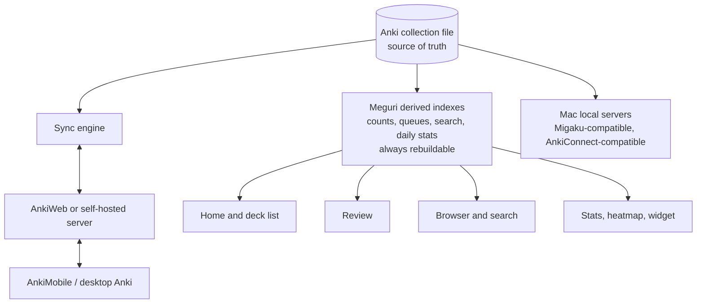

# Meguri - Plan

## Goal Capsule

- **Objective:** Antoine studies every day on Mac, iPhone, iPad and foldable iPhone with an app that does everything he relies on Anki for, looks and behaves like a first-party Apple app, never makes him wait (the next card is on screen the moment he answers), and keeps his Anki collection and sync history fully intact and interoperable.
- **Means:** Meguri, a native SwiftUI app on a newly written Rust core that reads and writes Anki collections, schedules with FSRS through fsrs-rs, and syncs with AnkiWeb and self-hosted Anki sync servers.
- **Product authority:** Antoine (sole user and decision-maker). Anki's observable behavior is the reference for everything in scope unless a requirement marks a deliberate deviation. Out-of-scope Anki features are listed under Scope Boundaries and their data is preserved, not supported.
- **Open blockers:** None for planning. AnkiWeb permission for a public App Store build and the foldable-iPhone simulator (expected with Xcode 27.1) are tracked under Dependencies and do not block planning or personal builds.

---

## Product Contract

### Summary

Meguri is a single-window native app for macOS 27, iOS 27, iPadOS 27 and the foldable iPhone that replaces Anki desktop and AnkiMobile for one learner. It keeps Anki's structure and vocabulary, works on real Anki collections and sync, schedules only with FSRS (parameters fully automatic), and is built for instant response. On the Mac it also stands in for the Migaku add-on and AnkiConnect so existing card-creation tools keep working.

### Problem Frame

Antoine has studied every single day for more than a year: about 410 reviews a day across Japanese, Spanish, German, French and English decks, mostly on AnkiMobile, with desktop Anki for card creation and maintenance. His collection is mid-sized by Anki standards (14,418 cards, 12,533 notes, 115,764 reviews, 28.8k media files, 1.4 GB), yet answering a card takes roughly 200–500 ms before the next one appears, and the desktop app has become crash-prone and slow.

Research into his setup located the costs. Anki rebuilds derived state (deck counts, queues, browser rows, stats) after almost every change and builds each card's web page only after the answer. The Migaku add-on rewrites six large note types and recopies about 5 MB of fonts on every launch, which re-uploads them on every sync. Media churn left 19k deletion records and 536 MB in the media trash. The Review Heatmap add-on rescans all reviews on every screen. AnkiMobile adds a deliberate "double-tap prevention" delay between cards. The interface itself is dated: dialogs and windows everywhere, overwhelming deck options, and features like the heatmap that only exist through add-ons.

Anki's own code cannot simply be reused: it is AGPL-3.0, which conflicts with App Store distribution, and there is a real chance Meguri is published there later. AnkiWeb's terms also restrict third-party clients, so public builds need either Ankitects' permission or self-hosted sync.

### Key Decisions

- **Clean reimplementation; no Anki code in Meguri.** Behavior, formats, protocols and constants are specified from research and verified against real Anki; no AGPL code is copied or translated. (session-settled: user-directed — chosen over building on Anki's own Rust engine (rslib, AGPL-3.0): a public App Store release must stay possible.) Governs R2021, R1960, R1881, R1801.
- **Rust core, native SwiftUI interface.** One newly written Rust engine shared by every platform, with every screen built in SwiftUI (AppKit/UIKit only where SwiftUI falls short) using Apple's own stack. (session-settled: user-approved — chosen over Rust everywhere and Swift everywhere: native Apple behavior plus a headless, Docker-testable engine.) Governs R15.
- **FSRS only, through fsrs-rs at Anki's exact version.** No SM-2 or legacy scheduler; collections with FSRS off are switched to FSRS; FSRS upgrades follow Anki releases only. (session-settled: user-directed — chosen over keeping SM-2 for migrating users: Meguri is for one user who already uses FSRS.) Governs R646, R702, R2022.
- **FSRS parameters are automatic; desired retention stays visible.** Parameters are re-optimized in the background, adopted only when they fit better, and never shown; refreshing memory states never mass-reschedules. (session-settled: user-directed — chosen over Anki's manual parameter and Optimize controls: nobody should have to think about parameters.) Governs R691, R692, R736.
- **Sync with AnkiWeb and self-hosted servers; AnkiWeb behind a build switch; honest identity.** One protocol implementation serves both; App Store builds offer AnkiWeb only with Ankitects' permission; Meguri never impersonates an official client, and automated tests never touch AnkiWeb. (session-settled: user-approved — chosen over AnkiWeb-only and self-hosted-only: build as if permitted, ship publicly only what is permitted.) Governs R1497, R1509, R2031.
- **The Anki collection is the single source of truth.** Meguri's speed comes from derived indexes kept alongside it that can always be deleted and rebuilt; data for features Meguri does not offer is preserved, never dropped. Governs R1488, R1483, R1484, R1466.
- **Full replacement on the Mac includes Migaku- and AnkiConnect-compatible servers.** Meguri receives Migaku cards itself and routes them by language automatically; HyperTTS, Kanji Grid and the Migaku add-on are not carried over. (session-settled: user-directed — chosen over keeping desktop Anki around for add-on jobs: Meguri fully replaces Anki.) Governs R1663, R1710.
- **Close to Anki's structure, in one window.** Anki's screens and vocabulary stay recognizable, with selective changes; every feature opens inside the single main window. (session-settled: user-directed — chosen over a from-scratch redesign: closer to Anki, minimal where possible, dense where needed.) Governs R6.
- **Every feature on every device.** iPhone, iPad, Mac and foldable iPhone all get the browser, editor, note type and template editor, deck options, stats, import/export and image occlusion editor, with layouts chosen by window width. (session-settled: user-approved — chosen over an iPhone limited to daily-use features: no "can't do that here" moments.) Governs R2, R6.
- **Deck selection versus starting a review.** iPhone: tapping a deck starts reviewing immediately. Mac and iPad: a click opens the deck page; double-click or Return starts reviewing. Decks are never mixed in one session. (session-settled: user-directed — chosen over click-to-review in the sidebar: selecting should not start a session.) Governs R74.
- **Review screen: progress bar, four labeled buttons, visible back button, invisible tap zones.** No remaining counts; Again/Hard/Good/Easy each show their next interval after reveal; an always-visible back button undoes the last answer; left/right halves answer Again/Good and tint only while pressed. (session-settled: user-directed — chosen over counts, two-button and visible-zone variants.) Governs R333, R365, R402, R627.
- **Deck options: essentials first, everything else under Advanced.** Anki's names and options are kept; only FSRS parameter controls disappear. (session-settled: user-directed — chosen over a Settings-style list of all Anki sections.) Governs R736.
- **Heatmap and streaks follow the Review Heatmap add-on; the widget shows only heatmap and streak data.** What Antoine sees today stays the same, and the add-on's synced settings are honored. (session-settled: user-approved — chosen over Anki's stats-screen day rule; widget scope chosen by the user.) Governs R1270, R312.
- **On the review path, the instant next card outranks Anki's single-page script timing.** The next card's question runs in a second alternating page before the answer, while both sides of a card share one page and every rendered card must still match the oracle; answer-side scripts run at reveal within a 50 ms budget. Governs R445, R465, R468, R347, R1807, R1808.
- **Meguri is licensed under MPL-2.0.** Changes to Meguri's own files stay open while the App Store remains possible. (session-settled: user-directed — chosen over Apache-2.0 and AGPL-3.0 with a contributor agreement: the middle ground.) Governs R155, R2025.
- **Sync stays close to live during review.** About every 60 seconds and on leaving the app, holding back only the newest answer so the back button keeps working. (session-settled: user-directed — chosen over deferring all syncs until the session ends: other devices stay current.) Governs R88, R365, R726, R1520.
- **Search ignores letter case for every alphabet.** `über` finds "Über" in plain and field searches, unlike Anki's ASCII-only folding; AnkiConnect searches follow the same rule. (session-settled: user-directed — chosen over matching Anki's ASCII-only case folding: a German and Spanish learner expects accented capitals to match.) Governs R1036, R1085, R1777, R1916.
- **Real Anki is the test oracle; Anki's tests become neutral scenarios.** Expected results always come from running the pinned Anki release headless in Docker, never from copied assertions, and the oracle never ships. (session-settled: user-approved — chosen over copying Anki's test code: keeps parity proof without AGPL code.) Governs R1868, R1869, R1878, R1879.

### Actors

- A1. Antoine: the learner and only user; reviews daily on iPhone, adds and maintains cards mostly on Mac.
- A2. Meguri app: one product on Mac, iPhone, iPad and foldable iPhone, sharing one core.
- A3. Sync server: AnkiWeb (personal builds, and public builds only with permission) or a self-hosted Anki sync server; also the channel through which other Anki clients exchange changes.
- A4. Other Anki clients: AnkiMobile and desktop Anki, still in use during the transition and syncing to the same account.
- A5. Migaku browser extension: sends new cards (fields, audio, images) to the local Migaku-compatible server on the Mac; it does not query word statuses.
- A6. AnkiConnect clients: Claude Code sessions and Antoine's scripts calling the local AnkiConnect-compatible server on the Mac.
- A7. Test oracle: real Anki run headless in Docker during development only; never shipped.
- A8. Build and verification agents: the AI agents that implement Meguri and verify it by building, running, screenshotting and measuring it.

### Requirements

#### App shell, navigation, home and settings

**Platforms, scenes and windows**
- R1. Meguri ships one app target per platform family: macOS 27 (Apple silicon only), iOS 27 and iPadOS 27, including the foldable iPhone; no older OS is supported.
- R2. Every screen picks its layout from the current window width (size class), not from the device type: compact width uses the iPhone layout (tab bar), regular width uses the sidebar layout.
- R3. The iPhone layout applies to iPhone, the folded foldable iPhone, and any iPad window narrow enough to be compact (Slide Over, narrow Split View, small Stage Manager window).
- R4. The sidebar layout applies to Mac, iPad at regular width, and the unfolded foldable iPhone.
- R5. Switching between layouts at runtime (fold/unfold, window resize, rotation, Split View change) preserves the current section, the selected deck, scroll positions, any unsaved editor text, and an in-progress review (same card, same revealed state).
- R6. The Mac app has exactly one main window; every feature (browser, editor, deck options, stats, note types, settings, import/export, image occlusion editor) opens inside it as a pane, sheet, inspector or popover, never as a separate window.
- R7. On iPad, Meguri supports one scene; the window is fully resizable (Stage Manager, Split View, Slide Over, external display) and every screen works at every allowed size (deviation: AnkiMobile has no multi-window story either, but Meguri does not offer "New Window").
- R8. iPhone supports portrait and landscape everywhere, including review, and supports iOS 27 resizable iPhone app windows.
- R9. On the foldable iPhone, no interactive control is placed in the fold's reserved region; card content may span the fold, and two-column layouts split at the fold.
- R10. On the foldable iPhone's outer display, tab bars and toolbars follow the system placement (side bars on the outer display) without custom overrides.
- R11. Closing the Mac window keeps Meguri running only while a Migaku or AnkiConnect integration is enabled (R1667); otherwise closing the last window quits, ⌘Q always quits, and clicking the Dock icon or choosing Window > Meguri reopens the window while it runs.
- R12. The Mac window restores its size, position, sidebar width, sidebar visibility and selected section on relaunch; full-screen mode is supported.
- R13. On relaunch, the app restores the last section and selected deck but never resumes in the middle of a review; it opens on that deck's page (sidebar layout) or Home (iPhone layout).
- R14. When the app moves to the background on iOS/iPadOS, Meguri commits pending writes and releases database file locks before suspension, so the system never terminates it for holding a lock in the shared container.
- R15. No user-visible navigation, transition or tap waits on the database, the network or the Rust core on the main thread; Home renders immediately from the last computed state and updates in place when fresh counts arrive.
- R16. Cold launch to an interactive Home meets R1818 (at most 500 ms at p95) and warm launch takes at most 300 ms, on current hardware with a 150,000-card collection.

**Navigation structure**
- R17. In the sidebar layout, the sidebar has a top group of sections — Home, Browse, Stats, Note Types, Settings — followed by a "Decks" group containing the full deck tree.
- R18. In the iPhone layout, a bottom tab bar has four tabs: Decks (Home), Browse, Stats, Settings; Note Types is reached from Settings and from the Browse ⋯ menu.
- R19. Each tab or section keeps its own navigation stack; reselecting the active tab pops it to its root, and a second reselect scrolls to top.
- R20. The sidebar can be hidden and shown (toolbar button, ⌃⌘S, edge swipe on iPad); its visibility is remembered per device.
- R21. When a review starts in the sidebar layout, the review fills the detail area and the sidebar collapses automatically; it is restored when the review ends, and the user can reveal it during review.
- R22. Selecting another deck or section in the sidebar during a review ends the review session immediately (answers are already saved) and navigates there without a confirmation.
- R23. In the iPhone layout, review is presented full screen above the tab bar; the tab bar is hidden for the whole session.
- R24. A global Add action is always reachable outside review: a toolbar "+" on Home, Browse and the deck page (all layouts), the File menu on Mac, and the review ⋯ menu.
- R25. Add opens in-window (a sheet on iPhone/iPad, an attached sheet or panel on Mac) over the current screen, and closing it returns to exactly that screen.
- R26. A "Go to Deck" quick switcher (Anki's Study Deck) opens with `/` or ⇧⌘O and filters decks by space-separated terms that must all match parts of the full deck name (e.g. "ja 1" matches "Japanese::Lesson1"), case-insensitively.
- R27. In Go to Deck, Return opens the highlighted deck's page (sidebar layout) or starts its review (iPhone layout), and a "Create deck named '<query>'" row creates a deck when no exact match exists.

**Home and deck list**
- R28. In the iPhone layout, Home shows, top to bottom: the deck tree, the "Studied today" line, the activity heatmap, then the four streak stats.
- R29. In the sidebar layout, Home's detail area shows the deck table and the activity panel (studied-today line, heatmap, streak stats) side by side; below a width threshold the activity panel moves under the deck table.
- R30. The deck tree shows every deck as a row with its last name component, indented by depth, and New, Learn and Due counts in three right-aligned columns with headers on Mac/iPad.
- R31. Count values come from the scheduler's deck-tree counts (v3 semantics: children summed, then the deck's limits applied, parent limits capping children), so they match Anki desktop for the same collection and moment.
- R32. Count colours follow Anki's state colours — New blue, Learn red, Due green — with zero counts shown dimmed, and each colour meets a 4.5:1 contrast ratio in light, dark and Increase Contrast modes.
- R33. The sidebar deck tree shows the same three counts in compact form (non-zero values only) so the user can see what is due without opening Home.
- R34. Sibling decks are sorted by full name with Anki's case-insensitive Unicode comparison, so numeric prefixes ("4.", "5.", "9.") and emoji names order exactly as in Anki.
- R35. Deck names display emoji, CJK and right-to-left text correctly, show any HTML literally (never interpreted), truncate long names with an ellipsis, and expose the full name in a tooltip (Mac) and to VoiceOver.
- R36. Parent decks have a disclosure control; collapsing or expanding toggles the deck's `study_collapsed` flag (stored on the deck, synced) and keeps the scroll position.
- R37. The Home tree and the sidebar tree share `study_collapsed`; the browser sidebar's `browser_collapsed` flag is never changed by Home.
- R38. ⌥-clicking a disclosure control (or ⌥← / ⌥→) collapses or expands that deck and all its descendants.
- R39. The Default deck (id 1) is hidden from the tree when it has no cards and no child decks, unless it is the only deck in the collection.
- R40. The current deck (`curDeck`) is highlighted in the tree.
- R41. Opening a deck page or starting a review sets `curDeck` to that deck and `activeDecks` to the deck plus its descendants, writing only when the value actually changes.
- R42. Selecting a deck is not recorded as an undo step (deviation: Anki records "Select Deck" as an undoable op, which buries the user's meaningful undo).
- R43. Below the tree, Home shows "Studied N cards in X minutes today (Y s/card)", counting revlog entries since the start of the current Anki day excluding Manual (type 4) and Rescheduled (type 5) entries, including reviews of since-deleted cards, with the time unit capped at minutes.
- R44. When nothing has been studied today, the line reads "No cards studied today" instead of a zero sentence.
- R45. Deck counts and the studied-today line refresh after every collection change (answer, undo, redo, edit, sync, import, deck or preset change), when the app returns to the foreground, at the day rollover, and when the next learning card becomes due while Home is visible.
- R46. Every deck row has a ⋯ button (shown on hover on Mac) and the same items in its context menu (right-click on Mac, long-press on iPhone/iPad).
- R47. The per-deck menu contains, in this order: Study, Overview, Add Note, Browse, Stats, Deck Options, Rename, New Subdeck, Description, Export, Unbury (only when the deck subtree has buried cards), and Delete (separated, destructive style).
- R48. "Add Note" from a deck menu opens Add with that deck preselected regardless of the "default deck" preference; "Browse" opens Browse with the search `deck:"<full name>"`; "Stats" opens Stats scoped to that deck.
- R49. On iPhone, swiping a deck row reveals Options and More only, never Delete (deviation: AnkiMobile shows Delete first on swipe).
- R50. Home has a bottom-of-list "Create Deck" and "Import File" pair of actions on all layouts, plus "Get Decks" (opens the AnkiWeb shared-deck page in the default browser) only in builds where AnkiWeb is enabled.
- R51. Dropping an `.apkg` (or any file type the import area accepts) onto the Mac window, the Dock icon, the iPad window or the deck list starts the import flow; unsupported files show a short message naming the accepted types.
- R52. Opening a supported file from Finder, Files, Mail or the share sheet ("Open in Meguri") starts the import flow over the current screen; if a review is in progress, the review stays underneath and resumes on the same card after the import sheet closes.
- R53. Filtered decks present in a synced collection appear in the tree in a distinct style with their counts, but cannot be studied; tapping one explains that filtered decks are not supported yet, and its menu offers only Rename and Delete.
- R54. Deleting a filtered deck returns its cards to their home decks and deletes no cards, as in Anki.

**Creating, renaming, reparenting and deleting decks**
- R55. Create Deck asks for a name; `::` in the name creates a nested deck, and missing parent decks are created automatically.
- R56. Deck names are normalized per component exactly as Anki: Unicode NFC, ASCII control characters removed, whitespace and `:` trimmed from each component, and an empty component becomes "blank".
- R57. Deck-name matching is case-insensitive: creating a deck whose name matches an existing deck (ignoring case) opens the existing deck instead of creating a duplicate, and a new child adopts the existing parent's capitalization.
- R58. An empty or whitespace-only name disables the Create/Rename confirm button.
- R59. "New Subdeck" in a deck menu pre-fills the name field with `<full parent name>::` and places the cursor at the end.
- R60. Rename pre-fills the full `A::B::C` name, so typing a different path moves the deck; renaming a parent renames all its descendants in one undoable step.
- R61. When a rename or reparent produces a name that already exists, Meguri appends "+" until the name is unique, exactly as Anki does, and tells the user the final name.
- R62. A deck cannot be renamed or moved under one of its own descendants, and nothing can be nested under a filtered deck; the action is refused with a short explanation.
- R63. Decks can be reparented by drag and drop in the Home tree and the sidebar tree on all platforms: dropping onto a deck makes the dragged deck its child, and dropping onto the "Decks" header or the top drop zone makes it top-level.
- R64. Reparenting keeps the dragged deck's last name component and all its children, and shows a toast "N decks moved" with Undo.
- R65. Several selected decks can be reparented in one drag on Mac/iPad (multi-selection with ⌘/⇧ click).
- R66. Delete removes the deck, all descendant decks and all their cards in one undoable step, then shows a toast "Deleted <deck> (N cards)" with Undo.
- R67. When the deck subtree contains at least one card, Delete first asks for confirmation stating the deck count and card count (deviation: modern Anki desktop deletes without asking and relies on undo).
- R68. Deleting the Default deck removes its cards and children but keeps the Default deck itself, resetting its name to "Default", as Anki does.
- R69. Every deck operation (create, rename, reparent, delete, description edit, collapse) writes standard Anki deck records and graves so that Anki desktop, AnkiMobile and AnkiDroid see the same result after sync.

**Deck page (overview) and deck description**
- R70. The deck page shows the full deck path as a breadcrumb title, the deck's description, the New / Learning / To Review counts, a prominent Study button, a Deck Options button, the deck-scoped heatmap with its four streak stats, and links to Browse and Stats for the deck.
- R71. When the scheduler's queue counts differ from the tree counts because of burying, each affected count shows a dimmed "+N" with an explanation tooltip or popover.
- R72. An Unbury button appears only when the deck subtree has buried cards; when both manually buried and sibling-buried cards exist it offers "Manually buried cards", "Buried siblings" and "All buried cards".
- R73. The Study button is the default action: Return or Space on Mac/iPad keyboards, and a tap anywhere on the button.
- R74. In the sidebar layout, a single click on a deck (sidebar or Home table) opens its deck page; a double-click, Return on a selected deck, or the S key starts its review directly.
- R75. In the iPhone layout, tapping a deck row starts its review immediately; the deck page is reached from the row's menu ("Overview").
- R76. Studying a deck includes all its subdecks under Anki's limit rules; there is no collection-wide "review all due" entry point anywhere in Meguri.
- R77. When the user starts a deck that has nothing to study now, no review opens; instead the deck page (or a sheet on iPhone) shows the finished state.
- R78. The finished state says the deck is done for now and adds, when applicable: the time until the next learning card is ready, the number of learning cards due later today, a note that today's review limit was reached while reviews remain (with a link to Deck Options), a note that the new-card limit was reached while new cards remain (with a link), a note that cards were buried with an unbury link, and the deck description.
- R79. When a learning card becomes due while the finished state is visible, the page switches back to the normal deck page with an enabled Study button (it does not start review by itself).
- R80. An empty deck (no cards in its subtree) shows "This deck is empty" with Add Note (deck preselected) and Import File, instead of the finished state.
- R81. The deck description is edited from the deck menu or the deck page as plain text, with a "Markdown" toggle that sets the deck's `md` flag.
- R82. Descriptions render on the deck page and the finished state: Markdown when `md` is set, otherwise as sanitized HTML (no scripts, no event handlers, no forms, no remote content that can alter the page).
- R83. Links in descriptions open in the default browser after the user taps them; no link can navigate or modify the deck page itself.
- R84. An unedited description is preserved byte for byte, including the user's empty Markdown flag (e.g. "9. Kaishi 1.5k" has `md` set with an empty description).

**Review session lifecycle (shell-owned parts)**
- R85. Closing a review (✕, Esc, or navigating away) needs no confirmation and loses nothing, because each answer is saved when given.
- R86. The timebox uses the collection's `timeLim` (seconds; 0 = off): after the answer that crosses the limit, Meguri shows "N cards studied in M minutes" with Continue (restarts the timer) and Finish (opens the session summary).
- R87. At the day rollover during a review, the session continues with a rebuilt queue for the new day and the streak/heatmap move to the new day, without interrupting the current card.
- R88. During an active review session Meguri syncs incrementally about every 60 seconds and immediately when the app leaves the foreground, always holding the most recent answer back from the upload so the back button can still undo it (R365).
- R89. The Sync command is disabled during an active review session, with a tooltip explaining that sync runs when the session ends (deviation: Anki allows syncing from the reviewer and resets to the deck list).
- R90. Pressing D (Home), B (Browse) or T (Stats) during review ends the session and navigates; A (Add) opens Add over the review without ending it.

**End-of-session summary**
- R91. A session summary appears when the queue runs out, when the user chooses Finish on the timebox prompt, or when the user closes a review with ✕ or Esc after answering at least one card; when a session ends through a sidebar selection, D/B/T or starting another deck, the navigation proceeds with no summary and the persisted session record (R441) stays reachable from the deck page until the next session.
- R92. The summary shows: cards studied (answers) and time spent this session, counts per button (Again / Hard / Good / Easy), the share of answers that were not Again, and how many new cards were introduced.
- R93. The summary shows what comes next for the deck: remaining cards today (when the session was closed early, with a Continue button), the time until the next learning card, or "Finished for today" with tomorrow's due count for this deck.
- R94. The summary repeats the limit-reached and buried notes of the finished state when they apply.
- R95. The summary shows the current streak and marks when this session made today an active day.
- R96. The summary lists every card answered Again at least once in this session ("missed cards"), in first-miss order, each with a plain-text excerpt of its question, its deck, and how many times it was missed.
- R97. Tapping a missed card opens a read-only preview of both sides (full renderer, audio playable) that never changes scheduling; the preview offers Edit Note, Flag, Mark and Card Info.
- R98. "Browse missed cards" opens Browse with a search that matches exactly the missed cards (`cid:` list).
- R99. Undo from the summary (button or ⌘Z) reverts the last answer, reopens the review on that card, and updates the summary data.
- R100. Session statistics exclude answers that were undone, and the summary is kept only in memory until it is dismissed.
- R101. The summary is dismissed with Done, Return, Esc, or a tap on ✕, and returns to the screen from which the review started.

**Toolbar actions and sync status**
- R102. A Sync button sits in the main toolbar (sidebar layout) and in the Decks tab's navigation bar (iPhone layout) and is hidden only when no sync account is configured, replaced by "Log In".
- R103. The Sync button shows distinct states: up to date; local or remote changes waiting (normal sync); one-way (full) sync required; syncing (with progress); and needs attention (error or login expired), each with a text label for accessibility.
- R104. The one-way-sync-required state uses a warning colour (Anki: red) and the normal-changes state an accent colour (Anki: blue), and the button never relies on colour alone.
- R105. Clicking the Sync button starts a sync; while a sync runs, clicking it shows a popover with the stage (collection, media), files remaining for media, last successful sync time, and the last error if any.
- R106. Media sync progress is shown as a quiet secondary indicator ("Syncing media, N files left") that never blocks studying, browsing or editing.
- R107. The button's "remote changes waiting" state is refreshed when the app comes to the foreground and at most every 10 minutes while online, never on every screen change.
- R108. The undo-capable toast (operation name + Undo) appears after every destructive or bulk operation outside review, lasts at least 5 seconds, never covers the answer buttons, and is reachable by VoiceOver.

**Settings — structure and storage rules**
- R109. Settings is a section in the sidebar layout (Mac included; ⌘, selects it) and a tab in the iPhone layout, organised into pages: Account & Sync, Review, Editing, Browsing, Appearance, Heatmap, Backups, Maintenance, Integrations (Mac only), About.
- R110. Settings on Mac lives in the main window (deviation: macOS convention is a separate Settings window; the brief requires one window).
- R111. A search field at the top of Settings filters settings by name and keywords across all pages.
- R112. Each setting is stored in exactly one of four places, shown here per setting: collection config (synced, so it changes every device), device-local preferences (this device only), the Keychain (credentials), or a deck/preset record (owned by the deck options area).
- R113. Every synced setting is marked with a "Synced" globe badge and a footnote "Applies on all devices that sync this collection".
- R114. Changing a setting writes only when the value differs, so opening and closing Settings never marks the collection modified or creates a pending sync.
- R115. Settings changes take effect immediately (no Save button) and are not undo steps.
- R116. Collection config keys that Meguri does not show (including add-on keys and keys of out-of-scope features) are preserved unchanged.

**Settings — Account & Sync**
- R117. Log In / Log Out for AnkiWeb appears only in builds where AnkiWeb is enabled; the account row shows the user name and the server in use.
- R118. "Self-hosted sync server" accepts a custom URL (with an optional path prefix) and is available in every build.
- R119. Login exchanges the user name and password for a sync key; the password is never stored, and the key and user name are kept in the Keychain (device-local, not synced through iCloud Keychain).
- R120. Changing the sync server URL logs the user out and requires a new login, so a key issued by one server is never sent to another.
- R121. After a successful first login, Meguri offers to sync now.
- R122. "Sync audio and images" (device-local, default on) controls media sync.
- R123. "Sync automatically" (device-local, default on) syncs on launch, on returning to the foreground after at least 5 minutes away, and when the app goes to the background or quits (Anki: sync on profile open/close).
- R124. "Sync media periodically" (device-local, default every 15 minutes, 0 = off) runs a background media sync while the app is open (Anki: `autoSyncMediaMinutes`).
- R125. "Force a one-way sync on next sync" (collection-level change) marks the collection so the next sync asks the user to choose upload or download, with the same confirmation as Anki.
- R126. "Network timeout" (device-local, default 60 seconds) applies to every sync request.
- R127. On Mac, quitting with automatic sync on and local changes pending runs the sync with a small progress sheet offering "Quit Without Syncing"; on iOS the background sync runs within the system's background-task time.

**Settings — Review**
- R128. "Next day starts at" (collection `rollover`, hour 0–23, default 4) sets the daily rollover used by scheduling, counts, studied-today, heatmap and widgets.
- R129. "Learn ahead limit" (collection `collapseTime`, stored in seconds, shown in minutes, default 20) controls how far ahead learning cards may be shown when nothing else is due.
- R130. "Timebox time limit" (collection `timeLim`, stored in seconds, shown in minutes, default 0 = off) drives the timebox prompt.
- R131. "Show next review time above answer buttons" (collection `estTimes`, default on) shows or hides the interval label on Again/Hard/Good/Easy.
- R132. "Show progress bar during review" (device-local, default on) toggles Meguri's thin progress bar; the collection's `dueCounts` key is preserved but not used (deviation: Meguri never shows remaining counts in review).
- R133. "Show play buttons on cards with audio" (collection `hideAudioPlayButtons`, inverted, default shown) and "Interrupt current audio when answering" (collection `interruptAudioWhenAnswering`, default on) are listed here; their behaviour is owned by the review area.
- R134. "Space and Return answer Good" (device-local, default on) lets Space/Return grade Good on the answer side of a hardware keyboard.
- R135. "Answer keys" (device-local, default 1 2 3 4) lets the user rebind the four answer keys to any single non-modifier key, rejecting keys already used by another review shortcut.
- R136. "Play card audio in Silent Mode" (iPhone/iPad, device-local, default on) and "Lower other audio during card audio" (device-local, default on) control the audio session, matching AnkiMobile's Ignore Mute and Duck options.
- R137. "Open card links in" (device-local: in-app browser, default, or default browser) and "Allowed link schemes" (device-local list of non-web URL schemes that cards may open after a one-time confirmation) are listed here; enforcement is owned by the review area.

**Settings — Editing and Browsing**
- R138. "Paste clipboard images as PNG" (collection `pasteImagesAsPng`, default off).
- R139. "Paste strips formatting" (collection `pasteStripsFormatting`, default off); the opposite behaviour is always available as Paste and Match Style (⌥⇧⌘V) or Paste with Formatting from the edit menu, replacing Anki's Shift-modified paste.
- R140. "Default deck when adding" (collection `addToCur`, default "current deck"; alternative "depends on note type") with its behaviour owned by the editor area.
- R141. "Default search text" (collection `defaultSearchText`, default empty) and "Ignore accents in search" (collection `ignoreAccentsInSearch`, default off) are listed under Browsing.

**Settings — Appearance**
- R142. Light and dark appearance always follow the system and switch live, including the card currently on screen, without losing scroll position or revealed state (deviation: no in-app Light/Dark override, unlike Anki's Theme option).
- R143. "Card zoom" (device-local, default 100 %, range 50–300 %) scales card content in review, preview and the editor preview, and is also controlled by ⌘+ / ⌘− / ⌘0.
- R144. There is no in-app Reduce Motion, UI scale, minimalist mode, hide-bars or video-driver option; Meguri follows the system settings instead (deviation: Anki's own toggles are dropped).
- R145. The interface language follows the system's per-app language setting; Meguri has no in-app language picker.

**Settings — Heatmap**
- R146. Heatmap colour theme (lime, olive, ice, magenta, flame; default lime), calendar mode (year overview, default; or continuous timeline), history limit (days, 0 = none), forecast limit (days, 0 = none), "ignore data before" date, "exclude deleted cards from history" (default off), "exclude manual reschedules from history" (default on) and "decks excluded from the Home heatmap" are stored in the collection config key `heatmap`, in the Review Heatmap add-on's format.
- R147. Meguri reads the `heatmap` key on open and after every sync, writes changed values back in the same format, and preserves any sub-keys it does not understand (including `version`).
- R148. "Show heatmap on Home", "Show heatmap on deck page" and "Show streak stats even when the heatmap is hidden" are device-local toggles (default on, on, off).
- R149. "First day of week" for the heatmap uses the collection's `firstDayOfWeek` (shared with the Stats calendar; default Sunday) (deviation: the add-on always starts weeks on Monday).

**Settings — Backups, Maintenance, Integrations, About**
- R150. Backups shows the collection's `backups` settings (synced): minutes between backups (default 30), daily (default 12), weekly (default 10) and monthly (default 9) backups to keep, plus a note that media files are not included.
- R151. Backups offers "Back Up Now", "Restore from Backup…" (list of backups with date and size), and "Show Backups" (Finder on Mac; the Files app location on iPhone/iPad).
- R152. Maintenance offers Check Database, Check Media and Empty Cards on every platform, each running in the background with progress and showing its report when done.
- R153. Integrations (Mac only) lists the Migaku integration toggle (device-local, default off; loopback port 44432) with access to its "Recently received" list, and the AnkiConnect-compatible server toggle (device-local, default off; loopback port 8765); behaviour is owned by the integrations area.
- R154. Integrations shows each server's live status (running, port in use by another app, stopped) in plain words.
- R155. About shows the version and build number, collection statistics (cards, notes, decks, note types, media file count and size), Meguri's own MPL-2.0 license, acknowledgements and licences of bundled components (including fsrs-rs, BSD-3-Clause), a help link, and Copy Debug Info.
- R156. The app name, icon, subtitle and every screen avoid the word "Anki" as a product name; compatibility is stated only as plain facts (e.g. "Syncs with Anki sync servers", "Opens .apkg files").

**First launch and onboarding**
- R157. With no collection on the device, Meguri shows a welcome screen with: "Log In to AnkiWeb" (only when AnkiWeb is enabled in the build), "Use a Sync Server" (custom URL + credentials), "Import a File" (.apkg and the file types the import area accepts), and "Start Empty".
- R158. When the local collection is empty and the server has a collection, the first sync downloads it without the upload/download conflict prompt, as Anki does.
- R159. After the first download or import, Meguri confirms what arrived in one line (e.g. "12,533 notes · 22 decks · 115,764 reviews") and opens Home.
- R160. Studying, browsing and editing work while the first media download continues in the background; cards whose media has not arrived yet show a placeholder instead of an error.
- R161. "Start Empty" creates a new collection containing only the Default deck and Anki's stock note types, and Home shows an empty state with Add Note, Create Deck, Import File and Log In.
- R162. One-time tips (each shown at most once, dismissible, never during the first card of a review) explain: `::` for subdecks when creating a deck, double-click/Return to study in the sidebar layout, and the review tap zones on the first answer side on iPhone/iPad.
- R163. There are no other onboarding pop-ups, tutorials or sample decks.

**Empty, error and status communication**
- R164. Every list or chart has an explicit empty state with one sentence and, where it helps, one action (e.g. Browse with no results: "No cards match" + "Clear Search"; heatmap without reviews: "No reviews yet").
- R165. Errors are sorted into three kinds: transient (network down, server busy) shown as a non-blocking banner or status glyph with Retry; actionable (login expired, one-way sync needed, storage full, client or server version mismatch, collection too large for AnkiWeb's limit) shown as an alert that names the next step; and blocking (collection cannot be opened) shown as a full-screen error.
- R166. Failures of automatic, background work (auto sync, periodic media sync, backups) never interrupt the user; they switch the relevant status glyph to "needs attention" and keep the details for the popover.
- R167. Every error alert has a Copy Debug Info action that copies app version, OS, device model, collection size figures and the recent error log, never credentials or card content.
- R168. Messages sent by the sync server are shown as sanitized rich text (links allowed, no scripts).
- R169. If the collection cannot be opened (corrupt file, newer schema than supported, disk full), the blocking error offers Check Database, Restore from Backup and (when an account exists) Download from Server, in that order.
- R170. Long operations (check database, check media, empty cards, import, export, backup, restore, one-way sync, background FSRS optimization) report progress in a non-modal activity indicator, keep the rest of the UI usable, and offer Cancel whenever stopping is safe.
- R171. Only one collection-wide exclusive operation (one-way sync, restore, check database, import) runs at a time; starting a second one explains which operation is running instead of queuing silently.
- R172. Crash and hang diagnostics are collected only through the system's on-device mechanisms (MetricKit/OSLog) and are never sent anywhere without the user's action.

**Undo and redo (shell-owned parts)**
- R173. The Edit menu (Mac and iPad menu bar) shows "Undo <operation name>" and "Redo <operation name>" for the last collection operation, disabled with plain "Undo"/"Redo" when nothing is available.
- R174. When a text field has focus, ⌘Z / ⇧⌘Z apply to the text field; otherwise they apply to the collection's undo stack.
- R175. On iPhone/iPad, the system three-finger undo/redo gestures apply to the collection's undo stack when no text field has focus.

**Appearance, Liquid Glass and visual system**
- R176. Navigation chrome (tab bar, toolbars, sidebar, menus, sheets) uses the system Liquid Glass materials with no custom tinting beyond the app accent colour.
- R177. Card content, the deck list rows, the heatmap and the summary content are never placed on glass; glass is used only for controls layered above content.
- R178. All screens remain legible at both ends of the system glass transparency slider and with Reduce Transparency and Increase Contrast on.
- R179. Icons use SF Symbols; the app icon is a layered icon with default, dark, clear and tinted appearances and contains no text.
- R180. Animations use system springs and are skipped or replaced by short crossfades when Reduce Motion is on.

**Accessibility**
- R181. Every interactive control has an accessibility label, a value where meaningful, a hint where the action is not obvious, and a stable accessibility identifier for UI tests.
- R182. A deck row reads as one element: name, depth or parent, New/Learn/Due counts with their names, and collapsed/expanded state, with custom actions for Study, Overview, Options, Rename, Delete and Collapse/Expand.
- R183. The heatmap reads as a summary ("365-day streak, 410 reviews today, daily average 221") and is navigable day by day with VoiceOver (adjustable element: date plus "N reviews" or "N cards due").
- R184. When VoiceOver, Switch Control, Voice Control or Full Keyboard Access is on, the question side of a card shows an explicit "Show Answer" button and the answer side's invisible tap zones are disabled in favour of the four answer buttons (deviation from the no-buttons question side).
- R185. Answer buttons read as "Good, 3 days" (grade then interval); Voice Control names match the visible labels ("Tap Good", "Tap Show Answer", "Tap Undo").
- R186. All app chrome supports Dynamic Type up to the largest accessibility size: rows grow and wrap instead of truncating counts, and the Large Content Viewer works for tab and toolbar items.
- R187. Bold Text, Increase Contrast, Differentiate Without Colour (counts keep their column headers or labels; sync states have distinct symbols) and Smart Invert (card images excluded from inversion) are honoured.
- R188. Touch targets are at least 44×44 pt on iPhone/iPad; Mac controls use standard system control sizes.
- R189. Focus order is logical on every screen and keyboard focus is visible; on Mac, Tab moves through all controls when Full Keyboard Access is enabled.
- R190. An automated accessibility audit of Home, deck page, review (both sides), summary, Browse, Stats and Settings reports no issues on every layout in light and dark.

**Localization readiness**
- R191. Every user-visible string lives in a String Catalog with a developer comment; no string is assembled by concatenation, and counts use plural rules ("1 card", "2 cards").
- R192. Dates, times, numbers, percentages and durations are formatted with the user's locale formatters; interval labels on buttons and in the summary are localizable.
- R193. Layouts use leading/trailing alignment so a later right-to-left or longer-string localization needs no redesign; mirroring and pseudo-localization passes are deferred until a second language ships.
- R194. Deck names, tag names, note-type names, field content and server messages are never translated or transformed.
- R195. The first release ships English only.

**Keyboard — general rules (Mac, and iPad/iPhone with a hardware keyboard)**
- R196. Every command reachable by pointer is reachable by keyboard, and every shortcut below works identically on Mac and on iPad/iPhone with a hardware keyboard unless marked.
- R197. Single-key (no modifier) shortcuts are active only when no text field has focus, and they take precedence over type-to-select in lists.
- R198. Single-key shortcuts match by character first and fall back to the physical key position, so they work with Korean, Japanese, Cyrillic and other non-Latin keyboard layouts (Anki: Korean-layout equivalents).
- R199. Holding a key never auto-repeats an answer or a destructive action.
- R200. Shortcuts that share a key in different contexts (deck list, review, browser, editor, template editor, image occlusion editor) are never enabled at the same time; an automated test lists all enabled shortcuts per context and fails on any duplicate.
- R201. On iPad, holding ⌘ shows the system shortcut overlay listing every modifier shortcut of the current context; Help > Keyboard Shortcuts (⌘/) shows the full catalog, including single-key shortcuts, on all platforms.
- R202. Where Anki uses Ctrl on Windows/Linux, Meguri uses ⌘, as Anki does on macOS, unless a row below says otherwise.

**Keyboard — global (outside text fields)**
- R203. D: Home (Anki: d).
- R204. A or ⌘N: Add Note (Anki: a).
- R205. B: Browse (Anki: b).
- R206. T: Stats (Anki: t; Shift+T legacy stats is not reproduced).
- R207. Y or ⇧⌘Y: Sync (Anki: y).
- R208. S: on a deck page start review; during review, end the session and show the deck page (Anki: s toggles overview/review).
- R209. `/` or ⇧⌘O: Go to Deck (Anki: / Study Deck).
- R210. ⌥⌘N: New Deck.
- R211. ⇧⌘N: Note Types (Anki: Ctrl+Shift+N Manage Note Types).
- R212. ⇧⌘I: Import (Anki: Ctrl+Shift+I).
- R213. ⌘E: Export (Anki: Ctrl+E).
- R214. ⌘,: Settings (Anki: Ctrl+P / Anki menu Preferences).
- R215. ⌘Z / ⇧⌘Z: Undo / Redo (Anki: Ctrl+Z / Ctrl+Shift+Z).
- R216. ⌘F: focus the current screen's search; from Home, the deck page or review it opens Browse with the search field focused.
- R217. ⌃⌘S: show/hide sidebar; ⌃⌘F: full screen (Mac).
- R218. ⌘+ / ⌘− / ⌘0: card zoom in / out / reset (Anki: Ctrl+= / Ctrl+− / Ctrl+0).
- R219. ⌘/: Keyboard Shortcuts help (Anki: F1 opens the manual).
- R220. ⌘W closes the current sheet or panel, or the window when none is open; ⌘M minimise, ⌘H hide, ⌘Q quit (Mac).

**Keyboard — deck list and deck page**
- R221. ↑ / ↓ move the selection; → expands or moves to the first child; ← collapses or moves to the parent; ⌥→ / ⌥← expand or collapse all descendants.
- R222. Return: start review of the selected deck (sidebar layout); Space on a deck page: Study (Anki: Space/Enter Study Now).
- R223. O: Deck Options for the selected or shown deck (Anki: o); also ⌥⌘O.
- R224. U on a deck page: Unbury (Anki: u).
- R225. ⇧⌘R: Rename deck; ⌘⌫: Delete deck (with the confirmation rule above).
- R226. Esc on a deck page in the iPhone layout returns to Home.

**Keyboard — review**
- R227. Space or Return: show answer; on the answer side, Space/Return grade Good when "Space and Return answer Good" is on (Anki: same, with spacebar pref).
- R228. 1 / 2 / 3 / 4: Again / Hard / Good / Easy, using the configured answer keys (Anki: 1–4, rebindable).
- R229. U or ⌘Z: undo the last answer (Anki: u / Ctrl+Z); ⇧⌘Z: redo.
- R230. E: edit the current note in the panel over the card (Anki: e).
- R231. M: open the ⋯ more menu (Anki: m).
- R232. R or F5: replay audio (Anki: r / F5); 5: pause/resume audio; 6: seek −5 s; 7: seek +5 s (Anki: 5 / 6 / 7).
- R233. ⌘1 … ⌘7: toggle flag 1–7, where pressing the active flag clears it (Anki: Ctrl+1–7).
- R234. `*`: toggle Mark note (Anki: *).
- R235. `-`: bury card; `=`: bury note (Anki: - / =).
- R236. `@`: suspend card; `!`: suspend note (Anki: @ / !).
- R237. ⇧⌘D: Set Due Date (Anki: Ctrl+Shift+D).
- R238. ⌥⌘N: Reset (Forget) card (Anki: Ctrl+Alt+N); while review or Browse is shown, File > New Deck stays available but without its shortcut.
- R239. ⌘⌫: Delete note, after confirmation (Anki: Cmd+Backspace on Mac).
- R240. ⌥⌘E: Create Copy (opens Add prefilled with this note) (Anki: Ctrl+Alt+E).
- R241. O: Deck Options of the card's deck preset, naming the deck in the title (Anki: o).
- R242. I: Card Info; ⌥⌘I: Previous Card Info (Anki: i / Ctrl+Alt+I).
- R243. Esc: close the review (with the summary rule above).
- R244. When a type-in answer field has focus, only Return (submit and reveal), Esc (leave the field) and modifier shortcuts are active.

**Keyboard — Add screen and editor**
- R245. ⌘Return: Add the note / Save the edit (Anki: Ctrl+Enter).
- R246. ⌘N inside the Add screen: choose note type; ⌘D inside the Add screen: choose deck (Anki: Ctrl+N / Ctrl+D in Add).
- R247. ⇧⌘H: Add history (Anki: Ctrl+H, Ctrl+Shift+H on Mac).
- R248. Tab / ⇧Tab: next / previous field; Tab from the last field moves to the tags.
- R249. ⌘B / ⌘I / ⌘U: bold / italic / underline; ⌘=: subscript; ⇧⌘=: superscript; ⌘R: remove formatting (Anki: same with Ctrl).
- R250. F7 or ⌃⌘C: apply last text colour; F8 or ⌃⇧⌘C: pick text colour (Anki: F7 / F8; the ⌃ variants serve keyboards without function keys).
- R251. ⇧⌘C: cloze with a new number; ⌥⇧⌘C: cloze with the same number (Anki: Ctrl+Shift+C / Ctrl+Alt+Shift+C).
- R252. F3 or ⌥⌘A: attach media file (Anki: F3); F5 or ⌥⌘R: record audio (Anki: F5).
- R253. ⌘L: Cards / templates editor for this note type (Anki: Ctrl+L).
- R254. ⇧⌘X: toggle the HTML editor for the focused field (Anki: Ctrl+Shift+X).
- R255. F9 or ⌥⌘P: toggle sticky (pin) for the focused field in the Add screen (Anki: F9).
- R256. ⇧⌘T: focus the tags field (Anki: Ctrl+Shift+T); in the tags field, ⌘A selects all tags.
- R257. ⇧⌘P: preview the card (Anki: Ctrl+Shift+P).
- R258. ⌘] / ⌘[: indent / outdent list items (Anki: Ctrl+Shift+. / ,).
- R259. Esc closes the editor panel or Add sheet, asking first only when there are unsaved changes.

**Keyboard — Browse**
- R260. ⌘F: focus search; ⇧⌘F: filter the browser sidebar (Anki: Ctrl+F / Ctrl+Shift+F).
- R261. ⇧⌘L: focus the card/note table; ⌥⌘L: focus the editor pane (Anki: Ctrl+Shift+L / Ctrl+Shift+N).
- R262. ↑ / ↓ in the table, or ⌃⌘↓ / ⌃⌘↑ from anywhere in Browse: next / previous row (deviation: Anki's Ctrl+N / Ctrl+P would collide with ⌘N Add Note).
- R263. Home / End: first / last row; ⌘A: select all rows (in the table); ⌥⌘S: invert selection (Anki: Ctrl+Alt+A / Ctrl+Alt+S).
- R264. ⌥⌘T: toggle cards/notes mode (Anki: Ctrl+Alt+T).
- R265. ⌘D: change deck; ⇧⌘M: change note type (Anki: Ctrl+D / Ctrl+Shift+M).
- R266. ⌥⌘F: Find and Replace (Anki: Ctrl+Alt+F).
- R267. ⇧⌘D: Set Due Date; ⌥⌘N: Reset (Forget) (Anki: Ctrl+Shift+D / Ctrl+Alt+N).
- R268. ⇧⌘A: add tags; ⌥⇧⌘A: remove tags (Anki: Ctrl+Shift+A / Ctrl+Alt+Shift+A).
- R269. ⌘K: toggle mark; ⌘J: toggle suspend; ⇧⌘J: toggle bury (Anki: Ctrl+K / Ctrl+J / Ctrl+Shift+J).
- R270. ⌘1 … ⌘7: toggle flags (Anki: Ctrl+1–7).
- R271. ⌘⌫: delete selected notes (Anki: Ctrl+Delete).
- R272. ⌥⌘I: toggle the card info inspector (deviation: Anki's Ctrl+Shift+I collides with ⇧⌘I Import in a single window).
- R273. ⇧⌘E: export selected notes; ⌥⌘E: create copy; ⇧⌘P: preview (Anki: Ctrl+Shift+E / Ctrl+Alt+E / Ctrl+Shift+P).
- R274. ⌘S with a search active: save the current search (saved searches).

**Keyboard — preview, templates, image occlusion**
- R275. Previewer: ← / → previous / next card; R: replay audio; B: toggle showing both sides; Esc or ⇧⌘P: close (Anki: same).
- R276. Card templates editor: ⌘1 / ⌘2 / ⌘3: front template / back template / styling; ⌥1 … ⌥9: select card type; ⌘Return or ⌘S: save (Anki: Ctrl+1/2/3, Alt+n, Ctrl+Return).
- R277. Image occlusion editor: S select, R rectangle, E ellipse, P polygon, T text, M magnify, F zoom to fit, [ / ] zoom out / in, G group, U ungroup, D duplicate, Delete remove, ⌘A select all, L toggle translucency, C fill colour, ⇧L / ⇧H / ⇧R align left / centre / right, ⇧T / ⇧V / ⇧B align top / middle / bottom, ⌘Z / ⇧⌘Z undo / redo, ⌥⇧⌘M toggle masks (Anki: same keys, Ctrl+Y redo).

**Menu bar commands (Mac, and the iPadOS menu bar)**
- R278. The same command set is exposed in the Mac menu bar and the iPadOS menu bar, with items enabled only when they apply to the current context.
- R279. Meguri menu: About Meguri, Settings… (⌘,), Services, Hide/Hide Others/Show All, Quit (⌘Q).
- R280. File menu: New Note (⌘N), New Deck… (⌥⌘N), Import… (⇧⌘I), Export… (⌘E), Export Deck… (for the selected deck), Sync (⇧⌘Y), Back Up Now, Restore from Backup…, Close (⌘W).
- R281. Edit menu: Undo <op>, Redo <op>, Cut, Copy, Paste, Paste and Match Style, Delete, Select All, Find (⌘F), Find and Replace… (Browse), plus the system Emoji & Symbols and Dictation items.
- R282. View menu: Show/Hide Sidebar, Home (D), Browse (B), Stats (T), Note Types (⇧⌘N), Zoom In / Zoom Out / Actual Size (card zoom), Enter Full Screen.
- R283. Deck menu: Study (S/Return), Go to Deck… (⇧⌘O), Deck Options… (⌥⌘O), Rename… (⇧⌘R), Description…, New Subdeck…, Unbury, Export Deck…, Delete Deck… (⌘⌫), Collapse All / Expand All.
- R284. Card menu (enabled in review, preview and Browse): Show Answer, Again, Hard, Good, Easy, Edit Note, Flag ▸ (seven named flags using the collection's flag names), Mark Note, Bury Card, Bury Note, Suspend Card, Suspend Note, Set Due Date…, Reset…, Card Info, Previous Card Info, Create Copy, Delete Note, Replay Audio, Pause Audio, Audio −5 s, Audio +5 s, Close Review.
- R285. Tools menu: Check Database, Check Media, Empty Cards…, Note Types, Migaku Recently Received (Mac, when the integration is on), Copy Debug Info.
- R286. Window menu: Minimise, Zoom, Meguri (reopens the main window), Bring All to Front.
- R287. Help menu: Search (system), Keyboard Shortcuts (⌘/), Meguri Help, Copy Debug Info.
- R288. Right-clicking a card in review opens the same items as the review ⋯ menu; right-clicking rows in the deck tree and in Browse opens their context menus.

**Activity heatmap and streak (in-app)**
- R289. One heatmap component is used on Home (whole collection minus decks excluded in heatmap settings, including their children) and on each deck page (that deck and its descendants, matched on the card's current deck, not its original deck).
- R290. Past days count revlog entries per day; when "exclude manual reschedules" is on (default), entries with ease 0 (manual set-due-date, reset, and FSRS reschedules) are excluded, and learning, relearning, review and filtered entries all count.
- R291. On the Home heatmap, reviews of deleted cards count unless "exclude deleted cards from history" is on; deck-scoped heatmaps can only count existing cards.
- R292. A review belongs to the local calendar date of (review time minus the "next day starts at" hours), computed with the time zone rules in force at that review (daylight saving aware), matching the Review Heatmap add-on.
- R293. Future days show the forecast of due cards per day from review and day-learning cards (queues 2 and 3), excluding new, intraday learning, suspended and buried cards, in grey shades.
- R294. Today shows today's review count if there is at least one review today, otherwise today's due forecast, and today's cell has an outline.
- R295. Colour levels match the add-on: with avg = max(20, daily average), past-day thresholds are 0.125, 0.25, 0.5, 0.75, 1, 1.25, 1.5, 2 and 4 × avg mapped to ten shades of the chosen theme, and the forecast uses the same thresholds on ten grey shades.
- R296. The five themes use the add-on's exact ten-step palettes (lime `#d6e685`→`#1e6823`, olive, ice, magenta, flame), with the add-on's dark-mode adaptation; empty cells use a neutral light or dark grey.
- R297. Year mode shows one calendar year (53 weeks × 7 days) with ◀ / ● (today) / ▶ navigation by year; continuous mode shows a 9-month window starting about 4 months before today, paged by 9 months.
- R298. Navigation is bounded by the first review day and the last forecast day; ⌥-clicking ◀ / ▶ jumps to the first or last bound.
- R299. Hovering (Mac) or touching and holding (iPhone/iPad) a day shows "N cards reviewed on <long date>", "N cards due on <long date>", or "No reviews on <long date>" / "No cards due on <long date>".
- R300. Clicking or tapping a past day with reviews opens Browse with `prop:rated=-N` for that day; a future day with due cards opens Browse with `prop:due=N`; an empty day does nothing.
- R301. On iPhone, where full-year cells are only about 6 pt, day selection uses a scrub gesture with a magnified callout instead of requiring a precise tap.
- R302. Below the heatmap, four streak stats appear in this order: Daily average (total reviews ÷ days with at least one review, rounded), Days learned (days with activity ÷ days from the first review day to today inclusive, as a rounded percentage), Longest streak (longest run of consecutive active days), Current streak (length of the final run if the last active day is today or yesterday, else 0).
- R303. The streak stats use the same filtered history and scope as the heatmap above them, and their values are coloured by the add-on's thresholds (streaks: 0/14/30/90/180/365 days; percentage: 0/25/50/60/70/80/85/90/95/99).
- R304. Heatmap and streak data come from precomputed per-day counts that update incrementally after every answer, undo and redo and are rebuilt after sync, import and deck changes, so the heatmap never runs a full revlog scan while the user waits.
- R305. The streak is presented calmly: no guilt copy, no notifications, no "streak at risk" pop-ups.

**Heatmap and streak widget**
- R306. Meguri provides a widget on iPhone and iPad (Home Screen and Today view) and on Mac (desktop and Notification Centre), showing the whole-collection heatmap scope.
- R307. Small widget: the last 8 weeks of the heatmap, the current streak, and today's review count.
- R308. Medium widget: the last 20 weeks of the heatmap, the current streak, and today's review count.
- R309. Large widget: the full year heatmap, the four streak stats, and the studied-today line.
- R310. Extra-large widget (iPad and Mac): the full year heatmap with larger cells, the four streak stats, and today's review count.
- R311. No Lock Screen, StandBy, Control Center or Watch widget is provided; only the Home Screen, Today view and Mac widgets of R306 exist.
- R312. Widgets show only heatmap and streak information (review counts, streaks, the heatmap); they never show due counts or deck-level data (deviation: kept to the heatmap/streak widget the user asked for).
- R313. Widgets render correctly in full-colour, accented (tinted) and clear modes, using opacity steps for heatmap levels so tinting keeps the levels distinguishable.
- R314. Tapping any widget opens Meguri on Home; widgets have no per-day links and no buttons (there is no review-all action to offer).
- R315. The app writes a small snapshot (per-day counts for the shown range, streak stats, due today, forecast for today and the next day, theme, rollover hour, generation time) to the shared app-group container after each session ends, after every sync, undo of the last answer, day rollover while running, and when the app goes to the background.
- R316. Each snapshot write asks the system to reload widget timelines, and every timeline also includes an entry at the next rollover that shifts the data by one day (today's count resets and the current streak follows the "today or yesterday" rule).
- R317. Widgets never open the collection database; if the snapshot is more than 36 hours old they show a subtle "Updated <relative time>" line, and with no snapshot they show "Open Meguri to set up".
- R318. Widgets never show card content, deck names or any data beyond counts and dates.

**URL schemes and deep links**
- R319. Meguri registers its own `meguri://` scheme with these routes: `meguri://home`, `meguri://deck?id=<deck id>` (opens the deck page), and `meguri://browse?search=<search>` (opens Browse with that search).
- R320. Opening a deep link never modifies the collection, never starts a review, and is ignored with a short message when the target does not exist.
- R321. Meguri does not register the `anki://` scheme, so it never competes with AnkiMobile installed on the same device (the AnkiMobile x-callback routes are deferred; see below).

**Data preservation (shell-owned)**
- R322. Deck records keep every field Meguri does not edit (including `browser_collapsed`, legacy `extend_new`/`extend_review`, shared-deck provenance, and unknown JSON keys) exactly as received.
- R323. The `heatmap` collection-config key, flag names, and all other config keys written by Anki, AnkiMobile, AnkiDroid or add-ons survive any Meguri session and sync unchanged unless the user edits that exact setting.
- R324. Device-local settings (sync options, display toggles, answer keys, card zoom, integrations) never write to the collection and are not synced.

#### Review experience and card rendering

**Session model and entry**
- R325. A review session covers exactly one deck and its subdecks, starts from the entry points defined for Home and the deck page (iPhone: tap on deck; Mac/iPad: double-click, Return or Study), and ends only by ✕, Esc, queue exhaustion, Timebox "Finish", starting another session, selecting another deck or section in the sidebar (R22), the S key (R208), or Close Review from the Card menu.
- R326. Starting a session sets that deck as the collection's current deck (`curDeck`, a synced change), as Anki does.
- R327. At most one review session is active per device; starting a session on another deck (from the Mac/iPad sidebar) first ends the current one and hands it to the end-of-session summary.
- R328. When a session starts with nothing studyable, the congratulations screen is shown in place of a card, with no empty review screen and no error toast.
- R329. The review page (web view plus runtime) is created and warmed in the background at app launch and kept ready, so the first card meets R1813 (150 ms at p95 when the app is running, 400 ms right after a cold launch).
- R330. A session uses each card's own home-deck preset for per-card behaviour (autoplay, replay-question, timers, max answer seconds, leech action), and the selected deck's preset only for queue ordering, as Anki does.

**Review screen layout**
- R331. The review screen has three regions: a top bar, the card area (the card web view), and a bottom bar that holds the four answer buttons on the answer side.
- R332. The bottom bar keeps the same height on both sides (empty on the question side), so the card area never changes size on reveal and no reflow or `resize` happens between sides.
- R333. The top bar holds ✕ at the leading edge, the thin progress bar, the undo/back button and the ⋯ menu button at the trailing edge, and the optional on-screen timer.
- R334. No New/Learn/Due remaining counts are shown during review (deviation: Anki shows them per `dueCounts`; the key is preserved unchanged).
- R335. After each side is shown, the top and bottom bar backgrounds adopt the card's computed `body` background colour, and chrome foregrounds switch to a contrasting tone, so card and chrome read as one surface.
- R336. iPhone: review covers the whole screen with the tab bar hidden, the status bar stays visible, and the interactive edge-swipe-back gesture is disabled (✕ is the only exit).
- R337. iPad and Mac: review fills the content area, the sidebar collapses automatically when a session starts and is restored when it ends, and the user can re-show the sidebar mid-session without ending it.
- R338. Mac: review stays inside the single main window (no new windows), supports full screen, and the window's minimum size still fits the four answer buttons in one row.
- R339. Mac: the menu bar exposes every review action with its shortcut (reveal, answer 1–4, undo/redo, edit, flag submenu, mark, bury, suspend, set due date, forget, card info, previous card info, deck options, audio replay/pause/seek, auto advance, card zoom, create copy, delete note, close), each enabled only when applicable.
- R340. The device does not auto-lock while a review card is on screen and the user has interacted within the last 5 minutes; normal auto-lock applies otherwise and after leaving review.

**Progress bar**
- R341. The progress bar shows answered ÷ (answered + remaining), where "answered" is the number of answers given in this session (repeat answers to the same learning card each count) and "remaining" is the queue's New + Learning + Review count computed with Anki's v3 reviewer count rules (learning counted in cards, not steps).
- R342. The bar updates on every answer, undo, redo, bury, suspend, forget, set due date, delete, queue rebuild and day rollover, and it may move backward when remaining grows (for example Again creates a relearning card).
- R343. The bar reaches full exactly when the queue is empty and never shows full while a card remains.
- R344. The bar's accessibility value and its Mac hover tooltip give the exact remaining counts by kind (for example "12 new, 3 learning, 40 to review").
- R345. Bar changes animate briefly, and jump without animation when Reduce Motion is on.

**Question side and reveal**
- R346. The question side shows no buttons; the answer is revealed by a tap or click on non-exempt card content, Space, Return, or Enter in the type-in box.
- R347. Reveal shows the answer side in the earliest frame the platform allows when that side runs no template scripts, and within 50 ms at p95 (its scripts included) when it does, then starts answer audio per the autoplay rules.
- R348. The four answer buttons and their interval labels appear in the same frame as the answer, because the card's scheduling states are fetched together with the card.
- R349. VoiceOver, Switch Control and Full Keyboard Access get a "Show Answer" accessibility action on the card (and VoiceOver Magic Tap), since no button is visible.
- R350. On the question side the page scrolls to the top; on the answer side, if `#answer` exists it is scrolled into view after the side's images have loaded, otherwise the scroll position stays at the top (Anki behaviour).

**Answer buttons**
- R351. Every card shows exactly four buttons, in the fixed order Again, Hard, Good, Easy on every platform, in a single row.
- R352. Each button shows its next interval as the prominent label and the grade name as the secondary label.
- R353. Interval strings are byte-identical to Anki's English output for the same scheduling states (for example `<1m`, `10m`, `1d`, `2.3mo`), including the `<` prefix for intervals under the learn-ahead limit, verified against the oracle.
- R354. Interval labels are always shown (deviation: Anki hides them when `estTimes` is off; the key is preserved unchanged).
- R355. Again uses the same red as the Again tap-zone tint and Good the same green as the Good tint, while Hard and Easy use neutral styling, with sufficient contrast in light and dark.
- R356. The states submitted on answer are exactly the states shown on the buttons; if they became stale (card changed, day rolled over, options saved), labels are recomputed and redrawn before any answer is accepted.
- R357. Mac (and iPad with a hardware keyboard): buttons show their key hints (1–4, or the rebound keys), and Good is the default button.
- R358. On touch devices buttons are at least 44 pt tall, and their text follows Dynamic Type up to a cap that keeps the single row.

**Answering and timing**
- R359. The answer timer starts when the question side is first presented and stops at the answer input; the recorded time is capped by the preset's "Maximum answer seconds" (default 60).
- R360. Time while the app is in the background on iOS/iPadOS, or hidden/minimized on Mac, is excluded from the answer time (deviation: Anki desktop counts wall-clock time; the cap still applies).
- R361. The revlog id and `answered_at` are taken from the moment of the answer input, not the moment the write commits.
- R362. The answer is committed off the main thread and the next card is shown before the commit finishes; if a commit fails, the card is restored to the screen with an error banner and nothing is lost silently.
- R363. After an answer that makes the card a leech, a non-blocking toast says "Card was a leech." and adds "It has been suspended." when the preset's leech action is Suspend Card (Anki wording).
- R364. When the preset's "Show on-screen timer" is on, the top bar shows an mm:ss counter that counts up from question presentation, stops at the maximum answer seconds, and stops at reveal when "Stop on-screen timer on answer" is on.

**Undo/back button**
- R365. The undo/back button is always visible on both sides, reverts the most recent undoable collection step taken in this session, and shows the affected card again on its question side; the most recent answer is always undoable, while older answers already synced are not, and the button explains why when it is disabled.
- R366. The button is visible but disabled when no undoable step from this session exists (session start, or history cleared by day rollover, a non-undoable op or a full sync), while ⌘Z / Edit ▸ Undo keeps Anki's global undo behaviour.
- R367. Repeated presses step back through up to 30 steps (Anki's undo depth), one card per answer step.
- R368. Undoing an answer reverts the card, its revlog row, deck daily counters, queue position, siblings buried by that answer, and any leech tag or suspension, then restarts the answer timer and updates the progress bar and the session record.
- R369. Redo (⌘⇧Z / Edit ▸ Redo) re-applies the undone step and moves forward to the card that follows it.
- R370. The button's accessibility label and Mac tooltip name the step using Anki's op names (for example "Undo Answer Card", "Undo Bury", "Undo Delete Note").
- R371. Undo also works from the congratulations screen and the end-of-session summary, reopening the session on the restored card (Anki returns from the congrats screen to the reviewer).

**Closing**
- R372. ✕ ends the session immediately without confirmation, since every answer is already saved; if at least one card was answered it hands off to the end-of-session summary, otherwise it returns to where review started (iPhone deck list, Mac/iPad deck page).
- R373. Esc closes the topmost transient element first (menu, dialog, panel, focused card text input), and with none open it acts as ✕.

**⋯ menu**
- R374. The ⋯ menu contains, in order: Edit Note; Flag ▸; Mark Note; Bury Card; Bury Note; Suspend Card; Suspend Note; Set Due Date…; Forget…; Card Info; Previous Card Info; Deck Options; Replay Audio; Pause Audio; Audio −5 s; Audio +5 s; Auto Advance; Card Zoom (−, reset, +); Create Copy; Delete Note (destructive styling, last).
- R375. The Flag submenu lists the 7 flags with their colours and user labels from `flagLabels` (default names when unset), checks the card's current flag, and choosing the checked flag clears it.
- R376. Mark Note and Auto Advance show a checked state.
- R377. Items that do not apply are shown disabled rather than hidden (for example Previous Card Info before the first answer, audio items on cards without audio).
- R378. When the current card logged template JavaScript errors, the menu adds a "Template Errors…" item that lists them (message, line, card template).
- R379. M opens the menu (Anki's More key), and on Mac a right-click on the card opens the same menu, with Copy, Look Up and Translate prepended when text is selected; iPad pointer secondary-click behaves the same.

**Card actions from review**
- R380. Flag toggles the user flag on the current card, updates the `#_flag` indicator in place without re-rendering the side, and does not rebuild the queue.
- R381. Mark Note toggles the `marked` tag on the note and updates the `#_mark` indicator (★) in place without re-rendering.
- R382. Bury Card (queue −3) and Bury Note (all the note's cards) remove the current card and show the next card within one frame, with a toast using Anki's "N cards buried" wording.
- R383. Suspend Card and Suspend Note (queue −1) behave the same way with Anki's suspend wording.
- R384. Set Due Date… opens a dialog accepting Anki's syntax (`0` = today, `N`, `N-M` random range, `!` suffix to also reset the interval), prefilled with the last value used in review (`setDueReviewer`, default "1"), with inline validation errors.
- R385. After Set Due Date the card leaves the current position, and it returns only if the queue rebuild finds it due today.
- R386. Forget… opens a dialog with "Restore original position where possible" (`restorePositionReviewer`, default on) and "Reset repetition and lapse counts" (`resetCountsReviewer`, default off), both remembered, then makes the card new and moves on.
- R387. Delete Note deletes the note and all its cards immediately without confirmation (Anki behaviour) and shows a "Note deleted" toast with an Undo action.
- R388. Card Info opens over the card as a panel on Mac/iPad and a sheet on iPhone (never a window), with content owned by the stats area, and closing it returns to the same side without re-rendering.
- R389. Previous Card Info does the same for the card most recently answered in this session.
- R390. Deck Options opens the preset of the current card's home deck as a panel/sheet; after saving, the queue is rebuilt, the current card stays if still eligible, and its button states are recomputed.
- R391. Create Copy opens the Add editor as a panel prefilled with the note's notetype, deck, fields and tags, and review resumes on the same side when it closes.
- R392. An action that removes the current card while its answer side is shown records no answer for that card.
- R393. Every card action above is one undoable step that the back button can revert.

**Edit-current panel**
- R394. E or ⋯ ▸ Edit Note opens the note editor over the card area: an in-window panel on Mac, a sheet or trailing inspector on iPad, a sheet on iPhone, and never a separate window.
- R395. While the panel is open, review shortcuts and tap zones are inactive and card audio stops.
- R396. Field and tag edits save with the editor area's rules (debounced saves, one undo step per note per 60 s).
- R397. The panel closes with ⌘Return, Esc, its Close button, or a swipe-down on iPhone.
- R398. On close, the card is re-rendered on the side it was on (scripts run again), the answer timer restarts, and the button states are recomputed (Anki's redraw behaviour).
- R399. If the edit leaves the card's front blank or removes its cloze, Anki's "front of card is blank" or missing-cloze message is shown as the card, and the user can still answer, bury or suspend it.
- R400. If the panel deletes the note or moves the card out of the session's deck tree, the session continues with the next card.

**Tap zones (iPhone and iPad)**
- R401. On the question side, a tap anywhere on non-exempt card content reveals the answer.
- R402. On the answer side, a tap on the left half of the card area answers Again and a tap on the right half answers Good, with the boundary at the horizontal midpoint of the card view's visible width and no visible zone markings.
- R403. On the answer side, the touched half tints red (Again) or green (Good) at low opacity from touch-down, only while the finger is down, and never for exempt targets or on the question side.
- R404. A zone answers on touch-up only when the gesture is a single-finger tap with under 10 pt of movement and under 500 ms duration, so scrolling, pinching, long-pressing or a second finger cancels both the tint and the answer.
- R405. A tap never reveals or answers when its target is inside `a`, `button`, `input`, `select`, `textarea`, `label`, `summary`, `details`, `audio`, `video`, `[onclick]`, `[contenteditable]`, `[role=button]`, `.tappable`, `.replay-button`, or `#typeans` (a superset of AnkiMobile's rule that also covers `
` and `{{hint:}}` links).
- R406. A tap also never reveals or answers when card code called `preventDefault()` on its click, or when a text selection exists (the tap only clears the selection).
- R407. The reveal/answer decision is taken after the card's own handlers have run (bubble phase on the window), from code living in an isolated context that card scripts cannot read, override or remove.
- R408. A passive document-level `touchstart` listener is present so CSS `:active` styles work on iOS (for example furigana revealed by `ruby:active`).
- R409. Taps register with no double-tap-to-zoom delay, while two-finger pinch zoom of the card stays available.
- R410. A long press gives the system text selection with Copy, Look Up and Translate, unless the content sets `user-select: none`.
- R411. Pointer clicks on iPad (trackpad, mouse) behave exactly like taps, with no hover tint.
- R412. While the software keyboard is up for a type-in answer, a tap outside the input only dismisses the keyboard; the next tap reveals.
- R413. Mac has no answer-side tap zones: a click on answer-side card content does nothing, while a click on question-side non-exempt content reveals the answer.

**Accidental double-answer prevention**
- R414. Once an answer is accepted, further answer inputs are ignored until the next card's answer side is presented, so no card can be answered twice.
- R415. A touch whose touch-down started before the current card appeared never acts on that card.
- R416. On touch input, a reveal tap arriving within the "Double Tap Prevention" window after the previous answer is ignored (setting 0–1000 ms, default 250 ms, 0 disables), while the next card itself is displayed with no delay.
- R417. Keyboard auto-repeat never triggers a review action; each action needs a fresh key press.
- R418. Answer keys pressed on the question side do nothing (Anki behaviour).

**Keyboard controls (Mac and iPad hardware keyboard)**
- R419. Space and Return reveal the answer, and on the answer side answer Good when "Spacebar (or Enter) also answers card" is on (Anki global preference, default on).
- R420. 1, 2, 3, 4 answer Again, Hard, Good, Easy, and these answer keys are rebindable in settings (Anki `answer_keys`), with conflicting bindings rejected.
- R421. ⌘Z and U undo, ⌘⇧Z redoes, E edits the note, M opens the ⋯ menu, O opens deck options, I opens card info, ⌘⌥I opens previous card info, and Esc closes.
- R422. R and F5 replay audio, 5 pauses/resumes, 6 seeks −5 s and 7 seeks +5 s.
- R423. ⌘1–⌘7 toggle flags 1–7, `*` toggles mark, `=` buries the note, `-` buries the card, `!` suspends the note and `@` suspends the card.
- R424. ⌘⌥N opens Forget, ⌘⇧D opens Set Due Date, ⌘⌫ deletes the note, ⌘⌥E creates a copy, ⇧A toggles auto advance, and ⌘+ / ⌘− / ⌘0 change card zoom.
- R425. Review shortcuts are suppressed while focus is in an input, textarea or contenteditable (in the card or a panel), except Return in `#typeans` (handled through `_typeAnsPress`) and Esc.
- R426. Card `keydown`/`keyup` listeners on `window`/`document` see every key first, and Meguri acts only when the event was not `defaultPrevented` (image occlusion's M key, JPMN and AnKing hotkeys).
- R427. Shortcuts work while a non-Latin input source is active (Japanese, Korean, Cyrillic) by matching the physical key whenever focus is not in a text field (deviation: Anki only adds Korean duplicates).
- R428. On iPad, holding ⌘ shows the system shortcut overlay listing every review shortcut.

**Timebox**
- R429. When `timeLim` > 0 and the time since the timebox started exceeds it, a non-blocking sheet appears after the current answer (never mid-card) saying "N cards studied in M minutes" (Anki wording) with Continue and Finish.
- R430. The sheet sits over the next card's question, whose answer timer starts only when Continue is chosen; Continue restarts the timebox and Finish ends the session into the summary.
- R431. Timebox time excludes background time and survives backgrounding and relaunch within the session.

**Auto Advance**
- R432. Auto Advance is toggled per session (⇧A or ⋯), uses the current card's preset values (seconds to show question, seconds to show answer, question action Show Answer/Show Reminder, answer action Bury Card/Answer Again/Answer Hard/Answer Good/Show Reminder, Wait for audio), and is off at session start.
- R433. Auto Advance turns itself off when the app goes to the background or the Mac app deactivates, and the toggle is disabled with an explanation when both seconds values are 0.

**Congratulations / deck finished**
- R434. When the queue is empty, the screen shows Anki's congratulations content: "Congratulations! You have finished this deck for now." plus, when they apply, the next-learning-card notice (time until ready and remaining count), the review-limit-reached notice, the new-limit-reached notice, the buried-cards notice with an Unbury action, and the deck description (HTML, or Markdown when the deck's `md` flag is set).
- R435. Unbury offers "Manually buried cards", "Buried siblings" and "All buried cards" when both kinds exist, unburies within the session's deck tree, and resumes the session if cards became available.
- R436. The congratulations screen has no Custom Study link (deviation: custom study is out of scope).
- R437. The next-learning-card countdown updates live, and when a learning card enters the learn-ahead window a "Continue" button appears; review never resumes on its own.
- R438. The content is recomputed at day rollover and after any sync or edit while it is shown.
- R439. If cards were answered in the session, the congratulations content is passed to the end-of-session summary and shown there; otherwise it is shown on its own.

**End-of-session summary hand-off**
- R440. At session end the review area hands the summary area: deck id, start and end times, active study time, every answer in order (card id, rating, time taken, card kind before answering), the set of cards answered Again at least once ("missed"), cards buried/suspended/forgotten/rescheduled/deleted in the session, whether the deck was finished or closed early, and the congratulations state.
- R441. The session record is persisted as it changes, so it survives backgrounding and app termination until the summary has been shown.
- R442. Any card display launched from the summary (for example reviewing missed cards) uses this rendering environment but records no answers and changes no scheduling.

**Pre-rendering and performance**
- R443. While a question is shown, its answer side is already rendered to HTML with its images decoded and fonts and stylesheets loaded (Anki preloads answer images while the question is shown).
- R444. While any side is shown, the next 2 queue cards already have scheduling states fetched, question and answer HTML rendered, and their media, fonts and stylesheets preloaded into the page's caches.
- R445. The next card's question side, scripts and hooks included, is fully rendered in the idle page before the answer (R465), so on the answer input Meguri's own main-thread work stays under 4 ms and the page swap is committed in the same frame as the input.
- R446. When the actual next card differs from the pre-rendered one (requeued learning card, time-based learning due), it is rendered on demand and on screen within 50 ms.
- R447. Pre-rendered results are discarded whenever something they depend on changes (edit, undo, redo, options save, sync, external change, day rollover, appearance change, zoom change).
- R448. No fade or transition delays card content: any transition shows the new content from its first frame, and Reduce Motion removes transitions entirely.
- R449. When a side contains resources not yet preloaded, presentation waits at most Anki's budgets (200 ms for images, 500 ms for stylesheets, 800 ms for fonts) to avoid unstyled flashes.
- R450. A session of 1,000 cards keeps per-card latency within budget and memory bounded, without recreating the page except after a web content process termination.
- R451. Latency is measured and regression-tested on the user's collection (Migaku Japanese with about 30 KB of JS per side, Tobira Occlusion, WaniKani fonts) on the oldest supported iPhone and Mac.

**Session continuity**
- R452. When the app goes to the background, card audio stops, timers pause, and the session (card, side, scroll position, typed text, zoom, timebox, session record) is saved.
- R453. Returning on the same scheduler day restores the exact card and side without re-running scripts when the page is still alive.
- R454. If the system terminated the web content process, the page is recreated and the current side re-rendered automatically (its scripts run again), with typed text restored into `#typeans` and no error shown.
- R455. If the app was terminated during a session, relaunching on the same scheduler day reopens review of that deck on the same card's question side, and relaunching on a later day opens Home.
- R456. If the current card or its note changes outside review (sync, Migaku server, AnkiConnect, browser on another iPad window), the current side is re-rendered when the card is still eligible, otherwise the session moves to the next card with a toast "This card was changed elsewhere".
- R457. Queue changes from other sources (new cards added by the Migaku server, a normal sync) rebuild the queue in the background without interrupting the card on screen.
- R458. A sync that needs a full (one-way) sync is never performed while a session is open; it waits until the session ends.

**Day rollover mid-session**
- R459. Rollover is detected at the exact next-day boundary by a timer while in the foreground, and checked again on every foreground and every answer.
- R460. At rollover the card on screen stays, and its scheduling states and button labels are recomputed for the new day at once (on the answer side only the buttons redraw).
- R461. Once the current card is answered (or at once when the congratulations screen is shown), the queue is rebuilt for the new day: new daily limits, unburied cards, newly due cards, and reset "studied today" counters.
- R462. Rollover clears undo history (Anki behaviour), and the back button is disabled with the explanation "Undo is unavailable after the day changed".
- R463. The session continues as one session across rollover: the summary covers both days, and the progress bar recomputes remaining while keeping answered.
- R464. A time-zone change that changes the scheduler day number is handled exactly like a rollover.

**Rendering environment: page model**
- R465. Each session uses two long-lived pages that alternate by card: the next card's question side is inserted and its scripts run in the idle page before the user answers, both sides of one card always render in the same page, and Meguri never creates a new web view or page per card or per side (deviation: Anki uses one page, so globals persist across every card rather than every other card).
- R466. Side updates are serialized so two updates never interleave.
- R467. Each side update runs in Anki's order: reset `onUpdateHook` and `onShownHook`, insert the HTML into `#qa`, re-create every `<script>` in document order as its own task (awaiting `load` or `error` for `src` scripts), run `onUpdateHook` functions (awaited, each isolated), present the side, then run `onShownHook` functions.
- R468. Within a page, templates see Anki's persistence semantics: window globals and listeners survive across the sides of a card and the later cards rendered in that page, `DOMContentLoaded` and `load` fire once per page (twice per session), `document.readyState` is `complete` for every later side, and top-level `let`/`const` redeclaration throws on later sides exactly as in Anki.
- R469. Front→back is a DOM replacement: the answer re-renders `{{FrontSide}}` (question HTML without its `` followed by the rendered side, placed inside `#qa` and never hoisted into `<head>`.
- R471. `<video>` elements in `#qa` are paused and unloaded before every swap.
- R472. When the synced collection config contains `reviewExtra` HTML, it is appended after `#qa`.

**DOM skeleton and classes**
- R473. The page skeleton is `<!doctype html>`, `<html class="…" dir="ltr" data-bs-theme="light|dark">`, a head with UTF-8 charset, viewport `width=device-width, initial-scale=1, viewport-fit=cover`, `<base href>` set to the media origin root, the base CSS and the runtime, then `<body class="…">` holding `
&#x2605;
`, `
&#x2691;
` and `

`.
- R474. `#qa` is a direct child of `body`, with no wrapper element (no `.card` div, no AnkiDroid `#content`) and no `lang` attribute on `<html>`.
- R475. `<html>` platform classes are set natively, never derived from the user agent: `iphone ios mobile safari` on iPhone (including the foldable in both states), `ipad ios mobile safari` on iPad, `mac safari` on Mac, plus `night-mode` in dark appearance.
- R476. `<body>` classes are `card card{ord+1}`, plus `isMac` on Mac, plus `nightMode night_mode` in dark appearance (and `macos-dark-mode` on Mac), applied in the question's `onUpdateHook` after script insertion as Anki does, with no `fancy` and no `ankidroid_dark_mode`.
- R477. The iPad card view requests mobile content mode so the user agent contains "iPad", and the user agent is otherwise the unmodified system WebKit string (no "Chrome" token).
- R478. The `#_flag` and `#_mark` elements are shown, hidden and coloured as Anki does (★ for marked, ⚑ in `var(--flag-N)`), and Meguri draws no duplicate native indicator, so templates that hide or move them keep working.

**Base CSS**
- R479. Before the card's CSS, Meguri injects Anki's reviewer base rules exactly, including: `* { box-sizing: content-box }`, `html { font-family: "Helvetica" }`, `body { color: var(--fg); background: var(--canvas); margin: 20px; overscroll-behavior: none; overflow-wrap: break-word; background-size: cover; background-repeat: no-repeat; background-position: top; background-attachment: fixed }`, and `body.nightMode { background-color: var(--canvas); color: var(--fg) }`. However here and for all the fonts, update them to be the most modern default from Apple most likey using something like system-ui, -apple-system.
- R480. Base rules also include `a { color: var(--fg-link); text-decoration: none }`, `hr { background-color: #737373; margin: 1em 0; border: none; height: 1px }`, `img { max-width: 100%; max-height: 95vh }`, `li { text-align: start }`, `pre { text-align: left }` and `button { margin: 1em .5em }`.
- R481. Base rules position `#_flag` (fixed, right 10px, top 0, 30px, 1px black text stroke) and `#_mark` (fixed, left 10px, top 0, 30px, yellow, 1px black text stroke).
- R482. Base rules style type-in: `#typeans { width: 100%; box-sizing: border-box; line-height: 1.75 }`, `code#typeans { white-space: pre-wrap; font-variant-ligatures: none }`, `.typeGood { background: #afa; color: black }`, `.typeBad { background: #faa; color: black }`, `.typeMissed { background: #ccc; color: black }`.
- R483. Base rules style replay buttons: `.replay-button { text-decoration: none; display: inline-flex; vertical-align: middle; margin: 3px }`, `.replay-button svg { width: 40px; height: 40px }`, `.replay-button svg circle { fill: #fff; stroke: #414141 }`, `.replay-button svg path { fill: #414141 }`.
- R484. Base rules include `.nightMode .latex { filter: invert(100%) }`, `.drawing { zoom: 50% }`, `.nightMode img.drawing { filter: invert(1) hue-rotate(180deg) }` and the image-occlusion layout rules (`#image-occlusion-container` relative, auto margins, `max-height: calc(95vh - 40px)`; its `img` and `#image-occlusion-canvas` absolute at top 0, left 0, 100% × 100%, image with `max-width`/`max-height: unset`).
- R485. `:root` defines Anki's full set of reviewer CSS custom properties with Anki's light and dark values (including `--canvas` #f5f5f5/#2c2c2c, `--fg` #020202/#fcfcfc, `--fg-link` #1d4ed8/#bfdbfe, `--flag-1`…`--flag-7`) and `color-scheme` light/dark.
- R486. There is no default `.card` or `.cloze` rule, the body font size is the engine default (16 px), and the root font size is never changed, so `rem`-sized templates render as in Anki.
- R487. `html` gets `-webkit-text-size-adjust: 100%` so rotation never inflates text.

**Night mode**
- R488. Card night mode follows the app's appearance (system light/dark), is applied only through classes (`html.night-mode`, `body.nightMode.night_mode`) and `color-scheme`, and never inverts card content with a CSS filter.
- R489. `@media (prefers-color-scheme: dark)` inside cards agrees with the night-mode classes.
- R490. An appearance change while a card is shown switches the classes live without re-rendering the side.
- R491. Canvas colours use Anki desktop's tokens on every platform (deviation: AnkiMobile uses a black night background).
- R492. Only `.latex` images and `img.drawing` are inverted in night mode, and image-occlusion mask colours stay as the template defines them.

**Media serving and storage origin**
- R493. The media folder is served at the root of one fixed custom-scheme origin that never changes across sessions, launches or app updates, so `foo.jpg`, `./foo.jpg`, `/foo.jpg`, `url("_font.woff2")` in styles, and media in `src`/`href`/`data` of `img`, `audio`, `video`, `source`, `object` and `embed` all resolve.
- R494. Lookup percent-decodes the path, normalizes it to NFC, then falls back to NFD and then to a case-insensitive match.
- R495. Responses carry correct MIME types (fonts, SVG, webp, avif, JavaScript suitable for module import), CORS headers for fonts and module scripts, and support HTTP Range requests for audio and video.
- R496. The path prefix `/_anki/` is reserved for bundled runtime assets and `/_addons/` always returns 404.
- R497. Path traversal outside the media folder is refused, and SVG/HTML media opened as documents cannot run script, while `<script src="_x.js">` referenced by a template runs in the card page.
- R498. Files that arrive during a session (media sync) are served without reloading the page, and missing files return 404 and are recorded in the card's diagnostics.
- R499. Remote `https:` and `http:` subresources (images, fonts, stylesheets, scripts) load as in Anki, offline cards degrade as they do in Anki, and remote loads never delay presentation beyond the preload budgets.
- R500. Requests to loopback ports fail immediately on iOS/iPadOS, and on Mac they reach Meguri's own local servers when those are enabled, subject to those servers' origin rules.
- R501. `_`-prefixed media fonts (ttf, otf, woff, woff2) load through `@font-face`, root-relative URLs included, with no limit on the number or size of faces (deviation: AnkiMobile documents an embedded-font limit); SVG fonts are unsupported, as in Anki.
- R502. All card-rendering surfaces (review and card previews) share one persistent website data store on the fixed origin, so `localStorage` and IndexedDB persist across sessions and launches.
- R503. `sessionStorage` persists within one page (front→back and card→card) and starts empty when a new page is created.
- R504. Card pages have no Content Security Policy, so `eval`, `new Function` and inline `on*` handlers work.

**Card JavaScript surface**
- R505. `pycmd` and `bridgeCommand` are not defined on iOS/iPadOS (matching AnkiMobile), so templates take their mobile code paths.
- R506. On Mac, `pycmd(cmd, callback)` and `bridgeCommand` are defined: `ans` reveals the answer when on the question side, `play:q:N` / `play:a:N` stop the queue and play that side's Nth AV tag, and every other command is ignored without throwing and logged (deviation: Anki also honours `ease1`–`ease4`, `edit`, `more`).
- R507. When a `pycmd` callback is supplied, it is called asynchronously with `undefined`.
- R508. A global `_typeAnsPress()` exists on every platform, reads `window.event`, and reveals the answer when the key is Enter on the question side, even on cards without `{{type:}}`.
- R509. Global `onUpdateHook` and `onShownHook` arrays exist and are reset each side, their functions may return promises that are awaited, and each runs isolated from the others' exceptions.
- R510. `require("anki/reviewer")` returns the same `onUpdateHook` and `onShownHook` arrays, and `require("anki/bridgecommand")` returns the bridge function on Mac.
- R511. On iOS/iPadOS, `window.webkit.messageHandlers.cb.postMessage(JSON.stringify({scheme:"ankitap", msg:zone}))` is accepted with AnkiMobile's zones (`topLeft` … `bottomRight`, `midCenter`): any zone reveals on the question side; on the answer side the left column answers Again, the right column answers Good, the middle column does nothing, and unknown messages are ignored.
- R512. The `anki` global provides `anki.imageOcclusion` (`setup`, `drawShape` and the shape classes), the deprecated alias `anki.setupImageCloze`, and `anki.mutateNextCardStates` as a no-op that leaves states unchanged and never delays the buttons.
- R513. `ankiPlatform` is `"desktop"` on Mac and undefined on iOS/iPadOS.
- R514. `$` and `jQuery` (3.7.1) are available.
- R515. A minimal `MathJax` global exists whose typesetting functions (`typeset`, `typesetPromise`, `typesetClear`, `startup.promise`) do nothing and resolve, so templates calling them do not throw.
- R516. The Anki-named page functions `_showQuestion`, `_showAnswer`, `_updateQA`, `_drawFlag`, `_drawMark` and `getTypedAnswer` exist with Anki's semantics, and Meguri adds no other page-world globals.
- R517. `AnkiDroidJS`, `showAnswer`, `buttonAnswerEase1`–`4`, `study` and AnkiMobile's `setInnerHTML` are never defined, so templates that detect other clients behave as they do in AnkiMobile or Anki desktop.

**Script execution**
- R518. Card scripts run as classic scripts in sloppy mode; Meguri never injects them as modules or adds `"use strict"`.
- R519. `document.currentScript` is set while each script runs, and `onload`/`onerror` attributes on script elements fire.
- R520. Dynamic `import()` of media `.js` files works with relative and root-absolute paths.
- R521. An uncaught exception in one script never stops later scripts, the hooks, or the side's presentation.
- R522. Uncaught errors and unhandled rejections are captured with message, line and card template for the "Template Errors…" view.
- R523. A setting "Allow Web Inspector for cards" (default off; on in personal builds) makes card pages inspectable in Safari's Web Inspector.
- R524. `alert`, `confirm` and `prompt` show native dialogs, and `window.open` follows the link rules below.

**Template output in the reviewer**
- R525. `[sound:…]` and `[anki:tts …]` tags are replaced across the whole rendered side (including inside `<script>` text and attribute values) after template and cloze rendering, and numbered per side in order.
- R526. Each replay marker becomes exactly `<a class="replay-button soundLink" href=# onclick="…; return false;" draggable="false"><svg class="playImage" viewBox="0 0 64 64" version="1.1"><circle cx="32" cy="32" r="29" /><path d="M56.502,32.301l-37.502,20.101l0.329,-40.804l37.173,20.703Z" /></svg></a>`, with `pycmd('play:q:N')` in the handler on Mac and a Meguri page function on iOS/iPadOS, and with no backtick or `${` anywhere in the markup.
- R527. When "Show play buttons on cards with audio" is off (`hideAudioPlayButtons`), the markers are removed while audio still autoplays.
- R528. On the answer side, `{{FrontSide}}` keeps the question's `play:q:N` buttons, which replay question audio and are never autoplayed on the answer side.
- R529. The reviewer uses the shared template engine, so unknown filters (`{{editable:…}}`, `{{edit:…}}`, `{{clickable:…}}`) pass text through, HTML comments are never template-evaluated, filters apply right to left, and output is string-identical to the oracle's.
- R530. Media filenames in `src` attributes are IRI-encoded as Anki does.
- R531. Template syntax errors, "front of card is blank" and missing-cloze messages are shown as the card content with Anki's wording, and the card can still be answered.

**Type-in answer**
- R532. On the question side, `[[type:…]]` becomes `
<input type=text id=typeans onkeypress="_typeAnsPress();" style="font-family: '<field font>'; font-size: <field size>px;">
`; an empty expected field removes the box, an unknown field shows Anki's warning text, and only the first type box per card is active.
- R533. The input also carries `autocapitalize="off" autocorrect="off" spellcheck="false"` so iOS does not alter typed answers (deviation: Anki's markup has no such attributes).
- R534. `#typeans` is focused when the question is shown, and on iPhone/iPad the software keyboard comes up without an extra tap.
- R535. Enter reveals the answer only when no IME composition is in progress, so the Enter that commits Japanese or Chinese input never reveals.
- R536. The typed text is read from `#typeans` before the swap, including when reveal comes from a tap or Space outside the box.
- R537. On the answer side, the box is replaced by comparison HTML identical to Anki's for the same expected text, typed text and options (`nc`, `ci`, `cloze`), inside `
`, with `
` moved before the comparison when the template had it before the box.
- R538. Typed text survives backgrounding, web content process termination and relaunch within the session.

**Image occlusion review**
- R539. `anki.imageOcclusion.setup()` draws masks identically to Anki: active shapes in `--active-shape-color` with its border, inactive shapes only when `oi=1` (custom fill or `--inactive-shape-color`), the answer-side active shape as an outline highlight, and text shapes (c0) on every card and side.
- R540. Drawing matches Anki's geometry: rect/ellipse rotation about their top-left, polygon point offsets, text size from `fs` (40 px fallback), container aspect ratio from the image's natural size, and canvas backing sized by device pixel ratio up to 4096 × 4096.
- R541. On the answer side, `#toggle` (Toggle Masks) shows only when some shape has `oi=1`, and a tap/click or Shift+M toggles between all shapes and text shapes only.
- R542. Masks redraw on every size change: rotation, Split View, Stage Manager, folding and unfolding, Mac window resize, and card zoom.
- R543. `setup()` accepts `onWillDrawShapes` and `onDidDrawShapes` hooks, and its one-time module state persists across cards in the long-lived page.
- R544. Setup failures show the template's own `#err` text, as in Anki.
- R545. For occlusion notetypes with hidden per-mask audio fields (`{{cloze:A01}}`…), the front extracts no audio, and the back autoplays only the active mask's sounds in order, which R replays.
- R546. A tap on the occlusion image or canvas is an ordinary tap-zone tap.

**Audio playback**
- R547. AV tags are played by a native player outside the page, so swaps never cut audio except as the rules below say.
- R548. When autoplay is on for the card's home-deck preset (`disable_autoplay` off), the question side plays its question tags in order on presentation, and the answer side plays only its own answer tags (not FrontSide's) in order.
- R549. With "Interrupt current audio when answering" on (`interruptAudioWhenAnswering`, default on), revealing the answer and moving to the next card stop the current clip before new audio; with it off, new tags queue after the current clip.
- R550. Replay (R, F5, ⋯) stops current audio and plays the question tags on the question side, and on the answer side the question tags then the answer tags, unless "Skip question when replaying answer" (`replayq` off) limits it to answer tags.
- R551. A replay-button tap or click stops the queue and plays only that clip.
- R552. Pause/resume (5) and seek −5 s / +5 s (6 / 7) act on the current clip.
- R553. Every audio format Anki supports plays: mp3, m4a, aac, wav, flac, 3gp, ogg, oga, opus and spx, with Ogg Vorbis, Opus and Speex decoded by a bundled decoder whose license allows App Store distribution.
- R554. The first clip starts within 50 ms of the side's presentation, and each following clip in a queue starts within 100 ms of the previous one ending.
- R555. Card audio plays even with the iPhone silent switch on and ducks other apps' audio while a clip plays, restoring it after (deviation: AnkiMobile defaults to respecting mute).
- R556. On iOS/iPadOS card audio stops when the app leaves the foreground, an interruption (call, Siri) stops it without auto-resume, and unplugging headphones pauses it.
- R557. Card audio publishes no Now Playing or lock-screen controls.
- R558. A missing audio file is skipped silently (the queue continues) and recorded in diagnostics.
- R559. TTS tags keep their AV index so `play:q:N`/`play:a:N` numbering matches Anki, but play nothing.
- R560. HTML5 `<audio>` and `<video>` in cards play inside the page without a user gesture (honouring `autoplay`), play inline rather than full screen on iPhone, and are paused on swap and on backgrounding.

**Video in cards**
- R561. `[sound:…]` tags naming a video play in order with the AV queue in a native player shown over the card area (inside the window, never a separate window), which closes at the end, on a tap, or on side change.
- R562. Videos that the platform decodes natively (mp4, m4v, mov, 3gp) and those WebKit plays (webm, ogv) play; other video formats (mkv, avi, flv, mpg, mpeg, swf) show "Unsupported video format: <name>" in the player area and the queue continues (deviation: Anki desktop plays them with an external player).

**MathJax, TTS and LaTeX fallbacks**
- R563. `\(…\)` and `\[…\]` are not typeset, and their source text stays visible unchanged (deviation: MathJax is out of scope).
- R564. `{{tts …}}` / `[anki:tts …]…[/anki:tts]` show their inner text in place, with no play button and no audio (deviation: TTS is out of scope).
- R565. Pre-generated LaTeX images (`latex-*.png|svg` with class `latex`) display like any media and are inverted in night mode, and Meguri never generates them.

**Links**
- R566. Tapping or clicking a link never reveals or answers the card.
- R567. `#`, same-document and `javascript:` links run inside the page, and the review page never navigates away.
- R568. `http(s)` links open in the default browser on Mac, and on iOS/iPadOS in an in-app Safari view, or in the default browser when "Open links in default browser" is on.
- R569. Links with other URL schemes (for example dictionary apps) are handed to the system when an app handles them, after a one-time confirmation per scheme remembered on the device (Anki's allowed URL schemes), and `file:` links are blocked.
- R570. `target="_blank"` links and `window.open` follow the same rules.

**Card zoom and text size**
- R571. Card zoom is a per-device setting from 50 % to 300 % (default 100 %), changed with ⌘+ / ⌘− / ⌘0 or ⋯ ▸ Card Zoom, persisted across sessions, and applied as page zoom rather than `body` zoom or a root font-size change (deviation: Anki applies `body { zoom }`).
- R572. On iPhone/iPad, pinch zoom on a card is temporary: the question's zoom carries to its answer side and resets on the next card.
- R573. Review chrome follows Dynamic Type, while card content is scaled only by card zoom.

**Safe areas, foldable and resizable windows**
- R574. The card view's frame excludes the native top and bottom bars and the system safe areas (notch, Dynamic Island, home indicator, rounded corners, landscape side insets), so templates with `body { margin: 0 }` are never under system UI.
- R575. Template elements with `position: fixed; bottom: 0` sit above the answer bar, and `100vh` equals the card view's height.
- R576. Folding or unfolding the foldable iPhone mid-session switches between the iPhone and iPad layouts live, keeping the session, card, side, scroll position (proportional), typed text and playing audio, without recreating the page and with a `resize` event delivered.
- R577. iPad Split View, Slide Over, Stage Manager and Mac window resizing reflow the card live with the same continuity.
- R578. At narrow widths the four buttons stay in one row, shrinking their text to a minimum size before truncating labels.
- R579. Connecting or disconnecting a hardware keyboard, or rotating the device, mid-session changes no session state.

**Accessibility and feedback**
- R580. VoiceOver reads card content, answer buttons are labelled with grade and interval ("Again, 10 minutes"), and after reveal VoiceOver focus moves to the start of the answer (`#answer` when present).
- R581. Toasts (bury, suspend, leech, delete, external change) never block taps on the card or buttons, dismiss after about 2 seconds, and are announced to VoiceOver.

**Data preservation**
- R582. Reviewing writes no collection config keys except those Anki's reviewer writes (`curDeck`, `setDueReviewer`, `restorePositionReviewer`, `resetCountsReviewer`), and keeps `dueCounts`, `estTimes` and other unused review keys unchanged.
- R583. Rendering a card never modifies its note, including notes with MathJax, TTS, LaTeX or add-on filters.

#### Scheduling, FSRS and deck options

**Card states, queues and stored scheduling data**

- R584. Meguri reads and writes Anki's card scheduling columns with identical meaning: `type` (0 new, 1 learning, 2 review, 3 relearning) and `queue` (0 new, 1 intraday learning, 2 review, 3 interday learning, 4 preview repeat, −1 suspended, −2 sibling-buried, −3 manually buried).
- R585. `due` is interpreted by queue exactly as Anki does: new-card position for queue 0, unix seconds for queues 1 and 4, day number (days since collection creation) for queues 2 and 3; any `due` greater than 1,000,000,000 counts as a timestamp when a queue must be restored from the type.
- R586. `ivl` (days for review/relearning, 0 for new), `factor` (ease ×1000, 0 for new), `reps`, `lapses`, `left` (only `left % 1000` is meaningful; Meguri writes the plain remaining-step count), `odue`/`odid` and `flags` keep Anki's semantics, and Meguri never repurposes them.
- R587. Meguri keeps the SM-2 `factor` updated on every answer with the same deltas Anki applies under FSRS (−0.20 on lapse, −0.15 on Hard, +0.15 on Easy, floor 1.3; new cards graduate with the home preset's starting ease), so a collection opened later in an SM-2 client still has plausible eases.
- R588. The `cards.data` JSON keys `pos` (original new position), `s`, `d` (FSRS stability and difficulty 1–10), `dr` (desired retention used), `decay`, `lrt` (last review time, unix seconds) and `cd` (custom data) are written in Anki's format, and every unknown key or value is preserved byte-for-byte on round trip.
- R589. When a card first leaves the New state (by answer, set due date, or any other path), its new-card position is saved to `data.pos` so a later Reset can restore it.
- R590. New cards created for a note share that note's position; the collection's `nextPos` config value is the next free position and is incremented as Anki does.
- R591. Meguri preserves `cd` custom data written by other clients' custom schedulers unchanged across answers (it never writes `cd` itself).

**Day boundary, timezone and rollover**

- R592. The scheduler day number ("today") equals Anki's: the number of rollovers between the collection creation instant (`crt`, interpreted with `creationOffset`) and now (interpreted with the device's current UTC offset), where a day starts at the "Next day starts at" hour (`rollover`, 0–23, default 4); 23- and 25-hour DST days still count as one day.
- R593. `next_day_at` is the next local occurrence of the rollover hour, and all "due today" decisions for interday cards use `due <= today` while intraday decisions use timestamps against `next_day_at`.
- R594. Meguri detects the device's current UTC offset whenever it computes "today" and writes it to the `localOffset` config key when it changed (so it syncs), exactly as Anki's clients do.
- R595. Meguri computes the day number identically to Anki for collections that lack `creationOffset` (legacy timing) and never silently switches a collection's timing mode.
- R596. A collection created by Meguri gets `crt` = 04:00 local time of the current calendar day (the previous day's 04:00 if created before 04:00), `creationOffset` = current offset, `rollover` = 4, matching Anki's creation rule.
- R597. "Today" is cached until `next_day_at` passes; Meguri re-evaluates it on app launch, on return to foreground, on a timer firing at `next_day_at` while running, after a sync, and when the system timezone or clock changes.
- R598. When the day rolls over, Meguri discards the study queues, clears the undo/redo history, resets per-deck "studied today" counters lazily, and unburies every buried card (both kinds) if `lastUnburied` is earlier than today or more than 7 days in the future, then records today in `lastUnburied`.
- R599. The rollover unbury does not mark the unburied cards as modified for sync (no mtime/usn bump), matching Anki, so each device unburies its own copy.
- R600. If a rollover happens while a card is on screen, Meguri recomputes that card's next states and button labels for the new day before accepting an answer, rebuilds the queue, and keeps the session open; if the card is no longer due it moves on to the next card.
- R601. A learning delay that reaches or passes `next_day_at` converts to whole days (one day plus a day per further 86,400 s past the rollover) and puts the card in the interday learning queue with a day-number `due`; shorter delays stay intraday with a timestamp `due`.
- R602. The learn-ahead limit (`collapseTime`, default 1,200 s, shown as minutes) lets intraday learning cards due within now + limit be shown, but only when nothing else is available.

**Queue building: decks, limits and gathering**

- R603. Studying a deck includes that deck and all its descendants; Meguri never builds a cross-deck "review all" queue.
- R604. Display-order options (gather order, new sort order, new/review mix, interday mix, review sort order) come from the preset of the deck the user is studying, while per-card answer settings (steps, leech, bury, desired retention, FSRS params, max interval) come from each card's home deck preset.
- R605. Each deck's remaining limits are computed per day as (Today-only override if set for today, else This-deck override if set, else preset value) minus that deck's `new_studied` / `review_studied`, clamped at 0 when applied.
- R606. Limits form a tree: a child is capped by every ancestor within the studied subtree, answering a card decrements its deck and all ancestors, and a node reaching 0 stops gathering from all its descendants.
- R607. Ancestors above the studied deck do not limit it unless the global "Limits start from top" option (`applyAllParentLimits`, default off) is on, in which case their remaining limits cap the studied deck too.
- R608. Unless the global "New cards ignore review limit" option (`newCardsIgnoreReviewLimit`, default off) is on, new cards studied today also reduce the remaining review limit and new cards are capped by the remaining review limit at every level of the tree.
- R609. Intraday learning cards are never limited by any daily limit; interday learning cards count against and share the review limit, and are taken from it before reviews.
- R610. Gathering order is intraday learning (queues 1 and 4 due before `next_day_at`), then interday learning due today, then reviews due today, then new cards, and gathering stops when the studied deck's limits reach 0.
- R611. Interday learning cards and reviews are gathered in the review sort order of the studied deck's preset.
- R612. Cards in filtered decks, suspended cards and buried cards are never gathered into a normal deck's queue.
- R613. New-card gather order offers Anki's six choices with Anki's semantics: Deck (default; decks in alphabetical tree order, each by position then template ordinal, respecting each deck's limit), Deck then random notes, Ascending position, Descending position, Random notes, Random cards.
- R614. New-card sort order (applied after gathering) offers Anki's five choices: Card type then order gathered (default), Order gathered, Card type then random, Random note then card type, Random.
- R615. "Random" gather and sort orders use FNV-1a 64-bit hashing of the card or note id with a day-derived salt (Anki's Knuth multiplicative hash of the day number), so random orders are stable within a day, change daily, and match Anki's order for the same collection.
- R616. Review sort order offers all thirteen Anki orders with FSRS labels: Due date then random (default), Due date then deck, Deck then due date, Ascending intervals, Descending intervals, Ascending difficulty, Descending difficulty, Relative overdueness, Retrievability ascending, Retrievability descending, Random, Order added, Reverse order added.
- R617. Every review order breaks ties with Anki's hash of (card id, card mtime), and retrievability/overdueness orders use the card's stored FSRS state, falling back to Anki's SM-2 relative-overdueness formula for cards with no memory state.
- R618. Retrievability for ordering is computed from FSRS-6 with the card's own `decay` and elapsed time since `lrt`, matching Anki's ordering for the same instant.
- R619. New/review order (Mix with reviews default, Show after reviews, Show before reviews) and Interday learning/review order (same three choices) combine the lists with Anki's deterministic even-spreading rule, so mixed order matches Anki's.
- R620. Learning cards due now are shown before the main queue, ordered with previously attempted cards first, then by due time; learning cards within the learn-ahead window are shown only after the main queue is empty.
- R621. After an answer that keeps a card in intraday learning, Meguri reinserts it by due time and, when it would otherwise reappear immediately while other learning cards are waiting, delays it to just after the next learning card so the same card is never shown twice in a row when an alternative exists.
- R622. When only learning cards beyond the learn-ahead window remain, the session shows a waiting state with "next card in X" and automatically presents the card when it becomes due while the app is in the foreground.
- R623. The study queue is rebuilt after any change that affects it (card edits other than flagging, deck changes, deck options saves, preference changes, current deck change, sync, rollover), while an answer updates the queue incrementally without a rebuild.

**Counts and progress**

- R624. Deck list counts follow Anki: New = new cards, Learn = intraday learning due within the learn-ahead window plus interday learning due today, Due = reviews due today; children are summed into parents and then capped by each node's remaining limits (interday learning capped by the review limit first, reviews get the remainder, new capped by the new limit and, unless ignored, by the remaining review limit), and intraday learning is never capped.
- R625. Deck list counts do not subtract siblings that would be skipped by burying, while the deck page counts come from the real queue; the deck page shows the difference as a grey "+N" note when they differ.
- R626. Learning counts count cards, not remaining steps.
- R627. The review screen's progress bar is fed by queue counts (new + learning + review remaining, plus cards answered this session) and only moves backward when an undo returns a card or when cards re-enter the queue (deviation: Anki shows remaining counts instead of a bar).
- R628. When a deck has nothing left to study, Meguri shows a finished state that says when the next learning card is due (if today), notes when today's review or new limit was reached while cards remain, and offers Unbury when buried cards exist (deviation: no Custom Study link, because custom study is out of scope).

**Sibling burying and unburying**

- R629. Each preset has three independent toggles, Bury new siblings, Bury review siblings and Bury interday learning siblings, all off by default.
- R630. While gathering, a card is skipped (not counted against limits) when an earlier-gathered sibling of the same note had burying enabled for the later card's kind in that earlier card's preset; a card never buries itself.
- R631. Siblings skipped during gathering are not written as buried until a card of the note is answered.
- R632. Answering a card buries (queue −2) its siblings according to the answered card's home preset: new siblings if Bury new, review siblings of any due date if Bury review, interday learning siblings if Bury interday learning, skipping kinds gathered before the answered card (a review answer never buries interday learning siblings; a new-card answer buries only new siblings); intraday learning siblings are never buried.
- R633. Sibling burying reaches siblings in any deck, never touches suspended cards, and is reverted by undoing the answer.
- R634. Bury card and Bury note (manual) set queue −3 on the target cards, skip suspended cards, and are undoable steps named "Bury".
- R635. Unbury from the deck page offers three choices when both kinds exist, Manually buried cards, Buried siblings, All buried cards, and restores each card's queue from its type (timestamp vs day-number `due` decides between queues 1 and 3).

**Learning and relearning steps**

- R636. Steps are stored as minutes (float) in `delays`; the editor accepts space-separated values with units `s`, `m`, `h`, `d` (bare numbers are minutes) and rejects zero, negative or malformed values with an inline error.
- R637. Learning steps default to `1m 10m` and relearning steps to `10m`.
- R638. The current step index is the step count minus the remaining count (clamped to the last step).
- R639. Again returns to the first step (remaining reset to the full count).
- R640. Hard on the first step waits the average of the first two steps, or, with a single step, the smaller of 1.5 × that step and that step + 1 day; Hard on later steps repeats the current step; any Hard delay over one day is rounded to whole days.
- R641. Good advances to the next step or graduates when no step remains; Easy always graduates.
- R642. New cards are answered as if they were learning cards at the first step, so their four buttons show the same delays as a fresh learning card.
- R643. Steps of one day or more create interday learning cards that use the review limit and the interday learning mix.
- R644. When a preset's steps change on save, cards currently in learning/relearning in decks using it get their remaining-step count remapped to the step with the closest equivalent delay (never below 1), as Anki does.
- R645. Moving a card to a deck with a different preset remaps its remaining steps to the new preset and recomputes its FSRS memory state, desired retention and decay.

**FSRS answer transitions (fsrs-rs 6.6.2)**

- R646. All interval and memory-state computation uses the published fsrs-rs crate pinned to exactly 6.6.2 (FSRS-6, 21 parameters, trainable decay), and Meguri upgrades it only in step with Anki.
- R647. The preset's parameters are taken from the first non-empty of `fsrsParams6` (21), `fsrsParams5` (19), `fsrsWeights` (17), else fsrs-rs defaults; decay is params[20] for 21 params, 0.5 for fewer, and the FSRS-6 default 0.1542 for empty params.
- R648. Desired retention for a card is its home deck's "This deck" override if set, else the preset's value (default 0.90), and each answer writes that retention and the decay into the card's `dr` and `decay`.
- R649. Elapsed days given to FSRS are whole days from `lrt` (falling back to the last rating revlog entry) to `next_day_at`; same-day repeats pass 0 so FSRS's short-term stability formula applies.
- R650. A card with no memory state (imported, moved, or reviewed elsewhere) gets one computed on the fly from its revlog before its buttons are shown, using the SM-2 fallback with historical retention for histories without a learning start.
- R651. New and learning cards follow their steps; on graduation by Good the review interval is FSRS's Good interval rounded to at least 1 day and fuzzed, and Easy graduates to the larger of FSRS's Easy interval and the fuzzed Good interval + 1.
- R652. Review cards answered Hard, Good or Easy get FSRS's intervals, each with Anki's no-regression minimum (previous interval + 1 if FSRS's interval grew, the previous interval if it lies inside the fuzz range, otherwise no minimum), then with Good forced above Hard and Easy above Good, then fuzz or load balancing, then the maximum interval.
- R653. The interval modifier, easy bonus, hard interval, new interval, starting ease, graduating interval and easy interval do not affect FSRS scheduling, but are preserved in the preset.
- R654. Again on a review card is a lapse: lapses + 1, the post-relearning interval is FSRS's Again interval at least the preset's Minimum interval (default 1) and at most the maximum interval, and the card enters relearning at the first relearning step (or goes straight to review with that interval when there are no relearning steps).
- R655. In relearning, Again restarts the relearning steps, Hard repeats per the step rules, Good advances or returns to review with an FSRS interval, and Easy returns to review with FSRS's Easy interval kept above the Good result; fuzz applies only when the card leaves relearning.
- R656. The four button labels always show exactly the intervals that answering will apply (same fuzz, same load balancing, same limits), formatted like Anki (`<1m`, `10m`, `1d`, `2.3mo`, `1.1y`), with a leading `<` for delays shorter than the learn-ahead limit.

**Short-term scheduling**

- R657. When a preset's (re)learning steps are empty and FSRS short-term scheduling is allowed (params[17] > 0 and params[18] > 0, or default params), a card whose FSRS interval is under half a day stays in (re)learning with that interval in seconds instead of graduating.
- R658. The global `fsrsShortTermWithStepsEnabled` flag (default off) is honored when set by another client, extending short-term scheduling to presets that have steps, but it has no Meguri UI.

**Fuzz (exact, deterministic)**

- R659. The fuzz seed for an answer is the card id plus the card's `reps` before the answer, as wrapping unsigned 64-bit addition; recomputations of an already-answered interval (fuzz delta, memory-state-driven recalculation) use `reps − 1` (floored at 0).
- R660. The review fuzz factor is the first uniform `f32` draw in [0, 1) from the `rand` crate's StdRng seeded from that seed, at the exact `rand` version Anki pins (0.10.1 in Anki 26.09.3), so Meguri's fuzzed intervals are bit-identical to Anki's for the same card, reps and interval.
- R661. The fuzz range: the interval is first clamped to [minimum, maximum]; intervals under 2.5 days get no fuzz; otherwise delta = 1 + 15 % of the part between 2.5 and 7 days + 10 % of the part between 7 and 20 days + 5 % of the part above 20 days, bounds are round(ivl − delta) and round(ivl + delta) clamped to [minimum, maximum], and a collapsed range whose value is above 2 and below the maximum widens its upper bound by one day.
- R662. The fuzzed interval is floor(lower + factor × (upper − lower + 1)).
- R663. Intraday learning delays get a random extra of 0 up to min(25 %, 5 minutes) of the step (whole seconds, same seed, drawn as an integer in that half-open range), not shown on the buttons; the current step's elapsed time reconstruction uses the previous seed.
- R664. Fuzz cannot be disabled by the user, matching Anki.

**Load balancer**

- R665. The load balancer is a global setting (`loadBalancerEnabled`), on by default, and Meguri exposes it as a toggle labelled "Load balancer" (deviation: Anki desktop has no visible toggle).
- R666. When on, any review interval that would be fuzzed (graduation, review answers, leaving relearning) whose target and minimum are both 90 days or less is chosen among the days of the fuzz range by Anki's weighted rule instead of plain fuzz; longer intervals use plain fuzz.
- R667. The weight of a candidate day uses that day's count of review-due cards in the same preset (an empty day is strongly preferred), a bias toward the earlier target, a sibling penalty for days near days holding a review of a sibling note (from any preset, near-zero on the same day and rising over ±5 days), and the preset's stored Easy Days percentages; the day is drawn with the card's fuzz seed, so the result is deterministic and matches Anki for the same collection state.
- R668. The per-day due counts cover today to today + 99 days, are built with the queue, are updated in memory as cards are answered, and are reverted by undo.
- R669. Stored Easy Days percentages from a synced preset are honored by the load balancer even though Meguri has no Easy Days editor, so intervals match Anki.

**Maximum interval and leeches**

- R670. Maximum interval (default 36,500 days, range 1–36,500) caps every review interval after fuzz and load balancing.
- R671. A card becomes a leech on the lapse that reaches the leech threshold (default 8, minimum 1) and again every half-threshold (rounded up) after that: with threshold 8, at lapses 8, 12, 16, …; a stored threshold of 0 disables leech detection.
- R672. A leech always gets the note tag `leech`; with Leech action "Suspend Card" the card is also suspended, and with "Tag Only" (default) it stays in the queue.
- R673. After a leech answer, Meguri shows a brief non-blocking notice "Card was a leech." plus "It has been suspended." when applicable.

**Applying an answer**

- R674. An answer is applied in one transaction that writes the card, one revlog row, the deck counters, sibling burying, the leech tag/suspension and the undo step; reps + 1 for every answer.
- R675. A learning result sets type 1 (or 3 for relearning), `left`, and queue 1 with `due` = now + fuzzed seconds or queue 3 with `due` = today + days; a review result sets type and queue 2, `ivl`, `due` = today + ivl, `left` 0.
- R676. Every answer sets `lrt` to the answer time and stores the new stability, difficulty, desired retention and decay.
- R677. The answered card's current deck and all its ancestors get `new_studied` + 1 (when it came from the new queue) or `review_studied` + 1 (from review or interday learning), plus the answer time in `milliseconds_studied`; intraday learning answers consume no limit.
- R678. Answer time is measured from the question appearing on screen to the rating, capped at the preset's Maximum answer seconds, and recorded in milliseconds.
- R679. The answer timer pauses while the app is in the background, the screen is locked, or the edit panel is open over the card (deviation: Anki keeps counting).
- R680. Prefetching and precomputing the next few cards' states keeps the next card on screen within one display frame of answering, while the database write completes in order in the background and a failed write rolls the session back to the failed card with a visible error.

**Revlog entries**

- R681. Each answer writes one revlog row: `id` = answer time in ms (bumped to the next free ms on collision), `cid`, `usn`, `ease` 1–4, `ivl` and `lastIvl` (positive days, negative seconds), `factor` = FSRS difficulty mapped to 100–1100, `time` = capped ms, and `type` from the state before the answer (0 learning for new/learning, 1 review, 2 relearning).
- R682. Set due date writes a type 4 (Manual) row with ease 0, the new interval, the previous interval and time 0; Reset writes a type 4 row with ease 0 and factor 0 (the reset marker); Grade Now writes normal answer rows with time 0.
- R683. Bury, suspend, unbury, unsuspend and flag changes write no revlog rows, and Meguri never writes type 5 (Rescheduled) rows, but preserves and syncs all existing revlog rows of every type, including type 3 (Filtered).
- R684. Undoing an action deletes the revlog rows it created.

**Memory state maintenance**

- R685. Memory states for training and recomputation use only rated entries that affect scheduling (Manual, Rescheduled and cram entries are skipped), drop history before the most recent Reset marker, and respect the preset's "Ignore cards reviewed before" date.
- R686. Changing a preset's desired retention or a deck's DR override, changing parameters (including by automatic optimization), or reassigning presets recomputes memory states, `dr` and `decay` for the affected cards without changing any due date or interval.
- R687. Recomputed memory states bump the card's mtime/usn only when the stored state actually changes, so they sync without touching unchanged cards, and the whole recomputation is one undoable step when user-initiated.
- R688. Check Database repairs wrong `lrt` values the way Anki does.
- R689. Historical retention (default 0.90) is the assumed retention for SM-2-era history without a learning start, and is editable in Advanced.
- R690. "Ignore cards reviewed before" accepts a date (stored `YYYY-MM-DD`, compared as UTC midnight), rejects future dates, and shows "N of M cards included" for the preset, warning when under 10 %.

**Automatic FSRS optimization**

- R691. Meguri never shows FSRS parameters and has no manual Optimize button; it re-optimizes each preset automatically in the background (deviation: Anki optimizes only on demand).
- R692. Optimization runs when today minus the synced `lastFsrsOptimize` day is at least 30, processes every preset in turn, and then sets `lastFsrsOptimize` to today, so devices sharing a collection do not repeat the work after syncing.
- R693. A preset with fewer than 64 training items after filtering is skipped and keeps its current parameters.
- R694. Training follows Anki: search `preset:"<name>" -is:suspended` unless the preset's stored `weightSearch` overrides it, short-term enabled, 8 epochs, the count of relearning steps under one day passed to the optimizer, items built from whole days relative to `next_day_at`.
- R695. New parameters are adopted only if they have lower log loss than the current ones (defaults when empty) on the same items, with Anki's extra relearning-steps check when there is more than one relearning step; otherwise the preset is left untouched (no write, no sync traffic).
- R696. Adopted parameters are written only to `fsrsParams6`, leaving `fsrsParams5` and `fsrsWeights` untouched, and must be accepted by Anki desktop's own validation.
- R697. After adoption Meguri refreshes memory states for that preset's cards (R686) and never reschedules: no due date or interval changes and no Rescheduled revlog rows.
- R698. Optimization never blocks the UI: on Mac it runs at background priority while Meguri is open; on iPhone/iPad it runs as a background processing task when the system allows (preferring charging and idle), or at low priority in the app; it is abortable, and an interrupted run writes nothing.
- R699. Optimization never runs while a review session is active and starts only right after a successful incremental sync; it then writes the adopted parameters and refreshed memory states and syncs again in the same uninterrupted run (never a one-way sync), abandoning the run without writing anything if either sync fails.
- R700. When the global `fsrsHealthCheck` key is on (default true) and a preset has more than 300 items, Meguri runs Anki's health check after optimization and records the result (good/bad fit) for the diagnostics view (deviation: no dialog at optimize time).
- R701. Settings → Advanced contains a read-only "Scheduler diagnostics" view listing, per preset, the last optimization date, review count used, whether new parameters were adopted, and the health result, plus an "Optimize now" action for support cases (deviation: replaces Anki's parameter UI).

**FSRS-only policy and collection compatibility**

- R702. If an opened or synced collection has the global `fsrs` key off, Meguri explains in a one-time sheet that it schedules with FSRS, then turns `fsrs` on, computes memory states for all cards from their history, and leaves every due date and interval unchanged (deviation: Anki lets users keep SM-2; this change syncs to other clients).
- R703. If another client turns `fsrs` off again, Meguri repeats R702 on next open and says that FSRS was re-enabled.
- R704. A preset with parameters Meguri cannot construct (for example a future FSRS-7 parameter count) keeps its data untouched, its decks remain browsable, and study shows "This preset needs a newer Meguri" instead of guessing.
- R705. Collections still on scheduler v2 (`schedVer` 2 without `sched2021`) are switched to v3 silently as Anki does; v1 collections are refused with a message to open them in Anki first (deviation: Anki runs the v1 upgrade).
- R706. Cards in filtered decks keep `odid`/`odue` untouched; Meguri cannot study filtered decks but offers "Empty" on them, which returns cards home and restores due and queue from type exactly as Anki's Empty does (deviation: filtered decks are out of scope).
- R707. Preview-repeat cards (queue 4) and interday learning stored in filtered decks are preserved and only changed by Empty.

**Set due date**

- R708. Set due date accepts `N` (due in N days, 0 = today), `N-M` (a random day in the range for each card, reversed bounds accepted), and either with a trailing `!`, and rejects anything else with an inline error.
- R709. The field is prefilled with the last value used in that context, stored in `setDueReviewer` (default "1") and `setDueBrowser` (default "0").
- R710. Set due date turns every target card into a review card (type and queue 2, so suspended or buried cards become active, as in Anki) due today + N, takes it out of any filtered deck, saves its new position, and gives cards with no ease the home preset's starting ease.
- R711. Under FSRS, the new interval is the whole days since `lrt` plus N for cards with a review history; new cards or cards with interval 0 keep interval 0; cards lacking `lrt` shift their interval by the change in due date; `!` has no further effect under FSRS.
- R712. Set due date leaves memory state untouched, writes a Manual revlog row per card, and is one undoable step named "Set Due Date".

**Reset (forget)**

- R713. Reset makes target cards new (type and queue 0, interval 0, ease 0, memory state cleared), placing them at the end of the new queue or, when "Restore original position where possible" is on (default on) and a saved position exists, at that position.
- R714. "Reset repetition and lapse counts" (default off) sets reps and lapses to 0.
- R715. Both checkbox choices are remembered separately for the reviewer and the browser (`restorePositionReviewer`/`Browser`, `resetCountsReviewer`/`Browser`).
- R716. Reset takes cards out of filtered decks, writes the Reset revlog marker per card, keeps the `leech` tag, and is one undoable step named "Reset".

**Suspend, unsuspend, bury, Grade Now**

- R717. Suspend card or note sets queue −1 (a buried card can be suspended), unsuspend restores the queue from the type, and each is one undoable step.
- R718. Grade Now (browser) rates selected cards with the chosen button using their current computed states and time 0, outside any queue, as one undoable step.

**Undo and redo**

- R719. Every scheduling action is one undoable step with a name ("Answer Card", "Bury", "Suspend", "Set Due Date", "Reset", "Deck Options", "Grade Now", "Unbury"…), and Meguri keeps the 30 most recent steps in memory only (lost when the app quits or the collection closes).
- R720. Undo moves the step to redo and redo reapplies it; any new action clears the redo history.
- R721. Undoing an answer reverts the card row, deletes the revlog row, restores the deck counters, unburies siblings it buried, removes an added `leech` tag and reverts its suspension, removes the card from the load-balancer cache, and restores the learning queue cutoff.
- R722. After undoing an answer, that card is shown next on its question side, even if the queue had to be rebuilt in between.
- R723. The review screen's always-visible undo button undoes the most recent undoable step of any kind (an answer, a bury, a suspend…), and is disabled when nothing can be undone.
- R724. Undo and redo are available as ⌘Z / ⇧⌘Z on Mac and iPad keyboards and via the menu bar on Mac, and redo is in the review ⋯ menu on iPhone.
- R725. Day rollover, a sync that applies changes, a one-way sync, Check Database and any other action that changes data outside undo tracking clear the whole undo and redo history.
- R726. Automatic incremental syncs during a review session follow R88 (about every 60 seconds, plus on leaving the foreground), each holding back the newest answer so it stays undoable (deviation: Anki does not sync mid-session).

**Stale-state protection**

- R727. Before applying an answer, Meguri recomputes the card's current state from the database and applies the answer only if it equals the state the buttons were computed from; otherwise it does not write anything.
- R728. On such a mismatch (card changed by sync, the browser, the AnkiConnect or Migaku server, another window, or a rollover), Meguri silently rebuilds the queue and redisplays the card with fresh states and labels, showing a small "Card changed, please answer again" notice only if the card is still due (deviation: Anki shows a "card was modified" error).
- R729. Meguri also refuses to answer a card that is not at the head of the queue (except Grade Now) and recovers the same way.

**Deck options screen: structure and presets**

- R730. Deck options open for one deck from the deck ⋯ menu, the deck page and the review ⋯ menu (for the current card's home deck); on Mac and iPad they appear in the main window's detail area, and on iPhone as a full-screen pushed view.
- R731. The top of the screen shows the preset picker listing each preset as "name (used by N decks)", and selecting another preset assigns it to this deck on save.
- R732. The preset menu offers Add preset (from defaults, name prompt), Clone preset (copy of the selected one, name prompt), Rename preset, Remove preset, and Save to all subdecks (assigns the preset to the deck and every descendant).
- R733. The Default preset (id 1) cannot be removed; removing any other preset first warns that the next sync must be a one-way sync, then reassigns every deck that used it to the preset being saved.
- R734. Save is ⌘↩ / ⌘S on keyboards; dismissing with unsaved changes asks to Discard or Keep editing; each option has a "restore default" control shown when it differs from default, and a help popover written by Meguri.
- R735. Collection-wide options are marked with a "Global" badge, because they apply to all presets.
- R736. The first section ("Essentials") shows New cards/day, Maximum reviews/day, Desired retention and Don't play audio automatically; everything else sits behind an "Advanced" disclosure using Anki's option names and sections (Daily Limits, New Cards, Lapses, Display Order, Burying, Audio, Timers, Auto Advance, Advanced).
- R737. Saving is one undoable "Deck Options" step that, in order: applies removals, validates values, assigns the preset (to the deck or its subtree), writes deck-level limits, re-sorts new cards if the insertion order changed, remaps learning steps, recomputes memory states where retention or presets changed, and saves global options; then the study queue is rebuilt.
- R738. The screen stays usable on iPhone width with one column, and shows two columns on wide Mac/iPad windows, as Anki does.

**Deck options: every in-scope option (Anki defaults)**

- R739. New cards/day: default 20, range 0–9999; Maximum reviews/day: default 200, range 0–9999, with Anki's warning when reviews/day is under 10 × new/day.
- R740. Both daily limits have three tabs, Preset, This deck (deck `newLimit`/`reviewLimit`) and Today only (deck `newLimitToday`/`reviewLimitToday`, a limit plus the day it applies to); the most specific tab that is set opens by default, and clearing Today only keeps the stored value but moves its day into the past.
- R741. Global daily-limit options: New cards ignore review limit (off) and Limits start from top (off).
- R742. Desired retention: default 0.90, editable 0.70–0.99 as a percentage, with Preset and This deck tabs; warning below 80 % or above 95 %, stronger styling below 70 % or above 97 %.
- R743. New Cards: Learning steps (`1m 10m`, warning when any step is 1 day or more under FSRS) and Insertion order (Sequential default, or Random).
- R744. Changing Insertion order to Random shuffles the positions of all new cards in decks using the preset; changing it back to Sequential re-sorts them by order added; new cards added later get a position per the order in force.
- R745. Lapses: Relearning steps (`10m`, same FSRS warning), Minimum interval (1, minimum 1), Leech threshold (8, minimum 1), Leech action (Tag Only default, or Suspend Card).
- R746. Display Order: New card gather order (Deck), New card sort order (Card type then order gathered), New/review order (Mix with reviews), Interday learning/review order (Mix with reviews), Review sort order (Due date then random).
- R747. Burying: Bury new siblings, Bury review siblings, Bury interday learning siblings (all off), with help text explaining that interday learning is gathered before reviews, and reviews before new cards.
- R748. Audio: Don't play audio automatically (off) and Skip question when replaying answer (off).
- R749. Timers: Maximum answer seconds (60, range 1–7200, warning above 600), Show on-screen timer (off), Stop on-screen timer on answer (off).
- R750. Auto Advance: Seconds to show question for (0 = off, step 0.1), Seconds to show answer for (0 = off, step 0.1), Wait for audio (on), Question action (Show Answer default, or Show Reminder), Answer action (Bury Card default, Answer Again, Answer Good, Answer Hard, Show Reminder).
- R751. Advanced: Maximum interval (36,500; warning under 180 days, stronger under 50), Historical retention (0.90), Ignore cards reviewed before (empty), and the global Load balancer toggle (on).
- R752. Options that only matter for SM-2 or the parameter UI are hidden: FSRS toggle, FSRS parameters, Optimize/Evaluate, health-check toggle, simulator, Help me decide, Reschedule cards on change, Graduating interval, Easy interval, Starting ease, Easy bonus, Interval modifier, Hard interval, New interval, Easy Days, Custom scheduling (deviation: FSRS-only, no parameter UI).
- R753. Values read from the database outside valid bounds (old clients wrote 0 or NaN) are treated as Anki treats them (replaced with the default on read), and the editor only accepts in-range values.

**Timers, auto-advance and audio behavior**

- R754. The on-screen timer, when enabled, counts up from the question appearing, stops at Maximum answer seconds, and freezes when the answer is shown if "Stop on-screen timer on answer" is on (display only).
- R755. Auto Advance is toggled per session from the review ⋯ menu or ⇧A on keyboards, is unavailable with a short explanation when both delays are 0, and turns off when the app goes to the background or the Mac window loses key focus.
- R756. With Auto Advance on, the question action fires after the question delay (waiting for question audio first when Wait for audio is on), and the answer action fires after the answer delay; Show Reminder shows a transient hint instead of acting, and Answer actions record the elapsed time like a normal answer.
- R757. Audio autoplays on the question side and plays the answer-side audio when the answer is revealed, unless Don't play audio automatically is on.
- R758. Replay on the answer side plays question audio followed by answer audio, unless Skip question when replaying answer is on.
- R759. The global Timebox time limit (minutes, 0 = off, `timeLim`) shows "N cards studied in M minutes" with Continue or Finish when exceeded.

**Global scheduling preferences**

- R760. Settings contain "Next day starts at" (hour 0–23, default 4) and "Learn ahead limit" (minutes, default 20), stored in the synced `rollover` and `collapseTime` keys.
- R761. Changing a scheduling preference rebuilds the study queue and recomputes counts immediately.

**Data preservation**

- R762. Deck presets round-trip Anki's legacy JSON layout unchanged, including SM-2 fields (`new.ints`, `initialFactor`, `rev.ease4`, `ivlFct`, `hardFactor`, `lapse.mult`), `easyDaysPercentages`, `weightSearch`, `sm2Retention`, `new_per_day_minimum`, all FSRS parameter keys, the `other` add-on map (for example Migaku data in the user's Default preset) and any unknown key.
- R763. The global `cardStateCustomizer` JavaScript, Easy Days values, filtered-deck definitions, `extend_new`/`extend_review`, `fsrsLegacyEvaluate`, `fsrsHealthCheck`, `fsrsShortTermWithStepsEnabled` and every other config key Meguri does not edit are preserved unchanged and keep syncing.
- R764. Meguri ignores the custom-scheduling JavaScript when answering, so a collection that has it set schedules without the customization in Meguri (deviation: custom scheduling is out of scope).
- R765. Deck-level fields (`desiredRetention`, the limit overrides, the studied counters and `lastDayStudied`) are written in Anki's format so other clients read the same limits and counts.

**Platform adaptations**

- R766. On iPhone, tapping a deck starts review at once; if nothing is due, the finished state (R628) appears instead.
- R767. On Mac and iPad, the deck page shows New/Learn/Due counts from the real queue (with the buried "+N" difference) and its Study button; double-click or Return starts review.
- R768. Scheduling operations available from the review ⋯ menu (bury card/note, suspend card/note, set due date, reset, flag, undo/redo) are also available from the browser and as keyboard shortcuts on Mac/iPad (`-`/`=` bury card/note, `@`/`!` suspend card/note, ⇧⌘D set due date, ⌥⌘N reset).

#### Notes, editor, note types and templates

**Note data model (compatibility rules)**

- R769. A note stores its fields as one string joined with the unit separator U+001F, in the note type's field order, and Meguri reads and writes exactly that encoding.
- R770. A note's tags are stored as one string of space-separated tags with one leading and one trailing space (for example " grammar tobira::l03 "), or the empty string when the note has no tags.
- R771. Every new note gets a GUID that is a random 64-bit value encoded in Anki's base91 alphabet (a–z, A–Z, 0–9 and `!#$%&()*+,-./:;<=>?@[]^_`{|}~`), and the GUID of an existing note never changes.
- R772. A new note id is the current time in milliseconds, or the largest existing note id plus one if that id is already taken.
- R773. The note's sort field value is the HTML-stripped text of the field chosen as sort field, with media file names kept in place of media tags, stored with numeric affinity so that values that look like numbers sort numerically before text.
- R774. The note's checksum is the first 4 bytes, read as a big-endian unsigned 32-bit number, of the SHA-1 of the first field after NFC normalization and HTML stripping with media file names kept, and it is always computed from the first field regardless of the sort field.
- R775. On every save, ASCII control characters other than newline and tab are removed from each field, and each field is NFC-normalized when the collection setting "normalize note text" is on (the default), with the setting preserved and honored when off.
- R776. Saving a note whose fields, tags and note type are identical to what is stored is a no-op that changes neither its modification time nor its update sequence number, so unchanged notes never re-sync.
- R777. A real change to a note sets its modification time to the current time in seconds and marks it for the next sync.
- R778. The note columns that Anki always writes as 0 and empty (flags and data) are preserved exactly as found and written as 0 and empty for new notes.
- R779. A field is "empty" for card generation and conditionals only if it contains nothing but whitespace and ` `, `
` or `
` tags (in any case, with optional `/`), so `&nbsp;` or `` makes a field non-empty.
- R780. When a note's field count does not match its note type (import or repair), missing fields are added as empty and extra fields are merged into the last field separated by "; ".
- R781. Deleting a note deletes all its cards, records deletion entries so the deletion syncs, appends the deleted note (note type, GUID, fields) to a deleted-notes log like Anki's `deleted.txt`, and can be undone.

**Card generation**

- R782. For a normal note type, a card exists for template N when that template's front would render at least one field replacement that refers to a non-empty field, reached through conditionals that are satisfied; static text alone never creates a card.
- R783. The back template is never considered when deciding whether a card is generated.
- R784. For card generation, special fields count as non-empty except FrontSide, and Tags counts as non-empty only when the note has at least one tag, so `{{#Tags}}` fronts generate cards only for tagged notes.
- R785. For a Cloze note type, one card is generated per distinct cloze number found in any field of the note (whether or not that field is used by a `{{cloze:}}` replacement), with card ordinal = number − 1.
- R786. Cloze number 0 never creates a card, and cloze numbers above 500 share the card with ordinal 499 (the card of c500).
- R787. When a newly added note would generate no card at all, the card for the first template (ordinal 0) is still created, so every note always has at least one card.
- R788. Editing a note creates any newly required cards immediately and never deletes existing cards, even when their front becomes empty or their cloze number disappears; such cards are removed only through Empty Cards or note deletion.
- R789. Adding a template, editing a front template, changing fields or changing a note's content regenerates missing cards for every affected note, running off the main thread with progress for large note types.
- R790. A template whose front fails to parse generates no new cards and leaves existing cards untouched.

**Deck placement and position of new cards**

- R791. When a note is added, each new card goes to the template's deck override if that deck exists and is a normal deck, otherwise to the deck chosen in the Add screen if it exists and is normal, otherwise to the Default deck (id 1).
- R792. When new cards appear on an existing note (edit or template change), each goes to the template's deck override if valid, otherwise to the deck of the note's existing cards when they all share one deck (their original deck if in a filtered deck), otherwise to the last deck used for adding that note type, otherwise to Default.
- R793. Cloze note types have no deck override, so their new cards follow only the sibling-deck and fallback rules.
- R794. New cards are never placed in a filtered deck.
- R795. New cards of a note that already has a new card take that sibling's new-queue position; otherwise they take the next value of the collection's new-card position counter, or a random position derived from it when the target deck's preset uses random insertion order.

**Add flow: opening, choosers and defaults**

- R796. The Add screen is reachable from the Home toolbar, the deck page, Browse, the review ⋯ menu and the A key, and opens as an in-window panel on Mac (deviation: no separate window), a sheet on iPad and a full-screen sheet on iPhone.
- R797. The Add screen has a "Type" chooser (note type) and a "Deck" chooser, each a searchable list, and the deck list excludes filtered decks and hides the Default deck when it is empty and has no subdecks.
- R798. With "When adding, default to current deck" on (collection key `addToCur`, default true), the deck defaults to the current deck, or to the home deck of the card under review if the current deck is filtered, otherwise Default, and the note type defaults to that deck's last-used note type, then the current note type, then the first note type.
- R799. With that setting off ("Change deck depending on note type"), the note type defaults to the current note type (or the first one) and the deck defaults to that note type's last deck if it still exists and is not filtered, else the current-deck rule.
- R800. Changing the note type inside the Add screen switches the deck to that note type's last deck only when `addToCur` is off.
- R801. After every successful add, Meguri stores the deck as the note type's last deck (`_nt_<notetypeId>_lastDeck`), the note type as the deck's last note type (`_deck_<deckId>_lastNotetype`) and the note type as the current note type (`curModel`), all as synced collection config.
- R802. Switching note type in the Add screen keeps the entered content by copying non-empty fields to fields of the same name first, then the remaining non-empty fields by position, and keeps the tags.
- R803. Reopening the Add screen while the note is blank resets the note type and deck to the defaults, while a non-blank note is kept as it was.
- R804. The setting "When adding, default to current deck / Change deck depending on note type" is offered in Settings and is synced as `addToCur`.

**Add flow: sticky fields, checks and adding**

- R805. Each field shows a pin in the Add screen that toggles the field's sticky option, which is stored in the note type's field configuration (so it syncs and is not a schema change).
- R806. After a note is added, sticky fields keep their content, all other fields are cleared, all tags carry over to the next note, and focus returns to the first field.
- R807. The first field is checked live (after each debounced change and on leaving a field): if another note of the same note type has the same checksum and identical stripped first-field text, the field is marked as a duplicate and a "Show Duplicates" link opens Browse with the search `dupe:<notetypeId>,<first field text>`.
- R808. Duplicates are only a warning and never block adding.
- R809. Adding is refused with an explanation when the first field is empty after stripping HTML (for image occlusion: when no occlusion exists).
- R810. Adding is refused with an explanation when cloze markup appears in a note type that is not Cloze, or in a field of a Cloze note type that no `{{cloze:}}` replacement uses.
- R811. For a Cloze note type with no cloze deletion at all, Meguri asks whether to add anyway and, if confirmed, adds the note with its single fallback card.
- R812. The live check shows a non-blocking hint for each of these cloze problems (cloze outside a cloze field, cloze in a non-cloze note type, missing cloze) before the user presses Add.
- R813. Pressing Add (⌘↩) saves pending field edits first, adds the note through the normal add path, and shows a toast stating how many cards were added.
- R814. Adding a note is one undoable action named "Add Note".

**Add flow: history and closing**

- R815. The Add screen keeps a History list of notes added since launch, newest first, each labeled with the first 30 characters of its first field, opening that note in Browse via `nid:<id>`, with deleted notes shown disabled as "(Note deleted)".
- R816. Closing the Add screen with unsaved input (any non-sticky field non-empty ignoring whitespace and ` `, or a sticky field changed since the last add; tags ignored) asks "Discard current input?" with Discard and Keep Editing, and Esc, ⌘W and the iPhone swipe-down all go through this prompt.

**Create Copy**

- R817. "Create Copy" in Browse and in the review ⋯ menu opens the Add screen prefilled with the note's type, fields and tags and with the card's deck selected.

**Edit flows**

- R818. Editing from review (E key, or Edit in the ⋯ menu) opens the current card's note in a panel over the card on Mac and iPad and in a sheet on iPhone, and closing it re-renders the card on the side that was showing.
- R819. Browse shows the editor for the selected note when exactly one row is selected, saves before the selection changes or any action runs, and offers Preview (⌘⇧P).
- R820. Edits are saved per field after a 600 ms pause in typing, when focus leaves the field, before any other action, when the panel closes, and when the app moves to the background.
- R821. Each save in an edit flow is an undoable "Update Note" action, and consecutive saves of the same note within 60 seconds merge into one undo step.
- R822. If another operation (sync, Browse action, local server) changes the note while it is open, pending edits are saved first and the editor reloads the note, and if the note is deleted the editor closes.
- R823. Opening a note and closing it without typing writes nothing, and fields the user did not touch are saved back byte-identical even when they contain markup the editor would not produce itself.
- R824. The Edit panel has no unsaved-changes prompt because every change is already saved.

**Editor layout and fields**

- R825. The editor shows one labeled input per field in note type order, followed by the tag editor, with the field description shown as placeholder text while the field is empty.
- R826. Clicking or tapping a field label collapses or expands that field, starting from the field's "Collapse by default" option, with the runtime state remembered per note type for the session only.
- R827. Each field can switch between rich text and a plain HTML source editor (per-field button, ⌘⇧X), starting in HTML mode when "Use HTML editor by default" is set, and the HTML editor uses plain quotes and no autocorrect.
- R828. Each field uses its configured editor font and size and right-to-left direction when "Reverse text direction" is set, which affects only editing, not card rendering.
- R829. Tab and Shift-Tab move between fields and then into the tag editor, and the caret position in a field is restored when focus returns to it.
- R830. In rich text, Return starts a new line with the same markup Anki desktop's editor produces (to be confirmed against the oracle), and a field whose whole content is ` ` or `
 
` is saved as empty.
- R831. While a field is being edited, scripts and inline event handlers in its HTML never execute, while the stored HTML keeps them unchanged.
- R832. Undo inside a field (⌘Z / ⇧⌘Z) undoes text edits in that field only, separate from the collection undo used outside text fields.
- R833. Image occlusion note types hide the Occlusion and Image fields in the normal field list (they are edited through the mask editor).

**Editor toolbar: inline formatting**

- R834. Bold (⌘B) wraps the selection in `<b>`, and turning it off also removes `<strong>` and inline bold font weights inside the selection.
- R835. Italic (⌘I) wraps in `<i>`, and turning it off also removes `<em>` and inline italic or oblique font styles.
- R836. Underline (⌘U) wraps in `<u>`.
- R837. Superscript (⌘=) wraps in `` and Subscript (⇧⌘=) in ``, and the two are mutually exclusive.
- R838. Text color applies the last used color (F7) as `` and its chevron opens the system color picker (F8), and turning color off also removes legacy ``.
- R839. Highlight color applies a `` with the last used highlight color and has no shortcut.
- R840. The last text color (default #0000ff) and last highlight color are remembered on the device, and custom swatches are read from and written to the synced collection key `customColorPickerPalette`.
- R841. Remove formatting (⌘R) removes only bold, italic, underline, superscript, subscript, text color, highlight and bare spans, with a menu of checkboxes to choose which, and never touches lists, alignment or headings.
- R842. With no selection, a formatting command toggles the format for text typed next; with a selection, it applies to or removes from the selection.

**Editor toolbar: block formatting**

- R843. Bulleted list (⌘, while a rich-text field is focused) and numbered list (⌘.) toggle `<ul>`/`<ol>` lists, and ⌘, keeps opening Settings when no rich-text field is focused.
- R844. Alignment (left, center, right, justify) applies text alignment to the current block and has no shortcut.
- R845. Outdent (⇧⌘,) and indent (⇧⌘.) work only inside a list item, and elsewhere show "Indent/unindent currently only works with lists."
- R846. Block formatting buttons are enabled only while a rich-text field has focus.

**Editor toolbar: note type buttons and options**

- R847. "Fields…" opens the field editor and "Cards…" (⌘L) opens the template editor for the note's type with the current note in the preview, both saving the note first.
- R848. An options menu offers "Shrink images" (synced key `shrinkEditorImages`, default on) and "Close HTML tags" (synced key `closeHTMLTags`, default on) for the HTML editor.

**Editor: attaching and recording media**

- R849. Attach (F3) offers Files on all platforms plus Photo Library and Camera on iPhone and iPad, and inserts images as ``, audio and video as `[sound:name]`, and any other file as its bare file name.
- R850. Image extensions are jpg, jpeg, png, gif, svg, webp, ico and avif, and audio/video extensions are 3gp, aac, avi, flac, flv, m4a, mkv, mov, mp3, mp4, mpeg, mpg, oga, ogg, ogv, ogx, opus, spx, swf, wav and webm, matched case-insensitively.
- R851. Inserting audio or video plays it once right away.
- R852. Photos from the camera or photo library are stored as JPEG (PNG when "paste images as PNG" is on), never HEIC, and are downscaled so the longer side is at most the "image max size" setting (default 1024 px, can be off) (deviation: AnkiMobile-style limit, not in Anki desktop).
- R853. Record audio (F5) opens an in-window recorder with timer, Save and Cancel, and on Save adds the recording to media and inserts `[sound:name]`.
- R854. Recordings are saved as AAC in `.m4a` (deviation: Anki desktop records mp3).
- R855. Cancelling a file picker, camera or recorder leaves the field unchanged.
- R856. Attaching a file larger than 100 MiB warns that it will not sync.

**Editor: cloze tools**

- R857. The cloze buttons appear only for Cloze note types and act only in a rich-text field used by a `{{cloze:}}` replacement, doing nothing elsewhere.
- R858. New cloze (⇧⌘C) wraps the selection in `{{cN::…}}` where N is one more than the highest cloze number in any field of the note (1 if none).
- R859. Same cloze (⌥⇧⌘C) wraps the selection using the highest existing cloze number (1 if none).
- R860. Wrapping keeps leading and trailing whitespace, including non-breaking spaces, outside the braces, and with no selection the caret is placed before the closing `}}`.

**Editor keyboard shortcuts (Mac and iPad hardware keyboard)**

- R861. Shortcuts map Anki's Ctrl to ⌘, Alt to ⌥, and keep function keys: Bold ⌘B, Italic ⌘I, Underline ⌘U, Superscript ⌘=, Subscript ⇧⌘=, Remove formatting ⌘R, Text color F7, Color picker F8, Bulleted list ⌘,, Numbered list ⌘., Outdent ⇧⌘,, Indent ⇧⌘., Attach F3, Record F5, New cloze ⇧⌘C, Same cloze ⌥⇧⌘C, HTML editor ⇧⌘X, Tags ⇧⌘T, Cards ⌘L.
- R862. In the Add screen: Add ⌘↩, History ⇧⌘H, Deck chooser ⌘D, Note type chooser ⌘N, toggle sticky on the focused field F9, toggle all sticky ⇧F9 (clears all if any is set, otherwise sets all), Close Esc or ⌘W.
- R863. In the Edit panel ⌘↩ and Esc save and close, and in Browse Preview is ⇧⌘P.
- R864. Every function-key action is also available as a toolbar control and a menu command, because many Apple keyboards have no function row.
- R865. On iPad, holding ⌘ shows all editor shortcuts in the system shortcut overlay.

**Paste and drag & drop**

- R866. The synced setting "Paste without shift key strips formatting" (`pasteStripsFormatting`, default off) chooses between stripping and keeping formatting, and pasting with Shift held (⇧⌘V, and also ⌥⇧⌘V) inverts it.
- R867. Pasted content is taken in this order: HTML if present; otherwise, if the first URL is a local file, file URLs, then image, then audio, then text; otherwise image, then audio, then URLs, then text.
- R868. Pasted bitmap images are re-encoded as JPEG (quality 80) or as PNG when the synced setting "Paste images as PNG" (`pasteImagesAsPng`, default off) is on, and saved as `paste-<40-hex SHA-1 of the encoded bytes>.jpg|png`.
- R869. Pasted plain text is HTML-escaped, tabs become 4 spaces, every space after the first in a run becomes `&nbsp;`, and newlines become ` `.
- R870. In keep-formatting mode, `data:image/…;base64` content in pasted text or HTML is saved as a `paste-<sha1>` media file, and URLs ending in a known media extension are downloaded into media (30 s timeout, query string dropped, extension added from the MIME type when missing), while other URLs become `<a href>` links.
- R871. Remote `` sources (http, https, ftp, file) in pasted HTML are downloaded into media and the `src` rewritten to the stored name.
- R872. Content copied from a Meguri field and pasted into another field keeps all its markup (internal paste) except inline font-size, font-family, width, height, max-width, max-height and image vertical-align.
- R873. Strip-formatting mode keeps only `br`, `div`, `sub`, `sup` without attributes and `img` with only `src` and `alt`, turns `p` into `div`, deletes `title`, `script`, `iframe`, `object` and `style` with their content, unwraps every other element, removes comments, and collapses runs of whitespace.
- R874. Keep-formatting mode additionally keeps `a` (href), `b`, `blockquote`, `code`, `dd`, `dl`, `dt`, `em`, `h1`–`h3`, `i`, `li`, `ol`, `pre`, `rp`, `rt`, `ruby`, `strong`, `table`, `u`, `ul` without attributes, `font` (color), `td`/`th` (colspan, rowspan), `tr` (rowspan), and `span` with only color, non-transparent background-color, font-weight, font-style and text-decoration-line styles.
- R875. In dark appearance, keep-formatting paste drops color and background-color so pasted text stays readable in both appearances.
- R876. Dropping files, images, text or links onto a field focuses that field and inserts the content through the same pipeline as paste, with Shift held at drop inverting formatting, on Mac (Finder, browsers) and on iPhone/iPad (drag from other apps).
- R877. HTML dragged from another field is inserted unfiltered, and dropping onto a collapsed field does nothing.

**Images in the editor**

- R878. With "Shrink images" on, large images display reduced to a thumbnail size in the editor only, and double-click or "Actual size" toggles one image without changing stored HTML.
- R879. Selecting an image shows a resize handle that keeps the aspect ratio (minimum 5 px), stores the result as a `width` attribute and removes inline width/height, with a label "W×H (Original: w×h)" and a "Restore original size" action that removes `width`.
- R880. The image controls offer float left, none and right, stored as the image's CSS float.

**Editor context menu**

- R881. The field context menu offers Cut, Copy, Paste and Paste without formatting, plus for images Copy Image, Open Image (Quick Look) and, on Mac, Show in Finder, which works only for files inside the media folder with an image extension.

**Tag editor**

- R882. Tags appear as chips with `::` displayed as `∷`, and when tags span more than two rows hierarchical tags are shortened to `…∷leaf` with the full name on hover or long press.
- R883. Typing in a tag shows autocomplete suggestions where the input is split on `::` and each part must match, case-insensitively as a substring, successive components of an existing tag in order (components may be skipped), with prefix matches first and at most 500 results.
- R884. Up/Down (and Tab/Shift-Tab while suggestions show) select a suggestion and Return accepts it.
- R885. Space or Return ends the current tag and starts a new one, and typing `::` or a colon after a colon inserts the hierarchy separator (deviation: Anki's tag editor turns Space into `::`).
- R886. Backspace at the start of a tag joins it with the previous tag, Delete at the end joins it with the next, and Left/Right at the edges move between tags.
- R887. Pasting text into the tag editor splits it on whitespace into separate tags, and duplicate tags (case-insensitive) flash and are dropped.
- R888. On leaving a tag, leading and trailing colons and separators are trimmed and an empty tag is removed.
- R889. Tags can be selected (click, ⌘-click to toggle, ⇧-click for a range, ⌘A in an empty tag input for all), copied (⌘C copies names one per line with `::`), and deleted (Backspace or the × badge).
- R890. An "Add tag" control and ⇧⌘T append and focus a new empty tag, and the tag area can be collapsed with its state remembered per screen (Add, Edit, Browse).

**Tag rules and tag management**

- R891. Tags are NFC-normalized, ASCII control characters and spaces (including the ideographic space U+3000) are removed, an empty hierarchy component becomes "blank", and quotation marks are kept.
- R892. Tags are unique case-insensitively: a tag that matches an existing tag ignoring case adopts the existing spelling, and a new tag under an existing parent adopts the parent's spelling for the parent part.
- R893. A note's tags are saved deduplicated and sorted, and every tag used by a note is registered in the collection's tag list.
- R894. Browse's tag list supports Rename (renames the tag and all its children on every note, adopting existing parent case, rejecting spaces and empty names), Delete (removes the tag and its children from every note), and drag-to-reparent with Anki's rules (foo onto bar → bar::foo; foo::bar onto baz → baz::bar; onto the top level → bar; onto its own child → no change).
- R895. "Clear Unused Tags" removes registered tags not used by any note while keeping parents of used tags.
- R896. Every tag operation is one undoable action and touches only notes whose tags actually change.

**Flags**

- R897. A card has at most one of 7 flags stored in the low 3 bits of the card's flags value (1 Red, 2 Orange, 3 Green, 4 Blue, 5 Pink, 6 Turquoise, 7 Purple), and the other bits are preserved.
- R898. Flags are set from the review ⋯ menu and Browse with ⌘1–⌘7 on Mac and iPad keyboards, and setting the flag a card already has removes it.
- R899. Each flag can be renamed from Browse's sidebar, with names stored in the synced collection key `flagLabels` (keyed "1"–"7"), an empty name meaning the default name, and "Restore default name" removing the entry.
- R900. Flag names and colors are used everywhere flags appear (review menu, Browse sidebar and rows, card info, search chips).

**Marked notes**

- R901. Marking a note adds the tag `marked` and unmarking removes it (matched case-insensitively), from the review ⋯ menu (`*` key) and Browse (⌘K).
- R902. A marked note shows a star indicator during review and is findable with `tag:marked`.

**Note types: data and preservation**

- R903. Meguri reads and writes Anki's note type, field and template records, including every per-field option (sticky, RTL, font name, font size, description, use HTML editor by default, collapse by default, exclude from unqualified searches, field id, image-occlusion field tag, prevent deletion) and per-template option (front, back, browser front, browser back, deck override, browser font name and size, template id).
- R904. Note type settings that Meguri does not use (LaTeX header, footer and SVG option, legacy field requirements, original stock kind, original id, and any unknown keys) are preserved unchanged through edits and sync.
- R905. New fields and templates get a fresh random 64-bit id, and cloning a note type keeps the ids of its fields and templates.
- R906. A note type's modification time changes only when its content actually changes, so viewing or saving without changes never re-uploads it.
- R907. Note type names are NFC-normalized and made unique by appending "+", and field and template names are made unique within the note type (case-insensitively) the same way.

**Note types: Meguri's stock kinds**

- R908. Meguri ships its own stock note types, written fresh with Meguri's own template text and styling, for Basic, Basic (and reversed card), Basic (optional reversed card), Basic (type in the answer), Cloze and Image Occlusion (deviation: template text and CSS differ from Anki's stock text).
- R909. Each stock kind keeps Anki's names, field names, field count, kind (normal or cloze) and original-stock-kind value (Basic 1, Basic and reversed 2, Basic optional reversed 3, Basic typing 4, Cloze 5, Image Occlusion 6), so other Anki clients recognize them.
- R910. Stock Basic has fields Front and Back; Basic (and reversed card) adds a second template from Back to Front; Basic (optional reversed card) adds a field "Add Reverse" that the second template's front requires; Basic (type in the answer) asks for Back with `{{type:Back}}`; each back starts with the question and an `
` line.
- R911. Stock Cloze has fields Text (protected from deletion) and Back Extra, uses `{{cloze:Text}}` on both sides, and its styling highlights clozes in both light and dark appearance via `.cloze` and `.nightMode .cloze`.
- R912. Stock Image Occlusion is a Cloze-kind type with fields Occlusion, Image, Header, Back Extra (all protected, carrying image-occlusion field tags 0–3) and Comments (tag 4, deletable, on no template), and its templates use Anki's runtime contract: a hidden `{{cloze:Occlusion}}` element, a container with id `image-occlusion-container` holding `{{Image}}` and a canvas with id `image-occlusion-canvas`, a call to `anki.imageOcclusion.setup()`, mask colors through the canvas CSS variables, and on the back a `#toggle` button plus Back Extra.
- R913. A new collection created by Meguri contains all six stock note types, and an Image Occlusion type is added on demand when the user first creates an occlusion and none exists.
- R914. "Restore to Default" replaces fields, templates and styling with Meguri's stock version of the type's original kind (asking which kind if unknown), keeps name, id and preserved settings, keeps note content by field position, drops extra fields and templates with their content, and asks for confirmation first (default No).

**Note types: management screen**

- R915. A Note Types screen lists every note type with its note count (loaded in the background), and is reachable from Settings and Browse on all platforms and with ⇧⌘N on Mac.
- R916. Add offers "Add: <stock kind>" for each stock kind and "Clone: <name>" for every existing note type (named "<name> copy"), then asks for a name, and selects the new type.
- R917. Rename changes only the name (no schema change) and selects the renamed type.
- R918. Delete is refused for the last note type, asks "Delete this note type and all its cards?" (or "Delete this unused note type?"), requires the schema-change confirmation, and deletes all its notes and cards.
- R919. Each row offers Fields, Cards and the Restore to Default action.

**Note types: fields**

- R920. The field editor lists fields as "1: Name" and supports Add, Delete, Rename, Reposition (to a position 1–N) and drag reordering.
- R921. Field names have `"` removed and are trimmed, cannot start with `#`, `^` or `/`, cannot contain `:`, `{`, `}` or `"`, and must be unique ignoring case, with invalid input explained inline.
- R922. Deleting is refused for the last field ("Notes require at least one field.") and for protected fields, and otherwise asks "Delete field from N notes?".
- R923. Renaming a field rewrites every reference in all front, back and browser templates, including filtered references and conditional open, negated and close tags.
- R924. Deleting a field removes its references from all templates, and if a front template is left with no field reference and no conditional, the first remaining field is inserted into it.
- R925. Per-field options are editable: editor font and size, "Reverse text direction (RTL)", "Use HTML editor by default", "Collapse by default", "Exclude from unqualified searches (slower)" and Description.
- R926. "Sort by this field in the browser" selects exactly one sort field and rewrites every note's sort value.
- R927. Adding, deleting or reordering fields and changing the sort field rewrite every note of the type off the main thread, while renaming and option changes do not touch notes.
- R928. Leaving the field editor with unsaved changes asks "Discard changes?".

**Note types: card template editor**

- R929. The template editor shows Front Template, Back Template and Styling (⌘1, ⌘2, ⌘3), with a monospaced plain-text editor using plain quotes, no autocorrect, Tab inserting 4 spaces, and ⌘F find.
- R930. The template editor highlights `{{…}}` tags and shows parse and validation errors live under the editor (deviation: Anki shows them only on save).
- R931. A card-type picker shows "N: Name" for each template with "Changes below will affect the N notes that use this card type.", and for Cloze types shows a card picker built from the note's cloze numbers instead.
- R932. The Options menu offers Add Card Type (copying the current template, named "Card N", confirming "This will create N cards. Proceed?" when notes exist), Remove Card Type, Rename Card Type, Reposition Card Type, Deck Override, Browser Appearance, Restore to Default and "Copy Info" (front, back and styling as Markdown code blocks).
- R933. Removing a template is refused for the last one and otherwise asks "Delete the 'X' card type, and its N cards?", also stating how many notes would be left with no cards (deviation: Anki does not warn about cardless notes).
- R934. Deck Override sets or clears a template's target deck using deck autocomplete, creating the deck if it does not exist, and is not offered for Cloze types.
- R935. Browser Appearance sets the template's browser front and back formats and an optional browser font and size, used for Browse's question and answer columns when non-empty.
- R936. "Insert Field" inserts a chosen field reference at the cursor, and "Flip" on the back template (requires `
`) makes the text after that line the new front and the old front the new back after `{{FrontSide}}` and the line.
- R937. Save (⌘↩) validates and keeps the editor open on errors, and leaving with unsaved changes asks "Discard changes?".

**Note types: template preview**

- R938. The template editor previews the real note it was opened for (including unsaved editor content), or the type's first note, rendered by the same engine and web view contract as review, side by side with the code on Mac and iPad and as a switchable pane on iPhone.
- R939. The preview shows front or back, updates about 200 ms after typing stops, and offers "Fill empty fields" (empty fields show "(FieldName)", empty cloze fields a sample cloze sentence).
- R940. The preview can be switched between light and dark card appearance and between iPhone, iPad and Mac platform classes independently of the device in hand.
- R941. In preview, type-in answers are simulated with "example" typed on the front and its comparison with "sample" on the back.

**Note types: validation on save**

- R942. Saving a note type requires at least one field and one template, rejects templates that fail to parse, rejects two templates with identical fronts unless they use `{{Card}}`, rejects a front with no field reference, and rejects references to unknown fields (special fields allowed).
- R943. Saving a Cloze note type requires a cloze replacement on both front and back.

**Change Note Type**

- R944. Browse's "Change Note Type" (⇧⌘M) works on selected notes that share one note type and lets the target be any note type, including the same one to remap fields.
- R945. For each new field the user picks an old field or "(Nothing)", one old field may feed several new fields, and the default mapping matches names exactly first then fills gaps with unused old fields in order.
- R946. For each new template the user picks an old template or "(Nothing)", each old template used at most once, and this mapping is hidden when either side is Cloze, with the note that cloze card numbers stay unchanged and extra cards are removed when moving to a normal type.
- R947. Before saving, Meguri lists the fields whose content will be discarded and the cards that will be removed.
- R948. Saving requires the schema-change confirmation, is refused if the collection schema changed since the screen opened, removes unmapped cards, renumbers remapped cards, remaps fields, generates any newly required cards, is undoable, and reports "N notes updated."

**Schema changes and full sync**

- R949. Adding, deleting or reordering fields, changing the sort field, adding, deleting or reordering templates, deleting a note type, Change Note Type, and Restore to Default when it changes structure mark the collection schema as modified.
- R950. Renaming fields, templates or note types, field options, template text, styling, deck override, browser appearance and adding or cloning note types are not schema changes.
- R951. Before the first schema change since the last sync, Meguri warns that the next sync must upload the whole collection and that unsynced changes on other devices will be lost, and does not ask again until the next sync.

**Empty Cards (card-generation side)**

- R952. Empty Cards lists, per note type, the cards whose template or cloze number would no longer generate a card, marks notes that would lose all their cards, offers "Keep notes with no valid cards" (keeps each such note's first card), and deletes the rest as one undoable action.

**Template language: syntax**

- R953. Templates use `{{…}}` tags whose content is trimmed and whose leading extra `{` are ignored (so `{{{Field}}}` equals `{{Field}}`).
- R954. `{{#Key}}…{{/Key}}` renders its content when Key is non-empty and `{{^Key}}…{{/Key}}` when empty, nestable to any depth, with emptiness per R779.
- R955. `{{#cN}}` is true only on the card whose cloze number (or template ordinal + 1) is N, even for normal note types.
- R956. A replacement `{{f2:f1:Field}}` names the field after the last colon and applies filters right to left (f1 first), field names are case-sensitive and may contain spaces, and an empty filter name (from `::`) is ignored.
- R957. Text inside HTML comments `<!-- … -->` is never evaluated and is output verbatim.
- R958. A template that starts with `{{=<% %>=}}` uses `<%` and `%>` as tag delimiters for the rest of that template.
- R959. Unclosed tags, unclosed or mismatched conditionals, unknown fields and unknown conditional keys render a clear error message in place of the card side instead of failing (deviation: message wording is Meguri's).

**Template language: special fields**

- R960. The special fields are FrontSide (the rendered question without its style block, on the back only), Tags (space-separated), Type (note type name), Deck (full path, the original deck for cards in filtered decks), Subdeck (last path component), Card (template name), CardFlag (`flag0`–`flag7`) and CardID, and a real field with the same name takes precedence.
- R961. Audio in `{{FrontSide}}` is shown as replay buttons on the back but is not auto-played again there.

**Template language: filters**

- R962. `text:` strips HTML and decodes entities.
- R963. `cloze:` renders the field's clozes for the current card, and `cloze-only:` outputs only the current card's cloze contents (hints on the front, answers on the back) joined by ", ".
- R964. `type:` as the outermost filter becomes a type-in placeholder for that field and drops any other filters, with modifiers `cloze`, `nc` (ignore combining characters) and `ci` (ignore case) combinable in any order, and the legacy names `type-cloze` and `type-nc` accepted.
- R965. `hint:` outputs, for non-empty text, a "FieldName" link that reveals a hidden div with the text, with Anki's exact markup and an id derived from the first 8 bytes of the BLAKE3 hash of text plus field name, so output matches Anki byte for byte.
- R966. `furigana:` turns each `base[reading]` into `<ruby><rb>base</rb><rt>reading</rt></ruby>`, `kana:` keeps only the reading and `kanji:` only the base, where the base is the run of characters other than space and `>` just before the bracket, one preceding space is consumed, `&nbsp;` counts as a space, and `[sound:…]` is left untouched.
- R967. `tts <lang> [options]:` produces Anki's `[anki:tts lang=…]text[/anki:tts]` markup so card HTML matches Anki, and review shows the text instead of speaking it (TTS out of scope).
- R968. Unknown filters (for example `editable:`, `edit:`, `clickable:`) pass their text through unchanged and later filters still apply.

**Cloze syntax**

- R969. `{{cN::text}}` hides text on card N, and `{{cN::text::hint}}` shows `[hint]` instead of `[...]` on the front.
- R970. `{{c1,2,3::text}}` belongs to cards 1, 2 and 3 (numbers deduplicated and sorted), and hints work with it.
- R971. The same number used several times hides every occurrence on that card.
- R972. Clozes nest up to 10 levels deep, and a `}}` outside any open cloze is literal text.
- R973. Cloze parsing ignores `}}` inside MathJax `\(…\)` and `\[…\]` so a cloze around math does not close early, and HTML inside MathJax in cloze output is stripped, even though MathJax rendering is out of scope.
- R974. Front output for the active cloze is `" data-ordinal="N">[...]` (or `[hint]`), back output is `content`, and other clozes are `content` on both sides.
- R975. A `{{cloze:Field}}` whose field contains no cloze for the current card renders as the empty string.
- R976. A card whose cloze number appears in no field renders a "missing cloze" message, and a normal card whose front renders empty renders a "front of card is blank" message (both outside Browse).
- R977. `{{type:cloze:Field}}` compares against the current card's cloze contents, collapsing identical answers to one and otherwise joining them with ", ".

**Media in notes: naming and adding**

- R978. Media lives in one flat folder with no subfolders, and fields store raw, unencoded file names.
- R979. A file name is normalized before adding by: NFC; removing `[ ] < > : " / ? * ^ \ |`, ASCII control and unassigned Unicode characters; turning non-breaking spaces into spaces; suffixing Windows device names (`con.jpg` → `con_.jpg`); appending `_` to a trailing space or dot; and truncating to 120 bytes of UTF-8 with the extension capped at 10 bytes.
- R980. If a file with the normalized name exists with identical content, its existing on-disk name is reused and nothing is written.
- R981. A new name containing uppercase letters is stored lowercased (Photo.JPG → photo.jpg), while existing mixed-case files keep their names and stay valid.
- R982. If the name is taken by different content, the file is stored as `<stem>-<40-hex SHA-1>.<ext>` with the stem shortened to stay within 120 bytes.
- R983. The name actually stored is the one written into the field.
- R984. Media file names that only differ in case resolve to the existing file's canonical name.
- R985. Files named `thumbs.db` or `.ds_store` (any case) are ignored, and files whose names start with `_` are never reported as unused.
- R986. Every add or change marks the file for the next media sync.

**Media references**

- R987. A note references media through `src` or `data` attributes of `img`, `audio`, `video`, `object` and `source` tags and through `[sound:name]`, with HTML entities decoded and remote `http(s)` URLs ignored.
- R988. Displayed field HTML percent-encodes local `src` names where needed (spaces, quotes, `<`, `>`, `#`, controls) while leaving non-ASCII characters as-is, and the editor decodes them back before saving.
- R989. Media referenced only through template-side `{{Field}}` substitutions is counted as unused, as in Anki.

**Image occlusion: detection and creation**

- R990. A note type is treated as image occlusion when its original stock kind is Image Occlusion and it has at least 4 fields, with its Occlusion, Image, Header and Back Extra fields found by their image-occlusion field tags and otherwise by positions 0–3.
- R991. Choosing an image-occlusion note type in the Add screen shows an image picker offering Photo Library, Camera, Files, Paste from clipboard and drag & drop.
- R992. The chosen image is added to media with the normal naming rules, the Image field becomes ``, and the mask editor opens.
- R993. The Add screen for image occlusion has a "Mask Editor" toggle (⌥⇧⌘M) that switches between the mask canvas and the normal fields (Header, Back Extra, other fields, tags), and a "Change Image" action that confirms and returns to the picker.
- R994. Adding uses the normal add path (deck and note type defaults, sticky fields, tags carry-over, toast), and is refused with "No occlusions created" when no mask with a number of 1 or more exists.

**Image occlusion: mask editor**

- R995. The mask editor offers Select (S), Rectangle (R), Ellipse (E), Polygon (P, click points and close on the first point), Text label (T) and Fill color (C) tools, starting on Rectangle when adding and Select when editing.
- R996. The mask editor offers Undo (⌘Z), Redo (⇧⌘Z and ⌘Y), Zoom out ([), Zoom in (]), Fit (F), Translucent masks (L, remembered), Delete (Delete), Duplicate (D), Group (G), Ungroup (U), Select all (A or ⌘A) and alignment of shapes (⇧L, ⇧H, ⇧R, ⇧T, ⇧V, ⇧B).
- R997. Shapes can be moved, resized and rotated (snapping to 0° within ±3°, groups not rotatable), and text labels scale uniformly.
- R998. Zoom ranges 0.5×–5×, with pinch to zoom and two-finger drag to pan on touch, and ⌘-scroll to zoom at the pointer, scroll and ⇧-scroll to pan and Space-drag to pan on Mac.
- R999. The image is shown at full resolution when zoomed.
- R1000. A mode menu chooses "Hide All, Guess One" (default) or "Hide One, Guess One" for the whole note.
- R1001. Shortcuts in the mask editor are inactive while a text label is being edited.
- R1002. On iPhone the mask editor fills the screen with tools in a bottom toolbar, one-finger drawing or moving according to the tool, and two fingers reserved for zoom and pan.

**Image occlusion: ordinals and storage format**

- R1003. Each mask is a cloze `{{cN::image-occlusion:<shape>:<key>=<value>:…}}` followed by ` `, all concatenated in the Occlusion field, with `\` written as `\\` and `:` as `\:` in values.
- R1004. Keys are written in the order left, top, angle (if not 0), shape keys, fill (if not the default), and `oi=1` last, where rect has width and height, ellipse has rx and ry (left/top being the bounding-box corner), polygon has `points="x1,y1 x2,y2 …"`, and text has text, scale and fs.
- R1005. Positions and sizes are fractions of the image width or height written with 4 decimals and leading and trailing zeros stripped exactly as Anki writes them, and the parser accepts any decimal form (for example both `.2081` and `0.2081`).
- R1006. Angle is stored as `round((degrees mod 360) / 360 × 10000)` and omitted when 0, and fill is omitted when it equals the default (#ffeba2 for masks, #000000 for text).
- R1007. In "Hide All, Guess One" every shape gets `oi=1`, in "Hide One, Guess One" none does, and an existing note's mode is read back as "any shape has `oi=1`".
- R1008. Text labels are always written as cloze number 0, so they never create cards and appear on every card and both sides.
- R1009. A shape keeps its number across edits, a new shape takes the lowest unused number from 1 upward, grouping gives all members the group's lowest number, and ungrouping gives members their own numbers.
- R1010. Moving, resizing, duplicating, undoing or redoing never changes an existing shape's number (deviation: fixes Anki editor bugs that renumber polygons).
- R1011. Shapes smaller than 5 px or fully transparent are dropped on save.
- R1012. Saving an occlusion note whose masks were not changed leaves the Occlusion field byte-identical.

**Image occlusion: editing existing notes**

- R1013. Opening an image-occlusion note in Edit or Browse opens the mask editor with its shapes rebuilt from the Occlusion field, shapes sharing a number shown as a group, text labels separate, and the mode restored.
- R1014. Changing the image keeps the masks in their relative positions on the new image.
- R1015. Removing a mask does not delete its card, which shows no active mask until Empty Cards removes it, and the editor says so when a numbered mask is deleted.
- R1016. An Occlusion field that cannot be parsed opens with an error and leaves the note unchanged, offering the normal field editor instead.

**Image occlusion: custom types with per-mask audio**

- R1017. Image-occlusion note types with extra fields (such as the user's Tobira Occlusion with A01–A34 audio fields and a Words field) are fully supported: extra fields show in the normal field list, and cloze numbers in them count for card generation.
- R1018. In the mask editor, selecting a mask shows the content other fields hold for that mask's cloze number (for example `{{c3::[sound:…]}}` in A03) with a play button, and lets the user attach or record audio for that mask, written as `{{cN::[sound:…]}}` into the matching A{NN} field after confirming any replacement.
- R1019. Deleting or renumbering a mask whose number also appears in another field warns that those fields still reference the old number.
- R1020. Review of such types matches Anki exactly: no audio is extracted on the front (the hidden cloze is entity-encoded) and only the active mask's audio plays on the back.

#### Browser, search and card info

**Search grammar: structure and lexing**
- R1021. An empty or whitespace-only search matches the whole collection, and its canonical form is `deck:*`.
- R1022. Every whitespace character (tab, newline, NBSP, ideographic space U+3000, …) separates terms exactly like a plain space, so pasted multi-line text never fails to parse.
- R1023. Adjacent terms are joined by implicit AND, and the keywords `and` / `or` are recognised case-insensitively (`AND`, `Or`), while the literal words must be quoted (`"and"`).
- R1024. AND binds tighter than OR (`a b or c` = `(a AND b) OR c`), and there is no `not` keyword.
- R1025. Parentheses group terms to any nesting depth, and `-` negates a single term, a quoted term, a `key:value` term or a whole group (`-(a or b)`).
- R1026. Double quotes make a whole term literal, including spaces, parentheses and `and`/`or`, and partial quoting `key:"value with spaces"` is accepted only when the quote follows the colon directly.
- R1027. An unquoted term ends at whitespace or an unescaped `"`, `(` or `)`.
- R1028. Outside raw contexts the valid escapes are exactly `\\`, `\"`, `\:`, `\(`, `\)`, `\-`, `\*`, `\_`, and any other `\x` or a trailing odd backslash is a parse error.
- R1029. The first unescaped `:` makes a term a `key:value` search, `\:` keeps a colon in plain text (`3\:30`), and colons after the first one need no escaping (`w:3:30`).
- R1030. A term that must begin with a literal hyphen is written `\-term` or quoted.
- R1031. Search keys are ASCII case-insensitive (`DECK:`, `Tag:`), while the fixed values of `is:`, `flag:`, `deck:current`, `deck:filtered` and `tag:none` are matched exactly as written in lowercase, as in Anki.
- R1032. Any key that is not a reserved keyword is a field search, never an error (e.g. `rid:1:2` searches a field named "rid" and normally matches nothing).

**Search grammar: text matching rules**
- R1033. `*` matches zero or more characters and `_` exactly one character in plain text, field values and deck/notetype/template/field/tag names, while `\*` and `\_` match the literal characters.
- R1034. An unqualified term is a substring match (implicitly `*text*`) against every field of the note and its sort field, using the raw stored field HTML.
- R1035. Because matching uses raw HTML, formatting inside a word breaks a plain match except in the sort field (stored HTML-stripped), and `&`, `<`, `>` must be searched as `&amp;`, `&lt;`, `&gt;`.
- R1036. Plain and field searches fold case for all Unicode letters (Ü/ü, Ñ/ñ, É/é, Cyrillic, Greek), as `w:`, `re:` and name searches (deck, notetype, template, tag, field names) already do (deviation: Anki folds only ASCII in plain and field searches, so Meguri can return more matches).
- R1037. The search text is NFC-normalised before matching whenever the collection key `normalize_note_text` is true (default true).
- R1038. When the synced collection key `ignoreAccentsInSearch` is true (default false), plain, `w:` and `sc:` searches ignore combining marks as `nc:` does, and the key is exposed as the setting "Ignore accents in search".
- R1039. Fields whose notetype field option "Exclude from unqualified searches" is set are skipped by unqualified, `re:`, `w:`, `nc:` and `sc:` searches (the sort field too, when it is excluded) but stay searchable by name.
- R1040. `w:word` matches whole words only (Unicode word boundaries, wildcards allowed as in `w:dog*`), and formatting tags count as word boundaries.
- R1041. `re:pattern` is a case-insensitive Rust-`regex`-syntax search over the note's fields (`(?-i)` turns case sensitivity back on), unanchored, and its value is raw input in which only `\"` is unescaped.
- R1042. `nc:text` matches ignoring combining characters on both sides (über/Über/uber, は/ば/ぱ), including Anki's extra folding table entries such as ß.
- R1043. `sc:text` matches only notes of cloze notetypes, against the field text with cloze markup `{{cN::…}}` removed.

**Search grammar: fields**
- R1044. `field:value` matches when the named field's whole content equals the value (no implicit wildcards), so `front:*dog*` is needed for "contains".
- R1045. `field:` (empty) matches an empty field, `field:_*` a non-empty field, and `field:*` any note whose notetype has that field.
- R1046. Field names with spaces are written `"my field:value"` or `my\ field:value`.
- R1047. A field name with wildcards (`fr*:text`) matches every field whose name matches in any notetype, and `*:text` matches when any field equals the text.
- R1048. `field:re:regex` searches by regex inside that field (unanchored) and `field:nc:text` ignores combining characters inside that field.
- R1049. A field name that exists in no notetype matches nothing and is not an error.

**Search grammar: tags, decks, presets, notetypes, templates**
- R1050. `tag:animal` matches the tag "animal" and its descendants ("animal::mammal") but not "animals", case-insensitively.
- R1051. `tag:none` matches untagged notes, `tag:*` everything, `tag:_*` any tagged note, `tag:parent::*` descendants only, and a tag search containing a space matches nothing.
- R1052. Tag wildcards never cross tag boundaries (`*` and `_` match non-space characters only), so `tag:ani*` matches tags starting with "ani".
- R1053. `tag:re:pattern` tests the regex against each tag separately (case-insensitive) and `tag:nc:text` matches ignoring accents and case.
- R1054. `deck:name` matches the deck and all its subdecks by full path from the top level (`deck:french` does not match "Languages::French"), case-insensitively, with `::` separating levels.
- R1055. `deck:*` matches all, `deck:current` the current deck and its subdecks, `deck:filtered` cards currently in any filtered deck, and `deck:a -deck:a::*` the parent without children.
- R1056. A card in a filtered deck also matches searches for its home deck.
- R1057. "Current deck" is the collection's current-deck setting, which Meguri updates whenever the user opens a deck page or starts reviewing a deck, falling back to Default when the deck no longer exists.
- R1058. `preset:"Name"` matches cards whose home deck uses the named deck-options preset (exact name, escapes honoured).
- R1059. `note:name` matches notetypes by exact Unicode-case-insensitive name, or by pattern when it contains wildcards.
- R1060. `card:name` matches a template by exact name or pattern, and `card:N` the 1-based template number (for cloze notetypes, the cloze number), with `card:0` treated as `card:1`.
- R1061. `nid:`, `cid:` and `did:` take comma-separated id lists (digits and commas only, otherwise an error), `did:` matches without subdecks but includes home decks of filtered cards, and `mid:` takes one notetype id.

**Search grammar: state, flags, properties, history**
- R1062. `is:` supports exactly `new`, `learn` (learning or relearning), `review` (review or relearning), `due`, `suspended`, `buried` (sibling or manual), `buried-manually`, `buried-sibling`, and any other value is an "invalid state" error.
- R1063. `is:due` matches review and interday-learning cards due today or earlier plus intraday learning cards due within now + the learn-ahead limit.
- R1064. `flag:0`…`flag:7` match no flag, red, orange, green, blue, pink, turquoise, purple, and any other value is an "invalid flag" error.
- R1065. `prop:` accepts the operators `<`, `<=`, `>`, `>=`, `=`, `!=` with the properties `ivl`, `due`, `reps`, `lapses`, `ease`, `pos`, `rated`, `resched`, `s`, `d`, `r`, `cdn:key` and `cds:key`, and reports "invalid property" / "invalid operator" / "invalid number" errors exactly where Anki does.
- R1066. `prop:ivl` compares the interval in days, `prop:reps` and `prop:lapses` the counters, and `prop:ease` the stored ease factor as a decimal (2.5 = 250%).
- R1067. `prop:due=N` compares days relative to today for review and interday-learning cards and `(due − next day start) / 86400` for intraday learning cards, using the original due date for cards in filtered decks.
- R1068. `prop:pos` compares the new-card queue position of new cards (original position when in a filtered deck).
- R1069. `prop:rated=N` and `prop:resched=N` take N ≤ 0 (days relative to today), and `prop:rated=N:B` restricts to answer button B (1–4).
- R1070. `prop:s` compares FSRS stability in days, `prop:d` difficulty given on a 0–1 scale (mapped to the stored 1–10 scale), and `prop:r` live retrievability at the current time, with cards lacking a memory state (including all new cards) never matching.
- R1071. `prop:cdn:key` compares a numeric custom-data value, `prop:cds:key=value` a string custom-data value, and `has-cd:key` tests that a card's custom data contains the key, with keys alphanumeric only.
- R1072. `added:N` (card creation), `edited:N` (note modification), `rated:N` and `rated:N:B` (answers, no upper day cap), `resched:N` (Set Due Date and other manual reschedules) and `introduced:N` (first ever non-manual answer) all count N days back to the rollover-hour day boundary, with N < 1 treated as 1.
- R1073. `rated:` excludes manual reschedule entries and `introduced:` ignores manual entries entirely, including when negated.
- R1074. `dupe:notetypeId,text` matches notes of that notetype whose first field equals the text after HTML stripping (media file names preserved), as used by the editor's "Show duplicates".

**Search errors and canonical form**
- R1075. Parse errors cover exactly Anki's categories (misplaced AND/OR, empty group, unopened/unclosed group, empty/unclosed quote, missing key, unknown escape, invalid state/flag/property/operator/number/whole number/positive or negative whole number/answer button/id list) with plain-English messages that name the offending text.
- R1076. Committing a search replaces the typed text with Anki's canonical form (AND as a space, OR as ` OR `, quoting and escaping added only where needed, empty search → `deck:*`), byte-identical to what Anki produces for the same input.
- R1077. Canonicalising an already canonical search returns it unchanged, and a canonical search means the same as the text it came from.
- R1078. Every search Meguri generates from UI (sidebar items, chips, autocomplete, Select Notes, duplicate links, other screens) escapes wildcards and quotes in names so a deck or tag named `a_b*` matches only itself.
- R1079. Combining a clicked item with the current search follows Anki's join rules: AND/OR join without adding brackets around the existing side when not needed, and "replace same kind" swaps every existing node of the clicked node's kind (e.g. all `deck:` terms) for the new one.

**Search execution and performance**
- R1080. Cards mode returns matching cards and notes mode returns notes that have at least one matching card (card-level terms like `is:suspended` match a note if any of its cards match).
- R1081. On a 150k-card collection, simple searches (deck, tag, state, flag, ids, recent events) return their first page in under 30 ms and plain-text full-collection searches in under 100 ms.
- R1082. Regex, `nc:`, `sc:`, `w:`, field-glob and `prop:r` searches on 150k cards return their first page in under 300 ms and never block typing.
- R1083. Changing the sort column shows the first page in under 100 ms on 150k cards in either mode, including computed sorts (deck name, notetype name, template name, notes-mode aggregates).
- R1084. Searching, sorting and row fetching run off the main thread, and a newer search cancels any in-flight one so stale results never replace newer ones.
- R1085. Result sets for any query, in both modes, equal real Anki's for the same collection and clock, verified by differential and grammar-fuzz tests against the oracle (including error/no-error outcome and canonical text), except for the extra non-ASCII case matches R1036 adds.

**Search field: tokens and editing**
- R1086. The search field is a single editable line whose underlying value is always the search text, and recognised `key:value` terms render as tokens (chips) with a kind icon (deck, tag, notetype, card, flag colour dot, state, property, date range, saved search) while plain text stays as text.
- R1087. Negated terms render as a visibly negated token, OR joins render as an explicit "or" connector, and parenthesised groups render as a bracketed token group, so the precedence the user sees is the precedence executed.
- R1088. Clicking or tapping a token offers Negate/Un-negate, Change value (picker for decks, tags, notetypes, flags, states), Edit as text, Switch join to AND/OR, and Remove.
- R1089. Backspace at a token's trailing edge first selects then deletes the token, arrow keys move across tokens as single units, and ⌘C/⌘X copy the canonical text of the selection.
- R1090. A "Syntax mode" toggle shows the raw text without tokens, and the choice persists per device.
- R1091. A term becomes a token only when the cursor leaves it or the search is committed, so typing is never interrupted by rendering.
- R1092. A clear button empties the field and runs the default search, and Esc in the search field first dismisses suggestions, then clears the field (deviation: Esc does not close the browser, since Browse is a section of the single window).
- R1093. A syntax reference with examples for every key family is reachable from the search field.

**Search field: autocomplete**
- R1094. Typing a bare word that prefixes a keyword (`de` → `deck:`, `pr` → `prop:`, `preset:`) suggests those keywords, while the first suggestion is always to search the typed text as written.
- R1095. After `deck:` suggestions list full deck paths matching any path component as a case-insensitive substring, plus `current`, `filtered`, `*` and "Parent::*", with filtered decks marked.
- R1096. After `tag:` suggestions list tags from the tag registry matching any `::` component, plus `none`, and accepting a parent offers its children next.
- R1097. After `note:` suggestions list notetype names, and after `card:` template names and numbers, scoped to notetypes named by `note:` terms in the same AND group when present.
- R1098. Field names are suggested as `Name:` keys (scoped to notetypes named in the same AND group), and after a field key the suggestions offer `_*` (non-empty), empty, `re:` and `nc:` forms.
- R1099. After `flag:` suggestions show 0–7 with colour swatches and the user's flag labels, and typing a flag's label matches it (e.g. `flag:import` → `flag:3` when green is labelled "Important").
- R1100. After `is:`, `prop:` (property, then operator, then a value hint with unit), `rated:`/`added:`/`edited:`/`introduced:`/`resched:` (1, 7, 30, 365 days, with plain-language descriptions) and `preset:` (preset names), suggestions list every valid value.
- R1101. Saved search names are suggested anywhere, and accepting one inserts its query as a parenthesised group (or replaces the whole search when the field was empty).
- R1102. With the field focused and empty, suggestions show recent searches (last 30, per device, not synced) and saved searches.
- R1103. Accepting a suggestion inserts it with any needed quoting and escaping (spaces, parentheses, `*`, `_`, `"`, `:`) and places the cursor after it.
- R1104. Suggestions rank prefix matches before substring matches and recently used before others, show at most 50 rows, and appear within one frame of the keystroke on a 150k-card collection with thousands of tags.
- R1105. ↑/↓ move through suggestions, Tab or Return accepts the highlighted one, and Return with nothing highlighted runs the search.

**Search field: live results and errors**
- R1106. Results update as the user types (deviation: Anki searches only on Enter), with each edit re-running the search after at most a 60 ms debounce and cancelling superseded runs.
- R1107. While the cursor is at the end of an incomplete term (key with empty value, unclosed quote or bracket, dangling `-`, `and`/`or`), results keep showing the last valid search and no error is shown.
- R1108. A syntax error is shown inline under the field with the offending range underlined, and the previous results stay visible, dimmed, labelled "Results unchanged until the search is valid" (deviation: Anki shows a modal warning).
- R1109. Return, accepting a suggestion, or a sidebar/chip action commits the search: it is canonicalised, added to recent searches, and the field shows the canonical text.
- R1110. A valid search with no results shows "No cards match" (or notes) with a "Clear search" action.
- R1111. The browser always shows the result count and the selection count ("3 of 1,204 cards selected" / notes variant).

**Default search and entry points**
- R1112. Opening Browse runs the synced `defaultSearchText` when set, else `deck:current`, shown as an empty field with a placeholder (as Anki does).
- R1113. Opening Browse from the reviewer selects and scrolls to the card under review, falling back to `cid:<id>` when the default search does not contain it.
- R1114. Other screens (deck ⋯ menu "Browse", editor "Show duplicates", add history, stats, AnkiConnect GUI actions) can open Browse with a given search, which is canonicalised and run as if committed.

**Cards and notes modes**
- R1115. A Cards/Notes toggle switches the table mode, stored in the synced key `browserTableShowNotesMode`.
- R1116. Toggling re-runs the current search in the other mode and maps the selection (cards → their notes, notes → all their cards) and the current row (a note's current card is its first card).
- R1117. In notes mode every card-level action (flag, suspend, bury, deck, due date, forget, grade now) applies to all cards of the selected notes.

**Columns (19 built-ins)**
- R1118. Sort Field (`noteFld`): the note's sort field as one line of HTML-stripped text with media file names kept, right-to-left when the field is RTL; default sort ascending.
- R1119. Question (`question`): the rendered front (using the template's browser question format when set) stripped to one line; not sortable; rendered only while the column is visible.
- R1120. Answer (`answer`): the rendered back (browser answer format when set) with the leading question text removed, stripped to one line; not sortable.
- R1121. Card Type / Cards (`template`): cards mode shows the template name (cloze: name plus cloze number, sorted numerically), notes mode shows the number of cards; default sort descending.
- R1122. Deck (`deck`): the deck name plus the home deck in parentheses for filtered cards, and in notes mode a "(N)" count when cards span several decks; default sort ascending by deck name.
- R1123. Due (`cardDue`): a date for review/learning cards, "New #N" for new cards, "(filtered)" for cards in filtered decks, wrapped in parentheses when suspended or buried; notes mode shows the earliest due of the note's non-new, unsuspended, unburied, non-filtered cards; default sort descending.
- R1124. Ease / Avg. Ease (`cardEase`): the stored ease percentage, "(new)" for new cards, notes mode the average of non-new cards.
- R1125. Interval / Avg. Interval (`cardIvl`): a time span, "(new)" or "(learning)" in cards mode, notes mode the average of review and relearning cards.
- R1126. Reviews (`cardReps`) and Lapses (`cardLapses`): the counters, summed in notes mode.
- R1127. Created (`noteCrt`), Card Modified (`cardMod`, latest of the note's cards in notes mode) and Note Modified (`noteMod`): date and time of day.
- R1128. Note Type (`note`, sorted by name) and Tags (`noteTags`, space-separated).
- R1129. Position (`originalPosition`): the original new-card position kept in card data, else the current new position for new cards, else blank.
- R1130. Stability (`stability`, time span), Difficulty (`difficulty`, 0–100 %) and Retrievability (`retrievability`, live %), blank without a memory state; sortable in cards mode only.
- R1131. Text columns (Question, Answer, Card Type, Deck, Sort Field, Note Type, Tags) are start-aligned and the rest centred, with deck names elided in the middle.
- R1132. Each column header has a tooltip explaining it, and cells show their full value on hover (Mac) or long-press preview (touch) when truncated.

**Column choice, order and persistence**
- R1133. The header context menu (Mac/iPad) and the Display menu (iPhone) toggle any of the 19 columns, sorted by label, and at least one column always remains.
- R1134. Active columns persist in the synced keys `activeCols` (cards) and `activeNoteCols` (notes), with defaults `noteFld, template, cardDue, deck` and `noteFld, note, template, noteTags` when absent.
- R1135. Columns can be reordered by dragging, and the order is stored as the order of the `activeCols`/`activeNoteCols` arrays (deviation: Anki keeps order in local window state, so Meguri's order also syncs).
- R1136. Column widths are stored per device and per mode, not synced, and the last column stretches to fill.
- R1137. Unknown column keys found in the synced arrays (add-on columns) are preserved on write but not displayed (deviation: Anki shows them as empty "Add-on" columns).
- R1138. Opening, scrolling or searching in the browser never rewrites synced config keys; keys are written only when the user changes the corresponding setting.

**Sorting**
- R1139. Clicking a sortable header sorts by it, using the column's default direction first (descending for Card Type, Due, Ease, Interval, Reviews, Lapses, Created, Modified, Position, Stability, Difficulty, Retrievability; ascending otherwise), and clicking again reverses.
- R1140. Question, Answer, and Stability/Difficulty/Retrievability in notes mode are not sortable, and their headers show no sort affordance (deviation: Anki shows an info message).
- R1141. The sort persists in the synced keys `sortType`/`sortBackwards` (cards) and `noteSortType`/`browserNoteSortBackwards` (notes), falling back to `noteCrt` when the stored column is invalid or unsortable.
- R1142. Reversing the current column reverses the result order in memory without re-querying, keeping the selection.
- R1143. Sort orders match Anki: Sort Field case-insensitive (ASCII) with numeric sort fields ordered numerically then by template ordinal, Due on one scale mixing new positions, intraday learning timestamps and review days, Ease with new cards last, Created by note id then template, Deck/Note Type/Card Type by name.
- R1144. Notes-mode sorts on card-level columns use per-note aggregates (Cards = count, Card Modified = max, Deck = distinct-deck count then name, Due = earliest due of non-new unsuspended unburied non-filtered cards, Ease = average of non-new, Interval = average of review/relearn, Reviews/Lapses = sum, Position = original else new position), with notes lacking a value sorting first ascending.
- R1145. Ties beyond Anki's documented keys are broken by card id (cards) or note id (notes) so order is deterministic.
- R1146. On iPhone, a Sort menu offers every sortable column plus Ascending/Descending, using the same keys.

**Row appearance**
- R1147. In cards mode a row's background follows the first that applies: flag colour (1–7), marked note, suspended, buried; in notes mode only marked colours a row.
- R1148. Row tints are lightened in light mode and darkened in dark mode so text keeps at least WCAG AA contrast, and selection highlight always wins over tint.
- R1149. Rows also show small glyphs for flag, marked, suspended, buried and leech states so state is never conveyed by colour alone.
- R1150. Question, Answer and Sort Field cells use the template's browser font family when installed, sized relative to the system text size (Dynamic Type on iOS/iPadOS).
- R1151. A per-device density setting (Compact / Regular) controls row height on Mac and iPad, and iPhone rows follow Dynamic Type.

**Selection**
- R1152. The table supports single, range (Shift) and toggle (⌘) selection, keyboard extension (Shift+↑/↓, Shift+Home/End), and a current row distinct from the selection that drives the editor, preview, card info and toggle states.
- R1153. Select All (⌘A in the table, ⌥⌘A anywhere), Invert Selection (⌥⌘S) and Select Notes (all cards of the selected notes, via a `nid:` search) are available, and selecting all of 150k rows takes under 50 ms with no freeze.
- R1154. After any re-search, every previously selected item that still matches stays selected and the current row stays current and visible (deviation: Anki restores at most 500 rows).
- R1155. Actions never re-run the search, so rows that stop matching (e.g. suspended rows under `-is:suspended`) stay visible with updated cells until the next search.
- R1156. Deleted notes' rows disappear immediately and the cursor moves to the nearest remaining row (deviation: Anki shows deleted rows disabled until the next search).

**Sidebar: sections**
- R1157. The browser's filter sidebar shows, in order: Saved Searches, Today, Flags, Card State, Decks, Note Types, Tags, each section collapsible with its state stored in the synced keys `collapseSavedSearches`, `collapseToday`, `collapseFlags`, `collapseCardState`, `collapseDecks`, `collapseNotetypes`, `collapseTags`.
- R1158. Saved Searches lists the synced `savedFilters` map (name → search) sorted case-insensitively by name, each item running its search.
- R1159. Today contains Due today `prop:due=0`, Added today `added:1`, Edited today `edited:1`, Studied today `rated:1`, First review `introduced:1`, Rescheduled `resched:1`, Again today `rated:1:1`, Overdue `is:due -prop:due=0`.
- R1160. Flags has a root `-flag:0`, "No flag" `flag:0` and the seven flags with their colours and labels, each `flag:N`.
- R1161. Card State has New `is:new`, Learning `is:learn`, Review `is:review`, Suspended `is:suspended`, Buried `is:buried`, each with its state colour.
- R1162. Decks has a root `deck:_*`, "Current deck" `deck:current`, and the full deck tree (filtered decks with a distinct icon) running `deck:"Full::Name"`, with per-deck expansion stored in the deck's browser-collapsed flag, separate from the deck list's.
- R1163. Note Types has a root `note:_*`, each notetype `note:Name`, and as children its templates `note:Name card:N` and fields `note:Name "Field:_*"`.
- R1164. Tags has a root `tag:_*`, "Untagged" `-tag:_*`, and the hierarchical tag tree split on `::` running `tag:Full::name`, with per-tag collapse stored in the tag registry.
- R1165. A filter box narrows every section to items whose name contains the typed text (case-insensitive, instant), expanding ancestors of matches and highlighting them, and ↓ moves focus into the list.
- R1166. Context menus offer Expand, Collapse, Expand Children and Collapse Children on any item with children.
- R1167. The sidebar refreshes in the background after any change to decks, tags, notetypes, flags or saved searches, keeping scroll position and expansion.

**Sidebar: combining searches**
- R1168. On Mac and with an iPad keyboard, clicking (or Return on) an item replaces the search, ⌘-click ANDs it, ⇧-click ORs it, ⌥ negates the clicked term (combinable with ⌘ or ⇧), and ⌘⇧-click replaces existing terms of the same kind.
- R1169. On touch, tap replaces the search, a leading swipe ANDs the item, a trailing swipe adds it negated, and long-press offers Search, Add (AND), Add as alternative (OR), Exclude (NOT), and Replace same kind.
- R1170. Multi-selecting sidebar items (⌘/⇧-click on Mac, Select mode on touch) offers Search all selected (AND) and Search any selected (OR).

**Sidebar: management**
- R1171. Saved Searches offers Save Current Search (name prompt, overwrite confirmation when the name exists), and each saved search offers Update to Current Search, Rename (inline), Delete (multi-select) and Search.
- R1172. Dragging any sidebar item that has a search onto Saved Searches creates a saved search named after the item.
- R1173. Flags are renamable inline, stored in the synced key `flagLabels` (`{"1": "label", …}`), an empty name restores the default label, and labels appear everywhere flags do (menus, reviewer, previewer, autocomplete, tokens).
- R1174. Decks offer Rename (inline, last component), Rename with Parents (full path), Delete (multi-select; deletes their cards; undoable), Add Note (Add screen preset to that deck) and Search.
- R1175. Decks can be dragged onto another deck to reparent or onto the root to become top-level, refusing a drop into the deck's own descendants or under a filtered deck.
- R1176. Tag Rename (inline) and Rename with Parents rename the tag and all its descendants on every note, adopt the new casing, report "N notes updated", warn when no note uses the tag, and roll back the field on rejection.
- R1177. Tags can be dragged onto another tag to reparent (`foo` onto `bar` → `bar::foo`, merging with an existing tag of that name) or onto the root to become top-level.
- R1178. Tags offer Delete (removes the tag and descendants from all notes; multi-select; undoable), Add to Selected Notes, Remove from Selected Notes and Search.
- R1179. Note types offer Manage Note Type, templates offer Edit Template, and fields offer Edit Fields and Find and Replace (preset to that field), each opening the corresponding in-app screen.
- R1180. With the sidebar focused, Return searches, ⌫ deletes the selected deletable items (decks, tags, saved searches), and the Rename command edits the selected item's name inline.

**Bulk actions: general**
- R1181. Every bulk action acts on the selected rows (all cards of selected notes in notes mode) and is disabled with no selection.
- R1182. Every bulk action is one undo step named after the action ("Undo Change Deck") on the shared app undo stack, with ⌘Z / ⇧⌘Z and toolbar undo on touch.
- R1183. Bulk actions on large selections run in the background with a progress indicator and cancel-before-commit, the UI stays interactive, and the result is applied in one transaction.
- R1184. Each action ends with a brief, non-blocking result message ("12 cards suspended", "3 of 10 notes updated") that includes an Undo button on touch.
- R1185. After an action only affected rows refresh, and the editor pane reloads when the shown note changed.
- R1186. All actions are reachable from the menu bar (Mac/iPad keyboard), the row context menu, and on iPhone the Select-mode toolbar plus its More menu.

**Bulk actions: deck, notetype, tags, mark**
- R1187. Change Deck opens a filterable deck chooser preselecting the current card's deck, can create a new deck inline, excludes filtered decks as targets, returns cards in filtered decks home first, and skips cards already in the target.
- R1188. Moving cards recomputes their FSRS memory state with the target preset's parameters and desired retention without rescheduling them, and remaps remaining learning steps to the target preset.
- R1189. Change Note Type requires all selected notes to share one notetype, maps fields and templates (by name, then position, with "nothing" allowed), and warns that it requires a one-way full sync before applying.
- R1190. Add Tags and Remove Tags open a tag entry with autocomplete from the tag registry, split on whitespace, adopt the casing of existing tags, and ignore duplicates.
- R1191. Clear Unused Tags removes from the tag registry every tag no note uses and reports the count.
- R1192. Toggle Mark adds the `marked` tag to all selected notes when the current note is unmarked, else removes it from all.

**Bulk actions: scheduling and flags**
- R1193. Toggle Suspend unsuspends all selected cards when the current card is suspended, else suspends all, and the menu item shows the current card's state as a checkmark.
- R1194. Toggle Bury unburies all selected cards when the current card is buried (manually or as a sibling), else buries them manually.
- R1195. Flag 1–7 sets that flag on all selected cards, or clears it from all when the current card already has that flag, and a "No flag" item clears flags.
- R1196. Set Due Date accepts `N` (0 = today), `N-M` (random day per card) and a `!` suffix (also set the interval), remembers the last input in the synced key `setDueBrowser` (default "0"), converts new cards to review cards, returns filtered cards home, and logs a manual revlog entry.
- R1197. Under FSRS, Set Due Date sets the interval to the days elapsed since the last review plus the new delay (0 for never-reviewed cards) and uses the home preset's initial ease when the card has none.
- R1198. Reset (Forget) returns cards to the new queue with options "Restore original position where possible" (default on, synced `restorePositionBrowser`) and "Reset repetition and lapse counts" (default off, synced `resetCountsBrowser`), clears the memory state, keeps review history, and logs a reset entry.
- R1199. Grade Now shows Again/Hard/Good/Easy (keys 1–4 work), answers each selected card immediately with its computed next state as a review with time 0, writes revlog entries, and leaves queues of other cards untouched.

**Find and Replace**
- R1200. Find and Replace offers Find, Replace With, In ("All fields", "Tags", or any field name used by the selected notes), "Selected notes only" (off and disabled when nothing is selected), "Ignore case" and "Treat input as regular expression".
- R1201. Find and Replace history (last 30 entries each) and the field/checkbox choices are remembered per device.
- R1202. Without regex, the find text matches literally and `$` in the replacement is literal; with regex, Rust-`regex` syntax applies, replacement groups are `${1}` or `$name`, and Ignore case prepends `(?i)`.
- R1203. The find text is NFC-normalised when note text normalisation is on.
- R1204. A named field is matched per notetype by name, notes whose notetype lacks it are skipped, and only notes whose content actually changed are modified.
- R1205. With "Tags", replacement runs inside each tag and the resulting tags are re-normalised and deduplicated.
- R1206. Before applying, the sheet shows a live count of matching notes and an invalid regex as an inline error (deviation: Anki shows neither).
- R1207. Changed notes are saved through the normal note-save path (sort field, checksum, card generation for newly satisfied templates; never deleting cards), and the result reads "N of M notes updated" or "N notes updated".

**Batch edit (bulk field editing)**
- R1208. Edit Field… sets one field across all selected notes with the operation Replace (set whole content), Append, Prepend or Clear (deviation: Anki provides this only through the Batch Editing add-on).
- R1209. The field list is the union of field names of the selected notes' notetypes, and notes whose notetype lacks the chosen field are skipped and counted.
- R1210. Content is entered in a rich-text field (with an HTML source toggle), and Append/Prepend take a separator choice (none, space, line break ` `, or custom text) that is omitted when the field is empty.
- R1211. Batch edit is one undo step, saves through the normal note-save path, modifies only notes whose content changes, and reports "N of M notes updated".

**Delete, export, add, copy**
- R1212. Delete Notes deletes the selected notes and all their cards with no confirmation dialog, shows "N notes deleted" with Undo, and is fully undoable.
- R1213. Export Notes opens the `.apkg` export sheet limited to the selected notes, with the same options as collection/deck export (scheduling, media, deck presets, legacy compatibility).
- R1214. Add Notes opens the Add screen, and Create Copy opens it prefilled with the current note's fields and tags and the current card's deck.
- R1215. ⌘C on the table copies the selected rows' visible column values as tab-separated text (deviation: Anki has no table copy).

**Preview**
- R1216. Preview shows the current card in the inspector on Mac/iPad and as a pushed screen on iPhone, rendered by the same renderer as review (templates, CSS, JS, media, furigana, image occlusion) with the user's night-mode handling.
- R1217. ← / → (and on-screen buttons) step back/forward: they reveal the answer first, then move to the previous/next result row, keeping the table selection in sync.
- R1218. A "Show both sides" toggle stored in the synced key `previewBothSides` shows question and answer together.
- R1219. Audio autoplays per the card's deck options, R replays, iOS respects the silent switch, and media stops when Preview closes or moves.
- R1220. Preview shows flag and marked indicators, removes type-in answer boxes, refreshes within 300 ms after the note or card changes, and closes when the selection is not exactly one row.

**Editor pane**
- R1221. Exactly one selected row shows that note in the editor pane (the same editor as Edit/Add, see the editor area), and multiple selection shows a summary ("12 cards selected") with the bulk actions.
- R1222. On Mac/iPad the inspector (Editor, Preview, Card Info tabs) sits on the right by default or below the table by a per-device setting, and is collapsible.
- R1223. Editor changes save with debounce, update the row immediately, and form undo steps; moving to another row first flushes the pending save.
- R1224. Moving to the previous/next row keeps the focused field focused in the new note.

**Keyboard shortcuts (Mac, and iPad with keyboard)**
- R1225. Edit: Undo ⌘Z, Redo ⇧⌘Z, Select All ⌥⌘A (and ⌘A in the table), Invert Selection ⌥⌘S, Copy ⌘C.
- R1226. View: Toggle Cards/Notes ⌥⌘T, Toggle Sidebar ⌃⌘S, Card Info ⌥⌘I, Preview ⇧⌘P.
- R1227. Notes: Create Copy ⌥⌘E, Export Notes ⇧⌘E, Add Tags ⇧⌘A, Remove Tags ⌥⇧⌘A, Toggle Mark ⌘K, Change Note Type ⇧⌘M, Find and Replace ⌥⌘F, Delete ⌘⌫ (only when the table has focus).
- R1228. Cards: Change Deck ⌘D, Set Due Date ⇧⌘D, Grade Now ⇧⌘G, Reset ⌥⌘N, Toggle Suspend ⌘J, Toggle Bury ⇧⌘J, Flags ⌘1–⌘7 (these take precedence over any app-level ⌘-number shortcut while Browse has focus).
- R1229. Go: Find ⌘F (focus and select the search text), Sidebar Filter ⇧⌘F, Card List ⇧⌘L, First Home, Last End, Previous ⌃⌘↑ / ↑, Next ⌃⌘↓ / ↓ (Sidebar and Note editor focus stay unbound), with Shift+Home/End extending the selection.
- R1230. ⇧⌘S (Reposition) and ⌘G / ⌥⌘G (Create Filtered Deck) stay reserved and unbound for the deferred features.
- R1231. All shortcuts appear in the menu bar on Mac and in the iPadOS menu/keyboard overlay, using Anki's mapping (Ctrl→⌘, Alt→⌥).

**Layouts per platform**
- R1232. Mac: Browse occupies the main content area as filter sidebar column | table | inspector, with the search field and Cards/Notes toggle in the toolbar, and nothing opens a separate window (deviation: Anki uses separate windows for browser, preview, card info and find/replace).
- R1233. iPad (regular width) and unfolded foldable: the same three columns using a real multi-column table, with the filter sidebar and inspector collapsible; compact widths (Split View, Slide Over, folded) switch live to the iPhone layout, preserving search, selection and scroll position.
- R1234. iPhone: a list with the search field pinned at the top, a horizontal quick-filter chip row (Due today, Flagged, Leeches `tag:leech`, Suspended, Added today, Studied today, New, then saved searches), and one row per result.
- R1235. iPhone rows show the sort field (or Question when chosen) as the primary line, up to two user-chosen secondary columns from the 19 as a second line, and status chips (flag, marked, suspended, buried, leech, "Now" when due now, "+N more tags").
- R1236. iPhone: a Filters button opens the full sidebar as a sheet with the touch combining gestures, and a toolbar holds Cards/Notes, Sort, Display (secondary columns) and Select.
- R1237. iPhone Select mode shows checkboxes, Select All / Deselect All / Invert / Select Notes, and a bottom toolbar (Flag, Suspend, Tags, Change Deck, More) with every other action under More.
- R1238. iPhone: tapping a row pushes the note editor with Preview and Card Info reachable from its toolbar and ⋯ menu, plus previous/next buttons that move through the results.
- R1239. iPhone rows support a leading swipe (flag menu) and trailing swipes (Suspend/Unsuspend, Delete with undo), and long-press shows a context menu with all single-row actions and a preview peek.
- R1240. Every row, token, sidebar item and action has a VoiceOver label (rows read their visible column values and states), and all browser features are operable by keyboard alone on Mac and iPad.

**Lazy loading and performance**
- R1241. A search produces only the ordered id list, and row cells are computed on demand for visible rows (plus a prefetch margin), cached by id, and invalidated only for rows touched by a change.
- R1242. The Question and Answer columns render cards only while those columns are visible, off the main thread, showing a placeholder until ready.
- R1243. Scrolling a 150k-row table holds the display refresh rate (120 Hz on ProMotion devices) with no blank flashes after cache warm-up.
- R1244. Toggling Cards/Notes, changing columns, and reversing sort each update the visible rows within 100 ms on 150k cards.
- R1245. Bulk actions on 150k cards (e.g. tag or move all) complete in the background without blocking scrolling or typing.
- R1246. Performance budgets are verified on the user's collection scaled to ~150k cards in CI benchmarks that fail on regression.

**Card Info**
- R1247. Card Info is available as the inspector tab in Browse (follows the current row live), from the editor, and from the reviewer ⋯ menu (key I) as a panel/sheet, never a separate window.
- R1248. The stats table shows, in order and only when applicable: Added; First Review; Latest Review (first and last answer with a rating, filtered-deck answers included); Due (non-new cards, the real time for intraday learning, original due when in a filtered deck, shown also for buried/suspended cards); Position (new cards, or original position after a reset); Interval.
- R1249. It continues with Stability (time span, plus days in parentheses above 31 days), Difficulty ((D−1)/9 as %), Retrievability (% from seconds elapsed since the last review); Reviews; Lapses; Average Time and Total Time (only when total > 0); Card Type; Note Type; Deck (with home deck in parentheses when filtered); Preset; Card ID; Note ID; Custom Data as `key=value` pairs when present.
- R1250. The Ease row is never shown, because Meguri always runs FSRS (Anki shows it only with FSRS off and no memory state).
- R1251. When a non-new card lacks a memory state, Card Info computes one from its review history for display without saving it.
- R1252. Opening Card Info never writes to the collection; a missing last-review time is derived from the review history in memory (deviation: Anki silently backfills it into card data on open).
- R1253. The review history table lists entries newest first with Date (and time where space allows), Type (Learn, Review, Relearn, Filtered, Manual, Rescheduled, colour-coded with state colours), Rating (Again highlighted), Interval, Ease (legacy "250%" or FSRS "D:xx%"), and Time taken.
- R1254. The history table can additionally show each entry's FSRS stability, from replaying the card's history with the preset's parameters (deviation: Anki computes but hides this column).
- R1255. The forgetting curve plots retrievability over the review history, resetting to 100% at each review, solid for the past and dashed for the projected future, with a dashed line at the card's effective desired retention (deck override, else preset).
- R1256. The curve offers First week / First month / First year / All time, each shown only when the history is long enough, defaulting to the longest applicable, with a tooltip of date, elapsed time, retrievability and stability.
- R1257. The curve skips manual, rescheduled and cram (filtered, non-rescheduling) entries, starts after the latest reset, and uses the preset's decay (the 21st FSRS-6 parameter, 0.5 for 19-parameter presets, else 0.1542).
- R1258. The forgetting curve can be hidden, and the choice persists per device.
- R1259. A "Copy debug info" action copies a JSON dump of the card's stats, raw card and revlog rows, deck and preset config, and rollover hour.
- R1260. Card Info refreshes automatically when the shown card changes (answer, edit, sync) and when the current row changes.
- R1261. Card Info values match Anki's card stats for the same card and clock, verified against the oracle.

**Previous Card Info**
- R1262. In review, Previous Card Info (⌥⌘I, and in the ⋯ menu) shows Card Info for the card answered just before the current one, and is disabled before the first answer of the session.
- R1263. When opened from review, the Card Info panel offers a Current / Previous switch so both can be compared without closing it.
- R1264. After undoing an answer, "previous card" refers to the card answered before the restored one.

**Data preservation and settings**
- R1265. All browser-related collection config keys (`activeCols`, `activeNoteCols`, `sortType`, `noteSortType`, `sortBackwards`, `browserNoteSortBackwards`, `browserTableShowNotesMode`, `savedFilters`, `flagLabels`, the seven `collapse*` keys, `previewBothSides`, `setDueBrowser`, `defaultSearchText`, `ignoreAccentsInSearch`, `restorePositionBrowser`, `resetCountsBrowser`) are read and written with Anki's names and JSON shapes.
- R1266. Keys Meguri does not use (`randomOrderReposition`, `shiftPositionOfExistingCards`, add-on keys) are preserved untouched.
- R1267. Settings › Browse exposes Default search text, Ignore accents in search, Inspector position (Mac/iPad), Row density, and Syntax mode, with the synced ones written to their Anki keys.
- R1268. Filtered decks synced from other clients appear in the sidebar and deck chooser lists (as non-targets), their cards show "(filtered)" and home deck, and every browser action handles them as Anki does even though creating filtered decks is deferred.

#### Statistics, heatmap and streaks

**Day boundaries and counting rules (shared by every stat)**
- R1269. The Stats screen, its Today section and the Home "studied today" line use Anki's day: day 0 runs from `next_day_at − 86,400 s` to `next_day_at`, where `next_day_at` is the next local occurrence of the synced `rollover` hour (0–23, default 4), and earlier days step back in fixed 86,400 s spans, as Anki does even across DST changes.
- R1270. The heatmap, the streak stats and the widget use the Review Heatmap add-on's day: a review belongs to the local calendar date of (review time − `rollover` hours), using the device's current time zone with that zone's DST rules at the review instant, and "today" is the same rule applied to now.
- R1271. Because R1269 and R1270 differ, a review logged within one hour of a DST change may fall on different days in the Stats Calendar and in the Home heatmap; this is expected and covered by tests, not a bug.
- R1272. Meguri computes `next_day_at` and day indices exactly as its scheduler does, so `prop:due`, `prop:rated`, `rated:`, `added:` and the graphs always agree on which day is "today".
- R1273. When the device time zone changes (travel, DST), all day buckets are recomputed in the new zone at the next refresh, as Anki and the add-on do; history is not frozen in the zone where it was recorded.
- R1274. When `next_day_at` passes while Meguri is open, the Home line, the heatmap, the streak stats, any open Stats screen and the widget timeline roll over to the new day without user action.
- R1275. Heatmap, streak and widget counting follows the add-on: every review-log row with a rating (ease ≥ 1) counts as one review, including learning steps, reviews, relearning and filtered/cram rows.
- R1276. With the synced `heatmap.limresched` = true (default and the user's value), rows with ease 0 (manual reschedules, Set Due Date, Reset/Forget, bulk FSRS reschedules) are excluded from the heatmap and streaks; with false they are counted.
- R1277. The Stats screen's Today, Reviews and studied-today counts follow Anki: review-log types Learn (0), Review (1), Relearn (2) and Filtered (3) count, and types Manual (4) and Rescheduled (5) never count.
- R1278. Every "cards studied" figure counts answers (review-log rows), not distinct cards, matching Anki.
- R1279. Review time uses the stored `time` value of each row (already capped by the answer-time limit when it was logged); Meguri never re-caps or recomputes it.
- R1280. A review-log row whose timestamp lies after now (clock skew from another device) is attributed to today for the heatmap and streaks (deviation: the add-on would draw it on a future day).

**Scopes and deleted cards**
- R1281. Collection scope (Stats "collection", Home heatmap, Home studied-today line) includes the reviews of deleted cards, because Anki keeps their review-log rows and counts them for an empty search.
- R1282. Deck scope and search scope include only reviews of cards that still exist and match, attributed by the card's current deck rather than its deck at review time, matching Anki.
- R1283. Deck scope always means the deck and all its subdecks, with Anki's `deck:` semantics (a card matches through its home deck or its current filtered deck).
- R1284. The deck-page heatmap attributes cards to their home deck (`odid` when set, else `did`) (deviation: the add-on uses only `did`, so cards sitting in a filtered deck would vanish from their home deck's heatmap).
- R1285. Card-based graphs (Future Due, Card Counts, Intervals, Stability, Difficulty, Retrievability, Added) only ever count existing cards in scope.

**Per-day totals, caching and performance**
- R1286. The Rust core keeps an in-memory per-day review total (whole collection, heatmap rules) that is built once when the collection opens and is then updated incrementally: +1 when an answer is logged, −1 when an answer is undone, merged when sync brings revlog rows, and fully rebuilt after a one-way (full) download, a `heatmap` or `rollover` config change, or a time-zone change.
- R1287. Deck-scoped heatmaps derive from the same review-log cache filtered through a card → home-deck table at query time, so moving or deleting cards is reflected without a rebuild.
- R1288. The studied-today count and time for the whole collection are held in memory and updated on answer, undo and sync, so the Home line never queries the database.
- R1289. For the Stats screen, the core keeps a compact columnar copy of the review log (id, cid, ease, ivl, lastIvl, factor, time, type) and of the card fields stats need, built lazily on first use and kept in sync on answer, undo, card change, delete and sync.
- R1290. Performance budgets on the reference devices (current iPhone, current Apple-silicon Mac) with 150k cards and 1.2M review-log rows: heatmap plus streak stats ≤ 5 ms from per-day totals; all Stats graphs for deck or collection scope ≤ 50 ms total; changing a per-graph range or toggle ≤ 16 ms with no core call; arbitrary search scope = search time + ≤ 50 ms.
- R1291. No stats computation runs on the main thread; a screen opens instantly with its last result (or a placeholder of the right size) and swaps in fresh data without layout jumps.
- R1292. The columnar review-log cache stays under about 40 MB at 1.2M rows and may be released on a memory warning, but the per-day totals are never released while the collection is open.
- R1293. Interval percentiles, medians and quantiles are computed from cumulative histograms, never by expanding one value per card.
- R1294. Retrievability depends on the current time, so it is recomputed each time the Stats screen opens or is refreshed, never served from a cache from another time.
- R1295. Viewing stats never modifies cards, notes, the review log or `col.mod`; only the explicit graph preferences (R1375, R1381, R1391) and heatmap settings (R1339) write config.

**Home "studied today" line**
- R1296. Home shows "Studied N cards in X today (Ys/card)", with Anki's definition: all review-log rows since the start of Anki day 0 (R1269) whose type is not Manual or Rescheduled, across the whole collection including deleted cards.
- R1297. The time unit is seconds below 60 s and minutes otherwise, never hours (for example "in 90 minutes"), and pluralization and number formatting match Anki's output for the same inputs (oracle-tested).
- R1298. With no answers today the line still shows, as Anki's "Studied 0 cards in 0 seconds today (0s/card)".
- R1299. On iPhone the line sits below the deck list and above the heatmap; on Mac and iPad it heads the heatmap/stats column beside the deck tree.
- R1300. The line updates when the user returns from a review session, after an undo, after a sync and at rollover.

**Home heatmap: layout and modes**
- R1301. Home shows a native heatmap of the whole collection directly under the studied-today line, followed by the four streak stats, drawn natively (no web view).
- R1302. "Year" mode (default; the user's `heatmap.mode` = `year`) shows one calendar year from January 1 to December 31 as 53 week columns × 7 weekday rows, weeks starting Monday, with the year label below and no weekday labels, as the add-on draws it.
- R1303. "9 months" mode (`heatmap.mode` = `months`, the add-on's "Continuous Timeline") shows 9 month blocks side by side, each labeled like "Oct '26", with weekday labels, starting on the 1st of the month 4 months before the current month, so the current month is the fifth block.
- R1304. Past days and today show review history; future days show the review forecast in grey; both share one continuous grid.
- R1305. Today's cell shows today's review count when there is at least one review today, otherwise today's due forecast.
- R1306. Today's cell has a visible outline in the primary label colour; a clicked or tapped cell gets a distinct selection outline that stays until another cell is chosen; on Mac the hovered cell gets a thin outline.
- R1307. Cells are square with rounded corners; on Mac and iPad they are about 10–12 pt; on iPhone in year mode the grid shrinks its cells to fit the full year in the screen width with the standard margins, without horizontal scrolling.
- R1308. The foldable iPhone shows the iPhone layout folded and the iPad layout unfolded, re-laying out the heatmap live without losing the shown period or selection.
- R1309. When the scope has no reviews at all, the heatmap and streak stats are replaced by a short "No reviews yet" message, as the add-on hides itself when there is no history.

**Heatmap: data and colours**
- R1310. The forecast counts cards in the review queue and the day-learning queue (queues 2 and 3) by due day, from today forward; new, intraday-learning, suspended and buried cards and overdue cards are not drawn, matching the add-on.
- R1311. The forecast ends at `heatmap.limfcst` days when set, else at the last due card, capped at 73,000 days to survive corrupt due values.
- R1312. History starts at the first review day, or later if `heatmap.limhist` (days) or `heatmap.limdate` (a date; ignored when 0 or equal to the collection's creation day) is set, whichever is more restrictive.
- R1313. Colour levels scale with the daily average: let a = max(20, daily average of the shown scope); a day with c reviews gets level 1–10 for c ≤ 0.125a, ≤ 0.25a, ≤ 0.5a, ≤ 0.75a, ≤ a, ≤ 1.25a, ≤ 1.5a, ≤ 2a, ≤ 4a, and > 4a respectively.
- R1314. Forecast days use the same factors on the due count, mapped to 10 grey levels where more due cards means a darker grey in light mode.
- R1315. Meguri uses one native 10-step green palette modeled on the add-on's default "lime" ramp, reversed in dark mode as the add-on's night mode does so busy days stay bright on dark backgrounds, and system fill colours for empty cells (deviation: the add-on's five themes are dropped; the synced `colors` value is kept but ignored).
- R1316. No colour legend is drawn, as in the add-on; the tooltip gives exact numbers.

**Heatmap: navigation and interaction**
- R1317. A control row above the grid has Back (◄), Today (●) and Forward (►) buttons; Back and Forward move one period (1 year in year mode, 9 months in 9-month mode) and Today returns to the period that contains today.
- R1318. Navigation is bounded: Back stops at the period containing the first history day and Forward at the period containing the last forecast day, and the buttons disable at those bounds.
- R1319. On Mac, Shift-click on Back or Forward jumps to the first or last period; on iPhone and iPad a long press does the same, and a horizontal swipe on the grid pages back or forward.
- R1320. The tooltip reads "**N** cards **reviewed** on Monday October 12, 2026", "**N** cards **due** on …", "**No** reviews on …" (past or today) or "**No** cards due on …" (future), with "card" for 1, using a localized long date.
- R1321. On Mac the tooltip appears on hover after about 0.3 s; on iPhone and iPad a tap or a drag across the grid selects the day under the finger and shows the tooltip as a callout with a "Show in Browser" button when the day has data (deviation: touch needs a tap target bigger than a 6 pt cell, so the browser opens from the callout, not from the first tap).
- R1322. Clicking (Mac) or confirming (touch) a past day or today with reviews opens the Browser in the same window on the search `prop:rated=-N` (`prop:rated=0` for today), prefixed with `deck:"<deck>"` on a deck-scoped heatmap; a future day with due cards opens `prop:due=N`; an empty day only moves the selection back to today (deviation: the add-on's `rid:` range search is not used, and its deck-page link bug is fixed).
- R1323. The browser result can show fewer cards than the tooltip count, because the tooltip counts reviews (including deleted cards' reviews) and the browser lists existing cards; this matches the add-on and needs no notice.
- R1324. On Mac, when the heatmap has keyboard focus, ← and → page back and forward, and ⇧← and ⇧→ jump to the bounds.
- R1325. Mode switching (Year / 9 months) is a setting (R1339), not a hidden Shift-click on the Today button (deviation: the add-on's hidden Shift-click gestures, theme cycling, support/heart button and easter egg are dropped).

**Streak stats**
- R1326. Below the heatmap, four stats show in this order with these labels: "Daily average: N cards", "Days learned: P%", "Longest streak: N days", "Current streak: N days", values in bold and correctly pluralized ("1 day", "0 days", "1 card").
- R1327. Daily average = round(total reviews ÷ number of days with at least one review), over the same filtered history as the heatmap, not divided by calendar days.
- R1328. Days learned = round(days with at least one review ÷ days from the first review day to today inclusive × 100), and exactly 100% when that span is a single day.
- R1329. Longest streak = the longest run of consecutive heatmap days with at least one review in the filtered history.
- R1330. Current streak = the length of the last run of active days if the last active day is today or yesterday, else 0, so a streak only breaks when a whole day ends with no review.
- R1331. Every streak stat is computed from the same history the heatmap shows (same scope, deck exclusions, history limits, ease rule), so the deck page shows deck-scoped streaks.
- R1332. Each value is tinted by level like the add-on: streaks by thresholds 0 / 14 / 30 / 90 / 180 / 365 days (0 = neutral, then palette levels 2, 4, 6, 9, 10, and 10 above 365); days learned by 0 / 25 / 50 / 60 / 70 / 80 / 85 / 90 / 95 / 99% (neutral then levels 1–9, level 9 above 99%); daily average by the dynamic levels of R1313.
- R1333. Each stat explains itself on hover (Mac) or long press (iOS): "Average reviews on active days", "Percentage of days with review activity over entire review history", "Longest continuous streak of review activity. All types of repetitions included.", "Current card review activity streak. All types of repetitions included."
- R1334. On Mac and iPad the four stats sit in one row; on iPhone they form a 2 × 2 grid; long values never truncate at the largest Dynamic Type sizes (they wrap or stack).
- R1335. Streak stats never use Activity-ring visuals, guilt copy, freezes or milestone animations (HIG prohibits imitating Activity rings; the rest is out of scope).

**Heatmap settings and the synced `heatmap` key**
- R1336. Meguri reads the synced collection config key `heatmap` (fields `colors`, `mode`, `limhist`, `limfcst`, `limdate`, `limcdel`, `limresched`, `limdecks`, `version`) and applies `mode` and every limit exactly as the add-on does.
- R1337. When the key is absent, Meguri uses the add-on defaults (`year`, no limits, `limcdel` false, `limresched` true, no excluded decks) and does not create the key until the user changes a heatmap setting, so opening Meguri never marks the config as modified.
- R1338. When Meguri writes the key, it rewrites only the changed fields, keeps `colors`, `version` and any unknown fields byte-for-byte, and leaves value types unchanged (numbers stay numbers, deck ids stay integers), so desktop Anki with the add-on keeps working.
- R1339. Settings has a "Heatmap" group with Calendar mode (Year / 9 months) visible, and an Advanced disclosure with the add-on's other options under their add-on names: History limit (days, "No limit"), Forecast limit (days, "No limit"), Ignore data before (date), Exclude deleted cards from history, Exclude manual reschedules from history, and Exclude decks from main heatmap (a deck list with add/remove).
- R1340. `limdecks` excludes the listed decks and their children from the Home heatmap, its streak stats and the widget only; deck pages ignore it.
- R1341. `limcdel` = true removes deleted cards' reviews from the Home heatmap and streaks; deck-scoped heatmaps never include them anyway.
- R1342. Per-device display toggles (show heatmap on Home, show heatmap on deck pages, show streak stats even when the heatmap is hidden) are local settings, not synced, all on by default, like the add-on's profile-local options.
- R1343. Heatmap settings and limits never affect the Stats screen, which follows Anki's rules only.

**Deck page stats (Mac and iPad sidebar deck page; iPhone deck Overview)**
- R1344. The deck page shows New, Learning and To Review counts for the deck and its subdecks in Anki's colours, using the scheduler's queue counts.
- R1345. When the deck tree count differs from the queue count because of buried cards, the page shows Anki's "+N" badge with an explanation on hover or tap.
- R1346. The deck page shows a deck-scoped heatmap with its four streak stats, using the same component, rules and interactions as Home with deck scope (R1282, R1284).
- R1347. The deck page has a Stats action that opens the Stats screen scoped to that deck.
- R1348. On iPhone, where tapping a deck starts review, the same deck page is reachable from the deck's ⋯ menu → Overview.

**Stats screen: entry, scope and history**
- R1349. Stats opens from the sidebar Stats section (Mac, iPad), the Stats tab (iPhone), the deck page or deck ⋯ menu (scoped to that deck), and Anki's `T` key on Home and deck pages on Mac and iPad with a hardware keyboard.
- R1350. A sticky header holds the scope control — Deck (with a deck picker listing every deck, filtered decks included if present), Collection, Search (a search field taking any Anki search, run on Return or when focus leaves) — and the history control "last 12 months" / "all history".
- R1351. Deck scope maps to `deck:"<name>"` (deck plus subdecks), Collection to the empty search, and Search to the typed text; an invalid search shows the search engine's error inline and keeps the previous graphs.
- R1352. "last 12 months" (default) fetches review history from `next_day_at − 366 × 86,400 s`; "all history" fetches everything; card-based graphs ignore this control.
- R1353. Choosing a deck in Stats does not change the current deck (deviation: Anki sets the current deck as a side effect).
- R1354. Meguri remembers the last scope, deck, search text and history choice per device and reopens Stats with them, except when opened from a deck, which scopes to that deck (deviation: Anki always starts on the current deck).
- R1355. Changing scope or history recomputes all graphs in one core call; per-graph controls only re-bin data already on hand.
- R1356. The Stats screen stays live: after a sync, an undo or a rollover while it is visible, it refreshes in place and keeps every control's state and scroll position.

**Stats screen: layout and common chart behaviour**
- R1357. All graphs are native Swift Charts in titled cards, in Anki's order: Today, Future Due, Calendar, Reviews, Card Counts, Review Intervals, Card Stability, Card Difficulty, Card Retrievability, Retention, Hourly Breakdown, Answer Buttons, Added.
- R1358. Each card shows Anki's title and subtitle text, its own controls in one row, the chart, and its key/value table; titles and subtitles use Anki's English strings (localizable).
- R1359. Cards flow in a responsive grid: 3 columns on wide Mac windows, 2 on medium widths and iPad landscape, 1 on iPhone and narrow windows.
- R1360. The Card Ease graph is not shown (deviation: Meguri is FSRS-only and SM-2 ease is meaningless to its users).
- R1361. A graph with no data in range shows a centred "No data" overlay instead of empty axes.
- R1362. Histograms use at most 70 bins with Anki's bin edges and ranges, so each bar covers the same days or values as in Anki and its browser search returns the same cards.
- R1363. Bars, areas and sectors use fixed semantic colours across the app: New blue, Learning orange, Relearning red, Young light green, Mature dark green, Suspended yellow, Buried grey, Filtered purple, tuned for light and dark mode and Increase Contrast.
- R1364. Cumulative overlays ("Running total") draw as a translucent area against a right axis where Anki has one (Future Due, Reviews, Intervals, Stability, Added).
- R1365. Tooltips show on hover on Mac and on touch-and-hold or scrub on iPhone and iPad, always with the exact numbers and day labels Anki uses ("Today", "Tomorrow", "In N days", "In a-b days", "Yesterday", "N days ago", "a-b days ago", "Running total: …").
- R1366. Per-graph range pickers are segmented controls; their selection is remembered per device for each graph (deviation: Anki resets them every time the screen opens).
- R1367. Per-graph range options that need all history ("all" in Reviews, Hourly Breakdown, Answer Buttons, and the All-time Retention row) appear only when "all history" is selected; switching to "all history" selects "all" on those graphs, as Anki does.
- R1368. Animations are short and disabled under Reduce Motion.

**Today**
- R1369. Today counts review-log rows from Anki day 0 in scope (R1277), unaffected by the history control.
- R1370. It shows "Studied N cards in X minutes today (Ys/card)" (same format as R1297), "Again count: A (P%)", "Learn: a, Review: b, Relearn: c, Filtered: d", and "Correct answers on mature cards: c/t (p%)" or "No mature cards were studied today."; with no answers it shows "No cards have been studied today."
- R1371. Correct means ease > 1; mature means the row's last interval ≥ 21 days; the Filtered count covers type-3 rows.
- R1372. "Filtered: d" is omitted when d is 0 (deviation: Meguri has no filtered decks, so the term is noise for most users).

**Future Due**
- R1373. Future Due counts non-new, non-suspended cards by due day, using the original due for cards in a filtered deck, day index `due − days_elapsed` for day-based dues and `(due − next_day_at) ÷ 86,400` truncated toward zero for intraday-learning timestamps.
- R1374. Buried cards are dropped only when their due day is ≤ 0; buried cards due later still count.
- R1375. A "Backlog" checkbox appears only when at least one card is overdue; when on, overdue days appear as negative days on the axis; its state is the synced config key `futureDueShowBacklog` (default true).
- R1376. Ranges are 1 month / 3 months / 1 year / all (always available; default 1 month), capping the axis at 31 / 90 / 365 days / the last due day.
- R1377. Bars use green shades with a cumulative area; the tooltip shows the day label, "N cards due" and "Running total: X".
- R1378. The table shows Total (reviews in the shown range), Average (total ÷ days in range, per day), Due tomorrow, and Daily load = Σ 1 / max(interval, 1) over the same cards before the buried filter, in reviews per day.

**Calendar (Stats screen)**
- R1379. The Calendar graph is a one-year grid built from the Reviews data (all five review kinds summed per Anki day, R1269, R1277), with no forecast, drawn with the same native grid component as the Home heatmap.
- R1380. Year navigation "◄ 2026 ►" goes back to the previous year when history is "last 12 months" (empty cells older than one year are not drawn) and back to 2000 when "all history", never past the current year; future dates are never drawn.
- R1381. The week start follows the synced `firstDayOfWeek` (0 Sunday, 1 Monday, 5 Friday, 6 Saturday; default Sunday), set from a "Week starts on" menu on the graph (deviation: Anki changes it by clicking a weekday label).
- R1382. Cell colour follows a square-root scale from light to full intensity of the Meguri palette over [0, the maximum day count across all fetched days] (deviation: Anki uses a blue ramp; Meguri uses its one palette everywhere).
- R1383. The tooltip reads "Monday, October 12, 2026" and "N reviews"; clicking a day with reviews opens the Browser on the scope search plus `prop:rated=-N`.
- R1384. The Calendar maps each Anki day to its civil date as Anki does (day offset from today, shifted back by the rollover hour), so its cells may differ from the Home heatmap only at DST edges (R1271).

**Reviews**
- R1385. Reviews splits each day's count and time into learn (type 0), relearn (type 2), young (type 1 with last interval < 21 days), mature (type 1 with last interval ≥ 21 days) and filtered (type 3).
- R1386. A "Time" checkbox switches count ↔ time and the subtitle between "The number of questions you have answered." and "The time taken to answer the questions."
- R1387. Ranges are 1 month (−30…0), 3 months (−89…0), 1 year (−364…0) and all (only with all history); default 1 month; year and all ranges shift bins so the first bin starts at "0–4" like Anki.
- R1388. Bars stack bottom to top as mature, young, relearn, learn, filtered, with a cumulative area; the tooltip lists the day label, the total, each kind with its colour swatch, and the running total.
- R1389. The table shows Days studied "a of b (p%)" (never rounding up to 100% unless exact), Total, Average over period, Average for days studied (only when below 100%), and in time mode Average answer time "Xs (Y cards/minute)"; time values use hours at most.

**Card Counts**
- R1390. Card Counts buckets cards by card type: New, Learning, Relearning, Young (interval < 21 days), Mature (interval ≥ 21 days); with "Separate suspended/buried cards" on, suspended cards go to Suspended and user- or scheduler-buried cards to Buried.
- R1391. The checkbox state is the synced config key `cardCountsSeparateInactive` (default true).
- R1392. It renders as a donut chart plus a table of swatch, label, count, percentage (2 decimals) and a Total row, plus a "Notes" row with the number of distinct notes in scope (deviation: Anki's new screen dropped total notes).
- R1393. Each label opens the Browser on Anki's search: New `"is:new"`, Learning `(-"is:review" AND "is:learn")`, Relearning `("is:review" AND "is:learn")`, Young `("is:review" AND -"is:learn") AND "prop:ivl<21"`, Mature `("is:review" AND -"is:learn") AND "prop:ivl>=21"`, Suspended `"is:suspended"`, Buried `"is:buried"`, each with `AND -("is:buried" OR "is:suspended")` appended when separating.

**Review Intervals**
- R1394. Review Intervals is a histogram of current interval in days for cards of type Review or Relearn, hiding interval 0, with a cumulative percentage area.
- R1395. Ranges are 1 month / 50% / 95% / all, default 95%, where a percentage caps the axis at that quantile of intervals.
- R1396. The tooltip reads "N cards with a 3~5 day interval" and "Running total: P%"; clicking a bar opens `"prop:ivl>=a" "prop:ivl<=b"`; the table shows Median interval.

**Card Stability, Card Difficulty, Card Retrievability (FSRS)**
- R1397. These three graphs always show (Meguri is FSRS-only) and use every card in scope that has an FSRS memory state.
- R1398. When some review or relearning cards in scope have no memory state yet, a footnote states how many were left out (deviation: Anki silently omits them).
- R1399. Card Stability bins rounded stability in days with the same ranges as Intervals (default 95%); subtitle "The delay at which retrievability falls to 90%."; click opens `"prop:s>=x−0.5" "prop:s<y+0.5"`; table Median stability.
- R1400. Card Difficulty bins difficulty shown as (D − 1) ÷ 9 × 100% in 1% steps (100% into the 99% bin), displayed in 5% bars; ranges 50% / 95% / 100% / all trim both tails to the 25–75%, 2.5–97.5% and min–max quantiles, default all (fixed 0–100% axis).
- R1401. Difficulty uses a red-to-green scale where hard is red; tooltip "N cards with 40%-45% difficulty"; click opens `"prop:d>=0.4" AND "prop:d<0.45"` (`<=` for the last bar); subtitle "The higher the difficulty, the slower stability will increase."; table Median difficulty.
- R1402. Card Retrievability computes each card's current R from its stability, its stored decay (else 0.5) and the exact seconds since its last review, binned per 1% with the same quantile ranges and a red-to-green scale over 0–100%.
- R1403. Retrievability's table shows Average retrievability (mean R × 100) and Estimated total knowledge "X cards / Y notes", where cards = Σ R and notes = Σ over notes of the mean R of that note's cards, counting cards without a memory state as 0 in their note's mean.
- R1404. Retrievability click opens `"prop:r>=a" AND "prop:r<b"`; subtitle "The probability of recalling a card today."

**Retention (True Retention table)**
- R1405. A review-log row counts for retention when it has a rating, is not cramming (not type Filtered with factor 0), and is either a Review row or a row whose last interval was at least one day; young versus mature is last interval < 21 days; fail is button 1 and pass is buttons 2–4.
- R1406. Rows are Today, Yesterday, Last week (7 days), Last month (30 days), Last year (365 days) and All time (only with all history), bounded at `next_day_at − k × 86,400 s`.
- R1407. A Young / Mature / All picker (default All) shows either the Summary table (Young %, Mature %, Total %, Count) or a single-group table (Pass, Fail, Retention); percentages have 1 decimal and "N/A" marks empty cells.
- R1408. Retention is not de-duplicated per day, matching Anki's code rather than its manual, so numbers equal Anki's.
- R1409. A help button explains that with FSRS the retention should land close to the desired retention, using Anki's help text.

**Hourly Breakdown**
- R1410. Hourly Breakdown shows 24 hourly bars of review count with a "% correct" line on a 0–100% right axis, excluding Filtered, Manual and Rescheduled rows, where correct means ease > 1.
- R1411. The hour of each review uses the current UTC offset for all history, matching Anki even though summer and winter reviews then shift by an hour.
- R1412. Ranges are 1 month / 3 months / 1 year / all, default 1 year; the tooltip reads "From 9:00~10:00", "N reviews", "P% correct (M)"; bars do not open the Browser; odd-hour labels hide on narrow widths.

**Answer Buttons**
- R1413. Answer Buttons shows three groups — Learning (types Learn, Relearn, Filtered), Young (Review with last interval < 21), Mature (Review with last interval ≥ 21) — of four bars for buttons 1–4 coloured red to green, skipping Manual, Rescheduled and out-of-range buttons.
- R1414. Each group label shows its correct percentage and total presses; the tooltip reads "Button: 3 (Good)", "Times pressed: N (P% of group)" and the group's correct count "C/T correct (P%)"; ranges match Hourly Breakdown (default 1 year); bars do not open the Browser.

**Added**
- R1415. Added bins existing cards in scope by creation day, `ceil((card id seconds − next_day_at) ÷ 86,400)`, with ranges 1 month / 3 months / 1 year / all (always available; default 1 month) and a cumulative area.
- R1416. The tooltip reads "3-5 days ago:", "N cards", "Running total: X cards"; clicking opens `"added:a"` or `"added:a" AND -"added:b"`; the table shows Total N cards and Average N cards/day.

**Click-to-browse**
- R1417. Clicking a bar, cell or label that Anki makes clickable opens the Browser in the same window (Mac/iPad sidebar switches to Browse; iPhone switches to the Browse tab) with the scope search and the item's query joined by AND, the scope search in parentheses, and the collection scope adding nothing.
- R1418. On touch devices a first tap selects the bar and shows its tooltip with a "Show in Browser" button; on Mac a click opens the Browser directly and hover shows the tooltip.
- R1419. Returning from the Browser restores the Stats screen exactly as it was (scope, controls, scroll position, selection).
- R1420. Every generated query uses only Anki search syntax, so it also works if the user saves it and later opens it in Anki.

**Export**
- R1421. The Stats screen can be exported as a PDF of all graphs and tables in their current state, through File → Export Stats as PDF… on Mac and the share sheet on iPhone and iPad, with the default name `meguri-stats-YYYY-MM-DD@HH-MM-SS.pdf`, matching Anki's Save PDF.

**Card Info**
- R1422. Card Info opens from the review ⋯ menu (Card Info, Previous Card Info), on Mac with `I` and ⌥⌘I during review, and in the Browser as an inspector pane that follows the selected card (⌥⌘I to toggle); it is a panel, inspector or sheet, never a separate window.
- R1423. Card Info lists, in order: Added, First Review, Latest Review (rated rows only, cram included), Due (date; original due in filtered decks; omitted for new cards) or Position (new cards), Interval, Stability (time span, plus days in parentheses above 31 days), Difficulty (%), Retrievability (%, live), Reviews, Lapses, Average Time, Total Time (only when above 0), Card Type, Note Type, Deck (home deck in parentheses when in a filtered deck), Preset, Card ID, Note ID, and Custom Data as `k=v` when present.
- R1424. Card Info has no Ease row (deviation: FSRS-only).
- R1425. When FSRS memory state is missing, Card Info shows values computed on the fly for display but writes nothing (deviation: Anki backfills the last-review time and may save the memory state when Card Info opens; Meguri leaves that to the scheduler's background refresh, so opening Card Info never causes a sync change).
- R1426. The review history table lists rows newest first with Date (plus time when wide), Type (Learn / Review / Relearn / Filtered / Manual / Rescheduled, colour-coded), Rating (1–4, 0 for manual, Again in red), Interval, Ease ("250%" for SM-2-era rows, "D:xx%" for FSRS rows, detected and shifted as Anki does) and Time.
- R1427. An FSRS forgetting curve shows retrievability over time from replaying the card's history: it resets to 100% at each review, draws the past solid and the future dashed, marks today, draws a dashed desired-retention line, skips manual, rescheduled and cram rows, and starts after the last reset.
- R1428. The curve has First Week / First Month / First Year / All Time ranges, each offered only when the history is long enough, defaulting to the longest that applies; its tooltip shows date and time, elapsed time, retrievability (2 decimals) and stability.
- R1429. Card Info refreshes live when the card changes (edit, answer, undo, sync) and, in the Browser, when the selection changes.
- R1430. A "Copy Debug Info" action copies a JSON dump of the card row, its review-log rows, its deck and preset config and the rollover hour, as Anki's Ctrl+C does.

**Widgets**
- R1431. Meguri ships a heatmap/streak widget for the iPhone and iPad Home Screen and the Mac desktop, fed by the same per-day totals and rules as the Home heatmap (R1270, R1275, R1276, `limdecks`).
- R1432. Small shows the current streak and today's review count; Medium shows a recent-weeks heatmap strip with the current streak; Large shows a wider heatmap with all four streak stats; Extra Large (iPad, Mac) shows the full year with all four stats.
- R1433. The app writes a small snapshot (per-day review totals, per-day forecast, today's studied count and time, rollover hour, time zone, generation time) atomically to the App Group, and the widget reads only that snapshot, never the collection database.
- R1434. The snapshot is rewritten after a review session ends, after an undo, after a sync, when the app goes to the background and at rollover, and the widget reload is requested only when the snapshot changed, to stay inside the reload budget.
- R1435. The widget's timeline includes an entry at each upcoming rollover, so today's cell empties and the current streak is re-evaluated (R1330) on time even if Meguri is not opened.
- R1436. The widget shows data as of Meguri's last review or sync; reviews made in other Anki clients appear only after Meguri syncs, and the widget shows a quiet "Updated …" note when its data is more than a day old.
- R1437. Heatmap levels stay distinguishable in accented (tinted) and clear widget modes by using opacity steps of the accent colour instead of hues.
- R1438. Tapping the widget opens Meguri on Home; the widget shows no card content; with no collection yet it shows "Open Meguri to get started".

**Accessibility**
- R1439. Every chart has a VoiceOver summary (title, scope, range and the key table values) and an audio-graph description, so VoiceOver users can hear the shape of each graph (Audio Graphs).
- R1440. Bars, sectors and table rows are VoiceOver elements reading the same text as the tooltip, grouped so a 70-bar graph can be skimmed and then explored; actions such as "Show in Browser" are exposed as accessibility actions.
- R1441. The heatmap reads as a summary ("N reviews in 2026, current streak N days") plus a month-by-month adjustable element; each day reads its tooltip text and offers "Show in Browser" when it has data.
- R1442. The streak stats read as label-value pairs with their explanations as hints.
- R1443. No information is conveyed by colour alone: heatmap levels are ordered by lightness, the tooltip carries exact counts, and Increase Contrast strengthens cell borders and the empty-cell colour.
- R1444. All stats text supports Dynamic Type up to accessibility sizes; tables reflow and charts keep a readable minimum height.
- R1445. Every interactive stats control has an accessibility identifier for UI tests (for example `stats.scope.deck`, `heatmap.nav.back`, `heatmap.day.2026-10-12`).

**Conformance**
- R1446. For every graph, the numbers Meguri computes for a given search and history range must equal real Anki's graph data for the same collection and clock, across the time-zone matrix (including DST days, half- and quarter-hour offsets and a collection created in another zone).
- R1447. Heatmap day totals, forecast and the four streak stats must equal the add-on's computation on the same collection, clock and `heatmap` config, including on the user's collection (115,764 review-log rows), where the reference values are recorded as fixtures.
- R1448. The studied-today line and Card Info rows must match Anki's text output for the same inputs.

#### Collection storage, sync, import/export and maintenance

**Collection file and storage engine**
- R1449. Meguri stores the collection as one SQLite file at schema version 18 that real Anki 26.09+ and AnkiMobile can open, read and write without any conversion.
- R1450. Meguri owns its own copy of the collection inside its app container and never opens a collection that another Anki client may have open (for example desktop Anki's profile folder); other clients' data arrives only through sync or package import.
- R1451. Every SQLite connection Meguri opens registers a collation named `unicase` that compares by Unicode simple case folding exactly like Anki, so names in `decks`, `notetypes`, `fields`, `templates`, `tags` and `deck_config` sort and collide identically.
- R1452. Meguri runs the collection in WAL mode with one writer and concurrent readers inside the app, and does not use SQLite exclusive locking mode. (deviation: Anki locks the file against every other reader, including the user's scripts)
- R1453. When Meguri detects that another process changed the collection file (data-version change while open, or `col.mod`/`scm` differing from its sidecar state at open), it reloads affected state and rebuilds derived indexes instead of trusting stale caches.
- R1454. On closing the collection or sending it anywhere (backup, export, one-way upload), Meguri checkpoints the WAL so the main file is complete on its own.
- R1455. The collection, media folder, media sync state and backups use iOS file protection "until first user authentication", so background sync and backups work while the device is locked.

**Record formats that must round-trip exactly**
- R1456. The `col` row keeps Anki semantics: `crt` in seconds (day 0), `mod`, `scm` and `ls` in milliseconds, `usn` as the client's last-sync server USN, and empty strings in the legacy JSON columns at schema 18.
- R1457. Notes store fields joined by `\x1f`, tags as a space-separated string with a leading and trailing space (or empty string), `sfld` as the HTML-stripped sort field, and `csum` as the first 4 bytes (big-endian) of SHA-1 of the stripped first field, computed exactly as Anki does.
- R1458. Note GUIDs Meguri creates are a random 64-bit value encoded in Anki's base91 alphabet, and imported or synced GUIDs are stored byte-for-byte.
- R1459. Cards keep `type` 0–3, `queue` values 0–4/-1/-2/-3, `factor` in permille, day-based or timestamp-based `due` per queue, and the `odue`/`odid` columns even though Meguri never creates filtered decks.
- R1460. Card `data` is JSON text whose keys Meguri reads and writes with Anki's precision: `pos` (original new position), `s` (stability), `d` (difficulty), `dr` (desired retention), `decay`, `lrt` (last review time, seconds) and `cd` (custom data JSON string, keys ≤ 8 bytes), with absent keys omitted.
- R1461. Meguri keeps unknown keys in card `data` and unknown `cd` content unchanged when it rewrites a card. (deviation: Anki drops keys it does not know)
- R1462. Revlog rows keep `ease` 1–4 (0 for manual), `ivl`/`lastIvl` (positive days, negative seconds), `time` in ms and `type` 0 learn, 1 review, 2 relearn, 3 filtered, 4 manual, 5 rescheduled; Meguri writes types 0, 1, 2, 4 and 5 and preserves type 3 rows it receives.
- R1463. Notetypes, fields, templates, decks (`common` and `kind`) and deck configs are stored as Anki-compatible protobuf blobs, and every unknown protobuf field Meguri reads is written back unchanged.
- R1464. The `other` bytes in notetype, field, template, deck and deck-config blobs (legacy JSON keys such as the Migaku add-on keys in the user's Default preset) are preserved on every write and are flattened back into the legacy JSON object when sent over sync.
- R1465. Deck names are stored in native form with components joined by `\x1f` and shown as `::`, and names with emoji or mixed scripts round-trip unchanged.
- R1466. The `config` table stores JSON bytes, and Meguri preserves every key it does not use (for example `heatmap`, `onigiri_sidebar_collapsed`, `_nt_*` keys, `cardStateCustomizer`, easy-days and filtered-deck keys) with its exact JSON value.
- R1467. Tags keep their `collapsed` and `config` columns and hierarchical `::` names, and tag case follows the existing registered tag.
- R1468. Meguri-specific settings that must follow the collection across devices are stored as `meguri`-prefixed config keys, and device-only state (credentials, server endpoint, sync progress, UI state, last optimize time) never lives in the collection. (note: Anki replaces the whole config table on sync, so device-only values there would be overwritten)

**IDs, USN and modification times**
- R1469. New notes, cards, revlog entries, decks, notetypes and deck configs get the current time in milliseconds as id, bumped to the next free value on collision.
- R1470. Meguri never creates an id more than one day in the future, even when the device clock jumps backward after earlier writes.
- R1471. Every local change to a note, card, revlog entry, deck, deck config, notetype, template, tag or config key sets that object's `usn` to -1 and its mtime to now (seconds), and bumps `col.mod` (ms).
- R1472. An operation that changes nothing (for example saving an unchanged note or notetype, or rewriting an identical config value) does not touch `usn`, mtimes or `col.mod`, so it creates no sync traffic.
- R1473. Every deletion of a card, note or deck inserts a grave (`oid`, `type` 0 card / 1 note / 2 deck, `usn` -1) and ignores duplicates, and deleting a note graves each of its cards.
- R1474. Changing the current deck or any other synced config counts as a collection change for sync status, as in Anki.

**Operations that force a one-way sync**
- R1475. Meguri sets `scm` to now (forcing a one-way sync next time) for exactly the operations Anki treats as schema changes: adding, removing or reordering fields; changing the sort field; adding, removing or reordering templates; deleting a notetype; changing the notetype of notes; deleting a deck preset; importing a `.colpkg` or restoring a backup; merging notetypes during `.apkg` import; the Check Database fixes listed below; a failed sync sanity check; a one-way upload; and the "force one-way sync" setting.
- R1476. Before the first schema-changing operation since the last sync (`scm <= ls`), Meguri asks the user to confirm that the change will require a one-way sync, and does nothing if they cancel.
- R1477. Meguri never sends a notetype whose field or template count changed through a normal sync without having set `scm` first.

**Schema versions, upgrades and refusals**
- R1478. Meguri opens and upgrades collections at schema 11, 14, 15, 16 and 17 to schema 18 with Anki's upgrade semantics (config/deck-config/tags tables, notetypes and decks to protobuf rows with unique names, `initial_ease` fix at 16, tags rebuild at 17, graves rebuild at 18).
- R1479. Meguri refuses schema < 11, schema 12 and 13, and schema > 18 with a clear message (too old, or made by a newer/unclean client), and never modifies a refused file.
- R1480. Meguri makes a copy of the original before any schema upgrade, and an interrupted upgrade leaves the original intact.
- R1481. Meguri can write schema-11 collections (legacy JSON in the `col` columns, old graves layout, `journal_mode=delete`) for the "support older Anki versions" export options.
- R1482. Meguri refuses to open or sync a collection that still uses the v1 scheduler and tells the user to open it once in current Anki. (deviation: Anki upgrades it in place)

**Preserving data for features Meguri does not offer**
- R1483. Filtered decks, their cards' `odid`/`odue`, filtered-deck search terms and delays, and revlog type 3 entries are kept intact and synced without change.
- R1484. SM-2 fields (`factor`, `ivl`, ease settings in presets), Easy Days percentages, `cardStateCustomizer` and custom-study counters (`extendNew`, `extendRev`) are preserved and synced even though Meguri does not use them for scheduling.
- R1485. Notetype fields Meguri does not expose (LaTeX header/footer, `latexsvg`, `req`, browser templates `bqfmt`/`bafmt`, `originalStockKind`, `originalId`, field `tag`/`preventDeletion`) are preserved on every notetype write.
- R1486. Deck-config keys Meguri does not show (all FSRS parameter lists `fsrsWeights`/`fsrsParams5`/`fsrsParams6` and any future list such as `fsrsParams7`, historical retention, `ignoreRevlogsBeforeDate`, `paramSearch`) round-trip unchanged unless Meguri's own optimizer deliberately updates the current list.

**Meguri-owned derived data**
- R1487. Search indexes, deck-count caches, stats aggregates, media indexes and rendered-card caches live in separate Meguri files next to the collection, never inside the collection file, and never sync.
- R1488. Every derived index can be deleted at any time and rebuilt from the collection and media folder without data loss, and Meguri rebuilds it in the background when it is missing, corrupt or stale.
- R1489. Derived indexes are rebuilt or invalidated after a one-way download, `.colpkg` import, backup restore, Check Database and any detected external change, and are updated incrementally after normal syncs.

**Crash safety and atomicity**
- R1490. Every user operation (answer, edit, import, bulk change, sync merge) commits as one transaction, so a crash leaves either all of it or none of it.
- R1491. A committed user change is durable on disk within one second and survives app termination by the OS, and power loss can never corrupt the collection.
- R1492. Files Meguri replaces wholesale (collection after one-way download or `.colpkg` import, exported packages, backups) are written to a temporary file in the same folder, verified, then atomically renamed into place.
- R1493. At launch Meguri removes leftovers from interrupted operations (temporary downloads, partial exports, half-written backups) and never treats them as valid data.
- R1494. Long operations (sync, import, export, backup, Check Database, Check Media, optimize) never block the UI thread, and the review screen stays usable while they run.
- R1495. Answers and edits made while a normal sync holds the write transaction are queued and committed right after the sync finishes or rolls back, and they sync on the next sync. (deviation: Anki blocks the collection during sync)

**Accounts and server settings**
- R1496. The Sync settings offer two server choices, AnkiWeb and "Self-hosted sync server" with a URL field, plus account status, Log in and Log out.
- R1497. A build-time switch controls whether AnkiWeb is offered; when it is off, AnkiWeb is absent from the UI, no AnkiWeb URL is ever contacted, and sync works only with a custom server.
- R1498. Login sends the username and password to `hostKey`, stores only the returned host key in the Keychain (device-only, available after first unlock), and never stores the password.
- R1499. A 403 on any request clears the stored host key and asks the user to log in again with "Email or password was incorrect" wording.
- R1500. A custom server URL accepts `http://` and `https://`, may contain a subpath, and is normalised to end with `/`.
- R1501. Meguri allows plain-HTTP connections to a user-entered custom server and requests Local Network permission on iOS/iPadOS with an explanation when the server is on the local network.
- R1502. Changing the server or logging out clears the stored host key and any redirected endpoint, and resets media sync state so the next media sync re-checks every file against the server without re-transferring identical files.
- R1503. The UI says clearly that only one Meguri collection per account is supported and that syncing two different collections to one account will overwrite one of them.
- R1504. The network stall timeout (no bytes moving) defaults to 60 seconds and is adjustable in an advanced sync setting.

**Sync transport (protocol v11)**
- R1505. Meguri speaks only sync protocol version 11: every request is an HTTP POST to `{base}sync/{method}` or `{base}msync/{method}` with `Content-Type: application/octet-stream`.
- R1506. Every request carries the `anki-sync` header JSON `{"v":11,"k":hostkey,"c":client-version,"s":session-key}`, with an empty `k` for login and a new random session key per sync.
- R1507. Request bodies are zstd-compressed JSON (or zstd-compressed raw bytes for `upload` and the media upload zip), and methods without arguments send `{}`.
- R1508. Meguri decompresses zstd responses and rejects any response that lacks the `anki-original-size` header.
- R1509. Meguri identifies itself honestly as Meguri in the `c` header field and the `cv` meta field and never impersonates an Anki client.
- R1510. When `meta` returns HTTP 308 with a `Location`, Meguri follows it only if the new base URL keeps `https` when the old one used it and stays on an `ankiweb.net` host for AnkiWeb or on the same host for a custom server; it then retries `meta` there, uses it for the rest of the sync and persists it as the account's endpoint, and any other redirect fails the sync with an error and saves nothing.
- R1511. Only `meta` follows redirects; a redirect on any other method is an error.
- R1512. Meguri uses the system proxy settings and system certificate store.

**Status check (`meta`)**
- R1513. `meta` sends `{"v":11,"cv":client-version}` and reads `mod`, `scm`, `usn`, `ts`, `msg`, `cont`, `empty` and `media_usn`.
- R1514. If `cont` is false, Meguri stops and shows the server message.
- R1515. If the server time differs from the device clock by more than 300 seconds, Meguri refuses to sync and tells the user to fix the device date, time and time zone.
- R1516. A non-empty server `msg` is shown to the user as rich text after the sync.
- R1517. Equal `mod` means no changes; differing `scm` means a one-way sync is required; otherwise a normal sync runs.
- R1518. When a one-way sync is required and the local collection has no cards, the only offered direction is download; when the server reports `empty`, the only offered direction is upload.

**Normal sync**
- R1519. A normal sync runs `meta`, `start`, `applyGraves`, `applyChanges`, `chunk` until done, `applyChunk` until done, `sanityCheck2` and `finish`, inside one local transaction.
- R1520. Before a normal sync Meguri discards cached queues and the undo history for every step that the sync uploads or that incoming changes touch, keeping only the held-back newest answer undoable, and if the scheduler day rolled over since the last unbury it unburies as Anki does.
- R1521. `start` sends `{"minUsn":local usn,"lnewer":local mod > server mod,"graves":null}` and applies the returned server graves by deleting those cards, notes and decks locally and recording graves with the server USN.
- R1522. Local pending graves are sent with `applyGraves` in chunks of at most 250 ids in total (cards, then notes, then decks).
- R1523. `applyChanges` sends pending notetypes, decks, deck configs and tags in Anki's legacy JSON shapes, plus the whole config table and `crt` only when the local side is newer.
- R1524. Incoming notetypes, decks and deck configs replace local ones when the local mtime is less than or equal to the remote mtime, with names made unique if they collide.
- R1525. If an accepted incoming notetype has a different field or template count from the local one, the sync aborts and Meguri offers a one-way sync.
- R1526. When the server side is newer, its config table replaces the local config table entirely, as in Anki.
- R1527. Incoming cards and notes replace local ones unless the local row is pending and its mtime is equal or newer (newer mtime wins, local wins ties); revlog entries are inserted only if absent.
- R1528. Incoming notes have their sort field and checksum recomputed locally, and a note whose notetype is missing aborts the sync with an error.
- R1529. Outgoing cards, notes and revlog go in `applyChunk` batches of at most 250 objects, marking each sent row with the server USN, with `done` set on the final batch.
- R1530. Before `sanityCheck2`, Meguri verifies that no row in cards, notes, revlog, graves, decks, deck configs, tags or notetypes still has `usn = -1`, then sends counts in Anki's tuple format with zero due counts.
- R1531. After `finish`, Meguri sets `ls` and `mod` to the returned server time and `usn` to the server USN + 1, then commits.
- R1532. On any error or cancel, Meguri rolls back the local transaction and sends `abort` without waiting for its result.
- R1533. If the sanity check fails, Meguri rolls back, sets `scm` so the next sync is one-way, and tells the user why.
- R1534. After a successful normal sync with media sync enabled, a media sync starts in the background using the media USN from `meta`.
- R1535. Sync progress shows the stage (connecting, syncing, finalising) and counts of objects sent and received.

**One-way sync (full upload and download)**
- R1536. When a one-way sync is required and both sides have cards, Meguri shows a choice of Upload, Download or Cancel, with Cancel as the default and never chosen automatically.
- R1537. The choice shows each side's facts: last modified time of both sides, last successful sync time, and the local card, note and review counts plus how many local reviews and edits are not yet on the server.
- R1538. The choice warns in plain words what each direction discards: Download discards the listed unsynced local changes; Upload replaces the server collection for all other devices.
- R1539. Before any one-way sync, Meguri makes a forced local backup.
- R1540. Before a one-way upload over a non-empty server collection, Meguri also downloads the server collection into a backup file. (deviation: Anki keeps no copy of the overwritten server data)
- R1541. A one-way upload deletes all graves, sets pending and structural rows to `usn` 0, increments `usn`, sets `scm` and `ls` to now, compacts the file, then posts it to `upload`.
- R1542. The upload succeeds only if the server replies with the text `OK`; any other reply is shown to the user as the error message.
- R1543. A one-way download streams the server file to a temporary file on disk (never fully in memory), runs an integrity check, sets `ls = mod`, and atomically replaces the collection.
- R1544. A failed or interrupted download leaves the existing local collection untouched.
- R1545. One-way sync progress shows bytes transferred and total, then a "Checking…" stage.
- R1546. One-way syncs never change media; a media sync with merge semantics follows them.
- R1547. The Sync settings include "Force a one-way sync on next sync", which sets `scm` and then shows the Upload/Download choice at the next sync.
- R1548. After a backup restore or `.colpkg` import, automatic syncs pause until the user runs a sync and makes the one-way choice. (note: Anki disables auto sync until restart)

**Sync triggers**
- R1549. Meguri syncs automatically when the app opens or returns to the foreground, when it goes to the background or quits, after each review session ends, and every 15 minutes while open and idle, if the user is logged in and automatic sync is on (default on).
- R1550. Automatic syncs never start while the editor has unsaved changes; during review they follow R88, and a sync's effect on undo follows R365.
- R1551. The user can start a sync manually from a sync button on every platform and with the `Y` key on Mac and iPad keyboards.
- R1552. On iOS/iPadOS, Meguri asks for background execution time when it goes to the background so a running sync can finish.
- R1553. On iOS/iPadOS, Meguri schedules background tasks that run a normal sync and continue media sync when the system allows (network available; long media work preferably while charging).
- R1554. If the system ends background time mid-sync, a normal sync rolls back and aborts cleanly, media sync keeps every completed batch, and both resume on the next sync.
- R1555. A failed automatic sync retries later with backoff and shows only a quiet status, while a failed manual sync shows the error.
- R1556. An HTTP 409 (another client is syncing) during an automatic sync retries after a delay without a dialog.
- R1557. On Mac, quitting waits for an in-progress close-time sync with a visible status and a "Quit now" option that safely aborts it.

**Sync status UI and errors**
- R1558. A sync indicator on every platform shows one of: in sync, local changes pending (normal sync needed), one-way sync needed, syncing (with progress), media syncing, offline, error, or not logged in.
- R1559. Status is computed offline when possible: never synced means unknown, `scm > ls` means one-way sync needed, `mod > ls` means changes pending, otherwise Meguri asks the server and caches the answer for 300 seconds.
- R1560. A sync status view shows the last successful sync time, the server in use, the current or last media sync counts (checked, added, removed) and the last error.
- R1561. Errors map to clear messages: 403 wrong credentials, 409 another device is syncing, 501 server requires a newer client, 500/502/503/504 server problem, 400 "run Check Database, then sync again, or force a one-way sync", 407 proxy authentication, timeout or offline network problem, and TLS failure with a hint about HTTPS/TLS 1.2 for self-hosted servers.
- R1562. No sync error ever crashes the app or leaves a modal that blocks study. (note: the user's Anki crashed while showing a sync error)

**AnkiWeb limits and policy**
- R1563. For AnkiWeb endpoints only, Meguri checks before syncing that a one-way upload would fit 100 MB compressed and 300 MB uncompressed, and refuses with a clear message if not.
- R1564. When the server forces a one-way sync because its collection exceeds its limit, Meguri handles it as a normal one-way choice.
- R1565. Media files larger than 100 MB or empty are never uploaded, and the user is told when such a file is added and in Check Media.
- R1566. Automated tests never contact AnkiWeb; every sync path is tested against a local official Anki sync server, including round trips with real Anki clients.

**Media storage and filenames**
- R1567. The media folder is flat (no subfolders), and Meguri keeps a persistent media index (name, size, mtime, SHA-1, sync state) so it never needs to hash unchanged files again.
- R1568. New media filenames are normalised like Anki: NFC, forbidden characters `[]<>:"/?*^\|` and control characters removed, NBSP replaced by a space, Windows device names and names ending in a space or dot suffixed with `_`, and truncated to 120 bytes keeping the extension.
- R1569. Adding media whose content already exists under the same name reuses that file without writing it again, and a different file with the same name gets a new unique name.
- R1570. When a new media name differs only by letter case from an existing file, Meguri uses the existing file's canonical name if the content matches and a new unique name if it differs, so no file is ever overwritten on a case-insensitive volume.
- R1571. Meguri never rewrites a media file whose content is unchanged, so its mtime and sync state stay the same.

**Media sync**
- R1572. Media sync is a separate process with its own server USN, runs in the background after collection sync, and can run, pause and resume independently of reviewing.
- R1573. Local change detection uses Meguri's own record of the writes it makes plus a cheap folder-level check, and rehashes only files whose size or mtime changed. (deviation: Anki rescans the whole folder whenever the folder mtime changes)
- R1574. Change detection skips `.DS_Store` and `thumbs.db`, non-UTF-8 names, empty files and files over 100 MB, and converts NFD names to NFC on Apple file systems.
- R1575. Meguri gets the server media USN from `meta` (or `msync/begin`) and pulls `mediaChanges` batches from its last USN until a batch is empty.
- R1576. For each server change, Meguri follows Anki's decision rules: server file present and different or missing locally means download (even over a pending local deletion), server deletion with no pending local change moves the local file to the trash, matching content marks the entry clean, and a server deletion with a pending local change is left for upload.
- R1577. Downloads use `downloadFiles` with at most 25 names per request, and each completed batch is recorded with its USN before the next starts, so an interrupted sync resumes where it stopped.
- R1578. A server file with a non-normalised name is saved under a normalised unique name, recorded as a deletion of the old name and an upload of the new one.
- R1579. Uploads send at most 25 pending changes per zip, stop adding files once the zip passes about 2.5 MB, and send deletions as tombstone entries.
- R1580. After an upload, Meguri marks the processed entries clean and advances its USN only when the server USN equals the last USN plus the count sent; otherwise the next pull fetches the gap.
- R1581. After any media change, Meguri runs `mediaSanity` with its count of present files; on mismatch it resets media sync state and runs one automatic re-sync before reporting an error. (deviation: Anki asks the user to sync again)
- R1582. Media deletion tombstones are kept and indexed so 20,000+ tombstones cost nothing on later syncs.
- R1583. A media folder of 30,000 files and 1.5 GB with no changes is checked in under 0.5 s, and the first full media download shows file counts, bytes and an estimate.
- R1584. While the first media download runs, the user can already review; cards whose media has not arrived show a quiet placeholder, and such missing files are never reported as missing or tagged.
- R1585. Files deleted locally before media is fully in sync come back from the server, as in Anki, and the UI says so where the user deletes media.

**Preventing media and notetype churn**
- R1586. No Meguri feature (including the Migaku integration and AnkiConnect server) rewrites notetypes, templates, CSS or media on launch or on a timer; such writes happen only when content actually changes.
- R1587. When Meguri needs bundled files in the media folder (for example `_`-prefixed fonts for Migaku cards), it adds them only if absent or different by SHA-1.
- R1588. A mass media change (for example re-encoding 19,000 audio files) syncs in the background with progress, resumes after interruption, and never blocks study.

**Coexistence and migration**
- R1589. Meguri can sync the same account as desktop Anki 26.09+ and current AnkiMobile during the transition, and every change it syncs is accepted and readable by those clients.
- R1590. Meguri never causes a one-way sync for an operation that Anki performs incrementally, and never edits notetypes, presets or config on its own except FSRS parameter updates that the scheduler requires.
- R1591. On first launch, Meguri offers three paths: log in and download the server collection (then media), import a `.colpkg` file, or start with an empty collection.
- R1592. The first-launch download lets the user study as soon as the collection is downloaded, while media continues in the background.
- R1593. If the user starts empty and then logs in to an account with data, Meguri offers a download without asking about upload, since the local side has no cards.
- R1594. Meguri keeps a local deleted-notes log in Anki's `deleted.txt` format (with `#guid column` and `#notetype column` headers) next to the collection.

**`.apkg` import**
- R1595. Users can import `.apkg` files from an Import File command, the share sheet / "Open in Meguri", Files, and drag and drop on Mac and iPad; `.zip` files that are renamed packages are accepted.
- R1596. Files named `.colpkg`, `collection.apkg` or `backup-*.apkg` are treated as whole-collection packages and go to the `.colpkg` flow.
- R1597. Meguri reads the latest format (meta version 3, zstd `collection.anki21b` at schema 18, zstd media files, protobuf media map) and the legacy formats (`collection.anki21` or `collection.anki2` with a JSON media map), and an unknown meta version is refused as "made by a newer version".
- R1598. A package without a media map imports with no media, and a media entry with an unsafe name (path separators, traversal) rejects the package as corrupt.
- R1599. Import never reads any file outside the package, and decompressed sizes are bounded so a malformed package cannot exhaust memory or disk.
- R1600. The import sheet shows the package's note, card and deck counts and whether it carries scheduling before the user confirms. (deviation: Anki shows only the options)
- R1601. The import options are "Merge note types", "Update notes" (if newer / always / never), "Update note types" (same values), "Import any learning progress" and "Import any deck presets", defaulting from and saved to the same synced config keys Anki uses (`mergeNotetypes`, `updateNotes`, `updateNotetypes`, `withScheduling`, `withDeckConfigs`).
- R1602. Notes are matched by GUID: unknown GUIDs are added, and existing ones are updated per the "Update notes" rule (if newer: existing mtime older; always: mtimes differ; never) keeping the incoming mtime, otherwise logged as duplicates.
- R1603. A matching GUID whose notetype differs and cannot be merged is logged as conflicting and not changed.
- R1604. Each imported notetype records its source id as original id; a new id is added with a unique name, an existing id with the same schema is updated per "Update note types", and an existing id with a different schema reuses an earlier copy with the same original id and schema or is added as a new copy.
- R1605. With "Merge note types" on, fields and templates merge by their ids (falling back to names), note fields and card ordinals are remapped, emptied merged copies are removed, and the user is warned first that this requires a one-way sync.
- R1606. A cloze notetype and a standard notetype never merge, and that attempt reports an error.
- R1607. Decks are matched by name case-insensitively (parents first); a same-kind match is updated, a kind mismatch is renamed with a timestamp suffix, and missing parent decks are created.
- R1608. Cards are added only for newly imported notes, skipping existing (note, template) pairs, and existing cards are never changed.
- R1609. With scheduling, day-based due dates shift by the difference in collection day numbers, today's limit overrides are remapped, revlog entries for imported cards are added, and FSRS memory state in card data is kept.
- R1610. Without scheduling, imported cards become new cards at the next new positions, flags are cleared, the `leech` and `marked` tags are removed, and filtered decks become normal decks.
- R1611. Deck presets are imported only with "Import any deck presets" on, and only presets whose id is not already present are added.
- R1612. Media dedupe uses SHA-1: identical content under the same name is reused, the same name with different content is saved as `name-<sha1hex>.ext` with references in imported notes rewritten, `_`-prefixed and `latex-` files are copied only if absent, and only referenced files are copied.
- R1613. Import ids that collide with existing ones are shifted to free values, and ids more than a day in the future are repaired.
- R1614. Packages from v1-scheduler collections with learning cards are converted the same way Anki converts them on import.
- R1615. The whole import is one undoable operation, and a summary lists new, updated, duplicate, conflicting, missing-notetype, missing-deck and empty-first-field notes.
- R1616. Import runs in the background with progress, and a 10,000-note package with 10,000 media files never freezes the UI.

**`.apkg` export**
- R1617. Users can export a deck (with its subdecks) from the deck ⋯ menu, a browser selection of notes or cards, or the whole collection, as `.apkg`.
- R1618. Export options are "Include scheduling information", "Include deck presets", "Include media" and "Support older Anki versions", with the last choices remembered.
- R1619. The default format is the latest one (meta 3, zstd schema-18 collection, dummy `collection.anki2` that tells old clients to update, zstd media, protobuf media map), and the legacy option writes a schema-11 `collection.anki21` with a JSON media map and uncompressed media.
- R1620. The package contains the selected notes and all their cards, their decks and parent decks, their notetypes, and revlog only with scheduling.
- R1621. Without scheduling, cards are reset to new with their original positions, flags are cleared, `leech` and `marked` tags are removed, deck limits and today counters are cleared, FSRS parameters are removed from exported presets, presets fall back to the default unless included, and the default deck is left out.
- R1622. Media included are the files referenced from the exported notes' fields and the notetypes' templates and CSS (including `_`-prefixed files).
- R1623. Export refuses data with ids more than a day in the future and suggests Check Database.
- R1624. On iOS/iPadOS export ends in the share sheet or a Files location; on Mac it ends in a save panel, and the file is written atomically.

**`.colpkg` import and export**
- R1625. Collection export writes a `.colpkg` of the whole collection with options "Include media" and "Support older Anki versions", from a consistent snapshot without closing the collection or blocking study.
- R1626. Collection import warns that it replaces the whole collection, makes a forced backup first, checks the incoming collection's integrity, upgrades older schemas, sets `scm`, and atomically replaces the collection.
- R1627. Collection import merges media: files already present with the same SHA-1 (or same size for legacy packages) are skipped, and existing media is never deleted.
- R1628. A corrupt or unreadable `.colpkg` changes nothing and shows a clear error.

**Backups**
- R1629. Backups are latest-format `.colpkg` files without media, named `backup-YYYY-MM-DD-HH.MM.SS.colpkg` in local time, stored in a Meguri backups folder that the user can reach from Files or Finder.
- R1630. An automatic backup is made when the collection changed since the last backup and no backup was created within the minimum interval (default 30 minutes), checked every 5 minutes while the app runs and when the app goes to the background or quits.
- R1631. Forced backups happen before a one-way download, before a one-way upload, before `.colpkg` import or backup restore, and before Check Database, regardless of the interval.
- R1632. The user can make a backup at any time with "Create Backup", which reports the file created.
- R1633. Backup retention keeps every backup from today and yesterday, then the newest backup per day until the daily count is used, per week (weeks start Monday) until the weekly count is used, and per month until the monthly count is used, and deletes the rest.
- R1634. Retention counts and the minimum interval default to 12 daily, 10 weekly, 9 monthly and 30 minutes, are editable in settings, and are stored in the synced `backups` config key in Anki's JSON shape.
- R1635. Backups are made from a consistent snapshot on a background thread, never read the whole file into memory at once, and never block study.
- R1636. The settings state that backups do not include media and point to "Export collection with media" for a full backup.
- R1637. A Restore flow lists backups newest first with date, time and size, makes a backup of the current collection, replaces it with the chosen one, and explains that the next sync will be one-way.
- R1638. A backup that fails its integrity check during restore is refused and the current collection stays unchanged.

**Check Database**
- R1639. Check Database is available on every platform, makes a forced backup, runs in the background with stage progress (integrity, optimize, cards, notes, history), and ends with a list of fixes or "no problems found".
- R1640. A failed SQLite integrity check stops with a "collection appears corrupt" message that points to backups, and changes nothing.
- R1641. Check Database compacts and re-analyses the database.
- R1642. Without forcing a one-way sync, it folds new-card due values ≥ 1,000,000, resets review due values over 100,000 to today, clamps due/odue/ivl to valid ranges, fixes odue on non-filtered review cards, makes mtimes integers, clamps template ordinals to 0–30,000, creates placeholder decks for missing deck ids, creates missing parent decks, repairs invalid UTF-8 in notes, rebuilds the tag list (keeping collapse states and parent tags), and resets the next new-card position.
- R1643. It forces a one-way sync when it recomputes a wrong `lrt` from the revlog, deletes cards whose note is missing, clears `odid`/`odue` from cards in normal decks, removes duplicate card ordinals, removes cards whose template no longer exists (not for cloze), fixes a note's field count (tagging it `db-check`), recovers a missing notetype as `db-check-<ms>-<fieldcount>`, fixes invalid revlog values, or remaps ids more than a day in the future.
- R1644. Check Database also restores Image Occlusion field tags, clamps future note mtimes, regenerates missing cards, and adds the Basic notetype if no notetype is left.

**Check Media**
- R1645. Check Media scans the media folder and all references (fields, `[sound:]`, ``, `<audio>`, `<video>`, `<source>`, `<object>`, template and CSS `_` files) and reports missing files, unused files, subfolders, files over 100 MB and the notes that miss media, matching names case-insensitively.
- R1646. Check Media renames files with invalid or non-normalised names and updates the references in notes, moving the old file to the trash.
- R1647. Check Media extracts inline base64 images (jpg, jpeg, png, gif, webp, avif) from fields into `paste-<sha1>.<ext>` files and replaces the inline data with the filename.
- R1648. Check Media merges files whose names differ only by letter case when their content is identical and reports them when it differs.
- R1649. The report offers "Tag Missing" (adds a tag to notes with missing media), "Delete Unused" (moves unused files to the media trash after confirmation), "Empty Trash" (permanent, with confirmation and size shown) and "Restore Trash" (never overwrites an existing different file).
- R1650. The trash folder is separate from the media folder, is never synced, and is not emptied automatically.
- R1651. Check Media on 30,000 files finishes in seconds using the media index, and only rehashes changed files.

**Empty Cards**
- R1652. Empty Cards lists, per notetype, the cards whose template renders empty (including cloze ordinals no longer present), with the note's first field.
- R1653. The option "Keep notes with no valid cards" (on by default) keeps one card for notes that would otherwise lose every card.
- R1654. Deleting empty cards is one undoable operation that writes graves and syncs incrementally.

**Optimize and maintenance**
- R1655. Meguri compacts and re-analyses the collection automatically about every 14 days while the app is idle, and before every one-way upload.
- R1656. Meguri runs a quick integrity check in the background at most once a day and warns the user (pointing to backups) if it fails, instead of checking on every close. (deviation: Anki checks on every close)
- R1657. Maintenance results (last backup, last Check Database, last optimize, collection and media sizes) are visible in a Maintenance section of settings.

**Local servers and scripts**
- R1658. Changes made through the AnkiConnect-compatible and Migaku-compatible local servers go through the same operation layer as the UI, so they follow the USN, mtime, grave, undo and media-dedupe rules.
- R1659. A local-server request that arrives during a sync waits until the sync finishes and is never lost.

**Platform adaptations**
- R1660. On iPhone, import, export, backups, Check Database, Check Media and Empty Cards live under Settings (and the deck ⋯ menu for per-deck export), with full-screen result sheets.
- R1661. On iPad and Mac, the same tools live in the sidebar Settings section and a Tools menu (Mac menu bar), with results in panels inside the single window, not separate windows.
- R1662. On Mac, Meguri keeps syncing and backing up only while it runs, and syncs on quit as in R1549.

#### Mac integrations: Migaku and AnkiConnect

**Scope and platform**
- R1663. Meguri's Mac app provides two local integrations: a Migaku-add-on-compatible server on port 44432 and an AnkiConnect-compatible server on port 8765. Each has its own on/off setting under Settings › Integrations, and both are off by default.
- R1664. The integrations exist only on macOS. On iPhone and iPad the Integrations section is hidden, and cards created on the Mac reach other devices through normal sync.
- R1665. Integration settings (toggles, ports, routing profiles, allow-lists, API key) are local Mac preferences, never written into the collection. Sync and `.apkg` export never carry them.
- R1666. Each server runs only while the Meguri process runs. Starting it never delays app launch or the first frame: it begins listening as soon as the collection is open.
- R1667. While either integration is enabled, closing the main window does not quit Meguri, so the servers keep answering. ⌘Q quits, and Settings offers "Open Meguri at login (hidden)".
- R1668. When Meguri is not running, nothing listens on either port. The Migaku extension then shows its usual "not connected" state, exactly as when Anki is closed, and Meguri ships no background helper or queue for that case.
- R1669. Both servers answer within 200 ms for trivial requests even when Meguri is hidden, in the background or under App Nap.
- R1670. Both servers survive sleep/wake, network changes, collection replacement by a full sync, and backup restore. They report "collection unavailable" during the exclusive phase of those operations and never crash or stop listening.
- R1671. Sandboxed (App Store) builds include the `com.apple.security.network.server` entitlement and the existing network-client entitlement. Enabling either server must not trigger the macOS Local Network prompt or an application-firewall prompt (verified on a clean macOS user account).
- R1672. Settings › Integrations shows a live status for each server: Off, Listening on 127.0.0.1:<port>, Port in use by another app, or Collection unavailable. For Migaku it also shows the extension's connection state and the time of the last received card.

**Network binding and security (both servers)**
- R1673. Each server binds the IPv4 loopback address 127.0.0.1, and also binds [::1] only if the 127.0.0.1 bind succeeded. It never binds 0.0.0.0, ::, or a LAN interface, and no setting can change that (deviation: the Migaku add-on binds all interfaces and AnkiConnect allows any bind address).
- R1674. If a port is already in use (typically by Anki), Meguri shows "Port <n> is in use by another app — quit Anki or change the port" and retries the bind every 10 s, taking the port over once it is free.
- R1675. The AnkiConnect port is configurable (default 8765). The Migaku port is fixed at 44432 because the extension hard-codes it.
- R1676. Both servers reject any request whose `Host` header is not `127.0.0.1:<port>`, `localhost:<port>`, `[::1]:<port>` or `host.docker.internal:<port>` with HTTP 403 and an empty body. A missing `Host` header is accepted. This blocks DNS rebinding while still allowing scripts run in Docker (deviation: neither original checks `Host`).
- R1677. Both servers speak HTTP/1.1, honour keep-alive with a 5 s idle timeout, and also work with clients that close the connection after each request.
- R1678. Request bodies are capped at 256 MB for AnkiConnect and 128 MB for Migaku. A larger body gets that server's normal error shape and is not processed.
- R1679. Pages rendered inside Meguri's own card webview are not allowed origins on either server by default, so card JavaScript cannot drive the APIs. The user can add the card origin to the AnkiConnect allow-list if they want this.

**Migaku server — endpoints and reply shapes**
- R1680. Meguri implements the protocol that Migaku browser extension 1.30/1.31 actually uses against `127.0.0.1:44432`: `GET /srs-check`, `POST /receive`, `POST /create` (legacy), a WebSocket at `/anki-connect`, and the `/srs-import-info`, `/srs-sample-card` and `/srs-import` routes. The Migaku Anki add-on's protocol (v0.6.6) is the compatibility reference.
- R1681. Every Migaku HTTP response carries `Access-Control-Allow-Headers: access-control-allow-origin,content-type` and `Access-Control-Allow-Methods: POST, GET, OPTIONS`. `Access-Control-Allow-Origin` echoes the allowed request origin, or is `*` when the request has no `Origin` (deviation: the add-on always sends `*`).
- R1682. `OPTIONS` on any Migaku route returns 204 with the CORS headers. If the preflight carries `Access-Control-Request-Private-Network: true`, the reply adds `Access-Control-Allow-Private-Network: true`.
- R1683. The Migaku server accepts only these origins: any `chrome-extension://`, `moz-extension://` or `safari-web-extension://` origin, any `https://*.migaku.com` origin, user-added origins, and requests with no `Origin` (a literal `Origin: null` is disallowed). Any other origin gets 403 with no CORS headers, on HTTP and on the WebSocket upgrade (deviation: the add-on accepts every origin).
- R1684. `GET /srs-check` returns HTTP 200 `{"ok": <bool>, "version": "4"}`. `ok` is true when the integration is on and the collection is open; it does not depend on a WebSocket being connected (deviation: the add-on also requires the WebSocket).
- R1685. `/anki-connect` accepts WebSocket upgrades from allowed origins and holds them open, answering pings. Several simultaneous connections are allowed (several browsers or profiles).
- R1686. Incoming WebSocket messages (`{id, msg, data}` JSON) are parsed and ignored apart from debug logging. Malformed messages never close the socket, and Meguri sends nothing on the socket in v1.
- R1687. The extension counts as "connected" while at least one `/anki-connect` socket is open. That state feeds only the status display in R1672.
- R1688. `/srs-import-info`, `/srs-sample-card` and `/srs-import` (migrating Anki decks into Migaku Memory) reply HTTP 501 with `{"success": false, "error": "Importing into Migaku Memory is not supported by Meguri."}`. They never read or modify the collection.
- R1689. Any other path gets 404 and a known path called with the wrong method gets 405, both with a JSON `{"success": false, "error": …}` body.
- R1690. `/anki-hello` returns `{"status": "connect", "port": 44432}` for older clients.

**Migaku `/receive` — payload handling**
- R1691. `POST /receive` accepts the extension's JSON body whatever its `Content-Type`. The body may contain `targetWord`, `sentence`, `translation`, `definitions`, `exampleSentences`, `notes` (HTML strings), `sentenceAudio` and `wordAudio` (arrays of `{id, title, input, r2Url, uploadId}`), and `images` (array of `{id, title, src, alt}`). Missing keys count as empty, and unknown keys are ignored.
- R1692. The payload carries no deck, note type or language. Meguri picks all three by routing (R1710–R1720).
- R1693. Meguri derives the same mapping sources as the add-on:
  - the raw fields
  - `sentenceAudio` and `wordAudio`: one `[sound:<file>]` per item, joined with `"\n \n"`
  - `images`: all items as `">`
  - `firstImage`: the first image only
  - `restImages`: the second image onward
  - `targetWordNoSyntax` and `sentenceNoSyntax`: Migaku bracket syntax stripped, with separate rules for CJK, Korean and European text
  - `reading`: readings inside `[...]` for CJK (pitch suffix after `;` dropped), or the IPA part for European text
- R1694. Field HTML is stored exactly as received, including `<strong>` emphasis and Migaku bracket syntax. Meguri does not sanitise or reformat it.
- R1695. An audio item's `input` may be a `data:<mime>;base64,` URL or an `http(s)` URL. Image `src` works the same way. Meguri accepts any audio or image MIME type and picks the file extension from the MIME type, or from the content's magic bytes when the MIME type is missing or generic: audio/mp4 → `.m4a`, audio/mpeg → `.mp3`, audio/ogg → `.ogg`, image/webp → `.webp`, image/jpeg → `.jpg`, image/png → `.png`, image/gif → `.gif`.
- R1696. Received audio is stored unchanged in its original container (normally AAC `.m4a`). There is no MP3 conversion and no ffmpeg (deviation: the add-on converts to `.mp3` with ffmpeg by default). Existing notes keep their `.mp3` references.
- R1697. An optional per-profile setting "Normalize received audio loudness" re-encodes received audio to AAC at ≥128 kbps at a target loudness (default −20 LUFS, matching the user's library). It is off by default.
- R1698. Received images are stored unchanged. WebP is kept as WebP.
- R1699. The media filename is `<item id>.<ext>`. Item IDs are reduced to `[A-Za-z0-9_-]`, and an empty or unusable ID gets a random 11-character hex name.
- R1700. A filename that already exists with identical content is reused. With different content, the file is renamed using the collection's standard media-conflict rule, and the field references the stored name.
- R1701. Remote media downloads follow at most 5 redirects, accept only `http`/`https`, and time out after 8 s per item. Item downloads run in parallel, so the whole request normally finishes within the extension's client timeout (observed ≈10 s).
- R1702. `/receive` is atomic. If any media item fails to decode or download, or the note cannot be added, no note is created and no media file is left behind. The reply is HTTP 400 `{"success": false, "error": "<message>"}`, and the attempt appears in Recently received as Failed, with its payload kept locally for 7 days for "Retry".
- R1703. Error messages reuse the strings the extension already recognises where they apply: `No fields to map to.` when the destination profile maps no field, and `No space left on device` when the disk is full. Other messages are plain English.
- R1704. On success the reply is HTTP 200 `{"success": true, "created": true, "id": <note id>}`. The note is committed through the normal note-add path, so mod/usn bookkeeping, card generation, deck counts and sync behave exactly as for a note added in the editor.
- R1705. A request is treated as a retry if every media item ID matches a card received in the last 10 minutes, or if there is no media and the `targetWord`+`sentence` are identical. Meguri then returns success with the existing note ID and creates nothing, so a client timeout followed by a retry never makes a duplicate.
- R1706. If the collection is busy (full sync, restore, check database) when `/receive` arrives, Meguri waits up to 5 s. If it is still busy, Meguri stores the payload in a durable local pending queue, replies `{"success": true, "created": false}`, and commits the card as soon as the collection is free (deviation: the add-on would fail).
- R1707. Each `/receive` is processed off the main thread. Concurrent requests are committed in arrival order, and none of this may drop a frame in the UI, including during review.
- R1708. If the Mac review screen is open, a newly received card updates deck counts and the progress bar live. It never replaces or re-renders the card currently shown.
- R1709. When Meguri is frontmost, a received card shows a brief non-modal in-app toast: "Received → <deck>" with "Move…" and "Open". Meguri shows no system notification.

**Migaku routing — destination profiles**
- R1710. Routing uses destination profiles. Each profile holds a name, a language (Japanese, German, Spanish, or another Migaku language), a note type (stored by ID, so renames don't break it), a deck (stored by ID), a field map, per-field default values, tags to add (default none), and the optional audio normalisation.
- R1711. The field map assigns each field of the destination note type exactly one source: one of the R1693 sources, "none", or "default value only". On first setup the map is inferred from field names using the add-on's multilingual keyword rules.
- R1712. For the user's Migaku "Custom" note types (11 fields), the inferred map is:

  | Field | Source |
  |---|---|
  | Sentence | sentence |
  | Translation | translation |
  | Target Word | targetWord |
  | Definitions | definitions |
  | Screenshot | firstImage |
  | Sentence Audio | sentenceAudio |
  | Word Audio | wordAudio |
  | Images | restImages |
  | Example Sentences | exampleSentences |
  | Is Vocabulary Card | none |
  | Is Audio Card | none |

- R1713. A per-field default value is written whenever the mapped value would otherwise be empty. This reproduces the user's `migaku_card_defaults` hook: German and Spanish Custom get Is Vocabulary Card = `x` and Is Audio Card = `x`; Japanese Custom gets Is Vocabulary Card blank and Is Audio Card = `x`.
- R1714. When Migaku integration is first enabled, Meguri pre-fills one profile per Migaku note type found in the collection, choosing as its deck the deck holding most of that type's recent notes. For this user that gives:
  - German → Migaku German Custom → 🇩🇪 German::Mining
  - Spanish → Migaku Spanish Custom → 🇪🇸 Spanish::Mining
  - Japanese → Migaku Japanese Custom → 🇯🇵 Japanese::🔊 Audio::4. Mining

  The defaults from R1713 are applied, and the user confirms the result.
- R1715. If a profile's note type or deck no longer exists, cards routed to it fail with HTTP 400 `{"success": false, "error": "Destination note type (or deck) for <profile> no longer exists."}` and the profile shows a warning. Meguri never silently picks another destination.

**Migaku routing — automatic language detection**
- R1716. Detection runs on `targetWord` plus `sentence`. Any Hiragana, Katakana, CJK ideograph, CJK punctuation (U+3000–U+303F) or full-width form (U+FF00–U+FFEF) means Japanese, unless the text contains Hangul and no kana (Korean). Han-only text with both a Japanese and a Chinese profile configured counts as uncertain.
- R1717. For Latin-script text, Meguri scores German against Spanish:
  - **POS tags** in the Migaku bracket syntax `word[lemma,pos,gender|…]`, each worth 2 points. German-only tags: `nn`, `nnp`, `prep`, `aux`. Spanish-only tags: `n`, `propn`, `adp`.
  - **Other signals**, each worth 1 point:
    - characters ä ö ü ß against ñ ¿ ¡ á é í ó ú
    - short stopword lists
    - `m`/`f` gender on `adj`/`v` (Spanish)
    - verb lemmas ending in -ar/-ir/-arse/-erse/-irse (Spanish) or -en/-eln/-ern (German)
  - **Decision:** the higher score wins by a margin of at least 1. A tie counts as uncertain.
- R1718. Detection must reproduce the user's history. Replayed over the existing 4,110 Migaku Custom notes, it must route 0 notes to the wrong language and leave at most 0.5 % uncertain (the reference heuristic gives 0 wrong and 12 uncertain).
- R1719. An uncertain card goes to the profile of the most recent confidently routed or manually moved card, if that happened within the last 60 minutes. Otherwise it goes to the user-chosen fallback profile (default: the profile with the most received cards). The card is still created and is flagged "Uncertain" in Recently received.
- R1720. A manual override, "Route incoming cards to: Automatic | <profile>…", is available on the Recently received page and in a Mac menu-bar command. It applies to every card until it is set back to Automatic, and Settings shows it clearly while it is active.

**Migaku — Recently received**
- R1721. When Migaku integration is on, the Mac sidebar shows a "Received" item listing received cards newest first. It keeps the last 500 entries or 30 days, whichever is more, stored locally and persisted across restarts.
- R1722. Each row shows:
  - time and stripped target word
  - a sentence snippet and a thumbnail when there is an image
  - an audio play button
  - the detected language with how it was decided (Auto, Uncertain, Fallback, Override, Manual)
  - destination deck and note type
  - status: Created, Pending, Failed, Moved or Deleted
  - warnings: possible duplicate, front would be empty, media missing
- R1723. The sidebar item shows a badge counting Uncertain and Failed rows the user has not yet confirmed. "Confirm" clears a row's badge contribution.
- R1724. "Move to <profile>" on one or more rows re-routes the cards. If the destination profile uses the same note type, only the deck changes for all of the note's cards. Otherwise the note is re-created under the destination note type and the original is deleted (see R1725).
- R1725. A cross-note-type move:
  - copies fields by exact name, falling back to the shared Migaku source key in the two field maps
  - keeps tags and media
  - recomputes default field values only for fields still equal to the source profile's defaults
  - never changes a note type in place, so no schema change or one-way full sync is triggered
- R1726. A cross-note-type move is allowed only while none of the note's cards has review history. Otherwise Meguri offers a deck-only move and explains why.
- R1727. Moves, deck changes and deletions made from Recently received are ordinary user actions. They are undoable with ⌘Z and the row updates to the new note ID.
- R1728. Rows also offer "Open in Browse" (search `nid:<id>`), "Edit" (the editor panel), "Retry" for Failed or Pending rows, and "Delete note".
- R1729. "Possible duplicate" is flagged when another note of the destination note type has the same `targetWordNoSyntax` in its Target Word field (syntax-stripped). The card is still added (the add-on also performs no duplicate check).
- R1730. "Front would be empty" is flagged when the generated card's question side renders empty, for example an audio-vocab card with no word audio.

**Migaku legacy `/create`**
- R1731. `POST /create` accepts a URL-encoded or multipart form whose `version` must be `2`; otherwise the reply is the text `Card could not be created: Version mismatch`. With a `card` field (`{noteTypeId, deckId, fields:[{name, content}], tags}`) it creates the note in exactly that note type and deck, saves multipart `files` into media, and replies `{"id": <note id>}`.
- R1732. `/create` uses the given note type and deck without routing, but still applies the matching profile's default field values and records the card in Recently received. An unknown note type or deck gets HTTP 400 with an error.
- R1733. The other `/create` sub-commands are acknowledged with their plain-text replies and have no other effect: `Migaku-Deliver-Audio`, `Migaku-No-Audio-Found`, `Migaku-Accept-Data` and `Migaku-Deliver-Definitions`. `searchNote` opens Browse on `nid:<id>`.

**AnkiConnect server — transport and envelope**
- R1734. The AnkiConnect server accepts any HTTP method with a JSON body `{"action": string (non-empty, required), "version": int, "params": object, "key": string|null}`. Only `OPTIONS` gets special handling.
- R1735. A request with an empty body returns `{"apiVersion": "AnkiConnect v.6"}`, the ping some clients use.
- R1736. `version` defaults to 4 when omitted. When `version` ≤ 4, a successful reply is the bare result. When `version` ≥ 5, it is `{"result": <x>, "error": null}`.
- R1737. Every error, including invalid JSON, schema failure, an unknown action or an action failure, returns HTTP 200 with `{"result": null, "error": "<message>"}` whatever the version.
- R1738. Error strings that clients key on are reproduced exactly:
  - `unsupported action`
  - `valid api key must be provided`
  - `model was not found: <name>`
  - `deck was not found: <name>`
  - `note was not found: <id>`
  - `cannot create note because it is a duplicate`
  - `cannot create note because it is empty`
  - `collection is not available`
- R1739. Replies carry `Content-Type: application/json`, `Access-Control-Allow-Origin: <allowed origin or *>` and `Access-Control-Allow-Headers: *`.
- R1740. Unknown extra keys in `params` are ignored. A missing required parameter returns an error naming it.
- R1741. Reported versions match AnkiConnect: `version` returns 6, and `requestPermission` reports `"version": 6`.

**AnkiConnect — origins, CORS and API key**
- R1742. The CORS allow-list setting defaults to `["http://localhost"]`. `*` in the list allows every origin and echoes `*`. An origin listed exactly is allowed and echoed.
- R1743. While `http://localhost` is in the list, these are also allowed: any `http(s)://127.0.0.1[:port]` and `http(s)://localhost[:port]` origin, and any `chrome-extension://`, `moz-extension://` or `safari-web-extension://` origin.
- R1744. A request with no `Origin` header (curl, Python, Lua/mpv, Claude Code tools, native apps) is always allowed, while a request carrying the literal header `Origin: null` counts as a disallowed origin (403, no CORS headers).
- R1745. A request from a disallowed origin gets HTTP 403 with an empty body, unless the action is `requestPermission`.
- R1746. `OPTIONS` returns 200 with the CORS headers, plus `Access-Control-Allow-Private-Network: true` when the preflight asks for it.
- R1747. An optional API key setting is empty by default. When a key is set, every action except `requestPermission` must carry exactly that `key`, otherwise the reply is `valid api key must be provided`. When no key is set, a supplied `key` is ignored (deviation: AnkiConnect rejects a supplied key when none is configured).
- R1748. Settings lists the allow-list and the deny-list. Entries can be added and removed, and changes take effect immediately.

**AnkiConnect — `requestPermission`, `apiReflect`, `multi`**
- R1749. `requestPermission` needs no key and works for any origin:
  - **Allowed origin:** returns `{"permission": "granted", "requireApikey": <bool>, "version": 6}`.
  - **Origin on the deny-list:** returns `{"permission": "denied"}`.
  - **Any other origin:** Meguri shows a native in-window alert: "<origin> wants to use Meguri through the AnkiConnect API". The alert offers Allow and Deny and an "Ignore further requests from this origin" checkbox.
- R1750. The permission alert outcomes:
  - **Allow:** adds the origin to the allow-list and returns granted.
  - **Deny with the checkbox:** adds it to the deny-list.
  - **No answer within 120 s:** the alert is dismissed and the reply is denied, with nothing persisted.
  - **Meguri in the background:** it requests the user's attention (Dock bounce) and does not steal focus.
- R1751. `apiReflect` takes `scopes` (must be a list) and `actions` (null or a list). It returns `{"scopes": ["actions"], "actions": [...]}` listing only actions Meguri actually implements, filtered by `actions` when given, so clients such as Yomitan can degrade gracefully.
- R1752. `multi` takes `{"actions": [{action, version?, params?, key?}, …]}` and runs each sub-action in order through the full handler, so each one needs its own `key` and has its own `version` (default 4, bare result).
- R1753. `multi` returns an array with one reply per sub-action, and a failing sub-action does not stop the others. The outer reply is wrapped according to the outer `version`, and `multi` is not atomic.

**AnkiConnect — v1 action set (exact AnkiConnect parameter names and reply shapes)**
- R1754. Misc:
  - `version`, `requestPermission`, `apiReflect`, `multi`
  - `sync`: runs Meguri's normal sync and returns null when it finishes, or an error string if sync fails or is not configured
  - `getProfiles` and `getActiveProfile`: a single profile name
  - `loadProfile`: true for that name, no effect
  - `reloadCollection`: no-op, returns null
- R1755. Decks:
  - `deckNames`, `deckNamesAndIds`
  - `getDecks(cards)` → `{deckName: [cardIds]}`
  - `createDeck(deck)`: creates missing parents, and returns the existing ID if the deck already exists
  - `changeDeck(cards, deck)`: creates the deck if missing
  - `deleteDecks(decks, cardsToo)`: errors unless `cardsToo` is true
  - `deckNameFromId`
  - `getDeckStats(decks)` → `{id: {deck_id, name, new_count, learn_count, review_count, total_in_deck}}`, using the same counts as Meguri's deck list
- R1756. Note types:
  - `modelNames`, `modelNamesAndIds`, `modelNameFromId`
  - `modelFieldNames`: fields in order
  - `modelFieldDescriptions`, `modelFieldFonts`, `modelFieldsOnTemplates`, `modelTemplates`, `modelStyling`
  - `findModelsById` and `findModelsByName`: full note types in Anki's legacy JSON dict shape
  - `createModel(modelName, inOrderFields, css, isCloze, cardTemplates[{Name?, Front, Back}])`: returns the new note type dict
- R1757. Notes, adding:
  - `addNote` and `addNotes`
  - `canAddNote`, `canAddNotes`
  - `canAddNoteWithErrorDetail`, `canAddNotesWithErrorDetail` → `[{"canAdd": true} | {"canAdd": false, "error": "…"}]`
- R1758. `addNote` field names match the note type's fields case-insensitively, and unknown field names are ignored. Adding fails with:
  - `model was not found: <name>` when the note type is missing
  - `deck was not found: <name>` when the deck is missing
  - `cannot create note because it is empty` when the first field is empty or no card would be generated
  - an error when the deck is filtered
- R1759. `addNote` duplicate checking follows AnkiConnect `options`:
  - the check compares first-field checksums
  - by default the scope is the same note type across the whole collection
  - `duplicateScope: "deck"` limits it to the target deck, with optional `duplicateScopeOptions.deckName`, `checkChildren` and `checkAllModels`
  - `allowDuplicate: true` skips the check
- R1760. `addNotes` is all-or-nothing. If any note fails, none is added, and the error string lists the per-note errors in AnkiConnect's current format.
- R1761. `addNote`, `updateNoteFields` and `updateNote` accept `audio`, `video` and `picture` attachments, each a single object or an array of `{filename, data | path | url, skipHash, deleteExisting, fields[]}`.
- R1762. For each attachment, Meguri stores the file and appends `[sound:<stored name>]` (audio/video) or `">` (picture) to each listed field. An attachment failure is written into the field as escaped error text and does not fail the call, as in AnkiConnect.
- R1763. Notes, updating:
  - `updateNoteFields(note{id, fields, …media})`: field names match case-sensitively, and unknown names are ignored
  - `updateNote(note{id, fields?, tags?})`: `tags` replaces the note's tags
  - `updateNoteTags(note, tags)`, `getNoteTags(note)`
  - `notesModTime(notes)` → `[{noteId, mod}]`
  - `deleteNotes(notes)`: same effect as deleting in the browser, including graves and the deletion log
- R1764. Notes, querying:
  - `findNotes(query)` → note IDs
  - `notesInfo(notes | query)` → `[{noteId, profile, tags, fields{name:{value, order}}, modelName, mod, cards[]}]`, with `{}` in place of each unknown ID
- R1765. Tags:
  - `addTags(notes, tags)` and `removeTags(notes, tags)`, where `tags` is a space-separated string
  - `getTags`, `clearUnusedTags`
  - `replaceTags(notes, tag_to_replace, replace_with_tag)`, `replaceTagsInAllNotes(tag_to_replace, replace_with_tag)`
  - Hierarchical `::` tags behave as in the browser.
- R1766. Cards:
  - `findCards(query)` → card IDs
  - `cardsInfo(cards)`, with `{}` in place of each unknown ID. Each element has cardId, fields, fieldOrder, question, answer (rendered HTML), modelName, ord, deckName, css, factor, interval, note, type, queue, due, reps, lapses, left, mod, nextReviews (the four answer-button interval labels) and flags.
  - `cardsModTime(cards)` → `[{cardId, mod}]`
  - `cardsToNotes(cards)` → distinct note IDs
- R1767. Cards: suspension and status:
  - `suspend(cards)` and `unsuspend(cards)`: true if anything changed
  - `suspended(card)`
  - `areSuspended(cards)`: null for each unknown ID
  - `areDue(cards)`
  - `getIntervals(cards, complete)`: negative values are seconds
- R1768. Cards, rescheduling: `forgetCards(cards)` and `setDueDate(cards, days)` use exactly the same operations and revlog entries as Meguri's Forget and Set Due Date. `days` uses Anki's grammar (`"0"`, `"1!"`, `"3-7"`).
- R1769. Media:
  - `storeMediaFile(filename, data | path | url, skipHash, deleteExisting)`: `deleteExisting` defaults to true. If the content's MD5 equals `skipHash`, nothing is written and the reply is null. Otherwise the reply is the actual stored filename, after Anki's media filename normalisation and conflict renaming.
  - `retrieveMediaFile(filename)` → base64, or false; this action, `deleteMediaFile` and `getMediaFilesNames` resolve names only inside the flat media folder and reject path separators and `..` with the normal error reply
  - `getMediaFilesNames(pattern)` → glob-matched names (default `*`)
  - `deleteMediaFile(filename)` → moves the file to the media trash, returns null
  - `getMediaDirPath`
- R1770. `getMediaDirPath` returns an absolute path to a real directory: in sandboxed builds a user-granted folder outside the app container (chosen once in Settings › AnkiConnect and kept as a security-scoped bookmark) whose new files are imported into collection media per R1771, so local unsandboxed processes such as mpvacious, scripts and Claude Code can write there without a macOS privacy prompt.
- R1771. Any file written into the `getMediaDirPath` directory becomes collection media. Meguri picks it up within 2 s through file-system events, and at the latest when a note referencing it is added or updated. It then syncs and appears in Check Media like a file added in the editor.
- R1772. The `path` media source reads local files only inside the media directory or folders the user granted in Settings › AnkiConnect › "Readable folders", in every build (sandboxed or not); any other path errors with "cannot read file: <path> (not permitted)".
- R1773. The `url` media source accepts only `http`/`https`. It uses a 30 s timeout and follows at most 5 redirects.
- R1774. Statistics: `getNumCardsReviewedToday` (since the day cutoff) and `getNumCardsReviewedByDay` (`[["YYYY-MM-DD", count]]`, newest first) use the same day boundaries and exclusions as Meguri's stats.
- R1775. Every action not in R1754–R1774 or the GUI set (R1782–R1788) returns `unsupported action` and is absent from `apiReflect`.

**AnkiConnect — search**
- R1776. `findCards`, `findNotes`, `notesInfo(query)` and `guiBrowse` use exactly the same search engine as Meguri's browser, with the full Anki search grammar. That includes `nid:`, `cid:`, `rid:`, `prop:`, `dupe:`, `added:`, `is:`, `deck:`, `note:`, `tag:` with hierarchies and wildcards, field searches, regex, and `deck:current` resolved against Meguri's selected deck.
- R1777. Search results follow Meguri's search rules (R1036, R1085) for the same query and collection, including the empty query, the "ignore accents" setting and Unicode normalisation, and come back in ascending ID order.
- R1778. An invalid search returns the same error message the browser shows, in the error envelope.

**AnkiConnect — read-only mode and activity log**
- R1779. Settings › AnkiConnect has a "Read-only" toggle, off by default. When it is on, every mutating action fails with `Meguri: the API is in read-only mode`, so the user can let an agent explore the collection safely.
- R1780. Settings › AnkiConnect shows an activity log of the last 1,000 requests: time, origin (or "no origin"), action, success or error, duration, and the number of objects affected. It contains no field content and is cleared on quit unless "Keep log" is on.
- R1781. Settings › AnkiConnect offers "Copy connection info for agents". It copies a short Markdown snippet with the endpoint URL, version 6, whether a key is required, read-only state, the supported action list, and Meguri-specific notes (API changes are not undoable, loopback only, `getMediaDirPath` behaviour), ready to paste into a Claude Code session.

**AnkiConnect — GUI actions on the single-window Mac app**
- R1782. `guiBrowse(query, reorderCards?)` switches the main window to Browse, sets and runs `query`, and applies `reorderCards{order, columnId}` using Anki column IDs. It returns the matching card IDs.
- R1783. `guiSelectCard(card)` selects the card's row if Browse is showing and the card is in the results, returning true or false. `guiSelectedNotes` returns the selected note IDs in Browse, or `[]` when Browse isn't showing.
- R1784. `guiAddCards(note)` opens the in-window Add panel (not a new window) prefilled with deck, note type, fields, tags and downloaded media, and returns 0 because the note is unsaved. `options.closeAfterAdding: true` closes the panel after the user adds the note.
- R1785. If the Add panel already holds an unsaved draft, `guiAddCards` does not overwrite it. Meguri shows "An external tool sent a new card — Replace draft / Keep draft" instead.
- R1786. `guiEditNote(note)` switches to Browse on `nid:<id>` with the note selected and its editor open, and returns null. An unknown ID returns `note was not found: <id>`.
- R1787. GUI actions bring Meguri to the front and unminimise the window when "Allow API to bring Meguri to front" is on (the default). They never discard unsaved work: if a sheet with unsaved changes is open, they fail with "cannot navigate: close the open sheet first".
- R1788. If a review session is in progress, a GUI navigation leaves it the same way the user switching to Browse would. Returning to the deck resumes normally.

**Concurrency, undo and data safety (both servers)**
- R1789. Changes made through either server are written through the same core write path as UI changes. Every action marks mod time and usn, so the next sync uploads it, and unknown or deferred-feature data on touched objects is preserved byte-for-byte.
- R1790. Read actions may run concurrently. Writes are serialised in arrival order with UI writes, and each AnkiConnect action is atomic.
- R1791. API traffic never blocks the main thread or drops a frame, including a burst of 1,000 `addNote` calls per minute during review.
- R1792. Changes made through either server appear in the UI within 1 s, coalesced: deck counts, the deck page, the heatmap, and visible Browse rows (refreshed in place). A Browse result set is not re-run automatically; a "Results changed — Refresh" indicator appears instead.
- R1793. If the open editor's note is changed through the API, the editor reloads when it has no unsaved edits. When it has unsaved edits, it keeps them and shows "Changed by an external tool — Reload / Keep mine".
- R1794. If the card currently under review is changed through the API, it re-renders on the current side without losing the session. If it is suspended, deleted or moved out of the deck, the review advances to the next card.
- R1795. Changes made through either server are not added to Meguri's undo stack, matching AnkiConnect's practical behaviour. Recovery is through Recently received (Migaku), the activity log and backups.
- R1796. API changes never clear the user's undo stack. If an API change touches an object that the top undo entry would restore, that entry is dropped and ⌘Z reports "Can't undo: changed by an external tool".
- R1797. While a sync or other exclusive operation holds the collection, AnkiConnect requests wait up to 30 s and then fail with `collection is not available`. Migaku requests follow R1706.
- R1798. Typical latency on a 150k-card collection: simple reads under 20 ms, `findNotes`/`findCards` under 100 ms, `addNote` without media download under 50 ms.

**Testing and licensing**
- R1799. An AnkiConnect conformance suite replays golden request/reply transcripts recorded against the real AnkiConnect add-on (2025-11-09 build) running in headless Anki in Docker. It covers envelopes, versions, errors, CORS/403, `multi` and every v1 action. Search and data results are also checked against the `anki` oracle.
- R1800. A Migaku conformance suite replays `/receive`, `/srs-check`, `/create` and WebSocket fixtures in the extension's exact format. Fixtures include data-URL and http media, failures, timeouts and retries. The suite also replays the routing corpus from R1718.
- R1801. Both protocols are clean-room reimplementations written from observed behaviour:
  - No AnkiConnect code (GPL-3.0-or-later) or Migaku add-on code (licence unknown) is copied or translated.
  - Meguri does not bundle Migaku's template JS or fonts.
  - Only functional interface facts are reproduced: action names, JSON shapes, ports, routes and short error strings.

#### Performance, verification, design quality and distribution

**Reference devices and collection sizes**
- R1802. Every performance budget applies on the user's own devices (iPhone 17 Pro, a 2025 iPad, a Mac with M3 Max) and on equally current hardware, running the Release build without a debugger; Meguri targets only very recent devices, and older hardware is never a design constraint.
- R1803. Budgets apply at every collection size up to 150,000 cards (about 10× the user's 14.4k cards and 1.2M review-log entries); at 500,000 cards each time budget may be 2× looser; at 1,000,000 cards every feature must still work without crashes, hangs or data loss.
- R1804. A seeded synthetic collection generator produces 10k, 100k, 500k and 1M-card collections whose shape follows the user's real distributions (notes per note type, field lengths, media references per note, about 8 review-log entries per card, tag counts, deck depth, 9 presets, FSRS on, load balancer on, sibling burying on).
- R1805. The generator also produces worst-case collections: one deck with 500k cards due, a 10k-node tag hierarchy, a 5 MB template, 30k media files in one folder, 2,000 decks, notes with 1 MB fields, and inline base64 images in fields.
- R1806. The user's real collection is a standing performance fixture next to the synthetic ones, and Meguri must beat real Anki's time for each benchmarked operation on the same Mac.

**Performance: review loop**
- R1807. After an answer (button, tap zone or key), the next card's question side appears in the earliest display frame the platform's render pipeline allows for a change committed in response to that input (no extra or dropped frames) at p95 over a 200-card session, and at most one frame later at p99, counted from input delivery to the R1862 visible confirmation against a baseline native view swap measured on the same device.
- R1808. The R1807 budget also holds for the user's script-heavy Migaku note types, the image occlusion note types and type-in cards, because their question side, scripts included, runs in the idle page before the user answers (R465).
- R1809. Revealing the answer (tap, Space) shows the answer side within one refresh interval for templates without scripts, and within 50 ms at p95 for templates that run scripts on the answer side.
- R1810. The four answer buttons show their interval labels in the same frame as the answer side; next-state calculation never delays the reveal.
- R1811. Undo returns the previous card with its answer reverted within 50 ms at p95.
- R1812. After edit, flag, mark, bury, suspend, set due date or forget from the review ⋯ menu, the next card appears within 50 ms at p95, because the queue is patched in place, not rebuilt.
- R1813. From starting a review (iPhone tap on a deck, Mac/iPad double-click or Return) to the first card on screen takes at most 150 ms at p95 when the app is running, and at most 400 ms right after a cold launch.
- R1814. Card audio set to autoplay starts within 100 ms of its side being shown.
- R1815. A scripted 200-card review session has a hitch time ratio below 5 ms/s and no single hitch longer than one refresh interval during card transitions.
- R1816. The tap-zone tint (red/green) is committed in the same frame the touch-down is delivered, with no input debounce delay.
- R1817. Writing an answer to the database never delays the next card; the write runs in the background and is durable within 1 s (see R2006).

**Performance: launch, deck list and home**
- R1818. Cold launch to an interactive deck list with correct counts takes at most 500 ms at p95 on reference devices at 150k cards; resume from background takes at most 100 ms.
- R1819. Counts shown at launch are never from a previous study day; a cached deck list may be shown only if it is still valid for the current day and collection state.
- R1820. The deck list, the "Studied N cards in X today" line and the heatmap reflect a finished answer or session within one refresh interval when the user returns to Home.
- R1821. The deck list reflects day rollover, a sync merge, an import or a bulk operation within 100 ms of that event completing, without a full-screen reload or layout jump.
- R1822. Collapsing or expanding a deck in the tree, and opening a deck page on Mac/iPad, respond within one refresh interval.
- R1823. Opening the collection file (including a schema check that finds nothing to migrate) takes at most 150 ms and never scans whole tables.

**Performance: search and browser**
- R1824. Search-as-you-type never delays typing: every keystroke is echoed within one refresh interval, and a newer query cancels any running older one.
- R1825. Plain-text, tag, deck, note type, flag and state searches show their first page of results within 100 ms at p95 at 150k cards.
- R1826. Regular-expression, `nc:` and field-scoped searches show their first page within 300 ms at p95 at 150k cards and stream the rest.
- R1827. Opening the browser with its default search shows the first page within 200 ms at 150k cards.
- R1828. Changing the sort column or direction re-sorts within 200 ms at 150k cards.
- R1829. Scrolling the browser at any speed, including scrubbing to the end, has a hitch time ratio below 5 ms/s, and rows never render card templates while scrolling.
- R1830. Switching between cards mode and notes mode, and selecting a row to show its editor or card info, takes at most 100 ms.
- R1831. Bulk operations on 10k selected notes (add/remove tag, change deck, flag, suspend, reschedule) finish within 2 s with visible progress, and the app stays responsive while they run.
- R1832. Find and replace across all 150k notes finishes within 5 s with visible progress, and is cancellable before it commits.

**Performance: editor**
- R1833. Opening the editor (from review, browser or Add) shows editable fields within 100 ms at p95, including notes with 31 fields and fields with large HTML.
- R1834. Typing in a field has no added latency beyond one refresh interval, and saving a note never blocks typing.
- R1835. The card preview in the editor and the template editor updates within 100 ms after typing pauses.
- R1836. Opening the image occlusion editor with a 4000×3000 image and 100 masks takes at most 300 ms, and dragging a mask runs without hitches.

**Performance: stats, heatmap and widgets**
- R1837. The stats screen shows its first graphs within 200 ms and all graphs within 500 ms at 150k cards and 1.2M review-log entries.
- R1838. Changing the stats scope (deck, collection, period) refreshes within 300 ms, and graphs below the fold are computed only when scrolled into view.
- R1839. The Home heatmap and four streak numbers render within one refresh interval from incrementally maintained daily aggregates, not by scanning the review log.
- R1840. Widgets render from a small precomputed snapshot, stay inside the system's widget memory limit, and never open the full collection.
- R1841. Card info and "previous card info" open within 100 ms, including cards with 500 review-log entries.

**Performance: sync, import/export, maintenance and FSRS**
- R1842. Syncing a typical day (about 410 reviews and a few dozen note edits) with a self-hosted server on the local network takes at most 1 s of local work and 3 s end to end, excluding media.
- R1843. A full upload or full download of the user's collection takes at most 3 s of local work excluding transfer time, and at most 10 s at 150k cards, with memory use bounded by streaming.
- R1844. Media sync of the user's 28.8k files (1.4 GB) is limited only by network speed and server protocol limits, resumes after interruption or relaunch, and never blocks reviewing.
- R1845. The user can review, browse and edit during any sync; changes made during a sync are kept and sync on the next round.
- R1846. Importing an `.apkg` with 10k notes takes at most 3 s excluding media copying; importing the user's collection as `.colpkg` takes at most 10 s excluding media.
- R1847. Check Database on a healthy 150k-card collection takes at most 5 s, runs in the background with progress, and blocks only conflicting writes.
- R1848. Creating a backup takes at most 2 s of background work at 150k cards and never shows a modal or blocks the UI, including on quit.
- R1849. Recomputing FSRS memory states for all cards takes at most 3 s at 100k cards, in the background, cancellable.
- R1850. Background FSRS parameter optimization on 1M review-log entries takes at most 30 s, runs at low priority (on iOS only when the system allows background processing), and can be cancelled and resumed without effect on the collection.

**Performance: memory, energy and size**
- R1851. Peak memory during normal use (review, deck list, browse, search, edit, stats) stays at or below 150 MB on iPhone at 150k cards and at 500k cards.
- R1852. Peak memory during sync, import, export, backup, Check Database and FSRS optimization stays at or below 300 MB on iPhone at 500k cards.
- R1853. Memory does not grow by more than 5 MB across a 1,000-card review session, and card web content memory is released when a session ends.
- R1854. When idle, Meguri uses no CPU: no polling timers, no repeated background scans; work is triggered by events or system scheduling.
- R1855. Media changes are tracked without listing or hashing the whole media folder on launch or before each sync.

**Main-thread rules**
- R1856. No user interaction ever causes a main-thread hang of 100 ms or more.
- R1857. Database access, calls into the core that can exceed 1 ms, template rendering, next-state calculation, search, sorting, stats computation, FSRS work, sync, media I/O, image decoding, backup, import/export and Check Database never run on the main thread.
- R1858. Progress reports from background work reach the UI at most about 10 times per second.
- R1859. The UI layer fetches data in pages or snapshots and never calls into the core once per visible row or per frame.
- R1860. Every long-running operation can be cancelled by the user, and a cancelled operation leaves the collection unchanged.

**Performance measurement and regression gates**
- R1861. Named timing intervals mark answer→next card visible, reveal→answer visible, launch→deck list interactive, keystroke→search results visible, browser open→first page, stats open→first graph, editor open→editable, sync start→sync end and every call into the core, so the same names appear in Instruments, UI performance tests and field diagnostics.
- R1862. "Visible" in R1861 means the card content has painted, confirmed by the web content after its next frame, not only that the UI asked for a swap.
- R1863. UI performance tests measure those intervals plus hitch rate, launch time and peak memory on simulators for every change and on real devices at each milestone of the implementation plan, and fail when a budget is exceeded or a baseline regresses by more than 10%.
- R1864. Core benchmarks run in two forms: wall-clock benchmarks on Apple silicon (p50/p95/p99 and peak memory at 10k/100k/500k) and instruction-count benchmarks in Docker that fail CI on a regression above 5%.
- R1865. A nightly job times the same operations in real Anki (the oracle) and in Meguri on the same machine, and tracks the Meguri-to-Anki ratio over time.
- R1866. Performance tests run in the Release configuration, with no debugger, no screenshot capture, no code coverage, no sanitizers, parallel testing off, and a warmed-up web content process.
- R1867. Field diagnostics (hang, hitch, launch, memory, disk writes) are collected on-device from system metrics only, with no data sent anywhere by Meguri.

**Compatibility oracle**
- R1868. Real Anki is the compatibility oracle: the official `anki` Python package pinned to an exact release (currently 26.9.3) and wheel hash, run headless in a local Docker container.
- R1869. The oracle is never part of any app target, extension, framework, App Store binary or user download, and is never pushed to a public registry.
- R1870. The oracle runs under a controlled clock (libfaketime): frozen-time mode is the default for golden files, and step mode jumps time within one process for multi-day scenarios.
- R1871. Each oracle process uses exactly one time zone; scenarios that need another time zone use another process.
- R1872. The oracle runs as long-lived processes that accept commands in a neutral JSON protocol, and several run in parallel for fuzzing.
- R1873. The code that drives the oracle is the only code that uses Anki; it lives in its own directory under the AGPL license, and Meguri's test runner talks to it only through the neutral protocol.
- R1874. Updating the pinned Anki version is a separate change that regenerates all golden files and presents the behavior differences for review; Meguri adopts Anki behavior changes only through such a change.
- R1875. Meguri's core takes time and randomness from injected sources, so the test runner can give Meguri and the oracle the same instants and seeds.
- R1876. No automated test, script, CI job or agent ever contacts AnkiWeb; all sync testing uses a local self-hosted Anki sync server.

**Harvested Anki tests**
- R1877. Every behavior test in Anki's source at the pinned release (about 726 Rust and 247 Python tests at 26.09.3) is inventoried and turned into one or more neutral scenario files written in Meguri's own words, with inputs only.
- R1878. The expected result of every harvested scenario comes from running it on the oracle, never from Anki's test assertions or source.
- R1879. Each harvested scenario is classified as in scope, preservation only (out-of-scope feature whose data Meguri must keep intact), out of scope, or not applicable (desktop UI, installer, build tooling), with a one-line reason.
- R1880. All in-scope and preservation-only scenarios must pass before release, and a coverage report lists the status of every harvested test.
- R1881. No Anki test code, fixture code or test data text is copied into Meguri; the link from each scenario back to the Anki test it came from is kept only on the spec-writing side.
- R1882. When the oracle version is bumped, new or changed Anki tests at the new release are harvested in the same change.

**Scenario format and golden files**
- R1883. Scenarios use a Meguri-owned, permissively licensed format that describes clock, time zone, setup (presets, decks, note types, notes, cards, review history), operations (add, edit, answer, advance time, bury, sync, import…) and observations.
- R1884. Observations are canonical JSON keyed by logical ids (#1, #2…), so Meguri need not match Anki's id allocation except where ids affect behavior (fuzz seeds, ordering).
- R1885. Each golden file records the scenario hash, oracle version, wheel hash, time zone and clock settings.
- R1886. Integers, strings, rendered HTML, orderings and enum values must match exactly; floating-point values use a tolerance documented per observation type (relative 1e-6 for stats, 1e-5 for FSRS memory states).
- R1887. Localized message text is never compared; tests compare structured fields (counts, kinds, enums) instead.
- R1888. On failure the runner reports the scenario id, the step of first divergence, an expected-vs-actual JSON diff and a one-line command that reproduces it.
- R1889. Every deliberate deviation from Anki has its own test asserting Meguri's behavior and an entry in a known-deviations list; an undocumented difference from the oracle is always a failure.

**Scheduler and queue conformance**
- R1890. For every scheduler scenario, the four next states (Again/Hard/Good/Easy), the card fields after answering and the new review-log row match the oracle exactly.
- R1891. The scheduler matrix covers learning and relearning steps (none, one, many, sub-minute, multi-day), graduating and easy intervals, maximum interval, desired retention, short-term scheduling with steps, early/on-time/late reviews (by 1, 10 and 100 days), leech threshold and leech action, and cards with SM-2-era history entering FSRS.
- R1892. Interval fuzz and learning-step fuzz match the oracle bit for bit, checked by a table of at least 10,000 (card id, reps) pairs that is regenerated on every oracle bump.
- R1893. Load-balancer results match the oracle with the surrounding collection included, with the load balancer on and off, and with crafted due-count distributions and sibling cards.
- R1894. For every deck, queue order, queue kind and new/learning/review counts match the oracle, including a full drain of the queue under a scripted rating policy.
- R1895. The queue matrix covers per-preset limits, "this deck" and "today only" limits, parent and child limits, new cards ignoring review limit, every in-scope gather and sort order, new/review mix, interday learning mix, sibling burying (new, review, interday), suspended, buried and flagged cards, and the learn-ahead limit.
- R1896. Orders that Anki derives from a hash of ids and the day must match exactly, not only as sets.
- R1897. Deck tree counts for every deck match the oracle at morning, just before rollover and just after rollover.

**Day rollover and time zones**
- R1898. Day number and next rollover instant match the oracle one second before, at, and one second after the rollover, for every rollover hour from 0 to 23.
- R1899. The time-zone matrix includes UTC, Europe/Paris, America/New_York and America/Los_Angeles across both DST changes, Asia/Tokyo, Asia/Kolkata, Asia/Kathmandu, Pacific/Chatham, Australia/Lord_Howe, Pacific/Kiritimati and America/St_Johns, plus 23- and 25-hour days.
- R1900. A collection created in one time zone and studied in another behaves as in the oracle.
- R1901. A 365-day simulation with daily reviews across DST changes matches the oracle's day numbers and due dates every day.

**FSRS conformance**
- R1902. Stability, difficulty and retrievability recomputed from history for every card of the user's collection match the oracle within relative 1e-5, and every outlier is explained.
- R1903. The review-history filtering that feeds FSRS (manual reschedules, filtered-deck reviews, entries before a forget or reset, SM-2-era history) matches the oracle.
- R1904. Parameter optimization on the same history is compared with the oracle on evaluation metrics (log loss and RMSE within a documented tolerance), not on raw parameter values.
- R1905. Meguri's automatic re-optimization adopts new parameters only if they fit the history better than the current ones, and a test proves that worse parameters are never adopted.
- R1906. A revlog-replay suite replays each card's rating history through both schedulers with today's presets (load balancer off, plus a smaller run with it on) and reports agreement per preset.

**Rendering conformance**
- R1907. For every rendering scenario, the question and answer HTML produced by Meguri's template engine equals the oracle's output string for string, after only the documented normalization of replay-button markup and media-name escaping.
- R1908. Audio tag lists, type-in markers and template error kinds match the oracle for every rendering scenario.
- R1909. The rendering scenarios cover field replacement and escaping, FrontSide, conditionals on empty, whitespace-only and ` `-only fields, every in-scope filter and filter chains, unknown filters passing through, special fields (Tags, Deck, Subdeck, Card, CardFlag), unicode field names, cloze (numbering, several per card, hints, nesting, across many fields), image occlusion, furigana, and which cards a note generates.
- R1910. Every card of the user's collection (14.4k cards, 27 note types) renders to the same HTML as the oracle.
- R1911. The rendering corpus includes the 16 user cases (U1–U16: Kaishi, Refold, three Migaku Custom types, Migaku stock, image occlusion, Tobira occlusion, JP syllabary type-in, WaniKani, Tobira, Jlab, editable-furigana Basic, German valency cloze, Lexicon and German Reading) and the 20 shared and synthetic cases (S1–S20: AnKing, legacy IO Enhanced, Lapis, JPMN, Yomitan output, Ultimate Geography, Core 2k/6k, Refold stock, persistence, script semantics, MathJax, media URL forms, night mode, tap pass-through, AnkiMobile bridge, tts, type-in variants, viewport and safe area, audio/video tags, large fonts).
- R1912. Each corpus case also runs in Meguri's card web view on iPhone, iPad and Mac in light and dark, with DOM assertions (scripts ran, canvas drawn, input present and focused, no raw syntax visible) and behavioral checks (tapping interactive content never answers, front-to-back state survives).
- R1913. For cases that depend on scripts or layout, Meguri's screenshots are compared with reference screenshots captured by hand from AnkiMobile (iOS path) and Anki desktop (Mac path), with a perceptual tolerance.
- R1914. Cards containing MathJax or `{{tts}}` keep their text visible and raise no errors, verified by corpus cases even though those features are out of scope.
- R1915. Personal note content never enters the shared rendering corpus; user-derived cases use the anonymized clone or synthetic notes.

**Search, sort and stats conformance**
- R1916. For every search scenario, the ordered list of matching cards or notes and the parse-error-or-success result match the oracle, with the non-ASCII case-folding difference of R1036 applied to the oracle's expected results.
- R1917. The search fixture exercises every in-scope search term, including tag and deck hierarchy and wildcards, field searches, regex, `nc:`, word boundary, `prop:`, `is:`, `flag:`, `rated:`, `introduced:`, `added:`, `edited:`, `preset:`, escaping, operator precedence, and case folding of non-ASCII text (Turkish dotted I, German ß, Japanese width and kana).
- R1918. A grammar-based fuzzer generates random valid and invalid queries, compares results with the oracle, and shrinks each failure to a minimal query.
- R1919. Normalizing a search to its canonical text round-trips the same way as in the oracle.
- R1920. Every browser column in cards and notes mode, ascending and descending, sorts identically to the oracle, including ties, empty values and unicode case folding.
- R1921. Every in-scope stats graph and table, card info and "studied today" figures match the oracle for the whole collection and for each deck at 30 days, 365 days and all time.

**Import, export and Check Database conformance**
- R1922. `.apkg` and `.colpkg` files exported by Meguri import into the oracle, and files exported by the oracle import into Meguri, with normalized database dumps that match except for documented fields.
- R1923. The package matrix covers with/without scheduling, with/without media, every note type, legacy and current container formats, duplicate-note policies, note type merging, deck name collisions, GUID matching and media name clashes.
- R1924. Corruption classes are injected one at a time and combined into copies of a fixture, and Meguri's Check Database produces the same repaired database and the same per-problem counters as the oracle.
- R1925. A collection opened, studied and closed by Meguri passes the oracle's Check Database with zero problems.

**Sync conformance**
- R1926. Sync suites run Meguri against a local self-hosted Anki sync server in Docker built from the same pinned Anki release, with the server sharing the test clock.
- R1927. Meguri → Anki and Anki → Meguri round trips (full and incremental) leave both collections with matching normalized dumps, with every excluded field documented.
- R1928. Incremental sync is tested for adds, edits and deletes of notes, cards, decks, note types, presets, tags and config keys, and for review-log merging.
- R1929. Conflict scenarios cover the same object edited on both sides, delete versus edit, a schema change on one side forcing a full sync, and the user's choice of direction.
- R1930. Full-sync triggers (first sync, schema change, injected sanity-check mismatch) are detected the same way as by Anki clients.
- R1931. Media sync is tested for adds, edits and deletes, unicode file names in both NFC and NFD forms, files near the size limit, the user's 28.8k-file media set, batch boundaries, interruption and resume, and deletions made on the server side.
- R1932. Robustness scenarios inject a dropped connection mid-sync, an aborted sync, server clock skew over 300 s, a wrong password and a busy server, and each leaves the local collection unharmed and in a resumable state.
- R1933. Meguri's sync requests are compared semantically with recorded exchanges between an Anki client and the same server (bodies decoded), never byte for byte on timestamps or session keys.

**Differential fuzzing and invariants**
- R1934. A nightly fuzzer generates random operation sequences (add/edit/delete notes, change presets, answer random cards with random ratings, advance time with a bias toward rollover boundaries, bury, suspend, set due date, forget, search, export and re-import, sync), runs each on Meguri and the oracle, and stops at the first divergence.
- R1935. Each divergence is shrunk to a minimal sequence and saved as a permanent regression scenario.
- R1936. Invariants are checked on Meguri alone after every fuzz step: queue counts equal the drained count, no card is both buried and due, card state fields are mutually consistent, sync is idempotent, and export then import is an identity.
- R1937. The fuzzer runs for a fixed nightly budget (30–60 minutes), and its seed is logged so any run can be replayed.

**The user's real collection as a fixture**
- R1938. The user's collection is used only from a local, gitignored path, mounted read-only, and every test works on a copy.
- R1939. The user's collection, its media and its profile folder are never uploaded to cloud CI or any remote service, and secrets found in the profile folder (sync key, add-on API keys) are never read into fixtures or logs.
- R1940. Results committed to the repository from the user's collection contain only aggregates and diffs keyed by logical ids, never field content, deck names or tags.
- R1941. A tool produces an anonymized clone of the user's collection: field text replaced by same-length random text with HTML structure, cloze markers and media references kept (media names hashed), deck names and tags hashed, and scheduling and review history unchanged.
- R1942. The private suite on the user's collection compares, at a frozen instant: next states for all four buttons of every card, queue order and counts for every deck and the root (morning, before and after rollover, and through a simulated day of answers), FSRS memory states, revlog replay, rendering of every card, saved and realistic searches, every browser sort, stats per deck and overall, apkg/colpkg round trips, and a full sync up and down through the local server.
- R1943. The private suite runs before every release and at each milestone, and its summary (pass counts per check, per-preset agreement) is recorded.

**Local server contract tests (Mac)**
- R1944. The AnkiConnect-compatible server (port 8765) passes contract tests for every implemented action, including the request envelope, version-dependent bare or wrapped replies, `multi`, the always-HTTP-200 error convention with the exact error strings clients depend on, API-key handling, CORS and origin rules, preflight replies and `requestPermission`.
- R1945. AnkiConnect contract expectations come from request/response pairs recorded against real Anki with the AnkiConnect add-on, including the calls used by the user's Claude Code sessions and scripts, and the calls Yomitan, asbplayer and mpvacious make.
- R1946. The Migaku-compatible server (port 44432) passes contract tests for the WebSocket connection, `/srs-check`, `/receive` (data-URL and http media, field mapping, default flags, exact success and failure replies) and preflight replies.
- R1947. Migaku routing is tested by replaying payloads rebuilt from the user's Migaku notes created through `/receive` (483 German, 536 Spanish, 241 Japanese), and each must land in the deck and note type it is in today.
- R1948. Notes created through either server are checked against the oracle: the same request applied to real Anki yields an equivalent note (fields, tags, deck, note type, generated cards) and equivalent stored media.
- R1949. Both servers are tested to refuse connections from any address other than loopback and to reject requests whose Host header is not a loopback name.

**Test tiers and gating**
- R1950. Tests run in tiers: committed golden files (seconds, every change), live oracle runs (minutes, every change to the core), nightly fuzzing, the private collection suite (local, per milestone and release), and on-device performance (per milestone and release).
- R1951. A change cannot merge while committed-golden, live-oracle, unit, snapshot, accessibility or performance-budget tests fail.
- R1952. Tests that need real Anki, the sync server, image diffing or video frame extraction run in Docker; tests that need Apple simulators or devices run on the host.
- R1953. Flaky tests are quarantined with an owner and a deadline, and never silently retried until green.

**Clean-room process**
- R1954. Spec writers may read Anki's source and write behavior specs and scenario files in their own words, with exact constants, formats and protocol names but no Anki code, no pseudocode that mirrors Anki's control flow, and no Anki identifiers other than names that are part of the file format, protocol or config interface.
- R1955. Implementers never have Anki's source available in their working environment; they work only from specs, scenarios, golden files, oracle outputs run as a black box, and fsrs-rs source.
- R1956. Implementers may not read the oracle driver's code, AnkiDroid code, the AnkiConnect add-on code or the Migaku add-on code.
- R1957. CI runs a code-similarity scan of every change against Anki's source at every release since 2.1.50 and fails above a set threshold, with flagged blocks reviewed by a human, because models may reproduce Anki code from memory.
- R1958. A provenance log links each implementation change to the spec ids it implements and records, for each agent session, its role and which sources it could access; role instructions are kept in version control.
- R1959. Meguri authors its own stock note types, base card CSS, UI strings and documentation, and does not copy Anki's.
- R1960. No Anki web assets (reviewer scripts, image occlusion runtime, editor, MathJax configuration) are used in the app or in tests.

**Autonomous build, run and verify loop**
- R1961. An agent can, from the command line alone, build the core and the app, install and launch it on iOS 27 iPhone simulators, iPadOS 27 simulators and macOS, drive it, take screenshots, record video, and collect timing and memory metrics.
- R1962. The same loop covers the foldable iPhone simulator (folded and unfolded, including switching while running) as soon as the toolchain offers it, and resizable iPhone windows and Mac windows at minimum, default and large sizes.
- R1963. Launch options select a fixture collection, a fixed clock and time zone, a fixed locale, animations off and a target screen or state, so any screen (including mid-review, answer side, menus, sheets and error states) can be reached deterministically without manual setup.
- R1964. Every interactive control and every list row has a stable accessibility identifier, so UI tests and agents drive the app by structure, not by guessed screen coordinates.
- R1965. Agents take a UI hierarchy snapshot and a screenshot before and after each action, tap at positions taken from the hierarchy, and report overlapping, cropped or unreadable text, wrong colors and broken alignment, ignoring transient states such as spinners.
- R1966. The status bar is fixed (time, battery, signal) for screenshots, and simulator model and OS build are pinned per baseline.
- R1967. Test-only hooks (fixture loading, clock injection, state jumping) exist only in debug and test builds and are absent from Release and App Store builds.
- R1968. Each verification job (snapshots, accessibility audit, motion capture, critic review, performance) is one repository command whose results are machine-readable and include image files an agent can open.
- R1969. One-time setup steps that change system settings or accept license terms (Xcode license, simulator runtime download, Xcode agent access) are listed for the user to perform and are never performed by an agent.

**Visual snapshot verification**
- R1970. Every screen and component has previews for each of its states (empty, typical, overflow, error, loading) and is snapshot-tested.
- R1971. The snapshot matrix covers light and dark, Dynamic Type at default, XXXL and the two largest accessibility sizes, Increase Contrast, Reduce Transparency, Reduce Motion, both Liquid Glass looks and the transparency setting at both extremes, small and large iPhones, iPad compact and regular widths, foldable outer and inner displays, resizable iPhone windows, and Mac windows at three sizes.
- R1972. Signature screens (review question and answer sides, Home/deck list, deck page, stats, browser, editor) use the full matrix; other screens may use pairwise-reduced combinations.
- R1973. Snapshot comparisons use a perceptual tolerance (about 0.98) on app-hosted renders so glass and blur render faithfully, and never compare mid-animation frames.
- R1974. Baselines are re-recorded on each Xcode or OS update, and any change to an approved signature-screen baseline is flagged for human review.
- R1975. Card faces are verified twice: the core's rendered HTML as text snapshots, and the web view's DOM and screenshot.
- R1976. Motion (card reveal, answer→next card, undo, sheet and sidebar transitions) is verified from recorded video turned into contact sheets of about 12 frames, checked for jump cuts, layout pops and a crossfade replacement when Reduce Motion is on.

**Accessibility verification**
- R1977. Every screen passes the system accessibility audit at default text size and at the largest accessibility size, in light and dark, and any suppressed issue needs a written reason tied to one element and one audit type.
- R1978. Scripted VoiceOver tests check reading order and spoken text for the review screen (both sides, all four buttons with their intervals, undo, close, ⋯ menu), the deck list, the browser and the editor.
- R1979. A unit test checks every pair of text and background color tokens in light, dark and increased contrast against 4.5:1 (3:1 for large text and non-text UI).
- R1980. Touch targets are at least 44×44 pt on iPhone and iPad and 28×28 pt on Mac (the image occlusion and editor toolbars included).
- R1981. Invisible tap zones always have an accessible alternative: VoiceOver, Switch Control, Voice Control and Full Keyboard Access users can answer with named Again/Hard/Good/Easy controls.
- R1982. Rating colors are never the only cue: every rating is also identified by its label, and the zone tint is paired with the button label.

**Critic agent and human checkpoints**
- R1983. A separate critic agent with a fresh context and no access to the code grades screenshots and contact sheets against a written, versioned rubric of HIG and Liquid Glass rules and against curated reference screenshots, and outputs structured issues (screen, variant, rubric rule, severity, region).
- R1984. The critic never fixes anything, a new critic instance grades each re-check, and its prompts are calibrated with examples from past human decisions.
- R1985. A high-severity critic issue blocks a screen from "verified"; medium issues become tasks; taste judgments by the critic alone never block a merge.
- R1986. Measurable checks (contrast, truncation, token use, glass placement, hit targets) are made deterministic by tests and lint rather than left to the critic.
- R1987. An agent iterates on a screen for at most three render-and-fix rounds before handing it to the critic and gates.
- R1988. For each signature screen the agent builds about three distinct design variants as previews and the user picks one (about 5 minutes per screen), and the pick and reason are logged.
- R1989. A weekly screenshot gallery page shows every screen in key variants, with old, new and diff side by side and the critic's open issues, and lets the user approve, reject or note each in about 20–30 minutes; approved images become locked baselines.
- R1990. About once a month the user does a short session on real devices to judge feel, motion and glass, which simulators cannot show.
- R1991. Routine changes need no human review when all automated gates pass.

**Design-quality guardrails**
- R1992. All colors, spacing, corner radii and motion come from named design tokens; color tokens have light, dark and increased-contrast variants, and each motion token has a Reduce Motion alternative.
- R1993. Text uses only system text styles that scale with Dynamic Type; no fixed font sizes exist in app UI code.
- R1994. A lint gate fails the build on raw color values, hex literals, fixed font sizes or numeric spacing outside the token definitions, shadows on content cards, and glass effects inside card-content or list-content views.
- R1995. System components (lists, forms, split views, tab bars, toolbars, tables, search fields, sheets, inspectors, menus) are used wherever they fit; custom tab bars, custom navigation bars and hamburger menus are not allowed.
- R1996. Liquid Glass appears only on the navigation and control layer (sidebar, tab bar, toolbars, answer button bar, floating controls), never on the card face or other content, and glass elements are never stacked on glass.
- R1997. Streak, goal and heatmap visuals must not resemble Apple's Activity rings.
- R1998. Icons are SF Symbols at weights matching adjacent text, with no mixed icon families.
- R1999. A component gallery screen in debug builds shows every component in every state, and agents build screens from it instead of inventing new views.
- R2000. Meguri's own chrome never restyles card content beyond the Anki-compatible base styles that templates expect.
- R2001. The product's design brief, rubric, screen inventory and decision log are kept in the repository and versioned.

**Data safety**
- R2002. Meguri never loses user data: every change is a single atomic database transaction, and a crash, kill or power loss at any point leaves a collection that opens, with at most the in-flight operation lost.
- R2003. A fault-injection suite kills the app at random points during review, edit, bulk operations, sync, import, export, backup and Check Database, and checks that the collection passes an integrity check and that every operation committed before the kill is present.
- R2004. Files that replace other files (collection after full download, `.colpkg` import, backups, exports, media) are written to a temporary file, verified, then swapped in atomically; a failed or cancelled operation leaves the previous file untouched.
- R2005. A full download is integrity-checked before it replaces the local collection.
- R2006. An answered card's review is durably committed within 1 s and before the app is suspended or quits, and no committed review is ever lost.
- R2007. On iOS, Meguri never holds database locks while suspended and finishes pending writes before suspension.
- R2008. An automatic backup is made before every one-way sync (upload or download), `.colpkg` import, Check Database, Empty Cards deletion, deleting unused media, deleting a deck that contains cards, deleting a note type and any operation that forces a full sync (deviation: Anki backs up only before full download, colpkg import and Check Database).
- R2009. Periodic backups use Anki's backup file format and default retention (one at most every 30 minutes when changed; all of today and yesterday, then 12 daily, 10 weekly, 9 monthly), so the backups can be restored in Anki.
- R2010. Restoring a backup is tested end to end, and after a restore automatic sync stays off until the user chooses a sync direction.
- R2011. Meguri checks database integrity after an unclean shutdown, after a full download, and periodically when idle (on iOS when the system grants background processing), and a quick check never blocks the UI.
- R2012. When corruption is detected, Meguri stops writing, never uploads the collection, and offers to restore the most recent good backup or to run Check Database.
- R2013. Meguri refuses to open a collection whose schema is newer than it supports, and never downgrades a schema silently.
- R2014. Meguri refuses to open a collection that another program has open, instead of risking concurrent writes.
- R2015. Before large operations (import, full sync, backup, export, media download) Meguri checks free disk space and refuses with a clear message rather than leaving a partial result; a disk-full scenario is part of the fault-injection suite.
- R2016. Meguri never adds tables, columns or indexes that Anki does not expect to the collection; its own derived data (search index, previews, counts, aggregates) lives in a separate store that can be deleted and rebuilt without losing anything.
- R2017. Data Meguri does not use (unknown config keys, preset fields, filtered decks, custom study state, Easy Days settings, custom scheduling data, card custom data, review-log entry types, MathJax/TTS content) survives open, edit, review and sync unchanged, checked by normalized-dump comparison against the oracle.
- R2018. Media files deleted by Meguri go to a media trash that can be restored, and are removed permanently only when the user empties the trash.
- R2019. A sync sanity-check mismatch never overwrites either side silently; the user sees a comparison (card counts, last review) and chooses a direction, after an automatic backup.
- R2020. Every destructive user operation is undoable in the session, or else confirmed first and preceded by a backup.

**Licensing and attribution**
- R2021. No Anki code (AGPL), AnkiDroid code (GPL), AnkiConnect add-on code (GPL) or Migaku add-on code is included, translated or adapted in any Meguri target or in Meguri's own source tree; the only Anki-dependent code is the quarantined oracle driver.
- R2022. fsrs-rs is used at the exact release Anki uses (6.6.2) under BSD-3-Clause, and its copyright notice, conditions and disclaimer appear in an in-app Acknowledgements screen and in a third-party notices file.
- R2023. Meguri never implies endorsement by Open Spaced Repetition or FSRS contributors; it may state factually that it uses FSRS.
- R2024. fsrs-rs's priority-queue dependency is used under its MPL-2.0 option, unmodified, with its notice and a link to its source in the Acknowledgements.
- R2025. CI checks every dependency's license against an allow-list (MIT, Apache-2.0, BSD, ISC, Zlib, Unicode, MPL-2.0 unmodified, CDLA-Permissive) and fails on GPL, AGPL, LGPL-only or unknown licenses in any shipped target.
- R2026. The Acknowledgements screen and notices file are generated from the dependency graph, and CI fails if any shipped dependency is missing from them.
- R2027. The random-number dependency used for interval fuzz is pinned to the version Anki uses, because its output changes between versions.

**Name, trademark and AnkiWeb**
- R2028. The product name, subtitle, icon, bundle id and App Store keywords never contain "Anki", and the Anki logo is never used.
- R2029. Compatibility is described only factually (for example "works with Anki collections (.apkg, .colpkg) and self-hosted Anki sync servers"), together with a note that Meguri is independent and not affiliated with or endorsed by Ankitects or AnkiHub, in the About screen and the store description.
- R2030. Meguri identifies itself honestly as Meguri in every sync request and never presents itself as an Anki client.
- R2031. A build switch controls whether AnkiWeb sync is offered; personal builds have it on, and App Store builds have it off unless Ankitects or AnkiHub grants written permission.
- R2032. With the switch off, the app contains no AnkiWeb option, wording or default endpoint, and CI checks the App Store configuration for this.
- R2033. AnkiWeb sync is never claimed in store text or marketing unless written permission exists.

**App Store distribution**
- R2034. The app and every bundled framework that uses required-reason APIs ship a privacy manifest declaring at least file timestamps (reason C617.1) and system boot time (reason 35F9.1), plus disk space (E174.1) if free space is checked and user defaults (CA92.1, or the app-group reason) if used.
- R2035. CI inspects the final binaries for required-reason API symbols and fails if any is used without a matching declaration.
- R2036. Meguri collects no data and contains no analytics, tracking or third-party SDKs that phone home, so its privacy label is "Data Not Collected".
- R2037. Meguri makes network requests only to the sync server the user configured, to AnkiWeb when enabled, and to remote URLs that the user's own card content references.
- R2038. Card templates run only inside the web view's sandbox; the bridge from card scripts to native code is limited to card-scoped actions (show answer, play audio, typed answer, Anki-compatible shims) and exposes no general native API.
- R2039. Meguri never downloads or runs executable code beyond the user's own card templates, and has no add-on system.
- R2040. Web inspection of card content is enabled only in debug builds.
- R2041. The Mac build is Apple-silicon only, and the sandboxed Mac app requests only the network-server capability needed for its two loopback servers.
- R2042. App Store builds meet current submission rules: built with the 27 SDKs, Liquid Glass adopted, foldable iPhone screenshots supplied once required, and export-compliance answers that match the TLS stack actually used.

### Key Flows

- F1. Daily review on iPhone
  - **Trigger:** Antoine opens Meguri in the morning.
  - **Actors:** A1, A2, A3
  - **Steps:** The app opens on the deck list with current counts and a background sync already under way; he taps 🇯🇵 Japanese › Audio and the first card is shown immediately; he taps anywhere to reveal, then taps the right half (Good) or left half (Again), or a labeled button; each next card is already rendered; he undoes one answer with the back button and re-answers it; when the deck is finished he sees the session summary with the cards he missed, then returns to the deck list and picks the next deck.
  - **Outcome:** All answers are saved and synced without him waiting on any of it.
  - **Covered by:** R75, R347, R445, R402, R365, R91, R88
- F2. Deck page and study on Mac
  - **Trigger:** Antoine wants to study Spanish on the Mac.
  - **Actors:** A1, A2
  - **Steps:** He clicks 🇪🇸 Spanish in the sidebar and sees its page (counts, its heatmap, Study button, options); he presses Return (or double-clicks the deck) and the window becomes the review; he answers with keys 1–4 and Space, presses E to fix a typo in an edit panel over the card, and presses ⌘Z to go back one card.
  - **Outcome:** Same review behavior as iPhone, keyboard-driven, in one window.
  - **Covered by:** R74, R21, R230, R394, R365
- F3. Mining a word from the browser with Migaku
  - **Trigger:** Antoine sends a word to his SRS from the Migaku browser extension while Meguri is open on the Mac with Migaku integration on.
  - **Actors:** A1, A2, A5
  - **Steps:** The extension checks the local server, then sends the card fields with audio and image; Meguri detects the language, picks the matching mining deck and note type, applies the per-language card flags, stores the media, and adds the note; the card appears in "Recently received", where he can move it if the routing was wrong.
  - **Outcome:** A correctly placed new card that syncs to his phone like any other.
  - **Covered by:** R1663, R1691, R1702, R1710, R1719, R1720
- F4. First launch and migration
  - **Trigger:** First run of a personal build on a new device.
  - **Actors:** A1, A2, A3
  - **Steps:** Meguri offers "Sign in to sync" (AnkiWeb or custom server) or "Import a collection package"; on sign-in it downloads the full collection and media with visible progress, keeping the app usable for already-downloaded data; from then on, normal incremental sync runs automatically.
  - **Outcome:** His full collection, history, settings and media are on the device, and AnkiMobile and desktop Anki keep syncing with it.
  - **Covered by:** R1591, R1543, R163
- F5. Sync conflict that needs a one-way sync
  - **Trigger:** A change on another client forced a full sync (for example, a field was added to a note type) while Meguri also has unsynced changes.
  - **Actors:** A1, A2, A3, A4
  - **Steps:** Meguri explains in plain language that the two sides can't be merged, shows what each side has (cards, last change, device), makes a backup automatically, and asks which side to keep; it never proceeds without his choice.
  - **Outcome:** No silent data loss; the discarded side remains recoverable from the backup.
  - **Covered by:** R1536, R1537, R1538, R1539, R1540
- F6. Editing a note type's template
  - **Trigger:** Antoine wants to change the back template of a note type on his iPad.
  - **Actors:** A1, A2
  - **Steps:** He opens the note type from the browser sidebar or settings, edits the back template and styling with a live preview of a real note (both sides, light and dark, iPhone/iPad/Mac classes), and saves; if the change requires a full sync, Meguri asks first.
  - **Outcome:** Updated cards render identically in Meguri and in other Anki clients.
  - **Covered by:** R938, R939, R948, R951

### Acceptance Examples

- AE1. **Covers R39, R68.** Given the Default deck has no cards and no children and other decks exist, when Home renders, then Default is not listed; given the user deletes all other decks, when Home renders, then Default is listed; given Default contains 3 cards and the user deletes it, then the 3 cards are removed, the deck still exists named "Default", and it is hidden again because it is empty.
- AE2. **Covers R57, R61, R62.** Given decks "Japanese" and "German::Mining" exist, when the user creates "japanese::Audio", then a child "Audio" is created under the existing "Japanese" (keeping its capital J); when the user drags "German::Mining" onto "Japanese" while "Japanese::Mining" already exists, then the moved deck becomes "Japanese::Mining+", its children move with it, a toast offers Undo, and dragging "Japanese" onto "Japanese::Audio" is refused.
- AE3. **Covers R74, R75, R77, R79.** Given the Mac sidebar, when the user single-clicks "Spanish::Mining", then its deck page opens and `curDeck` becomes that deck; when the user presses Return, review starts; given an iPhone and a deck whose only remaining card is a learning card due in 4 minutes, when the user taps the row, then no review opens, the finished state says the next learning card is ready in 4 minutes, and after 4 minutes the page shows an enabled Study button without starting review.
- AE4. **Covers R91, R96, R99, R100.** Given a session where card X was answered Again, then Good, and card Y was answered Again and that answer was undone and replaced with Good, when the queue runs out, then the summary lists only X as missed (missed once), the button counts exclude the undone answer, and pressing ⌘Z on the summary reopens review on the last card with its answer reverted.
- AE5. **Covers R290, R292, R302.** Given rollover = 4 and reviews at 02:30 on Oct 12 and 05:00 on Oct 12 (local), when the heatmap is built, then the 02:30 review counts for Oct 11 and the 05:00 review for Oct 12; given the last review was yesterday and none today, then Current streak still shows yesterday's run length until 04:00 tomorrow, when it becomes 0 if nothing was studied.
- AE6. **Covers R290, R291.** Given the user did a manual Set Due Date on 45 cards today (revlog type 4, ease 0) and reviewed 10 cards, when "exclude manual reschedules" is on, then today's cell shows 10; when it is turned off, then it shows 55; given one of the 10 reviewed cards is later deleted, then the Home heatmap still shows 10 and the deck page heatmap shows 9.
- AE7. **Covers R5, R9.** Given the foldable iPhone folded with the answer side of a card showing and the tap zones active, when the user unfolds it, then the layout switches to the sidebar layout with review still filling the detail area, the same card stays on the answer side, no answer is recorded, and no button sits on the fold.
- AE8. **Covers R114, R116, R147.** Given the collection config has `heatmap` with an extra sub-key unknown to Meguri, when the user opens Settings, changes nothing and closes it, then the collection's modification time and pending-sync state are unchanged; when the user switches the theme to "ice", then only `heatmap.colors` changes and the unknown sub-key is still present after sync.
- AE9. **Covers R88, R365, R123.** Given automatic sync is on and the user has answered 30 cards in an open review, when 60 seconds pass, then Meguri syncs every answer except the most recent one, and the back button still undoes that most recent answer; when the user then switches to another app, Meguri syncs immediately, again holding back the newest answer.
- AE10. **Covers R197, R198, R200.** Given a Korean keyboard layout is active and a card's question side is shown, when the user presses the physical key labelled E, then the note editor opens; given the editor field has focus, when the user types "e", then the letter is inserted and no shortcut fires; given Browse is visible, ⌥⌘N resets the selected cards and does not create a deck.
- AE11. **Covers R402, R403, R405, R406.** Given a Tobira card on its answer side with a `

source
…
` block on the left half, when the user taps the summary, then the disclosure toggles, no tint appears and no answer is recorded; when the user then presses and holds plain text on the left half, then the left half tints red while the finger is down, and on lift the card is answered Again.
- AE12. **Covers R414, R415, R416, R445.** Given an answer side on iPhone with Double Tap Prevention at 250 ms, when the user taps the right half twice 120 ms apart, then the first tap answers Good, the next card's question is on screen in the following frame, and the second tap does nothing; a third tap 400 ms after the first reveals the new card's answer.
- AE13. **Covers R459, R460, R461, R462.** Given the day starts at 04:00 and the user is on an answer side at 03:59:58 with labels computed for the old day, when 04:00 passes, then the button labels are recomputed for the new day; when the user then answers Good, then the answer uses the new-day states, the queue is rebuilt with the new day's limits and unburied siblings, and the back button is disabled with "Undo is unavailable after the day changed".
- AE14. **Covers R365, R367, R368, R369.** Given three cards A, B, C answered in this session and card D on screen, when the user taps back twice, then C and then B reappear on their question sides, both revlog rows are gone, and the progress bar has stepped back twice; when the user presses ⌘⇧Z, then B's answer is re-applied and C is shown.
- AE15. **Covers R467, R468, R521, R522.** Given a Migaku Japanese Custom back side whose first script throws a TypeError, when the side is shown, then the second (pitch graph) and third (support JS) scripts still run, `.word` spans and the pitch SVG exist, no raw `漢字[かな;h]` syntax is visible, and the error appears under ⋯ ▸ Template Errors…; on the next card, the pitch script's `readyState` check takes the `complete` branch and runs at once.
- AE16. **Covers R525, R545, R550.** Given a Tobira Occlusion card for mask 3 whose field A03 holds `{{c3::[sound:x.mp3]}}`, when the question is shown, then no audio plays; when the answer is revealed, then only `x.mp3` autoplays, no replay button is visible, and R plays `x.mp3` again.
- AE17. **Covers R532, R535, R536, R537.** Given a JP syllabary card with `{{type:Romaji}}` and the Japanese kana input source active, when the user types, presses Enter to commit the composition and then presses Enter again, then only the second Enter reveals the answer, and the comparison HTML equals the oracle's output for the same typed text.
- AE18. **Covers R505, R506.** Given an AnKing card whose front hides `#qa` and calls `pycmd("ans")` when `pycmd` exists, when it is shown on Mac, then the answer side appears at once with `#qa` visible; when the same card is shown on iPhone, then `pycmd` is undefined and the question shows normally.
- AE19. **Covers R549.** Given a 4-second question clip that started 1 second ago and an answer side with its own clip, when the user reveals with "Interrupt current audio when answering" on, then the question clip stops and the answer clip starts; with the setting off, the answer clip starts after the question clip finishes.
- AE20. **Covers R452, R454, R538, R360.** Given the user typed "ka" into `#typeans` 3 seconds after the question appeared, when the app is backgrounded for 10 minutes and iOS terminates the web content process, then on return the same card's question is re-rendered with "ka" in the box, and the answer time recorded on reveal excludes the 10 minutes.
- AE21. **Covers R605, R606, R608.** Given preset New/day 20 and Reviews/day 200, a parent deck "Japanese" with This-deck new limit 0 and a child "Mining" with This-deck new limit 5, and "New cards ignore review limit" off, when the user studies "Mining" after 198 reviews today, then at most 2 new cards are offered (capped by remaining reviews), and studying "Japanese" offers 0 new cards from any child.
- AE22. **Covers R632, R633, R721.** Given a note with cards A (review, due today) and B (new) in a preset with Bury new siblings on and Bury review siblings on, when the user answers A Good, then B moves to queue −2; when the user then taps undo, A returns to the front showing its question side, B is back in queue 0, and the revlog row for A is gone.
- AE23. **Covers R659, R660, R661, R662, R666.** Given a review card with load balancer off whose FSRS Good interval is 30.4 days, when the buttons are computed, then the Good label equals the interval Anki 26.09.3 computes for the same card id and reps, and answering Good stores exactly that interval; with load balancer on and a target of 120 days, plain fuzz applies.
- AE24. **Covers R592, R598, R725.** Given rollover hour 4 and the device in Europe/Paris, when the clock passes 04:00 while the deck list is open, then due counts refresh, sibling-buried and manually buried cards return, and Undo is disabled; at 03:59 the day number is still yesterday's.
- AE25. **Covers R671, R672.** Given Leech threshold 8 and action Tag Only, when a card lapses for the 8th time, then the note gets the tag `leech` and the card stays in the session's relearning; at its 10th lapse nothing happens; at its 12th lapse the notice appears again.
- AE26. **Covers R711.** Given FSRS and a review card last reviewed 5 days ago with interval 10, when the user sets due date `3`, then the card is due in 3 days with interval 8, its memory state is unchanged, and one Manual revlog row is written.
- AE27. **Covers R727, R728.** Given a card shown with its answer side, when a sync applies a change to that card from another device and the user then taps Good, then nothing is written, the card is redisplayed with fresh labels, and the next tap answers it with the fresh state.
- AE28. **Covers R692, R695, R697.** Given `lastFsrsOptimize` 31 days ago and a preset whose optimized parameters do not beat the current ones, when background optimization runs, then that preset is not written, other improved presets get new `fsrsParams6` and refreshed memory states, no due date changes, and `lastFsrsOptimize` becomes today.
- AE29. **Covers R702.** Given a collection synced from Anki with FSRS off and SM-2 cards, when Meguri opens it, then after the one-time sheet the `fsrs` key is on, every reviewed card has stability and difficulty, and every card's due date and interval are unchanged.
- AE30. **Covers R640, R601.** Given learning steps `10m 1d`, rollover at 04:00 and a card on the first step at 23:55, when the user taps Hard, then the delay is the average of the two steps (12 h 5 min), which passes the next rollover, so the card goes to interday learning (queue 3) due tomorrow rather than at 11:55.
- AE31. **Covers R782, R788, R792.** Given a "Basic (optional reversed card)" note whose only card is in deck German::Mining and whose "Add Reverse" is empty, when the user types "x" into Add Reverse and saves, then card 2 is created in German::Mining with card 1's new position; and when the user later clears Add Reverse, card 2 is kept.
- AE32. **Covers R791, R794.** Given a template whose deck override points to a deleted deck and an Add screen set to deck Culture, when the note is added, then that card goes to Culture; and if Culture were a filtered deck, it would go to Default.
- AE33. **Covers R785, R786, R1008.** Given a Cloze note with `{{c1::a}}`, `{{c3::b}}`, `{{c0::label}}` and `{{c700::z}}`, when it is added, then exactly cards with ordinals 0, 2 and 499 exist; and an image-occlusion note with two masks and one text label gets exactly 2 cards.
- AE34. **Covers R774, R807, R808.** Given an existing note of type Kaishi with first field `私`, when the user types `<b>私</b>` into the first field of a new Kaishi note, then the field is marked duplicate with a working "Show Duplicates" link, and Add still adds the note; a note of a different type with the same first field is not a duplicate.
- AE35. **Covers R806, R816.** Given field Sentence is sticky and the note has tags `german::verb`, when the user adds the note, then Sentence keeps its text, other fields are empty, tags are still `german::verb`, and closing the Add screen right away does not prompt; after typing into a non-sticky field, closing prompts "Discard current input?".
- AE36. **Covers R980, R981, R982.** Given the media folder holds `photo.jpg`, when the user attaches `Photo.JPG` with the same bytes then the field references `photo.jpg` and nothing is written; with different bytes it is stored as `photo-<40-hex sha1>.jpg`; and a new `Diagram.PNG` is stored as `diagram.png`.
- AE37. **Covers R892, R885.** Given the collection has tag `German::Verb`, when the user types `german`, `::`, `verb`, `::`, `modal` and presses Space, then the note is saved with tag `German::Verb::modal` and the tag input starts a new empty tag.
- AE38. **Covers R1010, R1012, R1015, R1019.** Given a Tobira Occlusion note with masks c1–c7 and audio clozes c1–c7 in A01–A07, when the user moves mask c4 and deletes mask c6, then mask c4 is saved as c4 with new coordinates, the editor warns that A06 still references c6, card 6 still exists, and the other masks are written byte-identical.
- AE39. **Covers R951, R949, R950.** Given the collection was just synced, when the user renames a field, no warning appears; when the user then adds a field, the full-upload warning appears once; and when the user then reorders templates before syncing, no second warning appears.
- AE40. **Covers R776, R823.** Given a Migaku note opened in the Edit panel, when the user closes the panel without typing, then the note's modification time and sync marker are unchanged; and when the user edits only the Translation field, the Sentence field is saved byte-identical.
- AE41. **Covers R1024, R1076.** Given the user types `dog cat or  fish` and presses Return, when the search commits, then it matches notes containing (dog AND cat) OR fish, and the field shows `dog cat OR fish`, identical to Anki's canonical text.
- AE42. **Covers R1107, R1108.** Given results for `deck:Japanese` are showing, when the user types ` tag:"wk-lev`, then results stay those of `deck:Japanese` with no error; when the user then presses Return with the quote still open, then an inline "unclosed quote" error underlines `"wk-lev` and the dimmed old results remain.
- AE43. **Covers R1079, R1168, R1169.** Given the search `deck:French is:due`, when the user ⌘⇧-clicks the deck "Spanish" (or long-presses it on iPhone and picks Replace same kind), then the search becomes `deck:Spanish is:due`; when the user instead ⌥⌘-clicks the tag "verbs", then it becomes `deck:French is:due -tag:verbs`.
- AE44. **Covers R1147, R1149.** Given a card flagged red whose note is marked and which is suspended, when shown in cards mode, then the row is red-tinted with flag, marked and suspended glyphs; in notes mode the same note's row is marked-tinted.
- AE45. **Covers R1193, R1155.** Given the search `-is:suspended` with 3 selected cards where the current card is not suspended, when the user presses ⌘J, then all 3 become suspended, their rows stay visible with suspended tint and "(…)" due text, and one ⌘Z restores all 3.
- AE46. **Covers R1252, R1251.** Given a review card with no stored last-review time and no memory state, when Card Info opens, then Retrievability is computed from its latest review entry and a computed memory state is shown, and the card row (data, mtime, usn) is byte-identical afterwards.
- AE47. **Covers R1202, R1204, R1207.** Given 10 selected notes of which 4 have a field "Meaning" and 3 of those contain "cost", when the user replaces `cost` with `$5` in "Meaning" without regex, then those 3 fields contain `$5`, the other 7 notes are untouched (mtime unchanged), the result reads "3 of 10 notes updated", and one undo reverts all.
- AE48. **Covers R1208, R1210, R1209.** Given 5 selected notes, 4 of a notetype with field "Notes", when the user runs Edit Field… › Append "<i>checked</i>" with separator line break, then each of the 4 notes' "Notes" field ends with ` <i>checked</i>` (no leading ` ` when the field was empty), and the result reads "4 of 5 notes updated".
- AE49. **Covers R1050, R1052, R1036.** Given notes tagged `animal::mammal`, `animals`, and `Animal`, when searching `tag:animal`, then the first and third match and `animals` does not; and given a field "Über", when searching `über` plainly, then it does not match (ASCII-only folding) while `nc:uber` and `w:über` do.
- AE50. **Covers R1144, R1139.** Given notes mode sorted by Due, when a note has only new cards, then it sorts first in ascending order and last in descending, and the first click on Due sorts descending.
- AE51. **Covers R1330, R1435.** Given the user reviewed every day from 2025-10-13 through 2026-10-11 and rollover is 04:00, when they look at Home at 21:00 on 2026-10-12 with no review yet today, then Current streak shows 364 days; when 04:00 on 2026-10-13 passes still with no review on 2026-10-12, then the widget and Home show Current streak 0 days and Longest streak stays 364 days.
- AE52. **Covers R1270, R1275, R1276.** Given rollover 4 and a review at 02:30 local on 2026-10-12 plus a Set Due Date entry (ease 0) at 10:00 the same morning, when the heatmap renders, then the 02:30 review counts on 2026-10-11 and the Set Due Date entry counts nowhere while `limresched` is true.
- AE53. **Covers R1281, R1282, R1296.** Given 50 reviews today of which 10 were on a card the user then deleted, when Home and the Stats screen are viewed, then Home says "Studied 50 cards…", Stats Today in Collection scope says 50, and Stats Today in Deck scope for that card's former deck counts only the 40 reviews of surviving cards.
- AE54. **Covers R1305, R1310, R1322.** Given 12 cards are due today and the user has not reviewed yet, when they tap today's cell on iPhone, then the callout reads "**12** cards **due** on …" and "Show in Browser" opens `prop:due=0`; after one review, the same cell reads "**1** card **reviewed** on …" and opens `prop:rated=0`.
- AE55. **Covers R1313, R1327.** Given a daily average of 410 reviews, when a day with 300 reviews and a day with 1,700 reviews are drawn, then they get level 4 (≤ 0.75 × 410 = 307.5) and level 10 (> 4 × 410 = 1,640); given a daily average of 8, the scale uses a = 20, so a day with 8 reviews gets level 3 (≤ 10).
- AE56. **Covers R1337, R1338.** Given a synced collection whose config has `heatmap` = `{"colors":"flame","mode":"year",…,"version":"1.0.1"}`, when the user switches Calendar mode to 9 months in Meguri and syncs, then the key becomes the same object with only `mode` = `"months"`, `colors` still `"flame"`, and desktop Anki's add-on shows the continuous timeline in flame colours; given a collection with no `heatmap` key, opening Meguri creates no key and no config change to sync.
- AE57. **Covers R1374, R1375, R1378.** Given 30 overdue review cards, 5 buried cards due today and 3 buried cards due tomorrow, when Future Due shows with Backlog off, then no negative days appear, today excludes the 5 buried cards, tomorrow includes the 3 buried cards, and Daily load includes all 38 cards; with Backlog on, the 30 overdue cards appear on negative days.
- AE58. **Covers R1269, R1271, R1384.** Given Europe/Paris, rollover 4, and a review at 03:30 CEST on the morning after the clocks went forward (spring-forward Sunday), when both views are compared, then the Stats Calendar and the Home heatmap may place that review on different dates, each matching its oracle (Anki for the Calendar, the add-on for the heatmap), and the test suite asserts both.
- AE59. **Covers R1367, R1406.** Given history set to "last 12 months", when the Retention table shows, then it has no All time row and the Reviews range picker has no "all"; when the user switches to "all history", then the All time row appears and Reviews, Hourly Breakdown and Answer Buttons switch to "all".
- AE60. **Covers R1417, R1393.** Given Deck scope on "Japanese" with Separate suspended/buried on, when the user clicks the Young label in Card Counts, then the Browser opens with `(deck:"Japanese") AND ("is:review" AND -"is:learn") AND "prop:ivl<21" AND -("is:buried" OR "is:suspended")`, and the card count equals the Young row.
- AE61. **Covers R1527, R1529.** Given card X was answered on the phone at 10:00:05 (pending) and the same card was edited on desktop and synced to the server with mtime 10:00:05, when the phone syncs, then the phone keeps its local version (tie goes to local), uploads it, and the server ends with the phone's version.
- AE62. **Covers R1536, R1537, R1538, R1539, R1540.** Given the user added a field to a notetype on Mac (scm changed) while the phone has 120 unsynced reviews, when the phone syncs, then it shows Upload / Download / Cancel with both sides' modification times and "120 reviews not on the server", Cancel is the default, and choosing Download first creates a local backup and only then replaces the collection.
- AE63. **Covers R1515.** Given the device clock is 6 minutes ahead of the server, when a sync starts, then nothing is changed locally or remotely and the user sees a message to correct the date, time and time zone.
- AE64. **Covers R1530, R1533.** Given the server answers `sanityCheck2` with "bad", when the sync ends, then all local changes from that sync are rolled back, `abort` is sent, `scm` is set, and the next sync asks for a one-way choice.
- AE65. **Covers R1576, R1585.** Given the user deleted `a.mp3` locally before the first media sync finished and the server still has `a.mp3`, when media sync runs, then `a.mp3` is downloaded again and no deletion is sent.
- AE66. **Covers R1586, R1587, R1472.** Given Meguri relaunches 100 times with the Migaku integration on and no content changes, when the user then syncs, then no notetype, config or media file is uploaded and the media change check reports zero changes.
- AE67. **Covers R1602, R1612.** Given an `.apkg` with a note whose GUID exists locally with an older mtime and an image `cat.jpg` whose content differs from the local `cat.jpg`, when imported with "Update notes: if newer", then the local note is updated with the incoming fields and mtime, the image is saved as `cat-<sha1>.jpg`, and the updated note references the new name.
- AE68. **Covers R1495, R1550.** Given a manual sync is running, when the user answers three cards, then each answer appears at once in the UI, is committed right after the sync finishes, and uploads on the next sync; given a review session is active, no automatic sync starts until it ends.
- AE69. **Covers R1633.** Given backups exist from every hour for 400 days, when retention runs on default settings, then all backups from today and yesterday remain plus the newest backup of each of the 12 previous days with backups, the 10 previous weeks and the 9 previous months, and all others are deleted.
- AE70. **Covers R1510.** Given AnkiWeb answers `meta` with 308 to `https://sync20.ankiweb.net/`, when the sync continues, then every later request of this sync and of future syncs goes to that base URL until the user changes server or logs out.
- AE71. **Covers R1717, R1718, R1719.** Given profiles for German, Spanish and Japanese, and a German card received 10 minutes ago, when `/receive` arrives with `targetWord` "streng[streng,adj,|streng,adv,]" and sentence "Streng vertraulich." (a scoring tie), then the card is created in 🇩🇪 German::Mining, flagged Uncertain/Fallback in Received, and the sidebar badge increments.
- AE72. **Covers R1713, R1712, R1704.** Given the Japanese profile, when `/receive` arrives with a kana sentence, two sentence-audio data URLs and one image, then a Migaku Japanese Custom note is created as follows, and the reply is `{"success": true, "created": true, "id": <nid>}`:
  - Sentence Audio = `[sound:<id1>.m4a]\n \n[sound:<id2>.m4a]`
  - Screenshot = `.webp">`
  - Images empty
  - Is Audio Card = `x`
  - Is Vocabulary Card blank
- AE73. **Covers R1702, R1705.** Given a `/receive` whose second audio URL returns 404, then the reply is HTTP 400 `{"success": false, …}`, no note or media file exists, and Received shows a Failed row with Retry. Given instead a successful request that took 11 s and was retried by the extension with the same media IDs, then the second reply returns the first note's ID and only one note exists.
- AE74. **Covers R1724, R1725, R1726.** Given a card misrouted to Migaku Spanish Custom that has never been reviewed, when the user chooses "Move to German", then a Migaku German Custom note with the same fields, media and German default flags exists in 🇩🇪 German::Mining, the Spanish note is deleted, no full sync is required, and ⌘Z reverts the move. Given the card had been reviewed once, then only "Move deck only" is offered.
- AE75. **Covers R1736, R1737, R1752, R1753.** Given no API key is set, when a client posts `{"action": "multi", "version": 6, "params": {"actions": [{"action": "deckNames"}, {"action": "nope", "version": 6}]}}`, then the HTTP 200 reply is `{"result": [["Default", …], {"result": null, "error": "unsupported action"}], "error": null}`. The first sub-result is bare because its version defaults to 4.
- AE76. **Covers R1743, R1744, R1745, R1749.** Given the default allow-list, a request with `Origin: chrome-extension://abc` or no `Origin` succeeds. A `deckNames` request with `Origin: https://evil.example` or `Origin: null` gets 403 with an empty body. `requestPermission` from that origin shows the native alert, and choosing Deny with "Ignore further requests" makes later `requestPermission` calls return `{"permission": "denied"}` without an alert.
- AE77. **Covers R1747.** Given an API key "k1" is set, then `deckNames` with no key returns `valid api key must be provided` and `requestPermission` with no key succeeds. Given no key is set, then `deckNames` with `"key": "whatever"` succeeds.
- AE78. **Covers R1674, R1673.** Given Anki is running and holds 127.0.0.1:8765, when AnkiConnect is enabled in Meguri, then Settings shows "Port 8765 is in use by another app", Meguri does not bind [::1]:8765, and within 10 s of Anki quitting Meguri is listening on 127.0.0.1:8765 and [::1]:8765.
- AE79. **Covers R1770, R1771.** Given mpvacious writes `clip.mp3` into the `getMediaDirPath` directory and then calls `addNote` with `[sound:clip.mp3]`, then the note plays the audio in Meguri, the next sync uploads `clip.mp3`, and Check Media reports no missing file.
- AE80. **Covers R1793, R1796.** Given the user has typed unsaved text in the editor for note N, and the top undo entry is "Answer card" for a card of N, when a script calls `updateNoteFields` on N, then the editor keeps the user's text and shows the "Changed by an external tool" banner, and ⌘Z reports that the undo is unavailable instead of reverting the script's change.
- AE81. **Covers R1807, R1808, R1817.** Given the user's collection on their iPhone at 120 Hz and the Migaku Japanese mining deck with 200 cards due, when an automated test answers Good on every card, then the next card appears in the earliest frame the platform allows at p95 and at most one frame later at p99 (per R1807), no transition hitch exceeds one refresh interval, and every review is in the database within 1 s of its answer.
- AE82. **Covers R1892, R1893, R2027.** Given a review card with a fixed id and 3 previous reviews in a preset with the load balancer on and a crafted due distribution around its target day, when Meguri and the oracle compute next states at the same frozen instant, then all four intervals match exactly; and if the random-number dependency is bumped to another version, the 10,000-pair fuzz table test fails before any other test.
- AE83. **Covers R1879, R1880, R2017.** Given a harvested Anki test about rescheduling cards in a filtered deck, when it is classified, then it is marked preservation only; its scheduling assertions are not run, but a scenario that syncs a collection containing that filtered deck through Meguri and back to the oracle shows the filtered deck and its cards unchanged.
- AE84. **Covers R1898, R1899.** Given the oracle and Meguri both set to Asia/Kathmandu (UTC+5:45) with rollover at 4 AM, when time is placed at 03:59:59, 04:00:00 and 04:00:01 local, then the day number and the counts for every deck match the oracle at each instant.
- AE85. **Covers R1957.** Given an implementer change whose new function shares a long token sequence with a function in Anki's scheduler at some release since 2.1.50, when CI runs the similarity scan, then the change fails with the matching regions listed for human review, even though the implementer's environment never contained Anki's source.
- AE86. **Covers R2004, R2005, R2003.** Given a full download of a 150k-card collection in progress, when the app is killed at 50% of the transfer, then on relaunch the previous collection opens unchanged, passes an integrity check, contains every review committed before the download began, and no partial file has replaced it.
- AE87. **Covers R1947.** Given payloads rebuilt from the user's 1,260 Migaku notes created through `/receive`, when each is posted to Meguri's Migaku server with no destination chosen, then every Japanese payload (CJK target word) goes to the Japanese mining deck, every German one (tags such as nn, prep, nnp) to German::Mining and every Spanish one (tags such as n, adp, propn) to Spanish::Mining, each with the right note type and default flags.
- AE88. **Covers R1977, R1978, R1981.** Given the review screen showing the answer side at the largest accessibility text size, in dark mode with Increase Contrast, when the accessibility audit and the VoiceOver test run, then the audit reports no unsuppressed issue and VoiceOver reaches the card content, then Again, Hard, Good and Easy each spoken with its interval, then undo, close and the ⋯ menu.
- AE89. **Covers R2031, R2032.** Given the App Store build configuration, when it is built, then the binary contains no AnkiWeb host name or sign-in option and the sync settings offer only a custom server URL; given the personal build configuration, the AnkiWeb option is present.
- AE90. **Covers R1983, R1985, R1994.** Given a change that puts a glass background on the card face, when the gates run, then the lint gate fails first; and given a screen where a long deck name is cut off at the largest text size, the critic reports a high-severity truncation issue with its rubric rule and region, and the screen stays out of "verified" until a re-check by a new critic passes.

### Success Criteria

- **Instant review:** on Antoine's own iPhone, iPad and Mac, the next card meets the one-frame budget of R1807 across his heaviest Migaku, image-occlusion and type-in cards, and he never perceives a wait between cards.
- **Instant everywhere else:** the deck list, search-as-you-type, browser scrolling, stats and sync meet the budgets in the Performance requirement groups (R1807 onward) on a synthetic collection of about 150k cards and 1.2M reviews, ten times his own.
- **Zero-difference compatibility:** for every card in Antoine's collection, Meguri and the pinned Anki release produce identical next intervals for all four buttons at a frozen instant, identical queue order per deck, identical rendered card HTML, and identical search results for the harvested query corpus; sync round-trips with AnkiMobile and desktop Anki lose or alter nothing.
- **Daily-driver test:** Antoine uses Meguri as his only study app for 30 consecutive days without falling back to Anki or AnkiMobile for any in-scope task.
- **Design quality:** every screen passes the automated accessibility audit, the snapshot matrix (appearance, text size, contrast, device class) and the critic rubric, and Antoine signs off on each signature screen (home, review, browser, deck options, stats) from a set of variants.
- **Buildable in one go:** a planning agent can turn this contract into an implementation plan without inventing behavior, scope or success criteria, and the verification loop lets build agents prove each requirement without asking Antoine.

### Scope Boundaries

#### Deferred for later

**App shell, navigation, home and settings**

- Filtered-deck creation, rebuild, empty and study, and Custom Study entry points on the deck page and finished state (filtered decks and custom study are out of scope; existing filtered decks are displayed and preserved only).
- AnkiMobile URL schemes `anki://x-callback-url/addnote`, `infoForAdding`, `search`, `sync` and `study` (they serve Shortcuts/dictionary-app automation, which is out of scope, and registering `anki://` would clash with AnkiMobile).
- Multiple profiles and the profile manager (out of scope; one collection per device install).
- Reminders, notifications, app icon badge with due count (notifications are out of scope).
- Siri, Shortcuts/App Intents, Spotlight, Live Activities, Control Center controls, Share extension, Mac Services menu, Handoff, menu bar extra (all out of scope).
- Interactive widget actions and per-deck widget configuration (no review-all action exists; collection-wide scope keeps the snapshot small).
- AnkiMobile's configurable 3×3 tap grid, swipes, shake action, gamepad mapping, tools overlay, top/bottom bar configuration (out of scope; Meguri uses fixed left/right tap zones). Double-tap prevention is kept only in the reduced form of R416: it ignores a reveal tap and never delays the next card.
- Haptics and sounds for answers and milestones (haptics out of scope).
- Record own voice and replay own voice (Antoine's decision: not in the first version).
- Reposition, Find Duplicates and Create Filtered Deck browser shortcuts (features out of scope or not listed).
- MathJax/LaTeX editor shortcuts (Ctrl+M / Ctrl+T chords) (MathJax and LaTeX are out of scope).
- Legacy stats screen (Shift+T) and the debug console (Anki-specific, no user value).
- Add-on manager, check-for-updates and add-on update toggles (no add-on system; App Store / direct distribution handles updates).
- In-app Light/Dark override, UI scale, minimalist mode, hide-bars options, video driver choice (replaced by system settings).
- Deck search/filter field on Home and inline rename in the tree (Go to Deck covers fast navigation; revisit after v1).
- Two-button (pass/fail) answer mode and streak freezes (UX research ideas, not Anki parity).

**Review experience and card rendering**

- Custom Study link and dialog on the congratulations screen: custom study is out of scope.
- Reviewing filtered decks (preview states, Rebuild/Empty): filtered decks are out of scope; their cards and settings are only preserved.
- MathJax typesetting: out of scope; source text stays visible (R563).
- TTS playback and `{{tts-voices:}}`: out of scope; text stays visible (R564).
- LaTeX image generation: out of scope; existing images display (R565).
- Custom scheduling JS (`anki.mutateNextCardStates` effects): out of scope; the function is a no-op (R512).
- AnkiMobile configurable 3×3 tap grid, swipes, shake action, gamepad mapping and User Actions 1–8 (`userJs1`–`userJs8`): the configurable gesture system is out of scope; only the fixed tap zones and the default `ankitap` mapping apply.
- Haptics and AnkiMobile feedback ticks on answer: haptics are out of scope.
- Apple Pencil scratchpad over cards: out of scope.
- Live Activities / Dynamic Island for a running session, Siri and Shortcuts actions: out of scope.
- Add-on reviewer hooks, add-on `pycmd` commands and `/_addons/` web exports: no add-on system.
- Notifications such as "your learning card is due": reminders and notifications are out of scope.

**Scheduling, FSRS and deck options**

- Filtered decks and Custom Study (including preview delays, early-review formula, "Increase today's limit" extensions, rebuild): out of scope by brief; only Empty is supported for existing filtered decks.
- Custom scheduling JavaScript (`cardStateCustomizer`): out of scope; preserved but not run.
- Easy Days editor: out of scope; stored values are still honored by the load balancer.
- SM-2 scheduling and the SM-2-only options: Meguri is FSRS-only.
- FSRS parameter UI, manual Optimize/Evaluate, the simulator, "Help me decide" workload graphs and the desired-retention workload estimate, Compute minimum recommended retention, Reschedule cards on change: replaced by automatic optimization without mass rescheduling.
- Reposition new cards (start/step/randomize/shift): out of scope by brief.
- Answer key customization and Space-answers-Good preference: reviewer/preferences area, not scheduling.
- FSRS-7 and any fsrs-rs newer than 6.6.2: only when Anki adopts it.

**Notes, editor, note types and templates**

- MathJax editing: the equation menu, MathJax inline/block/chemistry insertion (⌘M chords), the MathJax preview overlay and its setting (`renderMathjax` preserved, not used), because MathJax is out of scope; MathJax text in fields is kept as typed.
- LaTeX: `[latex]`, `[$]`, `[$$]` insertion (⌘T chords), LaTeX image generation, and the note type LaTeX options screen, because LaTeX is out of scope (settings preserved).
- TTS playback of `{{tts}}` and the `{{tts-voices:}}` filter, because TTS is out of scope (markup is still produced, text shown).
- Custom/add-on template filters and add-on editor buttons, because there is no add-on system (unknown filters pass through).
- Drawing images with Apple Pencil in the editor (AnkiMobile), because Pencil features are out of scope.
- Video recording from the camera in the editor, because the user has no video media (video files can still be attached from Files or Photos).
- Find Duplicates across the collection and CSV/text note import/export, because both are out of scope (the per-note duplicate warning stays).
- AnkiMobile's `addnote` / `infoForAdding` URL schemes, because Shortcuts/share-style integrations are out of scope (card intake on Mac goes through the Migaku and AnkiConnect servers).

**Browser, search and card info**

- Find Duplicates (search-in-field report, tag duplicates): deferred per brief; `dupe:` searches still work.
- Reposition new cards (⇧⌘S): deferred per brief; the `originalPosition` column and `prop:pos` still work.
- Create Filtered Deck from the current search (⌘G / ⌥⌘G): filtered decks are out of scope.
- Custom study from the browser: out of scope.
- CSV/text export of selected notes: CSV/text import/export is out of scope; `.apkg` export of selected notes is in scope.
- Add-on columns, add-on sidebar items, browser hooks and custom SQL sort orders: no add-on system; unknown column keys are preserved.
- TTS playback in Preview: `{{tts}}` is out of scope; text stays visible.
- Editor zoom and Full Screen menu items: covered by system text size and macOS window full screen.

**Statistics, heatmap and streaks**

- Card Ease graph and the Ease row in Card Info: SM-2 only; Meguri is FSRS-only.
- Legacy stats screen (Shift+click Stats, "deck life" period, flot charts): superseded by the new screen in Anki itself.
- The add-on's colour themes (olive, ice, magenta, flame), hidden Shift-click gestures, support button and "Snanki" game: one native palette and explicit settings replace them.
- Stats-screen heatmap from the add-on (it only appeared on the legacy screen): the Stats Calendar covers it.
- FSRS simulator, workload versus desired-retention charts and "Help Me Decide": they belong to deck options, which hide FSRS internals.
- Filtered-deck-specific stats views: filtered decks are out of scope, though their review-log rows are still counted as Anki counts them.
- Streak freezes, daily goals, milestone celebrations and reminders: not part of Anki or the add-on; notifications are out of scope.
- Lock Screen, StandBy, Control Center and Watch complications, Live Activities: only Home Screen and Mac desktop widgets are in scope.
- Research dataset export and add-on hooks into stats: no add-on system.

**Collection storage, sync, import/export and maintenance**

- CSV/TSV text import and "Notes/Cards in Plain Text" export: out of scope per the brief.
- Multiple profiles, the profile manager and "Downgrade & Quit": Meguri has one collection, and legacy export covers older clients. Antoine keeps staging shared decks in a desktop Anki sandbox profile for now; a preview-before-import step may come later.
- Sync protocol versions 8–10 (multipart/gzip) and schema-11 full syncs: every supported server speaks v11.
- `.anki-json`, Mnemosyne and other foreign importers, and importing `deleted.txt`: rare legacy paths.
- Custom TLS certificates and a separate media endpoint for custom servers: rare; system trust store and one base URL cover normal setups.
- In-app browsing and download of AnkiWeb shared decks: users can download `.apkg` files in Safari and open them in Meguri.
- `anki://x-callback-url/sync` and other URL-scheme or Shortcuts sync triggers: Siri/Shortcuts are out of scope.
- FSRS research dataset (revlog) export: not used by this user.
- Creating filtered decks or custom study: out of scope; their data is preserved (R1483).

**Mac integrations: Migaku and AnkiConnect**

- Migaku "intercept" mode, which fills an open Add panel instead of saving, and using the open Add panel's deck and note type as the destination: auto-routing replaces both.
- Word-status and known-word queries (`/learning-statuses`, `/profile-data`, `/info`, `/search`, `/sendcard`, `/condense`): extension 1.30/1.31 never calls them. Its word colouring comes from Migaku's cloud, not from Anki.
- Migrating Anki decks into Migaku Memory (`/srs-import*`): the routes are answered with 501 only.
- Sending TTS, search or definition requests to the extension over the `/anki-connect` WebSocket (for example for `pycmd('play_audio-…')`): the renderer handles TTS locally.
- AnkiConnect reviewer and navigation GUI actions: guiReviewActive, guiCurrentCard, guiStartCardTimer, guiShowQuestion, guiShowAnswer, guiAnswerCard, guiPlayAudio, guiUndo, guiDeckOverview, guiDeckBrowser, guiDeckReview, guiImportFile, guiCheckDatabase. `guiExitAnki` is never supported.
- AnkiConnect scheduling writes `answerCards`, `relearnCards`, `setEaseFactors`, `getEaseFactors`, `setSpecificValueOfCard` and `insertReviews`: raw or legacy writes that bypass Meguri's FSRS-only model.
- AnkiConnect note-type mutation:
  - updateModelTemplates, updateModelStyling, findAndReplaceInModels
  - the template and field CRUD actions
  - updateNoteModel

  These force schema changes and a one-way full sync.
- Deck-options CRUD (getDeckConfig, saveDeckConfig, setDeckConfigId, cloneDeckConfigId, removeDeckConfigId): FSRS parameters are hidden and presets need their own mapping.
- AnkiConnect `exportPackage`, `importPackage`, `getCollectionStatsHTML`, `cardReviews`, `getReviewsOfCards` and `getLatestReviewID`, plus `removeEmptyNotes` (which actually removes unused note types).
- An MCP server or CLI for agents: AnkiConnect covers Claude Code and scripts in v1.
- Integrations on iOS/iPadOS: iOS cannot keep a localhost server alive in the background.
- External scripts that edit the collection's SQLite file directly while Meguri runs: unsupported. Such scripts should use the AnkiConnect API instead.

**Performance, verification, design quality and distribution**

- Conformance suites for filtered decks and custom study: features are out of scope; only data-preservation scenarios run.
- SM-2 scheduler goldens: Meguri is FSRS only; SM-2 history is tested only as input to FSRS and to stats.
- CSV/text import and export conformance: feature out of scope.
- LaTeX and MathJax rendering parity: out of scope; only the "text stays visible" fallback is tested.
- TTS conformance (`{{tts}}`, `[anki:tts]`): out of scope; only graceful rendering is tested.
- Easy Days conformance: out of scope; Easy Days settings are only preserved, and load-balancer tests use them unset.
- Custom scheduling JS, reminders, haptics, Pencil, Siri/Shortcuts/Spotlight/Live Activities/Share extension: out of scope, so no verification suites.
- Add-on related Anki tests: Meguri has no add-on system.
- Live testing against AnkiWeb: forbidden by AnkiWeb's terms for unapproved clients; only a local self-hosted server is used.
- An automated real-device test farm: device performance runs are manual at milestones until a farm is worth its cost.

**Additions from review**

- Right-to-left mirroring and pseudo-localization passes (English-only first release; R193 keeps layouts ready).

#### Outside this product's identity

- An add-on or plugin system; Meguri builds the few add-on behaviors Antoine relies on (heatmap, Migaku and AnkiConnect servers, batch editing) as native features instead.
- A Meguri-specific data format or cloud service; the Anki collection and Anki sync protocol remain the only storage and sync contract.
- Gamification beyond the heatmap and streak stats (no XP, leagues, guilt messages, or Activity-ring look-alikes).
- Logging into AnkiWeb from any public Meguri surface (app or future website) without Ankitects' permission; the compliant migration path is export from Anki, import into Meguri.
- Uploading or browsing AnkiWeb shared decks inside the app (Antoine's "Deck sharer" workflow stays in Anki/AnkiWeb).

### Dependencies / Assumptions

- fsrs-rs 6.6.2 (BSD-3-Clause) remains the FSRS version used by the current Anki release; Meguri moves to a newer FSRS only when Anki ships it.
- The `anki` Python package for the current Anki release (26.09.x at the time of writing) stays installable on Linux arm64/x86_64 so the oracle can run in Docker.
- AnkiWeb keeps accepting sync protocol version 11 from clients that behave like the official ones; its minimum accepted version is unpublished.
- Ankitects has not granted AnkiWeb access for a public Meguri build; personal builds connect to AnkiWeb at Antoine's own risk under AnkiWeb's terms.
- AnkiMobile and desktop Anki continue to sync with the same account while Meguri is being built; Meguri must coexist with them from its first sync, so Antoine keeps them on releases that still write FSRS-6 parameters until Meguri re-pins to a newer FSRS.
- Xcode 27.0 has no foldable-iPhone simulator; foldable layouts are verified once Apple ships one (reported for Xcode 27.1), and on resizable iPhone windows in the meantime.
- The Migaku browser extension keeps its current local protocol (port 44432, `/receive`, `/srs-check`, WebSocket); a change on Migaku's side would need a follow-up.
- Antoine's real collection is available locally (gitignored) as the primary regression and performance fixture; an anonymized clone is used anywhere it might leave the machine.

### Outstanding Questions

#### Resolve Before Planning

- None.

#### Deferred to Planning

- Delivery order and milestones: planning defines them (the R1863, R1943 and R1950 gates refer to them); review found the strongest first slice to be sync, Home with heatmap, and review on iPhone and iPad while desktop Anki still handles card creation.
- Verify with Antoine's personal account that AnkiWeb accepts Meguri's honest client identifier (R1509); if it does not, AnkiWeb sync is unavailable to Meguri and self-hosted sync is the only option, never impersonation.
- Should the optimization cadence be shorter than 30 days or triggered by review growth (for example after 1,000 new reviews in a preset)?
- Is the 64-item minimum for automatic optimization right for small presets such as "Life" (6 cards)?
- Confirm against the Anki oracle the exact markup Anki desktop's editor produces for Return and Shift-Return in a rich-text field (`
` blocks vs ` `), so Meguri's output matches.
- Which app-level shortcuts (section switching) must yield to the browser's ⌘1–⌘7 flag shortcuts, and do the same keys flag the card in the reviewer?
- Should the Browser also accept the add-on's `rid:<startMs>:<endMs>` search, which appears in the user's Anki search history, so old searches keep working? (Browser area; the heatmap itself uses `prop:rated`.)
- Should Meguri use background app refresh to sync and refresh the widget when the user reviews mainly in other Anki clients, or is "as of last Meguri sync" enough? (Depends on the sync area's background policy.)
- Is downloading the server collection as a backup before every one-way upload (R1540) acceptable load for AnkiWeb, or should it apply only to self-hosted servers?
- Should the first media download fetch files for cards due soon before the rest, given that `mediaChanges` delivers changes in USN order?
- Does Migaku extension 1.31 treat `{"success": true, "created": false}` (the pending-queue reply in R1706) as a success toast rather than an error? Verify against the extension before relying on it, otherwise fall back to HTTP 400 "Meguri is busy".
- Does the extension reveal its current study language anywhere Meguri can read, for example in WebSocket messages or request headers? If so, that would make routing exact and could replace the heuristic in R1717.
- App Store builds: may the setting and UI use the name "Migaku", or must they say something like "Browser-extension card import" (a trademark question, like "Anki")?

### Sources / Research

All research lives in the gitignored `local-data/research/` folder (it quotes Anki source and describes Antoine's personal collection, so it is never committed and implementer agents in the clean-room process do not read it directly):

- `local-data/research/01-user-collection.md`: Antoine's decks, presets, note types, media, review patterns, add-ons and slowness causes.
- `local-data/research/02-scheduling-review.md`: scheduler, queues, FSRS, deck options, reviewer, undo.
- `local-data/research/03-notes-templates-editor.md` and `03b-editor.md`: note model, template language, cloze, rendering, editor, note types, image occlusion, media.
- `local-data/research/04-browser-search.md`: search grammar, browser columns, sidebar, actions, card info.
- `local-data/research/05-stats-heatmap.md`: stats graphs, Review Heatmap add-on behavior and formulas.
- `local-data/research/06-sync-storage-importexport.md`: schema 18, sync protocol v11, media sync, packages, backups, maintenance.
- `local-data/research/07-decks-prefs-mobile.md`: deck management, preferences, shortcuts, AnkiMobile features.
- `local-data/research/08-licensing-performance.md`: licensing, AnkiWeb terms, trademark, Anki performance causes.
- `local-data/research/09-ankiconnect.md`: AnkiConnect protocol and actions; Migaku extension protocol.
- `local-data/research/10-apple-platform.md`: iOS/macOS 27 design, capabilities, Rust bridging, App Store rules.
- `local-data/research/11-changelog-sweep.md`: every Anki release change and an easily-missed checklist.
- `local-data/research/12-template-compat.md`: rendering environment contract and test corpus; golden renders from real Anki.
- `local-data/research/13-conformance-oracle.md`: running real Anki as an oracle, clean-room process, test categories.
- `local-data/research/14-ux-inspiration.md`: UX patterns and Anki pain points.
- `local-data/research/15-ai-design-loop.md`, `15b-agentic-ui-sources.md`, `15c-swiftui-snapshot-tooling.md`, `15d-ui-verification-automation.md`: AI-driven design and verification loop.
- Reference checkouts in `refs/`: `refs/anki` (Anki 26.09.x, AGPL-3.0; readable by spec writers and the oracle only, never by implementers) and `refs/fsrs-rs` (BSD-3-Clause; Meguri depends on the released 6.6.2 crate, not this checkout's unreleased FSRS-7 work).
