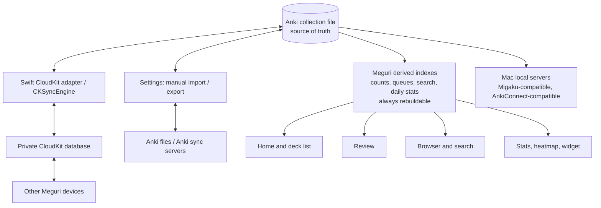
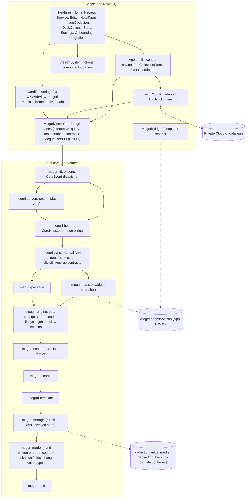
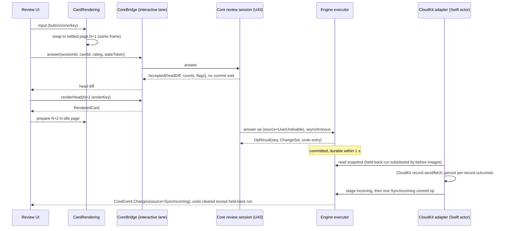
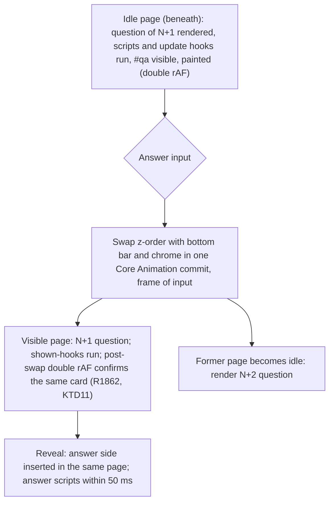
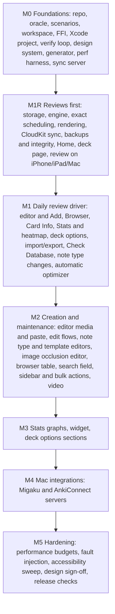

# Meguri - Plan

## Goal Capsule

- **Objective:** Antoine studies every day on Mac, iPhone, iPad and foldable iPhone with an app that does everything he relies on Anki for, looks and behaves like a first-party Apple app, never makes him wait (the next card is on screen the moment he answers), and keeps his Anki collection and sync history fully intact and interoperable.
- **Means:** Meguri, a native SwiftUI app on a newly written Rust core that reads and writes Anki collections, schedules with FSRS through fsrs-rs, uses private CloudKit sync between Meguri devices, and supports manual import/export through Anki files and Anki sync servers in Settings (KTD1–KTD3, KTD25, KTD26).
- **Product authority:** Antoine (sole user and decision-maker). Anki's observable behavior is the reference for everything in scope unless a requirement marks a deliberate deviation. Out-of-scope Anki features are listed under Scope Boundaries and their data is preserved, not supported.
- **Native design override (Antoine, 2026-10-25):** Meguri should look and behave like an app designed by Apple. Platform defaults take precedence over token-only rules in R1992, R1994 and KTD20 throughout this plan. Tokens constrain justified custom values; they never require replacing native defaults. Exception and visual-verification rules: `docs/design/native-interface-contract.md`. Preserve functional color meanings, accessibility checks and user-authored study-card rendering.
- **Execution profile:** autonomous Codex execution; never use Claude or Opus (Antoine, 2026-10-18). Core capabilities run in the clean-room spec-writer then implementer roles (KTD1). Each unit is implemented, reviewed and fixed for up to six rounds, then committed once `tools/mg gate` passes. Milestones M0, M1R and M1–M5 close through `tools/mg milestone-gate` (Delivery Milestones).
- **VoiceOver delivery override (Antoine, 2026-10-20):** remaining VoiceOver cursor and speech work, including R580 reveal focus and R1978 scripts, is optional follow-up after this app goal. Preserve implemented support and diagnostic tests, but VoiceOver failures do not block units, milestones or goal completion. Keyboard ownership, system accessibility audits, labels, contrast, hit targets and other alternative input checks remain required. This override applies to VoiceOver clauses throughout the plan, including U70, U253 and U256.
- **Stop conditions:** pause for Antoine only when:
  - a settled product decision turns out to be infeasible;
  - a step needs a system setting, a license acceptance, credentials or a signing account (R1969);
  - private data under `local-data/` would have to leave the Mac.

  Everything else proceeds on the plan's defaults (Assumptions).
- **Who finishes:** agents build, verify and commit every unit. Antoine performs the one-time setup steps, milestone device runs, signature-screen variant picks and the 30-day daily-driver trial.
- **Open blockers:** No product decision blocks this update. CloudKit contract/spec work, container provisioning and signed multi-device verification remain prerequisites to implementing and accepting the new sync path. AnkiWeb permission for a public App Store build and the foldable-iPhone simulator (expected with Xcode 27.1) are tracked under Dependencies and do not block planning or personal builds.

---

### Anki server work: frozen indefinitely (2026-10-26)

Antoine stopped Anki server work on 2026-10-26. Resume only when he explicitly requests it.
This overrides earlier requirements to complete every unit, support server transfers in the first usable version, or resume parked sync work.

- Preserve existing code, specs, scenarios, dependencies, failed checks and review records. Unfinished work remains unfinished.
- Do not build or fix server code, add server tests, start servers, or seek acceptance for this scope.
- U13, U105, U106, U107, U109, U110, U111 and U116 are not required. The original unit content remains below.
- Freeze the Anki-server portions of mixed units, including U113/U114/U117/U118, U151/U160/U161, U242/U246–U251 and U255–U257; retain their other requirements.
- RF4 server transfers and the persistent local-server utility are frozen. RF4 file import/export remains active.
- Server work is excluded from delivery, milestone and release acceptance. Existing dependencies cannot start server work or block active work.
- Shared tests run as before. A failed result remains failed. No server fix is required.
- If a shared validator cannot separate frozen server evidence, report that limitation and continue active app work. Never claim a failing check passed.
- File import/export, local Anki collection compatibility, shared media storage, CloudKit, and local Migaku/AnkiConnect integrations remain in scope.
- Resuming this work requires a new scope decision and verification. Historical evidence does not establish current acceptance.

The active Unit Index and milestone table exclude the frozen units. The Frozen Unit Index retains their original entries and dependencies.
Throughout this plan, sync acceptance means CloudKit; retained Anki protocol clauses are reference material under this freeze.
Manual-server round trips, server-only budgets, AnkiWeb permission work and server fault/soak cases are excluded from acceptance.
File round trips, offline durability, privacy and all active safety checks remain required.

## Product Contract

### Summary

Meguri is a single-window native app for macOS 27, iOS 27, iPadOS 27 and the foldable iPhone that replaces Anki desktop and AnkiMobile for one learner. It keeps Anki's structure and vocabulary, works on real Anki collections, uses iCloud for routine sync, supports manual Anki migration, schedules only with FSRS (parameters fully automatic), and is built for instant response. On the Mac it also stands in for the Migaku add-on and AnkiConnect so existing card-creation tools keep working.

### Problem Frame

Antoine has studied every single day for more than a year: about 410 reviews a day across Japanese, Spanish, German, French and English decks, mostly on AnkiMobile, with desktop Anki for card creation and maintenance. His collection is mid-sized by Anki standards (14,418 cards, 12,533 notes, 115,764 reviews, 28.8k media files, 1.4 GB), yet answering a card takes roughly 200–500 ms before the next one appears, and the desktop app has become crash-prone and slow.

Research into his setup located the costs. Anki rebuilds derived state (deck counts, queues, browser rows, stats) after almost every change and builds each card's web page only after the answer. The Migaku add-on rewrites six large note types and recopies about 5 MB of fonts on every launch, which re-uploads them on every sync. Media churn left 19k deletion records and 536 MB in the media trash. The Review Heatmap add-on rescans all reviews on every screen. AnkiMobile adds a deliberate "double-tap prevention" delay between cards. The interface itself is dated: dialogs and windows everywhere, overwhelming deck options, and features like the heatmap that only exist through add-ons.

Anki's own code cannot simply be reused: it is AGPL-3.0, which conflicts with App Store distribution, and there is a real chance Meguri is published there later. AnkiWeb's terms also restrict third-party clients, so public builds need either Ankitects' permission or self-hosted sync.

### Key Decisions

- **Clean reimplementation; no Anki code in Meguri.** Behavior, formats, protocols and constants are specified from research and verified against real Anki; no AGPL code is copied or translated. (session-settled: user-directed — chosen over building on Anki's own Rust engine (rslib, AGPL-3.0): a public App Store release must stay possible.) Governs R2021, R1960, R1881, R1801.
- **Rust core, native SwiftUI interface.** One newly written Rust engine shared by every platform, with every screen built in SwiftUI (AppKit/UIKit only where SwiftUI falls short) using Apple's own stack. (session-settled: user-approved — chosen over Rust everywhere and Swift everywhere: native Apple behavior plus a headless, Docker-testable engine.) Governs R15.
- **FSRS only, through fsrs-rs at Anki's exact version.** No SM-2 or legacy scheduler; collections with FSRS off are switched to FSRS; FSRS upgrades follow Anki releases only. (session-settled: user-directed — chosen over keeping SM-2 for migrating users: Meguri is for one user who already uses FSRS.) Governs R646, R702, R2022.
- **FSRS parameters are automatic; desired retention stays visible.** Parameters are re-optimized in the background, adopted only when they fit better, and never shown; refreshing memory states never mass-reschedules. (session-settled: user-directed — chosen over Anki's manual parameter and Optimize controls: nobody should have to think about parameters.) Governs R691, R692, R736.
- **CloudKit for routine sync; Anki transfers in Settings.** Private CloudKit sync connects the user's Meguri devices through their Apple account. Anki server access is an explicit manual import or export between Meguri and the selected server. Custom servers entered by URL have no successful-transfer cooldown. Existing build availability rules remain R1497 and R2031–R2033. (session-settled: user-directed, 2026-10-18; custom-server exception, 2026-10-24.) Governs R2043–R2066, KTD25, KTD26.
- **The Anki collection is the single source of truth.** Meguri's speed comes from derived indexes kept alongside it that can always be deleted and rebuilt; data for features Meguri does not offer is preserved, never dropped. Governs R1488, R1483, R1484, R1466.
- **Full replacement on the Mac includes Migaku- and AnkiConnect-compatible servers.** Meguri receives Migaku cards itself and routes them by language automatically; HyperTTS, Kanji Grid and the Migaku add-on are not carried over. (session-settled: user-directed — chosen over keeping desktop Anki around for add-on jobs: Meguri fully replaces Anki.) Governs R1663, R1710.
- **Close to Anki's structure, in one window.** Anki's screens and vocabulary stay recognizable, with selective changes; every feature opens inside the single main window. (session-settled: user-directed — chosen over a from-scratch redesign: closer to Anki, minimal where possible, dense where needed.) Governs R6.
- **Every feature on every device.** iPhone, iPad, Mac and foldable iPhone all get the browser, editor, note type and template editor, deck options, stats, import/export and image occlusion editor, with layouts chosen by window width. (session-settled: user-approved — chosen over an iPhone limited to daily-use features: no "can't do that here" moments.) Governs R2, R6.
- **Deck selection versus starting a review.** iPhone: tapping a deck starts reviewing immediately. Mac and iPad: a click opens the deck page; double-click or Return starts reviewing. Decks are never mixed in one session. (session-settled: user-directed — chosen over click-to-review in the sidebar: selecting should not start a session.) Governs R74.
- **Review screen: progress bar, four labeled buttons, visible back button, invisible tap zones.** No remaining counts; Again/Hard/Good/Easy each show their next interval after reveal; an always-visible back button undoes the last answer; left/right halves answer Again/Good and tint only while pressed. (session-settled: user-directed — chosen over counts, two-button and visible-zone variants.) Governs R333, R365, R402, R627.
- **Deck options: essentials first, everything else under Advanced.** Anki's names and options are kept; only FSRS parameter controls disappear. (session-settled: user-directed — chosen over a Settings-style list of all Anki sections.) Governs R736.
- **Heatmap and streaks follow the Review Heatmap add-on; the widget shows only heatmap and streak data.** What Antoine sees today stays the same, and the add-on's synced settings are honored. (session-settled: user-approved — chosen over Anki's stats-screen day rule; widget scope chosen by the user.) Governs R1270, R312.
- **On the review path, the instant next card outranks Anki's single-page script timing.** The next card's question runs in a second alternating page before the answer, while both sides of a card share one page and every rendered card must still match the oracle; answer-side scripts run at reveal within a 50 ms budget. Governs R445, R465, R468, R347, R1807, R1808.
- **Meguri's independently authored code and documentation use MIT.** Third-party material retains its licenses, notices and source obligations. (session-settled: user-directed, 2026-11-17; replaces the earlier MPL-2.0 choice for first-party material.) Governs R155, R2025. See `LICENSING.md`.
- **Sync stays close to live during review.** Eligible committed changes are offered to CloudKit promptly, with a foreground flush target of about 60 seconds and a best-effort flush on leaving the app. Apple controls automatic delivery timing. The newest answer remains held back for undo. (session-settled: user-directed.) Governs R88, R365, R726, R2047.
- **Search ignores letter case for every alphabet.** `über` finds "Über" in plain and field searches, unlike Anki's ASCII-only folding; AnkiConnect searches follow the same rule. (session-settled: user-directed — chosen over matching Anki's ASCII-only case folding: a German and Spanish learner expects accented capitals to match.) Governs R1036, R1085, R1777, R1916.
- **Real Anki is the test oracle; Anki's tests become neutral scenarios.** Expected results always come from running the pinned Anki release headless in Docker, never from copied assertions, and the oracle never ships. (session-settled: user-approved — chosen over copying Anki's test code: keeps parity proof without AGPL code.) Governs R1868, R1869, R1878, R1879.

### Actors

- A1. Antoine: the learner and only user; reviews daily on iPhone, adds and maintains cards mostly on Mac.
- A2. Meguri app: one product on Mac, iPhone, iPad and foldable iPhone, sharing one core.
- A3. Apple iCloud account and private CloudKit database: routine synchronization between Meguri installations signed into the same Apple account; no separate Meguri signup service.
- A4. Anki desktop, AnkiMobile and Anki sync servers: external migration endpoints reached through manual Settings transfers or compatible package files; they do not participate in Meguri's routine CloudKit sync.
- A5. Migaku browser extension: sends new cards (fields, audio, images) to the local Migaku-compatible server on the Mac; it does not query word statuses.
- A6. AnkiConnect clients: Claude Code sessions and Antoine's scripts calling the local AnkiConnect-compatible server on the Mac.
- A7. Test oracle: real Anki run headless in Docker during development only; never shipped.
- A8. Build and verification agents: the AI agents that implement Meguri and verify it by building, running, screenshotting and measuring it.



### Requirements

#### App shell, navigation, home and settings

**Platforms, scenes and windows**
- R1. Meguri ships one app target per platform family: macOS 27 (Apple silicon only), iOS 27 and iPadOS 27, including the foldable iPhone; no older OS is supported.
- R2. Every screen picks its layout from the current window width (size class), not from the device type: compact width uses the iPhone layout (tab bar), regular width uses the sidebar layout.
- R3. The iPhone layout applies to iPhone, the folded foldable iPhone, and any iPad window narrow enough to be compact (Slide Over, narrow Split View, small Stage Manager window).
- R4. The sidebar layout applies to Mac, iPad at regular width, and the unfolded foldable iPhone.
- R5. Switching between layouts at runtime (fold/unfold, window resize, rotation, Split View change) preserves the current section, the selected deck, scroll positions, any unsaved editor text, and an in-progress review (same card, same revealed state).
- R6. The Mac app has exactly one main window; every feature (browser, editor, deck options, stats, note types, settings, import/export, image occlusion editor) opens inside it as a pane, sheet, inspector or popover, never as a separate window.
- R7. On iPad, Meguri supports one scene; the window is fully resizable (Stage Manager, Split View, Slide Over, external display) and every screen works at every allowed size (deviation: AnkiMobile has no multi-window story either, but Meguri does not offer "New Window").
- R8. iPhone supports portrait and landscape everywhere, including review, and supports iOS 27 resizable iPhone app windows.
- R9. On the foldable iPhone, no interactive control is placed in the fold's reserved region; card content may span the fold, and two-column layouts split at the fold.
- R10. On the foldable iPhone's outer display, tab bars and toolbars follow the system placement (side bars on the outer display) without custom overrides.
- R11. Closing the Mac window keeps Meguri running only while a Migaku or AnkiConnect integration is enabled (R1667); otherwise closing the last window quits, ⌘Q always quits, and clicking the Dock icon or choosing Window > Meguri reopens the window while it runs.
- R12. The Mac window restores its size, position, sidebar width, sidebar visibility and selected section on relaunch; full-screen mode is supported.
- R13. On relaunch, the app restores the last section and selected deck and does not resume in the middle of a review (except a session cut short by termination, which R455 governs); it opens on that deck's page (sidebar layout) or Home (iPhone layout).
- R14. When the app moves to the background on iOS/iPadOS, Meguri commits pending writes and releases database file locks before suspension, so the system never terminates it for holding a lock while suspended; the collection lives in the app's private container (R1450), and only the widget snapshot lives in the shared app-group container.
- R15. No user-visible navigation, transition or tap waits on the database, the network or the Rust core on the main thread; Home renders immediately from the last computed state and updates in place when fresh counts arrive.
- R16. Cold launch to an interactive Home meets R1818 (at most 500 ms at p95) and warm launch takes at most 300 ms, on current hardware with a 150,000-card collection.

**Navigation structure**
- R17. In the sidebar layout, the sidebar has a top group of sections — Home, Browse, Stats, Note Types, Settings — followed by a "Decks" group containing the full deck tree.
- R18. In the iPhone layout, a bottom tab bar has four tabs: Decks (Home), Browse, Stats, Settings; Note Types is reached from Settings and from the Browse ⋯ menu.
- R19. Each tab or section keeps its own navigation stack; reselecting the active tab pops it to its root, and a second reselect scrolls to top.
- R20. The sidebar can be hidden and shown (toolbar button, ⌃⌘S, edge swipe on iPad); its visibility is remembered per device.
- R21. When a review starts in the sidebar layout, the review fills the detail area and the sidebar collapses automatically; it is restored when the review ends, and the user can reveal it during review.
- R22. Selecting another deck or section in the sidebar during a review ends the review session immediately (answers are already saved) and navigates there without a confirmation.
- R23. In the iPhone layout, review is presented full screen above the tab bar; the tab bar is hidden for the whole session.
- R24. A global Add action is always reachable outside review: a toolbar "+" on Home, Browse and the deck page (all layouts), the File menu on Mac, and the review ⋯ menu.
- R25. Add opens in-window (a sheet on iPhone/iPad, an attached sheet or panel on Mac) over the current screen, and closing it returns to exactly that screen.
- R26. A "Go to Deck" quick switcher (Anki's Study Deck) opens with `/` or ⇧⌘O and filters decks by space-separated terms that must all match parts of the full deck name (e.g. "ja 1" matches "Japanese::Lesson1"), case-insensitively.
- R27. In Go to Deck, Return opens the highlighted deck's page (sidebar layout) or starts its review (iPhone layout), and a "Create deck named '<query>'" row creates a deck when no exact match exists.

**Home and deck list**
- R28. In the iPhone layout, Home shows, top to bottom: the deck tree, the "Studied today" line, the activity heatmap, then the four streak stats.
- R29. In the sidebar layout, Home's detail area shows the deck table and the activity panel (studied-today line, heatmap, streak stats) side by side; below a width threshold the activity panel moves under the deck table.
- R30. The deck tree shows every deck as a row with its last name component, indented by depth, and New, Learn and Due counts in three right-aligned columns with headers on Mac/iPad.
- R31. Count values come from the scheduler's deck-tree counts (v3 semantics: children summed, then the deck's limits applied, parent limits capping children), so they match Anki desktop for the same collection and moment.
- R32. Count colours follow Anki's state colours — New blue, Learn red, Due green — with zero counts shown dimmed, and each colour meets a 4.5:1 contrast ratio in light, dark and Increase Contrast modes.
- R33. The sidebar deck tree shows the same three counts in compact form (non-zero values only) so the user can see what is due without opening Home.
- R34. Sibling decks are sorted by full name with Anki's case-insensitive Unicode comparison, so numeric prefixes ("4.", "5.", "9.") and emoji names order exactly as in Anki.
- R35. Deck names display emoji, CJK and right-to-left text correctly, show any HTML literally (never interpreted), truncate long names with an ellipsis, and expose the full name in a tooltip (Mac) and to VoiceOver.
- R36. Parent decks have a disclosure control; collapsing or expanding toggles the deck's `study_collapsed` flag (stored on the deck, synced) and keeps the scroll position.
- R37. The Home tree and the sidebar tree share `study_collapsed`; the browser sidebar's `browser_collapsed` flag is never changed by Home.
- R38. ⌥-clicking a disclosure control (or ⌥← / ⌥→) collapses or expands that deck and all its descendants.
- R39. The Default deck (id 1) is hidden from the tree when it has no cards and no child decks, unless it is the only deck in the collection.
- R40. The current deck (`curDeck`) is highlighted in the tree.
- R41. Opening a deck page or starting a review sets `curDeck` to that deck and `activeDecks` to the deck plus its descendants, writing only when the value actually changes.
- R42. Selecting a deck is not recorded as an undo step (deviation: Anki records "Select Deck" as an undoable op, which buries the user's meaningful undo).
- R43. Below the tree, Home shows "Studied N cards in X minutes today (Y s/card)", counting revlog entries since the start of the current Anki day excluding Manual (type 4) and Rescheduled (type 5) entries, including reviews of since-deleted cards, with the time unit capped at minutes.
- R44. When nothing has been studied today, the line reads "No cards studied today" instead of a zero sentence.
- R45. Deck counts and the studied-today line refresh after every collection change (answer, undo, redo, edit, sync, import, deck or preset change), when the app returns to the foreground, at the day rollover, and when the next learning card becomes due while Home is visible.
- R46. Every deck row has a ⋯ button (shown on hover on Mac) and the same items in its context menu (right-click on Mac, long-press on iPhone/iPad).
- R47. The per-deck menu contains, in this order: Study, Overview, Add Note, Browse, Stats, Deck Options, Rename, New Subdeck, Description, Export, Unbury (only when the deck subtree has buried cards), and Delete (separated, destructive style).
- R48. "Add Note" from a deck menu opens Add with that deck preselected regardless of the "default deck" preference; "Browse" opens Browse with the search `deck:"<full name>"`; "Stats" opens Stats scoped to that deck.
- R49. On iPhone, swiping a deck row reveals Options and More only, never Delete (deviation: AnkiMobile shows Delete first on swipe).
- R50. Home has Create Deck and Import File actions. The optional Get Decks action opens the shared-deck site in the default browser and uses no Anki credentials or sync endpoint; it is present only when its existing build availability rules allow it.
- R51. Dropping an `.apkg` (or any file type the import area accepts) onto the Mac window, the Dock icon, the iPad window or the deck list starts the import flow; unsupported files show a short message naming the accepted types.
- R52. Opening a supported file from Finder, Files, Mail or the share sheet ("Open in Meguri") starts the import flow over the current screen; if a review is in progress, the review stays underneath and resumes on the same card after the import sheet closes.
- R53. Filtered decks present in a synced collection appear in the tree in a distinct style with their counts, but cannot be studied; tapping one explains that filtered decks are not supported yet, and its menu offers only Rename and Delete.
- R54. Deleting a filtered deck returns its cards to their home decks and deletes no cards, as in Anki.

**Creating, renaming, reparenting and deleting decks**
- R55. Create Deck asks for a name; `::` in the name creates a nested deck, and missing parent decks are created automatically.
- R56. Deck names are normalized per component exactly as Anki: Unicode NFC, ASCII control characters removed, whitespace and `:` trimmed from each component, and an empty component becomes "blank".
- R57. Deck-name matching is case-insensitive: creating a deck whose name matches an existing deck (ignoring case) opens the existing deck instead of creating a duplicate, and a new child adopts the existing parent's capitalization.
- R58. An empty or whitespace-only name disables the Create/Rename confirm button.
- R59. "New Subdeck" in a deck menu pre-fills the name field with `<full parent name>::` and places the cursor at the end.
- R60. Rename pre-fills the full `A::B::C` name, so typing a different path moves the deck; renaming a parent renames all its descendants in one undoable step.
- R61. When a rename or reparent produces a name that already exists, Meguri appends "+" until the name is unique, exactly as Anki does, and tells the user the final name.
- R62. A deck cannot be renamed or moved under one of its own descendants, and nothing can be nested under a filtered deck; the action is refused with a short explanation.
- R63. Decks can be reparented by drag and drop in the Home tree and the sidebar tree on all platforms: dropping onto a deck makes the dragged deck its child, and dropping onto the "Decks" header or the top drop zone makes it top-level.
- R64. Reparenting keeps the dragged deck's last name component and all its children, and shows a toast "N decks moved" with Undo.
- R65. Several selected decks can be reparented in one drag on Mac/iPad (multi-selection with ⌘/⇧ click).
- R66. Delete removes the deck, all descendant decks and all their cards in one undoable step, then shows a toast "Deleted <deck> (N cards)" with Undo.
- R67. When the deck subtree contains at least one card, Delete first asks for confirmation stating the deck count and card count (deviation: modern Anki desktop deletes without asking and relies on undo).
- R68. Deleting the Default deck removes its cards and children but keeps the Default deck itself, resetting its name to "Default", as Anki does.
- R69. Every deck operation (create, rename, reparent, delete, description edit, collapse) writes standard Anki deck records and graves so that Anki desktop, AnkiMobile and AnkiDroid see the same result after sync.

**Deck page (overview) and deck description**
- R70. The deck page shows the full deck path as a breadcrumb title, the deck's description, the New / Learning / To Review counts, a prominent Study button, a Deck Options button, the deck-scoped heatmap with its four streak stats, and links to Browse and Stats for the deck.
- R71. When a deck list count differs from the deck page's queue count, that count shows the signed difference, deck list count minus queue count ("+N" or "−N"), dimmed, with an explanation tooltip or popover (`specs/sched/counts.md` C5, as R1345; corrected 2026-10-27).
- R72. An Unbury button appears only when the deck subtree has buried cards; when both manually buried and sibling-buried cards exist it offers "Manually buried cards", "Buried siblings" and "All buried cards".
- R73. The Study button is the default action: Return or Space on Mac/iPad keyboards, and a tap anywhere on the button.
- R74. In the sidebar layout, a single click on a deck (sidebar or Home table) opens its deck page; a double-click, Return on a selected deck, or the S key starts its review directly.
- R75. In the iPhone layout, tapping a deck row starts its review immediately; the deck page is reached from the row's menu ("Overview").
- R76. Studying a deck includes all its subdecks under Anki's limit rules; there is no collection-wide "review all due" entry point anywhere in Meguri.
- R77. When the user starts a deck that has nothing to study now, no review opens; instead the deck page (or a sheet on iPhone) shows the finished state.
- R78. The finished state says the deck is done for now and adds, when applicable: the time until the next learning card is ready, the number of learning cards due later today, a note that today's review limit was reached while reviews remain (with a link to Deck Options), a note that the new-card limit was reached while new cards remain (with a link), a note that cards were buried with an unbury link, and the deck description.
- R79. When a learning card becomes due while the finished state is visible, the page switches back to the normal deck page with an enabled Study button (it does not start review by itself).
- R80. An empty deck (no cards in its subtree) shows "This deck is empty" with Add Note (deck preselected) and Import File, instead of the finished state.
- R81. The deck description is edited from the deck menu or the deck page as plain text, with a "Markdown" toggle that sets the deck's `md` flag.
- R82. Descriptions render on the deck page and the finished state: Markdown when `md` is set, otherwise as sanitized HTML (no scripts, no event handlers, no forms, no remote content that can alter the page).
- R83. Links in descriptions open in the default browser after the user taps them; no link can navigate or modify the deck page itself.
- R84. An unedited description is preserved byte for byte, including the user's empty Markdown flag (e.g. "9. Kaishi 1.5k" has `md` set with an empty description).

**Review session lifecycle (shell-owned parts)**
- R85. Closing a review (✕, Esc, or navigating away) needs no confirmation and loses nothing, because each answer is saved when given.
- R86. The timebox uses the collection's `timeLim` (seconds; 0 = off): after the answer that crosses the limit, Meguri shows "N cards studied in M minutes" with Continue (restarts the timer) and Finish (opens the session summary).
- R87. At the day rollover during a review, the session continues with a rebuilt queue for the new day and the streak/heatmap move to the new day, without interrupting the current card.
- R88. During an active review, eligible committed changes are offered to CloudKit promptly, with an app-controlled foreground flush target of about 60 seconds and a best-effort flush on backgrounding. The newest undoable answer and its dependent top-of-stack changes remain held back (R365). Automatic delivery has no fixed completion deadline.
- R89. The Sync Now command remains disabled during an active review, with a tooltip explaining that automatic iCloud sync continues and ending the session enables a manual sync. Manual Anki transfers are also unavailable during review.
- R90. Pressing D (Home), B (Browse) or T (Stats) during review ends the session and navigates; A (Add) opens Add over the review without ending it.

**End-of-session summary**
- R91. A session summary appears when the queue runs out, when the user chooses Finish on the timebox prompt, or when the user closes a review with ✕ or Esc after answering at least one card; when a session ends through a sidebar selection, D/B/T or starting another deck, the navigation proceeds with no summary and the persisted session record (R441) stays reachable from the deck page until the next session.
- R92. The summary shows: cards studied (answers) and time spent this session, counts per button (Again / Hard / Good / Easy), the share of answers that were not Again, and how many new cards were introduced.
- R93. The summary shows what comes next for the deck: remaining cards today (when the session was closed early, with a Continue button), the time until the next learning card, or "Finished for today" with tomorrow's due count for this deck.
- R94. The summary repeats the limit-reached and buried notes of the finished state when they apply.
- R95. The summary shows the current streak and marks when this session made today an active day.
- R96. The summary lists every card answered Again at least once in this session ("missed cards"), in first-miss order, each with a plain-text excerpt of its question, its deck, and how many times it was missed.
- R97. Tapping a missed card opens a read-only preview of both sides (full renderer, audio playable) that never changes scheduling; the preview offers Edit Note, Flag, Mark and Card Info.
- R98. "Browse missed cards" opens Browse with a search that matches exactly the missed cards (`cid:` list).
- R99. Undo from the summary (button or ⌘Z) reverts the last answer, reopens the review on that card, and updates the summary data. For hold-back (R88) and the session-end sync (R1549), the session ends only when the summary or congratulations screen is dismissed.
- R100. Session statistics exclude answers that were undone, and the summary is kept only in memory until it is dismissed.
- R101. The summary is dismissed with Done, Return, Esc, or a tap on ✕, and returns to the screen from which the review started.

**Toolbar actions and sync status**
- R102. An iCloud Sync button sits in the main toolbar (sidebar) and Decks navigation bar (compact). When iCloud is unavailable it opens an explanation and system-account guidance; it never opens Anki credentials.
- R103. The iCloud indicator distinguishes up to date as of a completed exchange, local changes waiting, syncing, media pending, offline, paused and needs attention. It does not infer CloudKit state from Anki mod/scm/ls/usn fields. (Superseded 2026-11-19 for "paused", noted 2026-11-20: the user has no Pause; the update hold shows as Sync Automatically off, never as paused; `specs/sync/policy.md` P25.2, `specs/sync/status-strings.md` T19.4.)
- R104. Pending changes and needs-attention states have distinct symbols and text and never rely on colour alone. An Anki one-way-transfer warning belongs only to its Settings workflow.
- R105. Clicking Sync Now requests a foreground CloudKit exchange; while running it opens progress. The popover shows collection and media progress separately, last completed exchange, pending/held-back work and the latest error. Completion follows R2048–R2050.
- R106. Media sync progress is shown as a quiet secondary indicator ("Syncing media, N files left") that never blocks studying, browsing or editing.
- R107. CloudKit change events and foreground fetch results refresh sync status, with no per-screen polling and no Anki meta probes for routine sync. Status names its last confirmed exchange rather than claiming knowledge of every remote device.
- R108. The undo-capable toast (operation name + Undo) appears after every destructive or bulk operation outside review, lasts at least 5 seconds, never covers the answer buttons, and is reachable by VoiceOver.

**Settings — structure and storage rules**
- R109. Settings is a section in the sidebar layout (Mac included; ⌘, selects it) and a tab in the iPhone layout, organised into pages: Account & Sync, Review, Editing, Browsing, Appearance, Heatmap, Backups, Maintenance, Integrations (Mac only), About.
- R110. Settings on Mac lives in the main window (deviation: macOS convention is a separate Settings window; the brief requires one window).
- R111. A search field at the top of Settings filters settings by name and keywords across all pages.
- R112. Each setting is stored in exactly one of four places, shown here per setting: collection config (synced, so it changes every device), device-local preferences (this device only), the Keychain (credentials), or a deck/preset record (owned by the deck options area).
- R113. Every synced setting is marked with a "Synced" globe badge and a footnote "Applies on all devices that sync this collection".
- R114. Changing a setting writes only when the value differs, so opening and closing Settings never marks the collection modified or creates a pending sync.
- R115. Settings changes take effect immediately (no Save button) and are not undo steps.
- R116. Collection config keys that Meguri does not show (including add-on keys and keys of out-of-scope features) are preserved unchanged.

**Settings — Account & Sync**
- R117. Account & Sync shows iCloud availability, whether this collection is connected, storage/quota errors and Enable/Pause iCloud Sync controls. Apple-account sign-in and sign-out happen through system settings; Meguri never asks for an Apple password. (Superseded 2026-11-19, noted 2026-11-20: the Enable/Pause iCloud Sync controls are replaced by one Service control and Sync Automatically, with no Pause; `docs/design/native-interface-contract.md` N15.2 and N15.6, `specs/sync/cloudkit-recovery.md` V27.2 and V27.5, `specs/sync/policy.md` P25.2. The rest stands.)
- R118. Settings contains an Anki Transfers section with explicit Import from Anki and Export to Anki actions, plus file import/export. A self-hosted Anki server URL (optional path prefix) is available there in every build; AnkiWeb availability follows R1497 and R2031.
- R119. Manual Anki server login exchanges a username and password for a sync key; the password is never stored. The key and username remain in the device-local, non-synchronizable Keychain. CloudKit uses Apple-managed authentication.
- R120. Changing the Anki transfer endpoint clears its credentials and redirected endpoint before any request to the new endpoint. It does not change the iCloud account or automatically transfer a collection.
- R121. After Anki login, return to the selected manual import/export preview; login alone never starts a transfer or configures a recurring sync.
- R122. Sync audio and images (device-local, default on) controls CloudKit asset transfer; collection records continue syncing when media is paused. Manual Anki transfers have their own include-media choice. (Superseded 2026-11-19, noted 2026-11-20: there is no media setting; cards and media always sync together; `docs/design/native-interface-contract.md` N15.6, `specs/sync/policy.md` P25.1. Manual Anki transfers are unchanged.)
- R123. Sync automatically (device-local, default on after explicit collection connection) enables CKSyncEngine automatic scheduling and best-effort foreground/background flushes. It never schedules Anki server requests. (Superseded 2026-11-19 in part, noted 2026-11-20: there is no explicit connection step; choosing the service is the consent to set it up, and with no stored value the setting reads on from the first completed setup; `specs/sync/policy.md` P25.3, `specs/sync/cloudkit-recovery.md` V27.2.)
- R124. CloudKit media transfers resume opportunistically and show their own progress. There is no Anki media polling interval in routine sync settings.
- R125. Replace local collection from iCloud and Replace iCloud collection are separate advanced recovery actions with previews, backups and explicit confirmation (R2056). The Anki force-one-way option exists only inside a manual server transfer. (Superseded 2026-11-19 for their place only, noted 2026-11-20: the two replace actions are rows of Troubleshooting in the Sync section; their previews, backups and confirmations stand; `docs/design/native-interface-contract.md` N15.5 and N15.6, `specs/sync/status-strings.md` T19.6.)
- R126. Manual Anki requests retain the adjustable 60-second inactivity timeout. CloudKit uses Apple retry/throttling behavior; cancellation and a waiting state are available without pretending that this timeout controls Apple's scheduler.
- R127. On Mac quit, persist pending work and attempt a bounded CloudKit flush with a Quit Without Syncing option. On iOS use permitted background time, then persist and suspend cleanly; neither platform waits indefinitely or labels pending changes as synced.

**Settings — Review**
- R128. "Next day starts at" (collection `rollover`, hour 0–23, default 4) sets the daily rollover used by scheduling, counts, studied-today, heatmap and widgets.
- R129. "Learn ahead limit" (collection `collapseTime`, stored in seconds, shown in minutes, default 20) controls how far ahead learning cards may be shown when nothing else is due.
- R130. "Timebox time limit" (collection `timeLim`, stored in seconds, shown in minutes, default 0 = off) drives the timebox prompt.
- R131. "Show next review time above answer buttons" (collection `estTimes`, default on) shows or hides the interval label on Again/Hard/Good/Easy.
- R132. "Show progress bar during review" (device-local, default on) toggles Meguri's thin progress bar; the collection's `dueCounts` key is preserved but not used (deviation: Meguri never shows remaining counts in review). (Superseded 2026-11-19, noted 2026-11-20: the session progress bar has no device setting and always shows, along the bottom edge; `docs/design/native-interface-contract.md` N16.1.)
- R133. "Show play buttons on cards with audio" (collection `hideAudioPlayButtons`, inverted, default shown) and "Interrupt current audio when answering" (collection `interruptAudioWhenAnswering`, default on) are listed here; their behaviour is owned by the review area.
- R134. "Space and Return answer Good" (device-local, default on) lets Space/Return grade Good on the answer side of a hardware keyboard.
- R135. "Answer keys" (device-local, default 1 2 3 4) lets the user rebind the four answer keys to any single non-modifier key, rejecting keys already used by another review shortcut.
- R136. "Play card audio in Silent Mode" (iPhone/iPad, device-local, default on) and "Lower other audio during card audio" (device-local, default on) control the audio session, matching AnkiMobile's Ignore Mute and Duck options.
- R137. "Open card links in" (device-local: in-app browser, default, or default browser) and "Allowed link schemes" (device-local list of non-web URL schemes that cards may open after a one-time confirmation) are listed here; enforcement is owned by the review area.

**Settings — Editing and Browsing**
- R138. "Paste clipboard images as PNG" (collection `pasteImagesAsPng`, default off).
- R139. "Paste strips formatting" (collection `pasteStripsFormatting`, default off); the opposite behaviour is always available with ⇧⌘V or Paste and Match Style (⌥⇧⌘V) as R866 describes, or Paste with Formatting from the edit menu.
- R140. "Default deck when adding" (collection `addToCur`, default "current deck"; alternative "depends on note type") with its behaviour owned by the editor area.
- R141. "Default search text" (collection `defaultSearchText`, default empty) and "Ignore accents in search" (collection `ignoreAccentsInSearch`, default off) are listed under Browsing.

**Settings — Appearance**
- R142. Light and dark appearance always follow the system and switch live, including the card currently on screen, without losing scroll position or revealed state (deviation: no in-app Light/Dark override, unlike Anki's Theme option).
- R143. "Card zoom" (device-local, default 100 %, range 50–300 %) scales card content in review, preview and the editor preview, and is also controlled by ⌘+ / ⌘− / ⌘0.
- R144. There is no in-app Reduce Motion, UI scale, minimalist mode, hide-bars or video-driver option; Meguri follows the system settings instead (deviation: Anki's own toggles are dropped).
- R145. The interface language follows the system's per-app language setting; Meguri has no in-app language picker.

**Settings — Heatmap**
- R146. Heatmap colour theme (lime, olive, ice, magenta, flame; default lime), calendar mode (year overview, default; or continuous timeline), history limit (days, 0 = none), forecast limit (days, 0 = none), "ignore data before" date, "exclude deleted cards from history" (default off), "exclude manual reschedules from history" (default on) and "decks excluded from the Home heatmap" are stored in the collection config key `heatmap`, in the Review Heatmap add-on's format.
- R147. Meguri reads the `heatmap` key on open and after every sync, writes changed values back in the same format, and preserves any sub-keys it does not understand (including `version`).
- R148. "Show heatmap on Home", "Show heatmap on deck page" and "Show streak stats even when the heatmap is hidden" are device-local toggles (default on, on, on; corrected 2026-10-27: all on, as R1342 and the add-on's profile-local options have them).
- R149. "First day of week" for the heatmap uses the collection's `firstDayOfWeek` (shared with the Stats calendar; default Sunday) (deviation: the add-on always starts weeks on Monday).

**Settings — Backups, Maintenance, Integrations, About**
- R150. Backups shows the collection's `backups` settings (synced): minutes between backups (default 30), daily (default 12), weekly (default 10) and monthly (default 9) backups to keep, plus a note that media files are not included.
- R151. Backups offers "Back Up Now", "Restore from Backup…" (list of backups with date and size), and "Show Backups" (Finder on Mac; the Files app location on iPhone/iPad).
- R152. Maintenance offers Check Database, Check Media and Empty Cards on every platform, each running in the background with progress and showing its report when done.
- R153. Integrations (Mac only) lists the Migaku integration toggle (device-local, default off; loopback port 44432) with access to its "Recently received" list, and the AnkiConnect-compatible server toggle (device-local, default off; loopback port 8765); behaviour is owned by the integrations area.
- R154. Integrations shows each server's live status (running, port in use by another app, stopped) in plain words.
- R155. About shows the version and build number, collection statistics (cards, notes, decks, note types, media file count and size), Meguri's own MIT license, acknowledgements and licences of bundled components (including fsrs-rs, BSD-3-Clause), a help link, and Copy Debug Info.
- R156. The app name, icon, subtitle and every screen avoid the word "Anki" as a product name; compatibility is stated only as plain facts (e.g. "Syncs with Anki sync servers", "Opens .apkg files").

**First launch and onboarding**
- R157. With no collection, welcome offers Connect to iCloud, Import a File and Start Empty. Anki server import is reached through the Settings Anki Transfers workflow; it is never an onboarding account provider. (Superseded 2026-11-19, noted 2026-11-20: welcome offers Set Up Sync, Import a Collection File and Start Empty; there is no Connect to iCloud choice; `docs/design/native-interface-contract.md` N18.2 and N18.3. The Anki server sentence stands.)
- R158. Connecting an empty local installation to an existing iCloud collection downloads a coherent collection before activating it; media can continue afterward. Two non-empty collections are never silently merged or overwritten (R2055).
- R159. After the first download or import, Meguri confirms what arrived in one line (e.g. "12,533 notes · 22 decks · 115,764 reviews") and opens Home.
- R160. Studying, browsing and editing work while the first media download continues in the background; cards whose media has not arrived yet show a placeholder instead of an error.
- R161. Start Empty creates a collection containing only the Default deck and Anki's stock note types. Empty Home offers Add Note, Create Deck, Import File and Connect to iCloud as their units become available; Anki server credentials are confined to Settings Anki Transfers.
- R162. One-time tips (each shown at most once, dismissible, never during the first card of a review) explain: `::` for subdecks when creating a deck, double-click/Return to study in the sidebar layout, and the review tap zones on the first answer side on iPhone/iPad.
- R163. There are no other onboarding pop-ups, tutorials or sample decks.

**Empty, error and status communication**
- R164. Every list or chart has an explicit empty state with one sentence and, where it helps, one action (e.g. Browse with no results: "No cards match" + "Clear Search"; heatmap without reviews: "No reviews yet").
- R165. Errors are sorted into three kinds: transient (network down, server busy) shown as a non-blocking banner or status glyph with Retry; actionable (login expired, one-way sync needed, storage full, client or server version mismatch, collection too large for AnkiWeb's limit) shown as an alert that names the next step; and blocking (collection cannot be opened) shown as a full-screen error.
- R166. Failures of automatic, background work (auto sync, periodic media sync, backups) never interrupt the user; they switch the relevant status glyph to "needs attention" and keep the details for the popover.
- R167. Every error alert has a Copy Debug Info action that copies app version, OS, device model, collection size figures and the recent error log, never credentials or card content.
- R168. Messages sent by the sync server are shown as sanitized rich text (links allowed, no scripts).
- R169. If the collection cannot be opened (corrupt file, newer schema than supported, disk full), the blocking error offers Check Database, Restore from Backup and (when this device's iCloud conditions hold) Replace with the iCloud collection, in that order. No remedy downloads from an Anki server (`specs/sync/cloudkit-recovery.md` V19, `specs/maintenance/optimize-integrity.md` M7.1; corrected 2026-10-27).
- R170. Long operations (check database, check media, empty cards, import, export, backup, restore, one-way sync, background FSRS optimization) report progress in a non-modal activity indicator, keep the rest of the UI usable, and offer Cancel whenever stopping is safe.
- R171. Only one collection-wide exclusive operation (one-way sync, restore, check database, import, Replace local collection from iCloud (`CloudAdopt`; corrected 2026-10-27)) runs at a time; starting a second one explains which operation is running instead of queuing silently.
- R172. Crash and hang diagnostics are collected only through the system's on-device mechanisms (MetricKit/OSLog) and are never sent anywhere without the user's action.

**Undo and redo (shell-owned parts)**
- R173. The Edit menu (Mac and iPad menu bar) shows "Undo <operation name>" and "Redo <operation name>" for the last collection operation, disabled with plain "Undo"/"Redo" when nothing is available.
- R174. When a text field has focus, ⌘Z / ⇧⌘Z apply to the text field; otherwise they apply to the collection's undo stack.
- R175. On iPhone/iPad, the system three-finger undo/redo gestures apply to the collection's undo stack when no text field has focus.

**Appearance, Liquid Glass and visual system**
- R176. Navigation chrome (tab bar, toolbars, sidebar, menus, sheets) uses the system Liquid Glass materials with no custom tinting beyond the app accent colour.
- R177. Card content, the deck list rows, the heatmap and the summary content are never placed on glass; glass is used only for controls layered above content.
- R178. All screens remain legible at both ends of the system glass transparency slider and with Reduce Transparency and Increase Contrast on.
- R179. Icons use SF Symbols; the app icon is a layered icon with default, dark, clear and tinted appearances and contains no text.
- R180. Animations use system springs and are skipped or replaced by short crossfades when Reduce Motion is on.

**Accessibility**
- R181. Every interactive control has an accessibility label, a value where meaningful, a hint where the action is not obvious, and a stable accessibility identifier for UI tests.
- R182. A deck row reads as one element: name, depth or parent, New/Learn/Due counts with their names, and collapsed/expanded state, with custom actions for Study, Overview, Options, Rename, Delete and Collapse/Expand.
- R183. The heatmap reads as a summary ("365-day streak, 410 reviews today, daily average 221") and is navigable day by day with VoiceOver (adjustable element: date plus "N reviews" or "N cards due").
- R184. When VoiceOver, Switch Control, Voice Control or Full Keyboard Access is on, the question side of a card shows an explicit "Show Answer" button and the answer side's invisible tap zones are disabled in favour of the four answer buttons (deviation from the no-buttons question side).
- R185. Answer buttons read as "Good, 3 days" (grade then interval); Voice Control names match the visible labels ("Tap Good", "Tap Show Answer", "Tap Undo").
- R186. All app chrome supports Dynamic Type up to the largest accessibility size: rows grow and wrap instead of truncating counts, and the Large Content Viewer works for tab and toolbar items.
- R187. Bold Text, Increase Contrast, Differentiate Without Colour (counts keep their column headers or labels; sync states have distinct symbols) and Smart Invert (card images excluded from inversion) are honoured.
- R188. Touch targets are at least 44×44 pt on iPhone/iPad; Mac controls use standard system control sizes.
- R189. Focus order is logical on every screen and keyboard focus is visible; on Mac, Tab moves through all controls when Full Keyboard Access is enabled.
- R190. An automated accessibility audit of Home, deck page, review (both sides), summary, Browse, Stats and Settings reports no issues on every layout in light and dark.

**Localization readiness**
- R191. Every user-visible string lives in a String Catalog with a developer comment; no string is assembled by concatenation, and counts use plural rules ("1 card", "2 cards").
- R192. Dates, times, numbers, percentages and durations are formatted with the user's locale formatters; interval labels on buttons and in the summary are localizable.
- R193. Layouts use leading/trailing alignment so a later right-to-left or longer-string localization needs no redesign; mirroring and pseudo-localization passes are deferred until a second language ships.
- R194. Deck names, tag names, note-type names, field content and server messages are never translated or transformed.
- R195. The first release ships English only.

**Keyboard — general rules (Mac, and iPad/iPhone with a hardware keyboard)**
- R196. Every command reachable by pointer is reachable by keyboard, and every shortcut below works identically on Mac and on iPad/iPhone with a hardware keyboard unless marked.
- R197. Single-key (no modifier) shortcuts are active only when no text field has focus, and they take precedence over type-to-select in lists.
- R198. Single-key shortcuts match by character first and fall back to the physical key position, so they work with Korean, Japanese, Cyrillic and other non-Latin keyboard layouts (Anki: Korean-layout equivalents).
- R199. Holding a key never auto-repeats an answer or a destructive action.
- R200. Shortcuts that share a key in different contexts (deck list, review, browser, editor, template editor, image occlusion editor) are never enabled at the same time; an automated test lists all enabled shortcuts per context and fails on any duplicate.
- R201. On iPad, holding ⌘ shows the system shortcut overlay listing every modifier shortcut of the current context; Help > Keyboard Shortcuts (⌘/) shows the full catalog, including single-key shortcuts, on all platforms.
- R202. Where Anki uses Ctrl on Windows/Linux, Meguri uses ⌘, as Anki does on macOS, unless a row below says otherwise.

**Keyboard — global (outside text fields)**
- R203. D: Home (Anki: d).
- R204. A or ⌘N: Add Note (Anki: a).
- R205. B: Browse (Anki: b).
- R206. T: Stats (Anki: t; Shift+T legacy stats is not reproduced).
- R207. Y or ⇧⌘Y: Sync (Anki: y).
- R208. S: on a deck page start review; during review, end the session and show the deck page (Anki: s toggles overview/review).
- R209. `/` or ⇧⌘O: Go to Deck (Anki: / Study Deck).
- R210. ⌥⌘N: New Deck.
- R211. ⇧⌘N: Note Types (Anki: Ctrl+Shift+N Manage Note Types).
- R212. ⇧⌘I: Import (Anki: Ctrl+Shift+I).
- R213. ⌘E: Export (Anki: Ctrl+E).
- R214. ⌘,: Settings (Anki: Ctrl+P / Anki menu Preferences).
- R215. ⌘Z / ⇧⌘Z: Undo / Redo (Anki: Ctrl+Z / Ctrl+Shift+Z).
- R216. ⌘F: focus the current screen's search; from Home, the deck page or review it opens Browse with the search field focused.
- R217. ⌃⌘S: show/hide sidebar; ⌃⌘F: full screen (Mac).
- R218. ⌘+ / ⌘− / ⌘0: card zoom in / out / reset (Anki: Ctrl+= / Ctrl+− / Ctrl+0).
- R219. ⌘/: Keyboard Shortcuts help (Anki: F1 opens the manual).
- R220. ⌘W closes the current sheet or panel, or the window when none is open; ⌘M minimise, ⌘H hide, ⌘Q quit (Mac).

**Keyboard — deck list and deck page**
- R221. ↑ / ↓ move the selection; → expands or moves to the first child; ← collapses or moves to the parent; ⌥→ / ⌥← expand or collapse all descendants.
- R222. Return: start review of the selected deck (sidebar layout); Space on a deck page: Study (Anki: Space/Enter Study Now).
- R223. O: Deck Options for the selected or shown deck (Anki: o); also ⌥⌘O.
- R224. U on a deck page: Unbury (Anki: u).
- R225. ⇧⌘R: Rename deck; ⌘⌫: Delete deck (with the confirmation rule above).
- R226. Esc on a deck page in the iPhone layout returns to Home.

**Keyboard — review**
- R227. Space or Return: show answer; on the answer side, Space/Return grade Good when "Space and Return answer Good" is on (Anki: same, with spacebar pref).
- R228. 1 / 2 / 3 / 4: Again / Hard / Good / Easy, using the configured answer keys (Anki: 1–4, rebindable).
- R229. U or ⌘Z: undo the last answer (Anki: u / Ctrl+Z); ⇧⌘Z: redo.
- R230. E: edit the current note in the panel over the card (Anki: e).
- R231. M: open the ⋯ more menu (Anki: m).
- R232. R or F5: replay audio (Anki: r / F5); 5: pause/resume audio; 6: seek −5 s; 7: seek +5 s (Anki: 5 / 6 / 7).
- R233. ⌘1 … ⌘7: toggle flag 1–7, where pressing the active flag clears it (Anki: Ctrl+1–7).
- R234. `*`: toggle Mark note (Anki: *).
- R235. `-`: bury card; `=`: bury note (Anki: - / =).
- R236. `@`: suspend card; `!`: suspend note (Anki: @ / !).
- R237. ⇧⌘D: Set Due Date (Anki: Ctrl+Shift+D).
- R238. ⌥⌘N: Reset (Forget) card (Anki: Ctrl+Alt+N); while review or Browse is shown, File > New Deck stays available but without its shortcut.
- R239. ⌘⌫: Delete note, after confirmation (Anki: Cmd+Backspace on Mac).
- R240. ⌥⌘E: Create Copy (opens Add prefilled with this note) (Anki: Ctrl+Alt+E).
- R241. O: Deck Options of the card's deck preset, naming the deck in the title (Anki: o).
- R242. I: Card Info; ⌥⌘I: Previous Card Info (Anki: i / Ctrl+Alt+I).
- R243. Esc: close the review (with the summary rule above).
- R244. When a type-in answer field has focus, only Return (submit and reveal), Esc (leave the field) and modifier shortcuts are active.

**Keyboard — Add screen and editor**
- R245. ⌘Return: Add the note / Save the edit (Anki: Ctrl+Enter).
- R246. ⌘N inside the Add screen: choose note type; ⌘D inside the Add screen: choose deck (Anki: Ctrl+N / Ctrl+D in Add).
- R247. ⇧⌘H: Add history (Anki: Ctrl+H, Ctrl+Shift+H on Mac).
- R248. Tab / ⇧Tab: next / previous field; Tab from the last field moves to the tags.
- R249. ⌘B / ⌘I / ⌘U: bold / italic / underline; ⌘=: subscript; ⇧⌘=: superscript; ⌘R: remove formatting (Anki: same with Ctrl).
- R250. F7 or ⌃⌘C: apply last text colour; F8 or ⌃⇧⌘C: pick text colour (Anki: F7 / F8; the ⌃ variants serve keyboards without function keys).
- R251. ⇧⌘C: cloze with a new number; ⌥⇧⌘C: cloze with the same number (Anki: Ctrl+Shift+C / Ctrl+Alt+Shift+C).
- R252. F3 or ⌥⌘A: attach media file (Anki: F3); F5 or ⌥⌘R: record audio (Anki: F5).
- R253. ⌘L: Cards / templates editor for this note type (Anki: Ctrl+L).
- R254. ⇧⌘X: toggle the HTML editor for the focused field (Anki: Ctrl+Shift+X).
- R255. F9 or ⌥⌘P: toggle sticky (pin) for the focused field in the Add screen (Anki: F9).
- R256. ⇧⌘T: focus the tags field (Anki: Ctrl+Shift+T); in the tags field, ⌘A selects all tags.
- R257. ⇧⌘P: preview the card (Anki: Ctrl+Shift+P).
- R258. ⌘] / ⌘[ and ⇧⌘. / ⇧⌘, (R861): indent / outdent list items (Anki: Ctrl+Shift+. / ,).
- R259. Esc closes the editor panel or Add sheet, asking first only when there are unsaved changes.

**Keyboard — Browse**
- R260. ⌘F: focus search; ⇧⌘F: filter the browser sidebar (Anki: Ctrl+F / Ctrl+Shift+F).
- R261. ⇧⌘L: focus the card/note table; ⌥⌘L: focus the editor pane (Anki: Ctrl+Shift+L / Ctrl+Shift+N).
- R262. ↑ / ↓ in the table, or ⌃⌘↓ / ⌃⌘↑ from anywhere in Browse: next / previous row (deviation: Anki's Ctrl+N / Ctrl+P would collide with ⌘N Add Note).
- R263. Home / End: first / last row; ⌘A: select all rows (in the table); ⌥⌘S: invert selection (Anki: Ctrl+Alt+A / Ctrl+Alt+S).
- R264. ⌥⌘T: toggle cards/notes mode (Anki: Ctrl+Alt+T).
- R265. ⌘D: change deck; ⇧⌘M: change note type (Anki: Ctrl+D / Ctrl+Shift+M).
- R266. ⌥⌘F: Find and Replace (Anki: Ctrl+Alt+F).
- R267. ⇧⌘D: Set Due Date; ⌥⌘N: Reset (Forget) (Anki: Ctrl+Shift+D / Ctrl+Alt+N).
- R268. ⇧⌘A: add tags; ⌥⇧⌘A: remove tags (Anki: Ctrl+Shift+A / Ctrl+Alt+Shift+A).
- R269. ⌘K: toggle mark; ⌘J: toggle suspend; ⇧⌘J: toggle bury (Anki: Ctrl+K / Ctrl+J / Ctrl+Shift+J).
- R270. ⌘1 … ⌘7: toggle flags (Anki: Ctrl+1–7).
- R271. ⌘⌫: delete selected notes (Anki: Ctrl+Delete).
- R272. ⌥⌘I: toggle the card info inspector (deviation: Anki's Ctrl+Shift+I collides with ⇧⌘I Import in a single window).
- R273. ⇧⌘E: export selected notes; ⌥⌘E: create copy; ⇧⌘P: preview (Anki: Ctrl+Shift+E / Ctrl+Alt+E / Ctrl+Shift+P).
- R274. ⌘S with a search active: save the current search (saved searches).

**Keyboard — preview, templates, image occlusion**
- R275. Previewer: ← / → previous / next card; R: replay audio; B: toggle showing both sides; Esc or ⇧⌘P: close (Anki: same).
- R276. Card templates editor: ⌘1 / ⌘2 / ⌘3: front template / back template / styling; ⌥1 … ⌥9: select card type; ⌘Return or ⌘S: save (Anki: Ctrl+1/2/3, Alt+n, Ctrl+Return).
- R277. Image occlusion editor: S select, R rectangle, E ellipse, P polygon, T text, M magnify, F zoom to fit, [ / ] zoom out / in, G group, U ungroup, D duplicate, Delete remove, ⌘A select all, L toggle translucency, C fill colour, ⇧L / ⇧H / ⇧R align left / centre / right, ⇧T / ⇧V / ⇧B align top / middle / bottom, ⌘Z / ⇧⌘Z undo / redo, ⌥⇧⌘M toggle masks (Anki: same keys, Ctrl+Y redo).

**Menu bar commands (Mac, and the iPadOS menu bar)**
- R278. The same command set is exposed in the Mac menu bar and the iPadOS menu bar, with items enabled only when they apply to the current context.
- R279. Meguri menu: About Meguri, Settings… (⌘,), Services, Hide/Hide Others/Show All, Quit (⌘Q).
- R280. File menu: New Note (⌘N), New Deck… (⌥⌘N), Import… (⇧⌘I), Export… (⌘E), Export Deck… (for the selected deck), Sync Now (⇧⌘Y; `sync.now.command`, `docs/design/native-interface-contract.md` N11.8, corrected 2026-10-27), Back Up Now, Restore from Backup…, Close (⌘W).
- R281. Edit menu: Undo <op>, Redo <op>, Cut, Copy, Paste, Paste and Match Style, Delete, Select All, Find (⌘F), Find and Replace… (Browse), plus the system Emoji & Symbols and Dictation items.
- R282. View menu: Show/Hide Sidebar, Home (D), Browse (B), Stats (T), Note Types (⇧⌘N), Zoom In / Zoom Out / Actual Size (card zoom), Enter Full Screen. (Superseded 2026-11-20, under review with its specs: Note Types is ⇧⌘T; Browse ⇧⌘B; `docs/design/native-interface-contract.md` N21.8, N22.1; decisions.md 2026-11-20 rows `noteTypes`, round 9.)
- R283. Deck menu: Study (S/Return), Go to Deck… (⇧⌘O), Deck Options… (⌥⌘O), Rename… (⇧⌘R), Description…, New Subdeck…, Unbury, Export Deck…, Delete Deck… (⌘⌫), Collapse All / Expand All.
- R284. Card menu (enabled in review, preview and Browse): Show Answer, Again, Hard, Good, Easy, Edit Note, Flag ▸ (seven named flags using the collection's flag names), Mark Note, Bury Card, Bury Note, Suspend Card, Suspend Note, Set Due Date…, Reset…, Card Info, Previous Card Info, Create Copy, Delete Note, Replay Audio, Pause Audio, Audio −5 s, Audio +5 s, Close Review.
- R285. Tools menu: Check Database, Check Media, Empty Cards…, Note Types, Migaku Recently Received (Mac, when the integration is on), Copy Debug Info.
- R286. Window menu: Minimise, Zoom, Meguri (reopens the main window), Bring All to Front.
- R287. Help menu: Search (system), Keyboard Shortcuts (⌘/), Meguri Help, Copy Debug Info.
- R288. Right-clicking a card in review opens the same items as the review ⋯ menu; right-clicking rows in the deck tree and in Browse opens their context menus.

**Activity heatmap and streak (in-app)**
- R289. One heatmap component is used on Home (whole collection minus decks excluded in heatmap settings, including their children) and on each deck page (that deck and its descendants, matched on the card's home deck as R1284 defines).
- R290. Past days count revlog entries per day; when "exclude manual reschedules" is on (default), entries with ease 0 (manual set-due-date, reset, and FSRS reschedules) are excluded, and learning, relearning, review and filtered entries all count.
- R291. On the Home heatmap, reviews of deleted cards count unless "exclude deleted cards from history" is on; deck-scoped heatmaps can only count existing cards.
- R292. A review belongs to the local calendar date of (review time minus the "next day starts at" hours), computed with the time zone rules in force at that review (daylight saving aware), matching the Review Heatmap add-on.
- R293. Future days show the forecast of due cards per day from review and day-learning cards (queues 2 and 3), excluding new, intraday learning, suspended and buried cards, in grey shades.
- R294. Today shows today's review count if there is at least one review today, otherwise today's due forecast, and today's cell has an outline.
- R295. Colour levels match the add-on: with avg = max(20, daily average), past-day thresholds are 0.125, 0.25, 0.5, 0.75, 1, 1.25, 1.5, 2 and 4 × avg mapped to ten shades of the chosen theme, and the forecast uses the same thresholds on ten grey shades.
- R296. Heatmap colours follow R1315 (one native palette modeled on the add-on's lime ramp); the synced theme value is preserved but not used.
- R297. Year mode shows one calendar year (53 weeks × 7 days) with ◀ / ● (today) / ▶ navigation by year; continuous mode shows a 9-month window starting about 4 months before today, paged by 9 months.
- R298. Navigation is bounded by the first review day and the last forecast day; jumping to the first or last bound works as R1319 describes.
- R299. Hovering (Mac) or touching and holding (iPhone/iPad) a day shows "N cards reviewed on <long date>", "N cards due on <long date>", or "No reviews on <long date>" / "No cards due on <long date>".
- R300. Clicking a past day with reviews (on touch, confirming it from the R1321 callout) opens Browse with `prop:rated=-N` for that day; a future day with due cards opens Browse with `prop:due=N`; an empty day does nothing.
- R301. On iPhone, where full-year cells are only about 6 pt, day selection uses a scrub gesture with a magnified callout instead of requiring a precise tap.
- R302. Below the heatmap, four streak stats appear in this order: Daily average (total reviews ÷ days with at least one review, rounded), Days learned (days with activity ÷ days from the first review day to today inclusive, as a rounded percentage), Longest streak (longest run of consecutive active days), Current streak (length of the final run if the last active day is today or yesterday, else 0).
- R303. The streak stats use the same filtered history and scope as the heatmap above them, and their values are coloured by the add-on's thresholds (streaks: 0/14/30/90/180/365 days; percentage: 0/25/50/60/70/80/85/90/95/99).
- R304. Heatmap and streak data come from precomputed per-day counts that update incrementally after every answer, undo and redo and are rebuilt after sync, import and deck changes, so the heatmap never runs a full revlog scan while the user waits.
- R305. The streak is presented calmly: no guilt copy, no notifications, no "streak at risk" pop-ups.

**Heatmap and streak widget**
- R306. Meguri provides a widget on iPhone and iPad (Home Screen and Today view) and on Mac (desktop and Notification Centre), showing the whole-collection heatmap scope.
- R307. Small widget: the last 8 weeks of the heatmap, the current streak, and today's review count.
- R308. Medium widget: the last 20 weeks of the heatmap, the current streak, and today's review count.
- R309. Large widget: the full year heatmap, the four streak stats, and the studied-today line.
- R310. Extra-large widget (iPad and Mac): the full year heatmap with larger cells, the four streak stats, and today's review count.
- R311. No Lock Screen, StandBy, Control Center or Watch widget is provided; only the Home Screen, Today view and Mac widgets of R306 exist.
- R312. Widgets show only heatmap and streak information (review counts, streaks, the heatmap); they never show due counts or deck-level data (deviation: kept to the heatmap/streak widget the user asked for).
- R313. Widgets render correctly in full-colour, accented (tinted) and clear modes, using opacity steps for heatmap levels so tinting keeps the levels distinguishable.
- R314. Tapping any widget opens Meguri on Home; widgets have no per-day links and no buttons (there is no review-all action to offer).
- R315. The app keeps the widget snapshot defined in R1433 current in the shared app-group container, rewriting it as R1434 specifies.
- R316. Each snapshot write asks the system to reload widget timelines, and every timeline also includes an entry at the next rollover that shifts the data by one day (today's count resets and the current streak follows the "today or yesterday" rule).
- R317. Widgets never open the collection database; if the snapshot is more than a day old they show a subtle "Updated <relative time>" line (R1436), and with no snapshot they show "Open Meguri to get started" (R1438).
- R318. Widgets never show card content, deck names or any data beyond counts and dates.

**URL schemes and deep links**
- R319. Meguri registers its own `meguri://` scheme with these routes: `meguri://home`, `meguri://deck?id=<deck id>` (opens the deck page), and `meguri://browse?search=<search>` (opens Browse with that search).
- R320. Opening a deep link never modifies the collection, never starts a review, and is ignored with a short message when the target does not exist.
- R321. Meguri does not register the `anki://` scheme, so it never competes with AnkiMobile installed on the same device (the AnkiMobile x-callback routes are deferred; see below).

**Data preservation (shell-owned)**
- R322. Deck records keep every field Meguri does not edit (including `browser_collapsed`, legacy `extend_new`/`extend_review`, shared-deck provenance, and unknown JSON keys) exactly as received.
- R323. The `heatmap` collection-config key, flag names, and all other config keys written by Anki, AnkiMobile, AnkiDroid or add-ons survive any Meguri session and sync unchanged unless the user edits that exact setting.
- R324. Device-local settings (sync options, display toggles, answer keys, card zoom, integrations) never write to the collection and are not synced.

#### Review experience and card rendering

**Session model and entry**
- R325. A review session covers exactly one deck and its subdecks, starts from the entry points defined for Home and the deck page (iPhone: tap on deck; Mac/iPad: double-click, Return or Study), and ends only by ✕, Esc, queue exhaustion, Timebox "Finish", starting another session, selecting another deck or section in the sidebar (R22), the S key (R208), or Close Review from the Card menu.
- R326. Starting a session sets that deck as the collection's current deck (`curDeck`, a synced change), as Anki does.
- R327. At most one review session is active per device; starting a session on another deck (from the Mac/iPad sidebar) first ends the current one and hands it to the end-of-session summary.
- R328. When a session starts with nothing studyable, the congratulations screen is shown in place of a card, with no empty review screen and no error toast.
- R329. The review page (web view plus runtime) is created and warmed in the background at app launch and kept ready, so the first card meets R1813 (150 ms at p95 when the app is running, 400 ms right after a cold launch).
- R330. A session uses each card's own home-deck preset for per-card behaviour (autoplay, replay-question, timers, max answer seconds, leech action), and the selected deck's preset only for queue ordering, as Anki does.

**Review screen layout**
- R331. The review screen has three regions: a top bar, the card area (the card web view), and a bottom bar that holds the four answer buttons on the answer side.
- R332. The bottom bar keeps the same height on both sides (empty on the question side), so the card area never changes size on reveal and no reflow or `resize` happens between sides.
- R333. The top bar holds ✕ at the leading edge, the thin progress bar, the undo/back button and the ⋯ menu button at the trailing edge, and the optional on-screen timer. (Superseded 2026-11-19, noted 2026-11-20: the progress bar is along the bottom edge under the answer buttons, not in the top bar, and there is no on-screen timer; `docs/design/native-interface-contract.md` N16.1 and N16.7.)
- R334. No New/Learn/Due remaining counts are shown during review (deviation: Anki shows them per `dueCounts`; the key is preserved unchanged).
- R335. After each side is shown, the top and bottom bar backgrounds adopt the card's computed `body` background colour, and chrome foregrounds switch to a contrasting tone, so card and chrome read as one surface.
- R336. iPhone: review covers the whole screen with the tab bar hidden, the status bar stays visible, and the interactive edge-swipe-back gesture is disabled (✕ is the only exit).
- R337. iPad and Mac: review fills the content area, the sidebar collapses automatically when a session starts and is restored when it ends, and the user can re-show the sidebar mid-session without ending it.
- R338. Mac: review stays inside the single main window (no new windows), supports full screen, and the window's minimum size still fits the four answer buttons in one row.
- R339. Mac: the menu bar exposes every review action with its shortcut (reveal, answer 1–4, undo/redo, edit, flag submenu, mark, bury, suspend, set due date, forget, card info, previous card info, deck options, audio replay/pause/seek, auto advance, card zoom, create copy, delete note, close), each enabled only when applicable.
- R340. The device does not auto-lock while a review card is on screen and the user has interacted within the last 5 minutes; normal auto-lock applies otherwise and after leaving review.

**Progress bar**
- R341. The progress bar shows answered ÷ (answered + remaining), where "answered" is the number of answers given in this session (repeat answers to the same learning card each count) and "remaining" is the queue's New + Learning + Review count computed with Anki's v3 reviewer count rules (learning counted in cards, not steps).
- R342. The bar updates on every answer, undo, redo, bury, suspend, forget, set due date, delete, queue rebuild and day rollover, and it may move backward when remaining grows (for example Again creates a relearning card).
- R343. The bar reaches full exactly when the queue is empty and never shows full while a card remains.
- R344. The bar's accessibility value and its Mac hover tooltip give the exact remaining counts by kind (for example "12 new, 3 learning, 40 to review"). (Superseded 2026-11-19, noted 2026-11-20: the bar's accessibility label is "Session Progress" with a value such as "12 of 40" (answers given of answers plus cards left), not the counts by kind; `docs/design/native-interface-contract.md` N16.1.)
- R345. Bar changes animate briefly, and jump without animation when Reduce Motion is on.

**Question side and reveal**
- R346. The question side shows no buttons; the answer is revealed by a tap or click on non-exempt card content, Space, Return, or Enter in the type-in box.
- R347. Reveal shows the answer side in the earliest frame the platform allows when that side runs no template scripts, and within 50 ms at p95 (its scripts included) when it does, then starts answer audio per the autoplay rules.
- R348. The four answer buttons and their interval labels appear in the same frame as the answer, because the card's scheduling states are fetched together with the card.
- R349. VoiceOver, Switch Control and Full Keyboard Access get a "Show Answer" accessibility action on the card (and VoiceOver Magic Tap), since no button is visible.
- R350. On the question side the page scrolls to the top; on the answer side, if `#answer` exists it is scrolled into view after the side's images have loaded, otherwise the scroll position stays at the top (Anki behaviour).

**Answer buttons**
- R351. Every card shows exactly four buttons, in the fixed order Again, Hard, Good, Easy on every platform, in a single row.
- R352. Each button shows its next interval as the prominent label and the grade name as the secondary label.
- R353. Interval strings are byte-identical to Anki's English output for the same scheduling states (for example `<1m`, `10m`, `1d`, `2.3mo`), including the `<` prefix for intervals under the learn-ahead limit, verified against the oracle.
- R354. Interval labels are always shown (deviation: Anki hides them when `estTimes` is off; the key is preserved unchanged).
- R355. Again uses the same red as the Again tap-zone tint and Good the same green as the Good tint, while Hard and Easy use neutral styling, with sufficient contrast in light and dark.
- R356. The states submitted on answer are exactly the states shown on the buttons; if they became stale (card changed, day rolled over, options saved), labels are recomputed and redrawn before any answer is accepted.
- R357. Mac (and iPad with a hardware keyboard): buttons show their key hints (1–4, or the rebound keys), and Good is the default button.
- R358. On touch devices buttons are at least 44 pt tall, and their text follows Dynamic Type up to a cap that keeps the single row.

**Answering and timing**
- R359. The answer timer starts when the question side is first presented and stops at the answer input; the recorded time is capped by the preset's "Maximum answer seconds" (default 60).
- R360. Time while the app is in the background on iOS/iPadOS, or hidden/minimized on Mac, is excluded from the answer time (deviation: Anki desktop counts wall-clock time; the cap still applies).
- R361. The revlog id and `answered_at` are taken from the moment of the answer input, not the moment the write commits.
- R362. The answer is committed off the main thread and the next card is shown before the commit finishes; if a commit fails, the card is restored to the screen with an error banner and nothing is lost silently.
- R363. After an answer that makes the card a leech, a non-blocking toast says "Card was a leech." and adds "It has been suspended." when the preset's leech action is Suspend Card (Anki wording).
- R364. When the preset's "Show on-screen timer" is on, the top bar shows an mm:ss counter that counts up from question presentation, stops at the maximum answer seconds, and stops at reveal when "Stop on-screen timer on answer" is on. (Superseded 2026-11-19, noted 2026-11-20: withdrawn; Meguri has no on-screen timer; `docs/design/native-interface-contract.md` N16.7, `specs/review/timers.md` T2 (Removed).)

**Undo/back button**
- R365. The undo/back button is always visible on both sides, reverts the most recent undoable collection step taken in this session, and shows the affected card again on its question side; the most recent answer is always undoable, while older answers already synced are not, and the button explains why when it is disabled.
- R366. The button is visible but disabled when no undoable step from this session exists (session start, or history cleared by day rollover, a non-undoable op or a full sync), while ⌘Z / Edit ▸ Undo keeps Anki's global undo behaviour.
- R367. Repeated presses step back through up to 30 steps (Anki's undo depth), one card per answer step.
- R368. Undoing an answer reverts the card, its revlog row, deck daily counters, queue position, siblings buried by that answer, and any leech tag or suspension, then restarts the answer timer and updates the progress bar and the session record.
- R369. Redo (⌘⇧Z / Edit ▸ Redo) re-applies the undone step and moves forward to the card that follows it.
- R370. The button's accessibility label and Mac tooltip name the step using Anki's op names (for example "Undo Answer Card", "Undo Bury", "Undo Delete Note").
- R371. Undo also works from the congratulations screen and the end-of-session summary, reopening the session on the restored card (Anki returns from the congrats screen to the reviewer).

**Closing**
- R372. ✕ ends the session immediately without confirmation, since every answer is already saved; if at least one card was answered it hands off to the end-of-session summary, otherwise it returns to where review started (iPhone deck list, Mac/iPad deck page).
- R373. Esc closes the topmost transient element first (menu, dialog, panel, focused card text input), and with none open it acts as ✕.

**⋯ menu**
- R374. The ⋯ menu contains, in order: Edit Note; Redo (iPhone only, when something can be redone, R724); Flag ▸; Mark Note; Bury Card; Bury Note; Suspend Card; Suspend Note; Set Due Date…; Forget…; Card Info; Previous Card Info; Deck Options; Replay Audio; Pause Audio; Audio −5 s; Audio +5 s; Auto Advance; Card Zoom (−, reset, +); Create Copy; Delete Note (destructive styling, last).
- R375. The Flag submenu lists the 7 flags with their colours and user labels from `flagLabels` (default names when unset), checks the card's current flag, and choosing the checked flag clears it.
- R376. Mark Note and Auto Advance show a checked state.
- R377. Items that do not apply are shown disabled rather than hidden (for example Previous Card Info before the first answer, audio items on cards without audio).
- R378. When the current card logged template JavaScript errors, the menu adds a "Template Errors…" item that lists them (message, line, card template).
- R379. M opens the menu (Anki's More key), and on Mac a right-click on the card opens the same menu, with Copy, Look Up and Translate prepended when text is selected; iPad pointer secondary-click behaves the same.

**Card actions from review**
- R380. Flag toggles the user flag on the current card, updates the `#_flag` indicator in place without re-rendering the side, and does not rebuild the queue.
- R381. Mark Note toggles the `marked` tag on the note and updates the `#_mark` indicator (★) in place without re-rendering.
- R382. Bury Card (queue −3) and Bury Note (all the note's cards) remove the current card and show the next card within one frame, with a toast using Anki's "N cards buried" wording.
- R383. Suspend Card and Suspend Note (queue −1) behave the same way with Anki's suspend wording.
- R384. Set Due Date… opens a dialog accepting Anki's syntax (`0` = today, `N`, `N-M` random range, `!` suffix to also reset the interval), prefilled with the last value used in review (`setDueReviewer`, default "1"), with inline validation errors.
- R385. After Set Due Date the card leaves the current position, and it returns only if the queue rebuild finds it due today.
- R386. Forget… opens a dialog with "Restore original position where possible" (`restorePositionReviewer`, default on) and "Reset repetition and lapse counts" (`resetCountsReviewer`, default off), both remembered, then makes the card new and moves on.
- R387. Delete Note deletes the note and all its cards immediately without confirmation (Anki behaviour) and shows a "Note deleted" toast with an Undo action.
- R388. Card Info opens over the card as a panel on Mac/iPad and a sheet on iPhone (never a window), with content owned by the stats area, and closing it returns to the same side without re-rendering.
- R389. Previous Card Info does the same for the card most recently answered in this session.
- R390. Deck Options opens the preset of the current card's home deck as a panel/sheet; after saving, the queue is rebuilt, the current card stays if still eligible, and its button states are recomputed.
- R391. Create Copy opens the Add editor as a panel prefilled with the note's notetype, deck, fields and tags, and review resumes on the same side when it closes.
- R392. An action that removes the current card while its answer side is shown records no answer for that card.
- R393. Every card action above is one undoable step that the back button can revert.

**Edit-current panel**
- R394. E or ⋯ ▸ Edit Note opens the note editor over the card area: an in-window panel on Mac, a sheet or trailing inspector on iPad, a sheet on iPhone, and never a separate window.
- R395. While the panel is open, review shortcuts and tap zones are inactive and card audio stops.
- R396. Field and tag edits save with the editor area's rules (debounced saves, one undo step per note per 60 s).
- R397. The panel closes with ⌘Return, Esc, its Close button, or a swipe-down on iPhone.
- R398. On close, the card is re-rendered on the side it was on (scripts run again), the answer timer restarts, and the button states are recomputed (Anki's redraw behaviour).
- R399. If the edit leaves the card's front blank or removes its cloze, Anki's "front of card is blank" or missing-cloze message is shown as the card, and the user can still answer, bury or suspend it.
- R400. If the panel deletes the note or moves the card out of the session's deck tree, the session continues with the next card.

**Tap zones (iPhone and iPad)**
- R401. On the question side, a tap anywhere on non-exempt card content reveals the answer.
- R402. On the answer side, a tap on the left half of the card area answers Again and a tap on the right half answers Good, with the boundary at the horizontal midpoint of the card view's visible width and no visible zone markings.
- R403. On the answer side, the touched half tints red (Again) or green (Good) at low opacity from touch-down, only while the finger is down, and never for exempt targets or on the question side.
- R404. A zone answers on touch-up only when the gesture is a single-finger tap with under 10 pt of movement and under 500 ms duration, so scrolling, pinching, long-pressing or a second finger cancels both the tint and the answer.
- R405. A tap never reveals or answers when its target is inside `a`, `button`, `input`, `select`, `textarea`, `label`, `summary`, `details`, `audio`, `video`, `[onclick]`, `[contenteditable]`, `[role=button]`, `.tappable`, `.replay-button`, or `#typeans` (a superset of AnkiMobile's rule that also covers `<summary>` and `{{hint:}}` links).
- R406. A tap also never reveals or answers when card code called `preventDefault()` on its click, or when a text selection exists (the tap only clears the selection).
- R407. The reveal/answer decision is taken after the card's own handlers have run (bubble phase on the window), from code living in an isolated context that card scripts cannot read, override or remove.
- R408. A passive document-level `touchstart` listener is present so CSS `:active` styles work on iOS (for example furigana revealed by `ruby:active`).
- R409. Taps register with no double-tap-to-zoom delay, while two-finger pinch zoom of the card stays available.
- R410. A long press gives the system text selection with Copy, Look Up and Translate, unless the content sets `user-select: none`.
- R411. Pointer clicks on iPad (trackpad, mouse) behave exactly like taps, with no hover tint.
- R412. While the software keyboard is up for a type-in answer, a tap outside the input only dismisses the keyboard; the next tap reveals.
- R413. Mac has no answer-side tap zones: a click on answer-side card content does nothing, while a click on question-side non-exempt content reveals the answer.

**Accidental double-answer prevention**
- R414. Once an answer is accepted, further answer inputs are ignored until the next card's answer side is presented, so no card can be answered twice.
- R415. A touch whose touch-down started before the current card appeared never acts on that card.
- R416. On touch input, a reveal tap arriving within the "Double Tap Prevention" window after the previous answer is ignored (setting 0–1000 ms, default 250 ms, 0 disables), while the next card itself is displayed with no delay.
- R417. Keyboard auto-repeat never triggers a review action; each action needs a fresh key press.
- R418. Answer keys pressed on the question side do nothing (Anki behaviour).

**Keyboard controls (Mac and iPad hardware keyboard)**
- R419. Space and Return reveal the answer, and on the answer side answer Good when "Spacebar (or Enter) also answers card" is on (Anki global preference, default on).
- R420. 1, 2, 3, 4 answer Again, Hard, Good, Easy, and these answer keys are rebindable in settings (Anki `answer_keys`), with conflicting bindings rejected.
- R421. ⌘Z and U undo, ⌘⇧Z redoes, E edits the note, M opens the ⋯ menu, O opens deck options, I opens card info, ⌘⌥I opens previous card info, and Esc closes.
- R422. R and F5 replay audio, 5 pauses/resumes, 6 seeks −5 s and 7 seeks +5 s.
- R423. ⌘1–⌘7 toggle flags 1–7, `*` toggles mark, `=` buries the note, `-` buries the card, `!` suspends the note and `@` suspends the card.
- R424. ⌘⌥N opens Forget, ⌘⇧D opens Set Due Date, ⌘⌫ deletes the note, ⌘⌥E creates a copy, ⇧A toggles auto advance, and ⌘+ / ⌘− / ⌘0 change card zoom.
- R425. Review shortcuts are suppressed while focus is in an input, textarea or contenteditable (in the card or a panel), except Return in `#typeans` (handled through `_typeAnsPress`) and Esc.
- R426. Card `keydown`/`keyup` listeners on `window`/`document` see every key first, and Meguri acts only when the event was not `defaultPrevented` (image occlusion's M key, JPMN and AnKing hotkeys).
- R427. Shortcuts work while a non-Latin input source is active (Japanese, Korean, Cyrillic) by matching the physical key whenever focus is not in a text field (deviation: Anki only adds Korean duplicates).
- R428. On iPad, holding ⌘ shows the system shortcut overlay listing every review shortcut.

**Timebox**
- R429. When `timeLim` > 0 and the time since the timebox started exceeds it, a non-blocking sheet appears after the current answer (never mid-card) saying "N cards studied in M minutes" (Anki wording) with Continue and Finish.
- R430. The sheet sits over the next card's question, whose answer timer starts only when Continue is chosen; Continue restarts the timebox and Finish ends the session into the summary.
- R431. Timebox time excludes background time and survives backgrounding and relaunch within the session.

**Auto Advance**
- R432. Auto Advance is toggled per session (⇧A or ⋯), uses the current card's preset values (seconds to show question, seconds to show answer, question action Show Answer/Show Reminder, answer action Bury Card/Answer Again/Answer Hard/Answer Good/Show Reminder, Wait for audio), and is off at session start.
- R433. Auto Advance turns itself off when the app goes to the background or the Mac app deactivates, and the toggle is disabled with an explanation when both seconds values are 0.

**Congratulations / deck finished**
- R434. When the queue is empty, the screen shows Anki's congratulations content: "Congratulations! You have finished this deck for now." plus, when they apply, the next-learning-card notice (time until ready and remaining count), the review-limit-reached notice, the new-limit-reached notice, the buried-cards notice with an Unbury action, and the deck description (HTML, or Markdown when the deck's `md` flag is set).
- R435. Unbury offers "Manually buried cards", "Buried siblings" and "All buried cards" when both kinds exist, unburies within the session's deck tree, and resumes the session if cards became available.
- R436. The congratulations screen has no Custom Study link (deviation: custom study is out of scope).
- R437. The next-learning-card countdown updates live, and when a learning card enters the learn-ahead window a "Continue" button appears; review never resumes on its own.
- R438. The content is recomputed at day rollover and after any sync or edit while it is shown.
- R439. If cards were answered in the session, the congratulations content is passed to the end-of-session summary and shown there; otherwise it is shown on its own.

**End-of-session summary hand-off**
- R440. At session end the review area hands the summary area: deck id, start and end times, active study time, every answer in order (card id, rating, time taken, card kind before answering), the set of cards answered Again at least once ("missed"), cards buried/suspended/forgotten/rescheduled/deleted in the session, whether the deck was finished or closed early, and the congratulations state.
- R441. The session record is persisted as it changes, so it survives backgrounding and app termination until the summary has been shown.
- R442. Any card display launched from the summary (for example reviewing missed cards) uses this rendering environment but records no answers and changes no scheduling.

**Pre-rendering and performance**
- R443. While a question is shown, its answer side is already rendered to HTML with its images decoded and fonts and stylesheets loaded (Anki preloads answer images while the question is shown).
- R444. While any side is shown, the next 2 queue cards already have scheduling states fetched, question and answer HTML rendered, and their media, fonts and stylesheets preloaded into the page's caches.
- R445. The next card's question side, scripts and hooks included, is fully rendered in the idle page before the answer (R465), so on the answer input Meguri's own main-thread work stays under 4 ms and the page swap is committed in the same frame as the input.
- R446. When the actual next card differs from the pre-rendered one (requeued learning card, time-based learning due), it is rendered on demand and on screen within 50 ms.
- R447. Pre-rendered results are discarded whenever something they depend on changes (edit, undo, redo, options save, sync, external change, day rollover, appearance change, zoom change).
- R448. No fade or transition delays card content: any transition shows the new content from its first frame, and Reduce Motion removes transitions entirely.
- R449. When a side contains resources not yet preloaded, presentation waits at most Anki's budgets (200 ms for images, 500 ms for stylesheets, 800 ms for fonts) to avoid unstyled flashes.
- R450. A session of 1,000 cards keeps per-card latency within budget and memory bounded, without recreating the page except after a web content process termination.
- R451. Latency is measured and regression-tested on the user's collection (Migaku Japanese with about 30 KB of JS per side, Tobira Occlusion, WaniKani fonts) on the oldest supported iPhone and Mac.

**Session continuity**
- R452. When the app goes to the background, card audio stops, timers pause, and the session (card, side, scroll position, typed text, zoom, timebox, session record) is saved.
- R453. Returning on the same scheduler day restores the exact card and side without re-running scripts when the page is still alive.
- R454. If the system terminated the web content process, the page is recreated and the current side re-rendered automatically (its scripts run again), with typed text restored into `#typeans` and no error shown.
- R455. If the app was terminated during a session, relaunching on the same scheduler day reopens review of that deck on the same card's question side, and relaunching on a later day opens Home.
- R456. If the current card or its note changes outside review (sync, Migaku server, AnkiConnect, browser on another iPad window), the current side is re-rendered when the card is still eligible, otherwise the session moves to the next card with a toast "This card was changed elsewhere".
- R457. Queue changes from other sources (new cards added by the Migaku server, a normal sync) rebuild the queue in the background without interrupting the card on screen.
- R458. A sync that needs a full (one-way) sync is never performed while a session is open; it waits until the session ends.

**Day rollover mid-session**
- R459. Rollover is detected at the exact next-day boundary by a timer while in the foreground, and checked again on every foreground and every answer.
- R460. At rollover the card on screen stays, and its scheduling states and button labels are recomputed for the new day at once (on the answer side only the buttons redraw).
- R461. Once the current card is answered (or at once when the congratulations screen is shown), the queue is rebuilt for the new day: new daily limits, unburied cards, newly due cards, and reset "studied today" counters.
- R462. Rollover clears undo history (Anki behaviour), and the back button is disabled with the explanation "Undo is unavailable after the day changed".
- R463. The session continues as one session across rollover: the summary covers both days, and the progress bar recomputes remaining while keeping answered.
- R464. A time-zone change that changes the scheduler day number is handled exactly like a rollover.

**Rendering environment: page model**
- R465. Each session uses two long-lived pages that alternate by card: the next card's question side is inserted and its scripts run in the idle page before the user answers, both sides of one card always render in the same page, and Meguri never creates a new web view or page per card or per side (deviation: Anki uses one page, so globals persist across every card rather than every other card).
- R466. Side updates are serialized so two updates never interleave.
- R467. Each side update runs in Anki's order: reset `onUpdateHook` and `onShownHook`, insert the HTML into `#qa`, re-create every `<script>` in document order as its own task (awaiting `load` or `error` for `src` scripts), run `onUpdateHook` functions (awaited, each isolated), present the side, then run `onShownHook` functions.
- R468. Within a page, templates see Anki's persistence semantics: window globals and listeners survive across the sides of a card and the later cards rendered in that page, `DOMContentLoaded` and `load` fire once per page (twice per session), `document.readyState` is `complete` for every later side, and top-level `let`/`const` redeclaration throws on later sides exactly as in Anki.
- R469. Front→back is a DOM replacement: the answer re-renders `{{FrontSide}}` (question HTML without its `<style>`), whose scripts run again and whose inputs are new elements.
- R470. Each side's HTML is `<style>{notetype CSS}</style>` followed by the rendered side, placed inside `#qa` and never hoisted into `<head>`.
- R471. `<video>` elements in `#qa` are paused and unloaded before every swap.
- R472. When the synced collection config contains `reviewExtra` HTML, it is appended after `#qa`.

**DOM skeleton and classes**
- R473. The page skeleton is `<!doctype html>`, `<html class="…" dir="ltr" data-bs-theme="light|dark">`, a head with UTF-8 charset, viewport `width=device-width, initial-scale=1, viewport-fit=cover`, `<base href>` set to the media origin root, the base CSS and the runtime, then `<body class="…">` holding `<div id="_mark" hidden>&#x2605;</div>`, `<div id="_flag" hidden>&#x2691;</div>` and `<div id="qa" dir="auto"></div>`.
- R474. `#qa` is a direct child of `body`, with no wrapper element (no `.card` div, no AnkiDroid `#content`) and no `lang` attribute on `<html>`.
- R475. `<html>` platform classes are set natively, never derived from the user agent: `iphone ios mobile safari` on iPhone (including the foldable in both states), `ipad ios mobile safari` on iPad, `mac safari` on Mac, plus `night-mode` in dark appearance.
- R476. `<body>` classes are `card card{ord+1}`, plus `isMac` on Mac, plus `nightMode night_mode` in dark appearance (and `macos-dark-mode` on Mac), applied in the question's `onUpdateHook` after script insertion as Anki does, with no `fancy` and no `ankidroid_dark_mode`.
- R477. The iPad card view requests mobile content mode so the user agent contains "iPad", and the user agent is otherwise the unmodified system WebKit string (no "Chrome" token).
- R478. The `#_flag` and `#_mark` elements are shown, hidden and coloured as Anki does (★ for marked, ⚑ in `var(--flag-N)`), and Meguri draws no duplicate native indicator, so templates that hide or move them keep working.

**Base CSS**
- R479. Before the card's CSS, Meguri injects Anki's reviewer base rules exactly, including: `* { box-sizing: content-box }`, `html { font-family: "Helvetica" }`, `body { color: var(--fg); background: var(--canvas); margin: 20px; overscroll-behavior: none; overflow-wrap: break-word; background-size: cover; background-repeat: no-repeat; background-position: top; background-attachment: fixed }`, and `body.nightMode { background-color: var(--canvas); color: var(--fg) }`. However here and for all the fonts, update them to be the most modern default from Apple most likey using something like system-ui, -apple-system.
- R480. Base rules also include `a { color: var(--fg-link); text-decoration: none }`, `hr { background-color: #737373; margin: 1em 0; border: none; height: 1px }`, `img { max-width: 100%; max-height: 95vh }`, `li { text-align: start }`, `pre { text-align: left }` and `button { margin: 1em .5em }`.
- R481. Base rules position `#_flag` (fixed, right 10px, top 0, 30px, 1px black text stroke) and `#_mark` (fixed, left 10px, top 0, 30px, yellow, 1px black text stroke).
- R482. Base rules style type-in: `#typeans { width: 100%; box-sizing: border-box; line-height: 1.75 }`, `code#typeans { white-space: pre-wrap; font-variant-ligatures: none }`, `.typeGood { background: #afa; color: black }`, `.typeBad { background: #faa; color: black }`, `.typeMissed { background: #ccc; color: black }`.
- R483. Base styling gives replay buttons inline-flex layout, middle vertical alignment, a 3 px margin and no text underline. Their SVGs are 40 px wide and 40 px high. The button inherits the card foreground color: the original rounded-square frame uses `currentColor` for its stroke and has no fill, while the triangle uses `currentColor` for its fill. These colors follow the card in light mode, dark mode and preview; base styling never adds an opaque frame fill.
- R484. Base rules include `.nightMode .latex { filter: invert(100%) }`, `.drawing { zoom: 50% }`, `.nightMode img.drawing { filter: invert(1) hue-rotate(180deg) }` and the image-occlusion layout rules (`#image-occlusion-container` relative, auto margins, `max-height: calc(95vh - 40px)`; its `img` and `#image-occlusion-canvas` absolute at top 0, left 0, 100% × 100%, image with `max-width`/`max-height: unset`).
- R485. `:root` defines Anki's full set of reviewer CSS custom properties with Anki's light and dark values (including `--canvas` #f5f5f5/#2c2c2c, `--fg` #020202/#fcfcfc, `--fg-link` #1d4ed8/#bfdbfe, `--flag-1`…`--flag-7`) and `color-scheme` light/dark.
- R486. There is no default `.card` or `.cloze` rule, the body font size is the engine default (16 px), and the root font size is never changed, so `rem`-sized templates render as in Anki.
- R487. `html` gets `-webkit-text-size-adjust: 100%` so rotation never inflates text.

**Night mode**
- R488. Card night mode follows the app's appearance (system light/dark), is applied only through classes (`html.night-mode`, `body.nightMode.night_mode`) and `color-scheme`, and never inverts card content with a CSS filter.
- R489. `@media (prefers-color-scheme: dark)` inside cards agrees with the night-mode classes.
- R490. An appearance change while a card is shown switches the classes live without re-rendering the side.
- R491. Canvas colours use Anki desktop's tokens on every platform (deviation: AnkiMobile uses a black night background).
- R492. Only `.latex` images and `img.drawing` are inverted in night mode, and image-occlusion mask colours stay as the template defines them.

**Media serving and storage origin**
- R493. The media folder is served at the root of one fixed custom-scheme origin that never changes across sessions, launches or app updates, so `foo.jpg`, `./foo.jpg`, `/foo.jpg`, `url("_font.woff2")` in styles, and media in `src`/`href`/`data` of `img`, `audio`, `video`, `source`, `object` and `embed` all resolve.
- R494. Lookup percent-decodes the path, normalizes it to NFC, then falls back to NFD and then to a case-insensitive match.
- R495. Responses carry correct MIME types (fonts, SVG, webp, avif, JavaScript suitable for module import), CORS headers for fonts and module scripts, and support HTTP Range requests for audio and video.
- R496. The path prefix `/_anki/` is reserved for bundled runtime assets and `/_addons/` always returns 404.
- R497. Path traversal outside the media folder is refused, and SVG/HTML media opened as documents cannot run script, while `<script src="_x.js">` referenced by a template runs in the card page.
- R498. Files that arrive during a session (media sync) are served without reloading the page, and missing files return 404 and are recorded in the card's diagnostics.
- R499. Remote `https:` and `http:` subresources (images, fonts, stylesheets, scripts) load as in Anki, offline cards degrade as they do in Anki, and remote loads never delay presentation beyond the preload budgets.
- R500. Requests to loopback ports fail immediately on iOS/iPadOS, and on Mac they reach Meguri's own local servers when those are enabled, subject to those servers' origin rules.
- R501. `_`-prefixed media fonts (ttf, otf, woff, woff2) load through `@font-face`, root-relative URLs included, with no limit on the number or size of faces (deviation: AnkiMobile documents an embedded-font limit); SVG fonts are unsupported, as in Anki.
- R502. All card-rendering surfaces (review and card previews) share one persistent website data store on the fixed origin, so `localStorage` and IndexedDB persist across sessions and launches.
- R503. `sessionStorage` persists within one page (front→back and card→card) and starts empty when a new page is created.
- R504. Card pages have no Content Security Policy, so `eval`, `new Function` and inline `on*` handlers work.

**Card JavaScript surface**
- R505. `pycmd` and `bridgeCommand` are not defined on iOS/iPadOS (matching AnkiMobile), so templates take their mobile code paths.
- R506. On Mac, `pycmd(cmd, callback)` and `bridgeCommand` are defined: `ans` reveals the answer when on the question side, `play:q:N` / `play:a:N` stop the queue and play that side's Nth AV tag, and every other command is ignored without throwing and logged (deviation: Anki also honours `ease1`–`ease4`, `edit`, `more`).
- R507. When a `pycmd` callback is supplied, it is called asynchronously with `null` (Antoine's settled pinned-parity decision, 2026-10-17).
- R508. A global `_typeAnsPress()` exists on every platform, reads `window.event`, and reveals the answer when the key is Enter on the question side, even on cards without `{{type:}}`.
- R509. Global `onUpdateHook` and `onShownHook` arrays exist and are reset each side, their functions may return promises that are awaited, and each runs isolated from the others' exceptions.
- R510. `require("anki/reviewer")` returns the same `onUpdateHook` and `onShownHook` arrays, and `require("anki/bridgecommand")` returns the bridge function on Mac.
- R511. On iOS/iPadOS, `window.webkit.messageHandlers.cb.postMessage(JSON.stringify({scheme:"ankitap", msg:zone}))` is accepted with AnkiMobile's zones (`topLeft` … `bottomRight`, `midCenter`): any zone reveals on the question side; on the answer side the left column answers Again, the right column answers Good, the middle column does nothing, and unknown messages are ignored.
- R512. The `anki` global provides `anki.imageOcclusion` (`setup`, `drawShape` and the shape classes), the deprecated alias `anki.setupImageCloze`, and `anki.mutateNextCardStates` as a no-op that leaves states unchanged and never delays the buttons.
- R513. `ankiPlatform` is `"desktop"` on Mac and undefined on iOS/iPadOS.
- R514. `$` and `jQuery` (3.7.1) are available.
- R515. A minimal `MathJax` global exists whose typesetting functions (`typeset`, `typesetPromise`, `typesetClear`, `startup.promise`) do nothing and resolve, so templates calling them do not throw.
- R516. The Anki-named page functions `_showQuestion`, `_showAnswer`, `_updateQA`, `_drawFlag`, `_drawMark` and `getTypedAnswer` exist with Anki's semantics, and Meguri adds no other page-world globals.
- R517. `AnkiDroidJS`, `showAnswer`, `buttonAnswerEase1`–`4`, `study` and AnkiMobile's `setInnerHTML` are never defined, so templates that detect other clients behave as they do in AnkiMobile or Anki desktop.

**Script execution**
- R518. Card scripts run as classic scripts in sloppy mode; Meguri never injects them as modules or adds `"use strict"`.
- R519. `document.currentScript` is set while each script runs, and `onload`/`onerror` attributes on script elements fire.
- R520. Dynamic `import()` of media `.js` files works with relative and root-absolute paths.
- R521. An uncaught exception in one script never stops later scripts, the hooks, or the side's presentation.
- R522. Uncaught errors and unhandled rejections are captured with message, line and card template for the "Template Errors…" view.
- R523. A setting "Allow Web Inspector for cards" (default off; on in personal builds) makes card pages inspectable in Safari's Web Inspector.
- R524. `alert`, `confirm` and `prompt` show native dialogs, and `window.open` follows the link rules below.

**Template output in the reviewer**
- R525. `[sound:…]` and `[anki:tts …]` tags are replaced across the whole rendered side (including inside `<script>` text and attribute values) after template and cloze rendering, and numbered per side in order.
- R526. Each replay marker becomes Meguri's original compact markup `<a class="replay-button soundLink" href=# onclick="…; return false;" draggable="false"><svg class="playImage" viewBox="0 0 48 48" version="1.1"><rect x="3" y="3" width="42" height="42" rx="12" fill="none" stroke="currentColor" stroke-width="2" /><path d="M18 14L34 24L18 34Z" fill="currentColor" /></svg></a>`, with `pycmd('play:q:N')` in the handler on Mac and a post to Meguri's native message handler on iOS/iPadOS (no new page-world global, R516), and with no backtick or `${` anywhere in the markup. This independently specified rounded-square and triangle design supersedes the prior graphic literal under R1960 and R1907; compatibility classes, commands, numbering and replay behavior remain unchanged. A previous Product Contract literal is not evidence of independent authorship.
- R527. When "Show play buttons on cards with audio" is off (`hideAudioPlayButtons`), the markers are removed while audio still autoplays.
- R528. On the answer side, `{{FrontSide}}` keeps the question's `play:q:N` buttons, which replay question audio and are never autoplayed on the answer side.
- R529. The reviewer uses the shared template engine, so unknown filters (`{{editable:…}}`, `{{edit:…}}`, `{{clickable:…}}`) pass text through, HTML comments are never template-evaluated, filters apply right to left, and output is string-identical to the oracle's.
- R530. Media filenames in `src` attributes are IRI-encoded as Anki does.
- R531. Template syntax errors, "front of card is blank" and missing-cloze messages are shown as the card content with Anki's wording, and the card can still be answered.

**Type-in answer**
- R532. On the question side, `[[type:…]]` becomes `<center><input type=text id=typeans onkeypress="_typeAnsPress();" style="font-family: '<field font>'; font-size: <field size>px;"></center>`; an empty expected field removes the box, an unknown field shows Anki's warning text, and only the first type box per card is active.
- R533. The input also carries `autocapitalize="off" autocorrect="off" spellcheck="false"` so iOS does not alter typed answers (deviation: Anki's markup has no such attributes).
- R534. `#typeans` is focused when the question is shown, and on iPhone/iPad the software keyboard comes up without an extra tap.
- R535. Enter reveals the answer only when no IME composition is in progress, so the Enter that commits Japanese or Chinese input never reveals.
- R536. The typed text is read from `#typeans` before the swap, including when reveal comes from a tap or Space outside the box.
- R537. On the answer side, the box is replaced by comparison HTML identical to Anki's for the same expected text, typed text and options (`nc`, `ci`, `cloze`), inside `<div style="font-family: …; font-size: …px">`, with `<hr id=answer>` moved before the comparison when the template had it before the box.
- R538. Typed text survives backgrounding, web content process termination and relaunch within the session.

**Image occlusion review**
- R539. `anki.imageOcclusion.setup()` draws masks identically to Anki: active shapes in `--active-shape-color` with its border, inactive shapes only when `oi=1` (custom fill or `--inactive-shape-color`), the answer-side active shape as an outline highlight, and text shapes (c0) on every card and side.
- R540. Drawing matches Anki's geometry: rect/ellipse rotation about their top-left, polygon point offsets, text size from `fs` (40 px fallback), container aspect ratio from the image's natural size, and canvas backing fitted to the canvas's CSS client extent at device pixel ratio and the image's natural aspect ratio, proportionally bounded at 4096 per dimension. The per-dimension bound is a declared Meguri difference from the prepared reference's area-only cap.
- R541. On the answer side, `#toggle` (Toggle Masks) shows only when some shape has `oi=1`, and a tap/click or Shift+M toggles between all shapes and text shapes only.
- R542. Masks redraw on every size change: rotation, Split View, Stage Manager, folding and unfolding, Mac window resize, and card zoom.
- R543. `setup()` accepts `onWillDrawShapes` and `onDidDrawShapes` hooks, and its one-time module state persists across cards in the long-lived page.
- R544. Follow the IO spec's M9 failure rules. The template owns `#err`; the runtime leaves an external `#err` unchanged. Without an image element, the container shows `No image to show.`. Failed image resources and later drawing errors use the existing native diagnostics. A synchronous template catch does not handle later drawing errors.
- R545. For occlusion notetypes with hidden per-mask audio fields (`{{cloze:A01}}`…), the front extracts no audio, and the back autoplays only the active mask's sounds in order, which R replays.
- R546. A tap on the occlusion image or canvas is an ordinary tap-zone tap.

**Audio playback**
- R547. AV tags are played by a native player outside the page, so swaps never cut audio except as the rules below say.
- R548. When autoplay is on for the card's home-deck preset (`disable_autoplay` off), the question side plays its question tags in order on presentation, and the answer side plays only its own answer tags (not FrontSide's) in order.
- R549. With "Interrupt current audio when answering" on (`interruptAudioWhenAnswering`, default on), revealing the answer and moving to the next card stop the current clip before new audio; with it off, new tags queue after the current clip.
- R550. Replay (R, F5, ⋯) stops current audio and plays the question tags on the question side, and on the answer side the question tags then the answer tags, unless "Skip question when replaying answer" (`replayq` off) limits it to answer tags.
- R551. A replay-button tap or click stops the queue and plays only that clip.
- R552. Pause/resume (5) and seek −5 s / +5 s (6 / 7) act on the current clip.
- R553. Every audio format Anki supports plays: mp3, m4a, aac, wav, flac, 3gp, ogg, oga, opus and spx, with Ogg Vorbis, Opus and Speex decoded by a bundled decoder whose license allows App Store distribution.
- R554. The first clip starts within 50 ms of the side's presentation, and each following clip in a queue starts within 100 ms of the previous one ending.
- R555. Card audio plays even with the iPhone silent switch on and ducks other apps' audio while a clip plays, restoring it after (deviation: AnkiMobile defaults to respecting mute).
- R556. On iOS/iPadOS card audio stops when the app leaves the foreground, an interruption (call, Siri) stops it without auto-resume, and unplugging headphones pauses it.
- R557. Card audio publishes no Now Playing or lock-screen controls.
- R558. A missing audio file is skipped silently (the queue continues) and recorded in diagnostics.
- R559. TTS tags keep their AV index so `play:q:N`/`play:a:N` numbering matches Anki, but play nothing.
- R560. HTML5 `<audio>` and `<video>` in cards play inside the page without a user gesture (honouring `autoplay`), play inline rather than full screen on iPhone, and are paused on swap and on backgrounding.

**Video in cards**
- R561. `[sound:…]` tags naming a video play in order with the AV queue in a native player shown over the card area (inside the window, never a separate window), which closes at the end, on a tap, or on side change.
- R562. Videos that the platform decodes natively (mp4, m4v, mov, 3gp) and those WebKit plays (webm, ogv) play; other video formats (mkv, avi, flv, mpg, mpeg, swf) show "Unsupported video format: <name>" in the player area and the queue continues (deviation: Anki desktop plays them with an external player).

**MathJax, TTS and LaTeX fallbacks**
- R563. `\(…\)` and `\[…\]` are not typeset, and their source text stays visible unchanged (deviation: MathJax is out of scope).
- R564. `{{tts …}}` / `[anki:tts …]…[/anki:tts]` show their inner text in place, with no play button and no audio (deviation: TTS is out of scope).
- R565. Pre-generated LaTeX images (`latex-*.png|svg` with class `latex`) display like any media and are inverted in night mode, and Meguri never generates them.

**Links**
- R566. Tapping or clicking a link never reveals or answers the card.
- R567. `#`, same-document and `javascript:` links run inside the page, and the review page never navigates away.
- R568. `http(s)` links open in the default browser on Mac, and on iOS/iPadOS in an in-app Safari view, or in the default browser when "Open links in default browser" is on.
- R569. Links with other URL schemes (for example dictionary apps) are handed to the system when an app handles them, after a one-time confirmation per scheme remembered on the device (Anki's allowed URL schemes), and `file:` links are blocked.
- R570. `target="_blank"` links and `window.open` follow the same rules.

**Card zoom and text size**
- R571. Card zoom is a per-device setting from 50 % to 300 % (default 100 %), changed with ⌘+ / ⌘− / ⌘0 or ⋯ ▸ Card Zoom, persisted across sessions, and applied as page zoom rather than `body` zoom or a root font-size change (deviation: Anki applies `body { zoom }`).
- R572. On iPhone/iPad, pinch zoom on a card is temporary: the question's zoom carries to its answer side and resets on the next card.
- R573. Review chrome follows Dynamic Type, while card content is scaled only by card zoom.

**Safe areas, foldable and resizable windows**
- R574. The card view's frame excludes the native top and bottom bars and the system safe areas (notch, Dynamic Island, home indicator, rounded corners, landscape side insets), so templates with `body { margin: 0 }` are never under system UI.
- R575. Template elements with `position: fixed; bottom: 0` sit above the answer bar, and `100vh` equals the card view's height.
- R576. Folding or unfolding the foldable iPhone mid-session switches between the iPhone and iPad layouts live, keeping the session, card, side, scroll position (proportional), typed text and playing audio, without recreating the page and with a `resize` event delivered.
- R577. iPad Split View, Slide Over, Stage Manager and Mac window resizing reflow the card live with the same continuity.
- R578. At narrow widths the four buttons stay in one row, shrinking their text to a minimum size before truncating labels.
- R579. Connecting or disconnecting a hardware keyboard, or rotating the device, mid-session changes no session state.

**Accessibility and feedback**
- R580. VoiceOver reads card content, answer buttons are labelled with grade and interval ("Again, 10 minutes"), and after reveal VoiceOver focus moves to the start of the answer (`#answer` when present).
- R581. Toasts (bury, suspend, leech, delete, external change) never block taps on the card or buttons, dismiss after about 2 seconds, and are announced to VoiceOver.

**Data preservation**
- R582. Reviewing writes no collection config keys except those Anki's reviewer writes (`curDeck`, `setDueReviewer`, `restorePositionReviewer`, `resetCountsReviewer`), and keeps `dueCounts`, `estTimes` and other unused review keys unchanged.
- R583. Rendering a card never modifies its note, including notes with MathJax, TTS, LaTeX or add-on filters.

#### Scheduling, FSRS and deck options

**Card states, queues and stored scheduling data**

- R584. Meguri reads and writes Anki's card scheduling columns with identical meaning: `type` (0 new, 1 learning, 2 review, 3 relearning) and `queue` (0 new, 1 intraday learning, 2 review, 3 interday learning, 4 preview repeat, −1 suspended, −2 sibling-buried, −3 manually buried).
- R585. `due` is interpreted by queue exactly as Anki does: new-card position for queue 0, unix seconds for queues 1 and 4, day number (days since collection creation) for queues 2 and 3; any `due` greater than 1,000,000,000 counts as a timestamp when a queue must be restored from the type.
- R586. `ivl` (days for review/relearning, 0 for new), `factor` (ease ×1000, 0 for new), `reps`, `lapses`, `left` (only `left % 1000` is meaningful; Meguri writes the plain remaining-step count), `odue`/`odid` and `flags` keep Anki's semantics, and Meguri never repurposes them.
- R587. Meguri keeps the SM-2 `factor` updated on every answer with the same deltas Anki applies under FSRS (−0.20 on lapse, −0.15 on Hard, +0.15 on Easy, floor 1.3; new cards graduate with the home preset's starting ease), so a collection opened later in an SM-2 client still has plausible eases.
- R588. The `cards.data` JSON keys `pos` (original new position), `s`, `d` (FSRS stability and difficulty 1–10), `dr` (desired retention used), `decay`, `lrt` (last review time, unix seconds) and `cd` (custom data) are written in Anki's format, and every unknown key or value is preserved byte-for-byte on round trip.
- R589. When a card first leaves the New state (by answer, set due date, or any other path), its new-card position is saved to `data.pos` so a later Reset can restore it.
- R590. New cards created for a note share that note's position; the collection's `nextPos` config value is the next free position and is incremented as Anki does.
- R591. Meguri preserves `cd` custom data written by other clients' custom schedulers unchanged across answers (it never writes `cd` itself).

**Day boundary, timezone and rollover**

- R592. The scheduler day number ("today") equals Anki's: the number of rollovers between the collection creation instant (`crt`, interpreted with `creationOffset`) and now (interpreted with the device's current UTC offset), where a day starts at the "Next day starts at" hour (`rollover`, 0–23, default 4); 23- and 25-hour DST days still count as one day.
- R593. `next_day_at` is the next local occurrence of the rollover hour, and all "due today" decisions for interday cards use `due <= today` while intraday decisions use timestamps against `next_day_at`.
- R594. Meguri detects the device's current UTC offset whenever it computes "today" and writes it to the `localOffset` config key when it changed (so it syncs), exactly as Anki's clients do.
- R595. Meguri computes the day number identically to Anki for collections that lack `creationOffset` (legacy timing) and never silently switches a collection's timing mode.
- R596. A collection created by Meguri gets `crt` = 04:00 local time of the current calendar day (the previous day's 04:00 if created before 04:00), `creationOffset` = current offset, `rollover` = 4, matching Anki's creation rule.
- R597. "Today" is cached until `next_day_at` passes; Meguri re-evaluates it on app launch, on return to foreground, on a timer firing at `next_day_at` while running, after a sync, and when the system timezone or clock changes.
- R598. When the day rolls over, Meguri discards the study queues, clears the undo/redo history, resets per-deck "studied today" counters lazily, and unburies every buried card (both kinds) if `lastUnburied` is earlier than today or more than 7 days in the future, then records today in `lastUnburied`.
- R599. The rollover unbury does not mark the unburied cards as modified for sync (no mtime/usn bump), matching Anki, so each device unburies its own copy.
- R600. If a rollover happens while a card is on screen, Meguri recomputes that card's next states and button labels for the new day before accepting an answer, rebuilds the queue, and keeps the session open; if the card is no longer due it moves on to the next card.
- R601. A learning delay that reaches or passes `next_day_at` converts to whole days (one day plus a day per further 86,400 s past the rollover) and puts the card in the interday learning queue with a day-number `due`; shorter delays stay intraday with a timestamp `due`.
- R602. The learn-ahead limit (`collapseTime`, default 1,200 s, shown as minutes) lets intraday learning cards due within now + limit be shown, but only when nothing else is available.

**Queue building: decks, limits and gathering**

- R603. Studying a deck includes that deck and all its descendants; Meguri never builds a cross-deck "review all" queue.
- R604. Display-order options (gather order, new sort order, new/review mix, interday mix, review sort order) come from the preset of the deck the user is studying, while per-card answer settings (steps, leech, bury, desired retention, FSRS params, max interval) come from each card's home deck preset.
- R605. Each deck's remaining limits are computed per day as (Today-only override if set for today, else This-deck override if set, else preset value) minus that deck's `new_studied` / `review_studied`, clamped at 0 when applied.
- R606. Limits form a tree: a child is capped by every ancestor within the studied subtree, answering a card decrements its deck and all ancestors, and a node reaching 0 stops gathering from all its descendants.
- R607. Ancestors above the studied deck do not limit it unless the global "Limits start from top" option (`applyAllParentLimits`, default off) is on, in which case their remaining limits cap the studied deck too.
- R608. Unless the global "New cards ignore review limit" option (`newCardsIgnoreReviewLimit`, default off) is on, new cards studied today also reduce the remaining review limit and new cards are capped by the remaining review limit at every level of the tree.
- R609. Intraday learning cards are never limited by any daily limit; interday learning cards count against and share the review limit, and are taken from it before reviews.
- R610. Gathering order is intraday learning (queues 1 and 4 due before `next_day_at`), then interday learning due today, then reviews due today, then new cards, and gathering stops when the studied deck's limits reach 0.
- R611. Interday learning cards and reviews are gathered in the review sort order of the studied deck's preset.
- R612. Cards in filtered decks, suspended cards and buried cards are never gathered into a normal deck's queue.
- R613. New-card gather order offers Anki's six choices with Anki's semantics: Deck (default; decks in alphabetical tree order, each by position then template ordinal, respecting each deck's limit), Deck then random notes, Ascending position, Descending position, Random notes, Random cards.
- R614. New-card sort order (applied after gathering) offers Anki's five choices: Card type then order gathered (default), Order gathered, Card type then random, Random note then card type, Random.
- R615. "Random" gather and sort orders use FNV-1a 64-bit hashing of the card or note id with a day-derived salt (Anki's Knuth multiplicative hash of the day number), so random orders are stable within a day, change daily, and match Anki's order for the same collection.
- R616. Review sort order offers all thirteen Anki orders with FSRS labels: Due date then random (default), Due date then deck, Deck then due date, Ascending intervals, Descending intervals, Ascending difficulty, Descending difficulty, Relative overdueness, Retrievability ascending, Retrievability descending, Random, Order added, Reverse order added.
- R617. Every review order breaks ties with Anki's hash of (card id, card mtime), and retrievability/overdueness orders use the card's stored FSRS state, falling back to Anki's SM-2 relative-overdueness formula for cards with no memory state.
- R618. Retrievability for ordering is computed from FSRS-6 with the card's own `decay` and elapsed time since `lrt`, matching Anki's ordering for the same instant.
- R619. New/review order (Mix with reviews default, Show after reviews, Show before reviews) and Interday learning/review order (same three choices) combine the lists with Anki's deterministic even-spreading rule, so mixed order matches Anki's.
- R620. Learning cards due now are shown before the main queue, ordered with previously attempted cards first, then by due time; learning cards within the learn-ahead window are shown only after the main queue is empty.
- R621. After an answer that keeps a card in intraday learning, Meguri reinserts it by due time and, when it would otherwise reappear immediately while other learning cards are waiting, delays it to just after the next learning card so the same card is never shown twice in a row when an alternative exists.
- R622. When only learning cards beyond the learn-ahead window remain, the session shows a waiting state with "next card in X" and automatically presents the card when it becomes due while the app is in the foreground.
- R623. The study queue is rebuilt after any change that affects it (card edits other than flagging, deck changes, deck options saves, preference changes, current deck change, sync, rollover), while an answer updates the queue incrementally without a rebuild.

**Counts and progress**

- R624. Deck list counts follow Anki: New = new cards, Learn = intraday learning due within the learn-ahead window plus interday learning due today, Due = reviews due today; children are summed into parents and then capped by each node's remaining limits (interday learning capped by the review limit first, reviews get the remainder, new capped by the new limit and, unless ignored, by the remaining review limit), and intraday learning is never capped.
- R625. Deck list counts do not subtract siblings that would be skipped by burying, while the deck page counts come from the real queue; the deck page shows the signed difference, deck list count minus queue count, as a grey "+N" or "−N" note when they differ; it can be negative for Learn (`specs/sched/counts.md` C5; corrected 2026-10-27).
- R626. Learning counts count cards, not remaining steps.
- R627. The review screen's progress bar is fed by queue counts (new + learning + review remaining, plus cards answered this session) and only moves backward when an undo returns a card or when cards re-enter the queue (deviation: Anki shows remaining counts instead of a bar).
- R628. When a deck has nothing left to study, Meguri shows a finished state that says when the next learning card is due (if today), notes when today's review or new limit was reached while cards remain, and offers Unbury when buried cards exist (deviation: no Custom Study link, because custom study is out of scope).

**Sibling burying and unburying**

- R629. Each preset has three independent toggles, Bury new siblings, Bury review siblings and Bury interday learning siblings, all off by default.
- R630. While gathering, a card is skipped (not counted against limits) when an earlier-gathered sibling of the same note had burying enabled for the later card's kind in that earlier card's preset; a card never buries itself.
- R631. Siblings skipped during gathering are not written as buried until a card of the note is answered.
- R632. Answering a card buries (queue −2) its siblings according to the answered card's home preset: new siblings if Bury new, review siblings of any due date if Bury review, interday learning siblings if Bury interday learning, skipping kinds gathered before the answered card (a review answer never buries interday learning siblings; a new-card answer buries only new siblings); intraday learning siblings are never buried.
- R633. Sibling burying reaches siblings in any deck, never touches suspended cards, and is reverted by undoing the answer.
- R634. Bury card and Bury note (manual) set queue −3 on the target cards, skip suspended cards, and are undoable steps named "Bury".
- R635. Unbury from the deck page offers three choices when both kinds exist, Manually buried cards, Buried siblings, All buried cards, and restores each card's queue from its type (timestamp vs day-number `due` decides between queues 1 and 3).

**Learning and relearning steps**

- R636. Steps are stored as minutes (float) in `delays`; the editor accepts space-separated values with units `s`, `m`, `h`, `d` (bare numbers are minutes) and rejects zero, negative or malformed values with an inline error.
- R637. Learning steps default to `1m 10m` and relearning steps to `10m`.
- R638. The current step index is the step count minus the remaining count (clamped to the last step).
- R639. Again returns to the first step (remaining reset to the full count).
- R640. Hard on the first step waits the average of the first two steps, or, with a single step, the smaller of 1.5 × that step and that step + 1 day; Hard on later steps repeats the current step; any Hard delay over one day is rounded to whole days.
- R641. Good advances to the next step or graduates when no step remains; Easy always graduates.
- R642. New cards are answered as if they were learning cards at the first step, so their four buttons show the same delays as a fresh learning card.
- R643. Steps of one day or more create interday learning cards that use the review limit and the interday learning mix.
- R644. When a preset's steps change on save, cards currently in learning/relearning in decks using it get their remaining-step count remapped to the step with the closest equivalent delay (never below 1), as Anki does.
- R645. Moving a card to a deck with a different preset remaps its remaining steps to the new preset and recomputes its FSRS memory state, desired retention and decay.

**FSRS answer transitions (fsrs-rs 6.6.2)**

- R646. All interval and memory-state computation uses the published fsrs-rs crate pinned to exactly 6.6.2 (FSRS-6, 21 parameters, trainable decay), and Meguri upgrades it only in step with Anki.
- R647. The preset's parameters are taken from the first non-empty of `fsrsParams6` (21), `fsrsParams5` (19), `fsrsWeights` (17), else fsrs-rs defaults; decay is params[20] for 21 params, 0.5 for fewer, and the FSRS-6 default 0.1542 for empty params.
- R648. Desired retention for a card is its home deck's "This deck" override if set, else the preset's value (default 0.90), and each answer writes that retention and the decay into the card's `dr` and `decay`.
- R649. Elapsed days given to FSRS are whole days from `lrt` (falling back to the last rating revlog entry) to `next_day_at`; same-day repeats pass 0 so FSRS's short-term stability formula applies.
- R650. A card with no memory state (imported, moved, or reviewed elsewhere) gets one computed on the fly from its revlog before its buttons are shown, using the SM-2 fallback with historical retention for histories without a learning start.
- R651. New and learning cards follow their steps; on graduation by Good the review interval is FSRS's Good interval rounded to at least 1 day and fuzzed, and Easy graduates to the larger of FSRS's Easy interval and the fuzzed Good interval + 1.
- R652. Review cards answered Hard, Good or Easy get FSRS's intervals, each with Anki's no-regression minimum (previous interval + 1 if FSRS's interval grew, the previous interval if it lies inside the fuzz range, otherwise no minimum), then with Good forced above Hard and Easy above Good, then fuzz or load balancing, then the maximum interval.
- R653. The interval modifier, easy bonus, hard interval, new interval, starting ease, graduating interval and easy interval do not affect FSRS scheduling, but are preserved in the preset.
- R654. Again on a review card is a lapse: lapses + 1, the post-relearning interval is FSRS's Again interval at least the preset's Minimum interval (default 1) and at most the maximum interval, and the card enters relearning at the first relearning step (or goes straight to review with that interval when there are no relearning steps).
- R655. In relearning, Again restarts the relearning steps, Hard repeats per the step rules, Good advances or returns to review with an FSRS interval, and Easy returns to review with FSRS's Easy interval kept above the Good result; fuzz applies only when the card leaves relearning.
- R656. The four button labels always show exactly the intervals that answering will apply (same fuzz, same load balancing, same limits), formatted like Anki (`<1m`, `10m`, `1d`, `2.3mo`, `1.1y`), with a leading `<` for delays shorter than the learn-ahead limit.

**Short-term scheduling**

- R657. When a preset's (re)learning steps are empty and FSRS short-term scheduling is allowed (params[17] > 0 and params[18] > 0, or default params), a card whose FSRS interval is under half a day stays in (re)learning with that interval in seconds instead of graduating.
- R658. The global `fsrsShortTermWithStepsEnabled` flag (default off) is honored when set by another client, extending short-term scheduling to presets that have steps, but it has no Meguri UI.

**Fuzz (exact, deterministic)**

- R659. The fuzz seed for an answer is the card id plus the card's `reps` before the answer, as wrapping unsigned 64-bit addition; recomputations of an already-answered interval (fuzz delta, memory-state-driven recalculation) use `reps − 1` (floored at 0).
- R660. The review fuzz factor is the first uniform `f32` draw in [0, 1) from the `rand` crate's StdRng seeded from that seed, at the exact `rand` version Anki's scheduler uses at the 26.09.3 tag (0.9.4), so Meguri's fuzzed intervals are bit-identical to Anki's for the same card, reps and interval.
- R661. The fuzz range: the interval is first clamped to [minimum, maximum]; intervals under 2.5 days get no fuzz; otherwise delta = 1 + 15 % of the part between 2.5 and 7 days + 10 % of the part between 7 and 20 days + 5 % of the part above 20 days, bounds are round(ivl − delta) and round(ivl + delta) clamped to [minimum, maximum], and a collapsed range whose value is above 2 and below the maximum widens its upper bound by one day.
- R662. The fuzzed interval is floor(lower + factor × (upper − lower + 1)).
- R663. Intraday learning delays get a random extra of 0 up to min(25 %, 5 minutes) of the step (whole seconds, same seed, drawn as an integer in that half-open range), not shown on the buttons; the current step's elapsed time reconstruction uses the previous seed.
- R664. Fuzz cannot be disabled by the user, matching Anki.

**Load balancer**

- R665. The load balancer is a global setting (`loadBalancerEnabled`), on by default, and Meguri exposes it as a toggle labelled "Load balancer" (deviation: Anki desktop has no visible toggle).
- R666. When on, any review interval that would be fuzzed (graduation, review answers, leaving relearning) whose target and minimum are both 90 days or less is chosen among the days of the fuzz range by Anki's weighted rule instead of plain fuzz; longer intervals use plain fuzz.
- R667. The weight of a candidate day uses that day's count of review-due cards in the same preset (an empty day is strongly preferred), a bias toward the earlier target, a sibling penalty for days near days holding a review of a sibling note (from any preset, near-zero on the same day and rising over ±5 days), and the preset's stored Easy Days percentages; the day is drawn with the card's fuzz seed, so the result is deterministic and matches Anki for the same collection state.
- R668. The per-day due counts cover today to today + 99 days, are built with the queue, are updated in memory as cards are answered, and are reverted by undo.
- R669. Stored Easy Days percentages from a synced preset are honored by the load balancer even though Meguri has no Easy Days editor, so intervals match Anki.

**Maximum interval and leeches**

- R670. Maximum interval (default 36,500 days, range 1–36,500) caps every review interval after fuzz and load balancing.
- R671. A card becomes a leech on the lapse that reaches the leech threshold (default 8, minimum 1) and again every half-threshold (rounded up) after that: with threshold 8, at lapses 8, 12, 16, …; a stored threshold of 0 disables leech detection.
- R672. A leech always gets the note tag `leech`; with Leech action "Suspend Card" the card is also suspended, and with "Tag Only" (default) it stays in the queue.
- R673. After a leech answer, Meguri shows a brief non-blocking notice "Card was a leech." plus "It has been suspended." when applicable.

**Applying an answer**

- R674. An answer is applied in one transaction that writes the card, one revlog row, the deck counters, sibling burying, the leech tag/suspension and the undo step; reps + 1 for every answer.
- R675. A learning result sets type 1 (or 3 for relearning), `left`, and queue 1 with `due` = now + fuzzed seconds or queue 3 with `due` = today + days; a review result sets type and queue 2, `ivl`, `due` = today + ivl, `left` 0.
- R676. Every answer sets `lrt` to the answer time and stores the new stability, difficulty, desired retention and decay.
- R677. The answered card's current deck and all its ancestors get `new_studied` + 1 (when it came from the new queue) or `review_studied` + 1 (from review or interday learning), plus the answer time in `milliseconds_studied`; intraday learning answers consume no limit.
- R678. Answer time is measured from the question appearing on screen to the rating, capped at the preset's Maximum answer seconds, and recorded in milliseconds.
- R679. The answer timer pauses while the app is in the background, the screen is locked, or the edit panel is open over the card (deviation: Anki keeps counting).
- R680. Prefetching and precomputing the next few cards' states keeps the next card on screen within one display frame of answering, while the database write completes in order in the background and a failed write rolls the session back to the failed card with a visible error.

**Revlog entries**

- R681. Each answer writes one revlog row: `id` = answer time in ms (bumped to the next free ms on collision), `cid`, `usn`, `ease` 1–4, `ivl` and `lastIvl` (positive days, negative seconds), `factor` = FSRS difficulty mapped to 100–1100, `time` = capped ms, and `type` from the state before the answer (0 learning for new/learning, 1 review, 2 relearning).
- R682. Set due date writes a type 4 (Manual) row with ease 0, the new interval, the previous interval and time 0; Reset writes a type 4 row with ease 0 and factor 0 (the reset marker); Grade Now writes normal answer rows with time 0.
- R683. Bury, suspend, unbury, unsuspend and flag changes write no revlog rows, and Meguri never writes type 5 (Rescheduled) rows, but preserves and syncs all existing revlog rows of every type, including type 3 (Filtered).
- R684. Undoing an action deletes the revlog rows it created.

**Memory state maintenance**

- R685. Memory states for training and recomputation use only rated entries that affect scheduling (Manual, Rescheduled and cram entries are skipped), drop history before the most recent Reset marker, and respect the preset's "Ignore cards reviewed before" date.
- R686. Changing a preset's desired retention or a deck's DR override, changing parameters (including by automatic optimization), or reassigning presets recomputes memory states, `dr` and `decay` for the affected cards without changing any due date or interval.
- R687. Recomputed memory states bump the card's mtime/usn only when the stored state actually changes, so they sync without touching unchanged cards, and the whole recomputation is one undoable step when user-initiated.
- R688. Check Database repairs wrong `lrt` values the way Anki does.
- R689. Historical retention (default 0.90) is the assumed retention for SM-2-era history without a learning start, and is editable in Advanced.
- R690. "Ignore cards reviewed before" accepts a date (stored `YYYY-MM-DD`, compared as UTC midnight), rejects future dates, and shows "N of M cards included" for the preset, warning when under 10 %.

**Automatic FSRS optimization**

- R691. Meguri never shows FSRS parameters and has no manual Optimize button; it re-optimizes each preset automatically in the background (deviation: Anki optimizes only on demand).
- R692. Optimization runs when today minus the synced `lastFsrsOptimize` day is at least 30, processes every preset in turn, and then sets `lastFsrsOptimize` to today, so devices sharing a collection do not repeat the work after syncing.
- R693. A preset with fewer than 64 training items after filtering is skipped and keeps its current parameters.
- R694. Training follows Anki: the preset's own cards (by preset id, not suspended) unless its stored `weightSearch` overrides it (`specs/sched/optimizer.md` O2; corrected 2026-10-27), short-term enabled, 8 epochs, the count of relearning steps under one day passed to the optimizer, items built from whole days relative to `next_day_at`.
- R695. New parameters are adopted when they have lower log loss than the current ones (defaults when empty) on the same items, or, with more than one relearning step, when Anki's extra relearning-steps check on the current ones does not find a stability below 1.0, even if the log loss is not lower (`specs/sched/optimizer.md` O5 step 4; corrected 2026-10-27); otherwise the preset is left untouched (no write, no sync traffic).
- R696. Adopted parameters are written only to `fsrsParams6`, leaving `fsrsParams5` and `fsrsWeights` untouched, and must be accepted by Anki desktop's own validation.
- R697. After adoption Meguri refreshes memory states for that preset's cards (R686) and never reschedules: no due date or interval changes and no Rescheduled revlog rows.
- R698. Optimization never blocks the UI: on Mac it runs at background priority while Meguri is open; on iPhone/iPad it runs as a background processing task when the system allows (preferring charging and idle), or at low priority in the app; it is abortable, and an interrupted run writes nothing.
- R699. Optimization never runs during review. For a connected collection, it starts after a successful CloudKit collection exchange, trains from a captured local revision, fetches/reconciles again and adopts only if its input revision and session guards remain valid. It then queues the adopted result for CloudKit; a later failure leaves that result pending. Fetching is not a distributed lock; concurrent optimizer writes follow the reviewed convergence policy. Local-only optimization may run under the same local revision/session guards without a cloud prerequisite.
- R700. When the global `fsrsHealthCheck` key is on (default true) and a preset has more than 300 items, Meguri runs Anki's health check after optimization and records the result (good/bad fit) for the diagnostics view (deviation: no dialog at optimize time).
- R701. Settings → Advanced contains a read-only "Scheduler diagnostics" view listing, per preset, the last optimization date, review count used, whether new parameters were adopted, and the health result, plus an "Optimize now" action for support cases (deviation: replaces Anki's parameter UI).

**FSRS-only policy and collection compatibility**

- R702. If an opened or synced collection has the global `fsrs` key off, Meguri explains in a one-time sheet that it schedules with FSRS, then turns `fsrs` on, computes memory states for all cards from their history, and leaves every due date and interval unchanged (deviation: Anki lets users keep SM-2; this change syncs to other clients). (Superseded 2026-11-19, noted 2026-11-20: there is no sheet; Meguri turns FSRS on by itself, with no prompt or option; `docs/design/native-interface-contract.md` N18.1, `specs/sched/fsrs-policy.md` A1, `specs/sched/app-coordination.md` F5. What the op writes stands.)
- R703. If another client turns `fsrs` off again, Meguri repeats R702 on next open and says that FSRS was re-enabled. (Superseded 2026-11-19, noted 2026-11-20: Meguri turns FSRS on again each time and says nothing; each time is written to the diagnostic log; `docs/design/native-interface-contract.md` N18.1, `specs/sched/fsrs-policy.md` A1.3.)
- R704. A preset with parameters Meguri cannot construct (for example a future FSRS-7 parameter count) keeps its data untouched, its decks remain browsable, and study shows "This preset needs a newer Meguri" instead of guessing.
- R705. Collections still on scheduler v2 (`schedVer` 2 without `sched2021`) are switched to v3 silently as Anki does; v1 collections are refused with a message to open them in Anki first (deviation: Anki runs the v1 upgrade).
- R706. Cards in filtered decks keep `odid`/`odue` untouched; Meguri cannot study filtered decks but offers "Empty" on them, which returns cards home and restores due and queue from type exactly as Anki's Empty does (deviation: filtered decks are out of scope).
- R707. Preview-repeat cards (queue 4) and interday learning stored in filtered decks are preserved and only changed by Empty.

**Set due date**

- R708. Set due date accepts `N` (due in N days, 0 = today), `N-M` (a random day in the range for each card, reversed bounds accepted), and either with a trailing `!`, and rejects anything else with an inline error.
- R709. The field is prefilled with the last value used in that context, stored in `setDueReviewer` (default "1") and `setDueBrowser` (default "0").
- R710. Set due date turns every target card into a review card (type and queue 2, so suspended or buried cards become active, as in Anki) due today + N, takes it out of any filtered deck, saves its new position, and gives cards with no ease the home preset's starting ease.
- R711. Under FSRS, the new interval is the whole days since `lrt` plus N for cards with a review history; new cards or cards with interval 0 keep interval 0; cards lacking `lrt` shift their interval by the change in due date; `!` has no further effect under FSRS.
- R712. Set due date leaves memory state untouched, writes a Manual revlog row per card, and is one undoable step named "Set Due Date".

**Reset (forget)**

- R713. Reset makes target cards new (type and queue 0, interval 0, ease 0, memory state cleared), placing them at the end of the new queue or, when "Restore original position where possible" is on (default on) and a saved position exists, at that position.
- R714. "Reset repetition and lapse counts" (default off) sets reps and lapses to 0.
- R715. Both checkbox choices are remembered separately for the reviewer and the browser (`restorePositionReviewer`/`Browser`, `resetCountsReviewer`/`Browser`).
- R716. Reset takes cards out of filtered decks, writes the Reset revlog marker per card, keeps the `leech` tag, and is one undoable step named "Reset".

**Suspend, unsuspend, bury, Grade Now**

- R717. Suspend card or note sets queue −1 (a buried card can be suspended), unsuspend restores the queue from the type, and each is one undoable step.
- R718. Grade Now (browser) rates selected cards with the chosen button using their current computed states and time 0, outside any queue, as one undoable step.

**Undo and redo**

- R719. Every scheduling action is one undoable step with a name ("Answer Card", "Bury", "Suspend", "Set Due Date", "Reset", "Deck Options", "Grade Now", "Unbury"…), and Meguri keeps the 30 most recent steps in memory only (lost when the app quits or the collection closes).
- R720. Undo moves the step to redo and redo reapplies it; any new action clears the redo history.
- R721. Undoing an answer reverts the card row, deletes the revlog row, restores the deck counters, unburies siblings it buried, removes an added `leech` tag and reverts its suspension, removes the card from the load-balancer cache, and restores the learning queue cutoff.
- R722. After undoing an answer, that card is shown next on its question side, even if the queue had to be rebuilt in between.
- R723. The review screen's always-visible undo button undoes the most recent undoable step of any kind (an answer, a bury, a suspend…), and is disabled when nothing can be undone.
- R724. Undo and redo are available as ⌘Z / ⇧⌘Z on Mac and iPad keyboards and via the menu bar on Mac, and redo is in the review ⋯ menu on iPhone.
- R725. Day rollover, a one-way sync, Check Database and any other action that changes data outside undo tracking clear the whole undo and redo history; a sync that applies changes clears it except for the held-back steps kept by R1520.
- R726. Automatic CloudKit synchronization during review follows R88: an app-controlled flush target near 60 seconds and a best-effort background flush, preserving newest-answer hold-back. Apple controls delivery timing.

**Stale-state protection**

- R727. Before applying an answer, Meguri recomputes the card's current state from the database and applies the answer only if it equals the state the buttons were computed from; otherwise it does not write anything.
- R728. On such a mismatch (card changed by sync, the browser, the AnkiConnect or Migaku server, another window, or a rollover), Meguri silently rebuilds the queue and redisplays the card with fresh states and labels, showing a small "Card changed, please answer again" notice only if the card is still due (deviation: Anki shows a "card was modified" error).
- R729. Meguri also refuses to answer a card that is not at the head of the queue (except Grade Now) and recovers the same way.

**Deck options screen: structure and presets**

- R730. Deck options open for one deck from the deck ⋯ menu, the deck page and the review ⋯ menu (for the current card's home deck); on Mac and iPad they appear in the main window's detail area, and on iPhone as a full-screen pushed view.
- R731. The top of the screen shows the preset picker listing each preset as "name (used by N decks)", and selecting another preset assigns it to this deck on save.
- R732. The preset menu offers Add preset (from defaults, name prompt), Clone preset (copy of the selected one, name prompt), Rename preset, Remove preset, and Save to all subdecks (assigns the preset to the deck and every descendant).
- R733. The Default preset (id 1) cannot be removed. Removing another preset confirms which decks are reassigned, then reassigns them to the preset being saved. Coherent CloudKit publication follows R2053; Anki full-transfer warnings are confined to a subsequent manual Anki transfer.
- R734. Save is ⌘↩ / ⌘S on keyboards; dismissing with unsaved changes asks to Discard or Keep editing; each option has a "restore default" control shown when it differs from default, and a help popover written by Meguri.
- R735. Collection-wide options are marked with a "Global" badge, because they apply to all presets.
- R736. The first section ("Essentials") shows New cards/day, Maximum reviews/day, Desired retention and Don't play audio automatically; everything else sits behind an "Advanced" disclosure using Anki's option names and sections (Daily Limits, New Cards, Lapses, Display Order, Burying, Audio, Timers, Auto Advance, Advanced).
- R737. Saving is one undoable "Deck Options" step that, in order: applies removals, validates values, assigns the preset (to the deck or its subtree), writes deck-level limits, re-sorts new cards if the insertion order changed, remaps learning steps, recomputes memory states where retention or presets changed, and saves global options; then the study queue is rebuilt.
- R738. The screen stays usable on iPhone width with one column, and shows two columns on wide Mac/iPad windows, as Anki does.

**Deck options: every in-scope option (Anki defaults)**

- R739. New cards/day: default 20, range 0–9999; Maximum reviews/day: default 200, range 0–9999, with Anki's warning when reviews/day is under 10 × new/day.
- R740. Both daily limits have three tabs, Preset, This deck (deck `newLimit`/`reviewLimit`) and Today only (deck `newLimitToday`/`reviewLimitToday`, a limit plus the day it applies to); the most specific tab that is set opens by default, and clearing Today only keeps the stored value but moves its day into the past.
- R741. Global daily-limit options: New cards ignore review limit (off) and Limits start from top (off).
- R742. Desired retention: default 0.90, editable 0.70–0.99 as a percentage, with Preset and This deck tabs; warning below 80 % or above 95 %, stronger styling below 70 % or above 97 %.
- R743. New Cards: Learning steps (`1m 10m`, warning when any step is 1 day or more under FSRS) and Insertion order (Sequential default, or Random).
- R744. Changing Insertion order to Random shuffles the positions of all new cards in decks using the preset; changing it back to Sequential re-sorts them by order added; new cards added later get a position per the order in force.
- R745. Lapses: Relearning steps (`10m`, same FSRS warning), Minimum interval (1, minimum 1), Leech threshold (8, minimum 1), Leech action (Tag Only default, or Suspend Card).
- R746. Display Order: New card gather order (Deck), New card sort order (Card type then order gathered), New/review order (Mix with reviews), Interday learning/review order (Mix with reviews), Review sort order (Due date then random).
- R747. Burying: Bury new siblings, Bury review siblings, Bury interday learning siblings (all off), with help text explaining that interday learning is gathered before reviews, and reviews before new cards.
- R748. Audio: Don't play audio automatically (off) and Skip question when replaying answer (off).
- R749. Timers: Maximum answer seconds (60, range 1–7200, warning above 600), Show on-screen timer (off), Stop on-screen timer on answer (off). (Superseded 2026-11-19 for the two on-screen timer options, noted 2026-11-20: Deck Options shows neither; their stored values are kept; `specs/sched/deck-options.md` O3, `docs/design/native-interface-contract.md` N16.7. Maximum answer seconds stands.)
- R750. Auto Advance: Seconds to show question for (0 = off, step 0.1), Seconds to show answer for (0 = off, step 0.1), Wait for audio (on), Question action (Show Answer default, or Show Reminder), Answer action (Bury Card default, Answer Again, Answer Good, Answer Hard, Show Reminder).
- R751. Advanced: Maximum interval (36,500; warning under 180 days, stronger under 50), Historical retention (0.90), Ignore cards reviewed before (empty), and the global Load balancer toggle (on).
- R752. Options that only matter for SM-2 or the parameter UI are hidden: FSRS toggle, FSRS parameters, Optimize/Evaluate, health-check toggle, simulator, Help me decide, Reschedule cards on change, Graduating interval, Easy interval, Starting ease, Easy bonus, Interval modifier, Hard interval, New interval, Easy Days, Custom scheduling (deviation: FSRS-only, no parameter UI).
- R753. Values read from the database outside valid bounds (old clients wrote 0 or NaN) are treated as Anki treats them (replaced with the default on read), and the editor only accepts in-range values.

**Timers, auto-advance and audio behavior**

- R754. The on-screen timer, when enabled, counts up from the question appearing, stops at Maximum answer seconds, and freezes when the answer is shown if "Stop on-screen timer on answer" is on (display only). (Superseded 2026-11-19, noted 2026-11-20: the display is withdrawn; answer time is still measured and capped; `specs/review/timers.md` T2 (Removed), `docs/design/native-interface-contract.md` N16.7.)
- R755. Auto Advance is toggled per session from the review ⋯ menu or ⇧A on keyboards, is unavailable with a short explanation when both delays are 0, and turns off when the app goes to the background or the Mac window loses key focus.
- R756. With Auto Advance on, the question action fires after the question delay (waiting for question audio first when Wait for audio is on), and the answer action fires after the answer delay; Show Reminder shows a transient hint instead of acting, and Answer actions record the elapsed time like a normal answer.
- R757. Audio autoplays on the question side and plays the answer-side audio when the answer is revealed, unless Don't play audio automatically is on.
- R758. Replay on the answer side plays question audio followed by answer audio, unless Skip question when replaying answer is on.
- R759. The global Timebox time limit (minutes, 0 = off, `timeLim`) shows "N cards studied in M minutes" with Continue or Finish when exceeded.

**Global scheduling preferences**

- R760. Settings contain "Next day starts at" (hour 0–23, default 4) and "Learn ahead limit" (minutes, default 20), stored in the synced `rollover` and `collapseTime` keys.
- R761. Changing a scheduling preference rebuilds the study queue and recomputes counts immediately.

**Data preservation**

- R762. Deck presets round-trip Anki's legacy JSON layout unchanged, including SM-2 fields (`new.ints`, `initialFactor`, `rev.ease4`, `ivlFct`, `hardFactor`, `lapse.mult`), `easyDaysPercentages`, `weightSearch`, `sm2Retention`, `new_per_day_minimum`, all FSRS parameter keys, the `other` add-on map (for example Migaku data in the user's Default preset) and any unknown key.
- R763. The global `cardStateCustomizer` JavaScript, Easy Days values, filtered-deck definitions, `extend_new`/`extend_review`, `fsrsLegacyEvaluate`, `fsrsHealthCheck`, `fsrsShortTermWithStepsEnabled` and every other config key Meguri does not edit are preserved unchanged and keep syncing.
- R764. Meguri ignores the custom-scheduling JavaScript when answering, so a collection that has it set schedules without the customization in Meguri (deviation: custom scheduling is out of scope).
- R765. Deck-level fields (`desiredRetention`, the limit overrides, the studied counters and `lastDayStudied`) are written in Anki's format so other clients read the same limits and counts.

**Platform adaptations**

- R766. On iPhone, tapping a deck starts review at once; if nothing is due, the finished state (R628) appears instead.
- R767. On Mac and iPad, the deck page shows New/Learn/Due counts from the real queue (with the signed "+N"/"−N" difference from the deck list counts, `specs/sched/counts.md` C5; corrected 2026-10-27) and its Study button; double-click or Return starts review.
- R768. Scheduling operations available from the review ⋯ menu (bury card/note, suspend card/note, set due date, reset, flag, undo/redo) are also available from the browser and as keyboard shortcuts on Mac/iPad (`-`/`=` bury card/note, `@`/`!` suspend card/note, ⇧⌘D set due date, ⌥⌘N reset).

#### Notes, editor, note types and templates

**Note data model (compatibility rules)**

- R769. A note stores its fields as one string joined with the unit separator U+001F, in the note type's field order, and Meguri reads and writes exactly that encoding.
- R770. A note's tags are stored as one string of space-separated tags with one leading and one trailing space (for example " grammar tobira::l03 "), or the empty string when the note has no tags.
- R771. Every new note gets a GUID that is a random 64-bit value encoded in Anki's base91 alphabet (a–z, A–Z, 0–9 and `!#$%&()*+,-./:;<=>?@[]^_`{|}~`), and the GUID of an existing note never changes.
- R772. A new note id is the current time in milliseconds, or the largest existing note id plus one if that id is already taken.
- R773. The note's sort field value is the HTML-stripped text of the field chosen as sort field, with media file names kept in place of media tags, stored with numeric affinity so that values that look like numbers sort numerically before text.
- R774. The note's checksum is the first 4 bytes, read as a big-endian unsigned 32-bit number, of the SHA-1 of the first field after NFC normalization and HTML stripping with media file names kept, and it is always computed from the first field regardless of the sort field.
- R775. On every save, ASCII control characters other than newline and tab are removed from each field, and each field is NFC-normalized when the collection setting "normalize note text" is on (the default), with the setting preserved and honored when off.
- R776. Saving a note whose fields, tags and note type are identical to what is stored is a no-op that changes neither its modification time nor its update sequence number, so unchanged notes never re-sync.
- R777. A real change to a note sets its modification time to the current time in seconds and marks it for the next sync.
- R778. The note columns that Anki always writes as 0 and empty (flags and data) are preserved exactly as found and written as 0 and empty for new notes.
- R779. A field is "empty" for card generation and conditionals only if it contains nothing but whitespace and `<br>`, `<div>` or `</div>` tags (in any case, with optional `/`), so `&nbsp;` or `<span></span>` makes a field non-empty.
- R780. When a note's field count does not match its note type (import or repair), missing fields are added as empty and extra fields are merged into the last field separated by "; ".
- R781. Deleting a note deletes all its cards, records deletion entries so the deletion syncs, appends the deleted note (note type, GUID, fields) to a deleted-notes log like Anki's `deleted.txt`, and can be undone.

**Card generation**

- R782. For a normal note type, a card exists for template N when that template's front would render at least one field replacement that refers to a non-empty field, reached through conditionals that are satisfied; static text alone never creates a card.
- R783. The back template is never considered when deciding whether a card is generated.
- R784. For card generation, special fields count as non-empty except FrontSide, and Tags counts as non-empty only when the note has at least one tag, so `{{#Tags}}` fronts generate cards only for tagged notes.
- R785. For a Cloze note type, one card is generated per distinct cloze number found in any field of the note (whether or not that field is used by a `{{cloze:}}` replacement), with card ordinal = number − 1.
- R786. Cloze number 0 never creates a card, and cloze numbers above 500 share the card with ordinal 499 (the card of c500).
- R787. When a newly added note would generate no card at all, the card for the first template (ordinal 0) is still created, so every note always has at least one card.
- R788. Editing a note creates any newly required cards immediately and never deletes existing cards, even when their front becomes empty or their cloze number disappears; such cards are removed only through Empty Cards or note deletion.
- R789. Adding a template, editing a front template, changing fields or changing a note's content regenerates missing cards for every affected note, running off the main thread with progress for large note types.
- R790. A template whose front fails to parse generates no new cards and leaves existing cards untouched.

**Deck placement and position of new cards**

- R791. When a note is added, each new card goes to the template's deck override if that deck exists and is a normal deck, otherwise to the deck chosen in the Add screen if it exists and is normal, otherwise to the Default deck (id 1).
- R792. When new cards appear on an existing note (edit or template change), each goes to the template's deck override if valid, otherwise to the deck of the note's existing cards when they all share one deck (their original deck if in a filtered deck), otherwise to the last deck used for adding that note type, otherwise to Default.
- R793. Cloze note types have no deck override, so their new cards follow only the sibling-deck and fallback rules.
- R794. New cards are never placed in a filtered deck.
- R795. New cards of a note that already has a new card take that sibling's new-queue position; otherwise they take the next value of the collection's new-card position counter, or a random position derived from it when the target deck's preset uses random insertion order.

**Add flow: opening, choosers and defaults**

- R796. The Add screen is reachable from the Home toolbar, the deck page, Browse, the review ⋯ menu and the A key, and opens as an in-window panel on Mac (deviation: no separate window), a sheet on iPad and a full-screen sheet on iPhone.
- R797. The Add screen has a "Type" chooser (note type) and a "Deck" chooser, each a searchable list, and the deck list excludes filtered decks and hides the Default deck when it is empty and has no subdecks.
- R798. With "When adding, default to current deck" on (collection key `addToCur`, default true), the deck defaults to the current deck, or to the home deck of the card under review if the current deck is filtered, otherwise Default, and the note type defaults to that deck's last-used note type, then the current note type, then the first note type.
- R799. With that setting off ("Change deck depending on note type"), the note type defaults to the current note type (or the first one) and the deck defaults to that note type's last deck if it still exists and is not filtered, else the current-deck rule.
- R800. Changing the note type inside the Add screen switches the deck to that note type's last deck only when `addToCur` is off.
- R801. After every successful add, Meguri stores the deck as the note type's last deck (`_nt_<notetypeId>_lastDeck`), the note type as the deck's last note type (`_deck_<deckId>_lastNotetype`) and the note type as the current note type (`curModel`), all as synced collection config; notes added through the local servers (Migaku, AnkiConnect) do not change these defaults.
- R802. Switching note type in the Add screen keeps the entered content by copying non-empty fields to fields of the same name first, then the remaining non-empty fields by position, and keeps the tags.
- R803. Reopening the Add screen while the note is blank resets the note type and deck to the defaults, while a non-blank note is kept as it was.
- R804. The setting "When adding, default to current deck / Change deck depending on note type" is offered in Settings and is synced as `addToCur`.

**Add flow: sticky fields, checks and adding**

- R805. Each field shows a pin in the Add screen that toggles the field's sticky option, which is stored in the note type's field configuration (so it syncs and is not a schema change).
- R806. After a note is added, sticky fields keep their content, all other fields are cleared, all tags carry over to the next note, and focus returns to the first field.
- R807. The first field is checked live (after each debounced change and on leaving a field): if another note of the same note type has the same checksum and identical stripped first-field text, the field is marked as a duplicate and a "Show Duplicates" link opens Browse with the search `dupe:<notetypeId>,<first field text>`.
- R808. Duplicates are only a warning and never block adding.
- R809. Adding is refused with an explanation when the first field is empty after stripping HTML (for image occlusion: when no occlusion exists).
- R810. Adding is refused with an explanation when cloze markup appears in a note type that is not Cloze, or in a field of a Cloze note type that no `{{cloze:}}` replacement uses.
- R811. For a Cloze note type with no cloze deletion at all, Meguri asks whether to add anyway and, if confirmed, adds the note with its single fallback card.
- R812. The live check shows a non-blocking hint for each of these cloze problems (cloze outside a cloze field, cloze in a non-cloze note type, missing cloze) before the user presses Add.
- R813. Pressing Add (⌘↩) saves pending field edits first, adds the note through the normal add path, and shows a toast stating how many cards were added. (Superseded 2026-11-19 for the toast, noted 2026-11-20: after an add the sheet shows "Added to <deck>", with no card count and no Undo; `specs/editor/add-flow.md` A5.1, `docs/design/native-interface-contract.md` N17.1. Saving pending edits first stands.)
- R814. Adding a note is one undoable action named "Add Note".

**Add flow: history and closing**

- R815. The Add screen keeps a History list of notes added since launch, newest first, each labeled with the first 30 characters of its first field, opening that note in Browse via `nid:<id>`, with deleted notes shown disabled as "(Note deleted)".
- R816. Closing the Add screen with unsaved input (any non-sticky field non-empty ignoring whitespace and `<br>`, or a sticky field changed since the last add; tags ignored) asks "Discard current input?" with Discard and Keep Editing, and Esc, ⌘W and the iPhone swipe-down all go through this prompt.

**Create Copy**

- R817. "Create Copy" in Browse and in the review ⋯ menu opens the Add screen prefilled with the note's type, fields and tags and with the card's deck selected.

**Edit flows**

- R818. Editing from review (E key, or Edit in the ⋯ menu) opens the current card's note in a panel over the card on Mac and iPad and in a sheet on iPhone, and closing it re-renders the card on the side that was showing.
- R819. Browse shows the editor for the selected note when exactly one row is selected, saves before the selection changes or any action runs, and offers Preview (⌘⇧P).
- R820. Edits are saved per field after a 600 ms pause in typing, when focus leaves the field, before any other action, when the panel closes, and when the app moves to the background.
- R821. Each save in an edit flow is an undoable "Update Note" action, and consecutive saves of the same note within 60 seconds merge into one undo step.
- R822. If another operation (sync, Browse action, local server) changes the note while it is open, pending edits are saved first and the editor reloads the note, and if the note is deleted the editor closes.
- R823. Opening a note and closing it without typing writes nothing, and fields the user did not touch are saved back byte-identical even when they contain markup the editor would not produce itself.
- R824. The Edit panel has no unsaved-changes prompt because every change is already saved.

**Editor layout and fields**

- R825. The editor shows one labeled input per field in note type order, followed by the tag editor, with the field description shown as placeholder text while the field is empty.
- R826. Clicking or tapping a field label collapses or expands that field, starting from the field's "Collapse by default" option, with the runtime state remembered per note type for the session only.
- R827. Each field can switch between rich text and a plain HTML source editor (per-field button, ⌘⇧X), starting in HTML mode when "Use HTML editor by default" is set, and the HTML editor uses plain quotes and no autocorrect.
- R828. Each field uses its configured editor font and size and right-to-left direction when "Reverse text direction" is set, which affects only editing, not card rendering.
- R829. Tab and Shift-Tab move between fields and then into the tag editor, and the caret position in a field is restored when focus returns to it.
- R830. In rich text, Return starts a new line with the same markup Anki desktop's editor produces (to be confirmed against the oracle), and a field whose whole content is `<br>` or `<div><br></div>` is saved as empty.
- R831. While a field is being edited, scripts and inline event handlers in its HTML never execute, while the stored HTML keeps them unchanged.
- R832. Undo inside a field (⌘Z / ⇧⌘Z) undoes text edits in that field only, separate from the collection undo used outside text fields.
- R833. Image occlusion note types hide the Occlusion and Image fields in the normal field list (they are edited through the mask editor).

**Editor toolbar: inline formatting**

- R834. Bold (⌘B) wraps the selection in `<b>`, and turning it off also removes `<strong>` and inline bold font weights inside the selection.
- R835. Italic (⌘I) wraps in `<i>`, and turning it off also removes `<em>` and inline italic or oblique font styles.
- R836. Underline (⌘U) wraps in `<u>`.
- R837. Superscript (⇧⌘=) wraps in `<sup>` and Subscript (⌘=) in `<sub>` (R249), and the two are mutually exclusive.
- R838. Text color applies the last used color (F7) as `<span style="color:…">` and its chevron opens the system color picker (F8), and turning color off also removes legacy `<font color>`.
- R839. Highlight color applies a `<span style="background-color:…">` with the last used highlight color and has no shortcut.
- R840. The last text color (default #0000ff) and last highlight color are remembered on the device, and custom swatches are read from and written to the synced collection key `customColorPickerPalette`.
- R841. Remove formatting (⌘R) removes only bold, italic, underline, superscript, subscript, text color, highlight and bare spans, with a menu of checkboxes to choose which, and never touches lists, alignment or headings.
- R842. With no selection, a formatting command toggles the format for text typed next; with a selection, it applies to or removes from the selection.

**Editor toolbar: block formatting**

- R843. Bulleted list (⌘, while a rich-text field is focused) and numbered list (⌘.) toggle `<ul>`/`<ol>` lists, and ⌘, keeps opening Settings when no rich-text field is focused.
- R844. Alignment (left, center, right, justify) applies text alignment to the current block and has no shortcut.
- R845. Outdent (⇧⌘,) and indent (⇧⌘.) work only inside a list item, and elsewhere show "Indent/unindent currently only works with lists."
- R846. Block formatting buttons are enabled only while a rich-text field has focus.

**Editor toolbar: note type buttons and options**

- R847. "Fields…" opens the field editor and "Cards…" (⌘L) opens the template editor for the note's type with the current note in the preview, both saving the note first.
- R848. An options menu offers "Shrink images" (synced key `shrinkEditorImages`, default on) and "Close HTML tags" (synced key `closeHTMLTags`, default on) for the HTML editor.

**Editor: attaching and recording media**

- R849. Attach (F3) offers Files on all platforms plus Photo Library and Camera on iPhone and iPad, and inserts images as ``, audio and video as `[sound:name]`, and any other file as its bare file name.
- R850. Image extensions are jpg, jpeg, png, gif, svg, webp, ico and avif, and audio/video extensions are 3gp, aac, avi, flac, flv, m4a, mkv, mov, mp3, mp4, mpeg, mpg, oga, ogg, ogv, ogx, opus, spx, swf, wav and webm, matched case-insensitively.
- R851. Inserting audio or video plays it once right away.
- R852. Photos from the camera or photo library are stored as JPEG (PNG when "paste images as PNG" is on), never HEIC, and are downscaled so the longer side is at most the "image max size" setting (default 1024 px, can be off) (deviation: AnkiMobile-style limit, not in Anki desktop).
- R853. Record audio (F5) opens an in-window recorder with timer, Save and Cancel, and on Save adds the recording to media and inserts `[sound:name]`.
- R854. Recordings are saved as AAC in `.m4a` (deviation: Anki desktop records mp3).
- R855. Cancelling a file picker, camera or recorder leaves the field unchanged.
- R856. Attaching a file larger than 100 MiB warns that it will not sync.

**Editor: cloze tools**

- R857. The cloze buttons appear only for Cloze note types and act only in a rich-text field used by a `{{cloze:}}` replacement, doing nothing elsewhere.
- R858. New cloze (⇧⌘C) wraps the selection in `{{cN::…}}` where N is one more than the highest cloze number in any field of the note (1 if none).
- R859. Same cloze (⌥⇧⌘C) wraps the selection using the highest existing cloze number (1 if none).
- R860. Wrapping keeps leading and trailing whitespace, including non-breaking spaces, outside the braces, and with no selection the caret is placed before the closing `}}`.

**Editor keyboard shortcuts (Mac and iPad hardware keyboard)**

- R861. Shortcuts map Anki's Ctrl to ⌘, Alt to ⌥, and keep function keys: Bold ⌘B, Italic ⌘I, Underline ⌘U, Subscript ⌘=, Superscript ⇧⌘=, Remove formatting ⌘R, Text color F7, Color picker F8, Bulleted list ⌘,, Numbered list ⌘., Outdent ⇧⌘,, Indent ⇧⌘., Attach F3, Record F5, New cloze ⇧⌘C, Same cloze ⌥⇧⌘C, HTML editor ⇧⌘X, Tags ⇧⌘T, Cards ⌘L.
- R862. In the Add screen: Add ⌘↩, History ⇧⌘H, Deck chooser ⌘D, Note type chooser ⌘N, toggle sticky on the focused field F9, toggle all sticky ⇧F9 (clears all if any is set, otherwise sets all), Close Esc or ⌘W.
- R863. In the Edit panel ⌘↩ and Esc save and close, and in Browse Preview is ⇧⌘P.
- R864. Every function-key action is also available as a toolbar control and a menu command, because many Apple keyboards have no function row.
- R865. On iPad, holding ⌘ shows all editor shortcuts in the system shortcut overlay.

**Paste and drag & drop**

- R866. The synced setting "Paste without shift key strips formatting" (`pasteStripsFormatting`, default off) chooses between stripping and keeping formatting, and pasting with Shift held (⇧⌘V, and also ⌥⇧⌘V) inverts it.
- R867. Pasted content is taken in this order: HTML if present; otherwise, if the first URL is a local file, file URLs, then image, then audio, then text; otherwise image, then audio, then URLs, then text.
- R868. Pasted bitmap images are re-encoded as JPEG (quality 80) or as PNG when the synced setting "Paste images as PNG" (`pasteImagesAsPng`, default off) is on, and saved as `paste-<40-hex SHA-1 of the encoded bytes>.jpg|png`.
- R869. Pasted plain text is HTML-escaped, tabs become 4 spaces, every space after the first in a run becomes `&nbsp;`, and newlines become `<br>`.
- R870. In keep-formatting mode, `data:image/…;base64` content in pasted text or HTML is saved as a `paste-<sha1>` media file, and URLs ending in a known media extension are downloaded into media (30 s timeout, query string dropped, extension added from the MIME type when missing), while other URLs become `<a href>` links.
- R871. Remote `` sources (http, https, ftp, file) in pasted HTML are downloaded into media and the `src` rewritten to the stored name.
- R872. Content copied from a Meguri field and pasted into another field keeps all its markup (internal paste) except inline font-size, font-family, width, height, max-width, max-height and image vertical-align.
- R873. Strip-formatting mode keeps only `br`, `div`, `sub`, `sup` without attributes and `img` with only `src` and `alt`, turns `p` into `div`, deletes `title`, `script`, `iframe`, `object` and `style` with their content, unwraps every other element, removes comments, and collapses runs of whitespace.
- R874. Keep-formatting mode additionally keeps `a` (href), `b`, `blockquote`, `code`, `dd`, `dl`, `dt`, `em`, `h1`–`h3`, `i`, `li`, `ol`, `pre`, `rp`, `rt`, `ruby`, `strong`, `table`, `u`, `ul` without attributes, `font` (color), `td`/`th` (colspan, rowspan), `tr` (rowspan), and `span` with only color, non-transparent background-color, font-weight, font-style and text-decoration-line styles.
- R875. In dark appearance, keep-formatting paste drops color and background-color so pasted text stays readable in both appearances.
- R876. Dropping files, images, text or links onto a field focuses that field and inserts the content through the same pipeline as paste, with Shift held at drop inverting formatting, on Mac (Finder, browsers) and on iPhone/iPad (drag from other apps).
- R877. HTML dragged from another field is inserted unfiltered, and dropping onto a collapsed field does nothing.

**Images in the editor**

- R878. With "Shrink images" on, large images display reduced to a thumbnail size in the editor only, and double-click or "Actual size" toggles one image without changing stored HTML.
- R879. Selecting an image shows a resize handle that keeps the aspect ratio (minimum 5 px), stores the result as a `width` attribute and removes inline width/height, with a label "W×H (Original: w×h)" and a "Restore original size" action that removes `width`.
- R880. The image controls offer float left, none and right, stored as the image's CSS float.

**Editor context menu**

- R881. The field context menu offers Cut, Copy, Paste and Paste without formatting, plus for images Copy Image, Open Image (Quick Look) and, on Mac, Show in Finder, which works only for files inside the media folder with an image extension.

**Tag editor**

- R882. Tags appear as chips with `::` displayed as `∷`, and when tags span more than two rows hierarchical tags are shortened to `…∷leaf` with the full name on hover or long press.
- R883. Typing in a tag shows autocomplete suggestions where the input is split on `::` and each part must match, case-insensitively as a substring, successive components of an existing tag in order (components may be skipped), with prefix matches first and at most 500 results.
- R884. Up/Down (and Tab/Shift-Tab while suggestions show) select a suggestion and Return accepts it.
- R885. Space or Return ends the current tag and starts a new one, and typing `::` or a colon after a colon inserts the hierarchy separator (deviation: Anki's tag editor turns Space into `::`).
- R886. Backspace at the start of a tag joins it with the previous tag, Delete at the end joins it with the next, and Left/Right at the edges move between tags.
- R887. Pasting text into the tag editor splits it on whitespace into separate tags, and duplicate tags (case-insensitive) flash and are dropped.
- R888. On leaving a tag, leading and trailing colons and separators are trimmed and an empty tag is removed.
- R889. Tags can be selected (click, ⌘-click to toggle, ⇧-click for a range, ⌘A in an empty tag input for all), copied (⌘C copies names one per line with `::`), and deleted (Backspace or the × badge).
- R890. An "Add tag" control and ⇧⌘T append and focus a new empty tag, and the tag area can be collapsed with its state remembered per screen (Add, Edit, Browse).

**Tag rules and tag management**

- R891. Tags are NFC-normalized, ASCII control characters and spaces (including the ideographic space U+3000) are removed, an empty hierarchy component becomes "blank", and quotation marks are kept.
- R892. Tags are unique case-insensitively: a tag that matches an existing tag ignoring case adopts the existing spelling, and a new tag under an existing parent adopts the parent's spelling for the parent part.
- R893. A note's tags are saved deduplicated and sorted, and every tag used by a note is registered in the collection's tag list.
- R894. Browse's tag list supports Rename (renames the tag and all its children on every note, adopting existing parent case, rejecting spaces and empty names), Delete (removes the tag and its children from every note), and drag-to-reparent with Anki's rules (foo onto bar → bar::foo; foo::bar onto baz → baz::bar; onto the top level → bar; onto its own child → no change).
- R895. "Clear Unused Tags" removes registered tags not used by any note while keeping parents of used tags.
- R896. Every tag operation is one undoable action and touches only notes whose tags actually change.

**Flags**

- R897. A card has at most one of 7 flags stored in the low 3 bits of the card's flags value (1 Red, 2 Orange, 3 Green, 4 Blue, 5 Pink, 6 Turquoise, 7 Purple), and the other bits are preserved.
- R898. Flags are set from the review ⋯ menu and Browse with ⌘1–⌘7 on Mac and iPad keyboards, and setting the flag a card already has removes it.
- R899. Each flag can be renamed from Browse's sidebar, with names stored in the synced collection key `flagLabels` (keyed "1"–"7"), an empty name meaning the default name, and "Restore default name" removing the entry.
- R900. Flag names and colors are used everywhere flags appear (review menu, Browse sidebar and rows, card info, search chips).

**Marked notes**

- R901. Marking a note adds the tag `marked` and unmarking removes it (matched case-insensitively), from the review ⋯ menu (`*` key) and Browse (⌘K).
- R902. A marked note shows a star indicator during review and is findable with `tag:marked`.

**Note types: data and preservation**

- R903. Meguri reads and writes Anki's note type, field and template records, including every per-field option (sticky, RTL, font name, font size, description, use HTML editor by default, collapse by default, exclude from unqualified searches, field id, image-occlusion field tag, prevent deletion) and per-template option (front, back, browser front, browser back, deck override, browser font name and size, template id).
- R904. Note type settings that Meguri does not use (LaTeX header, footer and SVG option, legacy field requirements, original stock kind, original id, and any unknown keys) are preserved unchanged through edits and sync.
- R905. New fields and templates get a fresh random 64-bit id, and cloning a note type keeps the ids of its fields and templates.
- R906. A note type's modification time changes only when its content actually changes, so viewing or saving without changes never re-uploads it.
- R907. Note type names are NFC-normalized and made unique by appending "+", and field and template names are made unique within the note type (case-insensitively) the same way.

**Note types: Meguri's stock kinds**

- R908. Meguri ships its own stock note types, written fresh with Meguri's own template text and styling, for Basic, Basic (and reversed card), Basic (optional reversed card), Basic (type in the answer), Cloze and Image Occlusion (deviation: template text and CSS differ from Anki's stock text).
- R909. Each stock kind keeps Anki's names, field names, field count, kind (normal or cloze) and original-stock-kind value (Basic 1, Basic and reversed 2, Basic optional reversed 3, Basic typing 4, Cloze 5, Image Occlusion 6), so other Anki clients recognize them.
- R910. Stock Basic has fields Front and Back; Basic (and reversed card) adds a second template from Back to Front; Basic (optional reversed card) adds a field "Add Reverse" that the second template's front requires; Basic (type in the answer) asks for Back with `{{type:Back}}`; each back starts with the question and an `<hr id=answer>` line.
- R911. Stock Cloze has fields Text (protected from deletion) and Back Extra, uses `{{cloze:Text}}` on both sides, and its styling highlights clozes in both light and dark appearance via `.cloze` and `.nightMode .cloze`.
- R912. Stock Image Occlusion is a Cloze-kind type with fields Occlusion, Image, Header, Back Extra (all protected, carrying image-occlusion field tags 0–3) and Comments (tag 4, deletable, on no template), and its templates use Anki's runtime contract: a hidden `{{cloze:Occlusion}}` element, a container with id `image-occlusion-container` holding `{{Image}}` and a canvas with id `image-occlusion-canvas`, a call to `anki.imageOcclusion.setup()`, mask colors through the canvas CSS variables, and on the back a `#toggle` button plus Back Extra.
- R913. A new collection created by Meguri contains all six stock note types, and an Image Occlusion type is added on demand when the user first creates an occlusion and none exists.
- R914. "Restore to Default" replaces fields, templates and styling with Meguri's stock version of the type's original kind (asking which kind if unknown), keeps name, id and preserved settings, keeps note content by field position, drops extra fields and templates with their content, and asks for confirmation first (default No).

**Note types: management screen**

- R915. A Note Types screen lists every note type with its note count (loaded in the background), and is reachable from Settings and Browse on all platforms and with ⇧⌘N on Mac. (Superseded 2026-11-20, under review with its specs: Note Types is a sidebar section (Mac, iPad) with View › Note Types ⇧⌘T; ⇧⌘N stays New Deck…; `specs/notetypes/workspace.md` W14, `docs/design/native-interface-contract.md` N22.1; decisions.md 2026-11-20 rows `noteTypes`, round 9. The background counts stand.)
- R916. Add offers "Add: <stock kind>" for each stock kind and "Clone: <name>" for every existing note type (named "<name> copy"), then asks for a name, and selects the new type. (Superseded 2026-11-20, under review with its specs: New Note Type… lists the six stock kinds with one line each; Duplicate makes "<name> Copy" at once; `specs/notetypes/workspace.md` W11; decisions.md 2026-11-20 rows `noteTypes`, round 9.)
- R917. Rename changes only the name (no schema change) and selects the renamed type.
- R918. Delete is refused for the last note type, asks "Delete this note type and all its cards?" (or "Delete this unused note type?"), takes its safety backup after that question is accepted and before its first write, and deletes all its notes and cards. It asks no schema-change confirmation (`specs/notetypes/schema-changes.md` G4; safety backup per `specs/package/backup-triggers.md` T6.1; corrected 2026-10-27).
- R919. Each row offers Fields, Cards and the Restore to Default action. (Superseded 2026-11-20, under review with its specs: a note type opens on its detail with Fields and Cards tabs; `specs/notetypes/workspace.md` W2, `docs/design/native-interface-contract.md` N22.1; decisions.md 2026-11-20 rows `noteTypes`, round 9.)

**Note types: fields**

- R920. The field editor lists fields as "1: Name" and supports Add, Delete, Rename, Reposition (to a position 1–N) and drag reordering. (Superseded 2026-11-20, under review with its specs: the fields are a table with drag reordering, Sort, Used On and Notes columns; no "1: Name" rows or Reposition; `specs/notetypes/workspace.md` W3; decisions.md 2026-11-20 rows `noteTypes`, round 9.)
- R921. Field names have `"` removed and are trimmed, cannot start with `#`, `^` or `/`, cannot contain `:`, `{`, `}` or `"`, and must be unique ignoring case, with invalid input explained inline.
- R922. Deleting is refused for the last field ("Notes require at least one field.") and for protected fields, and otherwise asks "Delete field from N notes?". (Superseded 2026-11-20, under review with its specs: deleting a field asks nothing at once; the Save sheet gives its content count; `specs/notetypes/draft-save.md` D4, D8; decisions.md 2026-11-20 rows `noteTypes`, round 9. The refusals stand.)
- R923. Renaming a field rewrites every reference in all front, back and browser templates, including filtered references and conditional open, negated and close tags.
- R924. Deleting a field removes its references from all templates, and if a front template is left with no field reference and no conditional, the first remaining field is inserted into it.
- R925. Per-field options are editable: editor font and size, "Reverse text direction (RTL)", "Use HTML editor by default", "Collapse by default", "Exclude from unqualified searches (slower)" and Description. (Superseded 2026-11-20, under review with its specs: shown: Collapsed in Editor, Right-to-Left, Placeholder; font, size, HTML by default and exclude from search are kept, not shown; `specs/notetypes/workspace.md` W4; decisions.md 2026-11-20 rows `noteTypes`, round 9.)
- R926. "Sort by this field in the browser" selects exactly one sort field and rewrites every note's sort value.
- R927. Adding, deleting or reordering fields and changing the sort field rewrite every note of the type off the main thread, while renaming and option changes do not touch notes.
- R928. Leaving the field editor with unsaved changes asks "Discard changes?".

**Note types: card template editor**

- R929. The template editor shows Front Template, Back Template and Styling (⌘1, ⌘2, ⌘3), with a monospaced plain-text editor using plain quotes, no autocorrect, Tab inserting 4 spaces, and ⌘F find. (Superseded 2026-11-20, under review with its specs: Styling also has the Card Text row over the CSS; `specs/notetypes/workspace.md` W6, W10; decisions.md 2026-11-20 rows `noteTypes`, round 9. The rest stands.)
- R930. The template editor highlights `{{…}}` tags and shows parse and validation errors live under the editor (deviation: Anki shows them only on save).
- R931. A card-type picker shows "N: Name" for each template with "Changes below will affect the N notes that use this card type.", and for Cloze types shows a card picker built from the note's cloze numbers instead. (Superseded 2026-11-20, under review with its specs: card types are a list beside the code with their card counts; `specs/notetypes/workspace.md` W5; decisions.md 2026-11-20 rows `noteTypes`, round 9.)
- R932. The Options menu offers Add Card Type (copying the current template, named "Card N", confirming "This will create N cards. Proceed?" when notes exist), Remove Card Type, Rename Card Type, Reposition Card Type, Deck Override, Browser Appearance, Restore to Default and "Copy Info" (front, back and styling as Markdown code blocks). (Superseded 2026-11-20, under review with its specs: commands are the list's +, − and context menu; adding asks nothing at once, the Save sheet gives the cards created; Browser Appearance and Copy Info wait; `specs/notetypes/workspace.md` W5, `specs/notetypes/draft-save.md` D8; decisions.md 2026-11-20 rows `noteTypes`, round 9.)
- R933. Removing a template is refused for the last one and otherwise asks "Delete the 'X' card type, and its N cards?", also stating how many notes would be left with no cards (deviation: Anki does not warn about cardless notes).
- R934. Deck Override sets or clears a template's target deck using deck autocomplete, creating the deck if it does not exist, and is not offered for Cloze types.
- R935. Browser Appearance sets the template's browser front and back formats and an optional browser font and size, used for Browse's question and answer columns when non-empty.
- R936. "Insert Field" inserts a chosen field reference at the cursor, and "Flip" on the back template (requires `<hr id=answer>`) makes the text after that line the new front and the old front the new back after `{{FrontSide}}` and the line.
- R937. Save (⌘↩) validates and keeps the editor open on errors, and leaving with unsaved changes asks "Discard changes?".

**Note types: template preview**

- R938. The template editor previews the real note it was opened for (including unsaved editor content), or the type's first note, rendered by the same engine and web view contract as review, side by side with the code on Mac and iPad and as a switchable pane on iPhone.
- R939. The preview shows front or back, updates within the R1835 budget after typing pauses, and offers "Fill empty fields" (empty fields show "(FieldName)", empty cloze fields a sample cloze sentence).
- R940. The preview can be switched between light and dark card appearance and between iPhone, iPad and Mac platform classes independently of the device in hand. (Superseded 2026-11-20, under review with its specs: Light and Dark only; no platform or device picker; `specs/notetypes/workspace.md` W9; decisions.md 2026-11-20 rows `noteTypes`, round 9.)
- R941. In preview, type-in answers are simulated with "example" typed on the front and its comparison with "sample" on the back.

**Note types: validation on save**

- R942. Saving a note type requires at least one field and one template, rejects templates that fail to parse, rejects two templates with identical fronts unless they use `{{Card}}`, rejects a front with no field reference, and rejects references to unknown fields (special fields allowed).
- R943. Saving a Cloze note type requires a cloze replacement on both front and back.

**Change Note Type**

- R944. Browse's "Change Note Type" (⇧⌘M) works on selected notes that share one note type and lets the target be any note type, including the same one to remap fields.
- R945. For each new field the user picks an old field or "(Nothing)", one old field may feed several new fields, and the default mapping matches names exactly first then fills gaps with unused old fields in order.
- R946. For each new template the user picks an old template or "(Nothing)", each old template used at most once, and this mapping is hidden when either side is Cloze, with the note that cloze card numbers stay unchanged and extra cards are removed when moving to a normal type.
- R947. Before saving, Meguri lists the fields whose content will be discarded and the cards that will be removed.
- R948. Saving asks no schema-change confirmation and takes its safety backup as T6.1 requires (coalescing included) before its first write (`specs/notetypes/schema-changes.md` G4, `specs/package/backup-triggers.md` T6.1; corrected 2026-10-27), is refused if the collection schema changed since the screen opened, removes unmapped cards, renumbers remapped cards, remaps fields, generates any newly required cards, is undoable, and reports "N notes updated."

**Schema changes and full sync**

- R949. Adding, deleting or reordering fields, changing the sort field, adding, deleting or reordering templates, deleting a note type, Change Note Type, and Restore to Default when it changes structure mark the collection schema as modified.
- R950. Renaming fields, templates or note types, field options, template text, styling, deck override, browser appearance and adding or cloning note types are not schema changes.
- R951. Schema changes update Anki compatibility bookkeeping while publishing coherent CloudKit generations (R1475, R2053). Ordinary edits show no Anki full-upload warning; the warning and direction choice belong to a later explicit manual transfer preview (R1476). (Superseded 2026-11-20, under review with its specs: with Meguri Sync a structural save asks once, in the Save sheet, and uploads; with iCloud or Off it asks only when content is lost; `specs/notetypes/draft-save.md` D3, `specs/sync/meguri-provider.md` MP7; decisions.md 2026-11-20 rows `noteTypes`, round 9. iCloud stands.)

**Empty Cards (card-generation side)**

- R952. Empty Cards lists, per note type, the cards whose template or cloze number would no longer generate a card, marks notes that would lose all their cards, offers "Keep notes with no valid cards" (keeps each such note's first card), and deletes the rest as one undoable action.

**Template language: syntax**

- R953. Templates use `{{…}}` tags whose content is trimmed and whose leading extra `{` are ignored, so `{{{Field}}}` names the same field as `{{Field}}`. A tag ends at its first `}}`, so the third `}` of `{{{Field}}}` is plain text after the field's text, as in Anki. (Amended 2026-10-16 to match the oracle, as R1907 requires: this first said that `{{{Field}}}` equals `{{Field}}`; `docs/process/review-log/U60.md`, A1.)
- R954. `{{#Key}}…{{/Key}}` renders its content when Key is non-empty and `{{^Key}}…{{/Key}}` when empty, nestable to any depth, with emptiness per R779.
- R955. `{{#cN}}` is true only on the card whose cloze number (or template ordinal + 1) is N, even for normal note types.
- R956. A replacement `{{f2:f1:Field}}` names the field after the last colon and applies filters right to left (f1 first), field names are case-sensitive and may contain spaces, and an empty filter name (from `::`) is ignored.
- R957. Text inside HTML comments `<!-- … -->` is never evaluated and is output verbatim.
- R958. A template that starts with `{{=<% %>=}}` uses `<%` and `%>` as tag delimiters for the rest of that template.
- R959. Unclosed, unopened or mismatched conditionals, unknown fields and unknown conditional keys render a clear error message in place of the card side instead of failing (deviation: message wording is Meguri's). An opening `{{` with no `}}` after it is plain text, not an error, as in Anki. (Amended 2026-10-16 to match the oracle: this first listed unclosed tags among the errors; `docs/process/review-log/U60.md`, A1.)

**Template language: special fields**

- R960. The special fields are FrontSide (the rendered question without its style block, on the back only), Tags (space-separated), Type (note type name), Deck (full path, the original deck for cards in filtered decks), Subdeck (last path component), Card (template name), CardFlag (`flag` followed by the card's flags value: `flag0`–`flag7` for the user flags, higher bits unmasked as in Anki) and CardID, and a real field with the same name takes precedence, except that `{{FrontSide}}` always shows the question: a note field named FrontSide is seen only by sections, the blank check and card generation, as in Anki. (Amended 2026-10-16 to match the oracle: this first let a field named FrontSide win everywhere and limited CardFlag to `flag0`–`flag7`; `docs/process/review-log/U60.md`, A1.)
- R961. Audio in `{{FrontSide}}` is shown as replay buttons on the back but is not auto-played again there.

**Template language: filters**

- R962. `text:` strips HTML and decodes entities.
- R963. `cloze:` renders the field's clozes for the current card, and `cloze-only:` outputs only the current card's cloze contents (hints on the front, answers on the back) joined by ", ".
- R964. `type:` as the outermost filter becomes Anki's type-in placeholder for that field and drops any other filters: exactly `type:nc:` (or the legacy `type-nc:`) gives the `nc` placeholder, exactly `type:cloze:` (or `type-cloze:`) the `cloze` one, and every other chain the plain one, so card HTML matches Anki. The type-in comparison reads the modifiers `cloze`, `nc` (ignore combining characters) and `ci` (ignore case), combinable in any order, from the template; `ci` and combined modifiers are a Meguri addition with its deviation entry (U64). (Amended 2026-10-16 to match the oracle: this first put `ci` and combined modifiers in the placeholder, which Anki's lacks; `docs/process/review-log/U60.md`, A1.)
- R965. `hint:` outputs, for text that is not empty or white space only, a "FieldName" link that reveals a hidden div with the text, with Anki's exact markup and an id derived from the first 8 bytes of the BLAKE3 hash of text plus field name, so output matches Anki byte for byte; empty or white-space-only text is output unchanged. (Amended 2026-10-16 to match the oracle: this first said "for non-empty text"; `docs/process/review-log/U60.md`, A1.)
- R966. `furigana:` turns each `base[reading]` into `<ruby><rb>base</rb><rt>reading</rt></ruby>`, `kana:` keeps only the reading and `kanji:` only the base, where the base is the run of characters other than space and `>` just before the bracket, one preceding space is consumed, `&nbsp;` counts as a space, and `[sound:…]` is left untouched.
- R967. `tts <lang> [options]:` produces Anki's `[anki:tts lang=…]text[/anki:tts]` markup so card HTML matches Anki, and review shows the text instead of speaking it (TTS out of scope).
- R968. Unknown filters (for example `editable:`, `edit:`, `clickable:`) pass their text through unchanged. As in Anki without add-ons, an unknown filter ends the chain: filters written to its left have no effect, so `{{edit:furigana:F}}` gives the furigana output and `{{furigana:edit:F}}` the field's text. (Amended 2026-10-16 to match the oracle: this first said that later filters still apply; `docs/process/review-log/U60.md`, A1.)

**Cloze syntax**

- R969. `{{cN::text}}` hides text on card N, and `{{cN::text::hint}}` shows `[hint]` instead of `[...]` on the front.
- R970. `{{c1,2,3::text}}` belongs to cards 1, 2 and 3 (numbers deduplicated and sorted), and hints work with it.
- R971. The same number used several times hides every occurrence on that card.
- R972. Clozes nest up to 10 levels deep, and a `}}` outside any open cloze is literal text.
- R973. Cloze parsing does not look at MathJax: a `}}` inside `\(…\)` or `\[…\]` closes a cloze like any other, as in Anki. HTML inside MathJax in `cloze:` output is stripped, even though MathJax rendering is out of scope, and where that removes one tag of a cloze span and not the other, the output stays unbalanced, as in Anki. (Amended 2026-10-16 to match the oracle, as R1907 requires: this first said that parsing ignores `}}` inside MathJax so a cloze around math does not close early, which Anki's main branch does and the pinned 26.09.3 does not; `docs/process/review-log/U61.md`, A1.)
- R974. Front output for the active cloze is `<span class="cloze" data-cloze="<entity-encoded content>" data-ordinal="N">[...]</span>` (or `[hint]`), back output is `<span class="cloze" data-ordinal="N">content</span>`, and other clozes are `<span class="cloze-inactive" data-ordinal="M">content</span>` on both sides.
- R975. A `{{cloze:Field}}` whose field contains no cloze for the current card renders as the empty string.
- R976. A card whose cloze number appears in no field renders a "missing cloze" message, and a normal card whose front renders empty renders a "front of card is blank" message (both outside Browse).
- R977. `{{type:cloze:Field}}` compares against the current card's cloze contents: the one answer when all of them are identical, and otherwise all of them in order, duplicates included, joined with ", ", as in Anki. (Amended 2026-10-16 to match the oracle: this first said "collapsing identical answers to one and otherwise joining them", which U61 read as dropping every duplicate; `docs/process/review-log/U61.md`, A2.)

**Media in notes: naming and adding**

- R978. Media lives in one flat folder with no subfolders, and fields store raw, unencoded file names.
- R979. A file name is normalized before adding by: NFC; removing `[ ] < > : " / ? * ^ \ |`, ASCII control and unassigned Unicode characters; turning non-breaking spaces into spaces; suffixing Windows device names (`con.jpg` → `con_.jpg`); appending `_` to a trailing space or dot; and truncating to 120 bytes of UTF-8 with the extension capped at 10 bytes.
- R980. If a file with the normalized name exists with identical content, its existing on-disk name is reused and nothing is written.
- R981. A new name containing uppercase letters is stored lowercased (Photo.JPG → photo.jpg), while existing mixed-case files keep their names and stay valid.
- R982. If the name is taken by different content, the file is stored as `<stem>-<40-hex SHA-1>.<ext>` with the stem shortened to stay within 120 bytes.
- R983. The name actually stored is the one written into the field.
- R984. Media file names that only differ in case resolve to the existing file's canonical name.
- R985. Files named `thumbs.db` or `.ds_store` (any case) are ignored, and files whose names start with `_` are never reported as unused.
- R986. Every add or change marks the file for the next media sync.

**Media references**

- R987. A note references media through `src` or `data` attributes of `img`, `audio`, `video`, `object` and `source` tags and through `[sound:name]`, with HTML entities decoded and remote `http(s)` URLs ignored.
- R988. Displayed field HTML percent-encodes local `src` names where needed (spaces, quotes, `<`, `>`, `#`, controls) while leaving non-ASCII characters as-is, and the editor decodes them back before saving.
- R989. Media referenced only through template-side `{{Field}}` substitutions is counted as unused, as in Anki.

**Image occlusion: detection and creation**

- R990. A note type is treated as image occlusion when its original stock kind is Image Occlusion and it has at least 4 fields, with its Occlusion, Image, Header and Back Extra fields found by their image-occlusion field tags and otherwise by positions 0–3.
- R991. Choosing an image-occlusion note type in the Add screen shows an image picker offering Photo Library, Camera, Files, Paste from clipboard and drag & drop.
- R992. The chosen image is added to media with the normal naming rules, the Image field becomes ``, and the mask editor opens.
- R993. The Add screen for image occlusion has a "Mask Editor" toggle (⌥⇧⌘M) that switches between the mask canvas and the normal fields (Header, Back Extra, other fields, tags), and a "Change Image" action that confirms and returns to the picker.
- R994. Adding uses the normal add path (deck and note type defaults, sticky fields, tags carry-over, toast), and is refused with "No occlusions created" when no mask with a number of 1 or more exists.

**Image occlusion: mask editor**

- R995. The mask editor offers Select (S), Rectangle (R), Ellipse (E), Polygon (P, click points and close on the first point), Text label (T) and Fill color (C) tools, starting on Rectangle when adding and Select when editing.
- R996. The mask editor offers Undo (⌘Z), Redo (⇧⌘Z and ⌘Y), Zoom out ([), Zoom in (]), Fit (F), Translucent masks (L, remembered), Delete (Delete), Duplicate (D), Group (G), Ungroup (U), Select all (A or ⌘A) and alignment of shapes (⇧L, ⇧H, ⇧R, ⇧T, ⇧V, ⇧B).
- R997. Shapes can be moved, resized and rotated (snapping to 0° within ±3°, groups not rotatable), and text labels scale uniformly.
- R998. Zoom ranges 0.5×–5×, with pinch to zoom and two-finger drag to pan on touch, and ⌘-scroll to zoom at the pointer, scroll and ⇧-scroll to pan and Space-drag to pan on Mac.
- R999. The image is shown at full resolution when zoomed.
- R1000. A mode menu chooses "Hide All, Guess One" (default) or "Hide One, Guess One" for the whole note.
- R1001. Shortcuts in the mask editor are inactive while a text label is being edited.
- R1002. On iPhone the mask editor fills the screen with tools in a bottom toolbar, one-finger drawing or moving according to the tool, and two fingers reserved for zoom and pan.

**Image occlusion: ordinals and storage format**

- R1003. Each mask is a cloze `{{cN::image-occlusion:<shape>:<key>=<value>:…}}` followed by `<br>`, all concatenated in the Occlusion field, with `\` written as `\\` and `:` as `\:` in values.
- R1004. Keys are written in the order left, top, angle (if not 0), shape keys, fill (if not the default), and `oi=1` last, where rect has width and height, ellipse has rx and ry (left/top being the bounding-box corner), polygon has `points="x1,y1 x2,y2 …"`, and text has text, scale and fs.
- R1005. Positions and sizes are fractions of the image width or height written with 4 decimals and leading and trailing zeros stripped exactly as Anki writes them, and the parser accepts any decimal form (for example both `.2081` and `0.2081`).
- R1006. Angle is stored as `round((degrees mod 360) / 360 × 10000)` and omitted when 0, and fill is omitted when it equals the default (#ffeba2 for masks, #000000 for text).
- R1007. In "Hide All, Guess One" every shape gets `oi=1`, in "Hide One, Guess One" none does, and an existing note's mode is read back as "any shape has `oi=1`".
- R1008. Text labels are always written as cloze number 0, so they never create cards and appear on every card and both sides.
- R1009. A shape keeps its number across edits, a new shape takes the lowest unused number from 1 upward, grouping gives all members the group's lowest number, and ungrouping gives members their own numbers.
- R1010. Moving, resizing, duplicating, undoing or redoing never changes an existing shape's number (deviation: fixes Anki editor bugs that renumber polygons).
- R1011. Shapes smaller than 5 px or fully transparent are dropped on save.
- R1012. Saving an occlusion note whose masks were not changed leaves the Occlusion field byte-identical.

**Image occlusion: editing existing notes**

- R1013. Opening an image-occlusion note in Edit or Browse opens the mask editor with its shapes rebuilt from the Occlusion field, shapes sharing a number shown as a group, text labels separate, and the mode restored.
- R1014. Changing the image keeps the masks in their relative positions on the new image.
- R1015. Removing a mask does not delete its card, which shows no active mask until Empty Cards removes it, and the editor says so when a numbered mask is deleted.
- R1016. An Occlusion field that cannot be parsed opens with an error and leaves the note unchanged, offering the normal field editor instead.

**Image occlusion: custom types with per-mask audio**

- R1017. Image-occlusion note types with extra fields (such as the user's Tobira Occlusion with A01–A34 audio fields and a Words field) are fully supported: extra fields show in the normal field list, and cloze numbers in them count for card generation.
- R1018. In the mask editor, selecting a mask shows the content other fields hold for that mask's cloze number (for example `{{c3::[sound:…]}}` in A03) with a play button, and lets the user attach or record audio for that mask, written as `{{cN::[sound:…]}}` into the matching A{NN} field after confirming any replacement.
- R1019. Deleting or renumbering a mask whose number also appears in another field warns that those fields still reference the old number.
- R1020. Review of such types matches Anki exactly: no audio is extracted on the front (the hidden cloze is entity-encoded) and only the active mask's audio plays on the back.

#### Browser, search and card info

**Search grammar: structure and lexing**
- R1021. An empty or whitespace-only search matches the whole collection, and its canonical form is `deck:*`.
- R1022. Every whitespace character (tab, newline, NBSP, ideographic space U+3000, …) separates terms exactly like a plain space, so pasted multi-line text never fails to parse.
- R1023. Adjacent terms are joined by implicit AND, and the keywords `and` / `or` are recognised case-insensitively (`AND`, `Or`), while the literal words must be quoted (`"and"`).
- R1024. AND binds tighter than OR (`a b or c` = `(a AND b) OR c`), and there is no `not` keyword.
- R1025. Parentheses group terms to any nesting depth, and `-` negates a single term, a quoted term, a `key:value` term or a whole group (`-(a or b)`).
- R1026. Double quotes make a whole term literal, including spaces, parentheses and `and`/`or`, and partial quoting `key:"value with spaces"` is accepted only when the quote follows the colon directly.
- R1027. An unquoted term ends at whitespace or an unescaped `"`, `(` or `)`.
- R1028. Outside raw contexts the valid escapes are exactly `\\`, `\"`, `\:`, `\(`, `\)`, `\-`, `\*`, `\_`, and any other `\x` or a trailing odd backslash is a parse error.
- R1029. The first unescaped `:` makes a term a `key:value` search, `\:` keeps a colon in plain text (`3\:30`), and colons after the first one need no escaping (`w:3:30`).
- R1030. A term that must begin with a literal hyphen is written `\-term` or quoted.
- R1031. Search keys are ASCII case-insensitive (`DECK:`, `Tag:`), while the fixed values of `is:`, `flag:`, `deck:current`, `deck:filtered` and `tag:none` are matched exactly as written in lowercase, as in Anki.
- R1032. Any key that is not a reserved keyword is a field search, never an error (e.g. `rid:1:2` searches a field named "rid" and normally matches nothing).

**Search grammar: text matching rules**
- R1033. `*` matches zero or more characters and `_` exactly one character in plain text, field values and deck/notetype/template/field/tag names, while `\*` and `\_` match the literal characters.
- R1034. An unqualified term is a substring match (implicitly `*text*`) against every field of the note and its sort field, using the raw stored field HTML.
- R1035. Because matching uses raw HTML, formatting inside a word breaks a plain match except in the sort field (stored HTML-stripped), and `&`, `<`, `>` must be searched as `&amp;`, `&lt;`, `&gt;`.
- R1036. Plain and field searches fold case for all Unicode letters (Ü/ü, Ñ/ñ, É/é, Cyrillic, Greek), as `w:`, `re:` and name searches (deck, notetype, template, tag, field names) already do (deviation: Anki folds only ASCII in plain and field searches, so Meguri can return more matches).
- R1037. The search text is NFC-normalised before matching whenever the collection key `normalize_note_text` is true (default true).
- R1038. When the synced collection key `ignoreAccentsInSearch` is true (default false), plain, `w:` and `sc:` searches ignore combining marks as `nc:` does, and the key is exposed as the setting "Ignore accents in search".
- R1039. Fields whose notetype field option "Exclude from unqualified searches" is set are skipped by unqualified, `re:`, `w:`, `nc:` and `sc:` searches (the sort field too, when it is excluded) but stay searchable by name.
- R1040. `w:word` matches whole words only (Unicode word boundaries, wildcards allowed as in `w:dog*`), and formatting tags count as word boundaries.
- R1041. `re:pattern` is a case-insensitive Rust-`regex`-syntax search over the note's fields (`(?-i)` turns case sensitivity back on), unanchored, and its value is raw input in which only `\"` is unescaped.
- R1042. `nc:text` matches ignoring combining characters on both sides (über/Über/uber, は/ば/ぱ), including Anki's extra folding table entries such as ß.
- R1043. `sc:text` matches only notes of cloze notetypes, against the field text with cloze markup `{{cN::…}}` removed.

**Search grammar: fields**
- R1044. `field:value` matches when the named field's whole content equals the value (no implicit wildcards), so `front:*dog*` is needed for "contains".
- R1045. `field:` (empty) matches an empty field, `field:_*` a non-empty field, and `field:*` any note whose notetype has that field.
- R1046. Field names with spaces are written `"my field:value"` or `my\ field:value`.
- R1047. A field name with wildcards (`fr*:text`) matches every field whose name matches in any notetype, and `*:text` matches when any field equals the text.
- R1048. `field:re:regex` searches by regex inside that field (unanchored) and `field:nc:text` ignores combining characters inside that field.
- R1049. A field name that exists in no notetype matches nothing and is not an error.

**Search grammar: tags, decks, presets, notetypes, templates**
- R1050. `tag:animal` matches the tag "animal" and its descendants ("animal::mammal") but not "animals", case-insensitively.
- R1051. `tag:none` matches untagged notes, `tag:*` everything, `tag:_*` any tagged note, `tag:parent::*` descendants only, and a tag search containing a space matches nothing.
- R1052. Tag wildcards never cross tag boundaries (`*` and `_` match non-space characters only), so `tag:ani*` matches tags starting with "ani".
- R1053. `tag:re:pattern` tests the regex against each tag separately (case-insensitive) and `tag:nc:text` matches ignoring accents and case.
- R1054. `deck:name` matches the deck and all its subdecks by full path from the top level (`deck:french` does not match "Languages::French"), case-insensitively, with `::` separating levels.
- R1055. `deck:*` matches all, `deck:current` the current deck and its subdecks, `deck:filtered` cards currently in any filtered deck, and `deck:a -deck:a::*` the parent without children.
- R1056. A card in a filtered deck also matches searches for its home deck.
- R1057. "Current deck" is the collection's current-deck setting, which Meguri updates whenever the user opens a deck page or starts reviewing a deck, falling back to Default when the deck no longer exists.
- R1058. `preset:"Name"` matches cards whose home deck uses the named deck-options preset (exact name, escapes honoured).
- R1059. `note:name` matches notetypes by exact Unicode-case-insensitive name, or by pattern when it contains wildcards.
- R1060. `card:name` matches a template by exact name or pattern, and `card:N` the 1-based template number (for cloze notetypes, the cloze number), with `card:0` treated as `card:1`.
- R1061. `nid:`, `cid:` and `did:` take comma-separated id lists (digits and commas only, otherwise an error), `did:` matches without subdecks but includes home decks of filtered cards, and `mid:` takes one notetype id.

**Search grammar: state, flags, properties, history**
- R1062. `is:` supports exactly `new`, `learn` (learning or relearning), `review` (review or relearning), `due`, `suspended`, `buried` (sibling or manual), `buried-manually`, `buried-sibling`, and any other value is an "invalid state" error.
- R1063. `is:due` matches review and interday-learning cards due today or earlier plus intraday learning cards due within now + the learn-ahead limit.
- R1064. `flag:0`…`flag:7` match no flag, red, orange, green, blue, pink, turquoise, purple, and any other value is an "invalid flag" error.
- R1065. `prop:` accepts the operators `<`, `<=`, `>`, `>=`, `=`, `!=` with the properties `ivl`, `due`, `reps`, `lapses`, `ease`, `pos`, `rated`, `resched`, `s`, `d`, `r`, `cdn:key` and `cds:key`, and reports "invalid property" / "invalid operator" / "invalid number" errors exactly where Anki does.
- R1066. `prop:ivl` compares the interval in days, `prop:reps` and `prop:lapses` the counters, and `prop:ease` the stored ease factor as a decimal (2.5 = 250%).
- R1067. `prop:due=N` compares days relative to today for review and interday-learning cards and `(due − next day start) / 86400` for intraday learning cards, using the original due date for cards in filtered decks.
- R1068. `prop:pos` compares the new-card queue position of new cards (original position when in a filtered deck).
- R1069. `prop:rated=N` and `prop:resched=N` take N ≤ 0 (days relative to today), and `prop:rated=N:B` restricts to answer button B (1–4).
- R1070. `prop:s` compares FSRS stability in days, `prop:d` difficulty given on a 0–1 scale (mapped to the stored 1–10 scale), and `prop:r` live retrievability at the current time, with cards lacking a memory state (including all new cards) never matching.
- R1071. `prop:cdn:key` compares a numeric custom-data value, `prop:cds:key=value` a string custom-data value, and `has-cd:key` tests that a card's custom data contains the key, with keys alphanumeric only.
- R1072. `added:N` (card creation), `edited:N` (note modification), `rated:N` and `rated:N:B` (answers, no upper day cap), `resched:N` (Set Due Date and other manual reschedules) and `introduced:N` (first ever non-manual answer) all count N days back to the rollover-hour day boundary, with N < 1 treated as 1.
- R1073. `rated:` excludes manual reschedule entries and `introduced:` ignores manual entries entirely, including when negated.
- R1074. `dupe:notetypeId,text` matches notes of that notetype whose first field equals the text after HTML stripping (media file names preserved), as used by the editor's "Show duplicates".

**Search errors and canonical form**
- R1075. Parse errors cover exactly Anki's categories (misplaced AND/OR, empty group, unopened/unclosed group, empty/unclosed quote, missing key, unknown escape, invalid state/flag/property/operator/number/whole number/positive or negative whole number/answer button/id list) with plain-English messages that name the offending text.
- R1076. Committing a search replaces the typed text with Anki's canonical form (AND as a space, OR as ` OR `, quoting and escaping added only where needed, empty search → `deck:*`), byte-identical to what Anki produces for the same input. (Superseded 2026-11-20, under review with its specs: Browse shows no canonical text: a commit reads the text into filter tokens; pasted Anki syntax is still read; `specs/search/filter-tokens.md` T7, T8; decisions.md 2026-11-20 row `browser`, round 8.)
- R1077. Canonicalising an already canonical search returns it unchanged, and a canonical search means the same as the text it came from.
- R1078. Every search Meguri generates from UI (sidebar items, chips, autocomplete, Select Notes, duplicate links, other screens) escapes wildcards and quotes in names so a deck or tag named `a_b*` matches only itself.
- R1079. Combining a clicked item with the current search follows Anki's join rules: AND/OR join without adding brackets around the existing side when not needed, and "replace same kind" swaps every existing node of the clicked node's kind (e.g. all `deck:` terms) for the new one.

**Search execution and performance**
- R1080. Cards mode returns matching cards and notes mode returns notes that have at least one matching card (card-level terms like `is:suspended` match a note if any of its cards match).
- R1081. On a 150k-card collection, simple searches (deck, tag, state, flag, ids, recent events) return their first page in under 30 ms and plain-text full-collection searches in under 100 ms.
- R1082. Regex, `nc:`, `sc:`, `w:`, field-glob and `prop:r` searches on 150k cards return their first page in under 300 ms and never block typing.
- R1083. Changing the sort column shows the first page within the R1828 budget on 150k cards in either mode, including computed sorts (deck name, notetype name, template name, notes-mode aggregates).
- R1084. Searching, sorting and row fetching run off the main thread, and a newer search cancels any in-flight one so stale results never replace newer ones.
- R1085. Result sets for any query, in both modes, equal real Anki's for the same collection and clock, verified by differential and grammar-fuzz tests against the oracle (including error/no-error outcome and canonical text), except for the extra non-ASCII case matches R1036 adds.

**Search field: tokens and editing**
- R1086. The search field is a single editable line whose underlying value is always the search text, and recognised `key:value` terms render as tokens (chips) with a kind icon (deck, tag, notetype, card, flag colour dot, state, property, date range, saved search) while plain text stays as text. (Superseded 2026-11-20, under review with its specs: the field holds plain words and filter tokens, not chips over Anki text; `specs/search/filter-tokens.md` T1 to T6; decisions.md 2026-11-20 row `browser`, round 8.)
- R1087. Negated terms render as a visibly negated token, OR joins render as an explicit "or" connector, and parenthesised groups render as a bracketed token group, so the precedence the user sees is the precedence executed. (Superseded 2026-11-20, under review with its specs: in part: tokens are filter tokens; an is-not token reads "is not"; values of one token read "or"; groups from pasted text are advanced tokens; `specs/search/filter-tokens.md` T2, T6; decisions.md 2026-11-20 row `browser`, round 8.)
- R1088. Clicking or tapping a token offers Negate/Un-negate, Change value (picker for decks, tags, notetypes, flags, states), Edit as text, Switch join to AND/OR, and Remove. (Superseded 2026-11-20, under review with its specs: in part: the token menu is Is, Is Not, the values, Add Another and Remove Filter; `specs/search/filter-tokens.md` T10; decisions.md 2026-11-20 row `browser`, round 8.)
- R1089. Backspace at a token's trailing edge first selects then deletes the token, arrow keys move across tokens as single units, and ⌘C/⌘X copy the canonical text of the selection. (Superseded 2026-11-20, under review with its specs: in part: ⌘C copies the run text of the selected tokens; `specs/search/filter-tokens.md` T10; decisions.md 2026-11-20 row `browser`, round 8. The keys stand.)
- R1090. A "Syntax mode" toggle shows the raw text without tokens, and the choice persists per device. (Superseded 2026-11-20, under review with its specs: withdrawn: there is no syntax mode; `specs/search/filter-tokens.md` T5, `docs/design/native-interface-contract.md` N21.2; decisions.md 2026-11-20 row `browser`, round 8.)
- R1091. A term becomes a token only when the cursor leaves it or the search is committed, so typing is never interrupted by rendering. (Superseded 2026-11-20, under review with its specs: in part: text becomes tokens at a commit (Return, paste, an accepted suggestion, focus loss); `specs/search/filter-tokens.md` T8; decisions.md 2026-11-20 row `browser`, round 8.)
- R1092. A clear button empties the field and runs the default search, and Esc in the search field first dismisses suggestions, then clears the field (deviation: Esc does not close the browser, since Browse is a section of the single window).
- R1093. A syntax reference with examples for every key family is reachable from the search field. (Superseded 2026-11-20, under review with its specs: withdrawn: no syntax reference is shown; `docs/design/native-interface-contract.md` N21.2; decisions.md 2026-11-20 row `browser`, round 8.)

**Search field: autocomplete**
- R1094. Typing a bare word that prefixes a keyword (`de` → `deck:`, `pr` → `prop:`, `preset:`) suggests those keywords, while the first suggestion is always to search the typed text as written. (Superseded 2026-11-20, under review with its specs: keywords are suggested only while Anki syntax is typed; the first row is "Contains “…”"; `specs/search/filter-tokens.md` T12; decisions.md 2026-11-20 row `browser`, round 8.)
- R1095. After `deck:` suggestions list full deck paths matching any path component as a case-insensitive substring, plus `current`, `filtered`, `*` and "Parent::*", with filtered decks marked.
- R1096. After `tag:` suggestions list tags from the tag registry matching any `::` component, plus `none`, and accepting a parent offers its children next.
- R1097. After `note:` suggestions list notetype names, and after `card:` template names and numbers, scoped to notetypes named by `note:` terms in the same AND group when present.
- R1098. Field names are suggested as `Name:` keys (scoped to notetypes named in the same AND group), and after a field key the suggestions offer `_*` (non-empty), empty, `re:` and `nc:` forms.
- R1099. After `flag:` suggestions show 0–7 with colour swatches and the user's flag labels, and typing a flag's label matches it (e.g. `flag:import` → `flag:3` when green is labelled "Important").
- R1100. After `is:`, `prop:` (property, then operator, then a value hint with unit), `rated:`/`added:`/`edited:`/`introduced:`/`resched:` (1, 7, 30, 365 days, with plain-language descriptions) and `preset:` (preset names), suggestions list every valid value.
- R1101. Saved search names are suggested anywhere, and accepting one inserts its query as a parenthesised group (or replaces the whole search when the field was empty). (Superseded 2026-11-20, under review with its specs: choosing a saved search replaces the query; `specs/search/filter-tokens.md` T9, T13; decisions.md 2026-11-20 row `browser`, round 8.)
- R1102. With the field focused and empty, suggestions show recent searches (last 30, per device, not synced) and saved searches.
- R1103. Accepting a suggestion inserts it with any needed quoting and escaping (spaces, parentheses, `*`, `_`, `"`, `:`) and places the cursor after it.
- R1104. Suggestions rank prefix matches before substring matches and recently used before others, show at most 50 rows, and appear within one frame of the keystroke on a 150k-card collection with thousands of tags.
- R1105. ↑/↓ move through suggestions, Tab or Return accepts the highlighted one, and Return with nothing highlighted runs the search.

**Search field: live results and errors**
- R1106. Results update as the user types (deviation: Anki searches only on Enter), with each edit re-running the search after at most a 60 ms debounce and cancelling superseded runs.
- R1107. While the cursor is at the end of an incomplete term (key with empty value, unclosed quote or bracket, dangling `-`, `and`/`or`), results keep showing the last valid search and no error is shown.
- R1108. A syntax error is shown inline under the field with the offending range underlined, and the previous results stay visible, dimmed, labelled "Results unchanged until the search is valid" (deviation: Anki shows a modal warning). (Superseded 2026-11-20, under review with its specs: no syntax error is shown: text that does not parse searches its words literally; `specs/search/filter-tokens.md` T5; decisions.md 2026-11-20 row `browser`, round 8.)
- R1109. Return, accepting a suggestion, or a sidebar/chip action commits the search: it is canonicalised, added to recent searches, and the field shows the canonical text. (Superseded 2026-11-20, under review with its specs: a commit reads the text into tokens; no canonical text is shown; `specs/search/filter-tokens.md` T8; decisions.md 2026-11-20 row `browser`, round 8. Recent searches stand.)
- R1110. A valid search with no results shows "No cards match" (or notes) with a "Clear search" action.
- R1111. The browser always shows the result count and the selection count ("3 of 1,204 cards selected" / notes variant). (Superseded 2026-11-20, under review with its specs: the status line reads "<r> of <t> cards · <s> selected"; `specs/browser/workspace.md` V11; decisions.md 2026-11-20 row `browser`, round 8.)

**Default search and entry points**
- R1112. Opening Browse runs the synced `defaultSearchText` when set, else `deck:current`, shown as an empty field with a placeholder (as Anki does). (Superseded 2026-11-20, under review with its specs: Browse opens on its kept state; the first open reads `defaultSearchText` into tokens, otherwise the whole collection; `specs/search/filter-tokens.md` T14; decisions.md 2026-11-20 row `browser`, round 8.)
- R1113. Opening Browse from the reviewer selects and scrolls to the card under review, falling back to `cid:<id>` when the default search does not contain it.
- R1114. Other screens (deck ⋯ menu "Browse", editor "Show duplicates", add history, stats, AnkiConnect GUI actions) can open Browse with a given search, which is canonicalised and run as if committed.

**Cards and notes modes**
- R1115. A Cards/Notes toggle switches the table mode, stored in the synced key `browserTableShowNotesMode`.
- R1116. Toggling re-runs the current search in the other mode and maps the selection (cards → their notes, notes → all their cards) and the current row (a note's current card is its first card).
- R1117. In notes mode every card-level action (flag, suspend, bury, deck, due date, forget, grade now) applies to all cards of the selected notes.

**Columns (19 built-ins)**
- R1118. Sort Field (`noteFld`): the note's sort field as one line of HTML-stripped text with media file names kept, right-to-left when the field is RTL; default sort ascending.
- R1119. Question (`question`): the rendered front (using the template's browser question format when set) stripped to one line; not sortable; rendered only while the column is visible.
- R1120. Answer (`answer`): the rendered back (browser answer format when set) with the leading question text removed, stripped to one line; not sortable.
- R1121. Card Type / Cards (`template`): cards mode shows the template name (cloze: name plus cloze number, sorted numerically), notes mode shows the number of cards; default sort descending.
- R1122. Deck (`deck`): the deck name plus the home deck in parentheses for filtered cards, and in notes mode a "(N)" count when cards span several decks; default sort ascending by deck name.
- R1123. Due (`cardDue`): a date for review/learning cards, "New #N" for new cards, "(filtered)" for cards in filtered decks, wrapped in parentheses when suspended or buried; notes mode shows the earliest due of the note's non-new, unsuspended, unburied, non-filtered cards; default sort descending.
- R1124. Ease / Avg. Ease (`cardEase`): the stored ease percentage, "(new)" for new cards, notes mode the average of non-new cards.
- R1125. Interval / Avg. Interval (`cardIvl`): a time span, "(new)" or "(learning)" in cards mode, notes mode the average of review and relearning cards.
- R1126. Reviews (`cardReps`) and Lapses (`cardLapses`): the counters, summed in notes mode.
- R1127. Created (`noteCrt`), Card Modified (`cardMod`, latest of the note's cards in notes mode) and Note Modified (`noteMod`): date and time of day.
- R1128. Note Type (`note`, sorted by name) and Tags (`noteTags`, space-separated).
- R1129. Position (`originalPosition`): the original new-card position kept in card data, else the current new position for new cards, else blank.
- R1130. Stability (`stability`, time span), Difficulty (`difficulty`, 0–100 %) and Retrievability (`retrievability`, live %), blank without a memory state; sortable in cards mode only.
- R1131. Text columns (Question, Answer, Card Type, Deck, Sort Field, Note Type, Tags) are start-aligned and the rest centred, with deck names elided in the middle. (Superseded 2026-11-20, under review with its specs: a deck shows its name with the parent path in secondary text, the path cut first from its end; no middle truncation; `specs/browser/workspace.md` V5.1; decisions.md 2026-11-20 row `browser`, round 8. The rest stands.)
- R1132. Each column header has a tooltip explaining it, and cells show their full value on hover (Mac) or long-press preview (touch) when truncated.

**Column choice, order and persistence**
- R1133. The header context menu (Mac/iPad) and the Display menu (iPhone) toggle any of the 19 columns, sorted by label, and at least one column always remains.
- R1134. Active columns persist in the synced keys `activeCols` (cards) and `activeNoteCols` (notes), with defaults `noteFld, template, cardDue, deck` and `noteFld, note, template, noteTags` when absent. (Superseded 2026-11-20, under review with its specs: Browse shows Meguri's column sets (`meguriBrowserColumnSets`) with a tighter default and never reads or writes these keys; `specs/browser/workspace.md` V2.3, V2.4; decisions.md 2026-11-20 row `browser`, round 8.)
- R1135. Columns can be reordered by dragging, and the order is stored as the order of the `activeCols`/`activeNoteCols` arrays (deviation: Anki keeps order in local window state, so Meguri's order also syncs). (Superseded 2026-11-20, under review with its specs: the order is stored in `meguriBrowserColumnSets`; `specs/browser/workspace.md` V2.4; decisions.md 2026-11-20 row `browser`, round 8.)
- R1136. Column widths are stored per device and per mode, not synced, and the last column stretches to fill.
- R1137. Unknown column keys found in the synced arrays (add-on columns) are preserved on write but not displayed (deviation: Anki shows them as empty "Add-on" columns).
- R1138. Opening, scrolling or searching in the browser never rewrites synced config keys; keys are written only when the user changes the corresponding setting.

**Sorting**
- R1139. Clicking a sortable header sorts by it, using the column's default direction first (descending for Card Type, Due, Ease, Interval, Reviews, Lapses, Created, Modified, Position, Stability, Difficulty, Retrievability; ascending otherwise), and clicking again reverses.
- R1140. Question, Answer, and Stability/Difficulty/Retrievability in notes mode are not sortable, and their headers show no sort affordance (deviation: Anki shows an info message).
- R1141. The sort persists in the synced keys `sortType`/`sortBackwards` (cards) and `noteSortType`/`browserNoteSortBackwards` (notes), falling back to `noteCrt` when the stored column is invalid or unsortable. (Superseded 2026-11-20, under review with its specs: Browse's sort is stored with its column set; `specs/browser/workspace.md` V4.3; decisions.md 2026-11-20 row `browser`, round 8.)
- R1142. Reversing the current column reverses the result order in memory without re-querying, keeping the selection.
- R1143. Sort orders match Anki: Sort Field case-insensitive (ASCII) with numeric sort fields ordered numerically then by template ordinal, Due on one scale mixing new positions, intraday learning timestamps and review days, Ease with new cards last, Created by note id then template, Deck/Note Type/Card Type by name.
- R1144. Notes-mode sorts on card-level columns use per-note aggregates (Cards = count, Card Modified = max, Deck = distinct-deck count then name, Due = earliest due of non-new unsuspended unburied non-filtered cards, Ease = average of non-new, Interval = average of review/relearn, Reviews/Lapses = sum, Position = original else new position), with notes lacking a value sorting first ascending.
- R1145. Ties beyond Anki's documented keys are broken by card id (cards) or note id (notes) so order is deterministic.
- R1146. On iPhone, a Sort menu offers every sortable column plus Ascending/Descending, using the same keys.

**Row appearance**
- R1147. In cards mode a row's background follows the first that applies: flag colour (1–7), marked note, suspended, buried; in notes mode only marked colours a row. (Superseded 2026-11-20, under review with its specs: no row tints: a state column shows a symbol; `specs/browser/workspace.md` V2.5; decisions.md 2026-11-20 row `browser`, round 8.)
- R1148. Row tints are lightened in light mode and darkened in dark mode so text keeps at least WCAG AA contrast, and selection highlight always wins over tint.
- R1149. Rows also show small glyphs for flag, marked, suspended, buried and leech states so state is never conveyed by colour alone.
- R1150. Question, Answer and Sort Field cells use the template's browser font family when installed, sized relative to the system text size (Dynamic Type on iOS/iPadOS).
- R1151. A per-device density setting (Compact / Regular) controls row height on Mac and iPad, and iPhone rows follow Dynamic Type.

**Selection**
- R1152. The table supports single, range (Shift) and toggle (⌘) selection, keyboard extension (Shift+↑/↓, Shift+Home/End), and a current row distinct from the selection that drives the editor, preview, card info and toggle states.
- R1153. Select All (⌘A in the table, ⌥⌘A anywhere), Invert Selection (⌥⌘S) and Select Notes (all cards of the selected notes, via a `nid:` search) are available, and selecting all of 150k rows takes under 50 ms with no freeze.
- R1154. After any re-search, every previously selected item that still matches stays selected and the current row stays current and visible (deviation: Anki restores at most 500 rows).
- R1155. Actions never re-run the search, so rows that stop matching (e.g. suspended rows under `-is:suspended`) stay visible with updated cells until the next search.
- R1156. Deleted notes' rows disappear immediately and the cursor moves to the nearest remaining row (deviation: Anki shows deleted rows disabled until the next search).

**Sidebar: sections**
- R1157. The browser's filter sidebar shows, in order: Saved Searches, Today, Flags, Card State, Decks, Note Types, Tags, each section collapsible with its state stored in the synced keys `collapseSavedSearches`, `collapseToday`, `collapseFlags`, `collapseCardState`, `collapseDecks`, `collapseNotetypes`, `collapseTags`. (Superseded 2026-11-20, under review with its specs: Browse's sidebar is Saved Searches, Card State, Flags, Decks, Note Types, Tags, folded on the device only; `specs/browser/workspace.md` V6; decisions.md 2026-11-20 row `browser`, round 8.)
- R1158. Saved Searches lists the synced `savedFilters` map (name → search) sorted case-insensitively by name, each item running its search.
- R1159. Today contains Due today `prop:due=0`, Added today `added:1`, Edited today `edited:1`, Studied today `rated:1`, First review `introduced:1`, Rescheduled `resched:1`, Again today `rated:1:1`, Overdue `is:due -prop:due=0`. (Superseded 2026-11-20, under review with its specs: no Today section: built-in saved searches Due Today, Added in Last 7 Days and Leeches; `specs/search/filter-tokens.md` T13; decisions.md 2026-11-20 row `browser`, round 8.)
- R1160. Flags has a root `-flag:0`, "No flag" `flag:0` and the seven flags with their colours and labels, each `flag:N`.
- R1161. Card State has New `is:new`, Learning `is:learn`, Review `is:review`, Suspended `is:suspended`, Buried `is:buried`, each with its state colour.
- R1162. Decks has a root `deck:_*`, "Current deck" `deck:current`, and the full deck tree (filtered decks with a distinct icon) running `deck:"Full::Name"`, with per-deck expansion stored in the deck's browser-collapsed flag, separate from the deck list's.
- R1163. Note Types has a root `note:_*`, each notetype `note:Name`, and as children its templates `note:Name card:N` and fields `note:Name "Field:_*"`.
- R1164. Tags has a root `tag:_*`, "Untagged" `-tag:_*`, and the hierarchical tag tree split on `::` running `tag:Full::name`, with per-tag collapse stored in the tag registry.
- R1165. A filter box narrows every section to items whose name contains the typed text (case-insensitive, instant), expanding ancestors of matches and highlighting them, and ↓ moves focus into the list.
- R1166. Context menus offer Expand, Collapse, Expand Children and Collapse Children on any item with children.
- R1167. The sidebar refreshes in the background after any change to decks, tags, notetypes, flags or saved searches, keeping scroll position and expansion.

**Sidebar: combining searches**
- R1168. On Mac and with an iPad keyboard, clicking (or Return on) an item replaces the search, ⌘-click ANDs it, ⇧-click ORs it, ⌥ negates the clicked term (combinable with ⌘ or ⇧), and ⌘⇧-click replaces existing terms of the same kind. (Superseded 2026-11-20, under review with its specs: a sidebar click replaces only its own kind's token, ⌘-click adds or removes a value, ⌥-click excludes; no AND/OR/replace modifiers; `specs/search/filter-tokens.md` T9; decisions.md 2026-11-20 row `browser`, round 8.)
- R1169. On touch, tap replaces the search, a leading swipe ANDs the item, a trailing swipe adds it negated, and long-press offers Search, Add (AND), Add as alternative (OR), Exclude (NOT), and Replace same kind. (Superseded 2026-11-20, under review with its specs: touch has no swipe-to-combine on sidebar rows; the Filters sheet sets tokens; `specs/browser/workspace.md` V14.3; decisions.md 2026-11-20 row `browser`, round 8.)
- R1170. Multi-selecting sidebar items (⌘/⇧-click on Mac, Select mode on touch) offers Search all selected (AND) and Search any selected (OR). (Superseded 2026-11-20, under review with its specs: no multi-selection searches in the sidebar; `specs/search/filter-tokens.md` T9; decisions.md 2026-11-20 row `browser`, round 8.)

**Sidebar: management**
- R1171. Saved Searches offers Save Current Search (name prompt, overwrite confirmation when the name exists), and each saved search offers Update to Current Search, Rename (inline), Delete (multi-select) and Search.
- R1172. Dragging any sidebar item that has a search onto Saved Searches creates a saved search named after the item.
- R1173. Flags are renamable inline, stored in the synced key `flagLabels` (`{"1": "label", …}`), an empty name restores the default label, and labels appear everywhere flags do (menus, reviewer, previewer, autocomplete, tokens).
- R1174. Decks offer Rename (inline, last component), Rename with Parents (full path), Delete (multi-select; deletes their cards; undoable), Add Note (Add screen preset to that deck) and Search.
- R1175. Decks can be dragged onto another deck to reparent or onto the root to become top-level, refusing a drop into the deck's own descendants or under a filtered deck.
- R1176. Tag Rename (inline) and Rename with Parents rename the tag and all its descendants on every note, adopt the new casing, report "N notes updated", warn when no note uses the tag, and roll back the field on rejection.
- R1177. Tags can be dragged onto another tag to reparent (`foo` onto `bar` → `bar::foo`, merging with an existing tag of that name) or onto the root to become top-level.
- R1178. Tags offer Delete (removes the tag and descendants from all notes; multi-select; undoable), Add to Selected Notes, Remove from Selected Notes and Search.
- R1179. Note types offer Manage Note Type, templates offer Edit Template, and fields offer Edit Fields and Find and Replace (preset to that field), each opening the corresponding in-app screen.
- R1180. With the sidebar focused, Return searches, ⌫ deletes the selected deletable items (decks, tags, saved searches), and the Rename command edits the selected item's name inline.

**Bulk actions: general**
- R1181. Every bulk action acts on the selected rows (all cards of selected notes in notes mode) and is disabled with no selection.
- R1182. Every bulk action is one undo step named after the action ("Undo Change Deck") on the shared app undo stack, with ⌘Z / ⇧⌘Z and toolbar undo on touch.
- R1183. Bulk actions on large selections run in the background with a progress indicator and cancel-before-commit, the UI stays interactive, and the result is applied in one transaction.
- R1184. Each action ends with a brief, non-blocking result message ("12 cards suspended", "3 of 10 notes updated") that includes an Undo button on touch. (Superseded 2026-11-20, under review with its specs: no result message or toast; VoiceOver announces the result and Undo names the step; `specs/browser/workspace.md` V8.3; decisions.md 2026-11-20 row `browser`, round 8.)
- R1185. After an action only affected rows refresh, and the editor pane reloads when the shown note changed.
- R1186. All actions are reachable from the menu bar (Mac/iPad keyboard), the row context menu, and on iPhone the Select-mode toolbar plus its More menu.

**Bulk actions: deck, notetype, tags, mark**
- R1187. Change Deck opens a filterable deck chooser preselecting the current card's deck, can create a new deck inline, excludes filtered decks as targets, returns cards in filtered decks home first, and skips cards already in the target.
- R1188. Moving cards recomputes their FSRS memory state with the target preset's parameters and desired retention without rescheduling them, and remaps remaining learning steps to the target preset.
- R1189. Change Note Type requires one shared notetype, maps fields/templates by name then position with nothing allowed, and previews destructive mappings before applying. It publishes a coherent CloudKit generation; any Anki full-transfer warning is deferred to a manual transfer.
- R1190. Add Tags and Remove Tags open a tag entry with autocomplete from the tag registry, split on whitespace, adopt the casing of existing tags, and ignore duplicates.
- R1191. Clear Unused Tags removes from the tag registry every tag no note uses and reports the count.
- R1192. Toggle Mark adds the `marked` tag to all selected notes when the current note is unmarked, else removes it from all. (Superseded 2026-11-20, under review with its specs: deferred: marking is not offered in the first version (flags cover it); `specs/browser/workspace.md` V8.1; decisions.md 2026-11-20 row `browser`, round 8.)

**Bulk actions: scheduling and flags**
- R1193. Toggle Suspend unsuspends all selected cards when the current card is suspended, else suspends all, and the menu item shows the current card's state as a checkmark. (Superseded 2026-11-20, under review with its specs: Suspend and Unsuspend are two commands, shown by what the selection holds; `specs/browser/workspace.md` V8.1; decisions.md 2026-11-20 row `browser`, round 8.)
- R1194. Toggle Bury unburies all selected cards when the current card is buried (manually or as a sibling), else buries them manually.
- R1195. Flag 1–7 sets that flag on all selected cards, or clears it from all when the current card already has that flag, and a "No flag" item clears flags.
- R1196. Set Due Date accepts `N` (0 = today), `N-M` (random day per card) and a `!` suffix (also set the interval), remembers the last input in the synced key `setDueBrowser` (default "0"), converts new cards to review cards, returns filtered cards home, and logs a manual revlog entry.
- R1197. Under FSRS, Set Due Date sets the interval to the days elapsed since the last review plus the new delay (0 for never-reviewed cards) and uses the home preset's initial ease when the card has none.
- R1198. Reset (Forget) returns cards to the new queue with options "Restore original position where possible" (default on, synced `restorePositionBrowser`) and "Reset repetition and lapse counts" (default off, synced `resetCountsBrowser`), clears the memory state, keeps review history, and logs a reset entry.
- R1199. Grade Now shows Again/Hard/Good/Easy (keys 1–4 work), answers each selected card immediately with its computed next state as a review with time 0, writes revlog entries, and leaves queues of other cards untouched. (Superseded 2026-11-20, under review with its specs: deferred to a later version; `specs/browser/workspace.md` V8.1; decisions.md 2026-11-20 row `browser`, round 8.)

**Find and Replace**
- R1200. Find and Replace offers Find, Replace With, In ("All fields", "Tags", or any field name used by the selected notes), "Selected notes only" (off and disabled when nothing is selected), "Ignore case" and "Treat input as regular expression".
- R1201. Find and Replace history (last 30 entries each) and the field/checkbox choices are remembered per device.
- R1202. Without regex, the find text matches literally and `$` in the replacement is literal; with regex, Rust-`regex` syntax applies, replacement groups are `${1}` or `$name`, and Ignore case prepends `(?i)`.
- R1203. The find text is NFC-normalised when note text normalisation is on.
- R1204. A named field is matched per notetype by name, notes whose notetype lacks it are skipped, and only notes whose content actually changed are modified.
- R1205. With "Tags", replacement runs inside each tag and the resulting tags are re-normalised and deduplicated.
- R1206. Before applying, the sheet shows a live count of matching notes and an invalid regex as an inline error (deviation: Anki shows neither).
- R1207. Changed notes are saved through the normal note-save path (sort field, checksum, card generation for newly satisfied templates; never deleting cards), and the result reads "N of M notes updated" or "N notes updated".

**Batch edit (bulk field editing)**
- R1208. Edit Field… sets one field across all selected notes with the operation Replace (set whole content), Append, Prepend or Clear (deviation: Anki provides this only through the Batch Editing add-on). (Superseded 2026-11-20, under review with its specs: deferred to a later version (R1208 to R1211); `specs/browser/workspace.md` V8.1; decisions.md 2026-11-20 row `browser`, round 8.)
- R1209. The field list is the union of field names of the selected notes' notetypes, and notes whose notetype lacks the chosen field are skipped and counted.
- R1210. Content is entered in a rich-text field (with an HTML source toggle), and Append/Prepend take a separator choice (none, space, line break `<br>`, or custom text) that is omitted when the field is empty.
- R1211. Batch edit is one undo step, saves through the normal note-save path, modifies only notes whose content changes, and reports "N of M notes updated".

**Delete, export, add, copy**
- R1212. Delete Notes deletes the selected notes and all their cards with no confirmation dialog, shows "N notes deleted" with Undo, and is fully undoable. (Superseded 2026-11-20, under review with its specs: Delete asks when more than one note goes or the note has more than one card; there is no result message; `specs/browser/workspace.md` V8.2, V8.3; decisions.md 2026-11-20 row `browser`, round 8. Undo stands.)
- R1213. Export Notes opens the `.apkg` export sheet limited to the selected notes, with the same options as collection/deck export (scheduling, media, deck presets, legacy compatibility). (Superseded 2026-11-20, under review with its specs: deferred to a later version; `specs/browser/workspace.md` V8.1; decisions.md 2026-11-20 row `browser`, round 8.)
- R1214. Add Notes opens the Add screen, and Create Copy opens it prefilled with the current note's fields and tags and the current card's deck. (Superseded 2026-11-20, under review with its specs: deferred to a later version; `specs/browser/workspace.md` V8.1; decisions.md 2026-11-20 row `browser`, round 8.)
- R1215. ⌘C on the table copies the selected rows' visible column values as tab-separated text (deviation: Anki has no table copy).

**Preview**
- R1216. Preview shows the current card in the inspector on Mac/iPad and as a pushed screen on iPhone, rendered by the same renderer as review (templates, CSS, JS, media, furigana, image occlusion) with the user's night-mode handling.
- R1217. ← / → (and on-screen buttons) step back/forward: they reveal the answer first, then move to the previous/next result row, keeping the table selection in sync.
- R1218. A "Show both sides" toggle stored in the synced key `previewBothSides` shows question and answer together.
- R1219. Audio autoplays per the card's deck options, R replays, iOS respects the silent switch, and media stops when Preview closes or moves.
- R1220. Preview shows flag and marked indicators, removes type-in answer boxes, refreshes within 300 ms after the note or card changes, and closes when the selection is not exactly one row.

**Editor pane**
- R1221. Exactly one selected row shows that note in the editor pane (the same editor as Edit/Add, see the editor area), and multiple selection shows a summary ("12 cards selected") with the bulk actions.
- R1222. On Mac/iPad the inspector (Editor, Preview, Card Info tabs) sits on the right by default or below the table by a per-device setting, and is collapsible. (Superseded 2026-11-20, under review with its specs: the inspector has two tabs, Note and Info, on the trailing side; `specs/browser/workspace.md` V12, V13; decisions.md 2026-11-20 row `browser`, round 8.)
- R1223. Editor changes save with debounce, update the row immediately, and form undo steps; moving to another row first flushes the pending save.
- R1224. Moving to the previous/next row keeps the focused field focused in the new note.

**Keyboard shortcuts (Mac, and iPad with keyboard)**
- R1225. Edit: Undo ⌘Z, Redo ⇧⌘Z, Select All ⌥⌘A (and ⌘A in the table), Invert Selection ⌥⌘S, Copy ⌘C.
- R1226. View: Toggle Cards/Notes ⌥⌘T, Toggle Sidebar ⌃⌘S, Card Info ⌥⌘I, Preview ⇧⌘P. (Superseded 2026-11-20, under review with its specs: View has Browse ⇧⌘B and Note Types ⇧⌘T; Card Info stays ⌥⌘I; there is no Preview command; `docs/design/native-interface-contract.md` N21.8; decisions.md 2026-11-20 row `browser`, round 8. The rest stands.)
- R1227. Notes: Create Copy ⌥⌘E, Export Notes ⇧⌘E, Add Tags ⇧⌘A, Remove Tags ⌥⇧⌘A, Toggle Mark ⌘K, Change Note Type ⇧⌘M, Find and Replace ⌥⌘F, Delete ⌘⌫ (only when the table has focus).
- R1228. Cards: Change Deck ⌘D, Set Due Date ⇧⌘D, Grade Now ⇧⌘G, Reset ⌥⌘N, Toggle Suspend ⌘J, Toggle Bury ⇧⌘J, Flags ⌘1–⌘7 (these take precedence over any app-level ⌘-number shortcut while Browse has focus). (Superseded 2026-11-20, under review with its specs: Suspend and Unsuspend, Bury and Unbury are separate commands with round 7's keys (Bury ⌘J, Suspend ⇧⌘J); No Flag ⌘0; `specs/browser/workspace.md` V8.1, `docs/design/native-interface-contract.md` N21.8; decisions.md 2026-11-20 row `browser`, round 8. The other keys stand.)
- R1229. Go: Find ⌘F (focus and select the search text), Sidebar Filter ⇧⌘F, Card List ⇧⌘L, First Home, Last End, Previous ⌃⌘↑ / ↑, Next ⌃⌘↓ / ↓ (Sidebar and Note editor focus stay unbound), with Shift+Home/End extending the selection.
- R1230. ⇧⌘S (Reposition) and ⌘G / ⌥⌘G (Create Filtered Deck) stay reserved and unbound for the deferred features.
- R1231. All shortcuts appear in the menu bar on Mac and in the iPadOS menu/keyboard overlay, using Anki's mapping (Ctrl→⌘, Alt→⌥).

**Layouts per platform**
- R1232. Mac: Browse occupies the main content area as filter sidebar column | table | inspector, with the search field and Cards/Notes toggle in the toolbar, and nothing opens a separate window (deviation: Anki uses separate windows for browser, preview, card info and find/replace).
- R1233. iPad (regular width) and unfolded foldable: the same three columns using a real multi-column table, with the filter sidebar and inspector collapsible; compact widths (Split View, Slide Over, folded) switch live to the iPhone layout, preserving search, selection and scroll position.
- R1234. iPhone: a list with the search field pinned at the top, a horizontal quick-filter chip row (Due today, Flagged, Leeches `tag:leech`, Suspended, Added today, Studied today, New, then saved searches), and one row per result. (Superseded 2026-11-20, under review with its specs: no chip row: the same search field with suggestions and tokens, and a Filters sheet; `specs/browser/workspace.md` V14.3; decisions.md 2026-11-20 row `browser`, round 8.)
- R1235. iPhone rows show the sort field (or Question when chosen) as the primary line, up to two user-chosen secondary columns from the 19 as a second line, and status chips (flag, marked, suspended, buried, leech, "Now" when due now, "+N more tags").
- R1236. iPhone: a Filters button opens the full sidebar as a sheet with the touch combining gestures, and a toolbar holds Cards/Notes, Sort, Display (secondary columns) and Select. (Superseded 2026-11-20, under review with its specs: the toolbar holds Filters and Add; Cards/Notes and Sort By are in the Filters sheet; no Display menu; `specs/browser/workspace.md` V14.3; decisions.md 2026-11-20 row `browser`, round 8.)
- R1237. iPhone Select mode shows checkboxes, Select All / Deselect All / Invert / Select Notes, and a bottom toolbar (Flag, Suspend, Tags, Change Deck, More) with every other action under More. (Superseded 2026-11-20, under review with its specs: the Select bar holds Move, Tags, Suspend, Flag and More; `specs/browser/workspace.md` V14.2; decisions.md 2026-11-20 row `browser`, round 8.)
- R1238. iPhone: tapping a row pushes the note editor with Preview and Card Info reachable from its toolbar and ⋯ menu, plus previous/next buttons that move through the results.
- R1239. iPhone rows support a leading swipe (flag menu) and trailing swipes (Suspend/Unsuspend, Delete with undo), and long-press shows a context menu with all single-row actions and a preview peek.
- R1240. Every row, token, sidebar item and action has a VoiceOver label (rows read their visible column values and states), and all browser features are operable by keyboard alone on Mac and iPad.

**Lazy loading and performance**
- R1241. A search produces only the ordered id list, and row cells are computed on demand for visible rows (plus a prefetch margin), cached by id, and invalidated only for rows touched by a change.
- R1242. The Question and Answer columns render cards only while those columns are visible, off the main thread, showing a placeholder until ready.
- R1243. Scrolling a 150k-row table holds the display refresh rate (120 Hz on ProMotion devices) with no blank flashes after cache warm-up.
- R1244. Toggling Cards/Notes, changing columns, and reversing sort each update the visible rows within 100 ms on 150k cards.
- R1245. Bulk actions on 150k cards (e.g. tag or move all) complete in the background without blocking scrolling or typing.
- R1246. Performance budgets are verified on the user's collection scaled to ~150k cards in CI benchmarks that fail on regression.

**Card Info**
- R1247. Card Info is available as the inspector tab in Browse (follows the current row live), from the editor, and from the reviewer ⋯ menu (key I) as a panel/sheet, never a separate window.
- R1248. The stats table shows, in order and only when applicable: Added; First Review; Latest Review (first and last answer with a rating, filtered-deck answers included); Due (non-new cards, the real time for intraday learning, original due when in a filtered deck, shown also for buried/suspended cards); Position (new cards, or original position after a reset); Interval.
- R1249. It continues with Stability (time span, plus days in parentheses above 31 days), Difficulty ((D−1)/9 as %), Retrievability (% from seconds elapsed since the last review); Reviews; Lapses; Average Time and Total Time (only when total > 0); Card Type; Note Type; Deck (with home deck in parentheses when filtered); Preset; Card ID; Note ID; Custom Data as `key=value` pairs when present.
- R1250. The Ease row is never shown, because Meguri always runs FSRS (Anki shows it only with FSRS off and no memory state).
- R1251. When a non-new card lacks a memory state, Card Info computes one from its review history for display without saving it.
- R1252. Opening Card Info never writes to the collection; a missing last-review time is derived from the review history in memory (deviation: Anki silently backfills it into card data on open).
- R1253. The review history table lists entries newest first with Date (and time where space allows), Type (Learn, Review, Relearn, Filtered, Manual, Rescheduled, colour-coded with state colours), Rating (Again highlighted), Interval, Ease (legacy "250%" or FSRS "D:xx%"), and Time taken.
- R1254. The history table can additionally show each entry's FSRS stability, from replaying the card's history with the preset's parameters (deviation: Anki computes but hides this column).
- R1255. The forgetting curve plots retrievability over the review history, resetting to 100% at each review, solid for the past and dashed for the projected future, with a dashed line at the card's effective desired retention (deck override, else preset).
- R1256. The curve offers First week / First month / First year / All time, each shown only when the history is long enough, defaulting to the longest applicable, with a tooltip of date, elapsed time, retrievability and stability.
- R1257. The curve skips manual, rescheduled and cram (filtered, non-rescheduling) entries, starts after the latest reset, and uses the preset's decay (the 21st FSRS-6 parameter, 0.5 for 19-parameter presets, else 0.1542).
- R1258. The forgetting curve can be hidden, and the choice persists per device.
- R1259. A "Copy debug info" action copies a JSON dump of the card's stats, raw card and revlog rows, deck and preset config, and rollover hour.
- R1260. Card Info refreshes automatically when the shown card changes (answer, edit, sync) and when the current row changes.
- R1261. Card Info values match Anki's card stats for the same card and clock, verified against the oracle.

**Previous Card Info**
- R1262. In review, Previous Card Info (⌥⌘I, and in the ⋯ menu) shows Card Info for the card answered just before the current one, and is disabled before the first answer of the session.
- R1263. When opened from review, the Card Info panel offers a Current / Previous switch so both can be compared without closing it.
- R1264. After undoing an answer, "previous card" refers to the card answered before the restored one.

**Data preservation and settings**
- R1265. All browser-related collection config keys (`activeCols`, `activeNoteCols`, `sortType`, `noteSortType`, `sortBackwards`, `browserNoteSortBackwards`, `browserTableShowNotesMode`, `savedFilters`, `flagLabels`, the seven `collapse*` keys, `previewBothSides`, `setDueBrowser`, `defaultSearchText`, `ignoreAccentsInSearch`, `restorePositionBrowser`, `resetCountsBrowser`) are read and written with Anki's names and JSON shapes.
- R1266. Keys Meguri does not use (`randomOrderReposition`, `shiftPositionOfExistingCards`, add-on keys) are preserved untouched.
- R1267. Settings › Browse exposes Default search text, Ignore accents in search, Inspector position (Mac/iPad), Row density, and Syntax mode, with the synced ones written to their Anki keys.
- R1268. Filtered decks synced from other clients appear in the sidebar and deck chooser lists (as non-targets), their cards show "(filtered)" and home deck, and every browser action handles them as Anki does even though creating filtered decks is deferred.

#### Statistics, heatmap and streaks

**Day boundaries and counting rules (shared by every stat)**
- R1269. The Stats screen, its Today section and the Home "studied today" line use Anki's day: day 0 runs from `next_day_at − 86,400 s` to `next_day_at`, where `next_day_at` is the next local occurrence of the synced `rollover` hour (0–23, default 4), and earlier days step back in fixed 86,400 s spans, as Anki does even across DST changes.
- R1270. The heatmap, the streak stats and the widget use the Review Heatmap add-on's day: a review belongs to the local calendar date of (review time − `rollover` hours), using the device's current time zone with that zone's DST rules at the review instant, and "today" is the same rule applied to now.
- R1271. Because R1269 and R1270 differ, a review logged within one hour of a DST change may fall on different days in the Stats Calendar and in the Home heatmap; this is expected and covered by tests, not a bug.
- R1272. Meguri computes `next_day_at` and day indices exactly as its scheduler does, so `prop:due`, `prop:rated`, `rated:`, `added:` and the graphs always agree on which day is "today".
- R1273. When the device time zone changes (travel, DST), all day buckets are recomputed in the new zone at the next refresh, as Anki and the add-on do; history is not frozen in the zone where it was recorded.
- R1274. When `next_day_at` passes while Meguri is open, the Home line, the heatmap, the streak stats, any open Stats screen and the widget timeline roll over to the new day without user action.
- R1275. Heatmap, streak and widget counting follows the add-on: every review-log row with a rating (ease ≥ 1) counts as one review, including learning steps, reviews, relearning and filtered/cram rows.
- R1276. With the synced `heatmap.limresched` = true (default and the user's value), rows with ease 0 (manual reschedules, Set Due Date, Reset/Forget, bulk FSRS reschedules) are excluded from the heatmap and streaks; with false they are counted.
- R1277. The Stats screen's Today, Reviews and studied-today counts follow Anki: review-log types Learn (0), Review (1), Relearn (2) and Filtered (3) count, and types Manual (4) and Rescheduled (5) never count.
- R1278. Every "cards studied" figure counts answers (review-log rows), not distinct cards, matching Anki.
- R1279. Review time uses the stored `time` value of each row (already capped by the answer-time limit when it was logged); Meguri never re-caps or recomputes it.
- R1280. A review-log row whose timestamp lies after now (clock skew from another device) is attributed to today for the heatmap and streaks (deviation: the add-on would draw it on a future day).

**Scopes and deleted cards**
- R1281. Collection scope (Stats "collection", Home heatmap, Home studied-today line) includes the reviews of deleted cards, because Anki keeps their review-log rows and counts them for an empty search.
- R1282. Deck scope and search scope include only reviews of cards that still exist and match, attributed by the card's current deck rather than its deck at review time, matching Anki.
- R1283. Deck scope always means the deck and all its subdecks, with Anki's `deck:` semantics (a card matches through its home deck or its current filtered deck).
- R1284. The deck-page heatmap attributes cards to their home deck (`odid` when set, else `did`) (deviation: the add-on uses only `did`, so cards sitting in a filtered deck would vanish from their home deck's heatmap).
- R1285. Card-based graphs (Future Due, Card Counts, Intervals, Stability, Difficulty, Retrievability, Added) only ever count existing cards in scope.

**Per-day totals, caching and performance**
- R1286. The Rust core keeps an in-memory per-day review total (whole collection, heatmap rules) that is built once when the collection opens and is then updated incrementally: +1 when an answer is logged, −1 when an answer is undone, merged when sync brings revlog rows, and fully rebuilt after a one-way (full) download, a `heatmap` or `rollover` config change, or a time-zone change.
- R1287. Deck-scoped heatmaps derive from the same review-log cache filtered through a card → home-deck table at query time, so moving or deleting cards is reflected without a rebuild.
- R1288. The studied-today count and time for the whole collection are held in memory and updated on answer, undo and sync, so the Home line never queries the database.
- R1289. For the Stats screen, the core keeps a compact columnar copy of the review log (id, cid, ease, ivl, lastIvl, factor, time, type) and of the card fields stats need, built lazily on first use and kept in sync on answer, undo, card change, delete and sync.
- R1290. Performance budgets on the reference devices (current iPhone, current Apple-silicon Mac) with 150k cards and 1.2M review-log rows: heatmap plus streak stats ≤ 5 ms from per-day totals; all Stats graphs for deck or collection scope ≤ 50 ms total; changing a per-graph range or toggle ≤ 16 ms with no core call; arbitrary search scope = search time + ≤ 50 ms.
- R1291. No stats computation runs on the main thread; a screen opens instantly with its last result (or a placeholder of the right size) and swaps in fresh data without layout jumps.
- R1292. The columnar review-log cache stays under about 40 MB at 1.2M rows and may be released on a memory warning, but the per-day totals are never released while the collection is open.
- R1293. Interval percentiles, medians and quantiles are computed from cumulative histograms, never by expanding one value per card.
- R1294. Retrievability depends on the current time, so it is recomputed each time the Stats screen opens or is refreshed, never served from a cache from another time.
- R1295. Viewing stats never modifies cards, notes, the review log or `col.mod`; only the explicit graph preferences (R1375, R1381, R1391) and heatmap settings (R1339) write config.

**Home "studied today" line**
- R1296. Home shows "Studied N cards in X today (Ys/card)", with Anki's definition: all review-log rows since the start of Anki day 0 (R1269) whose type is not Manual or Rescheduled, across the whole collection including deleted cards.
- R1297. The time unit is seconds below 60 s and minutes otherwise, never hours (for example "in 90 minutes"), and pluralization and number formatting match Anki's output for the same inputs (oracle-tested).
- R1298. With no answers today the line still shows, as Anki's "Studied 0 cards in 0 seconds today (0s/card)".
- R1299. On iPhone the line sits below the deck list and above the heatmap; on Mac and iPad it heads the heatmap/stats column beside the deck tree.
- R1300. The line updates when the user returns from a review session, after an undo, after a sync and at rollover.

**Home heatmap: layout and modes**
- R1301. Home shows a native heatmap of the whole collection directly under the studied-today line, followed by the four streak stats, drawn natively (no web view).
- R1302. "Year" mode (default; the user's `heatmap.mode` = `year`) shows one calendar year from January 1 to December 31 as 53 week columns × 7 weekday rows, weeks starting Monday, with the year label below and no weekday labels, as the add-on draws it.
- R1303. "9 months" mode (`heatmap.mode` = `months`, the add-on's "Continuous Timeline") shows 9 month blocks side by side, each labeled like "Oct '26", with weekday labels, starting on the 1st of the month 4 months before the current month, so the current month is the fifth block.
- R1304. Past days and today show review history; future days show the review forecast in grey; both share one continuous grid.
- R1305. Today's cell shows today's review count when there is at least one review today, otherwise today's due forecast.
- R1306. Today's cell has a visible outline in the primary label colour; a clicked or tapped cell gets a distinct selection outline that stays until another cell is chosen; on Mac the hovered cell gets a thin outline.
- R1307. Cells are square with rounded corners; on Mac and iPad they are about 10–12 pt; on iPhone in year mode the grid shrinks its cells to fit the full year in the screen width with the standard margins, without horizontal scrolling.
- R1308. The foldable iPhone shows the iPhone layout folded and the iPad layout unfolded, re-laying out the heatmap live without losing the shown period or selection.
- R1309. When the scope has no reviews at all, the heatmap and streak stats are replaced by a short "No reviews yet" message, as the add-on hides itself when there is no history.

**Heatmap: data and colours**
- R1310. The forecast counts cards in the review queue and the day-learning queue (queues 2 and 3) by due day, from today forward; new, intraday-learning, suspended and buried cards and overdue cards are not drawn, matching the add-on.
- R1311. The forecast ends at `heatmap.limfcst` days when set, else at the last due card, capped at 73,000 days to survive corrupt due values.
- R1312. History starts at the first review day, or later if `heatmap.limhist` (days) or `heatmap.limdate` (a date; ignored when 0 or equal to the collection's creation day) is set, whichever is more restrictive.
- R1313. Colour levels scale with the daily average: let a = max(20, daily average of the shown scope); a day with c reviews gets level 1–10 for c ≤ 0.125a, ≤ 0.25a, ≤ 0.5a, ≤ 0.75a, ≤ a, ≤ 1.25a, ≤ 1.5a, ≤ 2a, ≤ 4a, and > 4a respectively.
- R1314. Forecast days use the same factors on the due count, mapped to 10 grey levels where more due cards means a darker grey in light mode.
- R1315. Meguri uses one native 10-step green palette modeled on the add-on's default "lime" ramp, reversed in dark mode as the add-on's night mode does so busy days stay bright on dark backgrounds, and system fill colours for empty cells (deviation: the add-on's five themes are dropped; the synced `colors` value is kept but ignored).
- R1316. No colour legend is drawn, as in the add-on; the tooltip gives exact numbers.

**Heatmap: navigation and interaction**
- R1317. A control row above the grid has Back (◄), Today (●) and Forward (►) buttons; Back and Forward move one period (1 year in year mode, 9 months in 9-month mode) and Today returns to the period that contains today.
- R1318. Navigation is bounded: Back stops at the period containing the first history day and Forward at the period containing the last forecast day, and the buttons disable at those bounds.
- R1319. On Mac, Shift-click on Back or Forward jumps to the first or last period; on iPhone and iPad a long press does the same, and a horizontal swipe on the grid pages back or forward.
- R1320. The tooltip reads "**N** cards **reviewed** on Monday October 12, 2026", "**N** cards **due** on …", "**No** reviews on …" (past or today) or "**No** cards due on …" (future), with "card" for 1, using a localized long date.
- R1321. On Mac the tooltip appears on hover after about 0.3 s; on iPhone and iPad a tap or a drag across the grid selects the day under the finger and shows the tooltip as a callout with a "Show in Browser" button when the day has data (deviation: touch needs a tap target bigger than a 6 pt cell, so the browser opens from the callout, not from the first tap).
- R1322. Clicking (Mac) or confirming (touch) a past day or today with reviews opens the Browser in the same window on the search `prop:rated=-N` (`prop:rated=0` for today), prefixed with `deck:"<deck>"` on a deck-scoped heatmap; a future day with due cards opens `prop:due=N`; an empty day only moves the selection back to today (deviation: the add-on's `rid:` range search is not used, and its deck-page link bug is fixed).
- R1323. The browser result can show fewer cards than the tooltip count, because the tooltip counts reviews (including deleted cards' reviews) and the browser lists existing cards; this matches the add-on and needs no notice.
- R1324. On Mac, when the heatmap has keyboard focus, ← and → page back and forward, and ⇧← and ⇧→ jump to the bounds.
- R1325. Mode switching (Year / 9 months) is a setting (R1339), not a hidden Shift-click on the Today button (deviation: the add-on's hidden Shift-click gestures, theme cycling, support/heart button and easter egg are dropped).

**Streak stats**
- R1326. Below the heatmap, four stats show in this order with these labels: "Daily average: N cards", "Days learned: P%", "Longest streak: N days", "Current streak: N days", values in bold and correctly pluralized ("1 day", "0 days", "1 card").
- R1327. Daily average = round(total reviews ÷ number of days with at least one review), over the same filtered history as the heatmap, not divided by calendar days.
- R1328. Days learned = round(days with at least one review ÷ days from the first review day to today inclusive × 100), and exactly 100% when that span is a single day.
- R1329. Longest streak = the longest run of consecutive heatmap days with at least one review in the filtered history.
- R1330. Current streak = the length of the last run of active days if the last active day is today or yesterday, else 0, so a streak only breaks when a whole day ends with no review.
- R1331. Every streak stat is computed from the same history the heatmap shows (same scope, deck exclusions, history limits, ease rule), so the deck page shows deck-scoped streaks.
- R1332. Each value is tinted by level like the add-on: streaks by thresholds 0 / 14 / 30 / 90 / 180 / 365 days (0 = neutral, then palette levels 2, 4, 6, 9, 10, and 10 above 365); days learned by 0 / 25 / 50 / 60 / 70 / 80 / 85 / 90 / 95 / 99% (neutral then levels 1–9, level 9 above 99%); daily average by the dynamic levels of R1313.
- R1333. Each stat explains itself on hover (Mac) or long press (iOS): "Average reviews on active days", "Percentage of days with review activity over entire review history", "Longest continuous streak of review activity. All types of repetitions included.", "Current card review activity streak. All types of repetitions included."
- R1334. On Mac and iPad the four stats sit in one row; on iPhone they form a 2 × 2 grid; long values never truncate at the largest Dynamic Type sizes (they wrap or stack).
- R1335. Streak stats never use Activity-ring visuals, guilt copy, freezes or milestone animations (HIG prohibits imitating Activity rings; the rest is out of scope).

**Heatmap settings and the synced `heatmap` key**
- R1336. Meguri reads the synced collection config key `heatmap` (fields `colors`, `mode`, `limhist`, `limfcst`, `limdate`, `limcdel`, `limresched`, `limdecks`, `version`) and applies `mode` and every limit exactly as the add-on does.
- R1337. When the key is absent, Meguri uses the add-on defaults (`year`, no limits, `limcdel` false, `limresched` true, no excluded decks) and does not create the key until the user changes a heatmap setting, so opening Meguri never marks the config as modified.
- R1338. When Meguri writes the key, it changes only the changed fields, keeps `colors`, `version` and any unknown fields with their values (the whole value is rewritten in compact form, so spacing and member order may change; `specs/storage/config-table.md` C6, corrected 2026-10-27), and leaves value types unchanged (numbers stay numbers, deck ids stay integers), so desktop Anki with the add-on keeps working.
- R1339. Settings has a "Heatmap" group with Calendar mode (Year / 9 months) visible, and an Advanced disclosure with the add-on's other options under their add-on names: History limit (days, "No limit"), Forecast limit (days, "No limit"), Ignore data before (date), Exclude deleted cards from history, Exclude manual reschedules from history, and Exclude decks from main heatmap (a deck list with add/remove).
- R1340. `limdecks` excludes the listed decks and their children from the Home heatmap, its streak stats and the widget only; deck pages ignore it.
- R1341. `limcdel` = true removes deleted cards' reviews from the Home heatmap and streaks; deck-scoped heatmaps never include them anyway.
- R1342. Per-device display toggles (show heatmap on Home, show heatmap on deck pages, show streak stats even when the heatmap is hidden) are local settings, not synced, all on by default, like the add-on's profile-local options.
- R1343. Heatmap settings and limits never affect the Stats screen, which follows Anki's rules only.

**Deck page stats (Mac and iPad sidebar deck page; iPhone deck Overview)**
- R1344. The deck page shows New, Learning and To Review counts for the deck and its subdecks in Anki's colours, using the scheduler's queue counts.
- R1345. When a deck list count differs from the deck page's queue count, the page shows beside that count the signed difference, deck list count minus queue count ("+N" or "−N"), with an explanation on hover or tap. It is positive when the queue build skips siblings or a subdeck limits more strictly, and can be negative for Learn; cards already buried are in neither count (`specs/sched/counts.md` C3, C5; corrected 2026-10-27).
- R1346. The deck page shows a deck-scoped heatmap with its four streak stats, using the same component, rules and interactions as Home with deck scope (R1282, R1284).
- R1347. The deck page has a Stats action that opens the Stats screen scoped to that deck.
- R1348. On iPhone, where tapping a deck starts review, the same deck page is reachable from the deck's ⋯ menu → Overview.

**Stats screen: entry, scope and history**
- R1349. Stats opens from the sidebar Stats section (Mac, iPad), the Stats tab (iPhone), the deck page or deck ⋯ menu (scoped to that deck), and Anki's `T` key on Home and deck pages on Mac and iPad with a hardware keyboard.
- R1350. A sticky header holds the scope control — Deck (with a deck picker listing every deck, filtered decks included if present), Collection, Search (a search field taking any Anki search, run on Return or when focus leaves) — and the history control "last 12 months" / "all history".
- R1351. Deck scope maps to `deck:"<name>"` (deck plus subdecks), Collection to the empty search, and Search to the typed text; an invalid search shows the search engine's error inline and keeps the previous graphs.
- R1352. "last 12 months" (default) fetches review history from `next_day_at − 366 × 86,400 s`; "all history" fetches everything; card-based graphs ignore this control.
- R1353. Choosing a deck in Stats does not change the current deck (deviation: Anki sets the current deck as a side effect).
- R1354. Meguri remembers the last scope, deck, search text and history choice per device and reopens Stats with them, except when opened from a deck, which scopes to that deck (deviation: Anki always starts on the current deck).
- R1355. Changing scope or history recomputes all graphs in one core call; per-graph controls only re-bin data already on hand.
- R1356. The Stats screen stays live: after a sync, an undo or a rollover while it is visible, it refreshes in place and keeps every control's state and scroll position.

**Stats screen: layout and common chart behaviour**
- R1357. All graphs are native Swift Charts in titled cards, in Anki's order: Today, Future Due, Calendar, Reviews, Card Counts, Review Intervals, Card Stability, Card Difficulty, Card Retrievability, Retention, Hourly Breakdown, Answer Buttons, Added.
- R1358. Each card shows Anki's title and subtitle text, its own controls in one row, the chart, and its key/value table; titles and subtitles use Anki's English strings (localizable).
- R1359. Cards flow in a responsive grid: 3 columns on wide Mac windows, 2 on medium widths and iPad landscape, 1 on iPhone and narrow windows.
- R1360. The Card Ease graph is not shown (deviation: Meguri is FSRS-only and SM-2 ease is meaningless to its users).
- R1361. A graph with no data in range shows a centred "No data" overlay instead of empty axes.
- R1362. Histograms use at most 70 bins with Anki's bin edges and ranges, so each bar covers the same days or values as in Anki and its browser search returns the same cards.
- R1363. Bars, areas and sectors use fixed semantic colours across the app: New blue, Learning orange, Relearning red, Young light green, Mature dark green, Suspended yellow, Buried grey, Filtered purple, tuned for light and dark mode and Increase Contrast.
- R1364. Cumulative overlays ("Running total") draw as a translucent area against a right axis where Anki has one (Future Due, Reviews, Intervals, Stability, Added).
- R1365. Tooltips show on hover on Mac and on touch-and-hold or scrub on iPhone and iPad, always with the exact numbers and day labels Anki uses ("Today", "Tomorrow", "In N days", "In a-b days", "Yesterday", "N days ago", "a-b days ago", "Running total: …").
- R1366. Per-graph range pickers are segmented controls; their selection is remembered per device for each graph (deviation: Anki resets them every time the screen opens).
- R1367. Per-graph range options that need all history ("all" in Reviews, Hourly Breakdown, Answer Buttons, and the All-time Retention row) appear only when "all history" is selected; switching to "all history" selects "all" on those graphs, as Anki does.
- R1368. Animations are short and disabled under Reduce Motion.

**Today**
- R1369. Today counts review-log rows from Anki day 0 in scope (R1277), unaffected by the history control.
- R1370. It shows "Studied N cards in X minutes today (Ys/card)" (same format as R1297), "Again count: A (P%)", "Learn: a, Review: b, Relearn: c, Filtered: d", and "Correct answers on mature cards: c/t (p%)" or "No mature cards were studied today."; with no answers it shows "No cards have been studied today."
- R1371. Correct means ease > 1; mature means the row's last interval ≥ 21 days; the Filtered count covers type-3 rows.
- R1372. "Filtered: d" is omitted when d is 0 (deviation: Meguri has no filtered decks, so the term is noise for most users).

**Future Due**
- R1373. Future Due counts non-new, non-suspended cards by due day, using the original due for cards in a filtered deck, day index `due − days_elapsed` for day-based dues and `(due − next_day_at) ÷ 86,400` truncated toward zero for intraday-learning timestamps.
- R1374. Buried cards are dropped only when their due day is ≤ 0; buried cards due later still count.
- R1375. A "Backlog" checkbox appears only when at least one card is overdue; when on, overdue days appear as negative days on the axis; its state is the synced config key `futureDueShowBacklog` (default true).
- R1376. Ranges are 1 month / 3 months / 1 year / all (always available; default 1 month), capping the axis at 31 / 90 / 365 days / the last due day.
- R1377. Bars use green shades with a cumulative area; the tooltip shows the day label, "N cards due" and "Running total: X".
- R1378. The table shows Total (reviews in the shown range), Average (total ÷ days in range, per day), Due tomorrow, and Daily load = Σ 1 / max(interval, 1) over the same cards before the buried filter, in reviews per day.

**Calendar (Stats screen)**
- R1379. The Calendar graph is a one-year grid built from the Reviews data (all five review kinds summed per Anki day, R1269, R1277), with no forecast, drawn with the same native grid component as the Home heatmap.
- R1380. Year navigation "◄ 2026 ►" goes back to the previous year when history is "last 12 months" (empty cells older than one year are not drawn) and back to 2000 when "all history", never past the current year; future dates are never drawn.
- R1381. The week start follows the synced `firstDayOfWeek` (0 Sunday, 1 Monday, 5 Friday, 6 Saturday; default Sunday), set from a "Week starts on" menu on the graph (deviation: Anki changes it by clicking a weekday label).
- R1382. Cell colour follows a square-root scale from light to full intensity of the Meguri palette over [0, the maximum day count across all fetched days] (deviation: Anki uses a blue ramp; Meguri uses its one palette everywhere).
- R1383. The tooltip reads "Monday, October 12, 2026" and "N reviews"; clicking a day with reviews opens the Browser on the scope search plus `prop:rated=-N`.
- R1384. The Calendar maps each Anki day to its civil date as Anki does (day offset from today, shifted back by the rollover hour), so its cells may differ from the Home heatmap only at DST edges (R1271).

**Reviews**
- R1385. Reviews splits each day's count and time into learn (type 0), relearn (type 2), young (type 1 with last interval < 21 days), mature (type 1 with last interval ≥ 21 days) and filtered (type 3).
- R1386. A "Time" checkbox switches count ↔ time and the subtitle between "The number of questions you have answered." and "The time taken to answer the questions."
- R1387. Ranges are 1 month (−30…0), 3 months (−89…0), 1 year (−364…0) and all (only with all history); default 1 month; year and all ranges shift bins so the first bin starts at "0–4" like Anki.
- R1388. Bars stack bottom to top as mature, young, relearn, learn, filtered, with a cumulative area; the tooltip lists the day label, the total, each kind with its colour swatch, and the running total.
- R1389. The table shows Days studied "a of b (p%)" (never rounding up to 100% unless exact), Total, Average over period, Average for days studied (only when below 100%), and in time mode Average answer time "Xs (Y cards/minute)"; time values use hours at most.

**Card Counts**
- R1390. Card Counts buckets cards by card type: New, Learning, Relearning, Young (interval < 21 days), Mature (interval ≥ 21 days); with "Separate suspended/buried cards" on, suspended cards go to Suspended and user- or scheduler-buried cards to Buried.
- R1391. The checkbox state is the synced config key `cardCountsSeparateInactive` (default true).
- R1392. It renders as a donut chart plus a table of swatch, label, count, percentage (2 decimals) and a Total row, plus a "Notes" row with the number of distinct notes in scope (deviation: Anki's new screen dropped total notes).
- R1393. Each label opens the Browser on Anki's search: New `"is:new"`, Learning `(-"is:review" AND "is:learn")`, Relearning `("is:review" AND "is:learn")`, Young `("is:review" AND -"is:learn") AND "prop:ivl<21"`, Mature `("is:review" AND -"is:learn") AND "prop:ivl>=21"`, Suspended `"is:suspended"`, Buried `"is:buried"`, each with `AND -("is:buried" OR "is:suspended")` appended when separating.

**Review Intervals**
- R1394. Review Intervals is a histogram of current interval in days for cards of type Review or Relearn, hiding interval 0, with a cumulative percentage area.
- R1395. Ranges are 1 month / 50% / 95% / all, default 95%, where a percentage caps the axis at that quantile of intervals.
- R1396. The tooltip reads "N cards with a 3~5 day interval" and "Running total: P%"; clicking a bar opens `"prop:ivl>=a" "prop:ivl<=b"`; the table shows Median interval.

**Card Stability, Card Difficulty, Card Retrievability (FSRS)**
- R1397. These three graphs always show (Meguri is FSRS-only) and use every card in scope that has an FSRS memory state.
- R1398. When some review or relearning cards in scope have no memory state yet, a footnote states how many were left out (deviation: Anki silently omits them).
- R1399. Card Stability bins rounded stability in days with the same ranges as Intervals (default 95%); subtitle "The delay at which retrievability falls to 90%."; click opens `"prop:s>=x−0.5" "prop:s<y+0.5"`; table Median stability.
- R1400. Card Difficulty bins difficulty shown as (D − 1) ÷ 9 × 100% in 1% steps (100% into the 99% bin), displayed in 5% bars; ranges 50% / 95% / 100% / all trim both tails to the 25–75%, 2.5–97.5% and min–max quantiles, default all (fixed 0–100% axis).
- R1401. Difficulty uses a red-to-green scale where hard is red; tooltip "N cards with 40%-45% difficulty"; click opens `"prop:d>=0.4" AND "prop:d<0.45"` (`<=` for the last bar); subtitle "The higher the difficulty, the slower stability will increase."; table Median difficulty.
- R1402. Card Retrievability computes each card's current R from its stability, its stored decay (else 0.5) and the exact seconds since its last review, binned per 1% with the same quantile ranges and a red-to-green scale over 0–100%.
- R1403. Retrievability's table shows Average retrievability (mean R × 100) and Estimated total knowledge "X cards / Y notes", where cards = Σ R and notes = Σ over notes of the mean R of that note's cards, counting cards without a memory state as 0 in their note's mean.
- R1404. Retrievability click opens `"prop:r>=a" AND "prop:r<b"`; subtitle "The probability of recalling a card today."

**Retention (True Retention table)**
- R1405. A review-log row counts for retention when it has a rating, is not cramming (not type Filtered with factor 0), and is either a Review row or a row whose last interval was at least one day; young versus mature is last interval < 21 days; fail is button 1 and pass is buttons 2–4.
- R1406. Rows are Today, Yesterday, Last week (7 days), Last month (30 days), Last year (365 days) and All time (only with all history), bounded at `next_day_at − k × 86,400 s`.
- R1407. A Young / Mature / All picker (default All) shows either the Summary table (Young %, Mature %, Total %, Count) or a single-group table (Pass, Fail, Retention); percentages have 1 decimal and "N/A" marks empty cells.
- R1408. Retention is not de-duplicated per day, matching Anki's code rather than its manual, so numbers equal Anki's.
- R1409. A help button explains that with FSRS the retention should land close to the desired retention, using Anki's help text.

**Hourly Breakdown**
- R1410. Hourly Breakdown shows 24 hourly bars of review count with a "% correct" line on a 0–100% right axis, excluding Filtered, Manual and Rescheduled rows, where correct means ease > 1.
- R1411. The hour of each review uses the current UTC offset for all history, matching Anki even though summer and winter reviews then shift by an hour.
- R1412. Ranges are 1 month / 3 months / 1 year / all, default 1 year; the tooltip reads "From 9:00~10:00", "N reviews", "P% correct (M)"; bars do not open the Browser; odd-hour labels hide on narrow widths.

**Answer Buttons**
- R1413. Answer Buttons shows three groups — Learning (types Learn, Relearn, Filtered), Young (Review with last interval < 21), Mature (Review with last interval ≥ 21) — of four bars for buttons 1–4 coloured red to green, skipping Manual, Rescheduled and out-of-range buttons.
- R1414. Each group label shows its correct percentage and total presses; the tooltip reads "Button: 3 (Good)", "Times pressed: N (P% of group)" and the group's correct count "C/T correct (P%)"; ranges match Hourly Breakdown (default 1 year); bars do not open the Browser.

**Added**
- R1415. Added bins existing cards in scope by creation day, `ceil((card id seconds − next_day_at) ÷ 86,400)`, with ranges 1 month / 3 months / 1 year / all (always available; default 1 month) and a cumulative area.
- R1416. The tooltip reads "3-5 days ago:", "N cards", "Running total: X cards"; clicking opens `"added:a"` or `"added:a" AND -"added:b"`; the table shows Total N cards and Average N cards/day.

**Click-to-browse**
- R1417. Clicking a bar, cell or label that Anki makes clickable opens the Browser in the same window (Mac/iPad sidebar switches to Browse; iPhone switches to the Browse tab) with the scope search and the item's query joined by AND, the scope search in parentheses, and the collection scope adding nothing.
- R1418. On touch devices a first tap selects the bar and shows its tooltip with a "Show in Browser" button; on Mac a click opens the Browser directly and hover shows the tooltip.
- R1419. Returning from the Browser restores the Stats screen exactly as it was (scope, controls, scroll position, selection).
- R1420. Every generated query uses only Anki search syntax, so it also works if the user saves it and later opens it in Anki.

**Export**
- R1421. The Stats screen can be exported as a PDF of all graphs and tables in their current state, through File → Export Stats as PDF… on Mac and the share sheet on iPhone and iPad, with the default name `meguri-stats-YYYY-MM-DD@HH-MM-SS.pdf`, matching Anki's Save PDF.

**Card Info**
- R1422. Card Info opens from the review ⋯ menu (Card Info, Previous Card Info), on Mac with `I` and ⌥⌘I during review, and in the Browser as an inspector pane that follows the selected card (⌥⌘I to toggle); it is a panel, inspector or sheet, never a separate window.
- R1423. Card Info lists, in order: Added, First Review, Latest Review (rated rows only, cram included), Due (date; original due in filtered decks; omitted for new cards) or Position (new cards), Interval, Stability (time span, plus days in parentheses above 31 days), Difficulty (%), Retrievability (%, live), Reviews, Lapses, Average Time, Total Time (only when above 0), Card Type, Note Type, Deck (home deck in parentheses when in a filtered deck), Preset, Card ID, Note ID, and Custom Data as `k=v` when present.
- R1424. Card Info has no Ease row (deviation: FSRS-only).
- R1425. When FSRS memory state is missing, Card Info shows values computed on the fly for display but writes nothing (deviation: Anki backfills the last-review time and may save the memory state when Card Info opens; Meguri leaves that to the scheduler's background refresh, so opening Card Info never causes a sync change).
- R1426. The review history table lists rows newest first with Date (plus time when wide), Type (Learn / Review / Relearn / Filtered / Manual / Rescheduled, colour-coded), Rating (1–4, 0 for manual, Again in red), Interval, Ease ("250%" for SM-2-era rows, "D:xx%" for FSRS rows, detected and shifted as Anki does) and Time.
- R1427. An FSRS forgetting curve shows retrievability over time from replaying the card's history: it resets to 100% at each review, draws the past solid and the future dashed, marks today, draws a dashed desired-retention line, skips manual, rescheduled and cram rows, and starts after the last reset.
- R1428. The curve has First Week / First Month / First Year / All Time ranges, each offered only when the history is long enough, defaulting to the longest that applies; its tooltip shows date and time, elapsed time, retrievability (2 decimals) and stability.
- R1429. Card Info refreshes live when the card changes (edit, answer, undo, sync) and, in the Browser, when the selection changes.
- R1430. A "Copy Debug Info" action copies a JSON dump of the card row, its review-log rows, its deck and preset config and the rollover hour, as Anki's Ctrl+C does.

**Widgets**
- R1431. Meguri ships a heatmap/streak widget for the iPhone and iPad Home Screen and the Mac desktop, fed by the same per-day totals and rules as the Home heatmap (R1270, R1275, R1276, `limdecks`).
- R1432. Each widget size shows what R307–R310 define.
- R1433. The app writes a small snapshot (per-day review totals for the shown range, per-day forecast, today's studied count and time, due today, streak stats, theme, rollover hour, time zone, generation time, and the values precomputed for after the next rollover) atomically to the App Group, and the widget reads only that snapshot, never the collection database.
- R1434. The snapshot is rewritten after a review session ends, after an undo, after a sync, when the app goes to the background, at rollover, and (debounced) after any other change that alters what the widget shows, such as heatmap settings, scheduling changes, deck changes, imports and one-way syncs; the widget reload is requested only when the snapshot changed, to stay inside the reload budget.
- R1435. The widget's timeline includes an entry at each upcoming rollover, so today's cell empties and the current streak is re-evaluated (R1330) on time even if Meguri is not opened.
- R1436. The widget shows data as of Meguri's last local update or CloudKit exchange. Anki-client reviews arrive only through a manual import; a quiet Updated … note appears when the snapshot is more than a day old.
- R1437. Heatmap levels stay distinguishable in accented (tinted) and clear widget modes by using opacity steps of the accent colour instead of hues.
- R1438. Tapping the widget opens Meguri on Home; the widget shows no card content; with no collection yet it shows "Open Meguri to get started".

**Accessibility**
- R1439. Every chart has a VoiceOver summary (title, scope, range and the key table values) and an audio-graph description, so VoiceOver users can hear the shape of each graph (Audio Graphs).
- R1440. Bars, sectors and table rows are VoiceOver elements reading the same text as the tooltip, grouped so a 70-bar graph can be skimmed and then explored; actions such as "Show in Browser" are exposed as accessibility actions.
- R1441. The heatmap reads as a summary ("N reviews in 2026, current streak N days") plus a month-by-month adjustable element; each day reads its tooltip text and offers "Show in Browser" when it has data.
- R1442. The streak stats read as label-value pairs with their explanations as hints.
- R1443. No information is conveyed by colour alone: heatmap levels are ordered by lightness, the tooltip carries exact counts, and Increase Contrast strengthens cell borders and the empty-cell colour.
- R1444. All stats text supports Dynamic Type up to accessibility sizes; tables reflow and charts keep a readable minimum height.
- R1445. Every interactive stats control has an accessibility identifier for UI tests (for example `stats.scope.deck`, `heatmap.nav.back`, `heatmap.day.2026-10-12`).

**Conformance**
- R1446. For every graph, the numbers Meguri computes for a given search and history range must equal real Anki's graph data for the same collection and clock, across the time-zone matrix (including DST days, half- and quarter-hour offsets and a collection created in another zone).
- R1447. Heatmap day totals, forecast and the four streak stats must equal the add-on's computation on the same collection, clock and `heatmap` config, including on the user's collection (115,764 review-log rows), where the reference values are recorded as fixtures.
- R1448. The studied-today line and Card Info rows must match Anki's text output for the same inputs.

#### Collection storage, sync, import/export and maintenance

**Collection file and storage engine**
- R1449. Meguri stores the collection as one SQLite file at schema version 18 that real Anki 26.09+ and AnkiMobile can open, read and write without any conversion.
- R1450. Meguri owns its collection inside the app container and never opens another client's live file. Other Meguri devices deliver records through CloudKit; Anki data arrives through explicit manual transfers or package import.
- R1451. Every SQLite connection Meguri opens registers a collation named `unicase` that compares by Unicode case folding exactly like Anki (full folding, so `ß` equals `ss`), so names in `decks`, `notetypes`, `fields`, `templates`, `tags` and `deck_config` sort and collide identically.
- R1452. Meguri runs the collection in WAL mode with one writer and concurrent readers inside the app, and does not use SQLite exclusive locking mode. (deviation: Anki locks the file against every other reader, including the user's scripts)
- R1453. When Meguri detects that another process changed the collection file (data-version change while open, or `col.mod`/`scm` differing from its sidecar state at open), it reloads affected state and rebuilds derived indexes instead of trusting stale caches.
- R1454. On closing the collection or sending it anywhere (backup, export, one-way upload), Meguri checkpoints the WAL so the main file is complete on its own.
- R1455. The collection, media folder, media sync state and backups use iOS file protection "until first user authentication", so background sync and backups work while the device is locked.

**Record formats that must round-trip exactly**
- R1456. The `col` row keeps Anki semantics: `crt` in seconds (day 0), `mod`, `scm` and `ls` in milliseconds, `usn` as the client's last-sync server USN, and empty strings in the legacy JSON columns at schema 18.
- R1457. Notes store fields joined by `\x1f`, tags as a space-separated string with a leading and trailing space (or empty string), `sfld` as the HTML-stripped sort field, and `csum` as the first 4 bytes (big-endian) of SHA-1 of the stripped first field, computed exactly as Anki does.
- R1458. Note GUIDs Meguri creates are a random 64-bit value encoded in Anki's base91 alphabet, and imported or synced GUIDs are stored byte-for-byte.
- R1459. Cards keep `type` 0–3, `queue` values 0–4/-1/-2/-3, `factor` in permille, day-based or timestamp-based `due` per queue, and the `odue`/`odid` columns even though Meguri never creates filtered decks.
- R1460. Card `data` is JSON text whose keys Meguri reads and writes with Anki's precision: `pos` (original new position), `s` (stability), `d` (difficulty), `dr` (desired retention), `decay`, `lrt` (last review time, seconds) and `cd` (custom data JSON string, keys ≤ 8 bytes), with absent keys omitted.
- R1461. Meguri keeps unknown keys in card `data` and unknown `cd` content unchanged when it rewrites a card. (deviation: Anki drops keys it does not know)
- R1462. Revlog rows keep `ease` 1–4 (0 for manual), `ivl`/`lastIvl` (positive days, negative seconds), `time` in ms and `type` 0 learn, 1 review, 2 relearn, 3 filtered, 4 manual, 5 rescheduled; Meguri writes types 0, 1, 2, 4 and 5 and preserves type 3 rows it receives.
- R1463. Notetypes, fields, templates, decks (`common` and `kind`) and deck configs are stored as Anki-compatible protobuf blobs, and every unknown protobuf field Meguri reads is written back unchanged.
- R1464. The `other` bytes in notetype, field, template, deck and deck-config blobs (legacy JSON keys such as the Migaku add-on keys in the user's Default preset) are preserved on every write and are flattened back into the legacy JSON object when sent over sync.
- R1465. Deck names are stored in native form with components joined by `\x1f` and shown as `::`, and names with emoji or mixed scripts round-trip unchanged.
- R1466. The `config` table stores JSON bytes, and Meguri preserves every key it does not use (for example `heatmap`, `onigiri_sidebar_collapsed`, `_nt_*` keys, `cardStateCustomizer`, easy-days and filtered-deck keys) with its exact JSON value.
- R1467. Tags keep their `collapsed` and `config` columns and hierarchical `::` names, and tag case follows the existing registered tag.
- R1468. Meguri-specific settings that must follow the collection across devices are stored as `meguri`-prefixed config keys, and device-only state (credentials, server endpoint, sync progress, UI state, last optimize time) never lives in the collection. (note: Anki replaces the whole config table on sync, so device-only values there would be overwritten)

**IDs, USN and modification times**
- R1469. New notes, cards, revlog entries, decks, notetypes and deck configs get the current time in milliseconds as id, bumped to the next free value on collision.
- R1470. Meguri never creates an id more than one day in the future, even when the device clock jumps backward after earlier writes.
- R1471. Every local change to a note, card, revlog entry, deck, deck config, notetype, template, tag or config key sets that object's `usn` to -1 and its mtime to now (seconds), and bumps `col.mod` (ms).
- R1472. An operation that changes nothing (for example saving an unchanged note or notetype, or rewriting an identical config value) does not touch `usn`, mtimes or `col.mod`, so it creates no sync traffic.
- R1473. Every deletion of a card, note or deck inserts a grave (`oid`, `type` 0 card / 1 note / 2 deck, `usn` -1) and ignores duplicates, and deleting a note graves each of its cards.
- R1474. Changing the current deck or any other synced config counts as a collection change for sync status, as in Anki.

**Operations that force a one-way sync**
- R1475. Meguri preserves Anki scm bookkeeping for the listed schema-changing operations (field/template structure, notetype changes, preset deletion, collection replacement/import, repairs and one-way transfers). This affects the next manual Anki transfer, not ordinary CloudKit sync, which uses coherent structural generations (R2053).
- R1476. Structural edits do not interrupt the user with an Anki full-sync warning during normal Meguri use. Any Anki one-way warning and direction confirmation appears in the explicit manual transfer preview before changes are sent or local data is replaced.
- R1477. Meguri never sends a notetype whose field or template count changed through a normal sync without having set `scm` first.

**Schema versions, upgrades and refusals**
- R1478. Meguri opens and upgrades collections at schema 11, 14, 15, 16 and 17 to schema 18 with Anki's upgrade semantics (config/deck-config/tags tables, notetypes and decks to protobuf rows with unique names, `initial_ease` fix at 16, tags rebuild at 17, graves rebuild at 18).
- R1479. Meguri refuses schema < 11, schema 12 and 13, and schema > 18 with a clear message (too old, or made by a newer/unclean client), and never modifies a refused file.
- R1480. Meguri makes a copy of the original before any schema upgrade, and an interrupted upgrade leaves the original intact.
- R1481. Meguri can write schema-11 collections (legacy JSON in the `col` columns, old graves layout, `journal_mode=delete`) for the "support older Anki versions" export options.
- R1482. Meguri refuses to open or sync a collection that still uses the v1 scheduler and tells the user to open it once in current Anki. (deviation: Anki upgrades it in place)

**Preserving data for features Meguri does not offer**
- R1483. Filtered decks, their cards' `odid`/`odue`, filtered-deck search terms and delays, and revlog type 3 entries are kept intact and synced without change.
- R1484. SM-2 fields (`factor`, `ivl`, ease settings in presets), Easy Days percentages, `cardStateCustomizer` and custom-study counters (`extendNew`, `extendRev`) are preserved and synced even though Meguri does not use them for scheduling.
- R1485. Notetype fields Meguri does not expose (LaTeX header/footer, `latexsvg`, `req`, browser templates `bqfmt`/`bafmt`, `originalStockKind`, `originalId`, field `tag`/`preventDeletion`) are preserved on every notetype write.
- R1486. Deck-config keys Meguri does not show (all FSRS parameter lists `fsrsWeights`/`fsrsParams5`/`fsrsParams6` and any future list such as `fsrsParams7`, historical retention, `ignoreRevlogsBeforeDate`, `paramSearch`) round-trip unchanged unless Meguri's own optimizer deliberately updates the current list.

**Meguri-owned derived data**
- R1487. Search indexes, deck-count caches, stats aggregates, media indexes and rendered-card caches live in separate Meguri files next to the collection, never inside the collection file, and never sync.
- R1488. Every derived index can be deleted at any time and rebuilt from the collection and media folder without data loss, and Meguri rebuilds it in the background when it is missing, corrupt or stale.
- R1489. Derived indexes are rebuilt or invalidated after a one-way download, `.colpkg` import, backup restore, Check Database and any detected external change, and are updated incrementally after normal syncs.

**Crash safety and atomicity**
- R1490. Every user operation (answer, edit, import, bulk change, sync merge) commits as one transaction, so a crash leaves either all of it or none of it.
- R1491. A committed user change is durable on disk within one second and survives app termination by the OS, and power loss can never corrupt the collection.
- R1492. Files Meguri replaces wholesale (collection after one-way download or `.colpkg` import, exported packages, backups) are written to a temporary file in the same folder, verified, then atomically renamed into place.
- R1493. At launch Meguri removes leftovers from interrupted operations (temporary downloads, partial exports, half-written backups) and never treats them as valid data.
- R1494. Long operations (sync, import, export, backup, Check Database, Check Media, optimize) never block the UI thread, and the review screen stays usable while they run.
- R1495. Answers and edits made while a normal sync runs are committed at once, never wait for the sync, are reconciled with the incoming changes when the sync commits, and sync on the next sync. (deviation: Anki blocks the collection during sync)

**Manual Anki server transfers: accounts and settings**

R1498–R1502 and R1504–R1546 describe the retained Anki protocol used only inside an explicit Settings transfer. R1563–R1566 and R1575–R1582 likewise apply to that transfer. None defines routine CloudKit behavior. The incremental path may reconcile a transfer baseline; it never establishes a continuing Anki sync relationship. Import and export previews must disclose every local or remote change required by the protocol (R2061).
- R1496. Routine sync settings configure iCloud. The separate Anki Transfers section offers manual file transfers and server import/export, with endpoint/account status and login/logout confined to that workflow.
- R1497. A build-time switch controls AnkiWeb availability inside manual Anki Transfers. When off, no AnkiWeb option, wording or default endpoint ships or is contacted; custom-server transfers and CloudKit remain available.
- R1498. Login sends the username and password to `hostKey`, stores only the returned host key in the Keychain (device-only, available after first unlock), and never stores the password.
- R1499. A 403 on any request clears the stored host key and asks the user to log in again with "Email or password was incorrect" wording.
- R1500. A custom server URL accepts `http://` and `https://`, may contain a subpath, and is normalised to end with `/`.
- R1501. Meguri allows plain-HTTP connections to a user-entered custom server and requests Local Network permission on iOS/iPadOS with an explanation when the server is on the local network.
- R1502. Changing the server or logging out clears the stored host key and any redirected endpoint, and resets media sync state so the next media sync re-checks every file against the server without re-transferring identical files.
- R1503. One active collection per Meguri installation and one active collection per Apple account are supported. Connecting two existing collections requires an explicit choice with previews and backups, never an automatic overwrite.
- R1504. The network stall timeout (no bytes moving) defaults to 60 seconds and is adjustable in an advanced sync setting.

**Manual Anki transfer transport (protocol v11)**
- R1505. Meguri speaks only sync protocol version 11: every request is an HTTP POST to `{base}sync/{method}` or `{base}msync/{method}` with `Content-Type: application/octet-stream`.
- R1506. Every request carries the `anki-sync` header JSON `{"v":11,"k":hostkey,"c":client-version,"s":session-key}`, with an empty `k` for login and a new random session key per sync.
- R1507. Request bodies are zstd-compressed JSON (or zstd-compressed raw bytes for `upload` and the media upload zip), and methods without arguments send `{}`.
- R1508. Meguri decompresses zstd responses and rejects any response that lacks the `anki-original-size` header.
- R1509. Meguri identifies itself honestly as Meguri in the `c` header field and the `cv` meta field and never impersonates an Anki client.
- R1510. When `meta` returns HTTP 308 with a `Location`, Meguri follows it only if the new base URL keeps `https` when the old one used it and stays on an `ankiweb.net` host for AnkiWeb or on the same host for a custom server; it then retries `meta` there, uses it for the rest of the sync and persists it as the account's endpoint, and any other redirect fails the sync with an error and saves nothing.
- R1511. Only `meta` follows redirects; a redirect on any other method is an error.
- R1512. Meguri uses the system proxy settings and system certificate store.

**Manual Anki transfer status check (`meta`)**
- R1513. `meta` sends `{"v":11,"cv":client-version}` and reads `mod`, `scm`, `usn`, `ts`, `msg`, `cont`, `empty` and `media_usn`.
- R1514. If `cont` is false, Meguri stops and shows the server message.
- R1515. If the server time differs from the device clock by more than 300 seconds, Meguri refuses to sync and tells the user to fix the device date, time and time zone.
- R1516. A non-empty server `msg` is shown to the user as rich text after the sync.
- R1517. Equal `mod` means no changes; differing `scm` means a one-way sync is required; otherwise a normal sync runs.
- R1518. When a one-way sync is required and the local collection has no cards, the only offered direction is download; when the server reports `empty`, the only offered direction is upload.

**Incremental reconciliation inside a manual Anki transfer**
- R1519. A normal sync runs `meta`, `start`, `applyGraves`, `applyChanges`, `chunk` until done, `applyChunk` until done, `sanityCheck2` and `finish`, and commits the merged result as one local transaction.
- R1520. Around a normal sync Meguri refreshes cached queues in the background (keeping the shown card and still-valid pre-rendered cards, R457) and clears the undo history for every step that the sync uploads or that incoming changes touch, keeping only the held-back newest answer undoable, and if the scheduler day rolled over since the last unbury it unburies as Anki does.
- R1521. `start` sends `{"minUsn":local usn,"lnewer":local mod > server mod,"graves":null}` and applies the returned server graves by deleting those cards, notes and decks locally and recording graves with the server USN.
- R1522. Local pending graves are sent with `applyGraves` in chunks of at most 250 ids in total (cards, then notes, then decks).
- R1523. `applyChanges` sends pending notetypes, decks, deck configs and tags in Anki's legacy JSON shapes, plus the whole config table and `crt` only when the local side is newer.
- R1524. Incoming notetypes, decks and deck configs replace local ones when the local mtime is less than or equal to the remote mtime, with names made unique if they collide.
- R1525. If an accepted incoming notetype has a different field or template count from the local one, the sync aborts and Meguri offers a one-way sync.
- R1526. When the server side is newer, its config table replaces the local config table entirely, as in Anki.
- R1527. Incoming cards and notes replace local ones unless the local row is pending and its mtime is equal or newer (newer mtime wins, local wins ties); revlog entries are inserted only if absent.
- R1528. Incoming notes have their sort field and checksum recomputed locally, and a note whose notetype is missing aborts the sync with an error.
- R1529. Outgoing cards, notes and revlog go in `applyChunk` batches of at most 250 objects, marking each sent row with the server USN, with `done` set on the final batch.
- R1530. Before `sanityCheck2`, Meguri verifies that no row in the sync's outgoing view of cards, notes, revlog, graves, decks, deck configs, tags or notetypes (the held-back steps excluded) still has `usn = -1`, then sends counts in Anki's tuple format with zero due counts.
- R1531. After `finish`, Meguri sets `ls` and `mod` to the returned server time and `usn` to the server USN + 1, then commits.
- R1532. On any error or cancel, Meguri rolls back the local transaction and sends `abort` without waiting for its result.
- R1533. If the sanity check fails, Meguri rolls back, sets `scm` so the next sync is one-way, and tells the user why.
- R1534. After a successful normal sync with media sync enabled, a media sync starts in the background using the media USN from `meta`.
- R1535. Sync progress shows the stage (connecting, syncing, finalising) and counts of objects sent and received.

**Whole-collection Anki transfers (full upload and download)**
- R1536. When a one-way sync is required and both sides have cards, Meguri shows a choice of Upload, Download or Cancel, with Cancel as the default and never chosen automatically.
- R1537. The choice shows each side's facts: last modified time of both sides, last successful sync time, and the local card, note and review counts plus how many local reviews and edits are not yet on the server.
- R1538. The choice warns in plain words what each direction discards: Download discards the listed unsynced local changes; Upload replaces the server collection for all other devices.
- R1539. Before any one-way sync, Meguri makes a forced local backup.
- R1540. Before a one-way upload over a non-empty server collection, Meguri also downloads the server collection into a backup file. (deviation: Anki keeps no copy of the overwritten server data)
- R1541. A one-way upload deletes all graves, sets pending and structural rows to `usn` 0, increments `usn`, sets `scm` and `ls` to now, compacts the file, then posts it to `upload`.
- R1542. The upload succeeds only if the server replies with the text `OK`; any other reply is shown to the user as the error message.
- R1543. A one-way download streams the server file to a temporary file on disk (never fully in memory), runs an integrity check, sets `ls = mod`, and atomically replaces the collection.
- R1544. A failed or interrupted download leaves the existing local collection untouched.
- R1545. One-way sync progress shows bytes transferred and total, then a "Checking…" stage.
- R1546. One-way syncs never change media; a media sync with merge semantics follows them.
- R1547. Force a one-way Anki transfer is available only in the manual Anki Transfers workflow. It never changes CloudKit scheduling or appears in the main sync popover.
- R1548. After restore, whole-collection import or manual Anki import, pause CloudKit publication until the user confirms whether the imported collection replaces the connected cloud collection or remains local. Persist the decision requirement; existing remote data is not overwritten on relaunch.

**Routine CloudKit sync triggers**
- R1549. Routine automatic synchronization uses CloudKit only: on eligible committed changes, launch, foreground, background and session end, subject to Apple scheduling, account state, the automatic-sync toggle and R1548. None of these triggers contacts an Anki server.
- R1550. Only committed editor changes enter the CloudKit queue. During review preserve R88 hold-back and R365 undo behavior; unrelated committed records may continue syncing while a draft is open.
- R1551. The user can request a foreground CloudKit exchange from Sync Now on every platform and Y on Mac/iPad keyboards, subject to R89. Anki import/export requires its explicit Settings action and confirmation.
- R1552. On iOS/iPadOS, Meguri asks for background execution time when it goes to the background so a running sync can finish.
- R1553. Allow CKSyncEngine to schedule automatic work with the required CloudKit and remote-notification capabilities. Any additional background processing is opportunistic and uses the single U154 registration owner; it never promises a periodic delivery deadline or starts Anki transfers.
- R1554. When background time expires, retain durable pending work and completed CloudKit batches and suspend within the OS deadline. Resume/reconcile idempotently on the next opportunity; do not roll back previously acknowledged cloud records.
- R1555. CloudKit transient failures retry according to Apple guidance and retry-after values, with quiet status. A user-started exchange reports failure or waiting without discarding queued work. Anki transfers retry/resume only inside their explicit manual operation.
- R1556. CloudKit conflicts and throttling follow the typed CloudKit policy (R2052–R2054); HTTP 409 handling is confined to an active manual Anki transfer and never starts an unattended server sync.
- R1557. On Mac, quitting waits for an in-progress close-time sync with a visible status and a "Quit now" option that safely aborts it.

**Routine CloudKit status UI and errors**
- R1558. Routine sync status is one of iCloud unavailable, local only, paused, up to date as of a completed exchange, changes pending, syncing collection, syncing media, offline or needs attention. Anki transfer status is separate. (Superseded 2026-11-19 for "paused", noted 2026-11-20: the user has no Pause; the only pause is the update hold, shown as Sync Automatically off; `specs/sync/policy.md` P25.2, `specs/sync/status-strings.md` T19.4.)
- R1559. Compute pending state from durable CloudKit tracking and acknowledged revisions, not Anki scm/mod/ls/usn. A successful collection exchange may still have pending media, newer local edits or review hold-back; report those separately.
- R1560. The iCloud status view shows the last completed exchange, current account/connection state, collection and media progress, pending work and error. Anki endpoint, credentials and last manual-transfer result appear only in Settings Anki Transfers.
- R1561. Routine-sync errors distinguish no iCloud account, account changed, offline, throttling/retry time, quota full, local storage full, conflict/recovery needed and unsupported schema. Anki HTTP error mappings remain within manual server transfers.
- R1562. No sync error ever crashes the app or leaves a modal that blocks study. (note: the user's Anki crashed while showing a sync error)

**AnkiWeb limits and policy**
- R1563. For AnkiWeb endpoints only, Meguri checks before syncing that a one-way upload would fit 100 MB compressed and 300 MB uncompressed, and refuses with a clear message if not.
- R1564. When the server forces a one-way sync because its collection exceeds its limit, Meguri handles it as a normal one-way choice.
- R1565. Media files larger than 100 MB or empty are never uploaded, and the user is told when such a file is added and in Check Media.
- R1566. Automated tests never contact AnkiWeb; every sync path is tested against a local official Anki sync server, including round trips with real Anki clients.

**Media storage and filenames**
- R1567. The media folder is flat (no subfolders), and Meguri keeps a persistent media index (name, size, mtime, SHA-1, sync state) so it never needs to hash unchanged files again.
- R1568. New media filenames are normalised like Anki: NFC, forbidden characters `[]<>:"/?*^\|` and control characters removed, NBSP replaced by a space, Windows device names and names ending in a space or dot suffixed with `_`, and truncated to 120 bytes keeping the extension.
- R1569. Adding media whose content already exists under the same name reuses that file without writing it again, and a different file with the same name gets a new unique name.
- R1570. When a new media name differs only by letter case from an existing file, Meguri uses the existing file's canonical name if the content matches and a new unique name if it differs, so no file is ever overwritten on a case-insensitive volume.
- R1571. Meguri never rewrites a media file whose content is unchanged, so its mtime and sync state stay the same.

**Media sync and Anki transfer compatibility**
- R1572. Routine media sync uses CloudKit assets with durable per-file progress, independent of reviewing and collection-record progress. Anki media USN state is separate and used only during a manual server transfer.
- R1573. Local change detection uses Meguri's own record of the writes it makes plus a cheap folder-level check, and rehashes only files whose size or mtime changed. (deviation: Anki rescans the whole folder whenever the folder mtime changes)
- R1574. Change detection skips `.DS_Store` and `thumbs.db`, non-UTF-8 names, empty files and files over 100 MB, and converts NFD names to NFC on Apple file systems.
- R1575. Meguri gets the server media USN from `meta` (or `msync/begin`) and pulls `mediaChanges` batches from its last USN until a batch is empty.
- R1576. For each server change, Meguri follows Anki's decision rules: server file present and different or missing locally means download (even over a pending local deletion), server deletion with no pending local change moves the local file to the trash, matching content marks the entry clean, and a server deletion with a pending local change is left for upload.
- R1577. Downloads use `downloadFiles` with at most 25 names per request, and each completed batch is recorded with its USN before the next starts, so an interrupted sync resumes where it stopped.
- R1578. A server file with a non-normalised name is saved under a normalised unique name, recorded as a deletion of the old name and an upload of the new one.
- R1579. Uploads send at most 25 pending changes per zip, stop adding files once the zip passes about 2.5 MB, and send deletions as tombstone entries.
- R1580. After an upload, Meguri marks the processed entries clean and advances its USN only when the server USN equals the last USN plus the count sent; otherwise the next pull fetches the gap.
- R1581. After any media change, Meguri runs `mediaSanity` with its count of present files; on mismatch it resets media sync state and runs one automatic re-sync before reporting an error. (deviation: Anki asks the user to sync again)
- R1582. Media deletion tombstones are kept and indexed so 20,000+ tombstones cost nothing on later syncs.
- R1583. A media folder of 30,000 files and 1.5 GB with no changes is checked in under 0.5 s, and the first full media download shows file counts, bytes and an estimate.
- R1584. While the first media download runs, the user can already review; cards whose media has not arrived show a quiet placeholder, and such missing files are never reported as missing or tagged.
- R1585. Files deleted locally before media is fully in sync come back from the server, as in Anki, and the UI says so where the user deletes media.

**Preventing media and notetype churn**
- R1586. No Meguri feature (including the Migaku integration and AnkiConnect server) rewrites notetypes, templates, CSS or media on launch or on a timer; such writes happen only when content actually changes.
- R1587. When Meguri needs bundled files in the media folder (for example `_`-prefixed fonts for Migaku cards), it adds them only if absent or different by SHA-1.
- R1588. A mass media change (for example re-encoding 19,000 audio files) syncs in the background with progress, resumes after interruption, and never blocks study.

**Coexistence and migration**
- R1589. Anki desktop and AnkiMobile can read every supported manual transfer result. Meguri-to-Meguri routine synchronization uses CloudKit, and continued use of an Anki client requires another explicit manual import/export rather than automatic coexistence.
- R1590. Meguri never causes a one-way sync for an operation that Anki performs incrementally, and never edits notetypes, presets or config on its own except FSRS parameter updates that the scheduler requires.
- R1591. First launch offers Connect to iCloud, Import a File and Start Empty (R157). M1R includes U166's minimal collection-only .colpkg import. Manual Anki server migration is started explicitly from Settings Anki Transfers after local creation, with its source/direction preview and confirmation. (Superseded 2026-11-19, noted 2026-11-20: first launch offers Set Up Sync, Import a Collection File and Start Empty; `docs/design/native-interface-contract.md` N18.2. The rest stands.)
- R1592. Connecting to an existing iCloud collection stages and validates collection records before activation. The user can then study while media continues in the background. A manual Anki server import stages and validates its collection separately, then follows the explicit iCloud publication choice (R1548).
- R1593. Connecting an empty local collection to an Apple account with cloud data offers that cloud collection without an Anki upload/download prompt. A non-empty local collection requires the connection/replacement preview and explicit choice (R158, R2055, R2056); no login alone starts an Anki transfer.
- R1594. Meguri keeps a local deleted-notes log in Anki's `deleted.txt` format (with `#guid column` and `#notetype column` headers) next to the collection.

**`.apkg` import**
- R1595. Users can import `.apkg` files from an Import File command, the share sheet / "Open in Meguri", Files, and drag and drop on Mac and iPad; `.zip` files that are renamed packages are accepted.
- R1596. Files named `.colpkg`, `collection.apkg` or `backup-*.apkg` are treated as whole-collection packages and go to the `.colpkg` flow.
- R1597. Meguri reads the latest format (meta version 3, zstd `collection.anki21b` at schema 18, zstd media files, protobuf media map) and the legacy formats (`collection.anki21` or `collection.anki2` with a JSON media map), and an unknown meta version is refused as "made by a newer version".
- R1598. A package without a media map imports with no media, and a media entry with an unsafe name (path separators, traversal) rejects the package as corrupt.
- R1599. Import never reads any file outside the package, and decompressed sizes are bounded so a malformed package cannot exhaust memory or disk.
- R1600. The import sheet shows the package's note, card and deck counts and whether it carries scheduling before the user confirms. (deviation: Anki shows only the options)
- R1601. The import options are "Merge note types", "Update notes" (if newer / always / never), "Update note types" (same values), "Import any learning progress" and "Import any deck presets", defaulting from and saved to the same synced config keys Anki uses (`mergeNotetypes`, `updateNotes`, `updateNotetypes`, `withScheduling`, `withDeckConfigs`).
- R1602. Notes are matched by GUID: unknown GUIDs are added, and existing ones are updated per the "Update notes" rule (if newer: existing mtime older; always: mtimes differ; never) keeping the incoming mtime, otherwise logged as duplicates.
- R1603. A matching GUID whose notetype differs and cannot be merged is logged as conflicting and not changed.
- R1604. Each imported notetype records its source id as original id; a new id is added with a unique name, an existing id with the same schema is updated per "Update note types", and an existing id with a different schema reuses an earlier copy with the same original id and schema or is added as a new copy.
- R1605. With Merge note types on, fields/templates merge by ids then names, note fields/card ordinals are remapped and emptied merged copies removed. Preview destructive mappings before import, publish a coherent CloudKit generation, and defer Anki full-transfer warnings to explicit manual server transfers.
- R1606. A cloze notetype and a standard notetype never merge, and that attempt reports an error.
- R1607. Decks are matched by name case-insensitively (parents first); a same-kind match is updated, a kind mismatch is renamed with a timestamp suffix, and missing parent decks are created.
- R1608. Cards are added only for newly imported notes, skipping existing (note, template) pairs, and existing cards are never changed.
- R1609. With scheduling, day-based due dates shift by the difference in collection day numbers, today's limit overrides are remapped, revlog entries for imported cards are added, and FSRS memory state in card data is kept.
- R1610. Without scheduling, imported cards become new cards at the next new positions, flags are cleared, the `leech` and `marked` tags are removed, and filtered decks become normal decks.
- R1611. Deck presets are imported only with "Import any deck presets" on, and only presets whose id is not already present are added.
- R1612. Media dedupe uses SHA-1: identical content under the same name is reused, the same name with different content is saved as `name-<sha1hex>.ext` with references in imported notes rewritten, `_`-prefixed and `latex-` files are copied only if absent, and only referenced files are copied.
- R1613. Import ids that collide with existing ones are shifted to free values, and ids more than a day in the future are repaired.
- R1614. Packages from v1-scheduler collections with learning cards are converted the same way Anki converts them on import.
- R1615. The whole import is one undoable operation, and a summary lists new, updated, duplicate, conflicting, missing-notetype, missing-deck and empty-first-field notes.
- R1616. Import runs in the background with progress, and a 10,000-note package with 10,000 media files never freezes the UI.

**`.apkg` export**
- R1617. Users can export a deck (with its subdecks) from the deck ⋯ menu, a browser selection of notes or cards, or the whole collection, as `.apkg`.
- R1618. Export options are "Include scheduling information", "Include deck presets", "Include media" and "Support older Anki versions", with the last choices remembered.
- R1619. The default format is the latest one (meta 3, zstd schema-18 collection, dummy `collection.anki2` that tells old clients to update, zstd media, protobuf media map), and the legacy option writes a schema-11 `collection.anki21` with a JSON media map and uncompressed media.
- R1620. The package contains the selected notes and all their cards, their decks and parent decks, their notetypes, and revlog only with scheduling.
- R1621. Without scheduling, cards are reset to new with their original positions, flags are cleared, `leech` and `marked` tags are removed, deck limits and today counters are cleared, FSRS parameters are removed from exported presets, presets fall back to the default unless included, and the default deck is left out.
- R1622. Media included are the files referenced from the exported notes' fields and the notetypes' templates and CSS (including `_`-prefixed files).
- R1623. Export refuses data with ids more than a day in the future and suggests Check Database.
- R1624. On iOS/iPadOS export ends in the share sheet or a Files location; on Mac it ends in a save panel, and the file is written atomically.

**`.colpkg` import and export**
- R1625. Collection export writes a `.colpkg` of the whole collection with options "Include media" and "Support older Anki versions", from a consistent snapshot without closing the collection or blocking study. (Superseded 2026-11-19 for "Include media", noted 2026-11-20: the collection export always includes media and offers no media option; `docs/design/native-interface-contract.md` N17.3, `specs/package/transfer-sheets.md` X7.3. Whether "Support older Anki versions" is offered stays open: X7.3 gives it as a spec-writer reading, and `specs/package/file-export.md` E1 keeps R1625's option set for U124 and U162.)
- R1626. Collection import warns that it replaces the whole collection, makes a forced backup first, checks the incoming collection's integrity, upgrades older schemas, sets `scm`, and atomically replaces the collection.
- R1627. Collection import merges media: files already present with the same SHA-1 (or same size for legacy packages) are skipped, and existing media is never deleted.
- R1628. A corrupt or unreadable `.colpkg` changes nothing and shows a clear error.

**Backups**
- R1629. Backups are latest-format `.colpkg` files without media, named `backup-YYYY-MM-DD-HH.MM.SS.colpkg` in local time, stored in a Meguri backups folder that the user can reach from Files or Finder.
- R1630. An automatic backup is made when the collection changed since the last backup and no backup was created within the minimum interval (default 30 minutes), checked every 5 minutes while the app runs and when the app goes to the background or quits.
- R1631. Forced backups happen before a one-way download, before a one-way upload, before `.colpkg` import or backup restore, and before Check Database, regardless of the interval.
- R1632. The user can make a backup at any time with "Create Backup", which reports the file created.
- R1633. Backup retention keeps every backup from today and yesterday, then the newest backup per day until the daily count is used, per week (weeks start Monday) until the weekly count is used, and per month until the monthly count is used, and deletes the rest.
- R1634. Retention counts and the minimum interval default to 12 daily, 10 weekly, 9 monthly and 30 minutes, are editable in settings, and are stored in the synced `backups` config key in Anki's JSON shape.
- R1635. Backups are made from a consistent snapshot on a background thread, never read the whole file into memory at once, and never block study.
- R1636. The settings state that backups do not include media and point to "Export collection with media" for a full backup.
- R1637. A Restore flow lists backups newest first with date, time and size, makes a backup of the current collection, replaces it with the chosen one, and explains that the next sync will be one-way.
- R1638. A backup that fails its integrity check during restore is refused and the current collection stays unchanged.

**Check Database**
- R1639. Check Database is available on every platform, makes a forced backup, runs in the background with stage progress (integrity, optimize, cards, notes, history), and ends with a list of fixes or "no problems found".
- R1640. A failed SQLite integrity check stops with a "collection appears corrupt" message that points to backups, and changes nothing.
- R1641. Check Database compacts and re-analyses the database.
- R1642. Without forcing a one-way sync, it folds new-card due values to 1,000,000 plus the value modulo 1,000,000 (so only values of 2,000,000 or more change; `specs/conformance/collection-check.md` K5, corrected 2026-10-27), resets review due values over 100,000 to today, clamps due/odue/ivl to valid ranges, fixes odue on non-filtered review cards, makes mtimes integers, clamps template ordinals to 0–30,000, creates placeholder decks for missing deck ids, creates missing parent decks, repairs invalid UTF-8 in notes, rebuilds the tag list (keeping collapse states and parent tags), and resets the next new-card position.
- R1643. It forces a one-way sync when it recomputes a wrong `lrt` from the revlog, deletes cards whose note is missing, clears `odid`/`odue` from cards in normal decks, removes duplicate card ordinals, removes cards whose template no longer exists (not for cloze), fixes a note's field count (tagging it `db-check`), recovers a missing notetype as `db-check-<ms>-<fieldcount>`, fixes invalid revlog values, or remaps ids more than a day in the future.
- R1644. Check Database also restores Image Occlusion field tags, clamps future note mtimes, regenerates missing cards, and adds the Basic notetype if no notetype is left.

**Check Media**
- R1645. Check Media scans the media folder and all references (fields, `[sound:]`, ``, `<audio>`, `<video>`, `<source>`, `<object>`, template and CSS `_` files) and reports missing files, unused files, subfolders, files over 100 MB and the notes that miss media, matching names case-insensitively.
- R1646. Check Media renames files with invalid or non-normalised names and updates the references in notes, moving the old file to the trash.
- R1647. Check Media extracts inline base64 images (jpg, jpeg, png, gif, webp, avif) from fields into `paste-<sha1>.<ext>` files and replaces the inline data with the filename.
- R1648. Check Media merges files whose names differ only by letter case when their content is identical and reports them when it differs.
- R1649. The report offers "Tag Missing" (adds a tag to notes with missing media), "Delete Unused" (moves unused files to the media trash after confirmation), "Empty Trash" (permanent, with confirmation and size shown) and "Restore Trash" (never overwrites an existing different file).
- R1650. The trash folder is separate from the media folder, is never synced, and is not emptied automatically.
- R1651. Check Media on 30,000 files finishes in seconds using the media index, and only rehashes changed files.

**Empty Cards**
- R1652. Empty Cards lists, per notetype, the cards whose template renders empty (including cloze ordinals no longer present), with the note's first field.
- R1653. The option "Keep notes with no valid cards" (on by default) keeps one card for notes that would otherwise lose every card.
- R1654. Deleting empty cards is one undoable operation that writes graves and syncs incrementally.

**Optimize and maintenance**
- R1655. Meguri compacts and re-analyses the collection automatically about every 14 days while the app is idle, and before every one-way upload.
- R1656. Meguri runs a quick integrity check in the background at most once a day and warns the user (pointing to backups) if it fails, instead of checking on every close. (deviation: Anki checks on every close)
- R1657. Maintenance results (last backup, last Check Database, last optimize, collection and media sizes) are visible in a Maintenance section of settings.

**Local servers and scripts**
- R1658. Changes made through the AnkiConnect-compatible and Migaku-compatible local servers go through the same operation layer as the UI, so they follow the USN, mtime, grave, undo and media-dedupe rules.
- R1659. A local-server request that arrives during a sync waits until the sync finishes and is never lost.

**Platform adaptations**
- R1660. On iPhone, import, export, backups, Check Database, Check Media and Empty Cards live under Settings (and the deck ⋯ menu for per-deck export), with full-screen result sheets.
- R1661. On iPad and Mac, the same tools live in the sidebar Settings section and a Tools menu (Mac menu bar), with results in panels inside the single window, not separate windows.
- R1662. On Mac, Meguri keeps syncing and backing up only while it runs, and syncs on quit as in R1549.

#### Mac integrations: Migaku and AnkiConnect

**Scope and platform**
- R1663. Meguri's Mac app provides two local integrations: a Migaku-add-on-compatible server on port 44432 and an AnkiConnect-compatible server on port 8765. Each has its own on/off setting under Settings › Integrations, and both are off by default.
- R1664. The integrations exist only on macOS. On iPhone and iPad the Integrations section is hidden, and cards created on the Mac reach other devices through normal sync.
- R1665. Integration settings (toggles, ports, routing profiles, allow-lists, API key) are local Mac preferences, never written into the collection. Sync and `.apkg` export never carry them.
- R1666. Each server runs only while the Meguri process runs. Starting it never delays app launch or the first frame: it begins listening as soon as the collection is open.
- R1667. While either integration is enabled, closing the main window does not quit Meguri, so the servers keep answering. ⌘Q quits, and Settings offers "Open Meguri at login (hidden)".
- R1668. When Meguri is not running, nothing listens on either port. The Migaku extension then shows its usual "not connected" state, exactly as when Anki is closed, and Meguri ships no background helper or queue for that case.
- R1669. Both servers answer within 200 ms for trivial requests even when Meguri is hidden, in the background or under App Nap.
- R1670. Both servers survive sleep/wake, network changes, collection replacement by a full sync, and backup restore. They report "collection unavailable" during the exclusive phase of those operations and never crash or stop listening.
- R1671. Sandboxed (App Store) builds include the `com.apple.security.network.server` entitlement and the existing network-client entitlement. Enabling either server must not trigger the macOS Local Network prompt or an application-firewall prompt (verified on a clean macOS user account).
- R1672. Settings › Integrations shows a live status for each server: Off, Listening on 127.0.0.1:<port>, Port in use by another app, or Collection unavailable. For Migaku it also shows the extension's connection state and the time of the last received card.

**Network binding and security (both servers)**
- R1673. Each server binds the IPv4 loopback address 127.0.0.1, and also binds [::1] only if the 127.0.0.1 bind succeeded. It never binds 0.0.0.0, ::, or a LAN interface, and no setting can change that (deviation: the Migaku add-on binds all interfaces and AnkiConnect allows any bind address).
- R1674. If a port is already in use (typically by Anki), Meguri shows "Port <n> is in use by another app — quit Anki or change the port" and retries the bind every 10 s, taking the port over once it is free.
- R1675. The AnkiConnect port is configurable (default 8765). The Migaku port is fixed at 44432 because the extension hard-codes it.
- R1676. Both servers reject any request whose `Host` header is not `127.0.0.1:<port>`, `localhost:<port>`, `[::1]:<port>` or `host.docker.internal:<port>` with HTTP 403 and an empty body. A missing `Host` header is accepted. This blocks DNS rebinding while still allowing scripts run in Docker (deviation: neither original checks `Host`).
- R1677. Both servers speak HTTP/1.1, honour keep-alive with a 5 s idle timeout, and also work with clients that close the connection after each request.
- R1678. Request bodies are capped at 256 MB for AnkiConnect and 128 MB for Migaku. A larger body gets that server's normal error shape and is not processed.
- R1679. Pages rendered inside Meguri's own card webview are not allowed origins on either server by default, so card JavaScript cannot drive the APIs. The user can add the card origin to the AnkiConnect allow-list if they want this.

**Migaku server — endpoints and reply shapes**
- R1680. Meguri implements the protocol that Migaku browser extension 1.30/1.31 actually uses against `127.0.0.1:44432`: `GET /srs-check`, `POST /receive`, `POST /create` (legacy), a WebSocket at `/anki-connect`, and the `/srs-import-info`, `/srs-sample-card` and `/srs-import` routes. The Migaku Anki add-on's protocol (v0.6.6) is the compatibility reference.
- R1681. Every Migaku HTTP response carries `Access-Control-Allow-Headers: access-control-allow-origin,content-type` and `Access-Control-Allow-Methods: POST, GET, OPTIONS`. `Access-Control-Allow-Origin` echoes the allowed request origin, or is `*` when the request has no `Origin` (deviation: the add-on always sends `*`).
- R1682. `OPTIONS` on any Migaku route returns 204 with the CORS headers. If the preflight carries `Access-Control-Request-Private-Network: true`, the reply adds `Access-Control-Allow-Private-Network: true`.
- R1683. The Migaku server accepts only these origins: any `chrome-extension://`, `moz-extension://` or `safari-web-extension://` origin, any `https://*.migaku.com` origin, user-added origins, and requests with no `Origin` (a literal `Origin: null` is disallowed). Any other origin gets 403 with no CORS headers, on HTTP and on the WebSocket upgrade (deviation: the add-on accepts every origin).
- R1684. `GET /srs-check` returns HTTP 200 `{"ok": <bool>, "version": "4"}`. `ok` is true when the integration is on and the collection is open; it does not depend on a WebSocket being connected (deviation: the add-on also requires the WebSocket).
- R1685. `/anki-connect` accepts WebSocket upgrades from allowed origins and holds them open, answering pings. Several simultaneous connections are allowed (several browsers or profiles).
- R1686. Incoming WebSocket messages (`{id, msg, data}` JSON) are parsed and ignored apart from debug logging. Malformed messages never close the socket, and Meguri sends nothing on the socket in v1.
- R1687. The extension counts as "connected" while at least one `/anki-connect` socket is open. That state feeds only the status display in R1672.
- R1688. `/srs-import-info`, `/srs-sample-card` and `/srs-import` (migrating Anki decks into Migaku Memory) reply HTTP 501 with `{"success": false, "error": "Importing into Migaku Memory is not supported by Meguri."}`. They never read or modify the collection.
- R1689. Any other path gets 404 and a known path called with the wrong method gets 405, both with a JSON `{"success": false, "error": …}` body.
- R1690. `/anki-hello` returns `{"status": "connect", "port": 44432}` for older clients.

**Migaku `/receive` — payload handling**
- R1691. `POST /receive` accepts the extension's JSON body whatever its `Content-Type`. The body may contain `targetWord`, `sentence`, `translation`, `definitions`, `exampleSentences`, `notes` (HTML strings), `sentenceAudio` and `wordAudio` (arrays of `{id, title, input, r2Url, uploadId}`), and `images` (array of `{id, title, src, alt}`). Missing keys count as empty, and unknown keys are ignored.
- R1692. The payload carries no deck, note type or language. Meguri picks all three by routing (R1710–R1720).
- R1693. Meguri derives the same mapping sources as the add-on:
  - the raw fields
  - `sentenceAudio` and `wordAudio`: one `[sound:<file>]` per item, joined with `"\n<br>\n"`
  - `images`: all items as `">`
  - `firstImage`: the first image only
  - `restImages`: the second image onward
  - `targetWordNoSyntax` and `sentenceNoSyntax`: Migaku bracket syntax stripped, with separate rules for CJK, Korean and European text
  - `reading`: readings inside `[...]` for CJK (pitch suffix after `;` dropped), or the IPA part for European text
- R1694. Field HTML is stored exactly as received, including `<strong>` emphasis and Migaku bracket syntax. Meguri does not sanitise or reformat it.
- R1695. An audio item's `input` may be a `data:<mime>;base64,` URL or an `http(s)` URL. Image `src` works the same way. Meguri accepts any audio or image MIME type and picks the file extension from the MIME type, or from the content's magic bytes when the MIME type is missing or generic: audio/mp4 → `.m4a`, audio/mpeg → `.mp3`, audio/ogg → `.ogg`, image/webp → `.webp`, image/jpeg → `.jpg`, image/png → `.png`, image/gif → `.gif`.
- R1696. Received audio is stored unchanged in its original container (normally AAC `.m4a`). There is no MP3 conversion and no ffmpeg (deviation: the add-on converts to `.mp3` with ffmpeg by default). Existing notes keep their `.mp3` references.
- R1697. An optional per-profile setting "Normalize received audio loudness" re-encodes received audio to AAC at ≥128 kbps at a target loudness (default −20 LUFS, matching the user's library). It is off by default.
- R1698. Received images are stored unchanged. WebP is kept as WebP.
- R1699. The media filename is `<item id>.<ext>`. Item IDs are reduced to `[A-Za-z0-9_-]`, and an empty or unusable ID gets a random 11-character hex name.
- R1700. A filename that already exists with identical content is reused. With different content, the file is renamed using the collection's standard media-conflict rule, and the field references the stored name.
- R1701. Remote media downloads follow at most 5 redirects, accept only `http`/`https`, and time out after 8 s per item. Item downloads run in parallel, so the whole request normally finishes within the extension's client timeout (observed ≈10 s).
- R1702. `/receive` is atomic. If any media item fails to decode or download, or the note cannot be added, no note is created and no media file is left behind. The reply is HTTP 400 `{"success": false, "error": "<message>"}`, and the attempt appears in Recently received as Failed, with its payload kept locally for 7 days for "Retry".
- R1703. Error messages reuse the strings the extension already recognises where they apply: `No fields to map to.` when the destination profile maps no field, and `No space left on device` when the disk is full. Other messages are plain English.
- R1704. On success the reply is HTTP 200 `{"success": true, "created": true, "id": <note id>}`. The note is committed through the normal note-add path, so mod/usn bookkeeping, card generation, deck counts and sync behave exactly as for a note added in the editor.
- R1705. A request is treated as a retry if every media item ID matches a card received in the last 10 minutes, or if there is no media and the `targetWord`+`sentence` are identical. Meguri then returns success with the existing note ID and creates nothing, so a client timeout followed by a retry never makes a duplicate.
- R1706. If the collection is busy (full sync, restore, check database) when `/receive` arrives, Meguri waits up to 5 s. If it is still busy, Meguri stores the payload in a durable local pending queue, replies `{"success": true, "created": false}`, and commits the card as soon as the collection is free (deviation: the add-on would fail).
- R1707. Each `/receive` is processed off the main thread. Concurrent requests are committed in arrival order, and none of this may drop a frame in the UI, including during review.
- R1708. If the Mac review screen is open, a newly received card updates deck counts and the progress bar live. It never replaces or re-renders the card currently shown.
- R1709. When Meguri is frontmost, a received card shows a brief non-modal in-app toast: "Received → <deck>" with "Move…" and "Open". Meguri shows no system notification.

**Migaku routing — destination profiles**
- R1710. Routing uses destination profiles. Each profile holds a name, a language (Japanese, German, Spanish, or another Migaku language), a note type (stored by ID, so renames don't break it), a deck (stored by ID), a field map, per-field default values, tags to add (default none), and the optional audio normalisation.
- R1711. The field map assigns each field of the destination note type exactly one source: one of the R1693 sources, "none", or "default value only". On first setup the map is inferred from field names using the add-on's multilingual keyword rules.
- R1712. For the user's Migaku "Custom" note types (11 fields), the inferred map is:

  | Field | Source |
  |---|---|
  | Sentence | sentence |
  | Translation | translation |
  | Target Word | targetWord |
  | Definitions | definitions |
  | Screenshot | firstImage |
  | Sentence Audio | sentenceAudio |
  | Word Audio | wordAudio |
  | Images | restImages |
  | Example Sentences | exampleSentences |
  | Is Vocabulary Card | none |
  | Is Audio Card | none |

- R1713. A per-field default value is written whenever the mapped value would otherwise be empty. This reproduces the user's `migaku_card_defaults` hook: German and Spanish Custom get Is Vocabulary Card = `x` and Is Audio Card = `x`; Japanese Custom gets Is Vocabulary Card blank and Is Audio Card = `x`.
- R1714. When Migaku integration is first enabled, Meguri pre-fills one profile per Migaku note type found in the collection, choosing as its deck the deck holding most of that type's recent notes. For this user that gives:
  - German → Migaku German Custom → 🇩🇪 German::Mining
  - Spanish → Migaku Spanish Custom → 🇪🇸 Spanish::Mining
  - Japanese → Migaku Japanese Custom → 🇯🇵 Japanese::🔊 Audio::4. Mining

  The defaults from R1713 are applied, and the user confirms the result.
- R1715. If a profile's note type or deck no longer exists, cards routed to it fail with HTTP 400 `{"success": false, "error": "Destination note type (or deck) for <profile> no longer exists."}` and the profile shows a warning. Meguri never silently picks another destination.

**Migaku routing — automatic language detection**
- R1716. Detection runs on `targetWord` plus `sentence`. Any Hiragana, Katakana, CJK ideograph, CJK punctuation (U+3000–U+303F) or full-width form (U+FF00–U+FFEF) means Japanese, unless the text contains Hangul and no kana (Korean). Han-only text with both a Japanese and a Chinese profile configured counts as uncertain.
- R1717. For Latin-script text, Meguri scores German against Spanish:
  - **POS tags** in the Migaku bracket syntax `word[lemma,pos,gender|…]`, each worth 2 points. German-only tags: `nn`, `nnp`, `prep`, `aux`. Spanish-only tags: `n`, `propn`, `adp`.
  - **Other signals**, each worth 1 point:
    - characters ä ö ü ß against ñ ¿ ¡ á é í ó ú
    - short stopword lists
    - `m`/`f` gender on `adj`/`v` (Spanish)
    - verb lemmas ending in -ar/-ir/-arse/-erse/-irse (Spanish) or -en/-eln/-ern (German)
  - **Decision:** the higher score wins by a margin of at least 1. A tie counts as uncertain.
- R1718. Detection must reproduce the user's history. Replayed over the existing 4,110 Migaku Custom notes, it must route 0 notes to the wrong language and leave at most 0.5 % uncertain (the reference heuristic gives 0 wrong and 12 uncertain).
- R1719. An uncertain card goes to the profile of the most recent confidently routed or manually moved card, if that happened within the last 60 minutes. Otherwise it goes to the user-chosen fallback profile (default: the profile with the most received cards). The card is still created and is flagged "Uncertain" in Recently received.
- R1720. A manual override, "Route incoming cards to: Automatic | <profile>…", is available on the Recently received page and in a Mac menu-bar command. It applies to every card until it is set back to Automatic, and Settings shows it clearly while it is active.

**Migaku — Recently received**
- R1721. When Migaku integration is on, the Mac sidebar shows a "Received" item listing received cards newest first. It keeps the last 500 entries or 30 days, whichever is more, stored locally and persisted across restarts.
- R1722. Each row shows:
  - time and stripped target word
  - a sentence snippet and a thumbnail when there is an image
  - an audio play button
  - the detected language with how it was decided (Auto, Uncertain, Fallback, Override, Manual)
  - destination deck and note type
  - status: Created, Pending, Failed, Moved or Deleted
  - warnings: possible duplicate, front would be empty, media missing
- R1723. The sidebar item shows a badge counting Uncertain and Failed rows the user has not yet confirmed. "Confirm" clears a row's badge contribution.
- R1724. "Move to <profile>" on one or more rows re-routes the cards. If the destination profile uses the same note type, only the deck changes for all of the note's cards. Otherwise the note is re-created under the destination note type and the original is deleted (see R1725).
- R1725. A cross-note-type move:
  - copies fields by exact name, falling back to the shared Migaku source key in the two field maps
  - keeps tags and media
  - recomputes default field values only for fields still equal to the source profile's defaults
  - never changes a note type in place, so no schema change or one-way full sync is triggered
- R1726. A cross-note-type move is allowed only while none of the note's cards has review history. Otherwise Meguri offers a deck-only move and explains why.
- R1727. Moves, deck changes and deletions made from Recently received are ordinary user actions. They are undoable with ⌘Z and the row updates to the new note ID.
- R1728. Rows also offer "Open in Browse" (search `nid:<id>`), "Edit" (the editor panel), "Retry" for Failed or Pending rows, and "Delete note".
- R1729. "Possible duplicate" is flagged when another note of the destination note type has the same `targetWordNoSyntax` in its Target Word field (syntax-stripped). The card is still added (the add-on also performs no duplicate check).
- R1730. "Front would be empty" is flagged when the generated card's question side renders empty, for example an audio-vocab card with no word audio.

**Migaku legacy `/create`**
- R1731. `POST /create` accepts a URL-encoded or multipart form whose `version` must be `2`; otherwise the reply is the text `Card could not be created: Version mismatch`. With a `card` field (`{noteTypeId, deckId, fields:[{name, content}], tags}`) it creates the note in exactly that note type and deck, saves multipart `files` into media, and replies `{"id": <note id>}`.
- R1732. `/create` uses the given note type and deck without routing, but still applies the matching profile's default field values and records the card in Recently received. An unknown note type or deck gets HTTP 400 with an error.
- R1733. The other `/create` sub-commands are acknowledged with their plain-text replies and have no other effect: `Migaku-Deliver-Audio`, `Migaku-No-Audio-Found`, `Migaku-Accept-Data` and `Migaku-Deliver-Definitions`. `searchNote` opens Browse on `nid:<id>`.

**AnkiConnect server — transport and envelope**
- R1734. The AnkiConnect server accepts any HTTP method with a JSON body `{"action": string (non-empty, required), "version": int, "params": object, "key": string|null}`. Only `OPTIONS` gets special handling.
- R1735. A request with an empty body returns `{"apiVersion": "AnkiConnect v.6"}`, the ping some clients use.
- R1736. `version` defaults to 4 when omitted. When `version` ≤ 4, a successful reply is the bare result. When `version` ≥ 5, it is `{"result": <x>, "error": null}`.
- R1737. Every error, including invalid JSON, schema failure, an unknown action or an action failure, returns HTTP 200 with `{"result": null, "error": "<message>"}` whatever the version.
- R1738. Error strings that clients key on are reproduced exactly:
  - `unsupported action`
  - `valid api key must be provided`
  - `model was not found: <name>`
  - `deck was not found: <name>`
  - `note was not found: <id>`
  - `cannot create note because it is a duplicate`
  - `cannot create note because it is empty`
  - `collection is not available`
- R1739. Replies carry `Content-Type: application/json`, `Access-Control-Allow-Origin: <allowed origin or *>` and `Access-Control-Allow-Headers: *`.
- R1740. Unknown extra keys in `params` are ignored. A missing required parameter returns an error naming it.
- R1741. Reported versions match AnkiConnect: `version` returns 6, and `requestPermission` reports `"version": 6`.

**AnkiConnect — origins, CORS and API key**
- R1742. The CORS allow-list setting defaults to `["http://localhost"]`. `*` in the list allows every origin and echoes `*`. An origin listed exactly is allowed and echoed.
- R1743. While `http://localhost` is in the list, these are also allowed: any `http(s)://127.0.0.1[:port]` and `http(s)://localhost[:port]` origin, and any `chrome-extension://`, `moz-extension://` or `safari-web-extension://` origin.
- R1744. A request with no `Origin` header (curl, Python, Lua/mpv, Claude Code tools, native apps) is always allowed, while a request carrying the literal header `Origin: null` counts as a disallowed origin (403, no CORS headers).
- R1745. A request from a disallowed origin gets HTTP 403 with an empty body, unless the action is `requestPermission`.
- R1746. `OPTIONS` returns 200 with the CORS headers, plus `Access-Control-Allow-Private-Network: true` when the preflight asks for it.
- R1747. An optional API key setting is empty by default. When a key is set, every action except `requestPermission` must carry exactly that `key`, otherwise the reply is `valid api key must be provided`. When no key is set, a supplied `key` is ignored (deviation: AnkiConnect rejects a supplied key when none is configured).
- R1748. Settings lists the allow-list and the deny-list. Entries can be added and removed, and changes take effect immediately.

**AnkiConnect — `requestPermission`, `apiReflect`, `multi`**
- R1749. `requestPermission` needs no key and works for any origin:
  - **Allowed origin:** returns `{"permission": "granted", "requireApikey": <bool>, "version": 6}`.
  - **Origin on the deny-list:** returns `{"permission": "denied"}`.
  - **Any other origin:** Meguri shows a native in-window alert: "<origin> wants to use Meguri through the AnkiConnect API". The alert offers Allow and Deny and an "Ignore further requests from this origin" checkbox.
- R1750. The permission alert outcomes:
  - **Allow:** adds the origin to the allow-list and returns granted.
  - **Deny with the checkbox:** adds it to the deny-list.
  - **No answer within 120 s:** the alert is dismissed and the reply is denied, with nothing persisted.
  - **Meguri in the background:** it requests the user's attention (Dock bounce) and does not steal focus.
- R1751. `apiReflect` takes `scopes` (must be a list) and `actions` (null or a list). It returns `{"scopes": ["actions"], "actions": [...]}` listing only actions Meguri actually implements, filtered by `actions` when given, so clients such as Yomitan can degrade gracefully.
- R1752. `multi` takes `{"actions": [{action, version?, params?, key?}, …]}` and runs each sub-action in order through the full handler, so each one needs its own `key` and has its own `version` (default 4, bare result).
- R1753. `multi` returns an array with one reply per sub-action, and a failing sub-action does not stop the others. The outer reply is wrapped according to the outer `version`, and `multi` is not atomic.

**AnkiConnect — v1 action set (exact AnkiConnect parameter names and reply shapes)**
- R1754. Misc:
  - `version`, `requestPermission`, `apiReflect`, `multi`
  - `sync`: runs Meguri's normal sync and returns null when it finishes, or an error string if sync fails or is not configured
  - `getProfiles` and `getActiveProfile`: a single profile name
  - `loadProfile`: true for that name, no effect
  - `reloadCollection`: no-op, returns null
- R1755. Decks:
  - `deckNames`, `deckNamesAndIds`
  - `getDecks(cards)` → `{deckName: [cardIds]}`
  - `createDeck(deck)`: creates missing parents, and returns the existing ID if the deck already exists
  - `changeDeck(cards, deck)`: creates the deck if missing
  - `deleteDecks(decks, cardsToo)`: errors unless `cardsToo` is true
  - `deckNameFromId`
  - `getDeckStats(decks)` → `{id: {deck_id, name, new_count, learn_count, review_count, total_in_deck}}`, using the same counts as Meguri's deck list
- R1756. Note types:
  - `modelNames`, `modelNamesAndIds`, `modelNameFromId`
  - `modelFieldNames`: fields in order
  - `modelFieldDescriptions`, `modelFieldFonts`, `modelFieldsOnTemplates`, `modelTemplates`, `modelStyling`
  - `findModelsById` and `findModelsByName`: full note types in Anki's legacy JSON dict shape
  - `createModel(modelName, inOrderFields, css, isCloze, cardTemplates[{Name?, Front, Back}])`: returns the new note type dict
- R1757. Notes, adding:
  - `addNote` and `addNotes`
  - `canAddNote`, `canAddNotes`
  - `canAddNoteWithErrorDetail`, `canAddNotesWithErrorDetail` → `[{"canAdd": true} | {"canAdd": false, "error": "…"}]`
- R1758. `addNote` field names match the note type's fields case-insensitively, and unknown field names are ignored. Adding fails with:
  - `model was not found: <name>` when the note type is missing
  - `deck was not found: <name>` when the deck is missing
  - `cannot create note because it is empty` when the first field is empty or no card would be generated
  - an error when the deck is filtered
- R1759. `addNote` duplicate checking follows AnkiConnect `options`:
  - the check compares first-field checksums
  - by default the scope is the same note type across the whole collection
  - `duplicateScope: "deck"` limits it to the target deck, with optional `duplicateScopeOptions.deckName`, `checkChildren` and `checkAllModels`
  - `allowDuplicate: true` skips the check
- R1760. `addNotes` is all-or-nothing. If any note fails, none is added, and the error string lists the per-note errors in AnkiConnect's current format.
- R1761. `addNote`, `updateNoteFields` and `updateNote` accept `audio`, `video` and `picture` attachments, each a single object or an array of `{filename, data | path | url, skipHash, deleteExisting, fields[]}`.
- R1762. For each attachment, Meguri stores the file and appends `[sound:<stored name>]` (audio/video) or `">` (picture) to each listed field. An attachment failure is written into the field as escaped error text and does not fail the call, as in AnkiConnect.
- R1763. Notes, updating:
  - `updateNoteFields(note{id, fields, …media})`: field names match case-sensitively, and unknown names are ignored
  - `updateNote(note{id, fields?, tags?})`: `tags` replaces the note's tags
  - `updateNoteTags(note, tags)`, `getNoteTags(note)`
  - `notesModTime(notes)` → `[{noteId, mod}]`
  - `deleteNotes(notes)`: same effect as deleting in the browser, including graves and the deletion log
- R1764. Notes, querying:
  - `findNotes(query)` → note IDs
  - `notesInfo(notes | query)` → `[{noteId, profile, tags, fields{name:{value, order}}, modelName, mod, cards[]}]`, with `{}` in place of each unknown ID
- R1765. Tags:
  - `addTags(notes, tags)` and `removeTags(notes, tags)`, where `tags` is a space-separated string
  - `getTags`, `clearUnusedTags`
  - `replaceTags(notes, tag_to_replace, replace_with_tag)`, `replaceTagsInAllNotes(tag_to_replace, replace_with_tag)`
  - Hierarchical `::` tags behave as in the browser.
- R1766. Cards:
  - `findCards(query)` → card IDs
  - `cardsInfo(cards)`, with `{}` in place of each unknown ID. Each element has cardId, fields, fieldOrder, question, answer (rendered HTML), modelName, ord, deckName, css, factor, interval, note, type, queue, due, reps, lapses, left, mod, nextReviews (the four answer-button interval labels) and flags.
  - `cardsModTime(cards)` → `[{cardId, mod}]`
  - `cardsToNotes(cards)` → distinct note IDs
- R1767. Cards: suspension and status:
  - `suspend(cards)` and `unsuspend(cards)`: true if anything changed
  - `suspended(card)`
  - `areSuspended(cards)`: null for each unknown ID
  - `areDue(cards)`
  - `getIntervals(cards, complete)`: negative values are seconds
- R1768. Cards, rescheduling: `forgetCards(cards)` and `setDueDate(cards, days)` use exactly the same operations and revlog entries as Meguri's Forget and Set Due Date. `days` uses Anki's grammar (`"0"`, `"1!"`, `"3-7"`).
- R1769. Media:
  - `storeMediaFile(filename, data | path | url, skipHash, deleteExisting)`: `deleteExisting` defaults to true. If the content's MD5 equals `skipHash`, nothing is written and the reply is null. Otherwise the reply is the actual stored filename, after Anki's media filename normalisation and conflict renaming.
  - `retrieveMediaFile(filename)` → base64, or false; this action, `deleteMediaFile` and `getMediaFilesNames` resolve names only inside the flat media folder and reject path separators and `..` with the normal error reply
  - `getMediaFilesNames(pattern)` → glob-matched names (default `*`)
  - `deleteMediaFile(filename)` → moves the file to the media trash, returns null
  - `getMediaDirPath`
- R1770. `getMediaDirPath` returns an absolute path to a real directory: in sandboxed builds a user-granted folder outside the app container (chosen once in Settings › AnkiConnect and kept as a security-scoped bookmark) whose new files are imported into collection media per R1771, so local unsandboxed processes such as mpvacious, scripts and Claude Code can write there without a macOS privacy prompt.
- R1771. Any file written into the `getMediaDirPath` directory becomes collection media. Meguri picks it up within 2 s through file-system events, and at the latest when a note referencing it is added or updated. It then syncs and appears in Check Media like a file added in the editor.
- R1772. The `path` media source reads local files only inside the media directory or folders the user granted in Settings › AnkiConnect › "Readable folders", in every build (sandboxed or not); any other path errors with "cannot read file: <path> (not permitted)".
- R1773. The `url` media source accepts only `http`/`https`. It uses a 30 s timeout and follows at most 5 redirects.
- R1774. Statistics: `getNumCardsReviewedToday` (since the day cutoff) and `getNumCardsReviewedByDay` (`[["YYYY-MM-DD", count]]`, newest first) use the same day boundaries and exclusions as Meguri's stats.
- R1775. Every action not in R1754–R1774 or the GUI set (R1782–R1788) returns `unsupported action` and is absent from `apiReflect`.

**AnkiConnect — search**
- R1776. `findCards`, `findNotes`, `notesInfo(query)` and `guiBrowse` use exactly the same search engine as Meguri's browser, with the full Anki search grammar. That includes `nid:`, `cid:`, `rid:`, `prop:`, `dupe:`, `added:`, `is:`, `deck:`, `note:`, `tag:` with hierarchies and wildcards, field searches, regex, and `deck:current` resolved against Meguri's selected deck.
- R1777. Search results follow Meguri's search rules (R1036, R1085) for the same query and collection, including the empty query, the "ignore accents" setting and Unicode normalisation, and come back in ascending ID order.
- R1778. An invalid search returns the same error message the browser shows, in the error envelope.

**AnkiConnect — read-only mode and activity log**
- R1779. Settings › AnkiConnect has a "Read-only" toggle, off by default. When it is on, every mutating action fails with `Meguri: the API is in read-only mode`, so the user can let an agent explore the collection safely.
- R1780. Settings › AnkiConnect shows an activity log of the last 1,000 requests: time, origin (or "no origin"), action, success or error, duration, and the number of objects affected. It contains no field content and is cleared on quit unless "Keep log" is on.
- R1781. Settings › AnkiConnect offers "Copy connection info for agents". It copies a short Markdown snippet with the endpoint URL, version 6, whether a key is required, read-only state, the supported action list, and Meguri-specific notes (API changes are not undoable, loopback only, `getMediaDirPath` behaviour), ready to paste into a Claude Code session.

**AnkiConnect — GUI actions on the single-window Mac app**
- R1782. `guiBrowse(query, reorderCards?)` switches the main window to Browse, sets and runs `query`, and applies `reorderCards{order, columnId}` using Anki column IDs. It returns the matching card IDs.
- R1783. `guiSelectCard(card)` selects the card's row if Browse is showing and the card is in the results, returning true or false. `guiSelectedNotes` returns the selected note IDs in Browse, or `[]` when Browse isn't showing.
- R1784. `guiAddCards(note)` opens the in-window Add panel (not a new window) prefilled with deck, note type, fields, tags and downloaded media, and returns 0 because the note is unsaved. `options.closeAfterAdding: true` closes the panel after the user adds the note.
- R1785. If the Add panel already holds an unsaved draft, `guiAddCards` does not overwrite it. Meguri shows "An external tool sent a new card — Replace draft / Keep draft" instead.
- R1786. `guiEditNote(note)` switches to Browse on `nid:<id>` with the note selected and its editor open, and returns null. An unknown ID returns `note was not found: <id>`.
- R1787. GUI actions bring Meguri to the front and unminimise the window when "Allow API to bring Meguri to front" is on (the default). They never discard unsaved work: if a sheet with unsaved changes is open, they fail with "cannot navigate: close the open sheet first".
- R1788. If a review session is in progress, a GUI navigation leaves it the same way the user switching to Browse would. Returning to the deck resumes normally.

**Concurrency, undo and data safety (both servers)**
- R1789. Changes made through either server are written through the same core write path as UI changes. Every action marks mod time and usn, so the next sync uploads it, and unknown or deferred-feature data on touched objects is preserved byte-for-byte.
- R1790. Read actions may run concurrently. Writes are serialised in arrival order with UI writes, and each AnkiConnect action is atomic.
- R1791. API traffic never blocks the main thread or drops a frame, including a burst of 1,000 `addNote` calls per minute during review.
- R1792. Changes made through either server appear in the UI within 1 s, coalesced: deck counts, the deck page, the heatmap, and visible Browse rows (refreshed in place). A Browse result set is not re-run automatically; a "Results changed — Refresh" indicator appears instead.
- R1793. If the open editor's note is changed through the API, the editor reloads when it has no unsaved edits. When it has unsaved edits, it keeps them and shows "Changed by an external tool — Reload / Keep mine".
- R1794. If the card currently under review is changed through the API, it re-renders on the current side without losing the session. If it is suspended, deleted or moved out of the deck, the review advances to the next card.
- R1795. Changes made through either server are not added to Meguri's undo stack, matching AnkiConnect's practical behaviour. Recovery is through Recently received (Migaku), the activity log and backups.
- R1796. API changes never clear the user's undo stack. If an API change touches an object that an undo entry would restore, the undo stack is truncated at the deepest such entry and ⌘Z reports "Can't undo: changed by an external tool".
- R1797. While a sync or other exclusive operation holds the collection, AnkiConnect requests wait up to 30 s and then fail with `collection is not available`. Migaku requests follow R1706.
- R1798. Typical latency on a 150k-card collection: simple reads under 20 ms, `findNotes`/`findCards` under 100 ms, `addNote` without media download under 50 ms.

**Testing and licensing**
- R1799. An AnkiConnect conformance suite replays golden request/reply transcripts recorded against the real AnkiConnect add-on (2025-11-09 build) running in headless Anki in Docker. It covers envelopes, versions, errors, CORS/403, `multi` and every v1 action. Search and data results are also checked against the `anki` oracle.
- R1800. A Migaku conformance suite replays `/receive`, `/srs-check`, `/create` and WebSocket fixtures in the extension's exact format. Fixtures include data-URL and http media, failures, timeouts and retries. The suite also replays the routing corpus from R1718.
- R1801. Both protocols are clean-room reimplementations written from observed behaviour:
  - No AnkiConnect code (GPL-3.0-or-later) or Migaku add-on code (licence unknown) is copied or translated.
  - Meguri does not bundle Migaku's template JS or fonts.
  - Only functional interface facts are reproduced: action names, JSON shapes, ports, routes and short error strings.

#### Performance, verification, design quality and distribution

**Reference devices and collection sizes**
- R1802. Every performance budget applies on the user's own devices (iPhone 17 Pro, a 2025 iPad, a Mac with M3 Max) and on equally current hardware, running the Release build without a debugger; Meguri targets only very recent devices, and older hardware is never a design constraint.
- R1803. Budgets apply at every collection size up to 150,000 cards (about 10× the user's 14.4k cards and 1.2M review-log entries); at 500,000 cards each time budget may be 2× looser; at 1,000,000 cards every feature must still work without crashes, hangs or data loss.
- R1804. A seeded synthetic collection generator produces 10k, 100k, 500k and 1M-card collections whose shape follows the user's real distributions (notes per note type, field lengths, media references per note, about 8 review-log entries per card, tag counts, deck depth, 9 presets, FSRS on, load balancer on, sibling burying on).
- R1805. The generator also produces worst-case collections: one deck with 500k cards due, a 10k-node tag hierarchy, a 5 MB template, 30k media files in one folder, 2,000 decks, notes with 1 MB fields, and inline base64 images in fields.
- R1806. The user's real collection is a standing performance fixture next to the synthetic ones, and Meguri must beat real Anki's time for each benchmarked operation on the same Mac.

**Performance: review loop**
- R1807. After an answer (button, tap zone or key), the next card's question side appears in the earliest display frame the platform's render pipeline allows for a change committed in response to that input (no extra or dropped frames) at p95 over a 200-card session, and at most one frame later at p99, counted from input delivery to the R1862 visible confirmation against a baseline native view swap measured on the same device.
- R1808. The R1807 budget also holds for the user's script-heavy Migaku note types, the image occlusion note types and type-in cards, because their question side, scripts included, runs in the idle page before the user answers (R465).
- R1809. Revealing the answer (tap, Space) shows the answer side within one refresh interval for templates without scripts, and within 50 ms at p95 for templates that run scripts on the answer side.
- R1810. The four answer buttons show their interval labels in the same frame as the answer side; next-state calculation never delays the reveal.
- R1811. Undo returns the previous card with its answer reverted within 50 ms at p95.
- R1812. After edit, flag, mark, bury, suspend, set due date or forget from the review ⋯ menu, the next card appears within 50 ms at p95, because the queue is patched in place, not rebuilt.
- R1813. From starting a review (iPhone tap on a deck, Mac/iPad double-click or Return) to the first card on screen takes at most 150 ms at p95 when the app is running, and at most 400 ms right after a cold launch.
- R1814. Card audio set to autoplay starts within 100 ms of its side being shown.
- R1815. A scripted 200-card review session has a hitch time ratio below 5 ms/s and no single hitch longer than one refresh interval during card transitions.
- R1816. The tap-zone tint (red/green) is committed in the same frame the touch-down is delivered, with no input debounce delay.
- R1817. Writing an answer to the database never delays the next card; the write runs in the background and is durable within 1 s (see R2006).

**Performance: launch, deck list and home**
- R1818. Cold launch to an interactive deck list with correct counts takes at most 500 ms at p95 on reference devices at 150k cards; resume from background takes at most 100 ms.
- R1819. Counts shown at launch are never from a previous study day; a cached deck list may be shown only if it is still valid for the current day and collection state.
- R1820. The deck list, the "Studied N cards in X today" line and the heatmap reflect a finished answer or session within one refresh interval when the user returns to Home.
- R1821. The deck list reflects day rollover, a sync merge, an import or a bulk operation within 100 ms of that event completing, without a full-screen reload or layout jump.
- R1822. Collapsing or expanding a deck in the tree, and opening a deck page on Mac/iPad, respond within one refresh interval.
- R1823. Opening the collection file (including a schema check that finds nothing to migrate) takes at most 150 ms and never scans whole tables.

**Performance: search and browser**
- R1824. Search-as-you-type never delays typing: every keystroke is echoed within one refresh interval, and a newer query cancels any running older one.
- R1825. Plain-text, tag, deck, note type, flag and state searches show their first page of results within 100 ms at p95 at 150k cards.
- R1826. Regular-expression, `nc:` and field-scoped searches show their first page within 300 ms at p95 at 150k cards and stream the rest.
- R1827. Opening the browser with its default search shows the first page within 200 ms at 150k cards.
- R1828. Changing the sort column or direction re-sorts within 200 ms at 150k cards.
- R1829. Scrolling the browser at any speed, including scrubbing to the end, has a hitch time ratio below 5 ms/s, and rows never render card templates while scrolling.
- R1830. Switching between cards mode and notes mode, and selecting a row to show its editor or card info, takes at most 100 ms.
- R1831. Bulk operations on 10k selected notes (add/remove tag, change deck, flag, suspend, reschedule) finish within 2 s with visible progress, and the app stays responsive while they run.
- R1832. Find and replace across all 150k notes finishes within 5 s with visible progress, and is cancellable before it commits.

**Performance: editor**
- R1833. Opening the editor (from review, browser or Add) shows editable fields within 100 ms at p95, including notes with 31 fields and fields with large HTML.
- R1834. Typing in a field has no added latency beyond one refresh interval, and saving a note never blocks typing.
- R1835. The card preview in the editor and the template editor updates within 100 ms after typing pauses.
- R1836. Opening the image occlusion editor with a 4000×3000 image and 100 masks takes at most 300 ms, and dragging a mask runs without hitches.

**Performance: stats, heatmap and widgets**
- R1837. The stats screen shows its first graphs within 200 ms and all graphs within 500 ms at 150k cards and 1.2M review-log entries.
- R1838. Changing the stats scope (deck, collection, period) refreshes within 300 ms, and graphs below the fold are computed only when scrolled into view.
- R1839. The Home heatmap and four streak numbers render within one refresh interval from incrementally maintained daily aggregates, not by scanning the review log.
- R1840. Widgets render from a small precomputed snapshot, stay inside the system's widget memory limit, and never open the full collection.
- R1841. Card info and "previous card info" open within 100 ms, including cards with 500 review-log entries.

**Performance: sync, import/export, maintenance and FSRS**
- R1842. A typical day of about 410 reviews and a few dozen edits requires at most 1 second of local collection-sync work, excluding network/Apple scheduling. Manual self-hosted Anki transfers retain the local-network 3-second end-to-end benchmark excluding media; CloudKit convergence latency is measured separately without a fixed delivery guarantee.
- R1843. A full upload or full download of the user's collection takes at most 3 s of local work excluding transfer time, and at most 10 s at 150k cards, with memory use bounded by streaming.
- R1844. CloudKit media transfer of the 28.8k-file, 1.4 GB fixture resumes after interruption/relaunch with bounded local work and never blocks review. Measure network/service delay separately from local overhead; manual Anki media transfers retain their protocol budgets.
- R1845. The user can review, browse and edit during any sync; changes made during a sync are kept and sync on the next round.
- R1846. Importing an `.apkg` with 10k notes takes at most 3 s excluding media copying; importing the user's collection as `.colpkg` takes at most 10 s excluding media.
- R1847. Check Database on a healthy 150k-card collection takes at most 5 s, runs in the background with progress, and blocks only conflicting writes.
- R1848. Creating a backup takes at most 2 s of background work at 150k cards and never shows a modal or blocks the UI, including on quit.
- R1849. Recomputing FSRS memory states for all cards takes at most 3 s at 100k cards, in the background, cancellable.
- R1850. Background FSRS parameter optimization on 1M review-log entries takes at most 30 s, runs at low priority (on iOS only when the system allows background processing), and can be cancelled and resumed without effect on the collection.

**Performance: memory, energy and size**
- R1851. Peak memory during normal use (review, deck list, browse, search, edit, stats) stays at or below 150 MB on iPhone at 150k cards and at 500k cards.
- R1852. Peak memory during sync, import, export, backup, Check Database and FSRS optimization stays at or below 300 MB on iPhone at 500k cards.
- R1853. Memory does not grow by more than 5 MB across a 1,000-card review session, and card web content memory is released when a session ends.
- R1854. When idle, Meguri uses no CPU: no polling timers, no repeated background scans; work is triggered by events or system scheduling.
- R1855. Media changes are tracked without listing or hashing the whole media folder on launch or before each sync.

**Main-thread rules**
- R1856. No user interaction ever causes a main-thread hang of 100 ms or more.
- R1857. Database access, calls into the core that can exceed 1 ms, template rendering, next-state calculation, search, sorting, stats computation, FSRS work, sync, media I/O, image decoding, backup, import/export and Check Database never run on the main thread.
- R1858. Progress reports from background work reach the UI at most about 10 times per second.
- R1859. The UI layer fetches data in pages or snapshots and never calls into the core once per visible row or per frame.
- R1860. Every long-running operation can be cancelled by the user, and a cancelled operation leaves the collection unchanged.

**Performance measurement and regression gates**
- R1861. Named timing intervals mark answer→next card visible, reveal→answer visible, launch→deck list interactive, keystroke→search results visible, browser open→first page, stats open→first graph, editor open→editable, sync start→sync end and every call into the core, so the same names appear in Instruments, UI performance tests and field diagnostics.
- R1862. "Visible" in R1861 means the card content has painted, confirmed by the web content after its next frame, not only that the UI asked for a swap.
- R1863. UI performance tests measure those intervals plus hitch rate, launch time and peak memory on simulators for every change and on real devices at each milestone of the implementation plan, and fail when a budget is exceeded or a baseline regresses by more than 10%.
- R1864. Core benchmarks run in two forms: wall-clock benchmarks on Apple silicon (p50/p95/p99 and peak memory at 10k/100k/500k) and instruction-count benchmarks in Docker that fail CI on a regression above 5%.
- R1865. A nightly job times the same operations in real Anki (the oracle) and in Meguri on the same machine, and tracks the Meguri-to-Anki ratio over time.
- R1866. Performance tests run in the Release configuration, with no debugger, no screenshot capture, no code coverage, no sanitizers, parallel testing off, and a warmed-up web content process.
- R1867. Field diagnostics (hang, hitch, launch, memory, disk writes) are collected on-device from system metrics only, with no data sent anywhere by Meguri.

**Compatibility oracle**
- R1868. Real Anki is the compatibility oracle: the official `anki` Python package pinned to an exact release (currently 26.9.3) and wheel hash, run headless in a local Docker container.
- R1869. The oracle is never part of any app target, extension, framework, App Store binary or user download, and is never pushed to a public registry.
- R1870. The oracle runs under a controlled clock (libfaketime): frozen-time mode is the default for golden files, and step mode jumps time within one process for multi-day scenarios.
- R1871. Each oracle process uses exactly one time zone; scenarios that need another time zone use another process.
- R1872. The oracle runs as long-lived processes that accept commands in a neutral JSON protocol, and several run in parallel for fuzzing.
- R1873. The code that drives the oracle is the only code that uses Anki; it lives in its own directory under the AGPL license, and Meguri's test runner talks to it only through the neutral protocol.
- R1874. Updating the pinned Anki version is a separate change that regenerates all golden files and presents the behavior differences for review; Meguri adopts Anki behavior changes only through such a change.
- R1875. Meguri's core takes time and randomness from injected sources, so the test runner can give Meguri and the oracle the same instants and seeds.
- R1876. No automated test, script, CI job or agent contacts AnkiWeb. Anki transfer tests use the local official server; CloudKit verification uses deterministic fakes and separately identified signed development-container integration runs.

**Harvested Anki tests**
- R1877. Every behavior test in Anki's source at the pinned release (counted at the 26.09.3 tag and recorded in the coverage report; about 673 Rust, 225 Python and 34 TypeScript tests) is inventoried and turned into one or more neutral scenario files written in Meguri's own words, with inputs only.
- R1878. The expected result of every harvested scenario comes from running it on the oracle, never from Anki's test assertions or source.
- R1879. Each harvested scenario is classified as in scope, preservation only (out-of-scope feature whose data Meguri must keep intact), out of scope, or not applicable (desktop UI, installer, build tooling), with a one-line reason.
- R1880. All in-scope and preservation-only scenarios must pass before release, and a coverage report lists the status of every harvested test.
- R1881. No Anki test code, fixture code or test data text is copied into Meguri; the link from each scenario back to the Anki test it came from is kept only on the spec-writing side.
- R1882. When the oracle version is bumped, new or changed Anki tests at the new release are harvested in the same change.

**Scenario format and golden files**
- R1883. Scenarios use a Meguri-owned, permissively licensed format that describes clock, time zone, setup (presets, decks, note types, notes, cards, review history), operations (add, edit, answer, advance time, bury, sync, import…) and observations.
- R1884. Observations are canonical JSON keyed by logical ids (#1, #2…), so Meguri need not match Anki's id allocation except where ids affect behavior (fuzz seeds, ordering).
- R1885. Each golden file records the scenario hash, oracle version, oracle lock-file hash (which pins the per-architecture wheel hashes), time zone and clock settings.
- R1886. Integers, strings, rendered HTML, orderings and enum values must match exactly; floating-point values use a tolerance documented per observation type (relative 1e-6 for stats, 1e-5 for FSRS memory states).
- R1887. Localized message text is never compared; tests compare structured fields (counts, kinds, enums) instead.
- R1888. On failure the runner reports the scenario id, the step of first divergence, an expected-vs-actual JSON diff and a one-line command that reproduces it.
- R1889. Every deliberate deviation from Anki has its own test asserting Meguri's behavior and an entry in a known-deviations list; an undocumented difference from the oracle is always a failure.

**Scheduler and queue conformance**
- R1890. For every scheduler scenario, the four next states (Again/Hard/Good/Easy), the card fields after answering and the new review-log row match the oracle exactly.
- R1891. The scheduler matrix covers learning and relearning steps (none, one, many, sub-minute, multi-day), graduating and easy intervals, maximum interval, desired retention, short-term scheduling with steps, early/on-time/late reviews (by 1, 10 and 100 days), leech threshold and leech action, and cards with SM-2-era history entering FSRS.
- R1892. Interval fuzz and learning-step fuzz match the oracle bit for bit, checked by a table of at least 10,000 (card id, reps) pairs that is regenerated on every oracle bump.
- R1893. Load-balancer results match the oracle with the surrounding collection included, with the load balancer on and off, and with crafted due-count distributions and sibling cards.
- R1894. For every deck, queue order, queue kind and new/learning/review counts match the oracle, including a full drain of the queue under a scripted rating policy.
- R1895. The queue matrix covers per-preset limits, "this deck" and "today only" limits, parent and child limits, new cards ignoring review limit, every in-scope gather and sort order, new/review mix, interday learning mix, sibling burying (new, review, interday), suspended, buried and flagged cards, and the learn-ahead limit.
- R1896. Orders that Anki derives from a hash of ids and the day must match exactly, not only as sets.
- R1897. Deck tree counts for every deck match the oracle at morning, just before rollover and just after rollover.

**Day rollover and time zones**
- R1898. Day number and next rollover instant match the oracle one second before, at, and one second after the rollover, for every rollover hour from 0 to 23.
- R1899. The time-zone matrix includes UTC, Europe/Paris, America/New_York and America/Los_Angeles across both DST changes, Asia/Tokyo, Asia/Kolkata, Asia/Kathmandu, Pacific/Chatham, Australia/Lord_Howe, Pacific/Kiritimati and America/St_Johns, plus 23- and 25-hour days.
- R1900. A collection created in one time zone and studied in another behaves as in the oracle.
- R1901. A 365-day simulation with daily reviews across DST changes matches the oracle's day numbers and due dates every day.

**FSRS conformance**
- R1902. Stability, difficulty and retrievability recomputed from history for every card of the user's collection match the oracle within relative 1e-5, and every outlier is explained.
- R1903. The review-history filtering that feeds FSRS (manual reschedules, filtered-deck reviews, entries before a forget or reset, SM-2-era history) matches the oracle.
- R1904. Parameter optimization on the same history is compared with the oracle on evaluation metrics (log loss and RMSE within a documented tolerance), not on raw parameter values.
- R1905. Meguri's automatic re-optimization adopts new parameters only under the adoption rule of `specs/sched/optimizer.md` O5, and a test proves that parameters that rule rejects are never adopted (corrected 2026-10-27).
- R1906. A revlog-replay suite replays each card's rating history through both schedulers with today's presets (load balancer off, plus a smaller run with it on) and reports agreement per preset.

**Rendering conformance**
- R1907. For every rendering scenario, the question and answer HTML produced by Meguri's template engine equals the oracle's output string for string, after only the documented normalization of replay-button markup and media-name escaping.
- R1908. Audio tag lists, type-in markers and template error kinds match the oracle for every rendering scenario.
- R1909. The rendering scenarios cover field replacement and escaping, FrontSide, conditionals on empty, whitespace-only and `<br>`-only fields, every in-scope filter and filter chains, unknown filters passing through, special fields (Tags, Deck, Subdeck, Card, CardFlag), unicode field names, cloze (numbering, several per card, hints, nesting, across many fields), image occlusion, furigana, and which cards a note generates.
- R1910. Every card of the user's collection (14.4k cards, 27 note types) renders to the same HTML as the oracle.
- R1911. The rendering corpus includes the 16 user cases (U1–U16: Kaishi, Refold, three Migaku Custom types, Migaku stock, image occlusion, Tobira occlusion, JP syllabary type-in, WaniKani, Tobira, Jlab, editable-furigana Basic, German valency cloze, Lexicon and German Reading) and the 20 shared and synthetic cases (S1–S20: AnKing, legacy IO Enhanced, Lapis, JPMN, Yomitan output, Ultimate Geography, Core 2k/6k, Refold stock, persistence, script semantics, MathJax, media URL forms, night mode, tap pass-through, AnkiMobile bridge, tts, type-in variants, viewport and safe area, audio/video tags, large fonts).
- R1912. Each corpus case also runs in Meguri's card web view on iPhone, iPad and Mac in light and dark, with DOM assertions (scripts ran, canvas drawn, input present and focused, no raw syntax visible) and behavioral checks (tapping interactive content never answers, front-to-back state survives).
- R1913. For cases that depend on scripts or layout, Meguri's screenshots are compared with reference screenshots captured by hand from AnkiMobile (iOS path) and Anki desktop (Mac path), with a perceptual tolerance. During WIP, Antoine approves leaving this evidence pending until the end (2026-10-20). The comparison and any fixes remain required.
- R1914. Cards containing MathJax or `{{tts}}` keep their text visible and raise no errors, verified by corpus cases even though those features are out of scope.
- R1915. Personal note content never enters the shared rendering corpus; user-derived cases use the anonymized clone or synthetic notes.

**Search, sort and stats conformance**
- R1916. For every search scenario, the ordered list of matching cards or notes and the parse-error-or-success result match the oracle, with the non-ASCII case-folding difference of R1036 applied to the oracle's expected results.
- R1917. The search fixture exercises every in-scope search term, including tag and deck hierarchy and wildcards, field searches, regex, `nc:`, word boundary, `prop:`, `is:`, `flag:`, `rated:`, `introduced:`, `added:`, `edited:`, `preset:`, escaping, operator precedence, and case folding of non-ASCII text (Turkish dotted I, German ß, Japanese width and kana).
- R1918. A grammar-based fuzzer generates random valid and invalid queries, compares results with the oracle, and shrinks each failure to a minimal query.
- R1919. Normalizing a search to its canonical text round-trips the same way as in the oracle.
- R1920. Every browser column in cards and notes mode, ascending and descending, sorts identically to the oracle, including ties, empty values and unicode case folding.
- R1921. Every in-scope stats graph and table, card info and "studied today" figures match the oracle for the whole collection and for each deck at 30 days, 365 days and all time.

**Import, export and Check Database conformance**
- R1922. `.apkg` and `.colpkg` files exported by Meguri import into the oracle, and files exported by the oracle import into Meguri, with normalized database dumps that match except for documented fields.
- R1923. The package matrix covers with/without scheduling, with/without media, every note type, legacy and current container formats, duplicate-note policies, note type merging, deck name collisions, GUID matching and media name clashes.
- R1924. Corruption classes are injected one at a time and combined into copies of a fixture, and Meguri's Check Database produces the same repaired database and the same per-problem counters as the oracle.
- R1925. A collection opened, studied and closed by Meguri passes the oracle's Check Database with zero problems.

**Sync conformance**
- R1926. Sync suites run Meguri against a local self-hosted Anki sync server in Docker built from the same pinned Anki release, with the server sharing the test clock.
- R1927. Meguri → Anki and Anki → Meguri round trips (full and incremental) leave both collections with matching normalized dumps, with every excluded field documented.
- R1928. Incremental sync is tested for adds, edits and deletes of notes, cards, decks, note types, presets, tags and config keys, and for review-log merging.
- R1929. Conflict scenarios cover the same object edited on both sides, delete versus edit, a schema change on one side forcing a full sync, and the user's choice of direction.
- R1930. Full-sync triggers (first sync, schema change, injected sanity-check mismatch) are detected the same way as by Anki clients.
- R1931. Media sync is tested for adds, edits and deletes, unicode file names in both NFC and NFD forms, files near the size limit, the user's 28.8k-file media set, batch boundaries, interruption and resume, and deletions made on the server side.
- R1932. Robustness scenarios inject a dropped connection mid-sync, an aborted sync, server clock skew over 300 s, a wrong password and a busy server, and each leaves the local collection unharmed and in a resumable state.
- R1933. Meguri's sync requests are compared semantically with recorded exchanges between an Anki client and the same server (bodies decoded), never byte for byte on timestamps or session keys.

**Differential fuzzing and invariants**
- R1934. A nightly fuzzer generates random operation sequences (add/edit/delete notes, change presets, answer random cards with random ratings, advance time with a bias toward rollover boundaries, bury, suspend, set due date, forget, search, export and re-import, sync), runs each on Meguri and the oracle, and stops at the first divergence.
- R1935. Each divergence is shrunk to a minimal sequence and saved as a permanent regression scenario.
- R1936. Invariants are checked on Meguri alone after every fuzz step: queue counts equal the drained count, no card is both buried and due, card state fields are mutually consistent, sync is idempotent, and export then import is an identity.
- R1937. The fuzzer runs for a fixed nightly budget (30–60 minutes), and its seed is logged so any run can be replayed.

**The user's real collection as a fixture**
- R1938. The user's collection is used only from a local, gitignored path, mounted read-only, and every test works on a copy.
- R1939. The user's collection, its media and its profile folder are never uploaded to cloud CI or any remote service, and secrets found in the profile folder (sync key, add-on API keys) are never read into fixtures or logs.
- R1940. Results committed to the repository from the user's collection contain only aggregates and diffs keyed by logical ids, never field content, deck names or tags.
- R1941. A tool produces an anonymized clone of the user's collection: field text replaced by same-length random text with HTML structure, cloze markers and media references kept (media names hashed), deck names and tags hashed, and scheduling and review history unchanged.
- R1942. The private suite on the user's collection compares, at a frozen instant: next states for all four buttons of every card, queue order and counts for every deck and the root (morning, before and after rollover, and through a simulated day of answers), FSRS memory states, revlog replay, rendering of every card, saved and realistic searches, every browser sort, stats per deck and overall, apkg/colpkg round trips, and a full sync up and down through the local server.
- R1943. The private suite runs before every release and at each milestone, and its summary (pass counts per check, per-preset agreement) is recorded.

**Local server contract tests (Mac)**
- R1944. The AnkiConnect-compatible server (port 8765) passes contract tests for every implemented action, including the request envelope, version-dependent bare or wrapped replies, `multi`, the always-HTTP-200 error convention with the exact error strings clients depend on, API-key handling, CORS and origin rules, preflight replies and `requestPermission`.
- R1945. AnkiConnect contract expectations come from request/response pairs recorded against real Anki with the AnkiConnect add-on, including the calls used by the user's Claude Code sessions and scripts, and the calls Yomitan, asbplayer and mpvacious make.
- R1946. The Migaku-compatible server (port 44432) passes contract tests for the WebSocket connection, `/srs-check`, `/receive` (data-URL and http media, field mapping, default flags, exact success and failure replies) and preflight replies.
- R1947. Migaku routing is tested by replaying payloads rebuilt from the user's Migaku notes created through `/receive` (483 German, 536 Spanish, 241 Japanese), and each must land in the deck and note type it is in today.
- R1948. Notes created through either server are checked against the oracle: the same request applied to real Anki yields an equivalent note (fields, tags, deck, note type, generated cards) and equivalent stored media.
- R1949. Both servers are tested to refuse connections from any address other than loopback and to reject requests whose Host header is not a loopback name.

**Test tiers and gating**
- R1950. Tests run in tiers: committed golden files (seconds, every change), live oracle runs (minutes, every change to the core), nightly fuzzing, the private collection suite (local, per milestone and release), and on-device performance (per milestone and release).
- R1951. A change cannot merge while committed-golden, live-oracle, unit, snapshot, accessibility or performance-budget tests fail.
- R1952. Tests that need real Anki, the sync server, image diffing or video frame extraction run in Docker; tests that need Apple simulators or devices run on the host.
- R1953. Flaky tests are quarantined with an owner and a deadline, and never silently retried until green.

**Clean-room process**
- R1954. Spec writers may read Anki's source and write behavior specs and scenario files in their own words, with exact constants, formats and protocol names but no Anki code, no pseudocode that mirrors Anki's control flow, and no Anki identifiers other than names that are part of the file format, protocol or config interface.
- R1955. Implementers never have Anki's source available in their working environment; they work only from specs, scenarios, golden files, oracle outputs run as a black box, and fsrs-rs source.
- R1956. Implementers may not read the oracle driver's code, AnkiDroid code, the AnkiConnect add-on code or the Migaku add-on code.
- R1957. CI runs a code-similarity scan of every change against Anki's source at every release since 2.1.50 and fails above a set threshold, with flagged blocks reviewed by a human, because models may reproduce Anki code from memory.
- R1958. A provenance log links each implementation change to the spec ids it implements and records, for each agent session, its role and which sources it could access; role instructions are kept in version control.
- R1959. Meguri authors its own stock note types, base card CSS, UI strings and documentation, and does not copy Anki's.
- R1960. No Anki web assets (reviewer scripts, image occlusion runtime, editor, MathJax configuration) are used in the app or in tests.

**Autonomous build, run and verify loop**
- R1961. An agent can, from the command line alone, build the core and the app, install and launch it on iOS 27 iPhone simulators, iPadOS 27 simulators and macOS, drive it, take screenshots, record video, and collect timing and memory metrics.
- R1962. The same loop covers the foldable iPhone simulator (folded and unfolded, including switching while running) as soon as the toolchain offers it, and resizable iPhone windows and Mac windows at minimum, default and large sizes.
- R1963. Launch options select a fixture collection, a fixed clock and time zone, a fixed locale, animations off and a target screen or state, so any screen (including mid-review, answer side, menus, sheets and error states) can be reached deterministically without manual setup.
- R1964. Every interactive control and every list row has a stable accessibility identifier, so UI tests and agents drive the app by structure, not by guessed screen coordinates.
- R1965. Agents take a UI hierarchy snapshot and a screenshot before and after each action, tap at positions taken from the hierarchy, and report overlapping, cropped or unreadable text, wrong colors and broken alignment, ignoring transient states such as spinners.
- R1966. The status bar is fixed (time, battery, signal) for screenshots, and simulator model and OS build are pinned per baseline.
- R1967. Test-only hooks (fixture loading, clock injection, state jumping) exist only in debug and test builds and are absent from Release and App Store builds.
- R1968. Each verification job (snapshots, accessibility audit, motion capture, critic review, performance) is one repository command whose results are machine-readable and include image files an agent can open.
- R1969. One-time setup steps that change system settings or accept license terms (Xcode license, simulator runtime download, Xcode agent access) are listed for the user to perform and are never performed by an agent.

**Visual snapshot verification**
- R1970. Every screen and component has previews for each of its states (empty, typical, overflow, error, loading) and is snapshot-tested.
- R1971. The snapshot matrix covers light and dark, Dynamic Type at default, XXXL and the two largest accessibility sizes, Increase Contrast, Reduce Transparency, Reduce Motion, both Liquid Glass looks and the transparency setting at both extremes, small and large iPhones, iPad compact and regular widths, foldable outer and inner displays, resizable iPhone windows, and Mac windows at three sizes.
- R1972. Signature screens (review question and answer sides, Home/deck list, deck page, stats, browser, editor) use the full matrix; other screens may use pairwise-reduced combinations.
- R1973. Snapshot comparisons use a perceptual tolerance (about 0.98) on app-hosted renders so glass and blur render faithfully, and never compare mid-animation frames.
- R1974. Baselines are re-recorded on each Xcode or OS update, and any change to an approved signature-screen baseline is flagged for human review.
- R1975. Card faces are verified twice: the core's rendered HTML as text snapshots, and the web view's DOM and screenshot.
- R1976. Motion (card reveal, answer→next card, undo, sheet and sidebar transitions) is verified from recorded video turned into contact sheets of about 12 frames, checked for jump cuts, layout pops and a crossfade replacement when Reduce Motion is on.

**Accessibility verification**
- R1977. Every screen passes the system accessibility audit at default text size and at the largest accessibility size, in light and dark, and any suppressed issue needs a written reason tied to one element and one audit type.
- R1978. Scripted VoiceOver tests check reading order and spoken text for the review screen (both sides, all four buttons with their intervals, undo, close, ⋯ menu), the deck list, the browser and the editor.
- R1979. A unit test checks every pair of text and background color tokens in light, dark and increased contrast against 4.5:1 (3:1 for large text and non-text UI).
- R1980. Touch targets are at least 44×44 pt on iPhone and iPad and 28×28 pt on Mac (the image occlusion and editor toolbars included).
- R1981. Invisible tap zones always have an accessible alternative: VoiceOver, Switch Control, Voice Control and Full Keyboard Access users can answer with named Again/Hard/Good/Easy controls.
- R1982. Rating colors are never the only cue: every rating is also identified by its label, and the zone tint is paired with the button label.

**Critic agent and human checkpoints**
- R1983. A separate critic agent with a fresh context and no access to the code grades screenshots and contact sheets against a written, versioned rubric of HIG and Liquid Glass rules and against curated reference screenshots, and outputs structured issues (screen, variant, rubric rule, severity, region).
- R1984. The critic never fixes anything, a new critic instance grades each re-check, and its prompts are calibrated with examples from past human decisions.
- R1985. A high-severity critic issue blocks a screen from "verified"; medium issues become tasks; taste judgments by the critic alone never block a merge.
- R1986. Measurable checks (contrast, truncation, token use, glass placement, hit targets) are made deterministic by tests and lint rather than left to the critic.
- R1987. An agent iterates on a screen for at most three render-and-fix rounds before handing it to the critic and gates.
- R1988. For each signature screen the agent builds about three distinct design variants as previews and the user picks one (about 5 minutes per screen), and the pick and reason are logged.
- R1989. A weekly screenshot gallery page shows every screen in key variants, with old, new and diff side by side and the critic's open issues, and lets the user approve, reject or note each in about 20–30 minutes; approved images become locked baselines.
- R1990. About once a month the user does a short session on real devices to judge feel, motion and glass, which simulators cannot show.
- R1991. Routine changes need no human review when all automated gates pass.

**Design-quality guardrails**
- R1992. All colors, spacing, corner radii and motion come from named design tokens; color tokens have light, dark and increased-contrast variants, and each motion token has a Reduce Motion alternative.
- R1993. Text uses only system text styles that scale with Dynamic Type; no fixed font sizes exist in app UI code.
- R1994. A lint gate fails the build on raw color values, hex literals, fixed font sizes or numeric spacing outside the token definitions, shadows on content cards, and glass effects inside card-content or list-content views.
- R1995. System components (lists, forms, split views, tab bars, toolbars, tables, search fields, sheets, inspectors, menus) are used wherever they fit; custom tab bars, custom navigation bars and hamburger menus are not allowed.
- R1996. Liquid Glass appears only on the navigation and control layer (sidebar, tab bar, toolbars, answer button bar, floating controls), never on the card face or other content, and glass elements are never stacked on glass.
- R1997. Streak, goal and heatmap visuals must not resemble Apple's Activity rings.
- R1998. Icons are SF Symbols at weights matching adjacent text, with no mixed icon families.
- R1999. A component gallery screen in debug builds shows every component in every state, and agents build screens from it instead of inventing new views.
- R2000. Meguri's own chrome never restyles card content beyond the Anki-compatible base styles that templates expect.
- R2001. The product's design brief, rubric, screen inventory and decision log are kept in the repository and versioned.

**Data safety**
- R2002. Meguri never loses user data: every change is a single atomic database transaction, and a crash, kill or power loss at any point leaves a collection that opens, with at most the in-flight operation lost.
- R2003. A fault-injection suite kills the app at random points during review, edit, bulk operations, sync, import, export, backup and Check Database, and checks that the collection passes an integrity check and that every operation committed before the kill is present.
- R2004. Files that replace other files (collection after full download, `.colpkg` import, backups, exports, media) are written to a temporary file, verified, then swapped in atomically; a failed or cancelled operation leaves the previous file untouched.
- R2005. A full download is integrity-checked before it replaces the local collection.
- R2006. An answered card's review is durably committed within 1 s and before the app is suspended or quits, and no committed review is ever lost.
- R2007. On iOS, Meguri never holds database locks while suspended and finishes pending writes before suspension.
- R2008. An automatic backup is made before every one-way sync (upload or download), `.colpkg` import, Check Database, Empty Cards deletion, deleting unused media, deleting a deck that contains cards, deleting a note type and any operation that forces a full sync (deviation: Anki backs up only before full download, colpkg import and Check Database).
- R2009. Periodic backups use Anki's backup file format and default retention (one at most every 30 minutes when changed; all of today and yesterday, then 12 daily, 10 weekly, 9 monthly), so the backups can be restored in Anki.
- R2010. Restore is tested end to end. After restoring, CloudKit publication remains paused until the user explicitly chooses whether to replace the connected cloud collection or keep the restored collection local (R1548, R2056). A successful Anki transfer does not resolve this cloud decision.
- R2011. Meguri checks database integrity after an unclean shutdown, after a full download, and periodically when idle (on iOS when the system grants background processing), and a quick check never blocks the UI.
- R2012. When corruption is detected, Meguri stops writing, never uploads the collection, and offers to restore the most recent good backup or to run Check Database.
- R2013. Meguri refuses to open a collection whose schema is newer than it supports, and never downgrades a schema silently.
- R2014. Meguri refuses to open a collection that another program has open, instead of risking concurrent writes.
- R2015. Before large operations (import, full sync, backup, export, media download) Meguri checks free disk space and refuses with a clear message rather than leaving a partial result; a disk-full scenario is part of the fault-injection suite.
- R2016. Meguri never adds tables, columns or indexes that Anki does not expect to the collection; its own derived data (search index, previews, counts, aggregates) lives in a separate store that can be deleted and rebuilt without losing anything.
- R2017. Data Meguri does not use (unknown config keys, preset fields, filtered decks, custom study state, Easy Days settings, custom scheduling data, card custom data, review-log entry types, MathJax/TTS content) survives open, edit, review and sync unchanged, checked by normalized-dump comparison against the oracle.
- R2018. Media files deleted by Meguri go to a media trash that can be restored, and are removed permanently only when the user empties the trash.
- R2019. A sync sanity-check mismatch never overwrites either side silently; the user sees a comparison (local and server card and note counts, last modification times) and chooses a direction, after an automatic backup.
- R2020. Every destructive user operation is undoable in the session, or else confirmed first and preceded by a backup.

**Licensing and attribution**
- R2021. No Anki code (AGPL), AnkiDroid code (GPL), AnkiConnect add-on code (GPL) or Migaku add-on code is included, translated or adapted in any Meguri target or in Meguri's own source tree; the only Anki-dependent code is the quarantined oracle driver.
- R2022. fsrs-rs is used at the exact release Anki uses (6.6.2) under BSD-3-Clause, and its copyright notice, conditions and disclaimer appear in an in-app Acknowledgements screen and in a third-party notices file.
- R2023. Meguri never implies endorsement by Open Spaced Repetition or FSRS contributors; it may state factually that it uses FSRS.
- R2024. fsrs-rs's priority-queue dependency is used under its MPL-2.0 option, unmodified, with its notice and a link to its source in the Acknowledgements.
- R2025. CI checks every dependency's license against an allow-list (MIT, Apache-2.0, BSD, ISC, Zlib, Unicode, MPL-2.0 unmodified, CDLA-Permissive) and fails on GPL, AGPL, LGPL-only or unknown licenses in any shipped target.
- R2026. The Acknowledgements screen and notices file are generated from the dependency graph, and CI fails if any shipped dependency is missing from them.
- R2027. The random-number dependency used for interval fuzz is pinned to the version Anki uses, because its output changes between versions.

**Name, trademark and AnkiWeb**
- R2028. The product name, subtitle, icon, bundle id and App Store keywords never contain "Anki", and the Anki logo is never used.
- R2029. Compatibility is described only factually (for example "works with Anki collections (.apkg, .colpkg) and self-hosted Anki sync servers"), together with a note that Meguri is independent and not affiliated with or endorsed by Ankitects or AnkiHub, in the About screen and the store description.
- R2030. Meguri identifies itself honestly as Meguri in every sync request and never presents itself as an Anki client.
- R2031. A build switch controls whether AnkiWeb manual transfers are offered; personal builds have it on, and App Store builds have it off unless Ankitects or AnkiHub grants written permission. It never enables routine AnkiWeb synchronization.
- R2032. With the switch off, the app contains no AnkiWeb option, wording or default endpoint, and CI checks the App Store configuration for this.
- R2033. AnkiWeb sync is never claimed in store text or marketing unless written permission exists.

**App Store distribution**
- R2034. The app and every bundled framework that uses required-reason APIs ship a privacy manifest declaring at least file timestamps (reason C617.1) and system boot time (reason 35F9.1), plus disk space (E174.1) if free space is checked and user defaults (CA92.1, or the app-group reason) if used.
- R2035. CI inspects the final binaries for required-reason API symbols and fails if any is used without a matching declaration.
- R2036. Meguri collects no data and contains no analytics, tracking or third-party SDKs that phone home, so its privacy label is "Data Not Collected".
- R2037. Network requests are limited to Apple CloudKit services, explicitly selected Anki transfer endpoints, and remote URLs referenced by the user's card content. No Meguri account service or hosted sync storage is required for routine sync.
- R2038. Card templates run only inside the web view's sandbox; the bridge from card scripts to native code is limited to card-scoped actions (show answer, play audio, typed answer, Anki-compatible shims) and exposes no general native API.
- R2039. Meguri never downloads or runs executable code beyond the user's own card templates, and has no add-on system.
- R2040. Web inspection of card content is never available in App Store builds; elsewhere it follows the R523 setting.
- R2041. The Mac build is Apple-silicon only. Alongside sandbox, network client/server, user-selected files, bookmarks and App Group capabilities, signed builds add the CloudKit container and remote-notification capabilities required for iCloud sync (KTD22, KTD25).
- R2042. App Store builds meet current submission rules: built with the 27 SDKs, Liquid Glass adopted, foldable iPhone screenshots supplied once required, and export-compliance answers that match the TLS stack actually used.


**Apple synchronization and manual migration**
- R2043. Routine Meguri-to-Meguri synchronization uses the user's private CloudKit database, one active collection per Apple account, with Apple-managed authentication. No separate Meguri signup, backend database, object-storage service or sync server is required.
- R2044. The local Anki-compatible SQLite collection remains authoritative for offline use. Synchronize logical records and media assets, never repeatedly upload the live SQLite file or place it in iCloud Drive. Keep the Rust core and SwiftUI architecture.
- R2045. Notes, cards, review history, decks, presets, notetypes/templates, tags and synced config follow the collection through CloudKit, including unknown Anki data that must round-trip. Device settings, credentials, derived caches, undo stacks and local diagnostics do not.
- R2046. Enable iCloud sync with an explicit connection action. With no account, no network, quota exhaustion, a paused connection or a missing entitlement, local study, editing, backups and file export continue to work; pending changes remain durable. (Superseded 2026-11-19 for "an explicit connection action" and "a paused connection", noted 2026-11-20: choosing the service is the consent to set it up, and there is no Pause; `specs/sync/cloudkit-recovery.md` V27, `specs/sync/policy.md` P25.2, `docs/design/native-interface-contract.md` N15.6. The rest stands.)
- R2047. The active review's newest answer and dependent held-back changes must not be published through any CloudKit callback. The previous eligible state may be sent, or the affected record may be deferred. Session end releases the hold-back. Incoming conflicts invalidate affected undo entries explicitly.
- R2048. Sync Now captures a finite local revision boundary, fetches and durably applies available remote changes, sends eligible changes through that boundary, then performs a final fetch/reconciliation. Operations run outside delegate event handling. New concurrent edits remain pending for a later exchange.
- R2049. Report collection exchange complete only after awaited send/fetch operations, delegate processing, local durable application and state persistence finish and every selected record's result is accounted for. Per-record failures, retryable conflicts and outstanding selected records prevent success. Cancellation and partial success retain recoverable pending work.
- R2050. Completion means this device has completed its requested exchange with CloudKit. It does not prove another device received it or that no newer remote changes exist. Media completion is separate; a collection-only exchange says that media is still pending or paused.
- R2051. Committed local changes and deletions cannot be lost between a SQLite commit, event notification, outbox persistence and CKSyncEngine scheduling. Persist or reconstruct pending work after every crash window. Never advance a fetch cursor beyond durably applied data; replay is idempotent. Disposable derived data is not the sole source of synchronization progress.
- R2052. Give records stable, collection-scoped identities and retain deletion knowledge so an offline device cannot resurrect deleted objects. Do not use wall-clock last-write-wins as the sole conflict rule. Concurrent reviews retain both history events; conflicting card scheduling is reconciled from the resulting history under a deterministic, tested policy.
- R2053. Notetype/field/template changes, imports and whole-collection replacements become visible only as a validated coherent generation. Incomplete cloud batches never expose cards referencing missing notes, notetypes or decks. CloudKit's per-batch atomicity is not assumed to cover a large import or every record zone.
- R2054. Conflicting edits preserve a recoverable copy when automatic reconciliation cannot preserve both intents. A Review Conflicts action in the iCloud needs-attention state and Settings lets the user inspect saved versions and recover chosen content through a normal validated edit, without replacing the whole collection. Copies remain accessible after relaunch until explicitly resolved. Quota, throttling, token expiry, deleted zones and partial failures do not silently clear pending changes or recreate deleted content. Recovery is explicit when intent is ambiguous. (Superseded 2026-11-19 for the Review Conflicts action, noted 2026-11-20: it is not shown until a review screen exists; for media it is met by the keep-collection sheet and Show Replaced Media, and other conflict copies show only as a count, an accepted gap; `specs/sync/cloudkit-recovery.md` V27.7, `docs/design/native-interface-contract.md` N15.6. The rest stands.)
- R2055. Bind local tracking to the CloudKit environment, Apple account and collection identity. On sign-out or account change stop the old engine and isolate its pending work; preserve local data and never upload it into the new account automatically. Reconnection requires an explicit collection choice.
- R2056. Before replacing an existing local or cloud collection, show direction, counts and pending work, retain recoverable backups of each side being replaced, and require confirmation. Restore/import creates a new publication generation; it never blindly replays stale queued records from the replaced generation.
- R2057. Media uses CKAsset and durable content identity, with filename mapping, deduplication, deletion handling and resumable progress. Transfer collection records before bulk media, prioritize missing assets needed by visible cards, and bound staging disk space/memory. Interrupted asset installation leaves the existing valid file intact.
- R2058. Card text, templates, collection settings and media filenames use encrypted record values from the initial CloudKit schema; assets use CloudKit asset encryption. Keep routing metadata minimal. Product copy states private iCloud storage accurately; end-to-end protection of encrypted fields/assets depends on Advanced Data Protection and does not cover all CloudKit metadata.
- R2059. Private CloudKit data uses the user's iCloud quota. Show actionable quota-full status without deleting local data, and keep file export and backup available. Do not impose the earlier server-storage sizing ideas as new collection limits.
- R2060. Settings Anki Transfers offers manual Import from Anki and Export to Anki, through compatible package files or an explicitly selected server. A user may import from a custom server, review cards and explicitly export back to the same server and account. The main Sync Now command, timers, background tasks and integrations never invoke these transfers.
- R2061. Server import/export has an explicit direction preview and confirmation, safety backups, progress, cancel/resume and a final collection/media result. Import stages and validates before local replacement; export previews remote replacement and never silently imports remote edits as a side effect. Any protocol reconciliation that would change the opposite side is disclosed and requires a new explicit decision. Publication to iCloud after import follows R1548.
- R2062. Custom servers selected by entering a URL have no Meguri-imposed wait between explicit imports and exports, in either direction or selected scope. Deadlines retained by earlier versions do not block these transfers. Preserve historical records and durable success receipts; after selected-scope completion, a fresh transfer still requires its own preparation, backups, confirmation and admission checks. For noncustom server paths, a completed import or export starts the persisted 60-minute cooldown shared by both directions for that endpoint/account in this installation. Failed or cancelled transfers do not consume that cooldown; resuming the same incomplete operation is not a new transfer. Show the next eligible time only where a wait applies. File import/export and CloudKit are not rate-limited by this rule.
- R2063. Where it applies, the cooldown is a device-local product rule, not an account-wide guarantee: reinstalling or using another device may have independent state. An account-wide service or signup system is not added for cooldown enforcement. The custom-server exception removes only elapsed-time eligibility. Repeated clicks cannot create overlapping transfers or bypass an active operation, uncertain upload, partial selected media or required recovery decision.
- R2064. Anki protocol compatibility and CloudKit convergence are distinct verification areas. Anki-oracle/local-server results prove manual transfer compatibility; they do not prove Apple's delivery, account isolation, quota recovery or CKAsset behavior. Automated tests never contact AnkiWeb.
- R2065. CloudKit schema/environment/container setup and signed multi-device tests are explicit prerequisites. Development/test identifiers and CloudKit containers are isolated from the daily-driver app and production data. Agents do not perform one-time Apple account or developer-portal setup.
- R2066. The complete CloudKit record/conflict/recovery contract and durable tracking design must be written and reviewed before implementation. Existing Anki-sync specs and historical gate receipts cannot be treated as this contract or as evidence that CloudKit has been implemented.

### Key Flows

- F1. Daily review on iPhone
  - **Trigger:** Antoine opens Meguri in the morning.
  - **Actors:** A1, A2, A3
  - **Steps:** The app opens on the deck list with current counts and a background sync already under way; he taps 🇯🇵 Japanese › Audio and the first card is shown immediately; he taps anywhere to reveal, then taps the right half (Good) or left half (Again), or a labeled button; each next card is already rendered; he undoes one answer with the back button and re-answers it; when the deck is finished he sees the session summary with the cards he missed, then returns to the deck list and picks the next deck.
  - **Outcome:** All answers are saved and synced without him waiting on any of it.
  - **Covered by:** R75, R347, R445, R402, R365, R91, R88
- F2. Deck page and study on Mac
  - **Trigger:** Antoine wants to study Spanish on the Mac.
  - **Actors:** A1, A2
  - **Steps:** He clicks 🇪🇸 Spanish in the sidebar and sees its page (counts, its heatmap, Study button, options); he presses Return (or double-clicks the deck) and the window becomes the review; he answers with keys 1–4 and Space, presses E to fix a typo in an edit panel over the card, and presses ⌘Z to go back one card.
  - **Outcome:** Same review behavior as iPhone, keyboard-driven, in one window.
  - **Covered by:** R74, R21, R230, R394, R365
- F3. Mining a word from the browser with Migaku
  - **Trigger:** Antoine sends a word to his SRS from the Migaku browser extension while Meguri is open on the Mac with Migaku integration on.
  - **Actors:** A1, A2, A5
  - **Steps:** The extension checks the local server, then sends the card fields with audio and image; Meguri detects the language, picks the matching mining deck and note type, applies the per-language card flags, stores the media, and adds the note; the card appears in "Recently received", where he can move it if the routing was wrong.
  - **Outcome:** A correctly placed new card that syncs to his phone like any other.
  - **Covered by:** R1663, R1691, R1702, R1710, R1719, R1720
- F4. First launch and migration
  - **Trigger:** First run of a personal build on a new device.
  - **Actors:** A1, A2, A3
  - **Steps:** Welcome offers Connect to iCloud, Import a File and Start Empty. An existing cloud collection downloads coherently, with media progress separate. To migrate from Anki, he imports a package or opens Settings → Anki Transfers → Import from Anki, reviews the source and replacement preview, confirms, then chooses whether to publish that imported collection to iCloud. Routine sync thereafter uses CloudKit.
  - **Outcome:** His collection, history, settings and media are available on his Meguri devices. Anki clients receive later changes only through another explicit manual export.
  - **Covered by:** R1591, R1543, R163
- F5. Manual Anki transfer that needs a full-collection choice
  - **Trigger:** The user starts a Settings Anki transfer whose source and destination have diverged, including structural changes.
  - **Actors:** A1, A2, A3, A4
  - **Steps:** Meguri explains in plain language that the two sides can't be merged, shows what each side has (cards, last change, device), makes a backup automatically, and asks which side to keep; it never proceeds without his choice.
  - **Outcome:** No silent data loss; the discarded side remains recoverable from the backup.
  - **Covered by:** R1536, R1537, R1538, R1539, R1540
- F6. Editing a note type's template
  - **Trigger:** Antoine wants to change the back template of a note type on his iPad.
  - **Actors:** A1, A2
  - **Steps:** He opens the note type from the browser sidebar or settings, edits the back template and styling with a live preview of a real note (both sides, light and dark, iPhone/iPad/Mac classes), and saves; the coherent structural generation propagates through CloudKit. Any full-transfer warning is deferred to a later explicit Anki transfer.
  - **Outcome:** Updated cards render identically in Meguri and in other Anki clients.
  - **Covered by:** R938, R939, R948, R951

### Acceptance Examples

- AE1. **Covers R39, R68.** Given the Default deck has no cards and no children and other decks exist, when Home renders, then Default is not listed; given the user deletes all other decks, when Home renders, then Default is listed; given Default contains 3 cards and the user deletes it, then the 3 cards are removed, the deck still exists named "Default", and it is hidden again because it is empty.
- AE2. **Covers R57, R61, R62.** Given decks "Japanese" and "German::Mining" exist, when the user creates "japanese::Audio", then a child "Audio" is created under the existing "Japanese" (keeping its capital J); when the user drags "German::Mining" onto "Japanese" while "Japanese::Mining" already exists, then the moved deck becomes "Japanese::Mining+", its children move with it, a toast offers Undo, and dragging "Japanese" onto "Japanese::Audio" is refused.
- AE3. **Covers R74, R75, R77, R79.** Given the Mac sidebar, when the user single-clicks "Spanish::Mining", then its deck page opens and `curDeck` becomes that deck; when the user presses Return, review starts; given an iPhone and a deck whose only remaining card is a learning card due in 4 minutes, when the user taps the row, then no review opens, the finished state says the next learning card is ready in 4 minutes, and after 4 minutes the page shows an enabled Study button without starting review.
- AE4. **Covers R91, R96, R99, R100.** Given a session where card X was answered Again, then Good, and card Y was answered Again and that answer was undone and replaced with Good, when the queue runs out, then the summary lists only X as missed (missed once), the button counts exclude the undone answer, and pressing ⌘Z on the summary reopens review on the last card with its answer reverted.
- AE5. **Covers R290, R292, R302.** Given rollover = 4 and reviews at 02:30 on Oct 12 and 05:00 on Oct 12 (local), when the heatmap is built, then the 02:30 review counts for Oct 11 and the 05:00 review for Oct 12; given the last review was yesterday and none today, then Current streak still shows yesterday's run length until 04:00 tomorrow, when it becomes 0 if nothing was studied.
- AE6. **Covers R290, R291.** Given the user did a manual Set Due Date on 45 cards today (revlog type 4, ease 0) and reviewed 10 cards, when "exclude manual reschedules" is on, then today's cell shows 10; when it is turned off, then it shows 55; given one of the 10 reviewed cards is later deleted, then the Home heatmap still shows 10 and the deck page heatmap shows 9.
- AE7. **Covers R5, R9.** Given the foldable iPhone folded with the answer side of a card showing and the tap zones active, when the user unfolds it, then the layout switches to the sidebar layout with review still filling the detail area, the same card stays on the answer side, no answer is recorded, and no button sits on the fold.
- AE8. **Covers R114, R116, R147.** Given the collection config has `heatmap` with an extra sub-key unknown to Meguri, when the user opens Settings, changes nothing and closes it, then the collection's modification time and pending-sync state are unchanged; when the user changes one heatmap setting, then only that setting's sub-key of `heatmap` changes and the unknown sub-key is still present after sync.
- AE9. **Covers R88, R365, R123, R2047.** Given automatic iCloud sync and 30 answers in an active review, eligible changes are offered for sending within the foreground flush target; the latest answer remains undoable and unpublished. On background, a best-effort flush retains that hold-back. Apple scheduling or suspension can delay delivery without losing queued work.
- AE10. **Covers R197, R198, R200.** Given a Korean keyboard layout is active and a card's question side is shown, when the user presses the physical key labelled E, then the note editor opens; given the editor field has focus, when the user types "e", then the letter is inserted and no shortcut fires; given Browse is visible, ⌥⌘N resets the selected cards and does not create a deck.
- AE11. **Covers R402, R403, R405, R406.** Given a Tobira card on its answer side with a `<details class="ref"><summary>source</summary>…</details>` block on the left half, when the user taps the summary, then the disclosure toggles, no tint appears and no answer is recorded; when the user then presses and holds plain text on the left half, then the left half tints red while the finger is down, and on lift the card is answered Again.
- AE12. **Covers R414, R415, R416, R445.** Given an answer side on iPhone with Double Tap Prevention at 250 ms, when the user taps the right half twice 120 ms apart, then the first tap answers Good, the next card's question is on screen in the following frame, and the second tap does nothing; a third tap 400 ms after the first reveals the new card's answer.
- AE13. **Covers R459, R460, R461, R462.** Given the day starts at 04:00 and the user is on an answer side at 03:59:58 with labels computed for the old day, when 04:00 passes, then the button labels are recomputed for the new day; when the user then answers Good, then the answer uses the new-day states, the queue is rebuilt with the new day's limits and unburied siblings, and the back button is disabled with "Undo is unavailable after the day changed".
- AE14. **Covers R365, R367, R368, R369.** Given three cards A, B, C answered in this session and card D on screen, when the user taps back twice, then C and then B reappear on their question sides, both revlog rows are gone, and the progress bar has stepped back twice; when the user presses ⌘⇧Z, then B's answer is re-applied and C is shown.
- AE15. **Covers R467, R468, R521, R522.** Given a Migaku Japanese Custom back side whose first script throws a TypeError, when the side is shown, then the second (pitch graph) and third (support JS) scripts still run, `.word` spans and the pitch SVG exist, no raw `漢字[かな;h]` syntax is visible, and the error appears under ⋯ ▸ Template Errors…; on the next card, the pitch script's `readyState` check takes the `complete` branch and runs at once.
- AE16. **Covers R525, R545, R550.** Given a Tobira Occlusion card for mask 3 whose field A03 holds `{{c3::[sound:x.mp3]}}`, when the question is shown, then no audio plays; when the answer is revealed, then only `x.mp3` autoplays, no replay button is visible, and R plays `x.mp3` again.
- AE17. **Covers R532, R535, R536, R537.** Given a JP syllabary card with `{{type:Romaji}}` and the Japanese kana input source active, when the user types, presses Enter to commit the composition and then presses Enter again, then only the second Enter reveals the answer, and the comparison HTML equals the oracle's output for the same typed text.
- AE18. **Covers R505, R506.** Given an AnKing card whose front hides `#qa` and calls `pycmd("ans")` when `pycmd` exists, when it is shown on Mac, then the answer side appears at once with `#qa` visible; when the same card is shown on iPhone, then `pycmd` is undefined and the question shows normally.
- AE19. **Covers R549.** Given a 4-second question clip that started 1 second ago and an answer side with its own clip, when the user reveals with "Interrupt current audio when answering" on, then the question clip stops and the answer clip starts; with the setting off, the answer clip starts after the question clip finishes.
- AE20. **Covers R452, R454, R538, R360.** Given the user typed "ka" into `#typeans` 3 seconds after the question appeared, when the app is backgrounded for 10 minutes and iOS terminates the web content process, then on return the same card's question is re-rendered with "ka" in the box, and the answer time recorded on reveal excludes the 10 minutes.
- AE21. **Covers R605, R606, R608.** Given preset New/day 20 and Reviews/day 200, a parent deck "Japanese" with This-deck new limit 0 and a child "Mining" with This-deck new limit 5, and "New cards ignore review limit" off, when the user studies "Mining" after 198 reviews today, then at most 2 new cards are offered (capped by remaining reviews), and studying "Japanese" offers 0 new cards from any child.
- AE22. **Covers R632, R633, R721.** Given a note with cards A (review, due today) and B (new) in a preset with Bury new siblings on and Bury review siblings on, when the user answers A Good, then B moves to queue −2; when the user then taps undo, A returns to the front showing its question side, B is back in queue 0, and the revlog row for A is gone.
- AE23. **Covers R659, R660, R661, R662, R666.** Given a review card with load balancer off whose FSRS Good interval is 30.4 days, when the buttons are computed, then the Good label equals the interval Anki 26.09.3 computes for the same card id and reps, and answering Good stores exactly that interval; with load balancer on and a target of 120 days, plain fuzz applies.
- AE24. **Covers R592, R598, R725.** Given rollover hour 4 and the device in Europe/Paris, when the clock passes 04:00 while the deck list is open, then due counts refresh, sibling-buried and manually buried cards return, and Undo is disabled; at 03:59 the day number is still yesterday's.
- AE25. **Covers R671, R672.** Given Leech threshold 8 and action Tag Only, when a card lapses for the 8th time, then the note gets the tag `leech` and the card stays in the session's relearning; at its 10th lapse nothing happens; at its 12th lapse the notice appears again.
- AE26. **Covers R711.** Given FSRS and a review card last reviewed 5 days ago with interval 10, when the user sets due date `3`, then the card is due in 3 days with interval 8, its memory state is unchanged, and one Manual revlog row is written.
- AE27. **Covers R727, R728.** Given a card shown with its answer side, when a sync applies a change to that card from another device and the user then taps Good, then nothing is written, the card is redisplayed with fresh labels, and the next tap answers it with the fresh state.
- AE28. **Covers R692, R695, R697.** Given `lastFsrsOptimize` 31 days ago and a preset whose optimized parameters do not beat the current ones, when background optimization runs, then that preset is not written, other improved presets get new `fsrsParams6` and refreshed memory states, no due date changes, and `lastFsrsOptimize` becomes today.
- AE29. **Covers R702.** Given a collection synced from Anki with FSRS off and SM-2 cards, when Meguri opens it, then after the one-time sheet the `fsrs` key is on, every reviewed card has stability and difficulty, and every card's due date and interval are unchanged. (Superseded 2026-11-19, noted 2026-11-20: "after the one-time sheet" becomes "after Meguri turns FSRS on by itself, with no sheet"; the result stands; `docs/design/native-interface-contract.md` N18.1, `specs/sched/fsrs-policy.md` A1.)
- AE30. **Covers R640, R601.** Given learning steps `10m 1d`, rollover at 04:00 and a card on the first step at 23:55, when the user taps Hard, then the delay is the average of the two steps (12 h 5 min), which passes the next rollover, so the card goes to interday learning (queue 3) due tomorrow rather than at 11:55.
- AE31. **Covers R782, R788, R792.** Given a "Basic (optional reversed card)" note whose only card is in deck German::Mining and whose "Add Reverse" is empty, when the user types "x" into Add Reverse and saves, then card 2 is created in German::Mining with card 1's new position; and when the user later clears Add Reverse, card 2 is kept.
- AE32. **Covers R791, R794.** Given a template whose deck override points to a deleted deck and an Add screen set to deck Culture, when the note is added, then that card goes to Culture; and if Culture were a filtered deck, it would go to Default.
- AE33. **Covers R785, R786, R1008.** Given a Cloze note with `{{c1::a}}`, `{{c3::b}}`, `{{c0::label}}` and `{{c700::z}}`, when it is added, then exactly cards with ordinals 0, 2 and 499 exist; and an image-occlusion note with two masks and one text label gets exactly 2 cards.
- AE34. **Covers R774, R807, R808.** Given an existing note of type Kaishi with first field `私`, when the user types `<b>私</b>` into the first field of a new Kaishi note, then the field is marked duplicate with a working "Show Duplicates" link, and Add still adds the note; a note of a different type with the same first field is not a duplicate.
- AE35. **Covers R806, R816.** Given field Sentence is sticky and the note has tags `german::verb`, when the user adds the note, then Sentence keeps its text, other fields are empty, tags are still `german::verb`, and closing the Add screen right away does not prompt; after typing into a non-sticky field, closing prompts "Discard current input?".
- AE36. **Covers R980, R981, R982.** Given the media folder holds `photo.jpg`, when the user attaches `Photo.JPG` with the same bytes then the field references `photo.jpg` and nothing is written; with different bytes it is stored as `photo-<40-hex sha1>.jpg`; and a new `Diagram.PNG` is stored as `diagram.png`.
- AE37. **Covers R892, R885.** Given the collection has tag `German::Verb`, when the user types `german`, `::`, `verb`, `::`, `modal` and presses Space, then the note is saved with tag `German::Verb::modal` and the tag input starts a new empty tag.
- AE38. **Covers R1010, R1012, R1015, R1019.** Given a Tobira Occlusion note with masks c1–c7 and audio clozes c1–c7 in A01–A07, when the user moves mask c4 and deletes mask c6, then mask c4 is saved as c4 with new coordinates, the editor warns that A06 still references c6, card 6 still exists, and the other masks are written byte-identical.
- AE39. **Covers R951, R949, R950, R2053.** Rename a field, add a field and reorder templates: no Anki full-upload warning interrupts ordinary editing. CloudKit exposes each validated structural generation coherently; a later manual Anki transfer previews its full-transfer consequence before confirmation.
- AE40. **Covers R776, R823.** Given a Migaku note opened in the Edit panel, when the user closes the panel without typing, then the note's modification time and sync marker are unchanged; and when the user edits only the Translation field, the Sentence field is saved byte-identical.
- AE41. **Covers R1024, R1076.** Given the user types `dog cat or  fish` and presses Return, when the search commits, then it matches notes containing (dog AND cat) OR fish, and the field shows `dog cat OR fish`, identical to Anki's canonical text.
- AE42. **Covers R1107, R1108.** Given results for `deck:Japanese` are showing, when the user types ` tag:"wk-lev`, then results stay those of `deck:Japanese` with no error; when the user then presses Return with the quote still open, then an inline "unclosed quote" error underlines `"wk-lev` and the dimmed old results remain.
- AE43. **Covers R1079, R1168, R1169.** Given the search `deck:French is:due`, when the user ⌘⇧-clicks the deck "Spanish" (or long-presses it on iPhone and picks Replace same kind), then the search becomes `deck:Spanish is:due`; when the user instead ⌥⌘-clicks the tag "verbs", then it becomes `(deck:French is:due) -tag:verbs` (`specs/search/join-and-replace.md` J6, J9; corrected 2026-10-27).
- AE44. **Covers R1147, R1149.** Given a card flagged red whose note is marked and which is suspended, when shown in cards mode, then the row is red-tinted with flag, marked and suspended glyphs; in notes mode the same note's row is marked-tinted.
- AE45. **Covers R1193, R1155.** Given the search `-is:suspended` with 3 selected cards where the current card is not suspended, when the user presses ⌘J, then all 3 become suspended, their rows stay visible with suspended tint and "(…)" due text, and one ⌘Z restores all 3.
- AE46. **Covers R1252, R1251.** Given a review card with no stored last-review time and no memory state, when Card Info opens, then Retrievability is computed from its latest review entry and a computed memory state is shown, and the card row (data, mtime, usn) is byte-identical afterwards.
- AE47. **Covers R1202, R1204, R1207.** Given 10 selected notes of which 4 have a field "Meaning" and 3 of those contain "cost", when the user replaces `cost` with `$5` in "Meaning" without regex, then those 3 fields contain `$5`, the other 7 notes are untouched (mtime unchanged), the result reads "3 of 10 notes updated", and one undo reverts all.
- AE48. **Covers R1208, R1210, R1209.** Given 5 selected notes, 4 of a notetype with field "Notes", when the user runs Edit Field… › Append "<i>checked</i>" with separator line break, then each of the 4 notes' "Notes" field ends with `<br><i>checked</i>` (no leading `<br>` when the field was empty), and the result reads "4 of 5 notes updated".
- AE49. **Covers R1050, R1052, R1036.** Given notes tagged `animal::mammal`, `animals`, and `Animal`, when searching `tag:animal`, then the first and third match and `animals` does not; and given a field "Über", when searching `über` plainly, then it matches (Meguri folds case for every alphabet, R1036), as do `nc:uber` and `w:über`.
- AE50. **Covers R1144, R1139.** Given notes mode sorted by Due, when a note has only new cards, then it sorts first in ascending order and last in descending, and the first click on Due sorts descending.
- AE51. **Covers R1330, R1435.** Given the user reviewed every day from 2025-10-13 through 2026-10-11 and rollover is 04:00, when they look at Home at 21:00 on 2026-10-12 with no review yet today, then Current streak shows 364 days; when 04:00 on 2026-10-13 passes still with no review on 2026-10-12, then the widget and Home show Current streak 0 days and Longest streak stays 364 days.
- AE52. **Covers R1270, R1275, R1276.** Given rollover 4 and a review at 02:30 local on 2026-10-12 plus a Set Due Date entry (ease 0) at 10:00 the same morning, when the heatmap renders, then the 02:30 review counts on 2026-10-11 and the Set Due Date entry counts nowhere while `limresched` is true.
- AE53. **Covers R1281, R1282, R1296.** Given 50 reviews today of which 10 were on a card the user then deleted, when Home and the Stats screen are viewed, then Home says "Studied 50 cards…", Stats Today in Collection scope says 50, and Stats Today in Deck scope for that card's former deck counts only the 40 reviews of surviving cards.
- AE54. **Covers R1305, R1310, R1322.** Given 12 cards are due today and the user has not reviewed yet, when they tap today's cell on iPhone, then the callout reads "**12** cards **due** on …" and "Show in Browser" opens `prop:due=0`; after one review, the same cell reads "**1** card **reviewed** on …" and opens `prop:rated=0`.
- AE55. **Covers R1313, R1327.** Given a daily average of 410 reviews, when a day with 300 reviews and a day with 1,700 reviews are drawn, then they get level 4 (≤ 0.75 × 410 = 307.5) and level 10 (> 4 × 410 = 1,640); given a daily average of 8, the scale uses a = 20, so a day with 8 reviews gets level 3 (≤ 10).
- AE56. **Covers R1337, R1338.** Given a synced collection whose config has `heatmap` = `{"colors":"flame","mode":"year",…,"version":"1.0.1"}`, when the user switches Calendar mode to 9 months in Meguri and the collection reaches desktop Anki through a manual Anki transfer (KTD26; corrected 2026-10-27), then the key becomes the same object with only `mode` = `"months"`, `colors` still `"flame"`, and desktop Anki's add-on shows the continuous timeline in flame colours; given a collection with no `heatmap` key, opening Meguri creates no key and no config change to sync.
- AE57. **Covers R1374, R1375, R1378.** Given 30 overdue review cards, 5 buried cards due today and 3 buried cards due tomorrow, when Future Due shows with Backlog off, then no negative days appear, today excludes the 5 buried cards, tomorrow includes the 3 buried cards, and Daily load includes all 38 cards; with Backlog on, the 30 overdue cards appear on negative days.
- AE58. **Covers R1269, R1271, R1384.** Given Europe/Paris, rollover 4, and a review at 03:30 CEST on the morning after the clocks went forward (spring-forward Sunday), when both views are compared, then the Stats Calendar and the Home heatmap may place that review on different dates, each matching its oracle (Anki for the Calendar, the add-on for the heatmap), and the test suite asserts both.
- AE59. **Covers R1367, R1406.** Given history set to "last 12 months", when the Retention table shows, then it has no All time row and the Reviews range picker has no "all"; when the user switches to "all history", then the All time row appears and Reviews, Hourly Breakdown and Answer Buttons switch to "all".
- AE60. **Covers R1417, R1393.** Given Deck scope on "Japanese" with Separate suspended/buried on, when the user clicks the Young label in Card Counts, then the Browser opens with `(deck:"Japanese") AND ("is:review" AND -"is:learn") AND "prop:ivl<21" AND -("is:buried" OR "is:suspended")`, and the card count equals the Young row.
- AE61. **Covers R1527, R1529.** In a user-started Settings Anki transfer, Given card X was answered on the phone at 10:00:05 (pending) and the same card was edited on desktop and synced to the server with mtime 10:00:05, when the phone syncs, then the phone keeps its local version (tie goes to local), uploads it, and the server ends with the phone's version.
- AE62. **Covers R1536, R1537, R1538, R1539, R1540.** In a user-started Settings Anki transfer, Given the user added a field to a notetype on Mac (scm changed) while the phone has 120 unsynced reviews, when the phone syncs, then it shows Upload / Download / Cancel with both sides' modification times and "120 reviews not on the server", Cancel is the default, and choosing Download first creates a local backup and only then replaces the collection.
- AE63. **Covers R1515.** In a user-started Settings Anki transfer, Given the device clock is 6 minutes ahead of the server, when a sync starts, then nothing is changed locally or remotely and the user sees a message to correct the date, time and time zone.
- AE64. **Covers R1530, R1533.** In a user-started Settings Anki transfer, Given the server answers `sanityCheck2` with "bad", when the sync ends, then all local changes from that sync are rolled back, `abort` is sent, `scm` is set, and the next sync asks for a one-way choice.
- AE65. **Covers R1576, R1585.** Given the user deleted `a.mp3` locally before the first media sync finished and the server still has `a.mp3`, when media sync runs, then `a.mp3` is downloaded again and no deletion is sent.
- AE66. **Covers R1586, R1587, R1472.** Given Meguri relaunches 100 times with the Migaku integration on and no content changes, when the user then syncs, then no notetype, config or media file is uploaded and the media change check reports zero changes.
- AE67. **Covers R1602, R1612.** Given an `.apkg` with a note whose GUID exists locally with an older mtime and an image `cat.jpg` whose content differs from the local `cat.jpg`, when imported with "Update notes: if newer", then the local note is updated with the incoming fields and mtime, the image is saved as `cat-<sha1>.jpg`, and the updated note references the new name.
- AE68. **Covers R1495, R1550.** Given a manual sync is running, when the user answers three cards, then each answer appears at once in the UI, is committed at once, and uploads on the next sync; given a review session is active, the Sync command stays disabled (R89) and automatic syncs follow R88.
- AE69. **Covers R1633.** Given backups exist from every hour for 400 days, when retention runs on default settings, then all backups from today and yesterday remain plus the newest backup of each of the 12 previous days with backups, the 10 previous weeks and the 9 previous months, and all others are deleted.
- AE70. **Covers R1510.** In a user-started Settings Anki transfer, Given AnkiWeb answers `meta` with 308 to `https://sync20.ankiweb.net/`, when the sync continues, then every later request of this sync and of future syncs goes to that base URL until the user changes server or logs out.
- AE71. **Covers R1717, R1718, R1719.** Given profiles for German, Spanish and Japanese, and a German card received 10 minutes ago, when `/receive` arrives with `targetWord` "streng[streng,adj,|streng,adv,]" and sentence "Streng vertraulich." (a scoring tie), then the card is created in 🇩🇪 German::Mining, flagged Uncertain/Fallback in Received, and the sidebar badge increments.
- AE72. **Covers R1713, R1712, R1704.** Given the Japanese profile, when `/receive` arrives with a kana sentence, two sentence-audio data URLs and one image, then a Migaku Japanese Custom note is created as follows, and the reply is `{"success": true, "created": true, "id": <nid>}`:
  - Sentence Audio = `[sound:<id1>.m4a]\n<br>\n[sound:<id2>.m4a]`
  - Screenshot = `.webp">`
  - Images empty
  - Is Audio Card = `x`
  - Is Vocabulary Card blank
- AE73. **Covers R1702, R1705.** Given a `/receive` whose second audio URL returns 404, then the reply is HTTP 400 `{"success": false, …}`, no note or media file exists, and Received shows a Failed row with Retry. Given instead a successful request that took 11 s and was retried by the extension with the same media IDs, then the second reply returns the first note's ID and only one note exists.
- AE74. **Covers R1724, R1725, R1726.** Given a card misrouted to Migaku Spanish Custom that has never been reviewed, when the user chooses "Move to German", then a Migaku German Custom note with the same fields, media and German default flags exists in 🇩🇪 German::Mining, the Spanish note is deleted, no full sync is required, and ⌘Z reverts the move. Given the card had been reviewed once, then only "Move deck only" is offered.
- AE75. **Covers R1736, R1737, R1752, R1753.** Given no API key is set, when a client posts `{"action": "multi", "version": 6, "params": {"actions": [{"action": "deckNames"}, {"action": "nope", "version": 6}]}}`, then the HTTP 200 reply is `{"result": [["Default", …], {"result": null, "error": "unsupported action"}], "error": null}`. The first sub-result is bare because its version defaults to 4.
- AE76. **Covers R1743, R1744, R1745, R1749.** Given the default allow-list, a request with `Origin: chrome-extension://abc` or no `Origin` succeeds. A `deckNames` request with `Origin: https://evil.example` or `Origin: null` gets 403 with an empty body. `requestPermission` from that origin shows the native alert, and choosing Deny with "Ignore further requests" makes later `requestPermission` calls return `{"permission": "denied"}` without an alert.
- AE77. **Covers R1747.** Given an API key "k1" is set, then `deckNames` with no key returns `valid api key must be provided` and `requestPermission` with no key succeeds. Given no key is set, then `deckNames` with `"key": "whatever"` succeeds.
- AE78. **Covers R1674, R1673.** Given Anki is running and holds 127.0.0.1:8765, when AnkiConnect is enabled in Meguri, then Settings shows "Port 8765 is in use by another app", Meguri does not bind [::1]:8765, and within 10 s of Anki quitting Meguri is listening on 127.0.0.1:8765 and [::1]:8765.
- AE79. **Covers R1770, R1771.** Given mpvacious writes `clip.mp3` into the `getMediaDirPath` directory and then calls `addNote` with `[sound:clip.mp3]`, then the note plays the audio in Meguri, the next sync uploads `clip.mp3`, and Check Media reports no missing file.
- AE80. **Covers R1793, R1796.** Given the user has typed unsaved text in the editor for note N, and the top undo entry is "Answer card" for a card of N, when a script calls `updateNoteFields` on N, then the editor keeps the user's text and shows the "Changed by an external tool" banner, and ⌘Z reports that the undo is unavailable instead of reverting the script's change.
- AE81. **Covers R1807, R1808, R1817.** Given the user's collection on their iPhone at 120 Hz and the Migaku Japanese mining deck with 200 cards due, when an automated test answers Good on every card, then the next card appears in the earliest frame the platform allows at p95 and at most one frame later at p99 (per R1807), no transition hitch exceeds one refresh interval, and every review is in the database within 1 s of its answer.
- AE82. **Covers R1892, R1893, R2027.** Given a review card with a fixed id and 3 previous reviews in a preset with the load balancer on and a crafted due distribution around its target day, when Meguri and the oracle compute next states at the same frozen instant, then all four intervals match exactly; and if the random-number dependency is bumped to another version, the 10,000-pair fuzz table test fails before any other test.
- AE83. **Covers R1879, R1880, R2017.** Given a harvested Anki test about rescheduling cards in a filtered deck, when it is classified, then it is marked preservation only; its scheduling assertions are not run, but a scenario that syncs a collection containing that filtered deck through Meguri and back to the oracle shows the filtered deck and its cards unchanged.
- AE84. **Covers R1898, R1899.** Given the oracle and Meguri both set to Asia/Kathmandu (UTC+5:45) with rollover at 4 AM, when time is placed at 03:59:59, 04:00:00 and 04:00:01 local, then the day number and the counts for every deck match the oracle at each instant.
- AE85. **Covers R1957.** Given an implementer change whose new function shares a long token sequence with a function in Anki's scheduler at some release since 2.1.50, when CI runs the similarity scan, then the change fails with the matching regions listed for human review, even though the implementer's environment never contained Anki's source.
- AE86. **Covers R2004, R2005, R2003.** Given a full download of a 150k-card collection in progress, when the app is killed at 50% of the transfer, then on relaunch the previous collection opens unchanged, passes an integrity check, contains every review committed before the download began, and no partial file has replaced it.
- AE87. **Covers R1947.** Given payloads rebuilt from the user's 1,260 Migaku notes created through `/receive`, when each is posted to Meguri's Migaku server with no destination chosen, then every Japanese payload (CJK target word) goes to the Japanese mining deck, every German one (tags such as nn, prep, nnp) to German::Mining and every Spanish one (tags such as n, adp, propn) to Spanish::Mining, each with the right note type and default flags.
- AE88. **Covers R1977, R1978, R1981.** Given the review screen showing the answer side at the largest accessibility text size, in dark mode with Increase Contrast, when the accessibility audit and the VoiceOver test run, then the audit reports no unsuppressed issue and VoiceOver reaches the card content, then Again, Hard, Good and Easy each spoken with its interval, then undo, close and the ⋯ menu.
- AE89. **Covers R2031, R2032, R2043, R2060.** The App Store configuration has no AnkiWeb host/sign-in option under the existing build rules; it offers iCloud sync and manual file/self-hosted transfers. The personal configuration exposes the build-enabled AnkiWeb option only inside Settings Anki Transfers, never as a routine sync provider.
- AE90. **Covers R1983, R1985, R1994.** Given a change that puts a glass background on the card face, when the gates run, then the lint gate fails first; and given a screen where a long deck name is cut off at the largest text size, the critic reports a high-severity truncation issue with its rubric rule and region, and the screen stays out of "verified" until a re-check by a new critic passes.

- AE91. **Covers R2048–R2050.** Sync Now sends and fetches successfully but one selected card save fails: the result is needs attention, the card remains pending and no complete state is shown. A later successful exchange reports this device complete while another offline device remains unacknowledged and media is still pending.
- AE92. **Covers R2051, R2052, R2055.** Kill after a local commit but before engine-state persistence; relaunch recovers the pending change exactly once. Switch Apple accounts while it is pending: the old collection remains local and is never uploaded into the new account without an explicit connection decision.
- AE93. **Covers R2052–R2054.** Two offline devices review the same card and one changes a notetype. After reconnection both review events survive, card state converges deterministically, and no partial structural generation becomes visible. A delayed third device does not resurrect a deleted card.
- AE94. **Covers R2057, R2059.** Cloud quota fills during media upload: committed study remains usable, collection/media progress is separate, pending assets survive restart, file export still works and completing the transfer after quota recovery does not duplicate files.
- AE95. **Covers R2060–R2063.** A confirmed custom-server import completes at 10:00. Save a real review, relaunch with the retained login, and explicitly prepare/confirm export to the same endpoint/account before 11:00, without changing clocks or stored deadlines. An unexpired deadline retained by an earlier version also leaves custom-server admission available; historical records remain unchanged. Active, partial or uncertain operations still block overlap. Where the noncustom cooldown applies, a successful transfer at 10:00 shows 11:00 as next eligible time after relaunch; a failed attempt consumes no cooldown. Resuming an incomplete transfer is allowed, and CloudKit/file export continue. Launch, foreground, timers and AnkiConnect sync make zero Anki-server calls.

- AE96. **Covers R2058, R2065.** Schema review finds card text, templates, synced settings and media filenames only in encrypted values, with opaque routing identifiers and encrypted assets. Privacy copy qualifies end-to-end protection by Advanced Data Protection and metadata exclusions. Test builds cannot address the production container.

### Success Criteria

- **Instant review:** on Antoine's own iPhone, iPad and Mac, the next card meets the one-frame budget of R1807 across his heaviest Migaku, image-occlusion and type-in cards, and he never perceives a wait between cards.
- **Instant everywhere else:** the deck list, search-as-you-type, browser scrolling, stats and sync meet the budgets in the Performance requirement groups (R1807 onward) on a synthetic collection of about 150k cards and 1.2M reviews, ten times his own.
- **Zero-difference compatibility:** for every card in Antoine's collection, Meguri and the pinned Anki release produce identical next intervals for all four buttons at a frozen instant, identical queue order per deck, identical rendered card HTML, and identical search results for the harvested query corpus; manual file/server round-trips with Anki lose or alter nothing, and Meguri devices converge through CloudKit without losing offline changes or review history.
- **Daily-driver test:** Antoine uses Meguri as his only study app for 30 consecutive days without falling back to Anki or AnkiMobile for any in-scope task.
- **Design quality:** every screen passes the automated accessibility audit, the snapshot matrix (appearance, text size, contrast, device class) and the critic rubric, and Antoine signs off on each signature screen (home, review, browser, deck options, stats) from a set of variants.
- **Buildable in one go:** a planning agent can turn this contract into an implementation plan without inventing behavior, scope or success criteria, and the verification loop lets build agents prove each requirement without asking Antoine.

### Scope Boundaries

#### Deferred for later

**App shell, navigation, home and settings**

- Filtered-deck creation, rebuild, empty and study, and Custom Study entry points on the deck page and finished state (filtered decks and custom study are out of scope; existing filtered decks are displayed and preserved only).
- AnkiMobile URL schemes `anki://x-callback-url/addnote`, `infoForAdding`, `search`, `sync` and `study` (they serve Shortcuts/dictionary-app automation, which is out of scope, and registering `anki://` would clash with AnkiMobile).
- Multiple profiles and the profile manager (out of scope; one collection per device install).
- Reminders, notifications, app icon badge with due count (notifications are out of scope).
- Siri, Shortcuts/App Intents, Spotlight, Live Activities, Control Center controls, Share extension, Mac Services menu, Handoff, menu bar extra (all out of scope).
- Interactive widget actions and per-deck widget configuration (no review-all action exists; collection-wide scope keeps the snapshot small).
- AnkiMobile's configurable 3×3 tap grid, swipes, shake action, gamepad mapping, tools overlay, top/bottom bar configuration (out of scope; Meguri uses fixed left/right tap zones). Double-tap prevention is kept only in the reduced form of R416: it ignores a reveal tap and never delays the next card.
- Haptics and sounds for answers and milestones (haptics out of scope).
- Record own voice and replay own voice (Antoine's decision: not in the first version).
- Reposition, Find Duplicates and Create Filtered Deck browser shortcuts (features out of scope or not listed).
- MathJax/LaTeX editor shortcuts (Ctrl+M / Ctrl+T chords) (MathJax and LaTeX are out of scope).
- Legacy stats screen (Shift+T) and the debug console (Anki-specific, no user value).
- Add-on manager, check-for-updates and add-on update toggles (no add-on system; App Store / direct distribution handles updates).
- In-app Light/Dark override, UI scale, minimalist mode, hide-bars options, video driver choice (replaced by system settings).
- Deck search/filter field on Home and inline rename in the tree (Go to Deck covers fast navigation; revisit after v1).
- Two-button (pass/fail) answer mode and streak freezes (UX research ideas, not Anki parity).

**Review experience and card rendering**

- Custom Study link and dialog on the congratulations screen: custom study is out of scope.
- Reviewing filtered decks (preview states, Rebuild/Empty): filtered decks are out of scope; their cards and settings are only preserved.
- MathJax typesetting: out of scope; source text stays visible (R563).
- TTS playback and `{{tts-voices:}}`: out of scope; text stays visible (R564).
- LaTeX image generation: out of scope; existing images display (R565).
- Custom scheduling JS (`anki.mutateNextCardStates` effects): out of scope; the function is a no-op (R512).
- AnkiMobile configurable 3×3 tap grid, swipes, shake action, gamepad mapping and User Actions 1–8 (`userJs1`–`userJs8`): the configurable gesture system is out of scope; only the fixed tap zones and the default `ankitap` mapping apply.
- Haptics and AnkiMobile feedback ticks on answer: haptics are out of scope.
- Apple Pencil scratchpad over cards: out of scope.
- Live Activities / Dynamic Island for a running session, Siri and Shortcuts actions: out of scope.
- Add-on reviewer hooks, add-on `pycmd` commands and `/_addons/` web exports: no add-on system.
- Notifications such as "your learning card is due": reminders and notifications are out of scope.

**Scheduling, FSRS and deck options**

- Filtered decks and Custom Study (including preview delays, early-review formula, "Increase today's limit" extensions, rebuild): out of scope by brief; only Empty is supported for existing filtered decks.
- Custom scheduling JavaScript (`cardStateCustomizer`): out of scope; preserved but not run.
- Easy Days editor: out of scope; stored values are still honored by the load balancer.
- SM-2 scheduling and the SM-2-only options: Meguri is FSRS-only.
- FSRS parameter UI, manual Optimize/Evaluate, the simulator, "Help me decide" workload graphs and the desired-retention workload estimate, Compute minimum recommended retention, Reschedule cards on change: replaced by automatic optimization without mass rescheduling.
- Reposition new cards (start/step/randomize/shift): out of scope by brief.
- Answer key customization and Space-answers-Good preference: reviewer/preferences area, not scheduling.
- FSRS-7 and any fsrs-rs newer than 6.6.2: only when Anki adopts it.

**Notes, editor, note types and templates**

- MathJax editing: the equation menu, MathJax inline/block/chemistry insertion (⌘M chords), the MathJax preview overlay and its setting (`renderMathjax` preserved, not used), because MathJax is out of scope; MathJax text in fields is kept as typed.
- LaTeX: `[latex]`, `[$]`, `[$$]` insertion (⌘T chords), LaTeX image generation, and the note type LaTeX options screen, because LaTeX is out of scope (settings preserved).
- TTS playback of `{{tts}}` and the `{{tts-voices:}}` filter, because TTS is out of scope (markup is still produced, text shown).
- Custom/add-on template filters and add-on editor buttons, because there is no add-on system (unknown filters pass through).
- Drawing images with Apple Pencil in the editor (AnkiMobile), because Pencil features are out of scope.
- Video recording from the camera in the editor, because the user has no video media (video files can still be attached from Files or Photos).
- Find Duplicates across the collection and CSV/text note import/export, because both are out of scope (the per-note duplicate warning stays).
- AnkiMobile's `addnote` / `infoForAdding` URL schemes, because Shortcuts/share-style integrations are out of scope (card intake on Mac goes through the Migaku and AnkiConnect servers).

**Browser, search and card info**

- Find Duplicates (search-in-field report, tag duplicates): deferred per brief; `dupe:` searches still work.
- Reposition new cards (⇧⌘S): deferred per brief; the `originalPosition` column and `prop:pos` still work.
- Create Filtered Deck from the current search (⌘G / ⌥⌘G): filtered decks are out of scope.
- Custom study from the browser: out of scope.
- CSV/text export of selected notes: CSV/text import/export is out of scope; `.apkg` export of selected notes is in scope.
- Add-on columns, add-on sidebar items, browser hooks and custom SQL sort orders: no add-on system; unknown column keys are preserved.
- TTS playback in Preview: `{{tts}}` is out of scope; text stays visible.
- Editor zoom and Full Screen menu items: covered by system text size and macOS window full screen.

**Statistics, heatmap and streaks**

- Card Ease graph and the Ease row in Card Info: SM-2 only; Meguri is FSRS-only.
- Legacy stats screen (Shift+click Stats, "deck life" period, flot charts): superseded by the new screen in Anki itself.
- The add-on's colour themes (olive, ice, magenta, flame), hidden Shift-click gestures, support button and "Snanki" game: one native palette and explicit settings replace them.
- Stats-screen heatmap from the add-on (it only appeared on the legacy screen): the Stats Calendar covers it.
- FSRS simulator, workload versus desired-retention charts and "Help Me Decide": they belong to deck options, which hide FSRS internals.
- Filtered-deck-specific stats views: filtered decks are out of scope, though their review-log rows are still counted as Anki counts them.
- Streak freezes, daily goals, milestone celebrations and reminders: not part of Anki or the add-on; notifications are out of scope.
- Lock Screen, StandBy, Control Center and Watch complications, Live Activities: only Home Screen and Mac desktop widgets are in scope.
- Research dataset export and add-on hooks into stats: no add-on system.

**Collection storage, sync, import/export and maintenance**

- CSV/TSV text import and "Notes/Cards in Plain Text" export: out of scope per the brief.
- Multiple profiles, the profile manager and "Downgrade & Quit": Meguri has one collection, and legacy export covers older clients. Antoine keeps staging shared decks in a desktop Anki sandbox profile for now; a preview-before-import step may come later.
- Sync protocol versions 8–10 (multipart/gzip) and schema-11 full syncs: every supported server speaks v11.
- `.anki-json`, Mnemosyne and other foreign importers, and importing `deleted.txt`: rare legacy paths.
- Custom TLS certificates and a separate media endpoint for custom servers: rare; system trust store and one base URL cover normal setups.
- In-app browsing and download of AnkiWeb shared decks: users can download `.apkg` files in Safari and open them in Meguri.
- `anki://x-callback-url/sync` and other URL-scheme or Shortcuts sync triggers: Siri/Shortcuts are out of scope.
- FSRS research dataset (revlog) export: not used by this user.
- Creating filtered decks or custom study: out of scope; their data is preserved (R1483).

**Mac integrations: Migaku and AnkiConnect**

- Migaku "intercept" mode, which fills an open Add panel instead of saving, and using the open Add panel's deck and note type as the destination: auto-routing replaces both.
- Word-status and known-word queries (`/learning-statuses`, `/profile-data`, `/info`, `/search`, `/sendcard`, `/condense`): extension 1.30/1.31 never calls them. Its word colouring comes from Migaku's cloud, not from Anki.
- Migrating Anki decks into Migaku Memory (`/srs-import*`): the routes are answered with 501 only.
- Sending TTS, search or definition requests to the extension over the `/anki-connect` WebSocket (for example for `pycmd('play_audio-…')`): the renderer handles TTS locally.
- AnkiConnect reviewer and navigation GUI actions: guiReviewActive, guiCurrentCard, guiStartCardTimer, guiShowQuestion, guiShowAnswer, guiAnswerCard, guiPlayAudio, guiUndo, guiDeckOverview, guiDeckBrowser, guiDeckReview, guiImportFile, guiCheckDatabase. `guiExitAnki` is never supported.
- AnkiConnect scheduling writes `answerCards`, `relearnCards`, `setEaseFactors`, `getEaseFactors`, `setSpecificValueOfCard` and `insertReviews`: raw or legacy writes that bypass Meguri's FSRS-only model.
- AnkiConnect note-type mutation:
  - updateModelTemplates, updateModelStyling, findAndReplaceInModels
  - the template and field CRUD actions
  - updateNoteModel

  These force schema changes and a one-way full sync.
- Deck-options CRUD (getDeckConfig, saveDeckConfig, setDeckConfigId, cloneDeckConfigId, removeDeckConfigId): FSRS parameters are hidden and presets need their own mapping.
- AnkiConnect `exportPackage`, `importPackage`, `getCollectionStatsHTML`, `cardReviews`, `getReviewsOfCards` and `getLatestReviewID`, plus `removeEmptyNotes` (which actually removes unused note types).
- An MCP server or CLI for agents: AnkiConnect covers Claude Code and scripts in v1.
- Integrations on iOS/iPadOS: iOS cannot keep a localhost server alive in the background.
- External scripts that edit the collection's SQLite file directly while Meguri runs: unsupported. Such scripts should use the AnkiConnect API instead.

**Performance, verification, design quality and distribution**

- Conformance suites for filtered decks and custom study: features are out of scope; only data-preservation scenarios run.
- SM-2 scheduler goldens: Meguri is FSRS only; SM-2 history is tested only as input to FSRS and to stats.
- CSV/text import and export conformance: feature out of scope.
- LaTeX and MathJax rendering parity: out of scope; only the "text stays visible" fallback is tested.
- TTS conformance (`{{tts}}`, `[anki:tts]`): out of scope; only graceful rendering is tested.
- Easy Days conformance: out of scope; Easy Days settings are only preserved, and load-balancer tests use them unset.
- Custom scheduling JS, reminders, haptics, Pencil, Siri/Shortcuts/Spotlight/Live Activities/Share extension: out of scope, so no verification suites.
- Add-on related Anki tests: Meguri has no add-on system.
- Live testing against AnkiWeb: forbidden by AnkiWeb's terms for unapproved clients; only a local self-hosted server is used.
- An automated real-device test farm: device performance runs are manual at milestones until a farm is worth its cost.

**Additions from review**

- Right-to-left mirroring and pseudo-localization passes (English-only first release; R193 keeps layouts ready).

#### Outside this product's identity

- An add-on or plugin system; Meguri builds the few add-on behaviors Antoine relies on (heatmap, Migaku and AnkiConnect servers, batch editing) as native features instead.
- A Meguri-operated signup, account or sync-storage service, or a replacement collection format. The local collection remains Anki-compatible; private CloudKit records/assets implement routine sync, and the Anki protocol serves explicit manual transfers only (R2043, R2044, R2060).
- Gamification beyond the heatmap and streak stats (no XP, leagues, guilt messages, or Activity-ring look-alikes).
- Logging into AnkiWeb from any public Meguri surface (app or future website) without Ankitects' permission; the compliant migration path is export from Anki, import into Meguri.
- Uploading or browsing AnkiWeb shared decks inside the app (Antoine's "Deck sharer" workflow stays in Anki/AnkiWeb).

### Dependencies / Assumptions

- fsrs-rs 6.6.2 (BSD-3-Clause) remains the FSRS version used by the current Anki release; Meguri moves to a newer FSRS only when Anki ships it.
- The `anki` Python package for the current Anki release (26.09.x at the time of writing) stays installable on Linux arm64/x86_64 so the oracle can run in Docker.
- AnkiWeb keeps accepting sync protocol version 11 from clients that behave like the official ones; its minimum accepted version is unpublished.
- Ankitects has not granted AnkiWeb access for a public Meguri build; personal builds connect to AnkiWeb at Antoine's own risk under AnkiWeb's terms.
- Anki interoperability is verified through manual file/server transfers against the pinned release. Daily study and card creation move to Meguri; CloudKit does not synchronize unmodified Anki clients.
- Xcode 27.0 has no foldable-iPhone simulator; foldable layouts are verified once Apple ships one (reported for Xcode 27.1), and on resizable iPhone windows in the meantime.
- The Migaku browser extension keeps its current local protocol (port 44432, `/receive`, `/srs-check`, WebSocket); a change on Migaku's side would need a follow-up.
- Antoine's real collection is available locally (gitignored) as the primary regression and performance fixture; an anonymized clone is used anywhere it might leave the machine.

### Outstanding Questions

#### Resolve Before Planning

- None.

#### Deferred to Planning

Planning resolved these:
- delivery order: Delivery Milestones;
- optimization cadence and minimum: unchanged at 30 days and 64 items (Assumptions);
- editor Return markup: observed goldens (U190);
- ⌘1–⌘7: no app-level ⌘-number shortcuts, so Browse and Review flags own them (U218, U181);
- `rid:` search: not supported (U81);
- background refresh: no separate app-refresh polling; CloudKit scheduling and silent change notifications remain enabled;
- server backup before a one-way upload: self-hosted servers only;
- first media download: CloudKit collection records before bulk assets; Anki transfer media retains protocol ordering;
- the Migaku pending reply: verified before use, else HTTP 400 (U139);
- extension language hints: the heuristic stays (U138);
- App Store naming of the Migaku feature: one string key (U144).

Still open for Antoine:
- Verify with his personal account that AnkiWeb accepts Meguri's honest client identifier (R1509). If it does not, AnkiWeb sync is unavailable and self-hosted sync is the only option, never impersonation.

### Sources / Research

- [Apple CKSyncEngine](https://developer.apple.com/documentation/cloudkit/cksyncengine-5sie5): custom persistence, automatic scheduling and account events.
- [Apple sendChanges](https://developer.apple.com/documentation/cloudkit/cksyncengine-5sie5/sendchanges(_:)) and [fetchChanges](https://developer.apple.com/documentation/cloudkit/cksyncengine-5sie5/fetchchanges(_:)): manual operation completion after delegate event handling.
- [Apple state persistence](https://developer.apple.com/documentation/cloudkit/cksyncenginestateupdateevent) and [account changes](https://developer.apple.com/documentation/cloudkit/cksyncengine-5sie5/event/accountchange): application-owned durability and account isolation.
- [Apple private database](https://developer.apple.com/documentation/cloudkit/ckcontainer/privateclouddatabase), [encrypted values](https://developer.apple.com/documentation/cloudkit/ckrecord/encryptedvalues) and [iCloud security](https://support.apple.com/en-us/102651): storage ownership/quota and encryption boundaries.


All research lives in the gitignored `local-data/research/` folder (it quotes Anki source and describes Antoine's personal collection, so it is never committed and implementer agents in the clean-room process do not read it directly):

- `local-data/research/01-user-collection.md`: Antoine's decks, presets, note types, media, review patterns, add-ons and slowness causes.
- `local-data/research/02-scheduling-review.md`: scheduler, queues, FSRS, deck options, reviewer, undo.
- `local-data/research/03-notes-templates-editor.md` and `03b-editor.md`: note model, template language, cloze, rendering, editor, note types, image occlusion, media.
- `local-data/research/04-browser-search.md`: search grammar, browser columns, sidebar, actions, card info.
- `local-data/research/05-stats-heatmap.md`: stats graphs, Review Heatmap add-on behavior and formulas.
- `local-data/research/06-sync-storage-importexport.md`: schema 18, sync protocol v11, media sync, packages, backups, maintenance.
- `local-data/research/07-decks-prefs-mobile.md`: deck management, preferences, shortcuts, AnkiMobile features.
- `local-data/research/08-licensing-performance.md`: licensing, AnkiWeb terms, trademark, Anki performance causes.
- `local-data/research/09-ankiconnect.md`: AnkiConnect protocol and actions; Migaku extension protocol.
- `local-data/research/10-apple-platform.md`: iOS/macOS 27 design, capabilities, Rust bridging, App Store rules.
- `local-data/research/11-changelog-sweep.md`: every Anki release change and an easily-missed checklist.
- `local-data/research/12-template-compat.md`: rendering environment contract and test corpus; golden renders from real Anki.
- `local-data/research/13-conformance-oracle.md`: running real Anki as an oracle, clean-room process, test categories.
- `local-data/research/14-ux-inspiration.md`: UX patterns and Anki pain points.
- `local-data/research/15-ai-design-loop.md`, `15b-agentic-ui-sources.md`, `15c-swiftui-snapshot-tooling.md`, `15d-ui-verification-automation.md`: AI-driven design and verification loop.
- Reference checkouts in `refs/`: `refs/anki` (Anki 26.09.x, AGPL-3.0; readable by spec writers and the oracle only, never by implementers) and `refs/fsrs-rs` (BSD-3-Clause; Meguri depends on the released 6.6.2 crate, not this checkout's unreleased FSRS-7 work).

---

## Planning Contract

Product Contract updated 2026-10-18 for CloudKit routine sync and Settings-only manual Anki migration (R2043–R2066). Stable requirement/unit identities and existing implementation history are retained. Earlier planning corrections below remain recorded; affected normative sync specs must be updated before implementation.

Earlier Product Contract corrections: The edits:
- R14: the collection lives in the private container.
- R99: the session ends when the summary is dismissed.
- R315, R317, R1433 and R1434: one widget-snapshot definition.
- R699: the optimizer commit gate.
- R725 and R1520: undo and queues around sync.
- R1495, R1519 and AE68: answers never wait for sync; automatic sync during review follows R88.
- R1796: undo truncation depth.
- R801: local-server adds leave Add-screen defaults alone.
- R1451: full case folding, as Anki's pinned `unicase` does.
- R1877 and R1885: test counts and the lock-file pin, matching the 26.09.3 tag.
- R953, R959, R960, R964, R965 and R968: the template language as the oracle shows it, which R1907's string-identical output requires (amended 2026-10-16 after U60's review, `docs/process/review-log/U60.md`, A1).
- R973 and R977: cloze parsing around MathJax and cloze type-in answers as the oracle shows them, for the same reason (amended 2026-10-16 after U61's review, `docs/process/review-log/U61.md`, A1 and A2).

Readings of Product Contract conflicts settled during review, with the Product Contract text unchanged:
- R239 and R387: ⌘⌫ deletes the note at once with the Undo toast, as the ⋯ menu does (U181).
- R2041 with R1624, R1770 and R1772: the Mac entitlement set adds user-selected file access and app-scope bookmarks (KTD22).
- R1553 with background refresh off: no custom app-refresh polling or scheduled Anki transfers. CKSyncEngine owns automatic cloud scheduling and remote notifications; U154 owns maintenance/optimizer processing registrations and bounded flush assertions (KTD15).
- R52 with R325 and R458: a `.colpkg` import or restore is refused while a review session is open; `.apkg` imports keep the review underneath (KTD17).
- R42 with R366 and R725: selecting a deck neither records nor clears undo; other non-undoable ops clear it (U25).
- R1468 with R692: R1468's device-only "last optimize time" is the optimizer's run diagnostics (U47, device-local). `lastFsrsOptimize` is Anki's own synced config key, so it carries no `meguri` prefix (KTD12).

### Assumptions

The plan was written without a synchronous user checkpoint, at the user's instruction to run autonomously. These inferred bets stand until the user overrides them:
- The defaults from the cross-area flow analysis settle every question the Product Contract left open between areas. This covers the hold-back mechanism, undo versus sync, exclusive-phase blocking, optimizer coordination, the widget snapshot and the foreground-return order (KTD5–KTD8, KTD16, KTD17).
- Bundle identifiers are `com.antoinefink.meguri` and `com.antoinefink.meguri.widget` under team DNQ34W43XX. The App Groups are `group.com.antoinefink.meguri` on iOS and `DNQ34W43XX.com.antoinefink.meguri` on macOS. These belong to the Release and AppStore builds Antoine studies with. Debug and Profile builds use `.dev` identifiers (`com.antoinefink.meguri.dev`, `com.antoinefink.meguri.dev.widget`, `group.com.antoinefink.meguri.dev`, `DNQ34W43XX.com.antoinefink.meguri.dev`), so agent test runs on the same Mac never terminate, replace or sync the daily-driver app's collection (U7).
- Until the user adds their Apple account in Xcode, Mac builds use ad-hoc signing and verification runs on simulators and the Mac. Real-device performance runs at milestones are user-performed (R1990).
- Foldable-specific work (R9, R10, R576, AE7) waits for the Xcode 27.1 SDK and simulator. The `horizontalSizeClass` layout switch ships now.
- AnkiWeb acceptance of Meguri's honest client identifier (R1509) is verified by the user with their own account. Automated tests use only the local sync server.
- Deferred product questions keep the requirements' stated defaults until answered:
  - optimization cadence of 30 days with a 64-item minimum;
  - editor Return markup taken from the oracle;
  - `rid:` search not supported;
  - no custom BGAppRefreshTask polling or widget-only refresh; CKSyncEngine schedules automatic cloud work, while U154 registers maintenance and optimizer processing tasks and bounded lifecycle flushes (KTD15);
  - server backup before upload only for self-hosted servers;
  - media download in USN order;
  - Migaku `created:false` treated as success only once verified, else HTTP 400;
  - the "Migaku" name used in personal builds.

### Key Technical Decisions

**Process and repository**
- KTD1. **Clean-room two-role pipeline.** Each capability that reproduces Anki behavior is built in two separate agent sessions.
  - A **spec writer** may read the 26.09.3 tag worktree of Anki, `local-data/research/` and the oracle. It writes `specs/<area>/*.md` and `conformance/scenarios/<area>/` in its own words: exact constants, formats and protocol names are allowed, Anki code and Anki-shaped pseudocode are not.
  - An **implementer** runs in a fresh session in a git worktree that contains no `refs/` or `local-data/`. It never reads `oracle/`, `refs/` or the research notes. It works from specs, scenarios, goldens, the oracle as a black box and fsrs-rs source.
  - Commits carry `Spec:` and `Role:` trailers (R1958).
  - A winnowing similarity scan against every Anki tag since 2.1.50 gates each change, and JPlag runs nightly (R1957).
  - UI units that reproduce no Anki behavior work from the Product Contract alone.
  - Governs R1954–R1960, R2021.
- KTD2. **Repository and workspace layout** as in Output Structure.
  - Crate layering is an allowed-edge table, stored as `core/tools/layering-check/edges.toml` and enforced by `layering-check` (U5). A crate may depend only on crates in lower rows; the components diagram in High-Level Technical Design draws it.

  | Row | Crate | Rule |
  |---|---|---|
  | 1 | meguri-text | |
  | 2 | meguri-model | owns the change value types `ChangeSet`, `OpSource` and `ChangeKind` (`src/changes.rs`), so sched, search and stats consume them without engine |
  | 3 | meguri-storage | the only crate that issues SQL against `collection.anki2` |
  | 4 | meguri-template | |
  | 5 | meguri-search | |
  | 6 | meguri-sched | pure: no executor, undo or event access; session orchestration, answer submission, leech tagging and sibling-bury writes live in meguri-engine (U43, U44) |
  | 7 | meguri-engine | declares the ports `BackupService` (U127), `SuspendParticipant`, `ChangeObserver` and `GenerationListener` (U24) and `DiskSpaceProvider` (U32) |
  | 8 | meguri-stats, meguri-package | siblings; no edge between them |
  | 9 | meguri-sync | tokio |
  | 10 | meguri-host | the only composition root (U38): `CoreHost::open` wires the package BackupService, the stats observers and widget builder, and the sync policy subscriptions |
  | 11 | meguri-servers | tokio and axum; macOS and Linux only |
  | 12 | meguri-ffi | the only crate built for Apple targets |
  | — | meguri-testkit, meguri-cli | any crate except meguri-ffi |

  - meguri-ffi (U37), meguri-servers and every testkit or cli path that executes engine ops open the collection through `CoreHost::open`, so headless runs get the same backup hook, observers and widget wiring as the app. tokio appears only in sync and servers, axum only in servers.
  - The crates whose output must equal the oracle's are pinned with `=` to the oracle lockfile: `unicase` 2.6.0, `regex`, `htmlescape` 0.3.1, `unicode-normalization`, `sha1`, `fsrs` 6.6.2, `rand` at the version rslib uses at the tag (0.9.4, R660), and `blake3` (hint ids, U60) and `difflib` (type-answer diff, U64) at the oracle lockfile's versions. They are re-pinned only together with the oracle.
  - The toolchain is Rust 1.99 (`rust-toolchain.toml`). Docker uses the same image for build, test, lint, fuzz and benchmarks.

**Core**
- KTD3. **Storage engine.**
  - rusqlite with bundled SQLite. The `unicase` collation is registered on every connection, and the open fails closed without it.
  - WAL mode: one writer connection owned by the engine's writer thread. No exclusive locking. An advisory lock file blocks a second writer process.
  - Read-only connections are assigned by role, never pooled:
    - one reserved for the interactive lane (review session, render, Card Info, editor open);
    - one for the query lane (row pages, deck counts, heatmap);
    - one per search worker (interruptible);
    - one for sync snapshots (normal and one-way), so a sync never holds the maintenance reader;
    - one shared by maintenance, backups (`VACUUM INTO`), stats cache builds and derived rebuilds;
    - on macOS while a local server runs, two for the local servers' read handlers on blocking threads (R1790), opened with the servers and closed with them.
    Long-lived snapshots never use the interactive, query or server readers.
  - Nothing is ever added to `collection.anki2` (R2016). Derived data lives in a rebuildable `meguri-derived.db` (R1487–R1489).
  - A full upload streams a `VACUUM INTO` snapshot. Every collection swap (full download and upload, `.colpkg` import, restore) goes through U124a's verified-replace primitive.
- KTD4. **Protobuf records.** Amended 2026-10-14 after U21's review: no prost, and no serde_json `preserve_order` or `float_roundtrip` (`docs/process/review-log/U21.md`, A2). Units that still name prost or those features follow this text.
  - Message structs and their wire codec are hand-written from the specs (`specs/model/protobuf-records.md`), without prost. The codec keeps unknown fields with their exact wire bytes at every message level and writes them by field number among the known fields (P4). A record whose decoded content did not change is written back as the bytes it was read with (P5) (R1463, R1486). prost's derived encoder cannot place unknown fields that way, and its decoder would need a second capture pass at every nesting level. Evidence: round-trip property tests with injected unknown fields of every wire type, the model goldens used as conversion pairs (`specs/model/schema11-json.md` S14), and the `proto_blobs` fuzz target.
  - Generating code from Anki's `.proto` files is forbidden.
  - Legacy JSON is read from serde_json raw values with std's exact number parsers and written with ryu. Values without a declared type stay the exact text they were read with, so their member order and number spelling survive (`specs/model/json-numbers.md` N7). Numbers keep Anki's types: f32 for FSRS values, i64 for ids. serde_json's `preserve_order` and `float_roundtrip` are not enabled: raw text leaves nothing for `preserve_order` to order, std's exact parsers already give what `float_roundtrip` is for, and Cargo feature unification would turn either one on for every crate in the build, meguri-testkit's golden parsing included. A unit that edits a JSON object in place keeps its untouched members as raw text in stored order in the same way. Config-table values are the exception: a partial change keeps the other members' values and kinds but rewrites the whole value in compact form, members sorted by name (`specs/storage/config-table.md` C5, C6; corrected 2026-10-27). This replaces rust-stack §5's serde_json feature advice.
- KTD5. **Op executor, change stream, undo and lifecycle live in the core (`meguri-engine`).**
  - Every write from UI, sync, local servers, optimizer, rollover or maintenance is an op on one serialized executor.
  - An op carries a `source` and returns its sequence number, a ChangeSet, undo metadata and the collection generation.
  - The change stream is ordered and includes `CollectionReplaced(generation)`. It is the single queue for every core→Swift event except the three channels KTD9 names: Progress, HostEvents and search results.
  - The undo manager keeps before-images and an `uploaded` flag, and reports disabled reasons. The core enforces that no uploaded step is undoable.
  - Lifecycle states: NoCollection, Opening, Upgrading, Ready(generation), ExclusiveBusy, Failed.
  - The suspend protocol (C8, R2006, R2007) is three control-lane calls, `flush_for_background()`, `suspend(deadline)` and `resume()`, defined in U32. The Swift sequences around them are U151's.
  - **Core decides, Swift schedules.** Core policies (U40 day clock, U113 sync and optimizer eligibility, U127 backup) are pure and return actions plus `next_deadline`. Swift arms exactly one timer per policy, in one owner:
    - day clock: U51 `DayClockMonitor`;
    - sync: U151 `SyncCoordinator`, which executes core eligibility actions through the Swift CloudKit adapter; CKSyncEngine owns Apple network scheduling, retries and event delivery (KTD25);
    - optimizer: U47's `OptimizerCoordinator` (app-side leg), started only by U113's optimizer action;
    - backups: U154 `BackupTrigger`, armed at U127's deadline.
    U154 alone registers background-task identifiers. Session state reaches U113 inside the core from U43's events; Swift never forwards it. Core-internal debounces (U100's 2 s) stay in the core as suspend participants.
- KTD6. **Hold-back sync is snapshot-and-stage.**
  - A normal sync reads outgoing rows from a read snapshot taken at sync start. It substitutes before-images for rows touched by the held-back run: the active session's contiguous top-of-stack steps that are not yet uploaded, down to and including the latest such answer (U25 defines it).
  - CloudKit callbacks use the same eligible snapshot/hold-back boundary, never unrestricted live-row reads. They persist sent revisions separately from Anki USNs. Manual Anki reconciliation additionally computes protocol sanity counts and stages incoming changes.
  - CloudKit incoming batches apply through engine ops with generation and revision checks; retries/replay are idempotent and acknowledgement never clears a newer local revision. Its conflict contract is R2052–R2054. The pending-and-newer-mtime merge, server USNs and `finish` bookkeeping belong only to U107 manual Anki reconciliation.
  - Answers commit at once (durable within 1 s) and never wait for a sync. Any non-exclusive op whose declared write phase exceeds about 200 ms publishes the delay; U24 owns the list (for example Check Database vacuum and repairs, a large `.apkg` apply, a large SyncIncoming merge). Answers accepted meanwhile stay in the session's in-memory overlay and are also appended to U43's pending-answer journal, so they are durable within 1 s (R2006, R1491); they commit as soon as the writer is free.
  - Hold-back applies only while the undo stack can outlive the sync. Before the Mac quit-time sync the session is ended (U151, U43), so the newest answer becomes eligible and is durably queued for a bounded best-effort cloud flush (R127); quitting does not guarantee delivery.
  - Governs R88, R726, R1495, R1519, R1520 together with R99.
- KTD7. **Undo and queues around sync.**
  - Applying incoming changes clears undo and redo except the held-back run and the entries created after the sync's snapshot (R1520 clears only steps the sync uploads or incoming changes touch; R365 keeps the newest answer undoable). Any of these kept entries is also dropped when a staged incoming row or grave targets a key in its touched set (card, note, deck, deck config, notetype or config key), whether or not the merge applied it.
  - Queues refresh in the background and keep the shown card and still-valid pre-renders, matched by `(cardId, stateToken, renderKey)` (U43).
  - Local-server writes truncate the undo stack at the deepest entry they intersect (R1796).
- KTD8. **FSRS through fsrs 6.6.2 directly.**
  - Optimization uses 8 epochs explicitly. The optimizer uses its own rayon pool built at utility QoS; nothing uses rayon's global pool. The engine's CancelToken maps to `want_abort`.
  - The real cost is SQLite, so performance work targets the revlog→item builder and batched card-data updates.
  - **Optimizer commit gate:**
    - training runs only when no session is active, and a session start cancels it;
    - training ends in `AwaitingGate` and writes nothing. The core never calls the network for the optimizer;
    - U47's app-side `OptimizerCoordinator` runs a CloudKit fetch/reconciliation barrier and then an engine revision/session check through U113/U114. Training records its input revision; abandon stale results after incoming or local changes. A fetch is not a distributed lock: concurrent devices use R2052–R2054 convergence, never an Anki `meta` probe;
    - parameters, memory states and the last-optimized date commit in one Optimizer op, which then requests a sync that SyncCoordinator runs under the normal policy (R699; U47).
  - Two Meguri devices optimizing the same day is an accepted small race; the next run converges.
- KTD24. **Floating-point determinism follows the platform, as Anki does.**
  - fsrs evaluates f32 `powf`/`exp`/`ln`. Apple's libm and glibc differ by 1 ulp on about 0.6% of FSRS-range inputs, which can flip a rounded interval on rare boundary cards.
  - Meguri uses the platform math library, as the user's desktop Anki on macOS and AnkiMobile do.
  - Goldens recorded by the Linux oracle compare exactly, except for a test-detected and reported class of 1-ulp boundary cases.
  - A macOS-native oracle run confirms exact agreement on Apple for the FSRS and fuzz suites at each milestone. It uses a host venv with the pinned `anki` arm64 wheel, a deliberate exception to Docker-first tooling.
  - A vendored glibc-equivalent math port is the fallback only if that run diverges.
  - The same host oracle also times Anki on the same Mac for the "Meguri beats Anki" comparisons (R1806, R1865).
  - Conflict call-out: R1890 says "exactly". The plan meets it against Anki on the same platform and documents the Linux-oracle boundary class under R1889.

**Bridge and app**
- KTD9. **UniFFI 0.32.2 with short blocking exports; long work runs as core jobs.**
  - Bindings come from an in-repo `uniffi-bindgen-swift` pinned `=0.32.2`, not cargo-swift.
  - The generated Swift compiles in its own Swift 5 language-mode target, `MeguriCoreBindings`, over the binary module `MeguriCoreFFI`. The Swift 6 `CoreBridge` wraps it.
  - Within one build configuration the exported surface is identical on every slice. Platform features gate implementations, never exports: on iOS slices the server exports (U135) are stubs that return `Unsupported`. Bindings are generated once per configuration from the macOS slice, and the build checks that every slice exports the same `uniffi_*` symbol set (U6).
  - **Jobs.** Collection open, manual Anki transfer login/meta/reconciliation/full/media jobs, optimizer training, import and export, backup, Check Database, Check Media, Empty Cards, and browser bulk ops (U86's framework: U87's card and note actions, Find and Replace, Edit Field) with the undo and redo of their entries (U25) are jobs. A short `start_*` export returns `JobHandle{id, cancel, progress}` at once. The work runs on core-owned threads (tokio for manual Anki transfer network/media work, a bounded job pool otherwise), and completion arrives as a `JobFinished{id, outcome}` event. U24's C7 arbitration decides core concurrency: manual Anki collection/media jobs may overlap where safe; exclusive jobs refuse others with Busy (R171). CloudKit network/event operations run in U114's Swift actor and use short/cancellable core calls, with separate progress/completion and generation fencing (KTD25).
  - **Lanes** carry only short calls. CoreBridge uses actors with custom serial executors on `DispatchSerialQueue` lanes:
    - interactive: review, render, undo, edits;
    - query: reads, pages, stats, and `qa_cells` with cancel;
    - maintenance: job start and control, listings, config;
    - control: lifecycle, `flush_for_background`/`suspend`/`resume`, widget flush and cancels. It never carries long work.
  - **Threads.** Every Rust-created thread is created through U24's thread registry and sets its QoS at start through the pthread QoS API: the engine writer and the search workers (with the search's own rayon pool) at user-initiated; the derived writer, stats cache builds and the optimizer pool at utility.
  - CancelToken objects are exported explicitly, because Swift Task cancellation does not reach Rust.
  - **Events.** One `CoreEvent` envelope `{seq, generation, causeSeq?, kind}`, defined in meguri-ffi (U6) and fed from the engine change stream (U24). Variants: Changes, CollectionReplaced, Lifecycle, RolledOver, Session, Stats, SyncStatus, MediaArrived, DerivedReadiness, WidgetSnapshotWritten and JobFinished; each owning unit adds its variant. Delivery rules:
    - one core dispatcher thread delivers envelopes in `seq` order, never from the writer thread and never while holding a lock;
    - Swift callback implementations only yield into an `.unbounded` `AsyncStream` continuation and never call the core synchronously;
    - derived events carry the `causeSeq` of the ChangeSet that caused them;
    - coalescing happens only in U151's `ChangeFanout`, never across CollectionReplaced, and never drops Session or CommitFailed variants;
    - only Progress is throttled (about 10 Hz in Rust, `bufferingNewest(1)` in Swift), on its own callback interface.
    HostEvents (U135) follow the same delivery rules on their own channel, and so do U85's search results (`FirstPage`, `Progress`, `Complete`, `Failed`, `Cancelled`), which arrive on their own synchronous callback interface filtered by request seq; their Swift implementations also only yield into an `AsyncStream`. There are no async foreign traits, and the only blocking foreign callback is U135's `AudioTranscoder`: declared on every slice, implemented by U144 on macOS only.
  - Results are paged (R1859), and every bridge call is signposted (R1861).
  - The XCFramework holds static libraries for `aarch64-apple-darwin`, `aarch64-apple-ios` and `aarch64-apple-ios-sim`, rebuilt only when inputs change.
- KTD10. **App structure.**
  - One multiplatform SwiftUI app target. Settings live in `.xcconfig` files, and folder-synchronized groups mean adding a file needs no project edit.
  - Mac: a `Window` scene plus an `NSApplicationDelegateAdaptor`. The adaptor keeps the app alive while integrations are on and runs the quit-time sync.
  - Compact width: `TabView` with a `NavigationStack` per tab.
  - Regular width and Mac: `NavigationSplitView` with the sections and the deck tree. `sidebarAdaptable` is not used, because it cannot hold a deep tree.
  - One `@Observable` `AppNavigation` sits above the layout switch, so changing layout keeps state.
  - Stores are `@Observable` and `@MainActor` and hold value snapshots.
  - Swift 6 strict concurrency throughout. MeguriKit uses MainActor default isolation; MeguriCore is nonisolated.
- KTD11. **Card rendering.**
  - The core renders question and answer HTML.
  - The `CardRendering` target keeps two persistent `WKWebView`s that share one configuration and content controller, plus one persistent website data store with a fixed identifier (R502). Both are stacked full-frame and opaque, with the idle page underneath. A swap changes z-order in the same Core Animation commit as the bottom bar and chrome changes, with no web-content call before it (U67, U176).
  - Meguri-authored JS runs in two worlds: the card-visible compatibility runtime (`runtime.js`, the Anki-named globals) in the page world; Meguri's probes and input observers (`interaction.js`, `review-host.js`) in an isolated content world that card scripts cannot reach. Both post only allowlisted messages to native (R2038).
  - Media is served through the `meguri-media:` scheme with Range/206 support. `[sound:]` plays natively through AVFoundation.
  - SwiftUI `WebView`/`WebPage` is rejected: it has no process-termination callback, no `pageZoom`, no autoplay policy and no file loading.
  - Spikes S1 (rendering under occlusion and a swap within the input frame) and S2 (custom-scheme media ranges) gate the review renderer.
  - Conflict call-out (R1807, R1862): R1807 counts to the R1862 visible confirmation, but a post-swap double rAF lands at least two web-process frames after the native commit, which the native baseline swap never pays; measured literally, R1807 always fails. The plan reads it as follows. Frames-to-visible runs from the native input timestamp to the display frame that presents the swap commit (U243 frame probe). R1862 is met by a pre-swap double rAF in the occluded page (settled means painted) plus a post-swap double rAF that must report the same card id; the post-swap message proves identity and paint but does not end the interval. The baseline probe uses the same input path and end rule, and both timestamps are recorded (U12, U67, U176).
  - Conflict call-out (R1853, R329): "released" means each page drops its card DOM, images and media and returns to the warm document at session end; the web content processes stay alive so R1813 holds (U176, U245).
- KTD12. **Where data lives.**
  - The collection, media, media DB and derived store sit in the app's private Application Support. Backups go to `Documents/Backups` on iOS and iPadOS, where the Files app shows them (R1629), and to the private container on the Mac, with a Show Backups action.
  - The App Group holds only `widget-snapshot.json`.
  - CloudKit pending work, record system fields/change tags, cursors, engine serialization, account binding and generation recovery metadata live in durable app-private tracking storage (KTD25); this is not a disposable derived cache.
  - Device-only state never enters the collection (R1468): the host key (Keychain), server endpoint, sync progress, the generation-bound cloud publication decision (U124a/U114 durable tracking, separate from legacy Anki recovery), optimizer run diagnostics (U47, `deviceState.optimizerLog` in U32's sidecar, `specs/sched/optimizer.md` O14; corrected 2026-10-27) and UI state.
  - `lastFsrsOptimize` is a synced collection config key, written only by the U47 commit op and read by U113's optimizer gate.
- KTD13. **Local servers in Rust (`meguri-servers`, axum on tokio), started and stopped by the Mac app over FFI.**
  - Body limits as R1678 sets them (256 MB for AnkiConnect, 128 MB for Migaku).
  - JSON parsed from raw bytes, with a single fallback handler.
  - CORS and Host checks in a hand-rolled tower layer.
  - Binds loopback only: `127.0.0.1`, then `[::1]` once the IPv4 bind succeeded (R1673); never a wildcard or LAN address.
  - Contract transcripts replay headless in Docker.
- KTD14. **Manual Anki transfer transport only.** Routine sync uses KTD25, not reqwest.
  - reqwest 0.13 with rustls and the platform verifier. reqwest reads system proxies only on macOS and without PAC, so Swift resolves the system proxy per job (PAC included) and passes it in (U114, U105; R1512).
  - Redirects are disabled; a 308 is handled by hand on `meta` only.
  - zstd is applied by hand. Bodies stream.
  - The stall timeout is a transport-owned inactivity watchdog over both directions (U105); reqwest's read and total timeouts stay unset, because its read timer does not reset on upload progress.
  - One lazily created tokio runtime for sync; the local servers own theirs (U135).
  - A `SyncTransport` seam allows a future URLSession background transfer.
- KTD15. **Background work.**
  - iOS:
    - `BGProcessingTask` for optimization and idle integrity checks. CKSyncEngine owns opportunistic automatic cloud work with remote notifications; no custom app-refresh polling and no scheduled Anki transfers;
    - `BGContinuedProcessingTask` for a user-started one-way sync or import, with progress;
    - `beginBackgroundTask` when leaving the app, covering a bounded CloudKit flush, durable tracking, snapshot write and WAL checkpoint; expiry persists/resumes rather than waiting for network completion.
  - macOS: `NSBackgroundActivityScheduler` and `ProcessInfo` activities.
  - The foreground-return and background sequences are U151's, built on U32's three C8 calls; U154 owns every task registration (KTD5).
- KTD16. **The widget snapshot is built in the core (`meguri-stats`) to the single schema of R1433.**
  - It subscribes to the change stream with a 2 s debounce, plus rollover, background and session end.
  - It is written atomically and triggers a WidgetCenter reload only when its bytes change.
  - The widget never links the Rust core.
- KTD17. **Exclusive phase.**
  - It runs from confirming a one-way sync, restore, `.colpkg` import or `CloudAdopt` (Replace local collection from iCloud, `specs/sync/cloudkit-recovery.md` V14 step 7; corrected 2026-10-27) until `CollectionReplaced` or cancel.
  - During it, Study, Add, Edit, bulk actions, deck options and note-type edits show "Waiting for <op>".
  - Open Add or Edit sheets close first: edits are saved, and Add drafts go through the discard prompt.
  - While a review session is open (until its summary is dismissed, KTD6), a `.colpkg` import or a restore is refused before its confirmation completes, with the session-active reason, as a one-way sync is (R458); a `CloudAdopt` does not start while a session is open (`SessionActive`; V14.1, V20, V21), and one whose exclusive phase finds a session opened since it started waits at its `ready` step until `SessionEnded` (V14.2 step 7; corrected 2026-10-27). R325 lists every way a session ends and none is a collection replacement, so the review is never torn down underneath; the message tells the user to end the review first. An `.apkg` import keeps the review underneath (R52).
  - Local servers wait through U24's availability wait; then AnkiConnect replies "collection is not available" (U141) and Migaku follows U139's busy rule.
  - The core enforces the phase: only ops submitted by the exclusive job commit, and the job's safety backup and snapshot come after a drain (U24).
  - Afterwards every Swift cache resets by generation and the app lands on Home.
- KTD18. **Test-only hooks** sit behind the Swift `MEGURI_TEST_HOOKS` condition and the Rust `test-hooks` feature, and are absent from Release (R1967). Swift hook code lives in the app target (`app/Meguri/TestHooks/`), never in a package; packages expose injection seams that the hooks register (U7).
  - They cover fixture loading, clock injection and state jumping.
  - Launch arguments choose the fixture, clock, time zone, locale, animation setting and target state (R1963).
- KTD19. **Where tests run.**
  - In Docker: Rust tests, lints, license gate, fuzzing, benchmarks, the oracle and the sync server.
  - On the host: Apple builds, simulators, snapshots, and UI and performance tests, through `xcodebuild` and `simctl`.
  - Swift Testing covers logic. XCTest/XCUIAutomation covers UI and performance (`XCTHitchMetric`, `XCTOSSignpostMetric`, the launch metric). Snapshots use app-hosted swift-snapshot-testing.
  - Every `tools/mg` job emits machine-readable JSON plus image paths (R1968).
  - Absolute millisecond budgets are enforced on real devices and in the Mac core benchmarks. Per-change simulator runs enforce frame-relative, hitch and memory budgets plus the 10% regression rule (R1863). Exception: R1807, R1808 and R1815 are gated absolutely per change on the Mac host; the iPhone and iPad simulators apply only the 10% regression rule to them (U243). R1816, a same-frame check with no Mac counterpart (no tint on the Mac), is gated absolutely on the iPhone and iPad simulators; the tap-zone path of R1807 runs on the iPad simulator under the 10% rule and absolutely on devices (U256).
  - The required simulators are created by name with `simctl`, because Xcode 27.0 has no default iPhone 17 Pro and no foldable simulator.
- KTD20. **Design system.**
  - Tokens cover color (light, dark and increased contrast), spacing, radii, and motion with Reduce Motion alternates.
  - Text uses only system text styles.
  - The `tools/mg lint-ui` gate bans raw colors, hex literals, fixed font sizes, untokenized spacing and glass on content (R1992–R1999).
  - The component gallery screen exists in debug builds.
- KTD21. **AnkiWeb build switch** (R1497, R2031, R2032): the Swift condition `ANKIWEB_ENABLED` plus the Rust feature `ankiweb`. Personal builds have it on and the App Store configuration has it off, which a CI script checks. Swift packages build Release and AppStore alike and never see app compilation conditions, so every AnkiWeb view, string reference and endpoint default lives in the app target under the condition and reaches MeguriKit only through an injected `AnkiWebProvider` (manual transfer login rows only). MeguriKit contains no AnkiWeb identifiers or wording. Provider injection is confined to Settings Anki Transfers; onboarding and the main Sync Now action use iCloud.
- KTD22. **Mac distribution**: Apple-silicon only, sandboxed with `network.server` and `network.client`, plus `com.apple.security.files.user-selected.read-write` and `com.apple.security.files.bookmarks.app-scope`, without which a sandboxed app cannot show open and save panels or keep security-scoped bookmarks (R1624, R1770, R1772); the App Group is added when signed. Signed builds also include CloudKit container/services and remote-notification capabilities (R2041, R2065). The test and production container/environment split is verified before any real-account run. Hardened runtime for direct builds.
- KTD23. **Oracle harness.**
  - Long-lived `docker run -i` oracle workers, one per time zone, speak JSON lines in batch mode (about 100 ms per scenario).
  - libfaketime is driven by a timestamp file with `DONT_FAKE_MONOTONIC=1`.
  - The sync server runs as a child of the worker, so it shares the faked clock.
  - Goldens record the lock-file hash.
  - Scenarios are YAML parsed with serde-saphyr. The Rust runner uses datatest-stable with cargo-nextest.
  - Tier T0: committed goldens, under 60 s, on every change.
  - Tier T1: live-oracle suites where Meguri's output is the oracle's input (export→import, Check Database, sync).
  - Nightly: differential fuzzing, about 40k programs in 30 minutes.

- KTD25. **CloudKit adapter over the Rust collection.** A Swift actor owns CKSyncEngine and the private CloudKit database; Rust retains collection mutation, eligible snapshots, hold-back, deterministic merge validation and generation checks. CKRecord payloads represent logical collection objects and CKAsset stores media; no SwiftData/Core Data migration and no SQLite-file synchronization.
  - Custom collection and media zones permit collection-first work and independent asset progress. Opaque record identifiers do not expose note text or filenames; encrypted values hold content. The exact record mapping, conflict semantics, tombstone retention and coherent-generation protocol are implementation prerequisites (R2066), not inferred from Anki USNs.
  - The engine change stream is post-commit notification, not a durable outbox. Before implementation, specify a crash-safe journal/reconciliation handshake across collection and tracking storage, including file replacement and account changes. Separate SQLite files are not assumed to commit atomically. No CloudKit progress depends solely on meguri-derived.db, nor are tracking tables added to the interoperable collection.
  - Persist incoming application and engine state with a replay-safe order; a persisted cursor never outruns applied records. Persist selected record revisions and outcomes for idempotent send acknowledgement. Keep unsent edits/deletions reconstructible even when a callback or persistence step fails.
  - Sync Now orchestrates fetch → validated local apply → eligible send → final fetch/reconciliation outside delegate callbacks. Await delegate processing and durable writes; inspect per-record results and remaining selected work. Bounded attempts expose waiting/failure rather than looping indefinitely under continual edits or throttling. Collection success and media success are separate.
  - Keep engine/account state isolated by app configuration, CloudKit environment, Apple account and collection generation. Development and daily-driver builds use separate containers. Actual identifiers, entitlements, production schema promotion and signed testing are user setup/deployment prerequisites, never invented or provisioned by an agent.
- KTD26. **Manual Anki transfers.** U105–U111 remain the clean-room protocol implementation for Settings transfers; U113/U114 route it only from explicit transfer commands, never automatic policy. Package file compatibility remains unchanged.
  - Import/export staging uses U124a verified replacement and U126 backups. Preview direction and all affected sides; incremental reconciliation cannot silently turn export into import or import into publishing local changes. Upload/download and media merge semantics are disclosed before confirmation.
  - A durable operation record stores endpoint/account identity, direction, resumable stage, collection generation, outcome and the successful-transfer timestamp. Custom URL servers impose no wait, including retained older deadlines; preserve those records as history. Other server paths retain the shared 60-minute success-only local cooldown across logout/relaunch. Serialize operations in all cases. File transfers and iCloud remain independent.
  - A successful Anki import enters R1548's cloud-publication decision, not an automatic overwrite of connected devices. Anki transfer bookkeeping stays separate from CloudKit revisions, tokens and account identity.

### High-Level Technical Design

**Components and layering** (solid arrows mean "depends on"; each crate may also use any crate below it, per the KTD2 table; dashed arrows are file I/O)



**Answer, hold-back and periodic sync**



**Undo entry lifecycle**

```mermaid
stateDiagram-v2
  [*] --> Undoable: op committed (user, undoable)
  Undoable --> HeldBack: in active session's top run at sync start
  Undoable --> UploadPending: in the snapshot of a running sync
  UploadPending --> Uploaded: selected CloudKit revision acknowledged
  UploadPending --> Undoable: definitively unsent; ambiguous sends require reconciliation
  HeldBack --> Undoable: sync finished, no staged incoming key in its touched set
  HeldBack --> Dropped: a staged incoming row or grave targets its touched set
  Undoable --> Dropped: rollover, one-way sync, Check DB, API intersect, non-undoable op, normal sync applied incoming changes (unless created after the snapshot and untouched, KTD7)
  Undone --> Dropped: normal sync applied incoming changes (unless created after the snapshot and untouched, KTD7), any clear-all
  Uploaded --> [*]: never undoable
  Undoable --> Undone: user undo
  Undone --> Undoable: redo
  Dropped --> [*]
```



**Review page model**



**Delivery milestones**



### Output Structure

The tree is a scope declaration. Each unit's Files field is authoritative.

```text
AGENTS.md                                root rules (exists)
LICENSE                                  MIT (Meguri; third-party terms retained)
THIRD_PARTY_NOTICES.md                   generated by tools/notices (cargo-about + Swift deps)
.gitignore                               build/, core/target/, MeguriCore/Binaries/, generated bindings, local-data/, refs/
build/                                   gitignored: tools/mg job results (build/mg/<job>/), reports
local-data/                              gitignored, private: real collection and research; never committed
refs/                                    gitignored: Anki checkouts for spec writers only (anki-26.09.3 worktree)
tools/
  mg                                     single task runner: tools/mg <job> (R1968)
  mg.d/                                  one script per job family (core, app, sim, oracle, perf, gate, ...)
  mg-result.schema.json                  machine-readable job result schema
  AGENTS.md
  hooks/                                 commit-msg (Spec:/Role: trailers), pre-commit
  scripts/                               xcframework build, sim control, contact sheets, image diff, gates/, release-check/, ...
  similarity/                            winnowing similarity scanner vs Anki tags >= 2.1.50
  gate/                                  tier and quarantine config, static checks
  lint-ui/                               UI lint gate (raw colours, fonts, spacing, glass)
  notices/                               notices generator and Swift licence allow-list
  release-audit/                         distribution compliance checks
  perf/                                  budgets.yaml, baselines/
  drive-scripts/                         agent UI drive script examples
  sim-devices.json                       named simulators created by simctl
  tests/                                 tools/mg self-tests
docker/
  dev.Dockerfile                         Rust toolchain image (rust 1.99, clang, cmake, nextest, deny, about)
  image-tools.Dockerfile                 image diff, video frame extraction
  compose.yml                            services dev, oracle, syncserver; sync-rig profile with toxiproxy
  syncserver.env.example
  AGENTS.md
docs/
  process/                               roles/, provenance.md, provenance/, tiers.md, merge.md, one-time-setup.md,
                                         milestones.yaml, milestone-records/, device-runs.md, daily-driver-log.jsonl, perf-ratio.csv
  design/                                brief.md, rubric.md, screens.md, screen-inventory.yaml, screen-status.yaml,
                                         decisions.md, decisions/ (spike records), references/, critic-calibration/,
                                         critic-issue.schema.json, approved-baselines.json, device-session.md
  distribution/                          release checklist, App Store metadata, required-reason map
specs/
  AGENTS.md, README-format.md            spec-writer rules and format
  <area>/<topic>.md                      own-words behavior specs; areas: text, model, storage, engine, notes, notetypes,
                                         decks, tags, media, sched, render, search, browser, stats, sync, package,
                                         maintenance, servers, editor, review, deckconfig, conformance, fixtures
conformance/
  AGENTS.md
  schema/                                scenario, observation, golden, protocol and server-transcript JSON schemas
  scenarios/<area>/**.yaml               neutral scenarios written by spec writers
  goldens/<area>/**.json                 oracle-produced expected outputs (committed)
  goldens-apple/                         macOS-native oracle overlays (KTD24)
  corpora/                               generated differential corpora (text, search, templates, sync, fp-probe, ...)
  fixtures/                              oracle-made fixtures (storage, package, preservation, servers)
  recordings/                            client recordings (AnkiConnect, sync)
  catalog/                               harvest.csv, requirements-matrix.yaml
  deviations.yaml                        known deviations (R1889), each with its own test
  private/                               README only; private-suite data stays in local-data/
  reports/private/                       gitignored private-suite reports
oracle/                                  AGPL-3.0 quarantine (own LICENSE); implementers never read it
  LICENSE, AGENTS.md, Dockerfile, entrypoint.sh, requirements.in/.lock   anki==26.9.3 pinned by hash, libfaketime
  driver/                                ops/, observe/, tests/ (JSON-lines batch driver)
  harvest/                               Anki test inventory and links (scenario linkage lives only here)
  provenance/                            golden provenance records
  macos/                                 macOS-native oracle venv lane (KTD24 exception)
  ankiconnect/                           AnkiConnect add-on oracle image and driver
core/                                    Rust workspace
  Cargo.toml, Cargo.lock                 [workspace.dependencies] with exact pins
  rust-toolchain.toml                    1.99
  pins.toml                              parity pins shared with the oracle lockfile
  deny.toml, about.toml, about.hbs, clippy.toml, rustfmt.toml
  AGENTS.md
  crates/
    meguri-text/                         strip_html, entities, NFC/NFKD, unicase, csum, sort field, media refs, folding
    meguri-model/                        ids/usn/mtime, hand-written protobuf records + unknown-field codec, schema-11 JSON, clock seam, faultpoints,
                                         change value types (ChangeSet, OpSource, ChangeKind)
    meguri-storage/                      rusqlite open, collation, WAL, connections, schema, rows, graves, config, derived store, media store
    meguri-template/                     template parser/renderer, filters, cloze, type-in, image occlusion, preview
    meguri-search/                       lexer/parser, canonical writer, SQL writer, matchers, browser rows, accelerators
    meguri-sched/                        pure: day clock, queues, steps, FSRS, fuzz, load balancer, answer rows, memory states,
                                         optimizer training, session queue-state types; no executor, undo or events
    meguri-engine/                       op executor, change stream, jobs, ports, undo, lifecycle, review session, answer op,
                                         notes/cards/decks/notetypes/tags ops, card generation, change notetype,
                                         maintenance (Check DB/Media, Empty Cards, backups hook)
    meguri-stats/                        aggregates, heatmap/streaks, graphs, card_info/, widget snapshot
    meguri-sync/                         protocol v11 normal and one-way sync, media sync, policy, SyncTransport
    meguri-package/                      .apkg/.colpkg import/export, backups (writer, retention, restore)
    meguri-host/                         composition root (U38): CoreHost::open, port wiring per area (wiring/)
    meguri-servers/                      axum AnkiConnect (8765) + Migaku (44432); macOS and Linux only
    meguri-ffi/                          UniFFI exports only (U37 collection surface + per-area exports), CoreEvent dispatcher;
                                         staticlib; the only crate built for Apple targets
    meguri-testkit/                      scenario runner, fixtures, generator, profiles/, golden diffing, faults (dev only)
  tools/
    meguri-cli/                          headless driver: scenarios, generators, benchmarks, oracle compare, private suite
    uniffi-bindgen-swift/                in-repo bindgen pinned =0.32.2
    layering-check/                      KTD2 allowed-edge table (edges.toml) and tokio placement gate
  fuzz/fuzz_targets/                     cargo-fuzz targets
app/
  AGENTS.md
  .swiftlint.yml                         UI lint custom rules
  Meguri.xcodeproj                       one project, folder-synchronized groups; shared schemes
  Config/                                Base, Debug, Profile, Release (personal, ANKIWEB_ENABLED), AppStore, Signing .xcconfig
  TestPlans/                             Unit, UI, Snapshots, Accessibility, Performance .xctestplan
  Meguri/                                app target (iOS/iPadOS/macOS)
    App/MeguriApp.swift                  entry, scenes
    Shell/                               root layouts, sidebar, status overlay, presentation host, keyboard bridges
    Commands/                            menu bar commands
    Mac/                                 AppDelegate adaptor, quit-time sync sheet
    TestHooks/                           MEGURI_TEST_HOOKS only: launch options, fixtures, route registry, probes
    AnkiWeb/                             ANKIWEB_ENABLED only: the AnkiWebProvider injected into MeguriKit (KTD21)
    Resources/                           Acknowledgements.json
    Info-iOS.plist, Info-macOS.plist     incl. NSAllowsArbitraryLoadsInWebContent; iOS Files access for Documents/Backups
    Meguri-iOS.entitlements, Meguri-macOS.entitlements, PrivacyInfo.xcprivacy, AppIcon.icon, AnkiWeb.xcstrings
  MeguriWidget/                          WidgetKit extension (App Group snapshot only; never links the core)
    Views/, Tests/, Info.plist, *.entitlements, PrivacyInfo.xcprivacy
  Packages/
    MeguriCore/                          Swift package, nonisolated by default
      Package.swift, AGENTS.md
      Binaries/                          gitignored: MeguriCoreFFI.xcframework (binaryTarget, C module)
      Sources/MeguriCoreBindings/        gitignored generated UniFFI Swift (Swift 5 mode)
      Sources/CoreBridge/                Swift 6 lanes, CancelToken, jobs, CoreEvent stream, signposts, per-area services
      Tests/CoreBridgeTests/
    MeguriKit/                           Swift package, MainActor default isolation
      Package.swift
      Sources/
        DesignSystem/                    tokens, typography, components, gallery, previews
        AppModel/                        CollectionStore, AppNavigation, lifecycle, sync coordinator, review coordinator, session shell
        CardRendering/                   CardWebView pair, media scheme handler, audio, video, preview
          Resources/CardRuntime/         Meguri-authored card page, base CSS, runtime JS, review-host.js (R1960)
        HeatmapKit/                      core-free heatmap palette, grid layout, widget snapshot model (shared with widget)
        XiphCodecs/                      vendored Ogg/Vorbis/Speex C target (only if the OS cannot decode them)
        Features/
          Home/                          Home, deck list, deck page, deck management, session summary
          Review/
          Browse/
          CardInfo/                      shared Card Info view (Browse, Review, editor, summary)
          Editor/
            Resources/EditorRuntime/     Meguri-authored contenteditable editor page
          NoteTypes/
          ImageOcclusion/
          DeckOptions/
          Stats/
          Settings/                      settings pages, sync, import/export, backups and maintenance, integrations pages
          Onboarding/
          Integrations/                  Mac only
      Tests/<Target>Tests/               Swift Testing per target (AppModelTests, CardInfoTests, HeatmapKitTests, ...)
  MeguriUITests/                         XCUITest: flows, accessibility, performance, safety, agent driver
  MeguriSnapshotTests/                   app-hosted swift-snapshot-testing, snapshot matrix
```

### Delivery Milestones

Each active unit belongs to the earliest milestone that needs it. Frozen server dependencies remain references and do not block active units. M1R "Reviews first" sits between M0 and M1; Antoine chose it on 2026-10-16. It holds what a daily review session on his real collection needs: the collection engine, exact scheduling, card rendering, private CloudKit record/media sync plus file-based Anki migration, backups and integrity protection, the deck list and deck page, the review screen, first launch and login, and the safety suites that protect the real collection. M1R studies an initially imported collection across Meguri devices; M1 adds card creation. Moving new content from Anki uses file import; server transfers remain frozen. To keep M1R closed, entry points into deferred features (the editor and Add, the Browser, Card Info, Stats, the deck options screen, import and export, Check Database, note type changes, the automatic optimizer) were cut with U152's attach pattern: the M1R unit ships without the entry point, and the deferred unit attaches it when it lands. Until the deferred unit lands, every control, tab or section that would reach it stays hidden (U152's attach registry), so M1R ships no control that does nothing. Where an M1R unit needed only part of a deferred unit, that part was split out as its own unit (U82a, U85a, U124a, U133a, U163a, U228a). The cross-cutting suite units (U241–U257) and the gate wiring (U19) grow with each milestone; their listed milestone is where they first run. Execution order within a milestone follows the Dependencies fields. For U19 and the suite units, a dependency that sits in a later milestone (marked "wires in when landed" in U19) does not block scheduling: the unit starts on its other dependencies and adds that leg when the unit it names lands.

| Milestone | Units | Closing gate (all suites on one commit) | User steps |
|---|---|---|---|
| **M0 Foundations** | U1, U2, U3, U4, U5, U6, U7, U8, U8b, U8c, U9, U10, U11, U12, U19, U20, U21, U22, U23, U240, U241 | The oracle image builds and records the first goldens: the 10k fuzz table, id allocation and a rollover×TZ subset (U3, U4). T0 runs them, with id allocation passing (U23) and the fuzz-table and rollover scenarios reported pending until U45 and U40 land in M1R. The similarity scan and provenance-trailer check are enforced (U2). The XCFramework builds, and the app launches on iPhone and iPad simulators and on the Mac with a fixture, giving a screenshot and hierarchy (U6–U8). The `lint-ui` gate is active (U9). A stub screen emits a named interval that U241 evaluates (U12). | Xcode license, simulator runtime and Xcode agent access (R1969) |
| **M1R Reviews first** | U8d, U19b, U240r, U14, U15, U24, U25, U26, U27, U28, U29, U30, U31, U32, U36, U37, U38, U40, U41, U42, U43, U44, U45, U46, U48, U49, U50, U51, U60, U61, U62, U63, U64, U65, U66, U67, U68, U70, U80, U82a, U85a, U113, U114, U117, U118, U124a, U126, U127, U132, U133a, U150, U151, U152, U153, U154, U155, U157, U158, U160, U161, U163a, U166, U175, U176, U177, U178, U179, U180, U181, U182, U185, U186, U187, U188, U228a, U243, U246, U248, U249, U250, U251, U256 | U246: areas storage, sched (R1890–R1903, R1906), render (R1907–R1915) and sync (R1926–R1933), plus the macOS-native oracle check (KTD24). U249 subset: next states, queues, memory states, revlog replay, render-all. U243 on the Mac host and simulators, gated by U241 against the review-loop budgets (R1807–R1817). U248 CloudKit convergence soak with signed development-container evidence (its two-device optimizer race wires in with U47, its Browse edit during a sync with U210). U36 preservation suite (R2017). U250 fault classes: review, sync, backup (AE86). U251's M1R legs: kill during review and during a CloudKit exchange, background suspend, the corrupt-collection screen, and restore through Settings (U163a); its later legs wire in with the units U251 names. U38's `wiring/pending.rs` lists only ports whose provider units are outside M1R (U38's gate check), and U176's snapshot-swap fallback exists behind its flag. | Final hands-on batch: hand-capture of the R1913 reference screenshots from AnkiMobile and Anki desktop (U256 procedure). U256 device run on iPhone, iPad and Mac (AE81), one user step per device; the iPhone and iPad steps stay `awaiting_user` until Antoine adds his Apple account in Xcode (Risks). The first real sync with CloudKit, made with a clean-tree build whose commit has passing M1R sync conformance results (U246 sync area, U248 CloudKit lane, U250 cloud sync classes), after those results finished and after a backup of the real collection exists (U240's `first-sync` validator; it does not compare with the gate commit, so fixes during the trial keep the step valid); it starts the M1R trial (all reviews in Meguri, existing imported cards) |
| **M1 Daily review driver** | U18, U33, U34, U35, U47, U81, U82, U83, U84, U85, U88, U92, U95, U96, U97, U98, U99, U100, U101, U103, U120, U121, U122, U123, U124, U128, U129, U130, U131, U133, U156, U159, U162, U163, U183, U184, U190, U191, U192, U193, U195, U210, U222, U225, U227, U228, U229, U232, U242, U244, U245, U252, U253, U254 | Cumulative over M1R: the full daily-driver gate. U246: areas storage, sched (R1890–R1903, R1906), the optimizer (R1904, R1905; U47 ships here), render (R1907–R1915) and sync (R1926–R1933), plus the macOS-native oracle check (KTD24). U249 subset: next states, queues, memory states, revlog replay, render-all. U243 on the Mac host and simulators. U241 and U242 groups for launch, review, open and sync (R1813, R1817, R1818, R1823, R1842–R1844). U244 launch and Home group (R1818–R1822). U245 review and memory subset. U248 CloudKit convergence soak with signed development-container evidence, with its two-device optimizer race. U36 preservation suite (R2017). U250 fault classes: review, sync, backup, optimizer write (AE86). U251 kill during review and sync, plus restore. U252–U254 for Home, deck page and review, including U253's sweep of those screens. U38's `wiring/pending.rs` is empty, and U176's snapshot-swap fallback exists behind its flag. | U256 device run on iPhone, iPad and Mac (AE81). Variant picks for Home, deck page and review (U254). A 7-day trial: all reviews and new cards in Meguri, no data incident, logged |
| **M2 Creation and maintenance** | U69, U71, U86, U87, U90, U91, U194, U196, U197, U200, U201, U202, U203, U205, U206, U207, U211, U212, U213, U214, U215, U216, U217, U218, U219, U220, U221, U223, U247 | U246: areas search (R1916–R1920), packages and maintenance (R1922–R1925), notes and rendering of editor previews. U249 adds saved searches, browser sorts and apkg/colpkg round trips. U244 browser, search and editor groups (R1824–R1836). U242 bulk, import, backup and Check DB (R1831, R1832, R1846–R1848). U250 classes: edit, bulk, import, export, Check DB. U251 disk-full and kill during import. U252–U254 for browser, editor, note types and IO editor. | Variant picks for browser and editor. Device run (browser and editor budgets). One-time capture of the Word, Google Docs, Safari, Chrome and Yomitan clipboard payloads for U197's paste corpus (Google Docs needs Antoine's account, a stop condition for agents) |
| **M3 Stats graphs, widget, deck options** | U104, U165, U226, U230, U231, U233, U234, U236, U237 | U246: stats (R1921); the optimizer area (R1904, R1905) already gates M1. U249 adds stats per deck. U244 stats group (R1837–R1839, R1841). U242 memory states and optimizer (R1849, R1850). U245 widget memory (R1840). U252–U254 for stats, deck options and widget. | Variant picks for stats and deck options. Device run |
| **M4 Mac integration servers** | U135, U136, U137, U138, U139, U140, U141, U142, U143, U144, U145, U146, U147, U164, U255 | U246: server contract suites (R1944–R1946, R1948, R1949) from the Mac-servers area. U249 Migaku routing replay (AE87). U250 class for server writes during edit and review. U255 Mac entitlement and loopback checks. | The firewall check on a clean user account (spike in the servers area). Device run (U256) on iPhone, iPad and Mac |
| **M5 Hardening and design sign-off** | U16, U17, U167, U168, U257 | U246 full: every in-scope and preservation-only harvested scenario passes (R1880), and no undocumented deviation remains (R1889). The full snapshot matrix (U252). Every screen is "verified" (U254). U255 release configs. U256 device run on every budget. U257 release readiness. | Signature-screen sign-off (all), the monthly device session, the 30-day daily-driver run (U257) |

### Alternative Approaches Considered

- **Anki's single long sync transaction**, with the held-back step rewound and replayed inside it. This is closer to Anki, but answers would block for the length of a sync, which conflicts with R2006's 1 s durability at a 60 s sync cadence. Rejected for KTD6.
- **Network.framework servers in Swift.** The contract suites could not run headless in Docker, and note-creation rules would be duplicated outside the engine. Rejected for KTD13.
- **SwiftUI `WebView`/`WebPage` for card faces.** It is missing the process-termination callback, page zoom, autoplay policy and file loading. Rejected for KTD11.
- **One monolithic core crate.** Compilation is slower, fuzz targets get heavier, and tokio leaks into iOS paths. Rejected for the layered workspace (KTD2).
- **Generated XcodeGen/Tuist projects.** Folder-synchronized groups plus xcconfig already let agents add files without project edits. XcodeGen 2.46 remains the fallback if worktree agents keep conflicting on the project file.

### Risks and Dependencies

| Risk | Mitigation |
|---|---|
| f32 libm divergence makes "exact" next states fail on rare cards | KTD24 macOS-native oracle check from M1R; vendored math port fallback |
| UniFFI Swift 6 async-trait bug and no cancellation | Blocking exports, explicit cancel tokens, bindings target in Swift 5 mode (KTD9) |
| An occluded WKWebView stops rendering, breaking the one-frame swap | Spike S1 on the Mac host before the review renderer, iPhone checkpoint in U256; fallback is a pre-rendered snapshot image swap while the live page catches up, built behind a flag before M1R closes (U176) and measured against R1807 |
| Custom-scheme media ranges on iOS | Spike S2; fallback `loadFileURL` with a shared read-access root |
| AnkiWeb rejects the honest client id | Self-hosted sync remains fully supported; never impersonate (R1509) |
| `refs/anki` HEAD is ahead of the oracle | Spec writers read the 26.09.3 tag worktree only (KTD1) |
| Clean-room leakage via model memory | Per-change similarity gate plus nightly JPlag (KTD1) |
| Foldable SDK absent in Xcode 27.0 | Size-class layout now; foldable units gated on 27.1 |
| Xcode has no signed-in account | Ad-hoc Mac signing; device runs wait for the user to add the account |
| The oracle wheel or the Docker base disappears | Lock file with hashes; image digest pinned; wheels cached locally |

### System-Wide Impact

- **Data lifecycle.** Every write path goes through the engine executor (KTD5), so undo, sync status, derived indexes, widget snapshots and UI refresh all derive from one change stream. A new feature that writes outside it breaks R1490, R1796 and R2016.
- **Main thread.** All core calls go through CoreBridge lanes (R1856–R1860). A feature that calls the core from `body` or per row fails R1859.
- **Compatibility.** Any change to record formats, collation, the fuzz RNG or FSRS pins must be re-verified against the oracle. Parity crates move only with the oracle (KTD2).
- **Agents.** The clean-room roles, the `tools/mg` jobs and the oracle quarantine shape how every unit is executed (KTD1, KTD19).

### Deferred to Follow-Up Work

- Foldable-specific layout behaviors once the Xcode 27.1 SDK ships (R9, R10, R576, AE7). The unit is planned and gated.
- XcodeGen migration only if project-file conflicts recur.
- A URLSession background-transfer `SyncTransport` for very large full syncs that must survive suspension.

### Open Questions

Deferred to implementation:
- Whether the macOS-native oracle shows any Apple-libm divergence from Anki-on-Mac (the KTD24 check).
- Spike outcomes S1–S6 and their effect on the review renderer, the Mac window lifecycle, the snapshot glass axes (S5, U10) and the foldable layouts (S6).
- The editor's Return and Shift-Return markup, observed once from Anki desktop 26.09.3 (U190).
- Whether the pinned graphs bundle, and Anki's card-info page for U92's display strings, run headless against the pylib backend in a quarantined image (U226's `oracle/graphs-page/`).
- Whether Migaku 1.31 accepts `{"success": true, "created": false}` as success (U139; HTTP 400 until recorded).
- Whether R1852's 300 MB optimizer cap holds at 500k cards (about 4M revlog rows) without changing the FSRS item set. U47 measures it; a breach is a stop condition reported to Antoine, because trimming items would break FSRS parity (R1902).

Deferred product decisions for Antoine. The plan follows each default until he answers:
- M1 scope. Decided by Antoine on 2026-10-16: reviews first. Entry-point edges into deferred features are cut with U152's attach pattern, and the new milestone M1R, before M1, holds only the review path on his real collection (Delivery Milestones).
- Heatmap streak toggle default. Decided 2026-10-27: all on, per R1342 and U229; R148, which had set "Show streak stats even when the heatmap is hidden" off, now matches (corrected 2026-10-27).
- Zero studied-today line. R44 says "No cards studied today"; R1298 says Anki's "Studied 0 cards in 0 seconds today (0s/card)". Default: R1298, the Anki text (U228).
- Remote media destinations. AnkiConnect `url` sources and Migaku remote media let any allowed caller make Meguri fetch loopback or LAN hosts (U135). Refuse private, loopback and link-local destinations for requests that carry an Origin, including after redirects? That would break workflows such as Yomitan's local audio server on localhost. Default: no destination restriction, as AnkiConnect behaves.
- R1960 and the oracle. Does "no Anki web assets in tests" cover the AGPL oracle quarantine? U190 reads it as yes (observed editor goldens, settled), while U226 records stats goldens by running the graphs page in a quarantined oracle image. Decided 2026-10-27 (`specs/stats/graphs-common.md` G12.2): the oracle quarantine may run the graphs page for stats goldens, which hold observed values only; the editor keeps its observed goldens (corrected 2026-10-27).
- Real collection on a device. AE81's device run needs the real collection on the iPhone, but `local-data/` must never leave the Mac. Default: the device gets it through Meguri's own full download from Antoine's sync account (U256); a pushed copy needs his explicit approval.
- Non-answer writes during a declared long write (R1495, R1845, R1812, R1813). Only answers have U43's overlay and journal; editor saves, ⋯-menu actions and `startSession`'s `curDeck` write queue behind a large SyncIncoming merge, a large `.apkg` apply, Check Database vacuum and repairs, or a large bulk op (U24's list) for up to its declared length. Extend the deferred-commit mechanism to these writes, or accept the wait? Default: they wait, the UI shows its "Waiting for <op>" state, and the R1812/R1813 gates are measured outside declared long writes.
- Id allocation where the requirements disagree. R772 (largest note id plus one) and R1469 (next free value) give different ids when an existing id lies above now, and when the oracle's rule would pass now + 1 day it conflicts with R1470's cap. Default: U23 follows the oracle per table, R1470's cap wins over oracle parity, and that case is recorded in `deviations.yaml` with a Meguri-authored golden.
- Optimization without a sync account. R691 and R692 promise automatic re-optimization, but R699 starts a run only right after a successful incremental sync, and its gate needs a `meta` probe, so a collection used with no sync account never optimizes. Decided 2026-10-27: obsolete. R699 now lets a local-only collection optimize under the local revision and session guards (`specs/sched/optimizer.md` O12, mode local-only), and the scheduler diagnostics view does not say that it needs sync (U47, U113; corrected 2026-10-27).
- Redo on the Mac during M1R. ⇧⌘Z and Edit ▸ Redo arrive with U159 (M1), and U182's ⋯ Redo item is iPhone-only (R374), so an M1R Mac build can undo (back button, U) but not redo. Default: no Mac redo until U159; re-answer the card instead. The alternative is to show U182's Redo item on the Mac until U159 binds ⇧⌘Z (U179, U182).
- Scheduler diagnostics location. R701 puts the view under Settings → Advanced, a page R109's page list does not have. Default: a "Scheduler diagnostics" row on the Maintenance page opens it (U47, U163).
- Learning cards beyond learn-ahead. R622 shows a waiting state that presents the card automatically when it becomes due; R437 shows congratulations with a live countdown and a Continue button, and review never resumes on its own. Default: R437; U186 owns `WaitingUntil` and shows Continue at the card's ready instant (U43, U176).
- Review key matching. R427 matches the physical key whenever focus is outside a text field; R198 matches the character first and falls back to the physical key. They differ on Latin layouts other than US (AZERTY's M key, symbol keys such as `*`). Default: review uses U158's `KeyMatcher` (R198), so the physical fallback covers the non-Latin input sources R427 names (U181).
- Case folding for explicit `nc:` leaves, which R1036 does not name. Default: Unicode simple folding, as for plain, field and `sc:` searches (ASCII in AsciiCompat mode), recorded with R1036's entry in `deviations.yaml` (U81).
- Sidebar modified clicks. R1168 makes ⌘/⇧-click combine searches; R1170 makes the same clicks multi-select on the Mac. Default: a Search/Select tool switch in the Mac and iPad sidebar toolbar, as Anki's sidebar has. R1168's modifiers apply in the Search tool, R1170's multi-selection in the Select tool, and touch keeps Select mode (U216, U217).
- Expand and collapse writes and undo. Deck and tag disclosure would push undo steps, and a sidebar section disclosure (`collapse*` keys) would clear the whole history under the R42/R725 reading above. Default: deck (`study_collapsed`, `browser_collapsed`) and tag `collapsed` writes are undoable steps named "Expand/Collapse", and the `collapse*` keys stay non-undoable writes that clear the stack (U28, U30, U83, U216). The alternative is a skip-undo class like R42's for all of them.
- Heatmap week start. R149 starts heatmap weeks on the synced `firstDayOfWeek` (default Sunday); R1302 starts them on Monday. Default: R149, a stated deviation that U160's settings row already exposes; the grid, the widget snapshot and the tests take the week start as input (U100, U165, U227, U228).
- Year-mode column count. R1302 says 53 week columns, but a leap year that starts on the last weekday needs 54 to show January 1 through December 31 (2012 and 2040 with Monday weeks, 2000 and 2028 with Sunday weeks). Default: the column count is computed per year, 53 or 54 (U227).
- Card Info display strings. R1448 shows the core's Anki-format text, which conflicts with R191 and R192's locale formatting. Default: the core strings are shown verbatim in every locale (U92, U222).
- Signature-screen matrix size. R1972's "full matrix" read as the full product of R1971's axes is about 2,500 images per state per screen. Default: U252's counted covering set (the full product of appearance, text size and Increase Contrast per device class, plus one-axis-at-a-time cells for Reduce Transparency, Reduce Motion, glass look and transparency extremes) for the typical and overflow states, pairwise for the other states.
- Ordinary structural edits use coherent CloudKit publication and destructive-mapping previews (R951); the earlier spec-flow Q9 Anki full-upload interruption is superseded.

### Sources and Research

The 2026-10-12 sync/flow dossiers describe the earlier Anki-server architecture. Their protocol facts remain references for manual transfers; their routine-sync architecture and contracts are superseded by R2043–R2066, KTD25/KTD26 and the revised units below. Update normative sync specs before implementation.

- Planning dossiers, committed under `docs/plans/research/`. Units cite them by short name:
  - `spec-flow`: cross-area flows and core contracts C1–C10;
  - `rust-stack`: crate choices, versions and pitfalls;
  - `oracle-harness`: oracle, scenario format, sync rig, fuzzing and the similarity scan;
  - `swiftui-arch`: WebKit, navigation, concurrency, widgets, background work and testing on the 27 SDKs;
  - `bridge-build`: UniFFI, the XCFramework and packaging.
- Area coverage notes, committed under `docs/plans/research/coverage/<area>.md`. A unit's "coverage note" means its area's file there. Each one maps requirements to units and records the cross-area contracts and decisions that area assumed.
- "Research note NN" or "note NN" means `local-data/research/NN-*.md`. These are private and quote Anki, so only spec writers read them (KTD1).
- The dossiers cover:
  - the bridge and build;
  - the Rust stack, with versions verified in Docker on 2026-10-12;
  - SwiftUI architecture, checked against the 27 SDK headers;
  - the oracle harness, with probes run on arm64;
  - cross-area flow analysis.
- Prior research: `local-data/research/` 01–15d (private; spec writers only).
- External:
  - UniFFI 0.32.2 Swift templates;
  - fsrs 6.6.2 source (`refs/fsrs-rs` at the tag for reference; the crate is used from crates.io);
  - Apple documentation for WKWebView, BackgroundTasks, WidgetKit and XCUIAutomation;
  - TN3179 on local network privacy;
  - the libfaketime documentation.

---

## Implementation Units

Units are grouped by area. Each area lists its units in dependency order. U-IDs are stable, and gaps are deliberate.

### Unit Index

| U-ID | Title | Key files | Depends on |
|---|---|---|---|
| U1 | Repository skeleton, toolchain pins, Docker dev image and `tools/mg` | `tools/mg`<br>`tools/AGENTS.md`<br>`docker/dev.Dockerfile` | — |
| U2 | Clean-room process, implementer isolation, provenance and similarity scan | `tools/mg.d/worktree.sh`<br>`tools/mg.d/session.sh`<br>`tools/hooks/commit-msg` | U1 |
| U3 | Oracle container, driver and record/compare commands | `oracle/LICENSE`<br>`oracle/AGENTS.md`<br>`oracle/Dockerfile` | U1 |
| U4 | Scenario format, conformance runner, goldens and harvest catalog | `core/crates/meguri-testkit/src/scenario/`<br>`core/tools/meguri-cli/src/conformance.rs`<br>`oracle/harvest/links.csv` | U3, U5 |
| U5 | Rust workspace skeleton, exact pins, clock/randomness seam and lint/deny/license gate | `core/Cargo.toml`<br>`core/Cargo.lock`<br>`core/tools/meguri-cli/` | U1 |
| U6 | FFI crate, XCFramework build and MeguriCore package with CoreBridge | `core/crates/meguri-ffi/`<br>`core/tools/uniffi-bindgen-swift/`<br>`tools/scripts/build-core-xcframework.sh` | U5 |
| U7 | Xcode project, targets, configurations, entitlements and test hooks | `app/Meguri.xcodeproj`<br>`app/Config/Base.xcconfig`<br>`app/Meguri/App/MeguriApp.swift` | U6 |
| U8 | Autonomous build-run-verify loop | `tools/sim-devices.json`<br>`tools/mg.d/sim.sh`<br>`tools/mg.d/app.sh` | U7 |
| U8b | Mac UI suites in a macOS VM | `tools/mg.d/mac-vm.sh`<br>`tools/vm/setup-guest.sh`<br>`tools/tests/mac_vm.bats` | U8, U10 |
| U8c | Simulators in the macOS VM | `tools/scripts/sim-pool.sh`<br>`tools/mg.d/sim.sh`<br>`docs/process/mac-ui-vm.md` | U8b |
| U8d | The Mac app stays out of sight on the host | `app/Meguri/App/MeguriApp.swift`<br>`tools/mg.d/app.sh`<br>`tools/mg.d/drive.sh` | U8c, U10 |
| U9 | DesignSystem package, design documents, UI lint gate and component gallery | `app/Packages/MeguriKit/Sources/DesignSystem/Tokens/`<br>`app/.swiftlint.yml`<br>`tools/lint-ui/` | U7 |
| U10 | Snapshot matrix, accessibility harness, critic and review gallery tooling | `app/Packages/MeguriKit/Sources/DesignSystem/Previews/PreviewStates.swift`<br>`tools/mg.d/snapshots.sh`<br>`tools/mg.d/a11y.sh` | U8, U9 |
| U11 | Synthetic collection generator and fixture recipes | `core/crates/meguri-testkit/src/generate/`<br>`core/crates/meguri-testkit/profiles/user-shape.json`<br>`core/crates/meguri-testkit/profiles/worst-cases/` | U3, U4, U21, U22, U23 |
| U12 | Performance instrumentation and benchmark harness | `app/Packages/MeguriCore/Sources/CoreBridge/Instrumentation/IntervalNames.swift`<br>`app/Packages/MeguriKit/Sources/AppModel/Diagnostics/FieldDiagnosticsStore.swift`<br>`tools/scripts/perf-compare/` | U6, U7, U11 |
| U14 | Floating-point determinism probe and macOS-native oracle lane | `oracle/macos/requirements-macos.lock`<br>`oracle/macos/README.md`<br>`oracle/macos/run-native.sh` | U3, U4, U5 |
| U15 | Private collection vault and anonymized clone | `tools/mg.d/private.sh`<br>`core/crates/meguri-testkit/src/private/`<br>`core/crates/meguri-testkit/src/anonymize/` | U3, U4, U11, U21, U22, U23 |
| U16 | Third-party notices, acknowledgements data and Swift dependency license gate | `core/about.toml`<br>`core/about.hbs`<br>`tools/notices/` | U5, U6, U7 |
| U17 | Distribution compliance audit | `app/Meguri/PrivacyInfo.xcprivacy`<br>`app/MeguriWidget/PrivacyInfo.xcprivacy`<br>`tools/release-audit/` | U7, U16 |
| U18 | Meguri-versus-Anki timing baseline | `oracle/driver/ops/timing.py`<br>`core/tools/meguri-cli/src/timing.rs`<br>`tools/mg.d/perf-ratio.sh` | U11, U12, U14, U15 |
| U19 | Test tiers, merge gate, quarantine and scheduled runs | `tools/mg.d/gate.sh`<br>`tools/mg.d/nightly.sh`<br>`tools/mg.d/milestone.sh` | U2, U4, U5, U8, U9, U10, U12, U13, U14, U16, U17, U18 |
| U19b | Environment-blocked gate runs are queued and caught up | `tools/mg.d/catch-up.sh`<br>`tools/gate/gate.py` | U19, U240, U240r |
| U20 | meguri-text: text primitives with Anki parity | `core/crates/meguri-text/Cargo.toml`<br>`core/fuzz/fuzz_targets/`<br>`core/crates/meguri-text/tests/corpora.rs` | U4, U5 |
| U21 | meguri-model: typed records, protobuf blobs with unknown-field capture, legacy JSON, clock | `core/crates/meguri-model/src/`<br>`core/fuzz/fuzz_targets/proto_blobs.rs`<br>`core/crates/meguri-model/tests/proto_roundtrip.rs` | U5, U20 |
| U22 | meguri-storage: open, collation, WAL, connections, schema check and upgrade | `core/crates/meguri-storage/`<br>`specs/storage/schema-18.md`<br>`specs/storage/open-and-connections.md` | U3, U4, U5, U20, U21 |
| U23 | Record I/O, ids, USN and mtimes, graves, config table, op journal | `core/crates/meguri-storage/src/rows/`<br>`core/crates/meguri-storage/src/ids.rs`<br>`core/crates/meguri-storage/tests/ids.rs` | U21, U22 |
| U24 | Engine core: op executor, change stream, lifecycle and generation, jobs, ports, cancellation and progress | `core/crates/meguri-engine/`<br>`specs/engine/op-model.md`<br>`specs/engine/change-stream.md` | U12, U22, U23 |
| U25 | Undo manager (C3) | `core/crates/meguri-engine/src/undo/`<br>`core/crates/meguri-engine/tests/undo_basic.rs`<br>`specs/engine/undo.md` | U23, U24 |
| U26 | Derived store | `core/crates/meguri-storage/src/derived/`<br>`core/crates/meguri-engine/src/derived_host.rs`<br>`core/crates/meguri-storage/tests/derived_store.rs` | U22, U24 |
| U27 | Notes and cards: note ops, card generation, deck placement and positions | `core/crates/meguri-engine/src/notes/`<br>`core/crates/meguri-engine/src/cards/`<br>`core/crates/meguri-engine/src/cardgen/` | U20, U23, U24, U25, U29, U30, U60, U61 |
| U28 | Decks, deck presets and new-collection defaults | `core/crates/meguri-engine/src/decks/`<br>`core/crates/meguri-engine/src/deck_config/`<br>`core/crates/meguri-engine/src/bootstrap.rs` | U21, U23, U24, U25, U27, U29, U40 |
| U29 | Note types: records, stock kinds, validation and the schema-change gate | `core/crates/meguri-engine/src/notetypes/`<br>`core/crates/meguri-engine/src/schema_gate.rs`<br>`core/crates/meguri-engine/tests/notetype_records.rs` | U21, U23, U24, U25, U60 |
| U30 | Tags, flags and marked notes | `core/crates/meguri-engine/src/tags/`<br>`core/crates/meguri-engine/src/flags.rs`<br>`core/crates/meguri-engine/tests/tags.rs` | U20, U23, U24, U25 |
| U31 | Media service: names, store, change journal, staging, trash (C9) | `core/crates/meguri-storage/src/media/`<br>`core/crates/meguri-engine/src/media/`<br>`core/crates/meguri-storage/tests/media_add.rs` | U20, U22, U24, U32 |
| U32 | Durability, suspend protocol, integrity checks and file safety | `core/crates/meguri-storage/src/durability.rs`<br>`core/crates/meguri-engine/src/suspend.rs`<br>`core/crates/meguri-storage/tests/atomic_file.rs` | U22, U24, U25, U26 |
| U33 | Schema-11 legacy writer | `core/crates/meguri-storage/src/schema/downgrade.rs`<br>`core/crates/meguri-storage/tests/downgrade.rs`<br>`specs/storage/schema11-downgrade.md` | U21, U22, U32 |
| U34 | Note type structure changes: fields, templates, sort field, deletion, Restore to Default | `core/crates/meguri-engine/src/notetypes/structure.rs`<br>`core/crates/meguri-engine/tests/notetype_structure.rs`<br>`specs/notetypes/structure-changes.md` | U27, U29, U36, U37, U60 |
| U35 | Change Note Type and Empty Cards (generation side) | `core/crates/meguri-engine/src/notetypes/change_notetype.rs`<br>`core/crates/meguri-engine/tests/change_notetype.rs`<br>`specs/notetypes/change-notetype.md` | U27, U29, U34, U37 |
| U36 | Data preservation and churn-prevention conformance suite | `core/crates/meguri-testkit/src/dump/preservation.rs`<br>`core/crates/meguri-engine/tests/preservation_churn.rs`<br>`specs/conformance/normalized-dump.md` | U3, U4, U11, U27, U28, U29, U30, U31 |
| U37 | Collection FFI surface and CoreBridge engine services | `core/crates/meguri-ffi/src/collection.rs`<br>`app/Packages/MeguriCore/Sources/CoreBridge/CollectionService.swift`<br>`app/Packages/MeguriCore/Sources/CoreBridge/UndoService.swift` | U6, U24, U25, U27, U28, U29, U30, U31, U32, U38, U41, U127 |
| U38 | meguri-host composition root | `core/crates/meguri-host/src/open.rs`<br>`core/crates/meguri-host/src/wiring/`<br>`core/crates/meguri-host/tests/ports.rs` | U24, U25, U26, U32 |
| U40 | Day clock and rollover | `core/crates/meguri-sched/src/timing/`<br>`core/crates/meguri-engine/src/sched/`<br>`core/crates/meguri-ffi/src/day_clock.rs` | U4, U5, U21, U22, U23, U24, U25 |
| U41 | Queue building and counts | `core/crates/meguri-sched/src/queue/`<br>`core/crates/meguri-sched/src/counts/`<br>`core/crates/meguri-sched/src/sqlfns.rs` | U22, U23, U26, U40, U42, U82a |
| U42 | Scheduling data model: card fields, cards.data, presets and scheduling config | `core/crates/meguri-sched/src/model/`<br>`core/crates/meguri-sched/tests/`<br>`specs/sched/card-data.md` | U21, U23, U28 |
| U43 | Review session (contract C5) | `core/crates/meguri-sched/src/session/`<br>`core/crates/meguri-engine/src/session/`<br>`core/crates/meguri-ffi/src/review_session.rs` | U6, U24, U25, U32, U40, U41, U44, U45, U46, U50, U62, U64 |
| U44 | Answer application | `core/crates/meguri-sched/src/answer/`<br>`core/crates/meguri-sched/src/load_balancer/`<br>`core/crates/meguri-storage/src/queries/` | U24, U25, U27, U30, U41, U42, U45, U46 |
| U45 | Next-state engine: steps, FSRS transitions, fuzz and labels | `core/Cargo.toml`<br>`core/crates/meguri-sched/src/states/`<br>`core/crates/meguri-sched/tests/` | U5, U40, U42 |
| U46 | Memory states and FSRS training items | `core/crates/meguri-sched/src/memory/`<br>`core/crates/meguri-storage/src/queries/revlog_fsrs.rs`<br>`core/crates/meguri-engine/src/ops/memory_state.rs` | U12, U23, U24, U25, U42, U45, U80 |
| U47 | Automatic FSRS optimizer job and its app-side coordination | `core/crates/meguri-sched/src/optimizer/`<br>`core/crates/meguri-engine/src/jobs/optimizer.rs`<br>`core/crates/meguri-storage/src/derived/optimizer_log.rs` | U7, U9, U10, U12, U13, U24, U26, U42, U43, U46, U49, U51, U80, U113, U114, U151, U154, U160, U163 |
| U48 | Card scheduling operations | `core/crates/meguri-sched/src/ops/`<br>`core/crates/meguri-engine/src/ops/sched_ops.rs`<br>`core/crates/meguri-ffi/src/sched_ops.rs` | U24, U25, U28, U42, U43, U44, U45, U46, U50 |
| U49 | Deck options and scheduling preferences | `core/crates/meguri-sched/src/options/`<br>`core/crates/meguri-engine/src/ops/`<br>`core/crates/meguri-ffi/src/deck_options.rs` | U24, U25, U27, U28, U29, U41, U42, U46 |
| U50 | FSRS-only policy and collection compatibility | `core/crates/meguri-sched/src/compat/`<br>`core/crates/meguri-engine/src/ops/fsrs_policy.rs`<br>`core/crates/meguri-ffi/src/fsrs_policy.rs` | U22, U24, U42, U45, U46 |
| U51 | App-side scheduling coordination: day clock monitor and FSRS policy sheet | `app/Packages/MeguriKit/Sources/AppModel/DayClockMonitor.swift`<br>`app/Packages/MeguriKit/Sources/AppModel/FsrsPolicyCoordinator.swift`<br>`app/Packages/MeguriKit/Sources/Features/Home/FsrsEnabledSheet.swift` | U6, U7, U9, U10, U40, U50, U114, U151 |
| U60 | Template engine: syntax, special fields, filters | `core/crates/meguri-template/Cargo.toml`<br>`core/crates/meguri-template/src/`<br>`core/fuzz/fuzz_targets/template_parse.rs` | U2, U3, U4, U5, U20 |
| U61 | Cloze rendering and cloze utilities | `core/crates/meguri-template/src/cloze/`<br>`core/fuzz/fuzz_targets/cloze.rs`<br>`core/crates/meguri-template/tests/cloze_unit.rs` | U20, U60 |
| U62 | Card render pipeline, AV tags and display transform | `core/crates/meguri-template/src/`<br>`core/crates/meguri-engine/src/rendering/`<br>`core/crates/meguri-ffi/src/render.rs` | U6, U21, U23, U24, U27, U28, U29, U60, U61 |
| U63 | Image occlusion storage format, detection and ordinals | `core/crates/meguri-template/src/image_occlusion/`<br>`core/crates/meguri-engine/src/image_occlusion.rs`<br>`core/crates/meguri-ffi/src/image_occlusion.rs` | U20, U21, U29, U61 |
| U64 | Type-in answer, media display encoding and IO render data | `core/crates/meguri-template/src/type_answer/`<br>`core/crates/meguri-template/src/image_occlusion/render.rs`<br>`core/crates/meguri-template/src/media_display.rs` | U20, U61, U62, U63 |
| U65 | Rendering spikes S1 and S2 | `app/Packages/MeguriKit/Tests/CardRenderingTests/Spikes/`<br>`app/MeguriUITests/CardSwapTimingSpikeTests.swift`<br>`docs/design/decisions.md` | U7 |
| U66 | Card runtime: page skeleton, base CSS, night mode and card JavaScript surface | `app/Packages/MeguriKit/Sources/CardRendering/Resources/CardRuntime/`<br>`THIRD_PARTY_NOTICES.md`<br>`app/Packages/MeguriKit/Tests/CardRenderingTests/Support/WebTestHarness.swift` | U2, U65 |
| U67 | CardWebView: two-page pair, media scheme handler and card audio player | `app/Packages/MeguriKit/Package.swift`<br>`app/Packages/MeguriKit/Sources/CardRendering/`<br>`app/Packages/MeguriKit/Tests/CardRenderingTests/CardPagePairTests.swift` | U6, U12, U31, U62, U64, U65, U66 |
| U68 | Image occlusion review runtime | `app/Packages/MeguriKit/Sources/CardRendering/Resources/CardRuntime/image-occlusion.js`<br>`app/Packages/MeguriKit/Tests/CardRenderingTests/Runtime/ImageOcclusionReviewTests.swift`<br>`app/Packages/MeguriKit/Tests/CardRenderingTests/Fixtures/image-occlusion/` | U64, U66, U67 |
| U69 | Extended audio formats and video playback | `app/Packages/MeguriKit/Sources/XiphCodecs/`<br>`app/Packages/MeguriKit/Sources/CardRendering/Audio/`<br>`app/Packages/MeguriKit/Sources/CardRendering/Video/CardVideoOverlay.swift` | U67 |
| U70 | Card page behaviors: links, dialogs, zoom, layout continuity, recovery, inspection, accessibility | `app/Packages/MeguriKit/Sources/CardRendering/Behavior/`<br>`app/Packages/MeguriKit/Tests/CardRenderingTests/LinkPolicyTests.swift`<br>`app/MeguriUITests/CardWebViewBehaviorUITests.swift` | U67 |
| U71 | Template preview rendering (engine side) | `core/crates/meguri-template/src/preview.rs`<br>`core/crates/meguri-engine/src/rendering/preview.rs`<br>`core/crates/meguri-ffi/src/render.rs` | U29, U62, U64, U67 |
| U80 | Search parser, canonical writer and SQL writer core | `core/crates/meguri-search/src/`<br>`core/fuzz/fuzz_targets/search_parser.rs`<br>`core/crates/meguri-search/tests/parse_props.rs` | U4, U5, U20, U21, U22 |
| U81 | Text matching: folding, wildcards, fields, regex, word, nc and sc | `core/crates/meguri-search/src/matchers/`<br>`core/crates/meguri-search/src/sqlfns.rs`<br>`core/crates/meguri-search/src/plan/text.rs` | U20, U22, U29, U61, U80, U82a |
| U82a | FSRS and card-data SQL extractor functions | `core/crates/meguri-search/src/sqlfns.rs`<br>`core/crates/meguri-search/tests/card_extractors.rs`<br>`specs/search/card-extractors.md` | U5, U22, U23, U42, U80 |
| U82 | Names, ids, state, properties and history terms | `core/crates/meguri-search/src/plan/names.rs`<br>`core/crates/meguri-search/src/sqlfns.rs`<br>`core/crates/meguri-search/tests/terms.rs` | U23, U28, U29, U30, U40, U80, U81, U82a |
| U83 | Browser and search configuration keys | `core/crates/meguri-search/src/config.rs`<br>`core/crates/meguri-engine/src/ops/browser_config.rs`<br>`core/crates/meguri-search/tests/config_keys.rs` | U21, U23, U24, U25 |
| U85a | Card excerpts for a card-id list | `core/crates/meguri-search/src/browser/qa.rs`<br>`core/crates/meguri-engine/src/browse/excerpts.rs`<br>`core/crates/meguri-ffi/src/excerpts.rs` | U6, U20, U22, U24, U28, U62 |
| U84 | Browser rows, columns and sorting | `core/crates/meguri-search/src/browser/`<br>`core/crates/meguri-search/tests/columns.rs`<br>`specs/browser/columns.md` | U20, U23, U28, U29, U60, U80, U82, U83, U85a |
| U85 | Search sessions and the paged query API | `core/crates/meguri-search/src/exec/`<br>`core/crates/meguri-engine/src/browse/`<br>`core/crates/meguri-ffi/src/search.rs` | U6, U22, U24, U80, U81, U82, U83, U84 |
| U86 | Bulk-operation framework, Find and Replace, and batch field edit | `core/crates/meguri-engine/src/ops/bulk/`<br>`core/crates/meguri-ffi/src/bulk.rs`<br>`core/crates/meguri-engine/tests/find_replace.rs` | U20, U24, U25, U27, U30, U85 |
| U87 | Card and note bulk actions | `core/crates/meguri-engine/src/ops/bulk/cards.rs`<br>`core/crates/meguri-ffi/src/bulk.rs`<br>`core/crates/meguri-engine/tests/bulk_actions.rs` | U27, U28, U29, U30, U35, U44, U48, U49, U83, U86, U122 |
| U88 | Search-text services for the search field and generated searches | `core/crates/meguri-search/src/builder.rs`<br>`core/crates/meguri-ffi/src/search_text.rs`<br>`core/crates/meguri-search/tests/builder.rs` | U28, U29, U30, U80, U83 |
| U90 | Search accelerators and search/browse performance budgets | `core/crates/meguri-search/src/accel/`<br>`core/crates/meguri-storage/src/derived/search_tables.rs`<br>`core/crates/meguri-search/tests/accel_equivalence.rs` | U11, U12, U26, U85, U86, U87, U91 |
| U91 | Search differential corpus and grammar fuzzer | `core/crates/meguri-testkit/src/search_gen.rs`<br>`core/tools/meguri-cli/src/cmd/search_fuzz.rs`<br>`core/crates/meguri-search/tests/differential.rs` | U3, U4, U11, U80, U81, U82, U84 |
| U92 | Card Info and Previous Card Info data | `oracle/driver/ops/stats.py`<br>`core/crates/meguri-stats/src/card_info/`<br>`core/crates/meguri-stats/tests/card_info.rs` | U3, U4, U23, U28, U29, U40, U46, U85, U95, U97 |
| U95 | Day buckets and incrementally maintained review aggregates | `oracle/driver/ops/heatmap_addon.py`<br>`core/crates/meguri-stats/Cargo.toml`<br>`core/crates/meguri-stats/src/` | U3, U4, U5, U11, U22, U23, U24, U25, U26, U38, U40 |
| U96 | Heatmap grid data, streak stats and `heatmap` config writer | `core/crates/meguri-stats/src/heatmap/`<br>`core/crates/meguri-stats/tests/`<br>`specs/stats/heatmap-addon.md` | U23, U24, U28, U40, U88, U95 |
| U97 | Studied-today line and Stats "Today" section | `oracle/driver/ops/stats.py`<br>`core/crates/meguri-stats/src/text.rs`<br>`core/crates/meguri-stats/tests/studied_today_text.rs` | U40, U80, U95 |
| U98 | Stats graph engine: columnar caches, scope resolution, graph aggregates and browse queries | `oracle/driver/ops/stats.py`<br>`core/crates/meguri-stats/src/graphs/`<br>`core/crates/meguri-stats/tests/` | U3, U4, U23, U24, U26, U40, U80, U82, U95 |
| U99 | Review-log graphs: Calendar, Reviews, Retention, Hourly Breakdown, Answer Buttons | `core/crates/meguri-stats/src/graphs/calendar.rs`<br>`core/crates/meguri-stats/tests/graphs_revlog.rs`<br>`specs/stats/graphs-revlog.md` | U97, U98 |
| U100 | Widget snapshot builder (C10) | `core/crates/meguri-stats/src/widget/`<br>`core/crates/meguri-stats/tests/widget_snapshot.rs`<br>`specs/stats/widget-snapshot.md` | U24, U38, U40, U95, U96, U97 |
| U101 | Card-based graphs: Future Due, Card Counts, Intervals, Stability, Difficulty, Retrievability, Added | `core/crates/meguri-stats/src/graphs/future_due.rs`<br>`core/crates/meguri-stats/tests/graphs_cards.rs`<br>`specs/stats/graphs-cards.md` | U45, U46, U47, U82, U82a, U98 |
| U103 | Stats FFI surface and live-refresh events | `core/crates/meguri-ffi/src/stats.rs`<br>`core/crates/meguri-stats/src/events.rs`<br>`app/Packages/MeguriCore/Sources/CoreBridge/StatsBridge.swift` | U6, U24, U92, U95, U96, U97, U98, U99, U100, U101 |
| U104 | Stats conformance matrix and performance gates | `core/tools/meguri-cli/src/commands/stats_private.rs`<br>`core/crates/meguri-stats/benches/stats_bench.rs`<br>`core/crates/meguri-stats/tests/fuzz_aggregates.rs` | U4, U11, U12, U95, U96, U97, U98, U99, U100, U101, U103 |
| U113 | CloudKit eligibility policy and manual-transfer isolation | `core/crates/meguri-sync/src/cloud/policy/`<br>`core/crates/meguri-sync/tests/cloud_policy.rs`<br>`specs/sync/policy.md`, `specs/sync/cloudkit-records.md`, `specs/sync/cloudkit-recovery.md` (corrected 2026-10-27) | U24, U38, U43, U106, U107, U109, U111, U132 (corrected 2026-10-27) |
| U114 | CloudKit bridge, Swift adapter and manual-transfer service | `core/crates/meguri-ffi/src/sync.rs`<br>`app/Packages/MeguriCore/Sources/CoreBridge/Sync/`<br>`tools/scripts/sync-e2e-swift.sh` | U6, U12, U24, U105, U106, U107, U109, U110, U111, U113 |
| U117 | Sync conformance suites (two-client and oracle) | `core/crates/meguri-testkit/src/sync/`<br>`core/tools/meguri-cli/src/commands/sync.rs`<br>`conformance/scenarios/sync/normal/` | U3, U4, U11, U13, U31, U38, U43, U107, U109, U111 |
| U118 | Sync robustness, property tests and budgets | `core/crates/meguri-testkit/src/sync/`<br>`core/crates/meguri-sync/tests/holdback_property.rs`<br>`core/crates/meguri-sync/benches/sync_day.rs` | U11, U12, U13, U107, U109, U111, U113, U117, U250 |
| U120 | Package reader and `.apkg` import | `core/crates/meguri-package/src/`<br>`core/fuzz/fuzz_targets/package_reader.rs` | U3, U4, U5, U11, U12, U20, U21, U22, U23, U24, U25, U27, U28, U29, U30, U31, U32, U40, U124a |
| U121 | Note type merging on `.apkg` import | `core/crates/meguri-package/src/apkg/import/merge.rs`<br>`core/crates/meguri-package/tests/apkg_merge.rs`<br>`specs/package/notetype-merge.md` | U27, U29, U35, U120, U127 |
| U122 | `.apkg` export (latest format) and package writer | `core/crates/meguri-package/src/container/`<br>`core/crates/meguri-package/src/apkg/export/`<br>`core/crates/meguri-package/tests/apkg_export.rs` | U20, U22, U23, U28, U31, U60, U120, U124a |
| U123 | Schema-11 writer and legacy package export | `core/crates/meguri-package/src/container/legacy.rs`<br>`core/crates/meguri-package/tests/legacy_export.rs`<br>`specs/package/legacy-export.md` | U21, U22, U23, U33, U122 |
| U124a | Collection package container, collection-only `.colpkg` and verified collection replace | `core/crates/meguri-package/src/container/`<br>`core/crates/meguri-engine/src/lifecycle/replace.rs`<br>`core/crates/meguri-engine/src/maintenance/device_state.rs` | U3, U21, U22, U23, U24, U26, U32 |
| U124 | `.colpkg` import and export | `core/crates/meguri-package/src/colpkg/`<br>`core/crates/meguri-package/tests/colpkg.rs`<br>specs: `specs/package/container.md` P15/P16, `specs/package/file-export.md` (corrected 2026-10-27) | U22, U24, U26, U31, U120, U122, U123, U124a |
| U126 | Backup writer, listing and retention | `core/crates/meguri-package/src/backup/`<br>`core/crates/meguri-package/tests/`<br>`core/crates/meguri-package/benches/backup.rs` | U23, U24, U124a |
| U127 | Backup triggers, safety backups and restore | `core/crates/meguri-engine/src/maintenance/`<br>`core/crates/meguri-package/src/backup/`<br>`core/crates/meguri-engine/tests/maintenance_scheduler.rs` | U24, U38, U124a, U126 |
| U128 | Check Database: integrity, optimize and record repairs | `core/crates/meguri-engine/src/maintenance/check_db/`<br>`core/crates/meguri-storage/src/maintenance.rs`<br>`core/crates/meguri-engine/tests/check_db.rs` | U3, U4, U22, U23, U24, U25, U26, U27, U28, U40, U127, U132 |
| U129 | Check Database: note and note type repairs | `core/crates/meguri-engine/src/maintenance/check_db/`<br>`specs/maintenance/check-database-notes.md`<br>`conformance/scenarios/maintenance/check-db-notes/` | U27, U29, U30, U61, U128 |
| U130 | Check Media and media trash | `core/crates/meguri-engine/src/maintenance/check_media/`<br>`core/crates/meguri-engine/tests/check_media.rs`<br>`core/crates/meguri-engine/benches/check_media.rs` | U20, U24, U27, U31, U60, U111, U127 |
| U131 | Empty Cards | `core/crates/meguri-engine/src/maintenance/empty_cards.rs`<br>`core/crates/meguri-engine/tests/empty_cards_maintenance.rs`<br>`conformance/scenarios/maintenance/empty-cards/` | U23, U25, U27, U35, U60, U61, U127 |
| U132 | Integrity monitoring, corruption handling and optimize | `core/crates/meguri-engine/src/maintenance/`<br>`core/crates/meguri-engine/tests/integrity.rs`<br>`specs/maintenance/optimize-integrity.md` | U22, U24, U32, U124a, U126, U127 |
| U133a | FFI and CoreBridge surface for backups, restore and maintenance triggers | `core/crates/meguri-ffi/src/maintenance.rs`<br>`app/Packages/MeguriCore/Sources/CoreBridge/MaintenanceService.swift`<br>`app/Packages/MeguriCore/Tests/CoreBridgeTests/MaintenanceServiceTests.swift` | U6, U24, U37, U124a, U126, U127, U132 |
| U133 | FFI and CoreBridge surface for packages and repairs | `core/crates/meguri-ffi/src/`<br>`app/Packages/MeguriCore/Sources/CoreBridge/`<br>`app/Packages/MeguriCore/Tests/CoreBridgeTests/` | U6, U24, U120, U121, U122, U123, U124, U128, U129, U130, U131, U133a |
| U135 | Server host, security layer and integrations store | `core/crates/meguri-servers/`<br>`core/crates/meguri-ffi/src/servers.rs`<br>`specs/servers/host-security.md` | U1, U2, U5, U6, U22, U24, U38 |
| U136 | Server conformance harness and AnkiConnect transcript oracle | `oracle/ankiconnect/`<br>`docker/compose.yml`<br>`core/crates/meguri-testkit/src/servers/` | U2, U3, U4, U135 |
| U137 | Migaku server endpoints, CORS and WebSocket | `core/crates/meguri-servers/src/migaku/`<br>`core/fuzz/fuzz_targets/migaku_ws_message.rs`<br>`core/crates/meguri-servers/tests/migaku_endpoints.rs` | U135, U136 |
| U138 | Migaku routing profiles and language detection | `core/crates/meguri-servers/src/migaku/`<br>`core/crates/meguri-servers/src/config/migrations/`<br>`core/tools/meguri-cli/src/migaku_corpus.rs` | U20, U28, U29, U135, U137 |
| U139 | Migaku `/receive` pipeline | `core/crates/meguri-servers/src/migaku/`<br>`core/crates/meguri-servers/src/config/migrations/`<br>`core/fuzz/fuzz_targets/migaku_receive_payload.rs` | U20, U24, U27, U31, U60, U62, U137, U138 |
| U140 | Recently received log, moves and legacy `/create` | `core/crates/meguri-servers/src/migaku/`<br>`core/crates/meguri-servers/src/config/migrations/`<br>`core/crates/meguri-ffi/src/servers.rs` | U25, U27, U28, U29, U86, U87, U138, U139 |
| U141 | AnkiConnect envelope, policy and action registry | `core/crates/meguri-servers/src/ankiconnect/`<br>`core/fuzz/fuzz_targets/ankiconnect_request.rs`<br>`core/crates/meguri-servers/tests/` | U24, U135, U136 |
| U142 | AnkiConnect collection actions | `core/crates/meguri-servers/src/ankiconnect/actions/`<br>`core/crates/meguri-servers/tests/`<br>`specs/servers/ankiconnect-actions.md` | U21, U27, U28, U29, U30, U41, U43, U45, U48, U60, U80, U86, U87, U95, U141 |
| U143 | AnkiConnect media actions and external media folder | `core/crates/meguri-servers/src/ankiconnect/actions/media.rs`<br>`core/crates/meguri-servers/tests/`<br>`specs/servers/ankiconnect-media.md` | U31, U135, U141, U142 |
| U144 | Swift integrations controller and Settings › Integrations | `app/Packages/MeguriCore/Sources/CoreBridge/ServersBridge.swift`<br>`app/Packages/MeguriKit/Sources/Features/Integrations/`<br>`app/Meguri/` | U6, U7, U9, U10, U135, U137, U141, U143, U150, U151, U160 |
| U145 | Migaku profiles editor, Recently received and in-app toast | `app/Packages/MeguriKit/Sources/Features/Integrations/Profiles/`<br>`app/Packages/MeguriKit/Sources/Features/Integrations/Received/`<br>`app/Packages/MeguriKit/Sources/Features/Integrations/RoutingCommands.swift` | U9, U10, U67, U138, U140, U144, U150, U153, U190, U210 |
| U146 | AnkiConnect GUI actions, sync action and `/create` navigation | `core/crates/meguri-servers/src/ankiconnect/actions/gui.rs`<br>`app/Packages/MeguriKit/Sources/Features/Integrations/Gui/`<br>`core/crates/meguri-servers/tests/ankiconnect_gui.rs` | U141, U142, U143, U144, U150, U151, U175, U195, U210 |
| U147 | Integrations end-to-end, data-safety and performance verification | `tools/scripts/clean-account-network-check.md`<br>`tools/mg`<br>`app/MeguriUITests/Integrations/` | U11, U12, U13, U25, U135, U136, U137, U138, U139, U140, U141, U142, U143, U144, U145, U146, U152, U175, U190, U210 |
| U150 | App shell, scenes and adaptive navigation | `app/Meguri/App/MeguriApp.swift`<br>`app/Meguri/Mac/AppDelegate.swift`<br>`app/Meguri/Shell/` | U7, U9 |
| U151 | CollectionStore, lifecycle and sync coordinator | `app/Packages/MeguriKit/Sources/AppModel/Collection/CollectionStore.swift`<br>`app/Packages/MeguriKit/Sources/AppModel/Lifecycle/AppLifecycleCoordinator.swift`<br>`app/Packages/MeguriKit/Sources/AppModel/Sync/SyncCoordinator.swift` | U6, U24, U25, U37, U40, U105, U107, U109, U111, U113, U114, U150 |
| U152 | Home and deck list | `app/Packages/MeguriKit/Sources/Features/Home/`<br>`app/Packages/MeguriKit/Tests/HomeTests/HomeStoreTests.swift`<br>`app/MeguriSnapshotTests/HomeSnapshotTests.swift` | U9, U28, U37, U41, U151 |
| U153 | Status communication, errors and exclusive-phase gating | `app/Packages/MeguriKit/Sources/AppModel/Status/StatusCenter.swift`<br>`app/Packages/MeguriKit/Sources/AppModel/Diagnostics/DiagnosticsCollector.swift`<br>`app/Packages/MeguriKit/Sources/DesignSystem/Components/Status/ToastView.swift` | U9, U133a, U151, U152 |
| U154 | Background execution and scheduled work | `app/Packages/MeguriKit/Sources/AppModel/Background/BackgroundScheduler.swift`<br>`app/Meguri/App/MeguriApp.swift`<br>`app/Meguri/Info-iOS.plist` | U111, U126, U133a, U151 |
| U155 | Deck page and finished state | `app/Packages/MeguriKit/Sources/Features/Home/DeckPage/`<br>`app/Packages/MeguriKit/Tests/HomeTests/DeckPageStoreTests.swift`<br>`app/MeguriSnapshotTests/DeckPageSnapshotTests.swift` | U20, U28, U37, U41, U48, U67, U152, U157, U228a |
| U156 | Deck management and Go to Deck | `app/Packages/MeguriKit/Sources/Features/Home/DeckManagement/DeckMenu.swift`<br>`app/Packages/MeguriKit/Sources/Features/Home/GoToDeck/GoToDeckView.swift`<br>`app/Packages/MeguriKit/Tests/HomeTests/DeckActionsModelTests.swift` | U28, U37, U152, U153, U157, U162, U210, U225, U232 |
| U157 | Review session shell and end-of-session summary | `app/Packages/MeguriKit/Sources/AppModel/Session/StudyLauncher.swift`<br>`app/Packages/MeguriKit/Sources/Features/Home/SessionSummary/SessionSummaryView.swift`<br>`app/Packages/MeguriKit/Tests/AppModelTests/SessionShellTests.swift` | U37, U41, U43, U67, U85a, U150, U151, U152, U153, U175, U179 |
| U158 | Keyboard shortcut engine, catalog and deck-list keys | `app/Packages/MeguriKit/Sources/AppModel/Keyboard/KeyStroke.swift`<br>`app/Meguri/Shell/Keyboard/`<br>`app/Meguri/Shell/KeyboardShortcutsHelpView.swift` | U150, U152 |
| U159 | Menu bar commands, global shortcuts and undo/redo routing | `app/Meguri/Commands/MeguriCommands.swift`<br>`app/Packages/MeguriKit/Sources/AppModel/Commands/FocusedActions.swift`<br>`app/Packages/MeguriKit/Sources/AppModel/Undo/UndoStore.swift` | U25, U37, U150, U151, U156, U157, U158, U160, U161, U162, U163, U181 |
| U160 | Settings framework and preference pages | `app/Packages/MeguriKit/Sources/Features/Settings/SettingsRoot.swift`<br>`app/Packages/MeguriKit/Sources/Features/Settings/Pages/ReviewSettingsPage.swift`<br>`app/Packages/MeguriKit/Tests/SettingsTests/SettingsStoreTests.swift` | U23, U150, U151, U153, U158 |
| U161 | iCloud sync status and Settings Anki Transfers | `app/Packages/MeguriKit/Sources/Features/Settings/Sync/SyncButton.swift`<br>`app/Meguri/Mac/QuitSyncSheet.swift`<br>`app/Packages/MeguriKit/Tests/SettingsTests/SyncButtonStateTests.swift` | U20, U105, U107, U109, U111, U113, U114, U151, U153, U160 (corrected 2026-10-27) |
| U162 | Import and export UI | `app/Packages/MeguriKit/Sources/Features/Settings/Collection/FileIntake.swift`<br>`app/Meguri/Shell/FileDropTargets.swift`<br>`app/Meguri/Mac/AppDelegate.swift` | U120, U122, U124, U133, U151, U153, U154, U157, U166 |
| U163a | Backups page and restore | `app/Packages/MeguriKit/Sources/Features/Settings/Collection/BackupsPage.swift`<br>`app/Packages/MeguriKit/Sources/Features/Settings/Collection/RestoreSheet.swift`<br>`app/Packages/MeguriKit/Tests/SettingsTests/BackupsPageTests.swift` | U7, U126, U127, U133a, U150, U152, U153, U154, U160 |
| U163 | Maintenance UI and repair reports | `app/Packages/MeguriKit/Sources/Features/Settings/Collection/MaintenancePage.swift`<br>`app/Packages/MeguriKit/Tests/SettingsTests/MaintenanceFlowTests.swift`<br>`app/MeguriUITests/MaintenanceTests.swift` | U7, U126, U127, U128, U130, U131, U133, U133a, U152, U153, U154, U160, U163a |
| U164 | Mac integrations settings entry and Tools menu item | `app/Packages/MeguriKit/Sources/Features/Settings/Integrations/IntegrationsSectionEntry.swift`<br>`app/Meguri/Commands/IntegrationsCommands.swift`<br>`app/Packages/MeguriKit/Tests/SettingsTests/IntegrationsEntryTests.swift` | U144, U150, U160 |
| U165 | Heatmap and streak widget extension | `app/MeguriWidget/MeguriWidgetBundle.swift`<br>`app/MeguriWidget/Views/SmallWidgetView.swift`<br>`app/MeguriWidget/Info.plist` | U7, U100, U103, U150, U151, U227 |
| U166 | First launch and iCloud connection | `app/Packages/MeguriKit/Sources/Features/Onboarding/WelcomeView.swift`<br>`app/Packages/MeguriKit/Sources/AppModel/Tips/OneTimeTips.swift`<br>`app/Packages/MeguriKit/Tests/OnboardingTests/OnboardingFlowTests.swift` | U22, U29, U109, U111, U151, U152, U153, U154, U161 |
| U167 | Appearance, accessibility and localization conformance for the shell | `app/Meguri/AppIcon.icon`<br>`tools/scripts/lint-strings`<br>`app/MeguriUITests/ShellAccessibilityAuditTests.swift` | U9, U10, U150, U152, U155, U157, U160 |
| U168 | Foldable iPhone adaptations | `app/Meguri/Shell/FoldAwareLayout.swift`<br>`app/MeguriUITests/FoldableTests.swift`<br>`app/MeguriSnapshotTests/FoldableSnapshotTests.swift` | U150, U167, U175 |
| U175 | Review screen and session controller | `app/Packages/MeguriKit/Sources/AppModel/Review/ReviewCoordinator.swift`<br>`app/Packages/MeguriKit/Sources/Features/Review/Session/`<br>`app/Packages/MeguriKit/Sources/Features/Review/Screen/ReviewScreen.swift` | U6, U7, U9, U24, U43, U44, U67, U150, U151 |
| U176 | Pre-rendering pipeline over the two alternating pages | `app/Packages/MeguriKit/Sources/Features/Review/Rendering/`<br>`app/Packages/MeguriKit/Sources/CardRendering/Resources/CardRuntime/review-host.js`<br>`app/Packages/MeguriKit/Sources/Features/Review/AGENTS.md` | U11, U12, U43, U66, U67, U151, U175 |
| U177 | Top bar: progress bar, on-screen timer and card-coloured chrome | `app/Packages/MeguriKit/Sources/Features/Review/Screen/`<br>`app/Packages/MeguriKit/Sources/Features/Review/Progress/`<br>`app/Packages/MeguriKit/Tests/ReviewTests/SessionProgressTests.swift` | U9, U41, U43, U175, U176 |
| U178 | Reveal, answer buttons and accessible answering | `app/Packages/MeguriKit/Sources/Features/Review/Answer/`<br>`app/Packages/MeguriKit/Sources/DesignSystem/Tokens/RatingTokens.swift`<br>`app/Packages/MeguriKit/Tests/ReviewTests/RevealControllerTests.swift` | U9, U43, U45, U67, U160, U175, U176 |
| U179 | Undo/back button and redo | `app/Packages/MeguriKit/Sources/Features/Review/Undo/`<br>`app/Packages/MeguriKit/Tests/ReviewTests/ReviewUndoControllerTests.swift`<br>`app/MeguriUITests/Review/ReviewUndoUITests.swift` | U25, U37, U43, U150, U151, U175, U176, U177 |
| U180 | Tap zones, press tint and touch double-answer prevention | `app/Packages/MeguriKit/Sources/Features/Review/Input/`<br>`app/Packages/MeguriKit/Sources/CardRendering/Resources/CardRuntime/review-host.js`<br>`app/Packages/MeguriKit/Tests/ReviewTests/TapDecisionTests.swift` | U9, U66, U67, U160, U175, U176, U178 |
| U181 | Keyboard controls and review commands | `app/Packages/MeguriKit/Sources/Features/Review/Input/`<br>`app/Packages/MeguriKit/Sources/CardRendering/Resources/CardRuntime/review-host.js`<br>`app/Packages/MeguriKit/Tests/ReviewTests/ReviewKeyMapTests.swift` | U66, U67, U150, U158, U160, U175, U178, U179, U180, U182, U185 |
| U182 | ⋯ menu, in-place card actions and review toasts | `app/Packages/MeguriKit/Sources/Features/Review/Menu/`<br>`app/Packages/MeguriKit/Tests/ReviewTests/CardActionPerformerTests.swift`<br>`app/MeguriSnapshotTests/Review/ReviewMenuSnapshotTests.swift` | U27, U30, U37, U43, U44, U48, U66, U67, U175, U176, U179 |
| U183 | Review dialogs and panels: Set Due Date, Forget, Card Info, Deck Options, Create Copy | `app/Packages/MeguriKit/Sources/Features/Review/Panels/`<br>`app/Packages/MeguriKit/Tests/ReviewTests/SetDueDateDialogModelTests.swift`<br>`app/MeguriUITests/Review/ReviewPanelsUITests.swift` | U48, U92, U151, U175, U179, U181, U182, U195, U222, U232 |
| U184 | Edit-current panel | `app/Packages/MeguriKit/Sources/Features/Review/Panels/`<br>`app/Packages/MeguriKit/Tests/ReviewTests/EditCurrentCoordinatorTests.swift`<br>`app/MeguriSnapshotTests/Review/EditCurrentPanelSnapshotTests.swift` | U27, U67, U175, U176, U178, U181, U183, U190 |
| U185 | Timebox and Auto Advance | `app/Packages/MeguriKit/Sources/Features/Review/Timebox/`<br>`app/Packages/MeguriKit/Sources/Features/Review/AutoAdvance/AutoAdvanceController.swift`<br>`app/Packages/MeguriKit/Tests/ReviewTests/TimeboxControllerTests.swift` | U67, U175, U176, U182 |
| U186 | Congratulations, closing and summary hand-off | `app/Packages/MeguriKit/Sources/Features/Review/Congrats/`<br>`app/Packages/MeguriKit/Sources/Features/Review/Session/`<br>`app/Packages/MeguriKit/Sources/Features/Review/Preview/ReadOnlyCardPlayer.swift` | U37, U41, U48, U67, U113, U151, U155, U157, U175, U176, U179 |
| U187 | Session continuity: background, page termination, relaunch and external changes | `app/Packages/MeguriKit/Sources/Features/Review/Continuity/`<br>`app/Packages/MeguriKit/Tests/ReviewTests/SessionContinuityTests.swift`<br>`app/MeguriUITests/Review/ReviewContinuityUITests.swift` | U24, U40, U43, U67, U150, U151, U175, U176, U185, U186 |
| U188 | Day rollover mid-session | `app/Packages/MeguriKit/Sources/Features/Review/Rollover/SessionRolloverHandler.swift`<br>`app/Packages/MeguriKit/Tests/ReviewTests/SessionRolloverHandlerTests.swift`<br>`app/MeguriUITests/Review/ReviewRolloverUITests.swift` | U25, U40, U43, U51, U151, U175, U176, U177, U178, U179, U186 |
| U190 | Note editor component: runtime page, host, field list and save pipeline | `app/Packages/MeguriKit/Sources/Features/Editor/Resources/EditorRuntime/editor.html`<br>`app/Packages/MeguriKit/Sources/Features/Editor/NoteEditorView.swift`<br>`app/Packages/MeguriKit/Sources/Features/Editor/Host/EditorWebView.swift` | U6, U7, U9, U10, U12, U20, U24, U27, U29, U31, U37, U67, U150, U151 |
| U191 | Core editor services: add defaults, field check, tag completion | `core/crates/meguri-engine/src/editor/`<br>`core/crates/meguri-ffi/src/editor.rs`<br>`app/Packages/MeguriCore/Sources/CoreBridge/EditorServices.swift` | U2, U3, U4, U20, U22, U23, U24, U27, U29, U30 |
| U192 | Editor formatting, cloze tools and command routing | `app/Packages/MeguriKit/Sources/Features/Editor/Resources/EditorRuntime/js/formatting.js`<br>`app/Packages/MeguriKit/Sources/Features/Editor/Toolbar/EditorToolbar.swift`<br>`app/Packages/MeguriKit/Sources/Features/Editor/Commands/EditorCommands.swift` | U9, U23, U29, U60, U150, U158, U190 |
| U193 | Tag editor | `app/Packages/MeguriKit/Sources/Features/Editor/Resources/EditorRuntime/js/tags.js`<br>`app/Packages/MeguriKit/Sources/Features/Editor/Tags/TagEditorModel.swift`<br>`app/Packages/MeguriKit/Tests/EditorTests/TagEditorRuntimeTests.swift` | U30, U190, U191 |
| U194 | Media insertion, images in the editor and context menu | `app/Packages/MeguriKit/Sources/Features/Editor/Media/MediaImporter.swift`<br>`app/Packages/MeguriKit/Sources/Features/Editor/Resources/EditorRuntime/js/images.js`<br>`app/Packages/MeguriKit/Sources/Features/Editor/Host/EditorContextMenu.swift` | U31, U37, U67, U190, U192 |
| U195 | Add flow | `app/Packages/MeguriKit/Sources/Features/Editor/Add/AddScreen.swift`<br>`app/Packages/MeguriKit/Sources/AppModel/AddEntryPoints.swift`<br>`app/Packages/MeguriKit/Tests/EditorTests/AddScreenModelTests.swift` | U27, U28, U29, U37, U80, U150, U151, U152, U175, U190, U191, U192, U193, U210 |
| U196 | Edit flows: review edit panel, Browse editor, external changes | `app/Packages/MeguriKit/Sources/Features/Editor/Edit/`<br>`app/Packages/MeguriKit/Tests/EditorTests/ExternalChangePolicyTests.swift`<br>`app/MeguriUITests/Editor/EditFlowUITests.swift` | U24, U25, U27, U151, U175, U184, U190, U192, U193, U210 |
| U197 | Paste and drag-and-drop pipeline | `app/Packages/MeguriKit/Sources/Features/Editor/Resources/EditorRuntime/js/paste-filter.js`<br>`app/Packages/MeguriKit/Sources/Features/Editor/Paste/PasteboardReader.swift`<br>`app/Packages/MeguriKit/Tests/EditorTests/PasteProcessorTests.swift` | U2, U3, U4, U190, U194 |
| U200 | Note Types screen and card template editor | `app/Packages/MeguriKit/Sources/Features/NoteTypes/NoteTypesScreen.swift`<br>`app/Packages/MeguriKit/Sources/Features/NoteTypes/Templates/CardTemplateEditor.swift` (corrected 2026-10-27: no schema-change gate file) | U9, U28, U29, U34, U37, U60, U150, U151, U190 |
| U201 | Field editor | `app/Packages/MeguriKit/Sources/Features/NoteTypes/Fields/FieldsEditor.swift`<br>`app/Packages/MeguriKit/Tests/NoteTypesTests/FieldNameValidatorTests.swift`<br>`app/MeguriUITests/NoteTypes/FieldsEditorUITests.swift` | U9, U29, U34, U37, U200 |
| U202 | Template preview | `app/Packages/MeguriKit/Sources/Features/NoteTypes/Preview/TemplatePreviewView.swift`<br>`app/Packages/MeguriKit/Tests/NoteTypesTests/TemplatePreviewModelTests.swift`<br>`app/MeguriUITests/NoteTypes/TemplatePreviewUITests.swift` | U37, U60, U61, U64, U66, U67, U190, U200 |
| U203 | Change Note Type | `app/Packages/MeguriKit/Sources/Features/NoteTypes/ChangeNotetype/ChangeNotetypeView.swift`<br>`app/Packages/MeguriKit/Tests/NoteTypesTests/ChangeNotetypeModelTests.swift`<br>`app/MeguriUITests/NoteTypes/ChangeNotetypeUITests.swift` | U29, U35, U37, U151, U200, U210 |
| U205 | Image occlusion mask editor | `app/Packages/MeguriKit/Sources/Features/ImageOcclusion/Model/OcclusionDocument.swift`<br>`app/Packages/MeguriKit/Sources/Features/ImageOcclusion/Canvas/MaskEditorView.swift`<br>`app/Packages/MeguriKit/Sources/Features/ImageOcclusion/Commands/MaskEditorCommands.swift` | U9, U12, U63, U64, U150, U158 |
| U206 | Image occlusion note flows: create, edit, change image | `app/Packages/MeguriKit/Sources/Features/ImageOcclusion/Flow/IONoteController.swift`<br>`app/Packages/MeguriKit/Tests/ImageOcclusionTests/IOSaveAdapterTests.swift`<br>`app/MeguriUITests/ImageOcclusion/IOAddEditUITests.swift` | U29, U63, U64, U194, U195, U196, U197, U205 |
| U207 | Per-mask audio for custom image-occlusion types | `app/Packages/MeguriKit/Sources/Features/ImageOcclusion/MaskAudio/MaskAudioInspector.swift`<br>`app/Packages/MeguriKit/Tests/ImageOcclusionTests/MaskFieldLinksTests.swift`<br>`app/MeguriUITests/ImageOcclusion/MaskAudioUITests.swift` | U61, U67, U190, U194, U206 |
| U210 | Browser screen, query pipeline and entry points | `app/Packages/MeguriCore/Sources/CoreBridge/Browse/BrowseBridge.swift`<br>`app/Packages/MeguriKit/Sources/Features/Browse/Model/`<br>`app/Packages/MeguriKit/Sources/Features/Browse/Data/BrowseDataSource.swift` | U6, U7, U9, U10, U11, U12, U24, U80, U84, U85, U88, U150, U151, U157 |
| U211 | Lazy row cache and Mac/iPad table | `app/Packages/MeguriKit/Sources/Features/Browse/Table/`<br>`app/Packages/MeguriKit/Sources/DesignSystem/Tokens/BrowseRowTints.swift`<br>`app/Packages/MeguriKit/Tests/BrowseTests/RowCacheTests.swift` | U9, U12, U24, U84, U85, U151, U210 |
| U212 | Selection model and table navigation | `app/Packages/MeguriKit/Sources/Features/Browse/Selection/`<br>`app/Packages/MeguriKit/Tests/BrowseTests/SelectionModelTests.swift`<br>`app/MeguriUITests/Browse/BrowseSelectionUITests.swift` | U84, U85, U210, U211 |
| U213 | Cards/Notes mode, columns, sorting and browser settings | `app/Packages/MeguriKit/Sources/Features/Browse/Columns/`<br>`app/Packages/MeguriKit/Sources/Features/Browse/Settings/BrowseSettingsSection.swift`<br>`app/Packages/MeguriKit/Tests/BrowseTests/BrowserConfigStoreTests.swift` | U23, U84, U85, U160, U210, U211, U212 |
| U214 | Search field: tokens, editing and inline errors | `app/Packages/MeguriKit/Sources/Features/Browse/SearchField/`<br>`app/Packages/MeguriKit/Tests/BrowseTests/SearchTokenModelTests.swift`<br>`app/MeguriSnapshotTests/Browse/SearchFieldSnapshotTests.swift` | U9, U80, U210 |
| U215 | Search autocomplete and recent searches | `app/Packages/MeguriKit/Sources/Features/Browse/Autocomplete/`<br>`app/Packages/MeguriKit/Tests/BrowseTests/SuggestionEngineTests.swift`<br>`app/MeguriUITests/Browse/AutocompleteUITests.swift` | U80, U84, U214, U216 |
| U216 | Filter sidebar: sections, filtering and combining searches | `app/Packages/MeguriKit/Sources/Features/Browse/Sidebar/`<br>`app/Packages/MeguriKit/Tests/BrowseTests/SidebarModelTests.swift`<br>`app/MeguriSnapshotTests/Browse/SidebarSnapshotTests.swift` | U24, U28, U30, U80, U84, U210, U214 |
| U217 | Sidebar management actions | `app/Packages/MeguriKit/Sources/Features/Browse/Sidebar/`<br>`app/Packages/MeguriKit/Sources/AppModel/FlagLabels.swift`<br>`app/Packages/MeguriKit/Tests/BrowseTests/SidebarActionsTests.swift` | U25, U27, U28, U30, U37, U83, U153, U156, U195, U200, U216, U220 |
| U218 | Browse commands, keyboard map and in-place bulk actions | `app/Packages/MeguriKit/Sources/Features/Browse/Commands/`<br>`app/Packages/MeguriKit/Sources/Features/Browse/Sheets/TagEntrySheet.swift`<br>`app/Packages/MeguriKit/Tests/BrowseTests/BrowseCommandCatalogTests.swift` | U25, U27, U30, U86, U150, U153, U158, U159, U191, U193, U210, U212, U213 |
| U219 | Bulk action sheets: deck, note type, scheduling, export, add and copy | `app/Packages/MeguriKit/Sources/Features/Browse/Sheets/`<br>`app/Packages/MeguriKit/Tests/BrowseTests/SetDueDateSheetTests.swift`<br>`app/MeguriUITests/Browse/BrowseSheetsUITests.swift` | U28, U44, U86, U87, U122, U195, U203, U218 |
| U220 | Find and Replace and Edit Field… | `app/Packages/MeguriKit/Sources/Features/Browse/FindReplace/FindReplaceSheet.swift`<br>`app/Packages/MeguriKit/Sources/Features/Browse/BatchEdit/EditFieldSheet.swift`<br>`app/Packages/MeguriKit/Tests/BrowseTests/FindReplaceModelTests.swift` | U86, U190, U218 |
| U221 | Inspector: editor pane and preview | `app/Packages/MeguriKit/Sources/Features/Browse/Inspector/`<br>`app/Packages/MeguriKit/Tests/BrowseTests/PreviewModelTests.swift`<br>`app/MeguriSnapshotTests/Browse/InspectorSnapshotTests.swift` | U60, U64, U66, U67, U190, U210, U212, U222 |
| U222 | Card Info and Previous Card Info | `app/Packages/MeguriKit/Sources/Features/CardInfo/`<br>`app/Packages/MeguriKit/Tests/CardInfoTests/CardInfoModelTests.swift`<br>`app/MeguriSnapshotTests/CardInfo/CardInfoSnapshotTests.swift` | U9, U24, U92, U103, U157, U175, U190, U210 |
| U223 | iPhone and compact layout, accessibility audit | `app/Packages/MeguriKit/Sources/Features/Browse/Phone/`<br>`app/Packages/MeguriKit/Tests/BrowseTests/QuickFilterChipsTests.swift`<br>`app/MeguriSnapshotTests/Browse/PhoneBrowseSnapshotTests.swift` | U10, U210, U211, U212, U213, U214, U216, U218, U219, U221, U222 |
| U225 | Stats screen shell: entry, scope, history, layout and live refresh | `app/Packages/MeguriKit/Sources/Features/Stats/Screen/`<br>`app/Packages/MeguriKit/Sources/Features/Stats/PreviewData/StatsPreviewData.swift`<br>`app/Packages/MeguriKit/Sources/Features/Stats/Resources/Stats.xcstrings` | U6, U7, U9, U24, U40, U80, U88, U98, U103, U150, U151, U210 |
| U226 | Stats chart foundation: binning, presentation text, interactions and chart accessibility | `app/Packages/MeguriKit/Sources/Features/Stats/Charts/`<br>`app/Packages/MeguriKit/Sources/DesignSystem/Tokens/ChartColors.swift`<br>`app/Packages/MeguriKit/Tests/StatsTests/` | U4, U9, U88, U225 |
| U227 | Heatmap grid component: layout, modes, colours, navigation and interaction | `app/Packages/MeguriKit/Sources/Features/Stats/Heatmap/`<br>`app/Packages/MeguriKit/Sources/HeatmapKit/`<br>`app/Packages/MeguriKit/Tests/HeatmapKitTests/HeatmapGridLayoutTests.swift` | U9, U95, U96, U150, U210 |
| U228a | Deck page counts and buried badge | `app/Packages/MeguriKit/Sources/Features/Stats/DeckPage/DeckPageStatsSection.swift`<br>`app/Packages/MeguriKit/Sources/Features/Stats/DeckPage/DeckPageCountsModel.swift`<br>`core/crates/meguri-ffi/src/deck_tree.rs` | U9, U37, U41, U151, U152 |
| U228 | Activity section: studied-today line, heatmap host, streak stats and deck page stats | `app/Packages/MeguriKit/Sources/Features/Stats/Activity/`<br>`app/Packages/MeguriKit/Sources/Features/Stats/DeckPage/`<br>`app/Packages/MeguriKit/Tests/StatsTests/` | U41, U95, U96, U151, U152, U157, U225, U227, U228a |
| U229 | Heatmap settings UI | `app/Packages/MeguriKit/Sources/Features/Stats/HeatmapSettings/`<br>`app/Packages/MeguriKit/Tests/StatsTests/HeatmapSettingsModelTests.swift`<br>`app/MeguriUITests/Stats/HeatmapSettingsTests.swift` | U95, U151, U160, U228 |
| U230 | Graph cards I: Today, Future Due, Calendar, Reviews, Card Counts, Added | `app/Packages/MeguriKit/Sources/Features/Stats/Graphs/`<br>`app/Packages/MeguriKit/Tests/StatsTests/GraphCardsITests.swift`<br>`app/MeguriSnapshotTests/Stats/GraphCardsISnapshotTests.swift` | U98, U225, U226, U227 |
| U231 | Graph cards II: Intervals, Stability, Difficulty, Retrievability, Retention, Hourly, Answer Buttons | `app/Packages/MeguriKit/Sources/Features/Stats/Graphs/`<br>`app/Packages/MeguriKit/Tests/StatsTests/GraphCardsIITests.swift`<br>`app/MeguriSnapshotTests/Stats/GraphCardsIISnapshotTests.swift` | U98, U225, U226 |
| U232 | Deck options screen: structure, draft model, presets and save | `app/Packages/MeguriKit/Sources/Features/DeckOptions/`<br>`app/Packages/MeguriKit/Tests/DeckOptionsTests/`<br>`app/MeguriSnapshotTests/DeckOptions/DeckOptionsSnapshotTests.swift` | U6, U9, U25, U28, U49, U150, U151, U152, U155, U175 |
| U233 | Deck options Essentials: daily limits and desired retention | `app/Packages/MeguriKit/Sources/Features/DeckOptions/Sections/`<br>`app/Packages/MeguriKit/Sources/Features/DeckOptions/Controls/`<br>`app/Packages/MeguriKit/Sources/Features/DeckOptions/DeckOptionsWarnings.swift` | U28, U49, U232 |
| U234 | Deck options Advanced sections | `app/Packages/MeguriKit/Sources/Features/DeckOptions/Sections/`<br>`app/Packages/MeguriKit/Sources/Features/DeckOptions/Controls/StepsField.swift`<br>`app/Packages/MeguriKit/Tests/DeckOptionsTests/AdvancedSectionsTests.swift` | U28, U49, U232, U233 |
| U236 | Stats PDF export | `app/Packages/MeguriKit/Sources/Features/Stats/Export/`<br>`app/Packages/MeguriKit/Tests/StatsTests/StatsPDFRendererTests.swift` | U150, U159, U225, U230, U231 |
| U237 | Stats, heatmap, card info and deck options acceptance: performance and accessibility gates | `app/MeguriUITests/Accessibility/`<br>`docs/design/rubric.md` | U10, U11, U12, U222, U225, U226, U227, U228, U229, U230, U231, U232, U233, U234, U236 |
| U240 | Delivery milestones and milestone gate runner | `tools/scripts/gates/milestone_gate`<br>`tools/mg`<br>`tools/scripts/gates/tests/` | U1, U8, U19 |
| U240r | Reviews-first milestone in the running manifest | `docs/process/milestones.yaml`<br>`tools/mg.d/milestone.sh` | U240 |
| U241 | Performance budget catalog and regression gate | `tools/perf/budgets.yaml`<br>`tools/perf/baselines/<runner>/<suite>.json`<br>`tools/scripts/gates/perf_gate` | U8, U12, U240 |
| U242 | Core benchmark suites and fixture profiles | `core/crates/meguri-testkit/profiles/`<br>`core/tools/meguri-cli/src/bench/`<br>`tools/mg` | U11, U12, U22, U24, U26, U41, U44, U47, U80, U84, U86, U98, U107, U109, U113, U120, U124, U126, U128, U241 |
| U243 | Review-loop frame budget suite | `app/Packages/MeguriKit/Sources/Features/Review/Diagnostics/`<br>`core/crates/meguri-testkit/profiles/review-corpus.toml`<br>`app/TestPlans/Performance.xctestplan` | U7, U11, U12, U15, U43, U44, U65, U66, U67, U175, U176, U178, U179, U180, U181, U182, U183, U184, U187, U241 |
| U244 | App-wide UI performance suite | `app/TestPlans/Performance.xctestplan`<br>`app/MeguriUITests/Performance/` | U7, U11, U84, U86, U95, U98, U150, U151, U152, U190, U195, U200, U202, U205, U210, U211, U213, U214, U218, U219, U220, U221, U222, U225, U227, U228, U230, U231, U237, U241, U242 |
| U245 | Resource and main-thread discipline suite | `app/Packages/MeguriKit/Sources/AppModel/Diagnostics/`<br>`tools/scripts/lint-bridge-usage`<br>`app/MeguriUITests/Performance/` | U6, U12, U24, U25, U43, U47, U67, U86, U100, U107, U113, U114, U120, U126, U128, U151, U165, U241 (corrected 2026-10-27) |
| U246 | Conformance aggregate gate and requirement coverage report | `core/crates/meguri-testkit/src/coverage/`<br>`tools/mg`<br>`conformance/catalog/requirements-matrix.yaml` | U3, U4, U8, U14, U40, U41, U44, U45, U46, U47, U60, U61, U64, U80, U84, U95, U98, U105, U107, U109, U111, U120, U122, U124, U128, U135, U137, U141, U240 |
| U247 | Nightly T2: differential fuzzing, query fuzzing, long simulations and Anki timing ratio | `core/crates/meguri-testkit/src/difffuzz/`<br>`core/tools/meguri-cli/src/fuzz_diff.rs`<br>`tools/scripts/nightly` | U2, U3, U4, U11, U18, U40, U41, U44, U45, U80, U91, U107, U120, U122, U241, U242, U246 |
| U248 | CloudKit convergence soak and manual Anki transfer round trips | `conformance/scenarios/soak/`<br>`tools/mg`<br>`app/MeguriUITests/Sync/` | U3, U4, U13, U25, U43, U47, U107, U109, U111, U118, U151, U175, U210, U246 |
| U249 | Private real-collection suite and anonymizer (T3) | `core/tools/meguri-cli/src/private_suite/`<br>`conformance/reports/private/<milestone>.json` | U3, U4, U11, U15, U18, U41, U44, U45, U46, U47, U60, U80, U84, U98, U107, U109, U111, U120, U122, U124, U137, U138, U242, U246 |
| U250 | Core fault-injection and data-safety suite | `core/crates/meguri-testkit/src/fault/`<br>`core/tools/meguri-cli/src/fault.rs`<br>`core/crates/meguri-engine/tests/fault_injection.rs` | U3, U4, U13, U22, U23, U24, U25, U26, U31, U32, U38, U47, U107, U109, U111, U120, U122, U124, U124a, U126, U127, U128, U130, U131, U132, U246 |
| U251 | App-level kill, disk-full and restore end-to-end suite | `tools/scripts/kill-app`<br>`tools/mg`<br>`app/MeguriUITests/Safety/` | U7, U8, U109, U113, U114, U124, U126, U128, U130, U151, U152, U153, U156, U160, U161, U162, U163, U163a, U175, U190, U210, U250 (corrected 2026-10-27) |
| U252 | Snapshot matrix and motion verification runs | `tools/scripts/snapshot-matrix`<br>`tools/scripts/baseline-guard`<br>`app/TestPlans/Snapshots.xctestplan` | U7, U9, U10, U67, U150, U152, U160, U165, U175, U190, U200, U205, U210, U225, U232, U240 |
| U253 | Accessibility sweep and VoiceOver scripts | `app/TestPlans/Accessibility.xctestplan`<br>`tools/mg`<br>`app/MeguriUITests/Accessibility/` | U7, U9, U10, U150, U152, U160, U175, U190, U200, U205, U210, U225, U232, U252 |
| U254 | Critic loop, variant picks and human checkpoints | `docs/design/screen-status.yaml`<br>`docs/design/critic-calibration/`<br>`tools/mg` | U8, U9, U10, U240, U252, U253 |
| U255 | Release configuration validation | `tools/scripts/release-check/`<br>`tools/mg` | U5, U6, U7, U16, U105, U135, U160, U165 |
| U256 | Milestone device runs (user-performed) | `tools/scripts/device-run`<br>`tools/perf/baselines/devices/`<br>`docs/process/device-runs.md` | U7, U240, U241, U243, U244, U245, U249, U253, U254 |
| U257 | Release readiness and 30-day daily-driver gate | `tools/scripts/gates/release_gate`<br>`tools/mg`<br>`docs/process/daily-driver-log.jsonl` | U240, U241, U242, U243, U244, U245, U246, U247, U248, U249, U250, U251, U252, U253, U254, U255, U256 |

### Frozen Unit Index

Retained for possible reactivation; excluded from active milestones and acceptance. See the Anki server freeze above.

| U-ID | Title | Key files | Depends on |
|---|---|---|---|
| U13 | Local sync server rig and multi-client harness | `oracle/driver/ops/`<br>`oracle/driver/observe/db_dump.py`<br>`core/crates/meguri-testkit/src/exec/` | U3, U4 |
| U105 | Sync transport, login and endpoints | `core/crates/meguri-sync/`<br>`core/crates/meguri-testkit/src/sync_stub.rs`<br>`specs/sync/transport.md` | U4, U5, U13, U24 |
| U106 | Sync messages, `meta` status check and error taxonomy | `core/crates/meguri-sync/src/wire/`<br>`core/fuzz/fuzz_targets/sync_json.rs`<br>`specs/sync/wire-format.md` | U3, U4, U21, U23, U105 |
| U107 | Normal sync with hold-back | `core/crates/meguri-sync/src/normal/`<br>`core/crates/meguri-sync/tests/normal_sync.rs`<br>`specs/sync/normal-sync.md` | U23, U24, U25, U26, U29, U32, U40, U43, U105, U106 |
| U109 | One-way sync (full upload and download) | `core/crates/meguri-sync/src/oneway/`<br>`core/crates/meguri-sync/tests/one_way.rs`<br>`specs/sync/one-way.md` | U22, U24, U26, U29, U32, U43, U105, U106, U107, U111, U124a, U126, U127 |
| U110 | Media sync state and change tracking | `core/crates/meguri-sync/src/media/`<br>`core/crates/meguri-sync/tests/media_tracker.rs`<br>`specs/sync/media-tracking.md` | U22, U31 |
| U111 | Media sync | `core/crates/meguri-sync/src/media/syncer.rs`<br>`core/fuzz/fuzz_targets/media_zip.rs`<br>`core/crates/meguri-sync/tests/media_sync.rs` | U24, U31, U105, U106, U110 |
| U116 | AnkiWeb build switch and identity checks | `app/Config/Release.xcconfig`<br>`app/Config/AppStore.xcconfig`<br>`app/Meguri/AnkiWeb.xcstrings` | U6, U7, U105, U114, U150, U160 |

**Foundations and process (U1–U19)**

### U1. Repository skeleton, toolchain pins, Docker dev image and `tools/mg`

**Goal:** Give every agent one repository layout, one pinned toolchain, one Docker dev image and one command entry point whose jobs all emit machine-readable results.

**Requirements:** R1968, R1969, R1952 (placement baseline); supports R1961.

**Dependencies:** None.

**Files:**
- `LICENSE` (MIT text; dependency MPL text retained separately), `.gitignore` (add `build/`, `core/target/`, `app/Packages/MeguriCore/Binaries/`, generated bindings dir, `DerivedData/`, `.venv*`)
- `tools/mg` (bash dispatcher), `tools/mg.d/` (one small script per job family), `tools/mg-result.schema.json`, `tools/AGENTS.md`
- `docker/dev.Dockerfile`, `docker/compose.yml`, `docker/AGENTS.md`
- `core/rust-toolchain.toml` (1.99.0; components clippy, rustfmt; targets aarch64-apple-darwin, aarch64-apple-ios, aarch64-apple-ios-sim)
- `docs/process/one-time-setup.md`
- `tools/tests/mg_selftest.bats` (or an equivalent shell test run in Docker)

**Approach:**
- `tools/mg <job> [args]` is the only documented way to run builds, tests and verification. Each job writes `build/mg/<job>/<run-id>/result.json` (status, duration, summary counts, failures with repro command, artifact paths such as PNGs and contact sheets, and the commit it ran on with a dirty-tree flag, filled by the dispatcher) and updates `build/mg/<job>/latest`. The last stdout line is the result path. Exit code mirrors status. The schema is versioned in `tools/mg-result.schema.json`.
- Jobs declare where they run: `docker` (Rust build/test/lint, oracle, sync server, image diff, video frame extraction, similarity scan) or `host` (xcodebuild, simctl, devicectl, swift test, XCFramework). This is the single place that encodes R1952 and the user's Docker-first preference.
- `docker/dev.Dockerfile`: `rust:1.99-slim` pinned by digest, plus clang, cmake, pkg-config, ca-certificates, valgrind (for instruction-count benches), cargo-nextest, cargo-deny, cargo-about; a second stage adds a pinned nightly for cargo-fuzz. Cargo registry and `target/` live in named volumes; the repo is bind-mounted; SQLite files used by tests stay on container tmpfs, never on the bind mount.
- `docker/compose.yml` defines `dev`; later units add `oracle` (U3), `syncserver` and the `sync-rig` profile (U13), `image-tools` (U8/U10), `swiftlint` (U9) and `similarity` (U2). Every image is pinned by digest and never pushed to a registry.
- `core/rust-toolchain.toml` moves the host from Rust 1.89 to 1.99 and lists the three Apple targets, so rustup installs them on first use; no manual host step is needed.
- `tools/mg doctor` checks Xcode version (27.0, build recorded), installed iOS runtimes, Docker reachability and resources, rustup targets, free disk space, and whether the Xcode account/team is configured. It prints the R1969 one-time user steps that are still missing and never performs them. `docs/process/one-time-setup.md` lists those steps: add the Apple account for team DNQ34W43XX to Xcode (until then Mac builds are ad-hoc signed and device builds are blocked), enable Developer Mode on devices, grant the Xcode UI-test runner Accessibility/Automation permission on macOS, grant Screen Recording if macOS video capture is wanted, optionally enable Xcode's "Allow external agents to use Xcode tools", install Xcode 27.1 when it ships (foldable simulator), size Docker's CPU/memory for 12 oracle workers, and approve the scheduler entry for nightly jobs (U19).
- `tools/AGENTS.md` states the job/result contract in a few lines; `docker/AGENTS.md` states the tmpfs-for-SQLite and never-push rules.

**Patterns to follow:** KTD19 placement; repo-root `AGENTS.md` conventions (terse subdirectory AGENTS.md files).

**Test scenarios:**
- `tools/mg doctor` on this Mac with no Xcode account → result status `warn`, the account step listed under `user_steps`, no system setting changed.
- `tools/mg nosuchjob` → non-zero exit, result.json with status `error` and the list of known jobs.
- Any job's result.json validates against `tools/mg-result.schema.json` (self-test iterates the registered jobs with `--dry-run`).
- `tools/mg core-test` with an empty workspace runs inside the `dev` container and reports zero tests, status `pass`.
- Building `docker/dev.Dockerfile` twice with no changes reuses all layers and yields the same image id.

**Verification:** A fresh clone plus Docker and Xcode reaches `tools/mg doctor` = pass-or-warn-only, and every later unit's job is reachable through `tools/mg`.

### U2. Clean-room process, implementer isolation, provenance and similarity scan

**Goal:** Make the two-role clean-room process enforceable and auditable: role instructions, an isolated implementer workspace, provenance trailers and session records, and a per-change code-similarity gate against Anki releases.

**Requirements:** R1954–R1960, R2021 (source-tree side), R1881 (process side), R1987 (role rule); AE85.

**Dependencies:** U1.

**Files:**
- `docs/process/roles/spec-writer.md`, `docs/process/roles/implementer.md`, `docs/process/roles/oracle-maintainer.md`, `docs/process/roles/critic.md` (critic content filled by U10), `docs/process/provenance.md`
- `docs/process/provenance/sessions.jsonl` (append-only session records)
- `specs/AGENTS.md`, `specs/README-format.md` (spec file conventions: spec ids, section anchors, allowed content)
- `tools/mg.d/worktree.sh` (`tools/mg worktree new --role <role> <name>`), `tools/mg.d/session.sh`
- `tools/hooks/commit-msg` (installed by `tools/mg hooks install`)
- `tools/similarity/` (scanner package, Dockerfile, `allowlist.yaml`, `config.yaml` with thresholds), `tools/similarity/tests/`
- `tools/mg.d/similarity.sh` (`tools/mg similarity [--base <ref>]`, `tools/mg similarity-nightly` for JPlag)
- `.claude/settings.implementer.json` (deny-rule profile copied into implementer worktrees)

**Approach:**
- Role files state what each role may read and must produce (KTD1). Spec writers read Anki only at the pinned tag through a dedicated worktree `refs/anki-26.09.3` (KTD1), never `refs/anki` HEAD; they write `specs/<area>/*.md` and `conformance/scenarios/<area>/` in their own words with exact constants, formats and interface names only (R1954), and keep per-section provenance notes (Anki file + tag) in `oracle/provenance/` (spec side only). Implementers read specs, scenarios, goldens, oracle outputs, fsrs-rs source and the Product Contract only (R1955, R1956). The role file also fixes R1959 (Meguri authors its own stock note types, base CSS, strings, docs; scenarios define their own note types and CSS) and R1960 (no Anki web assets anywhere, including tests), and the R1987 three-round cap for UI iteration.
- `tools/mg worktree new --role implementer` creates a git worktree whose sparse-checkout excludes `oracle/`, copies `.claude/settings.implementer.json` into it, and appends a session record (session id, role, base commit, sparse set, deny-profile hash, timestamp) to `docs/process/provenance/sessions.jsonl` (R1958). Deny rules cover absolute paths of `refs/`, `local-data/`, `oracle/`, the macOS oracle venv from U14, docker commands that open a shell or copy files out of the oracle image, web fetches of Anki/AnkiDroid/AnkiConnect/Migaku repositories, and `git show`/`git log -p` on `oracle/`. The clean room is evidence, not perfection; residual paths (git history) are accepted and documented in `docs/process/provenance.md`.
- Commit trailers: `Role:` (spec-writer | implementer | oracle-maintainer | infra | critic) and, for implementer commits touching `core/`, `app/` or `conformance/runner` code, `Spec:` with one or more spec ids and `Session:`. The commit-msg hook rejects missing trailers on those paths.
- Similarity scanner (MPL, Python in Docker, KTD23): corpus = unique `.rs/.py/.ts/.svelte/.js/.css/.html/.sql/.proto/.ftl` blobs from every Anki tag 2.1.50–26.09.3 (fetch the missing 2.1.50 tag into `refs/anki` once), plus the AnkiConnect and Migaku add-on sources when present locally. Three winnowing channels (`struct` k=40/w=10 with identifiers abstracted, `lex` k=12, `com` comment 10-grams). Flag a Meguri file when `struct` ≥ 10% or `lex` ≥ 15% (≥ 30 fingerprints each), any `com` 10-gram matches, or ≥ 6 consecutive struct fingerprints match. Swift and the card-runtime JS are scanned through `lex`/`com`. String Catalog English values and Meguri CSS are scanned against Anki's `.ftl` and CSS for runs of ≥ 8 words (R1959).
- The index is cached under `build/similarity-index/` keyed by the tag-list hash. The scan runs in the main checkout (which has `refs/`), never inside an implementer worktree. Its report has two views: an implementer view (Meguri file, region, channel, score, "rewrite this region from the spec") and a reviewer view (also the matching Anki tag and path) for human review (R1957). `allowlist.yaml` entries (interop facts: schema-18 DDL, protobuf field declarations, sync endpoint and JSON field names, config keys, search keywords) need a reason and `approved_by: antoine`, written only from Antoine's chat approval (U19 escalation).
- Interop masking: each area's spec writer emits `specs/<area>/interop-vocab.txt` (table and column names, protobuf field names, JSON and config keys, search keywords, sync endpoint names). The scanner masks these words in the `lex` channel and in string literals before fingerprinting, so reproducing Anki's exact interop vocabulary does not flag by itself. A flag that survives masking is escalated through U19.
- `tools/mg similarity-nightly` runs JPlag 6.3 in Docker (`--old` = latest tag plus 2.1.66, 23.10, 24.06, 25.02, 25.09; `--new` = Meguri) and stores the HTML report under `build/`.
- Calibration positives are generated at test time inside Docker from the corpus (identifier renaming, comment stripping) and are never written into the repository.

**Execution note:** Land the role files and worktree tooling before any core unit starts; the scanner can follow but must be in the gate (U19) before the first implementer merge.

**Patterns to follow:** oracle-harness.md §1 (implementer isolation) and §5 (scanner design); repo-root AGENTS.md hard rules.

**Test scenarios:**
- Covers AE85. Scanner self-test: a function taken from Anki's scheduler at some tag ≥ 2.1.51, with identifiers renamed and comments stripped, placed in a temporary Meguri-like file → flagged with `struct` ≥ 90%, the region listed in both report views, exit status `fail`.
- 30 fsrs-rs source files scanned as if they were Meguri files → every score ≤ 5%, status `pass`.
- A Meguri file containing only schema-18 `CREATE TABLE` text that is allowlisted → reported as allowlisted, status `pass`; the same text without the allowlist entry → `fail`.
- Calibration: independently written storage SQL over the cards and notes tables, using the masked interop vocabulary → score below threshold, status `pass`.
- A comment copied verbatim (10+ words) from an Anki source file → flagged by the `com` channel even when code differs.
- A String Catalog value equal to a 12-word English sentence from Anki's `.ftl` → flagged; the word "Again" alone → not flagged.
- `tools/mg worktree new --role implementer w1` → worktree has no `oracle/` directory, contains the implementer deny profile, and `sessions.jsonl` gains one record with role `implementer`.
- Commit touching `core/crates/meguri-search/src/lib.rs` without `Spec:` → commit-msg hook rejects with a one-line reason; with `Spec: search/grammar#G3`, `Role: implementer`, `Session: …` → accepted.
- Index build over 54+ tags completes in Docker within 30 s; scan of 30 changed files within 2 s.

**Verification:** An implementer worktree demonstrably lacks Anki sources; every implementer commit carries provenance trailers; `tools/mg similarity` runs in the gate with calibrated thresholds and AE85 passes.

### U3. Oracle container, driver and record/compare commands

**Goal:** Run the pinned Anki release headless under a controlled clock as long-lived JSON-lines workers, quarantined under AGPL, and expose it to Meguri tooling only through a neutral protocol.

**Requirements:** R1868–R1873, R1874 (bump mechanics), R1885 (oracle metadata), R1876 (container side); KTD23.

**Dependencies:** U1.

**Files:**
- `oracle/LICENSE` (AGPL-3.0-or-later), `oracle/AGENTS.md`, `oracle/Dockerfile`, `oracle/entrypoint.sh`, `oracle/requirements.in`, `oracle/requirements.lock`
- `oracle/driver/` (Python package: protocol loop, scenario interpreter, op modules per area under `oracle/driver/ops/`, observation emitters under `oracle/driver/observe/`)
- `oracle/driver/tests/` (driver self-tests run in the container)
- `oracle/provenance/` (spec-writer provenance notes), `oracle/harvest/` (filled by U4)
- `conformance/schema/protocol.json` (MPL; `hello`, `run`, `begin`/`step`/`end`)
- `tools/mg.d/oracle.sh` (`tools/mg oracle build|hello|record|compare|bump`)
- `docker/compose.yml` (`oracle` service definition used for builds and for `docker run -i` workers)

**Approach:**
- Image: `python:3.12-slim-trixie` pinned by digest, `libfaketime` and `tzdata` from Debian, `pip install --require-hashes` from `requirements.lock` generated in Docker with hashes for anki 26.9.3 (both Linux wheels) and its dependencies. The entrypoint selects the per-architecture libfaketime path and sets `DONT_FAKE_MONOTONIC=1`. Image tag `meguri-oracle:26.9.3-<hash of oracle/ tree>`; never pushed (R1869).
- Worker model: one long-lived `docker run -i --rm` process per time zone (R1871), `TZ` set at start, clock driven only through `FAKETIME_TIMESTAMP_FILE` + `FAKETIME_NO_CACHE=1` on container tmpfs; the driver writes frozen values at `clock.start` and on every `advance`, never the `@` form (R1870). Each scenario gets a fresh collection directory on tmpfs, closed and deleted afterwards. Several workers run in parallel (R1872); the pool is keyed by TZ and sized by a flag (default 12 for nightly).
- Protocol (Meguri-owned, `conformance/schema/protocol.json`): `hello` returns `{protocol, anki_version, lock_sha256, driver_sha256, tz}`; `run` takes one scenario and returns observations or a structured error; `begin`/`step`/`end` support interactive debugging. JSON lines on stdio; no ports.
- The driver is the only code that imports `anki` (R1873). It translates pylib/protobuf results into the neutral observation schema (U4) and prints f32 values as shortest round-trip f32 text. It never emits localized message text (R1887). Op and observation modules are per area so area spec writers (as oracle-maintainers) add their ops without touching the core loop; an extension point allows separate quarantined images for add-on oracles if an area needs one (stats heatmap add-on for AE58, AnkiConnect desktop recordings for R1945).
- `tools/mg oracle record <filter>` runs scenarios on workers and writes goldens (format owned by U4); it is the only writer of goldens. `tools/mg oracle compare <filter>` runs live and diffs against committed goldens (detects oracle drift). Implementers may run both only as black boxes.
- `tools/mg oracle bump <version>` (R1874, R1882): regenerate the lock, rebuild, re-record every golden into a staging tree, and produce a behavior-diff report grouped by area and observation kind for review; adoption is one separate change.
- Containers run on a Docker network with `internal: true` unless a scenario explicitly needs host access (R1876).

**Execution note:** Oracle-maintainer role (may read Anki); first deliver `hello`, `run`, clock control and the ops needed by the first goldens (add note, answer, advance, next_states, card, revlog, timing, ids, fuzz table), then grow per area.

**Patterns to follow:** oracle-harness.md §1 (image, worker model, measured costs, AGPL quarantine layout); research note 13 §1.2 pylib cheat-sheet (spec side only).

**Test scenarios:**
- `tools/mg oracle hello` → JSON with `anki_version` 26.9.3, the lock hash, the driver hash and `tz`.
- Frozen clock 2030-01-15T10:00:00 Europe/Paris, add three notes in two separate worker processes → identical real card and note ids across runs (collision bump visible).
- Scenario advancing 0 → +20 min → +1 d → +5 d → +26 d within one worker → `timing.days_elapsed` 0, 0, 1, 5, 26.
- Two workers with TZ Asia/Kathmandu and UTC running the same scenario concurrently → each reports its own TZ and offsets; no cross-talk.
- 100 small scenarios through one warm worker → mean wall time ≤ 150 ms per scenario on the M3 Max.
- A scenario with an unknown op → structured error `unsupported_op` naming the op; the worker stays alive for the next scenario.
- Driver emits an f32 stability 11.262237 as `11.262237`, not a widened f64 string.
- Rebuilding the image with an unchanged `oracle/` tree → same tag; editing a driver file → new tag and new `driver_sha256` in `hello`.
- A scenario attempting a request to a non-private address from inside the container → network error (internal network).

**Verification:** Golden recording and live comparison work end to end for the first scheduler scenarios; worker throughput meets ~100 ms/scenario; nothing under `oracle/` is referenced by any app target or Meguri crate.

### U5. Rust workspace skeleton, exact pins, clock/randomness seam and lint/deny/license gate

**Goal:** Create the layered Rust workspace with exact parity pins, the injected time and randomness seam every core crate uses, build profiles, and the Rust lint, advisory and license gates.

**Requirements:** R1875, R2025 (Rust graph), R2027, R2021 (dependency side); supports AE82.

**Dependencies:** U1.

**Files:**
- `core/Cargo.toml` (workspace, `[workspace.dependencies]` with exact pins, profiles), `core/Cargo.lock`
- `core/crates/meguri-{text,model,storage,template,search,sched,sync,package,stats,engine,host,servers,ffi,testkit}/Cargo.toml` and `src/lib.rs` (empty crate shells)
- `core/tools/meguri-cli/` (binary shell)
- `core/crates/meguri-model/src/clock.rs`, `core/crates/meguri-model/src/rng.rs` (seam types)
- `core/deny.toml`, `core/clippy.toml`, `core/rustfmt.toml`, `core/AGENTS.md`
- `core/tools/layering-check/` (small binary reading `cargo metadata`), `core/tools/layering-check/edges.toml` (the KTD2 table as data), `core/pins.toml` (pin ↔ oracle lockfile provenance)
- `tools/mg.d/core.sh` (`core-test`, `core-lint`, `core-deny`)

**Approach:**
- Crates per the Output Structure; allowed dependency edges per the KTD2 table in `edges.toml`. `layering-check` fails on any other edge, on tokio/axum/reqwest outside their allowed crates, and on a call to the engine's raw open entry point from any crate other than meguri-host.
- `[workspace.dependencies]` pins with `=`: `unicase =2.6.0`, `fsrs =6.6.2`, `htmlescape =0.3.1`, and `regex`, `unicode-normalization`, `sha1`, `rand`, `blake3`, `difflib` at the exact versions in Anki's `Cargo.lock` at tag 26.09.3 (rand for interval fuzz is 0.9.4 at the tag, while fsrs 6.6.2 brings rand 0.10.1; both appear in the graph). `core/pins.toml` records each pin, the tag it came from and the rule "change only with an oracle re-pin" (R2027). The pins are third-party interface facts read from the lockfile by the infra/spec role; implementers only see `pins.toml`.
- Seam (R1875): a clock abstraction giving the current instant in milliseconds and the local UTC offset at an instant, and a randomness abstraction for seeded generators. Production clock values are supplied by the host through `HostConfig` (Swift in the app, U37/U38); a system-backed clock exists only for headless meguri-cli runs. Tests and the scenario runner inject fixed instants and seeds. Every core crate that needs time or randomness takes it through this seam; reading the system clock elsewhere is a lint failure (clippy `disallowed_methods` for `SystemTime::now`, `Instant::now` outside the clock module and benches, and `thread_rng`).
- Cargo feature `test-hooks` declared on engine and ffi (filled by U24/U6) and `ankiweb` on sync and ffi (KTD18, KTD21); neither is default.
- Profiles: dev `opt-level = 1` with dependencies at 3; release `lto = "fat"`, `codegen-units = 1`, `panic = "unwind"`, symbols kept for dSYM.
- `deny.toml`: license allow-list MIT, Apache-2.0, BSD-2/3-Clause, ISC, Zlib, Unicode-3.0, MPL-2.0, Unlicense, CDLA-Permissive-2.0, MIT-0; deny GPL, AGPL, LGPL-only and unknown; clarify `priority-queue` as MPL-2.0; advisories and yanked crates fail; sources restricted to crates.io.
- `core/AGENTS.md`: only meguri-storage writes SQL against `collection.anki2`; only meguri-ffi knows UniFFI; pinned crates change only with the oracle; keep domain crates Linux-buildable.
- Jobs: `tools/mg core-test` (cargo-nextest, retries 0), `core-lint` (fmt check, clippy `-D warnings`, layering-check), `core-deny`, all in the `dev` container.

**Patterns to follow:** rust-stack.md §0–§6; bridge-build.md §4 profiles.

**Test scenarios:**
- Adding `tokio` to meguri-sched's dependencies → `core-lint` fails naming the forbidden edge. Adding meguri-engine to meguri-sched, or meguri-stats to meguri-package → fails naming the `edges.toml` row.
- Adding a GPL-3.0 crate anywhere in the graph → `core-deny` fails naming the crate and license.
- Changing `unicase` to 2.7.0 in the workspace → a pin test comparing `Cargo.lock` against `core/pins.toml` fails before other tests (feeds AE82's "fails first" ordering in U19).
- A core function calling `SystemTime::now` outside the clock module → clippy failure.
- A seam test: a fixed clock at 2030-01-15T10:00:00Z with offset +05:45 returns exactly those values; a seeded randomness source yields the same sequence across runs.
- Clean `core-test` on the empty workspace in Docker passes; the same workspace builds on the host for aarch64-apple-darwin.

**Verification:** The workspace builds on Linux Docker and for all three Apple targets; `core-lint` and `core-deny` pass and fail on the seeded violations above.

### U4. Scenario format, conformance runner, goldens and harvest catalog

**Goal:** Define the Meguri-owned scenario and observation format, a Rust runner that replays committed goldens in-process (T0) and drives the live oracle (T1), the known-deviation list, and the inventory and classification of Anki's tests at the pinned tag.

**Requirements:** R1874 (regeneration), R1877–R1889, R1950 (T0/T1 definition); AE83 (classification mechanism).

**Dependencies:** U3, U5.

**Files:**
- `specs/conformance/dsl.md`, `specs/conformance/observations.md` (semantics both adapters implement; spec-writer)
- `conformance/schema/scenario.schema.json`, `conformance/schema/observation.schema.json`, `conformance/schema/golden.schema.json`
- `conformance/AGENTS.md`, `conformance/deviations.yaml`, `conformance/catalog/harvest.csv`, `conformance/fixtures/` (small oracle-produced packages)
- `conformance/scenarios/smoke/` (protocol and runner smoke scenarios), `conformance/goldens/smoke/`
- `core/crates/meguri-testkit/src/scenario/` (typed model, parse, canonical hash), `src/observe/` (canonical JSON writer, f32 formatting, tolerances), `src/diff/` (JSON-pointer diff, first-divergence finder), `src/exec/mod.rs` (executor trait, capabilities registry), `src/exec/oracle.rs` (worker pool over `docker run -i`), `src/report.rs`
- `core/crates/meguri-testkit/tests/conformance.rs` (datatest-stable harness, `harness = false`)
- `core/tools/meguri-cli/src/conformance.rs` (`run`, `exec`, `diff`, `capabilities`)
- `oracle/harvest/links.csv`, `oracle/harvest/inventory.py` (spec side)
- `tools/mg.d/conformance.sh` (`tools/mg conformance [--live] <filter>`, `tools/mg goldens-check`, `tools/mg harvest-report`)

**Approach:**
- Format (R1883): authored scenarios are YAML restricted to a JSON-compatible subset, validated by JSON Schema; generated scenarios are JSON/JSONL. Sections: `id`, `clock` (tz, start, mode frozen|step), `setup` (note types and CSS defined by the scenario, presets, decks, notes, cards, review history, config), `steps` (ops v0: add/edit/delete notes, answer, advance, set_clock, bury/suspend/forget/set_due/reposition, update_preset, build_filtered, import/export with fixture paths, check_db, db_exec, sync), and `observe` lists. Parsed with serde-saphyr. Scenario hash = sha256 of the canonical JSON of the parsed scenario.
- Observations (R1884, R1886, R1887): canonical JSON (sorted keys, LF) keyed by logical ids `#nN`/`#cN` assigned in creation order; an `ids` observation exposes real ids where they matter (fuzz seeds, ordering). Kinds: `next_states`, `card`, `revlog`, `queue`, `deck_tree`, `timing`, `render`, `search`, `db_dump` (normalized tables; protobuf blobs as bytes, decoded only in diff display), `stats`, `check_db` counters, `sync` result kind, `digest`. Exact match for integers, strings, HTML, orderings, enums; floats only where the observation kind declares a tolerance (stats relative 1e-6, FSRS memory states 1e-5); `compare: set` only for SQLite-random orders. f32 values are shortest round-trip f32 text on both sides. Localized text is never an observation.
- Golden (R1885): `{scenario_id, scenario_sha256, oracle:{anki_version, lock_sha256, driver_sha256}, tz, clock, observations}`; the lock-file hash replaces the "wheel hash" (it records both per-arch wheel hashes; oracle-harness finding 4). Goldens are written only by `tools/mg oracle record`; there is no bless-from-Meguri path.
- Runner: one test per scenario file via datatest-stable under cargo-nextest. The Meguri executor links the core in-process and feeds the scenario clock and seeds through the U5 seam. Each core area adds its op and observation adapters under `core/crates/meguri-testkit/src/exec/<area>.rs` and registers capabilities; a scenario using an op Meguri does not yet support is reported `pending`, never `pass`. Each area's scenario directory carries an `area.yaml` marking scenarios `active`; T0 fails on any active scenario mismatch or stale golden (`scenario_sha256` or `lock_sha256` differ). T1 (`--live`) runs Meguri-output-to-oracle suites and re-records new or changed scenarios.
- Failure report (R1888): scenario id, step index of first divergence, JSON-pointer diff of expected vs actual, and a one-line `tools/mg conformance …` repro.
- Deviations (R1889): `conformance/deviations.yaml` lists each deliberate deviation with the requirement id, a scenario or test id asserting Meguri's behavior, and the oracle-side transform (e.g. R1036 non-ASCII folding applied to expected search results). The runner applies only listed transforms; any other difference fails.
- Harvest (R1877–R1882): at tag 26.09.3 the inventory counts 673 Rust `#[test]`, 225 Python and 34 TS tests (oracle-harness finding 5; the fixed numbers in R1877 are superseded by "count at the pinned tag and record the counts"). Tests added on `main` after the tag are inventoried as supplementary when the behavior exists at the tag. `conformance/catalog/harvest.csv` holds an opaque harvest id, language, area, classification (in-scope, preservation-only, out-of-scope, not-applicable), a one-line reason in Meguri's words, linked scenario ids and status. The Anki file and test name live only in `oracle/harvest/links.csv` (R1881). This unit inventories everything and classifies the clearly not-applicable groups (qt UI, installer, build tooling); each area's spec writer classifies and writes scenarios for its own tests. `tools/mg harvest-report` writes the coverage report (counts per classification and pass/fail/pending, counts at tag) (R1880).
- Bump (R1874): `tools/mg oracle bump` (U3) re-records; `goldens-check` then shows every changed observation grouped by area.

**Execution note:** Spec writer writes `specs/conformance/*.md` and the schema first; implementer builds the runner test-first against `conformance/scenarios/smoke/` goldens.

**Patterns to follow:** oracle-harness.md §2 (format, observation list, float trap, logical ids) and §6 (tiers); datatest-stable + cargo-nextest.

**Test scenarios:**
- A smoke scenario whose YAML differs only in comments and key order from its recorded version → same `scenario_sha256`; golden stays fresh.
- Editing one op in a scenario without re-recording → `goldens-check` reports it stale; T0 fails for that scenario if active.
- A golden with an older `lock_sha256` than the current oracle → reported stale with the bump command.
- Meguri executor returning interval 4 where the golden says 5 at step 3 → report names the scenario, step 3, pointer `/steps/3/next_states/#c1/good/interval_days`, expected 5, actual 4, and a repro command.
- FSRS stability differing by relative 5e-6 → pass (tolerance 1e-5); by 2e-5 → fail.
- A scenario using `build_filtered` before any executor supports it → `pending`, listed in the report, T0 status still pass.
- A difference in `search` results covered by a `deviations.yaml` entry for R1036 → pass; the same difference without the entry → fail.
- Covers AE83 (mechanism). A harvest row classified preservation-only links to a sync round-trip scenario; the report counts it under preservation-only with that scenario's status.
- `harvest.csv` contains no Anki file paths or test names (a check scans the column values against `oracle/harvest/links.csv`).
- T0 on 2,000 trivial scenarios completes in under 10 s on the host and in Docker.

**Verification:** `tools/mg conformance` runs T0 natively on macOS and in the Linux dev container; `tools/mg conformance --live` drives oracle workers; the harvest report lists every inventoried test with a classification or `unclassified`.

### U6. FFI crate, XCFramework build and MeguriCore package with CoreBridge

**Goal:** Expose the Rust core to Swift through one UniFFI staticlib packaged as an XCFramework that rebuilds only when Rust inputs change, wrapped by a Swift 6 `CoreBridge` that keeps every core call off the main thread.

**Requirements:** supports R1857–R1861 (bridge-side mechanics), R1967 (feature variants); KTD9.

**Dependencies:** U5.

**Files:**
- `core/crates/meguri-ffi/` (`Cargo.toml` with `crate-type = ["staticlib", "lib"]`, `uniffi.toml`, `src/lib.rs`, `src/error.rs`, `src/cancel.rs`, `src/progress.rs`, `src/jobs.rs`, `src/events.rs`)
- `core/tools/uniffi-bindgen-swift/` (in-repo bindgen binary pinned `=0.32.2`)
- `tools/scripts/build-core-xcframework.sh` (called by `tools/mg core-xcframework`)
- `app/Packages/MeguriCore/Package.swift`, `app/Packages/MeguriCore/Sources/MeguriCoreBindings/` (generated, gitignored), `app/Packages/MeguriCore/Sources/CoreBridge/` (`CoreBridge.swift`, `Lanes.swift`, `CancelToken.swift`, `Progress.swift`, `Jobs.swift`, `CoreEventStream.swift`, `BridgeError.swift`), `app/Packages/MeguriCore/Binaries/` (gitignored)
- `app/Packages/MeguriCore/Tests/CoreBridgeTests/`
- `app/Packages/MeguriCore/AGENTS.md`

**Approach:**
- UniFFI 0.32.2 proc-macros only; short blocking exports only; every export returns a result type; `panic = "unwind"` kept. Initial surface: core version and build info, a `CancelToken` object (atomic flag + async token) with `cancel()`, the `JobHandle` record and job-control exports (KTD9 jobs; jobs filled by U24 and the area units), a progress callback interface throttled in Rust to ≤ 10 Hz (R1858), the `CoreEvent` envelope with its event callback interface, and the error enum mapped to a small Swift-facing set. No async foreign traits.
- Events (KTD9 owns the rules): `src/events.rs` defines the envelope and runs the single dispatcher thread that drains the engine change stream (U24) and calls the Swift callback in `seq` order. Variants are added by their owning units. `CoreEventStream.swift` implements the callback by yielding into an `.unbounded` continuation only.
- Build script (KTD9): hash tracked Rust inputs plus profile, feature set and slice list; exit in ~50 ms when unchanged; otherwise build each slice (`aarch64-apple-darwin`, `aarch64-apple-ios`, `aarch64-apple-ios-sim`, chosen by `--slices`, defaulting to mac + sim), create the static-library XCFramework, and replace outputs only when bytes differ. Bindings (Swift sources, header and modulemap; module name `MeguriCoreFFI`, header in `Headers/MeguriCoreFFI/`) are generated once per build configuration from the macOS slice, and the script fails unless every slice exports the same `uniffi_*` symbol set. Feature sets are part of the hash: `test-hooks` for Debug/Profile, `ankiweb` for Debug/Profile/Release, neither for AppStore (KTD18, KTD21). The Xcode scheme pre-action calls the script with slices derived from the platform being built.
- Package: `binaryTarget` `MeguriCoreFFI` (C module), Swift target `MeguriCoreBindings` (generated Swift, Swift 5 language mode), Swift target `CoreBridge` (Swift 6, nonisolated by default) exporting DTOs and hiding generated types. Linker settings declare Security, SystemConfiguration and libresolv. `swift test` on the package works on the host without Xcode or a simulator.
- CoreBridge: four lane actors (interactive, query, maintenance, control; KTD9) each with a custom serial executor on its own DispatchSerialQueue; blocking FFI calls run only there, never on the main actor or the cooperative pool. Every call is wrapped in an os_signpost interval named after the call (R1861, names registry from U12). `Jobs.swift` turns a `JobHandle` plus its `JobFinished` event into an awaitable Swift value. Cancellation from Swift calls the explicit token; Swift task cancellation alone is never relied on.
- One Rust staticlib in the app; the widget never links it (KTD16).

**Execution note:** Infra role; no Anki-derived behavior.

**Patterns to follow:** bridge-build.md §1–§4 (pitfalls: `ffi_module_name`, no `--xcframework` flag, header subdirectory, compare-before-replace).

**Test scenarios:**
- Running the build script twice with no Rust change → second run exits without invoking cargo and leaves all output mtimes unchanged.
- Changing a private function body in meguri-ffi without changing the exported surface → `.a` replaced, generated Swift and header untouched (mtime unchanged).
- Building with `--slices mac,sim` then building the app for an iOS device destination → the pre-action adds the device slice; the link succeeds.
- An iOS device build links against bindings generated from the Mac slice with integrations enabled; a test-only export compiled on one slice only makes the symbol-set check fail before the XCFramework is created.
- 10,000 events from 4 test producer threads → Swift receives them in strictly increasing `seq`, always on the dispatcher thread and never on a producer thread (thread-name assertion); a callback implementation that calls back into the core synchronously trips a debug assertion.
- `swift test` in `app/Packages/MeguriCore` → CoreBridge test calls the version export and gets the workspace version.
- A Rust export returning an error → Swift receives the typed `BridgeError` case, not a crash.
- A Rust export that panics (test-only export behind `test-hooks`) → Swift receives the internal-error case; the process survives.
- A long test-only loop export cancelled from Swift after 50 ms → returns `cancelled` within 100 ms.
- A CoreBridge call made from a MainActor context runs on the interactive lane's queue (asserted via queue label), never on the main thread.
- Progress callbacks fired 1,000 times per second in Rust → Swift observes ≤ 11 updates per second.
- The generated bindings target compiles with zero diagnostics; CoreBridge compiles in Swift 6 strict concurrency with zero warnings.

**Verification:** `tools/mg core-xcframework` produces the XCFramework for all three slices; `swift test` passes for MeguriCore on the host; the no-change rebuild costs under 100 ms.

### U7. Xcode project, targets, configurations, entitlements and test hooks

**Goal:** Create the thin multiplatform Xcode project with stable targets and text-based settings, the build configurations that separate test hooks and AnkiWeb, the per-platform entitlements, and the launch-option test hooks that make every screen reachable deterministically.

**Requirements:** R1963, R1967, R2031 (configuration switch), R2041 (entitlement set), R1964 (convention); KTD10, KTD12, KTD18, KTD21, KTD22.

**Dependencies:** U6.

**Files:**
- `app/Meguri.xcodeproj` (folder-synchronized groups; targets Meguri, MeguriWidget, MeguriUITests, MeguriSnapshotTests)
- `app/Config/Base.xcconfig`, `Debug.xcconfig`, `Profile.xcconfig`, `Release.xcconfig`, `AppStore.xcconfig`, `Signing.xcconfig`
- `app/Meguri/App/MeguriApp.swift` (minimal entry), `app/Meguri/Info-iOS.plist`, `app/Meguri/Info-macOS.plist`, `app/Meguri/Meguri-iOS.entitlements`, `app/Meguri/Meguri-macOS.entitlements`, `app/MeguriWidget/` (empty extension shell), `app/MeguriWidget/*.entitlements`
- `app/Meguri/TestHooks/LaunchOptions.swift`, `TestHooks/FixtureInstaller.swift`, `TestHooks/RouteRegistry.swift`, `TestHooks/AppearanceOverrides.swift` (all under `#if MEGURI_TEST_HOOKS`)
- `app/Packages/MeguriKit/Package.swift` (empty targets per the Output Structure, MainActor default isolation)
- `app/Meguri.xcodeproj/xcshareddata/xcschemes/` (Meguri, Meguri-Profile, Meguri-AppStore), `app/TestPlans/Unit.xctestplan`, `UI.xctestplan`, `Snapshot.xctestplan`, `Performance.xctestplan`
- `app/AGENTS.md`
- `app/MeguriUITests/TestHooksTests.swift`

**Approach:**
- Configurations: Debug (`MEGURI_TEST_HOOKS`, `ANKIWEB_ENABLED`, Rust features test-hooks + ankiweb), Profile (Release optimization, no debugger, `MEGURI_TEST_HOOKS` so performance tests can load fixtures; never archived or distributed), Release (personal builds: `ANKIWEB_ENABLED`, no hooks), AppStore (neither). R1866's "Release configuration" for performance tests is met by Profile, which differs from Release only by the hook flag; this interpretation is recorded in `app/AGENTS.md`.
- Test-hook code lives in the app target (not in packages), because SwiftPM packages only distinguish debug/release and cannot see the Profile flag. The same holds for `ANKIWEB_ENABLED` (KTD21); `app/AGENTS.md` states that packages never test app compilation conditions. Packages expose harmless injection seams (clock provider, collection location, initial route) that the app's hooks call. The Rust `test-hooks` feature adds the matching test-only exports (clock override, open fixture) via U24.
- Bundle ids: Debug and Profile set the `.dev` bundle ids and App Groups (Assumptions) in their xcconfig files, so they get their own container, Keychain items and App Group. `FixtureInstaller` refuses to run unless the bundle id ends in `.dev`.
- Launch options (R1963): fixture collection path (copied into the app container on launch), AnkiConnect and Migaku ports (so app-level server tests never bind 8765 or 44432 while the daily-driver app holds them), fixed instant, time zone, locale, animations off, Reduce Motion/Reduce Transparency overrides (mapped onto SwiftUI's underscored environment values), Mac window size, and a target route (screen plus state such as `review/answer`, menus, sheets, error states). Routes are registered by each UI area in `RouteRegistry`; this unit provides the registry, the parser and three sample routes.
- Info.plist baseline keys other areas rely on: `NSAllowsArbitraryLoadsInWebContent` (http subresources in card web content, R499, U66/U67), and on iOS `UIFileSharingEnabled` plus `LSSupportsOpeningDocumentsInPlace` so the Files app shows `Documents/Backups` (KTD12, R1629, U163a). Areas add their own keys (scenes, URL scheme, document types, BG task ids) in their units.
- Settings live in xcconfig files; per-platform entitlements are selected by `[sdk=macosx*]`. iOS: App Group `group.com.antoinefink.meguri`. macOS: App Sandbox, `network.client`, `network.server`, `files.user-selected.read-write`, `files.bookmarks.app-scope`, App Group `DNQ34W43XX.com.antoinefink.meguri`; signed configurations also add CloudKit and remote notifications with isolated dev/production containers; arm64 only (KTD22, R2041). `Signing.xcconfig` defaults to ad-hoc for macOS and to no signing for simulators until the user adds the Xcode account (one-time step in U1); an ad-hoc Mac variant omits the App Group entitlement, so App Group and widget behavior on the Mac is verified only after signing is configured.
- `app/AGENTS.md`: accessibility identifiers follow `area.screen.element[.id]` (R1964); never edit `project.pbxproj` for files (folder-synchronized groups); settings go in xcconfig; test-hook code only under `app/Meguri/TestHooks/`.
- Test plans fix R1866 options for Performance (no coverage, no sanitizers, parallel off, no screenshots) and turn off automatic test retries in all plans (R1953).

**Patterns to follow:** bridge-build.md §3 (folder-synchronized groups, xcconfig, scheme pre-action); swiftui-arch.md §0.7 (per-platform App Group ids).

**Test scenarios:**
- Debug build launched with fixture path, instant 2030-01-15T10:00:00, TZ Asia/Tokyo, locale en_US and route `sample/sheet` → the app opens directly on that sheet; a UI test reads the fixed clock text from a debug label.
- Release and AppStore builds: the launch options are ignored and `TestHooks` types are absent from the binary (symbol check in `TestHooksTests`).
- Release and AppStore keep `com.antoinefink.meguri`; Debug and Profile resolve to `com.antoinefink.meguri.dev` with the `.dev` App Group; `FixtureInstaller` in a build whose id lacks `.dev` refuses with an error.
- `xcodebuild` builds Meguri for macOS (ad-hoc), iPhone 17 Pro simulator and iPad simulator from the command line with zero warnings.
- AppStore configuration build settings contain no `ANKIWEB_ENABLED` and select the Rust feature set without `ankiweb`; Debug contains both.
- macOS Release app's entitlements are exactly sandbox, network.client, network.server, files.user-selected.read-write and files.bookmarks.app-scope (+ App Group when signed); `lipo` reports arm64 only.
- Adding a Swift file under `app/Meguri/` requires no pbxproj change and is compiled.

**Verification:** All four configurations build from the command line; the sample routes are reachable deterministically; hooks exist only in Debug and Profile.

### U8. Autonomous build-run-verify loop

**Goal:** Let an agent, from the command line alone, create pinned simulators, build and launch the app on iPhone, iPad and Mac, drive it by accessibility identifier, capture hierarchy, screenshots and video, and turn motion into contact sheets.

**Requirements:** R1961, R1962, R1964 (identifier audit), R1965, R1966, R1968, R1969, R1976 (capture and contact sheets).

**Dependencies:** U7.

**Files:**
- `tools/sim-devices.json` (pinned device names, device type ids, runtime id and expected runtime build)
- `tools/mg.d/sim.sh` (`sim-setup`, `sim-reset`), `tools/mg.d/app.sh` (`build-app`, `run`), `tools/mg.d/drive.sh` (`drive`, `ui-tree`, `screenshot`), `tools/mg.d/record.sh` (`record`, `contact-sheet`)
- `tools/scripts/contact-sheet/` (ffmpeg-based, run in the `image-tools` container), `docker/image-tools.Dockerfile`
- `tools/scripts/hierarchy-check/` (layout and identifier checks over exported hierarchy JSON)
- `app/MeguriUITests/AgentDriver/AgentDriverTests.swift`, `AgentDriver/DriveScript.swift`, `AgentDriver/HierarchyExport.swift`
- `tools/drive-scripts/examples/` (sample scripts)

**Approach:**
- `sim-setup` creates (never assumes) the pinned devices with simctl: "Meguri iPhone 17 Pro" from the iPhone-17-Pro device type (not a default device in Xcode 27.0), a small iPhone (17e), a 13-inch iPad Pro M5 and a smaller iPad for compact widths, all on the iOS 27.0 runtime; it records UDIDs in `build/sim-devices.local.json` and fails if the runtime build differs from `tools/sim-devices.json` (R1966). It detects a foldable device type when the toolchain offers one and adds it automatically; until then the foldable lane reports `unavailable: toolchain` (R1962). Status bar is overridden (time 9:41, full battery, full bars) after every boot.
- `build-app --platform ios-sim|mac [--config]` runs `tools/mg core-xcframework`, the UI lint (U9) and `xcodebuild`. `run` installs and launches with U7 launch options on a named device or the Mac (Mac window size from launch options: minimum, default, large).
- `drive <script>` runs the XCUITest `AgentDriverTests` with the script path passed through the test-runner environment. Script steps: launch (options), tap/type/swipe/scroll by identifier, wait for identifier, snapshot(name), resize (Mac window; resizable iPhone window via `devicectl … appResize` once confirmed on simulators, otherwise reported unavailable). Before and after every step it attaches a hierarchy export (JSON: identifier, type, label, frame, hit point, enabled) and a screenshot; taps use hierarchy hit points only (R1965). Attachments are exported from the xcresult into `build/mg/drive/<run>/` with a manifest.
- `hierarchy-check` flags deterministic issues per step: interactive elements or list rows without identifiers or with identifiers not matching `area.screen.element[.id]` (R1964), overlapping text frames, text frames outside the window, and duplicated identifiers. Transient elements (activity indicators, progress views) are ignored. The judgement checks of R1965 (wrong colors, broken alignment, unreadable text) go to the critic (U10).
- `record start|stop` wraps `simctl io recordVideo` for simulators (macOS window recording uses XCUITest screenshots at a fixed rate unless Screen Recording was granted). `contact-sheet` extracts ~12 frames per marked transition window in the `image-tools` container and tiles them; it also runs scene-change and freeze detection to report jump cuts and stalls as data for the critic (R1976).
- Every job writes U1 result JSON with image paths an agent can open (R1968). Missing permissions or accounts are reported as user steps, never fixed by the agent (R1969).
- Host lease: several implementer worktrees run at once, but they share the named simulators, the Mac app and the one Mac host. Every host job that installs or launches the app, uses a simulator, or runs `ui-perf` or `bench-mac` first takes one exclusive lease across worktrees (`tools/mg` lock under `build/mg/host.lock`) and queues while another job holds it. No oracle or fuzz container starts while a performance job holds the lease. Holding the lease, the job checks that the macOS session is unlocked and the display awake, and keeps it awake with a `caffeinate` assertion while it runs; otherwise it reports `blocked: host` (a queued user step), never `fail`, so no review round is spent on it. `docs/process/one-time-setup.md` tells Antoine that UI gates wait while the Mac is locked or asleep.

**Patterns to follow:** research note 15 §0.3 (Apple device-interaction protocol: hierarchy + screenshot before/after, tap by hit point, ignore spinners); 15d §2.

**Test scenarios:**
- `tools/mg sim-setup` on a machine without the device → creates "Meguri iPhone 17 Pro" from the iPhone-17-Pro type; rerun → no new device, same UDID.
- Runtime build mismatch against `tools/sim-devices.json` → status `fail` with the expected and actual builds.
- `tools/mg drive tools/drive-scripts/examples/open-sample-sheet.json` on iPhone and Mac → per-step hierarchy JSON and PNGs exist, manifest lists them, status `pass`.
- A sample screen with a button lacking an identifier → `hierarchy-check` reports `missing-identifier` with the element's frame and label.
- Two overlapping labels in a test fixture view → reported `text-overlap` with both frames; a spinner overlapping a label → ignored.
- Foldable lane on Xcode 27.0 → `unavailable: toolchain`, not `fail`.
- Recording 3 s around a sample transition → contact sheet PNG with 12 tiles; a fixture video with an abrupt cut → `jump-cut` reported at the right frame index.
- Mac run with window size `minimum` then `large` → screenshots at both sizes in one run.
- Two worktrees start `run` on the same simulator at once → the second queues until the first releases the lease; neither terminates the other's app.
- Host session locked → a Mac UI job reports `blocked: host`, not `fail`.

**Verification:** An agent can go from a clean checkout to screenshots of the sample routes on iPhone 17 Pro, iPad and Mac, plus a contact sheet, using only `tools/mg` commands.

### U8b. Mac UI suites in a macOS VM

**Goal:** Run every Mac XCUITest suite in a macOS virtual machine on this Mac, unthrottled, so Mac UI verification never takes over Antoine's screen, runs as often as agents need and runs while the host is locked. Antoine's direction (2026-10-15): everything that would disturb his Mac runs in the VM, as soon and as often as useful. Amends U8's Mac UI gate (decided by Antoine on 2026-10-15); the VM as set up and verified is described in `docs/process/mac-ui-vm.md`.

**Requirements:** R1961, R1962, R1969 (unattended runs on the shared Mac), and root AGENTS.md "Running tests and apps on this Mac".

**Dependencies:** U8, U10.

**Files:**
- Create: `tools/mg.d/mac-vm.sh` (VM runner: config, start, lease, product sync, remote `xcodebuild test-without-building`, result copy-back), `tools/vm/setup-guest.sh` (the one-time provisioning script from `/Volumes/T9/meguri-vm/guest-setup/`), `tools/vm/AGENTS.md`, `tools/tests/mac_vm.bats` with a fake `tart` and `ssh`.
- Modify: `tools/mg.d/host.sh` (mac-ui), `tools/mg.d/app.sh` (`mg_app_xcodebuild_test` and the dropped-input detector for Mac runs), `tools/mg.d/a11y.sh` and `tools/mg.d/drive.sh` (their Mac paths), `tools/mg.d/doctor.sh`, root `AGENTS.md`, `tools/AGENTS.md`, `docs/process/one-time-setup.md`.

**Approach:**
- Configuration is per host, never in the repository: `~/Library/Application Support/meguri/mac-vm.json` (or the file named by `MEGURI_MAC_VM_CONFIG`) names the tart wrapper, the ssh wrapper and the VM. When the file is absent, the drive is not mounted or the VM does not exist, Mac XCUITest does not run on the host screen: the job reports the suites as queued (status `warn`, user step `mac-vm`: connect the T9 drive), as the hourly gate did before. `MEGURI_MAC_UI_ALLOW_HOST=1` keeps the old host path (host lease and hourly gate) for a run Antoine starts himself.
- With the VM available, every caller of Mac XCUITest (mac-ui suites, `a11y --platform mac`, `drive --platform mac`, the agent-driver resize test) keeps building on the host and then runs the tests in the VM. It takes a VM lease (one run at a time per VM across all worktrees, its own mkdir lock beside the host lease; the config lists one or more VMs and a run takes the first free one, so a second VM cloned with `tart clone` adds capacity without code changes) and starts the VM headless (`tart run --no-graphics`, detached) when it is stopped. It waits until SSH answers in a logged-in session, then copies `build/app/DerivedData/Build/Products` to the same absolute path in the VM (tar over SSH, replacing the previous copy for that worktree path), runs `xcodebuild test-without-building -xctestrun …` there, and copies the `.xcresult` and the log back into the run directory. It runs the dropped-input detector against the VM's log (`sudo log show`). VM runs take no host lease, skip the host session check and are not throttled. `result.json` records `mac_runner: "vm"` or `"host"`.
- A VM run never falls back to the host screen within the same run. If the VM fails to boot, SSH times out or the copy fails, the job reports status `error` with the reason (never `fail`).
- Mac UI performance suites (U12's `ui-perf --platform mac`, when it exists) run in the VM like any Mac XCUITest suite, against baselines recorded in the VM; CPU benchmarks without UI (`bench-mac`) stay on the host. Mac motion recording (`drive --platform mac --record`) in a VM run reports the recording as unavailable unless the XCUITest screenshot sampler covers it; record the gap in `tools/drive-scripts/AGENTS.md`.
- `tools/mg doctor` reports the VM: configured, drive mounted, VM present, running, SSH reachable, Xcode version equal to the host's.
- The hourly gate and its sweep are no longer used for Mac UI suites: queued suites run in the VM as soon as it is back. Root AGENTS.md: Mac UI suites run only in the VM; without it they queue; nothing drives the host's cursor or keyboard.

**Test scenarios:**
- Config present, fake VM reachable → `mac-ui --suite a11y` runs remotely; no host lease is taken, the hourly gate is not consulted, `mac_runner` is `vm`, and the result bundle lands in the run directory.
- Config absent → the job reports the suites queued (`warn`, user step `mac-vm`) and does not touch the host screen; with `MEGURI_MAC_UI_ALLOW_HOST=1` it takes the old host path (existing host-path tests keep passing under that variable).
- Repeated runs within minutes → each runs at once in the VM; no hourly refusal.
- Two worktrees start Mac suites at once → the second waits for the VM lease, then runs.
- Products are copied to the same absolute path in the VM; a second run from another worktree path does not delete the first worktree's copy while it runs.
- SSH unreachable or the VM fails to start → status `error` with the reason; the host screen is not used.
- The fake log shows the "Recap playback" timeout → the run is reported blocked (`mac-input`), as on the host.
- Real run, recorded in the unit's review log: `tools/mg mac-ui --suite a11y` from a worktree goes through the VM and passes, with the host locked or unlocked.

**Verification:** `tools/mg mac-ui --suite a11y` and `tools/mg a11y --platform mac` pass through the VM from a worktree without taking the host lease or the screen. `tools/mg selftest` (the bats suites) passes. `tools/mg doctor` shows the VM state.

### U8c. Simulators in the macOS VM

**Goal:** Run every simulator job in the macOS VM of U8b instead of on the host, so iPhone and iPad builds, runs, drives, captures and tests never boot a simulator on Antoine's Mac, never show its crash dialogs and keep running while the host is locked. Antoine's direction (2026-10-15): everything that would disturb his Mac runs in the VM, as soon and as often as useful.

**Requirements:** R1961, R1962, R1965, R1966, R1969, and root AGENTS.md "Running tests and apps on this Mac".

**Dependencies:** U8b.

**Files:**
- Modify: `tools/scripts/sim-pool.sh` and `tools/mg.d/sim.sh` (the pool lives in the VM), `tools/mg.d/app.sh`, `tools/mg.d/drive.sh`, `tools/mg.d/record.sh`, `tools/scripts/sim-record.sh`, `tools/mg.d/a11y.sh`, the snapshot job, `tools/mg.d/xcode.sh` (its simulator part), `tools/mg.d/doctor.sh`, `tools/mg.d/mac-vm.sh`, root `AGENTS.md`, `tools/AGENTS.md`, `docs/process/mac-ui-vm.md`; tests in `tools/tests/`.

**Approach:**
- Provisioning (scripted, run once by the orchestrator over SSH, recorded in `docs/process/mac-ui-vm.md`): copy the pinned iOS 27.0 (24A434) simulator runtime from the host into the VM and add it there (`xcrun simctl runtime add`); `tools/mg sim-setup` creates the pinned device types and the pool in the VM.
- Every simulator call goes through one runner function that runs `xcrun simctl` (and the pool script) locally or in the VM over SSH. App and test products are built on the host as today and copied to the same absolute path in the VM, as in U8b. Screenshots, videos, hierarchies, result bundles and logs are written in the VM and copied back into the run directory, so result.json and its artifacts keep their paths and shape.
- Simulator jobs take the same VM lease as Mac suites (one job per VM at a time). They need no host session: they run with the host locked. The host lease remains only for jobs that still use the host's screen or simulators (the host fallback below, and `bench-mac`).
- Snapshot tests: before moving them, run the full snapshot matrix in the VM against the committed baselines. If every image matches, snapshot jobs move to the VM. If any image differs, they stay on the host: record the differing cells and their diff sizes in `docs/process/mac-ui-vm.md`, and do not re-record approved baselines. Re-recording needs Antoine's approval in the gallery flow (R1989). Mac snapshot tests render in-process. On 2026-10-19 Antoine extended VM execution to the Mac app-hosted checks and approved separate VM references after the full comparison found four small differences among 60 cells. Mac snapshots now run in the VM against its own model/build key; the host references and tolerances remain unchanged. Verification and the measured differences are recorded in `docs/process/mac-ui-vm.md` and the U8b review log. Future reference changes still follow the approval rule above.
- Without the VM (config absent, drive missing): simulator jobs report `warn`/queued with user step `mac-vm`, as Mac suites do in U8b. `MEGURI_SIM_ALLOW_HOST=1` keeps the host pool for a run Antoine starts himself.
- iOS UI performance suites (U12's `ui-perf` for simulators, when it exists) run in the VM against VM baselines.

**Test scenarios:**
- With the fake VM: `sim acquire iphone` leases a VM simulator; `run`, `drive`, `screenshot`, `ui-tree`, `record` and `a11y --platform iphone` run their simctl and xcodebuild steps over SSH and return artifacts in the run directory, with the same result.json shape as host runs.
- Host locked (fake session state) → simulator jobs still run in the VM.
- Two worktrees start simulator jobs at once → the second waits for the VM lease.
- VM unreachable → `error` with the reason; no host simulator boots.
- Config absent → `warn`/queued; with `MEGURI_SIM_ALLOW_HOST=1` the host pool path works as before.
- Real runs, recorded in the unit's review log: `tools/mg drive tools/drive-scripts/examples/open-sample-sheet.json --platform iphone`, `tools/mg a11y --platform iphone` and the snapshot comparison above, from a worktree, through the VM.

**Verification:** From a worktree, with the host locked or unlocked, the iPhone drive example, the iPhone and iPad accessibility audits and (if they match) the snapshot matrix pass through the VM; `ps` on the host shows no booted simulator during the runs; `tools/mg selftest` passes.

### U8d. The Mac app stays out of sight on the host

**Goal:** When a test or a `tools/mg` job starts the Mac app on Antoine's Mac, it gets no Dock icon and never comes to the front. Mac snapshot tests (the app is their test host) and hidden launches (`open -g -j`, for window captures) still run on the host, but they no longer show up while he works. Antoine saw the app appear in his Dock on 2026-10-16 and chose this fix.

**Requirements:** R1961, R1963, and root AGENTS.md "Running tests and apps on this Mac".

**Dependencies:** U8c, U10.

**Files:**
- Modify: `app/Meguri/App/MeguriApp.swift` (or the Mac app delegate it uses), `tools/mg.d/app.sh` and `tools/mg.d/drive.sh` (their hidden launches pass the launch argument), `app/AGENTS.md`, root `AGENTS.md`, `docs/process/mac-ui-vm.md`; tests in the app's test targets and `tools/tests/`.

**Approach:**
- The app decides once, before it finishes launching: it runs without a Dock icon and never activates when it is a test host (`XCTestConfigurationFilePath` is set) or when the launch argument `-MeguriBackgroundLaunch YES` is passed. `tools/mg` adds that argument to every Mac launch it makes on the host. Choose the activation policy for each case from evidence: off-screen snapshot rendering and `screencapture -l <windowid>` must keep working.
- The switch exists only in Debug builds of the dev bundle id. Release and App Store builds ignore it.
- Mac UI suites in the VM launch the app through XCUIApplication without the argument, so it keeps the normal policy there.
- Snapshot reference images must not change. If any Mac snapshot differs, the policy is wrong: fix it, do not re-record.

**Test scenarios:**
- A hosted test asserts that the app, as test host, has no regular activation policy.
- `tools/mg run --platform mac` (hidden launch): `lsappinfo info -only ApplicationType <pid>` does not report `Foreground` while it runs, and the window capture still works.
- The app launched by hand (no argument, not a test host) gets the regular policy and a Dock icon.
- `tools/mg snapshots --platform mac` passes with unchanged references.
- `tools/mg mac-ui` in the VM still passes.

**Verification:** During `tools/mg snapshots --platform mac` and `tools/mg run --platform mac` on the host, the Meguri process never reports `Foreground` and gets no Dock tile; the Mac snapshot matrix matches its references; `tools/mg mac-ui` passes in the VM; `tools/mg selftest` passes.

### U9. DesignSystem package, design documents, UI lint gate and component gallery

**Goal:** Provide the token-based design vocabulary, the written design brief and rubric, a deterministic lint gate that rejects off-token UI code and misplaced glass, a contrast test over every token pair, and a debug component gallery agents build from.

**Requirements:** R1979, R1986, R1992–R1999, R2001; R1988 (decision log); AE90 (lint part).

**Dependencies:** U7.

**Files:**
- `app/Packages/MeguriKit/Sources/DesignSystem/Tokens/` (`ColorTokens.swift`, `Spacing.swift`, `Radius.swift`, `Motion.swift`), `DesignSystem/Resources/Colors.xcassets` (light, dark, increased-contrast variants)
- `DesignSystem/Typography/` (text-style helpers only), `DesignSystem/Components/` (shared building blocks: count columns, section header, empty/error/loading state views, toast, progress bar, destructive confirmation), `DesignSystem/Chrome/` (the only place glass styling is applied), `DesignSystem/Gallery/ComponentGallery.swift`
- `app/Packages/MeguriKit/Tests/DesignSystemTests/ContrastTests.swift`, `TokenCoverageTests.swift`
- `app/.swiftlint.yml`, `tools/lint-ui/` (path-based rules script), `tools/lint-ui/tests/fixtures/`, `tools/mg.d/lint-ui.sh`, `docker/compose.yml` (`swiftlint` service, pinned image)
- `docs/design/brief.md`, `docs/design/rubric.md` (versioned, rule ids), `docs/design/screens.md` (readable view generated from `screen-inventory.yaml`, the only inventory (U252); status lives only in `screen-status.yaml`), `docs/design/decisions.md`, `docs/design/references/index.md`

**Approach:**
- Tokens (R1992): semantic color names only (including New/Learn/Due state colors and rating colors), a 4-pt spacing scale, radii concentric with system containers, motion tokens each paired with a Reduce Motion alternative. Typography exposes only system text styles (R1993).
- Lint gate (R1994, KTD20), run by SwiftLint in Docker plus a small path-rules script: no `Color(red:…)`, hex or literal color initializers outside `Tokens/`; no fixed-size fonts; no numeric literals in padding/spacing/frame-insets outside `Tokens/`; no shadows on content views; glass APIs allowed only under `DesignSystem/Chrome/` and an explicit allowlist (sidebar, tab bar, toolbars, answer button bar, floating controls — R1996), so any glass in card-content or list-content code fails; custom tab-bar/navigation-bar/hamburger patterns flagged by name (R1995); non-SF-Symbol icon images flagged outside an allowlist (R1998). `tools/mg build-app` and the gate run lint first; lint is not an Xcode build phase (keeps Docker-first).
- Contrast (R1979): a Swift Testing test resolves every declared text/background token pair in light, dark and increased contrast and asserts 4.5:1 (3:1 for large text and non-text UI); pairs are declared next to the tokens so new tokens must declare their pairings (`TokenCoverageTests`).
- Gallery (R1999): a debug-only screen listing every component in every state, reachable by a test-hook route; U10 snapshots each gallery entry. Agents build screens from these components; new reusable components are added here first.
- Design documents (R2001): brief (feel, principles, anti-goals including "must not resemble Activity rings" R1997 and "chrome never restyles card content" R2000), rubric v1 (HIG/Liquid Glass rules with ids, severity guidance, which rules are deterministic and owned by lint/tests per R1986), screen inventory (id, purpose, states, variants required, references; the sketch → built → verified → approved status is kept only in `docs/design/screen-status.yaml`), decision log (one line per human pick or veto with reason; R1988). Reference screenshots are captured by the user; `references/index.md` names them by pattern.

**Patterns to follow:** research note 15 §1.3–§1.4, §2.3 rubric, §6.1 artifacts.

**Test scenarios:**
- Covers AE90 (lint part). Fixture file under a card-content path applying a glass effect → lint fails with rule `glass-outside-chrome` before any other gate runs.
- Fixture with `.font(.system(size: 17))` → `fixed-font-size`; with `.padding(12)` → `numeric-spacing`; with `Color(red: 1, green: 0, blue: 0)` in a feature view → `raw-color`; the same literal inside `Tokens/` → allowed.
- Fixture `.shadow(…)` on a list row content view → `content-shadow`.
- ContrastTests: a deliberately low-contrast pair (gray on gray) added to the test fixture set → fails naming the pair, mode and ratio; all real token pairs pass in light, dark and increased contrast.
- Adding a color token without declaring its pairings → `TokenCoverageTests` fails.
- Gallery route launched via test hook → every registered component appears with an identifier `designsystem.gallery.<component>.<state>`.

**Verification:** `tools/mg lint-ui` passes on the codebase and fails on every fixture above; contrast tests pass; the design documents exist and the rubric has stable rule ids the critic cites.

### U10. Snapshot matrix, accessibility harness, critic and review gallery tooling

**Goal:** Provide the reusable machinery every UI unit uses to prove a screen: preview-state registration, the app-hosted snapshot matrix with approved-baseline locking, accessibility audit and VoiceOver helpers, touch-target checks, the fresh-context critic run with structured issues, and the weekly review gallery.

**Requirements:** R1970–R1975, R1977, R1978, R1980, R1983–R1991; AE90 (critic part); supports AE88.

**Dependencies:** U8, U9.

**Files:**
- `app/Packages/MeguriKit/Sources/DesignSystem/Previews/PreviewStates.swift` (state registration protocol: empty, typical, overflow, error, loading)
- `app/MeguriSnapshotTests/Support/SnapshotMatrix.swift` (axes, full and pairwise sets), `Support/HostedSnapshot.swift` (app-hosted rendering, key-window drawing, iOS 27 safe-area workaround), `Support/MatrixRegistry.swift`, `GalleryComponentSnapshots.swift`, `StateCoverageTests.swift`, `__Snapshots__/<model>-<os-build>/`
- `app/MeguriUITests/Accessibility/AuditHelpers.swift`, `Accessibility/VoiceOverHelpers.swift`, `Accessibility/TouchTargetHelpers.swift`, `Accessibility/suppressions.json`
- `docs/design/approved-baselines.json`, `docs/design/critic-issue.schema.json`, `docs/design/critic-calibration/` (examples from past decisions), `docs/design/device-session.md`
- `docs/design/screen-status.yaml` (the status ledger and its transition writer; U254 operates it)
- `docs/process/roles/critic.md` (critic prompt and rules), `.claude/settings.critic.json` (critic deny profile)
- `tools/mg.d/snapshots.sh` (`snapshots [--record <filter>] [--rebaseline]`), `tools/mg.d/a11y.sh`, `tools/mg.d/critic.sh`, `tools/mg.d/gallery.sh`, `tools/scripts/image-diff/`, `tools/scripts/gallery/` (static page generator + small local review server run in Docker, bound to 127.0.0.1)

**Approach:**
- States (R1970): each screen or component conforms to `PreviewStates`; the same state fixtures feed `#Preview`s and snapshots. `StateCoverageTests` fails when a screen lacks a state its `screen-inventory.yaml` entry lists (U252); entries draw their states from these five.
- Matrix (R1971, R1972): axes = appearance; Dynamic Type default, XXXL and the two largest accessibility sizes; Increase Contrast; Reduce Transparency; Reduce Motion; Liquid Glass look (clear/tinted) and transparency extremes; device classes (small and large iPhone, iPad compact and regular, resizable iPhone window sizes, Mac window at three sizes; foldable cells stay deferred, U252). Signature screens use U252's signature set; others get a deterministic pairwise reduction. Trait/env overrides drive in-process snapshots. Glass look, opacity and the system-setting axes that system chrome reads (Reduce Transparency, Reduce Motion) rely on what spike S5 proves (`devicectl` or `simctl` settings on simulators), and a self-test shows each such axis changes the rendered system chrome. Axes that cannot be set on a simulator are marked device-only: their cells are `deferred` in the U240 manifest and captured on device at the monthly session. This unit runs spike S5 before building those axes and records the result in `docs/design/decisions/`.
- Rendering (R1973): swift-snapshot-testing (pinned) in the app-hosted `MeguriSnapshotTests` target, drawing in the key window so glass and blur render; perceptual precision 0.98; animations off and idle wait, never mid-animation frames. Baselines live per simulator model and OS build (R1966).
- Recording only through `tools/mg snapshots --record <filter>`, which rewrites only images that fail the 0.98 comparison and keeps the others byte-identical; `--rebaseline` after an Xcode or OS update (R1974). `approved-baselines.json` references each approved image. A changed baseline of an approved signature screen (U252's guard) is compared with its approved image at the same perceptual precision and fails the gate as `needs-human-review` only when that comparison fails, until approved in the gallery.
- Card faces (R1975): this unit provides text-snapshot conventions for core-rendered HTML (stored next to scenario goldens' Meguri side) and a hosted-web-view image snapshot helper; DOM assertions for the rendering corpus are owned by the rendering units.
- Accessibility (R1977, R1978, R1980): `AuditHelpers` runs `performAccessibilityAudit` on the current screen at default and largest accessibility size, light and dark; suppressions require element identifier, audit type and reason in `suppressions.json`, else the helper fails. `VoiceOverHelpers` wraps the Xcode 27 VoiceOver service (reading order and spoken text) with a fallback to accessibility-element order when the simulator lacks support. `TouchTargetHelpers` checks hierarchy frames: ≥ 44×44 pt on iPhone/iPad, ≥ 28×28 pt on Mac. Screen suites (e.g. AE88 for review) are owned by their UI units.
- Critic (R1983–R1987): `tools/mg critic <run>` builds a packet (screenshots, contact sheets from U8, rubric version, reference images, calibration examples from `docs/design/decisions.md` and `critic-calibration/`, output schema) and launches a fresh headless critic session using `docs/process/roles/critic.md`, with a copy of the packet as its working directory and the `.claude/settings.critic.json` deny profile (no shell, edit or write tools; reads limited to the packet), recorded like U2's sessions; no subagent of the orchestrator runs the critic (R1983). Output is validated against `critic-issue.schema.json` (screen, variant, rubric rule, severity, region). High severity keeps the screen out of "verified" in `docs/design/screen-status.yaml`, the only status ledger; medium issues become task entries; the critic never edits code; each re-check uses a new instance. Taste-only issues never block merge (R1985).
- Gallery (R1988, R1989): `tools/mg gallery` builds a static page with every screen in key variants (old | new | diff), open critic issues and signature-screen variant picks; a loopback review server records approve/reject/note decisions into `docs/design/reviews/<date>.json` and the pick log; approved images update `approved-baselines.json`. The gallery also holds a pending-approvals batch built from each branch escalated by the guard; an approval there is committed into that branch's worktree with an `approved_by: antoine` trailer (the U19 chat-approval rule), and `tools/mg merge` then re-runs the guard. `docs/design/device-session.md` is the monthly real-device checklist (R1990). Routine changes with all gates green need no human review (R1991, enforced in U19).
- Image diffing runs in the `image-tools` container (R1952).

**Execution note:** Land in two steps if needed: snapshots + accessibility first (other UI units need them), then critic + gallery.

**Patterns to follow:** research notes 15 §2, 15c §2 (glass mitigations, issue #1125 workaround), 15d §1 and §4; swiftui-arch.md §7.

**Test scenarios:**
- A gallery component snapshot recorded, then a one-token color change → snapshot fails with a diff PNG path; re-run with `--record` for that filter → passes.
- A signature screen listed in `approved-baselines.json` whose baseline changes → gate result `needs-human-review`, not `pass`.
- A registered screen missing its `error` state → `StateCoverageTests` fails naming the screen.
- Pairwise reducer is deterministic: same inputs → same combination list; every axis value pair appears at least once.
- Audit on a sample screen with a 20×20 pt button on iPhone → `TouchTargetHelpers` fails with the identifier and size; the system audit's `hitRegion` issue is not suppressed without a reason.
- A suppression entry without a reason → helper fails at load.
- Covers AE90 (critic part). A sample screen where a long deck name is truncated at the largest text size → critic output contains a high-severity issue citing the truncation rule and region; `screen-status.yaml` keeps the screen out of "verified"; after a fix, a new critic instance re-checks and the status moves to verified.
- Critic output that fails schema validation → `tools/mg critic` status `error`, issues not recorded.
- Gallery approve action for one image → `approved-baselines.json` gains its reference and `docs/design/reviews/<date>.json` records the decision.
- `--record` over an approved signature screen whose glass renders differ only below the 0.98 threshold → no file rewritten and no `needs-human-review`.
- The critic session tries to read a file outside the packet → refused by the deny profile.

**Verification:** A sample screen goes through states → matrix snapshots → audit → critic → gallery approval using only `tools/mg` commands; AE90 passes end to end together with U9.

### U11. Synthetic collection generator and fixture recipes

**Goal:** Generate seeded, valid Anki collections that follow the user's real distributions at 10k–1M cards, the worst-case shapes, and small named fixtures for UI tests and previews.

**Requirements:** R1804, R1805; supports R1803, R1963 (fixtures).

**Dependencies:** U3, U4, U21, U22, U23.

**Files:**
- `specs/fixtures/synthetic-collections.md` (shape model and invariants)
- `core/crates/meguri-testkit/src/generate/` (`profile.rs`, `notetypes.rs`, `decks.rs`, `notes.rs`, `cards.rs`, `revlog.rs`, `media.rs`, `worst_case.rs`)
- `core/crates/meguri-testkit/profiles/user-shape.json` (aggregate histograms only), `core/crates/meguri-testkit/profiles/worst-cases/*.json`
- `core/crates/meguri-testkit/fixtures/recipes/*.yaml` (named UI fixtures: empty, typical, overflow, error-prone, review-ready)
- `core/tools/meguri-cli/src/generate.rs`, `core/tools/meguri-cli/src/profile_extract.rs`
- `core/crates/meguri-testkit/tests/generate_validity.rs`
- `tools/mg.d/fixtures.sh` (`tools/mg fixtures <size|recipe> [--seed]`)

**Approach:**
- Profile: `profile_extract` (local only) reads a temporary copy of `local-data/anki/collection.anki2`, never the original, and writes only histograms (notes per note type, field-count and field-length distributions, template and script sizes, media references per note, tag counts and hierarchy depth, deck depth, card state mix, reviews per card ~8, rating mix, interval distribution, preset count 9, collection span in days, reviews per day, hour of day, gap from note creation to first review) — no text, names or ids (R1940). Committed `user-shape.json` lets everyone generate without private data.
- Generator: seeded ChaCha through the U5 randomness seam; writes through U23's storage-only builder and meguri-model (no hand-written SQL in testkit), so it needs no executor (U24). Note and card ids are historical creation timestamps that precede their revlog ids, unique and never in the future. Note types, templates and CSS are Meguri-authored (R1959). Presets have FSRS on, load balancer on, sibling burying on (R1804). Review histories are generated first and card scheduling fields and FSRS memory states derived from them with fsrs 6.6.2, so cards are internally consistent. Media files are deterministic bytes of sampled sizes; image-occlusion images are valid PNGs.
- Sizes 10k, 100k, 150k (about 1.2M revlog rows, the R1803 budget size), 500k, 1M cards; worst cases (R1805): one deck with 500k due, 10k-node tag hierarchy, 5 MB template, 30k media files in one folder, 2,000 decks, 1 MB fields, inline base64 images. Outputs cached under `build/fixtures/<profile-hash>-<seed>-<size>/` with a manifest (seed, generator version, logical dump hash).
- Recipes give UI units small named collections (pinned instants, deck trees with counts, overflowing names, RTL/CJK/emoji deck names) that the U7 fixture launch option loads.
- Validity: every generated collection opens in the oracle and passes its Check Database with zero problems (live, T1).

**Execution note:** Spec writer documents the shape model; implementer builds the generator. Lands after the storage units it writes through.

**Patterns to follow:** research note 13 §6 (generator parameters and sizes); U4 fixtures conventions.

**Test scenarios:**
- Same seed and profile twice → identical logical dump hash; different seed → different hash, same aggregate histograms within sampling tolerance.
- 10k-card collection: aggregate statistics (cards per note type, mean reviews per card ≈ 8, preset count 9, FSRS/load balancer/sibling burying on) within 5% of `user-shape.json`.
- 100k-card collection: the temporal histograms (reviews per day, hour of day, creation-to-first-review gap) are within 5% of `user-shape.json`, and every card id is older than its first revlog id.
- 10k-card collection opened in the oracle → Check Database reports zero problems and the oracle's card/note/revlog counts equal the manifest.
- Worst case "500k due in one deck" at a pinned instant → oracle deck-tree due count for that deck equals the configured value capped by limits.
- Worst case "1 MB field" note → oracle renders the card without error.
- `profile_extract` output contains no string longer than a numeric key (scan for any value present in the source collection's deck names, tags or fields → none).
- 1M-card generation completes within 10 minutes on the M3 Max in Docker and peak memory stays under 2 GB.

**Verification:** `tools/mg fixtures 100k` and every worst-case profile produce oracle-valid collections; UI recipes load through the launch option.

### U12. Performance instrumentation and benchmark harness

**Goal:** Give every budget a named, shared measurement: one registry of timing intervals used by the app, Instruments and tests; the UI performance test harness; Rust wall-clock and instruction-count benchmarks; and on-device field diagnostics that never leave the device. Budgets, baselines and the regression gate are U241's.

**Requirements:** R1861–R1864, R1866, R1867; supports R1807–R1853 (measurement only).

**Dependencies:** U6, U7, U11.

**Files:**
- `app/Packages/MeguriCore/Sources/CoreBridge/Instrumentation/IntervalNames.swift` (single registry), `Instrumentation/Signposts.swift`, `Instrumentation/VisibleConfirmation.swift`
- `app/Packages/MeguriKit/Sources/AppModel/Diagnostics/FieldDiagnosticsStore.swift` (MetricKit subscriber, local only)
- `app/MeguriUITests/Performance/PerfTestCase.swift`, `Performance/SmokePerfTests.swift`
- `tools/scripts/perf-compare/` (xcresult metrics → U241's result JSON), `tools/mg.d/perf.sh` (`perf-ui`, `bench`, `bench-icount`, `metrics`)
- `core/crates/meguri-testkit/benches/` (criterion wall-clock suites, shared bench fixtures), `core/crates/meguri-testkit/benches/icount/` (gungraun suites), `core/crates/meguri-testkit/src/bench/peak_alloc.rs`

**Approach:**
- Interval registry (R1861): answer→next card visible, reveal→answer visible, launch→deck list interactive, keystroke→search results visible, browser open→first page, stats open→first graph, editor open→editable, sync start→sync end, plus one interval per bridge call (emitted by CoreBridge, U6). One subsystem/category scheme; UI performance tests and Instruments use the same names; a test fails if a perf test references an unregistered name.
- Visible confirmation (R1862, read per the KTD11 conflict call-out): `answer→next visible` ends at the display frame that presents the swap commit. Each swap records two timestamps: that presented frame, and the post-swap double-rAF message, which must name the same card id or the sample is a miss. This unit defines the contract (token per swap, message name, ending API); the card runtime (U66) and CardRendering (U67) implement the page side.
- UI perf harness (R1863, R1866): XCTest base class running in the Profile configuration with `XCTOSSignpostMetric` for registered intervals, `XCTHitchMetric`, launch metric and memory metric; manual start/stop; warm-up iteration including a warmed web content process; no debugger, screenshots, coverage or sanitizers; parallel off. `perf-compare` exports metrics from the xcresult into U241's result JSON; U241's `perf-gate` applies the budgets in `tools/perf/budgets.yaml` and the stored baselines. Simulators run per change (smoke set chosen by U19); devices run per milestone once signing allows device builds.
- Core benches (R1864): criterion wall-clock suites on the host at 10k/100k/150k/500k generated collections. Each operation is timed individually (`iter_custom` into an HDR histogram), so p50/p95/p99 are per-op, not percentiles of batch means. Memory is process phys_footprint on Apple hosts and peak RSS in Docker, sampled during the bench; the counting allocator and `sqlite3_memory_highwater` are reported only as breakdowns, because SQLite allocates outside Rust's allocator. U241's catalog uses this one definition; gungraun instruction-count suites in Docker whose counts U241's gate compares with its baselines (the +5% rule, R1864). Area units add their benches; this unit provides fixtures, the allocator, reporting and a sample bench.
- Field diagnostics (R1867): a MetricKit subscriber stores hang, hitch, launch, memory and disk-write payloads in app-private storage; nothing is sent; Settings (U160) exposes them through Copy Debug Info. For R1861, `Signposts.swift` also emits the user-facing intervals (not every bridge call) through a `MXMetricManager.makeLogHandle(category:)` handle with `mxSignpost`, and the store keeps `signpostMetrics` under the registered names.
- `tools/mg metrics` wraps an `xctrace` recording around a drive script for ad-hoc investigation (R1961).

**Patterns to follow:** research note 15d §3; research note 13 §6 (bench tooling); bridge-build.md §4 (release-only numbers).

**Test scenarios:**
- A sample perf test measuring a registered interval with a synthetic 30 ms delay → `perf-ui` writes the interval, percentile and measured value to U241's result JSON schema.
- A perf test referencing an interval name not in `IntervalNames` → fails at test setup.
- Running `perf-ui` in Debug configuration → refused with "performance tests require Profile".
- `bench-icount` writes per-bench instruction counts to U241's result JSON schema.
- Criterion bench on a 10k fixture reports p50/p95/p99 and peak memory in result JSON.
- MetricKit payload delivered in a test harness → stored locally; a network-blocking test confirms no request is made.
- A delivered payload with `signpostMetrics` for a registered interval name → stored under that name.
- Criterion bench with one injected 20 ms stall in 100 operations → p99 reports the stall (per-op samples).
- Open bench (the leg U22 cannot run itself, since U11 and this unit build on it): opening a 150k-card synthetic collection with nothing to migrate ≤ 150 ms.

**Verification:** One end-to-end perf smoke test runs on the iPhone 17 Pro simulator in Profile with registered intervals and feeds U241's gate; both bench forms run; interval names match between Instruments traces and test output.

### Frozen server work: U13

#### U13. Local sync server rig and multi-client harness

**Status:** Frozen indefinitely by Antoine on 2026-10-26; retained reference only. No implementation or acceptance work is authorized.

**Goal:** Provide sync servers built from the pinned Anki release, sharing the scenario clock, with oracle clients acting as other devices, network fault injection and exchange recording, so sync suites never touch AnkiWeb.

**Requirements:** R1876; infrastructure for R1926, R1932, R1933.

**Dependencies:** U3, U4.

**Files:**
- `oracle/driver/ops/sync_server.py` (start/stop a server child process per scenario, user provisioning), `oracle/driver/ops/sync_client.py` (oracle client login/sync/full up/down), `oracle/driver/observe/db_dump.py`
- `specs/conformance/sync-ops.md` (DSL semantics of `sync`, multi-party actors and convergence observation)
- `core/crates/meguri-testkit/src/exec/sync_guard.rs` (endpoint guard), `core/crates/meguri-testkit/src/exec/parties.rs` (multi-party scenario plumbing)
- `docker/compose.yml` (`syncserver` service on 127.0.0.1 for app and simulator end-to-end runs; `sync-rig` profile with toxiproxy; `spec-record` profile with mitmdump reverse proxy), `docker/syncserver.env.example` (test users only)
- `conformance/scenarios/smoke/sync/`, `conformance/recordings/` (decoded exchanges, spec side, committed as data)
- `tools/mg.d/sync.sh` (`tools/mg sync-rig up|down|status`)

**Approach:**
- Conformance path (KTD23): the server runs as a child of the oracle worker (same image, same faked clock file), fresh base directory per scenario, users pre-provisioned or restarted per scenario. A second clock file 301 s ahead supports the skew scenario (R1932).
- Parties: a scenario may declare actors: Meguri clients (`meguri`, `meguri_2`, …) and oracle clients (`client_a`, `client_c`, …) that play AnkiMobile/desktop. This executor and DSL are the only multi-party ones; U117, U118 and U248 write scenarios and programs against them. The convergence observation compares normalized `db_dump`s of all parties after a final full download by a fresh client, with every excluded field documented in `specs/conformance/sync-ops.md`.
- Fault injection: toxiproxy between Meguri and the server (drops, latency, `limit_data`, reset). Recording (spec side, R1933): mitmdump reverse proxy captures Anki-client exchanges; bodies are zstd-decoded and stored under `conformance/recordings/` for semantic comparison by the sync units.
- End-to-end path: the `syncserver` compose service publishes only on 127.0.0.1 with test users from `docker/syncserver.env.example`, using the real clock, for simulator and Mac app runs.
- R1876 enforcement: the endpoint guard refuses a real AnkiWeb host by name and any sync endpoint that is not loopback, a private range or a compose service name; U105's `test-hooks` transport applies this same rule. Containers run on an internal network; the gate's static check fails if any test, script or scenario contains an AnkiWeb host (U19).
- The sync suites themselves (R1926–R1933) belong to the sync units (U105+).

**Patterns to follow:** oracle-harness.md §3; research note 13 §1.4 and §4.8.

**Test scenarios:**
- Smoke: oracle client A adds a note and full-uploads; oracle client C full-downloads → C's dump equals A's except documented fields.
- Smoke with Meguri executor stubbed as `pending` → scenario reported pending, not failed.
- Server started with the skewed clock → oracle client sync returns the clock error kind.
- Endpoint guard given an AnkiWeb host → refused before any network call; given `syncserver:8080` or `127.0.0.1` → allowed.
- toxiproxy `reset_peer` mid-transfer in a smoke scenario → oracle client reports a network error and its collection still opens.
- `tools/mg sync-rig up` → server reachable on 127.0.0.1 only (connection from the Docker host's LAN address refused).

**Verification:** Two-party and three-party smoke scenarios pass against the child server; the rig starts and stops by one command; no path in the repo can reach AnkiWeb.

### U14. Floating-point determinism probe and macOS-native oracle lane

**Goal:** Measure early whether Meguri on Apple matches Anki on Apple for FSRS and fuzz, and turn the known glibc-versus-Apple-libm 1-ulp class into a test-detected, documented golden overlay rather than a silent failure.

**Requirements:** KTD24; R1886, R1889 (deviation class); supports R1890, R1892, R1902.

**Dependencies:** U3, U4, U5.

**Files:**
- `oracle/macos/requirements-macos.lock` (anki macOS arm64 wheel pinned by hash), `oracle/macos/README.md` (spec side), `oracle/macos/run-native.sh`
- `tools/mg.d/fp-probe.sh` (`tools/mg fp-probe`), `tools/mg.d/oracle.sh` (`record --platform apple`)
- `core/tools/meguri-cli/src/fp_probe.rs` (direct fsrs 6.6.2 evaluation over a corpus)
- `conformance/corpora/fp-probe/inputs.jsonl` (generated memory states, elapsed days, retention, parameters)
- `conformance/scenarios/fp-probe/`, `conformance/goldens/fp-probe/`, `conformance/goldens-apple/` (overlay goldens)
- `specs/conformance/float-determinism.md`
- `core/crates/meguri-testkit/src/observe/overlay.rs`

**Approach:**
- Native lane: a host virtualenv (explicit exception to Docker-first, KTD24) under `build/oracle-macos-venv/` with the pinned macOS wheel; the implementer deny profile (U2) covers this path because the wheel contains Anki's Python sources. Time control on macOS: first try libfaketime through dynamic-library insertion with a non-system Python; if that fails, scenarios for this lane set time "by data" (db_exec moving due and last-review fields relative to the real now), which the probe scenarios are written to support.
- Probe: (1) generate an FSRS-range input corpus (stability, difficulty, elapsed days, desired retention, default and realistic parameters, card ids and reps for fuzz); (2) record Linux-oracle goldens and Apple-oracle results for the same scenarios; (3) compute the same next states with fsrs 6.6.2 directly via `meguri-cli fp-probe` natively on macOS and in Linux Docker; (4) report divergence rates for each pair (Linux oracle vs Apple oracle, Meguri-macOS vs Apple oracle, Meguri-Linux vs Linux oracle).
- Decision rule: if Meguri-macOS equals the Apple oracle (expected: same crate and platform libm), adopt overlay goldens; only if it diverges, fall back to vendoring a glibc-equivalent math port (patched fsrs), which would be a new unit.
- Overlay: `tools/mg oracle record --platform apple <filter>` writes to `conformance/goldens-apple/` only the observations that differ from the Linux golden, with metadata. The runner on macOS applies an overlay when present; on Linux it ignores overlays. `tools/mg goldens-check` validates every overlay entry belongs to the documented class (interval differs by one day at a rounding boundary; a difficulty within relative 1e-5; a stability within relative 1e-4 or 1e-5 days, whichever is larger, `specs/conformance/float-determinism.md` F8.3) and lists it as the R1889 deviation `fp-libm-boundary` in `conformance/deviations.yaml`. The class bounds only differences between the Linux and Apple oracles: Meguri's comparisons with expected values keep R1886's relative 1e-5 (`observations.md` O7, float-determinism F11.3). (Amended 2026-10-16, `docs/process/review-log/U14.md`, A1: this bullet first said memory states within 1e-5; the probe found 12 stabilities outside that bound, each one ulp of a math-library result near 1, float-determinism F11.1.)
- Milestone 1 gate: once the scheduler can answer and the vault (U15) exists, the U19 milestone job runs the next-state snapshot on the user's real collection on both oracles and Meguri-macOS and records only aggregate agreement counts.

**Execution note:** Run the probe before scheduler units build on exact next states (oracle-harness §7 step 4).

**Patterns to follow:** oracle-harness.md finding 1 and §7.

**Test scenarios:**
- Corpus of 100k FSRS-range inputs: report gives counts of differing `next_states` intervals between Linux and Apple oracles (expected order 0.1–1%) and lists each differing input.
- Meguri-macOS vs Apple oracle on the same corpus → zero differences (gate condition for overlay adoption); any difference → probe status `fail` with the inputs listed.
- Fuzz table of 10,000 (card id, reps) pairs: Linux oracle, Apple oracle and Meguri-macOS agree exactly (rand is integer-based; a mismatch fails the probe).
- An overlay entry where the interval differs by 3 days → `goldens-check` rejects it as outside the documented class.
- Running T0 on Linux with overlays present → overlays ignored; on macOS → applied, and the report counts how many observations used an overlay.
- Native lane `hello` → reports `platform: macos-arm64` and the macOS lock hash.

**Verification:** The probe report exists and the overlay decision is recorded in `specs/conformance/float-determinism.md`; T0 passes on both platforms for the FSRS scenarios (`fp-probe/next-states-edges`, `fp-probe/corpus/next-states-*`) with overlays restricted to the documented class; the probe report's fuzz table agrees on all four sides (float-determinism F4, F10.2).

Amended 2026-10-16 after U14's review (`docs/process/review-log/U14.md`, A2). This line first asked T0 to pass the fuzz scenario too. `fp-probe/corpus/fuzz-table` observes `fuzz_table` (`observations.md` O4) on a card that the `presets`, `decks`, `notetypes` and `notes` setup sections make, and U27, U28 and U29 build those; U14 depends only on U3, U4 and U5. So its Meguri run moves to U45, which builds the `fuzz_table` adapter and comes after them, and U45's Verification names it. The M0 row already expects the fuzz-table scenarios pending until U45. Until then the table's four-side check is the probe's fuzz gate (F10.2), computed by `meguri-cli fp-probe` with the same meguri-sched functions.

### U15. Private collection vault and anonymized clone

**Goal:** Let tests and benchmarks use the user's real collection safely: read-only, copied per run, never leaving the machine, with only aggregates committed, plus an anonymized clone that preserves scheduling exactly.

**Requirements:** R1806 (fixture side), R1915, R1938–R1941; supports R1942, R1943, R1947.

**Dependencies:** U3, U4, U11, U21, U22, U23.

**Files:**
- `specs/fixtures/anonymizer.md`
- `tools/mg.d/private.sh` (`tools/mg private status|copy|suite|scan-outputs`, `tools/mg anonymize`)
- `core/crates/meguri-testkit/src/private/` (`vault.rs` read-only access and per-run copies, `redact.rs` output guard)
- `core/crates/meguri-testkit/src/anonymize/` (field text, cloze and HTML-preserving replacement, media name hashing, deck name and tag hashing)
- `core/tools/meguri-cli/src/anonymize.rs`
- `tools/hooks/pre-commit` (private-token scan), `conformance/private/README.md` (where aggregate summaries go)
- `core/crates/meguri-testkit/tests/anonymize.rs` (synthetic-input tests only)

**Approach:**
- Vault (R1938, R1939): the only accepted source is `local-data/anki/` (gitignored); allowed files are the collection database and the media folder; everything else in a profile folder (preferences, add-on data holding API keys, sync key) is never opened. Docker mounts the source read-only; every run copies to tmpfs or `build/private/<run>/` (gitignored) and works on the copy. No job that uses the vault may run on a remote machine; jobs refuse when a CI environment marker is present.
- Output guard (R1940): a private token set (deck names, tags, field words of 4+ characters, media names) is built locally from the collection and kept only in `build/private/`; `tools/mg private scan-outputs` and the pre-commit hook fail if any staged file or result JSON destined for the repo contains one of those tokens. Committed results contain only aggregates and diffs keyed by logical ids (`conformance/private/`).
- Anonymizer (R1941, R1915): field text replaced by same-length random text with HTML tag structure, cloze markers (numbers, hints structure), furigana brackets and media references kept; media names hashed and media files replaced by same-size placeholders (valid images where an image is referenced by an image-occlusion note); deck names and tags hashed with hierarchy separators kept; note types, templates, scheduling, review history and config unchanged. The clone is still private-adjacent and stays local unless the user decides otherwise.
- Validation: the oracle opens the clone and reports zero Check Database problems; next states for every card and queue order per deck at a frozen instant are identical between the original and the clone in the oracle (proving scheduling is untouched).
- `tools/mg private suite` is the runner entry the Perf/QA units use for R1942/R1943 checks; this unit provides the plumbing and summary recording (pass counts only).

**Execution note:** Implementer builds from `specs/fixtures/anonymizer.md`; tests use synthetic inputs only; the real collection is exercised only locally via `tools/mg`.

**Patterns to follow:** research note 13 §5 (handling and anonymization); AGENTS.md private-data rule.

**Test scenarios:**
- `tools/mg private copy` → copy created under `build/private/<run>/`; the source file's mtime and hash unchanged; a write attempt on the mount fails.
- A profile folder containing a preferences database next to the collection → never opened (file-access log shows only the collection and media).
- A result JSON containing a deck name from the private token set → `scan-outputs` fails naming the file (not the token); the pre-commit hook blocks the commit.
- Synthetic note `<b>Hund</b> {{c1::der Hund::animal}} [sound:dog.mp3]` → clone has `<b>` + 4 random chars + `</b>`, `{{c1::` + 9 random chars + `::` + 6 random chars + `}}`, and `[sound:<hash>.mp3]`; the referenced media file exists with the same size.
- Deck `Japanese::Audio` and tag `jp::n5` → hashed components with `::` preserved; parent/child relations unchanged.
- Clone of a generated 10k collection (U11) → oracle next states for all cards and per-deck queue order identical to the source.
- Running a vault job with a CI marker set → refused.

**Verification:** The user's collection can be copied, anonymized and checked locally; no committed file contains private tokens; the oracle confirms the clone's scheduling equals the original's.

### U16. Third-party notices, acknowledgements data and Swift dependency license gate

**Goal:** Generate the notices file and the in-app acknowledgements data from the shipped dependency graph, and fail the gate when a shipped dependency is missing or carries a disallowed license.

**Requirements:** R2022, R2024, R2025 (Swift side and shipped-target scoping), R2026.

**Dependencies:** U5, U6, U7.

**Files:**
- `core/about.toml`, `core/about.hbs` (cargo-about config and template)
- `tools/notices/` (merge of Rust and Swift inventories, license map for Swift packages, checker), `tools/notices/swift-licenses.yaml`
- `THIRD_PARTY_NOTICES.md` (generated, committed)
- `app/Meguri/Resources/Acknowledgements.json` (generated, consumed by the Acknowledgements screen in U160)
- `tools/mg.d/notices.sh` (`tools/mg notices [--check]`)

**Approach:**
- Scope = what ships: the Rust graph of meguri-ffi for the Apple targets with the shipped feature sets (servers on macOS), plus Swift packages linked into the app or widget (test-only packages such as swift-snapshot-testing are excluded). cargo-about runs in Docker per target/feature set and the results are unioned.
- fsrs-rs notice includes copyright, conditions and disclaimer (R2022); priority-queue is listed under its MPL-2.0 option with a link to its source and a note that it is unmodified (R2024).
- `--check` fails when a shipped dependency is absent from `THIRD_PARTY_NOTICES.md` or `Acknowledgements.json`, when either file is stale relative to the lockfiles, or when a Swift package's license is not on the allow-list used by U5 (R2025, R2026). Disallowed licenses fail regardless of target if they appear in shipped scope.
- Wording rule (R2023) is part of the template: acknowledgements state factual use of FSRS and never imply endorsement.

**Patterns to follow:** rust-stack.md §5 (cargo-deny/cargo-about), research note 08 §A1 (fsrs-rs and priority-queue licensing).

**Test scenarios:**
- Fresh generation → `Acknowledgements.json` contains fsrs (BSD-3-Clause, full notice text) and priority-queue (MPL-2.0, source link).
- Adding a new Rust dependency to meguri-ffi without regenerating → `notices --check` fails naming the crate.
- A dev-dependency or test-only Swift package → not required in the notices; adding it to shipped scope → required.
- A Swift package with an unknown license in `swift-licenses.yaml` → check fails.
- meguri-servers dependencies (axum, hyper) appear only in the macOS section.

**Verification:** `tools/mg notices --check` passes on the current graph and fails on each seeded violation; U160 can render the JSON without further processing.

### U17. Distribution compliance audit

**Goal:** Check every built configuration against the licensing, trademark, AnkiWeb, privacy, network and App Store rules with one command that inspects the real binaries and bundles.

**Requirements:** R1869 (bundle side), R1967 (Release check), R2021 (shipped targets), R2023, R2028–R2042 (verification side); AE89.

**Dependencies:** U7, U16.

**Files:**
- `app/Meguri/PrivacyInfo.xcprivacy`, `app/MeguriWidget/PrivacyInfo.xcprivacy`
- `docs/distribution/app-store-metadata.md` (name, subtitle, keywords, description with the non-affiliation note), `docs/distribution/checklist.md` (submission checklist, export compliance answers, foldable screenshots once required), `docs/distribution/required-reason-map.yaml` (symbol → reason)
- `tools/release-audit/` (checks), `tools/mg.d/release-audit.sh` (`tools/mg release-audit --config Release|AppStore`)
- `tools/release-audit/tests/fixtures/`

**Approach:**
- Builds the requested configuration for iOS and macOS (archive-equivalent, no upload) and runs these checks on the products:
  - AnkiWeb (R2031–R2033, AE89): AppStore binaries and String Catalog entries contain no AnkiWeb host names, AnkiWeb wording or default endpoint; the Rust feature set lacks `ankiweb`; Release/personal builds contain the option. Store metadata never claims AnkiWeb sync unless `docs/distribution/checklist.md` records written permission.
  - Name and trademark (R2028, R2029): bundle name, display name, bundle ids, icon file names, subtitle and keywords contain no "Anki"; the store description contains the factual compatibility statement and the non-affiliation note; FSRS mentions are factual (R2023).
  - Honest identity (R2030): the binary carries Meguri's client identifier and no Anki client-version string pattern; the header itself is built by the sync units (U105).
  - Privacy (R2034, R2035): both privacy manifests exist; a symbol scan of the app, widget and embedded frameworks maps required-reason APIs (file timestamps, system boot time — Rust's monotonic clock uses it — disk space, user defaults) through `required-reason-map.yaml` and fails on any used API without a declared reason.
  - No tracking (R2036, R2037): no analytics/tracking SDKs in the dependency inventory; tracking flag false; URL/host strings found in binaries limited to an allow-list (user-configured server placeholder, AnkiWeb hosts only in personal builds).
  - No executable downloads or add-ons (R2039): no dynamic loading of non-embedded code, no script evaluation outside the card web view; card bridge message names limited to the allow-list published by the rendering units (R2038).
  - Web inspection (R523, R2040): App Store builds always disable inspection; non-AppStore Debug, Profile and personal Release builds follow the device setting (configuration checks plus native policy tests).
  - Mac (R2041, KTD22): arm64-only slices; entitlements include the existing sandbox/network/files/App Group set plus the approved CloudKit containers/services and remote-notification capability, isolated by configuration (R2041, R2065).
  - SDK and submission (R2042): products built with the 27 SDKs (build-version load commands); export compliance answer present in Info.plist and consistent with the TLS stack (rustls with aws-lc-rs used only for HTTPS).
  - Hooks and oracle absent (R1967, R1869): no test-hook symbols or launch-option strings in Release/AppStore; no oracle files, Python or AGPL material in any bundle; the license gate (U5/U16) shows no GPL/AGPL/LGPL-only code in shipped targets (R2021).
- Results list each check with pass/fail and evidence (symbol, string offset, file).

**Patterns to follow:** research note 08 §A4–§A5; KTD21; U1 result contract.

**Test scenarios:**
- Covers AE89. AppStore configuration build → no AnkiWeb host string or sign-in option in binaries or String Catalog; routine sync settings offer iCloud and Anki Transfers offers files/custom servers (string inventory); Release build → AnkiWeb option present.
- Fixture binary using a file-timestamp API with no declared reason → fails naming the symbol and reason code C617.1.
- Fixture `app-store-metadata.md` with keyword "anki flashcards" → fails `trademark-keywords`.
- Fixture Info.plist display name "Meguri for Anki" → fails.
- Release Mac product with an extra entitlement (e.g. camera) → fails listing the unexpected key.
- Release product containing a test-hook launch-option string → fails `test-hooks-present`.
- A URL string `https://example-analytics.invalid` in a fixture binary → fails host allow-list.
- Missing export-compliance key → fails `export-compliance`.

**Verification:** `tools/mg release-audit --config AppStore` and `--config Release` pass on real builds and fail on every fixture; AE89 passes.

### U18. Meguri-versus-Anki timing baseline

**Goal:** Time the same named operations in real Anki and in Meguri on the same Mac, nightly on synthetic collections and per milestone on the user's collection, and track the ratio over time.

**Requirements:** R1806 (must-beat comparison), R1865.

**Dependencies:** U11, U12, U14, U15.

**Files:**
- `oracle/driver/ops/timing.py` (spec side: times named operations inside Anki), `specs/conformance/timed-operations.md` (operation names and what each includes)
- `core/tools/meguri-cli/src/timing.rs` (runs the same named operations through the engine)
- `tools/mg.d/perf-ratio.sh` (`tools/mg perf-ratio [--private]`)
- `docs/process/perf-ratio.csv` (committed history: date, commit, operation, collection size, Anki time, Meguri time, ratio; synthetic and aggregate-only)

**Approach:**
- Operation names reuse the U12 registry where they overlap (open collection, deck list counts, queue build, answer, search classes, browser sort, stats, Check Database, import/export, full sync local work, memory-state recompute).
- Anki timings come from the macOS-native oracle lane (U14) so both sides run natively on the same Mac; Linux Docker timings are recorded separately as a secondary series.
- Nightly run on 10k/100k generated collections (U11); per milestone on a copy of the user's collection through the vault (U15) with only aggregate timings recorded (R1940). A ratio ≥ 1 (Meguri not faster) for any benchmarked operation on the user's collection is a milestone failure (R1806).
- Operations Meguri does not support yet are reported `pending`.
- This is the only Meguri-versus-Anki timing mechanism: U247 schedules `perf-ratio` nightly and U249 calls `perf-ratio --private`; neither adds its own timed op, CLI path or history file.

**Patterns to follow:** research note 13 §6 (oracle-timed baseline); U4 capabilities/pending convention.

**Test scenarios:**
- Nightly run on the 10k fixture → CSV rows appended for each supported operation with both times and the ratio.
- An operation Meguri lacks → row with Meguri time empty and status `pending`; no failure.
- `--private` run → rows contain operation names, sizes and times only; `scan-outputs` (U15) passes on the CSV.
- Milestone mode with a synthetic case where Meguri is slower than Anki → status `fail` naming the operation.

**Verification:** The ratio history exists and grows nightly; the milestone report shows Meguri faster than Anki on every supported operation on the user's collection.

### U19. Test tiers, merge gate, quarantine and scheduled runs

**Goal:** Turn all verification jobs into tiers with one merge gate, one nightly run and one milestone run, with no silent retries and explicit quarantine.

**Requirements:** R1950–R1953, R1991; R1880 (release gate); wiring for R1863 (per-change simulator perf), R1937 (nightly budget and seed logging); supports AE82 (canary ordering).

**Dependencies:** U2, U4, U5, U8, U9, U10, U12, U13. Wires in when landed, without blocking scheduling (Delivery Milestones): U14, U16, U17, U18.

**Files:**
- `tools/mg.d/gate.sh` (`tools/mg gate`), `tools/mg.d/nightly.sh`, `tools/mg.d/milestone.sh`, `tools/mg.d/quarantine.sh`
- `tools/gate/tiers.yaml` (job → tier, trigger paths, placement, time budget), `tools/gate/quarantine.yaml` (test id, owner, reason, deadline)
- `tools/gate/static-checks/` (AnkiWeb host scan over tests/scripts/scenarios, allowing only the U116 and U255 binary-scan scripts that search for those names; trailer check over the branch)
- `docs/process/tiers.md`, `docs/process/merge.md`
- `tools/mg.d/merge.sh` (`tools/mg merge <branch>`)
- `docs/process/provenance/escalations.jsonl` (blocked units and pending human approvals; each entry has a `kind`: behavior-gap, approval, blocked-red or stop-condition, and an open or resolved state)

**Approach:**
- Tiers (R1950, KTD23): T0 every change (committed goldens on macOS and Linux, Rust and Swift unit tests, lint-ui, core-lint, core-deny, notices check, similarity scan, snapshot and accessibility tests for touched UI, perf smoke on the simulator for touched app/core hot paths; budget < 60 s for the conformance part); T1 every change under `core/` (live oracle suites, golden recording of new scenarios, sync smoke); T2 nightly (differential fuzz from Perf/QA with logged seed and 30–60 min budget, search fuzz, full sync/media/fault matrix, 365-day DST runs, JPlag, perf-ratio, one x86_64 Linux run when available); T3 milestone and release (private suite, macOS-native oracle confirmation, device performance, harvest coverage with zero unclassified and all in-scope/preservation scenarios passing — R1880, release audit); T4 device performance per milestone and release.
- Gate (R1951): runs T0 (+T1 when `core/` changed), writes a receipt (commit, jobs, results) to `build/mg/gate/`. Implementers run `tools/mg gate --local` (every job except the similarity scan and oracle-image jobs) during their review rounds, because those need `refs/` and `oracle/`, which their worktree lacks (U2).
- Merge: `docs/process/merge.md` governs integration into master. The orchestrator can run `tools/mg merge <branch>` from the main checkout. It runs the worktree-safe T0/T1 jobs in the implementer's worktree at the branch tip, runs the similarity scan and the oracle-image jobs from the main checkout against the branch's tree, returns only the implementer view of any similarity flag to the implementer session, writes the receipt for the branch tip, and fast-forwards master only when that receipt passes. Canary suites run first: pin checks, the 10,000-pair fuzz table (active once U45 lands; pending before) and the unicase collation canary, so a pin bump fails before anything else (AE82 ordering). Placement follows R1952 (Docker for oracle, sync server, image diff, frame extraction; host for simulators and devices).
- Flakes (R1953): retries are disabled everywhere (nextest retries 0, Xcode test-plan retries off); a quarantined test runs and reports but does not block until its deadline, after which the gate fails. Entries need owner, reason, deadline, gate-recorded evidence that the same commit both passed and failed, and `approved_by: antoine`, written only from Antoine's chat approval. Every milestone gate from M1R on (M1R and M1–M5) fails while any conformance, sync or data-safety test is quarantined.
- Blocked units: a unit with no green gate after six review rounds, or a change that needs a new similarity-allowlist, quarantine or approved-baseline entry, is recorded in `docs/process/provenance/escalations.jsonl`. The unit stays unmerged, agents continue with units that do not depend on it, and Antoine resolves the entry (R1951, R1957). This is not a pause: other work goes on.
- Human review (R1991): only for flagged approved-baseline changes (U10), similarity flags (U2) and critic high-severity disputes; otherwise a green gate merges without review.
- Scheduling: nightly and weekly runs need a scheduler entry on the user's Mac (launchd or a scheduled agent task); creating it is a one-time step the user approves (U1 list). There is no git remote today, so "CI" means `tools/mg gate`/`nightly`/`milestone` on this Mac; any future cloud runner may run only Docker jobs without private data (R1939).
- The cross-cutting suites themselves (perf budgets, fault injection, private suite contents, critic runs, differential fuzzer) are owned by the Perf/QA units (U240+); this unit only wires them into tiers.

**Patterns to follow:** oracle-harness.md §6 tier table.

**Test scenarios:**
- Change touching only `docs/` → gate runs static checks only and passes in seconds.
- Change touching `core/crates/meguri-sched/` → gate includes T1 live suites for sched and the similarity scan.
- Bumping `rand` in `Cargo.lock` → the pin canary is the first failing job and the gate stops there (AE82 ordering).
- A test failing once then passing on rerun → the gate reports failure (no retry); adding it to `quarantine.yaml` with owner, a future deadline, pass-and-fail evidence on one commit and `approved_by: antoine` → reported as quarantined, gate passes; after the deadline → gate fails. An entry without the approval or the evidence → rejected. A quarantined sync test → the M1R milestone gate fails, and so does every later one.
- A scenario file containing an AnkiWeb host → static check fails (R1876).
- `tools/mg merge` on a branch whose tip fails a T0 job → master not moved, receipt marked failing. A similarity flag on the branch → the implementer session receives only the implementer view, and an escalation is recorded.
- A unit still red after its sixth round → an escalation entry exists, the unit is unmerged, and a non-dependent unit proceeds.
- Milestone run with one unclassified harvest row → fails R1880 check.

**Verification:** Every job from U1–U18 is assigned to a tier; `tools/mg gate` is the single merge condition; nightly and milestone runs produce one summary result each.

**Core: text, model, storage, engine (U20–U38)**

### U19b. Environment-blocked gate runs are queued and caught up

**Goal:** A gate run that cannot test because of the machine's state reports `queued`, as a VM job without the VM already does, instead of `error`. Two states count: the host session is locked (user step `host-session`), and macOS 27.0.1 drops the clicks and key presses XCUITest sends (user step `mac-input`). A merge whose runnable checks all pass then goes ahead. Each queued run is re-run on the integration branch once its condition clears, and a red re-run becomes an escalation. Antoine approved this on 2026-10-17 ("go and follow your recommendation"). Before that, with the Mac locked at night and the input bug present everywhere, no unit that touches `app/` could merge (U150 and U241 were refused for this alone).

**Requirements:** R1951, as amended by Antoine on 2026-10-17: an environment-blocked run is queued, not blocking. Also R1953 and root AGENTS.md "Running tests and apps on this Mac".

**Dependencies:** U19, U240, U240r.

**Files:**
- `tools/mg.d/xcode.sh`, `tools/mg.d/snapshots.sh`, `tools/mg.d/mac-vm.sh` and the other jobs where `blocked: host (locked)` or `blocked: mac-input` is decided (modify: report `queued` with the user step and the parts that could not run)
- `tools/gate/gate.py` (modify: the receipt lists queued runs with their user step and blocked parts; `queued` stays non-blocking)
- `tools/mg.d/merge.sh` (modify: after a merge, append each queued run to the catch-up queue)
- `tools/mg.d/catch-up.sh` (new job `catch-up`) and its run in `tools/gate/tiers.yaml` or a `utilities` line
- `tools/scripts/gates/milestone_gate` (check: a queued result never passes a milestone gate)
- `docs/process/tiers.md`, `docs/process/merge.md`, root `AGENTS.md`, `tools/AGENTS.md`
- tests in `tools/tests/` (gate tags) and `tools/scripts/gates/tests/`

**Approach:**
- Only the two states above become `queued`. A job keeps every result it did produce. A failing build, suite or test stays `fail`, and the parts that ran keep blocking on failure: the iPhone and iPad snapshot runs, the Mac UI suites that do not need synthesized input, and xcode-check's build phase. A job with some parts passed and others blocked is `queued` and names the blocked parts. A job with any failure is `fail`.
- `tools/mg merge` runs in the main checkout. After it fast-forwards, it appends each queued run (job, arguments, commit, user step, blocked parts, unit) to `build/mg/catch-up/queue.jsonl`. A gate job writes only under `build/`, as tools/AGENTS.md requires.
- `tools/mg catch-up` runs in the main checkout. For each user step that `tools/mg doctor` now reports clear, it re-runs the queued runs once on the current integration head, deduplicated by job and arguments, and marks those entries done. A failure is recorded with `tools/mg escalation add --kind blocked-red --unit <the unit whose merge queued it>`, with the run directory. Units that do not depend on that unit go on: it is not a pause. While a condition holds, `catch-up` does nothing for it and exits 0.
- A milestone gate never accepts `queued`: U240's evaluator treats it as missing (`awaiting_user` with the user step). The Mac checks therefore must pass before M1R closes.
- The orchestrator's watcher runs `tools/mg catch-up` on its schedule.

**Test scenarios:**
- A fake xcode-check whose build phase passes and whose device phase reports the host locked → `queued`, naming host-session and the device phase. The receipt does not block. A fake merge appends one queue entry.
- The same job with a failing build phase → `fail`.
- A fake mac-ui run with 4 suites passed and 3 blocked by mac-input → `queued`, naming the 3 suites. With 1 suite failed and 2 blocked → `fail`.
- `catch-up` while the fake doctor still reports host-session → it runs nothing and leaves the entries. With host-session clear → the queued runs run once on the head; on a pass the entries are done; on a fail an escalation is added for the queuing unit.
- `milestone-gate` with a queued xcode-check result → not `pass`; it names the user step.

**Verification:** `tools/mg selftest --filter-tags gate` passes. A real merge of a unit that touches `app/`, made with the Mac locked, merges with its Mac runs queued and listed in `build/mg/catch-up/queue.jsonl`. `tools/mg catch-up` run after unlocking re-runs them.

### U20. meguri-text: text primitives with Anki parity

**Goal:** Pure text functions that every stored derived value depends on (sort field, checksum, field emptiness, media names and references, GUID text), bit-identical to the oracle.

**Requirements:** R773, R774, R779, R979 (pure name normalization), R987, R988, R1457 (sfld/csum computation), R771 (base91 encoding), R82 (description sanitizer and Markdown rendering); supports R1451 (fold comparison used by the `unicase` collation), R891 (NFC and control-character primitives), R989 (reference scan used by U130).

**Dependencies:** U4, U5.

**Files:**
- `specs/text/strip-html.md`, `specs/text/checksum-and-sort-field.md`, `specs/text/field-emptiness.md`, `specs/text/media-references.md`, `specs/text/media-filenames.md`, `specs/text/guid.md` (spec writer)
- `conformance/scenarios/text/` (spec writer), `conformance/corpora/text/` (generated), `conformance/goldens/text/` (oracle)
- `core/crates/meguri-text/Cargo.toml`, `src/lib.rs`, `src/html.rs`, `src/entities.rs`, `src/normalize.rs`, `src/fold.rs`, `src/checksum.rs`, `src/field_empty.rs`, `src/media_refs.rs`, `src/iri.rs`, `src/media_name.rs`, `src/base91.rs`, `src/description.rs`
- `specs/text/description-html.md` (Meguri-defined allowlist)
- `core/crates/meguri-text/tests/corpora.rs`, `tests/props.rs`
- `core/fuzz/fuzz_targets/strip_html.rs`, `core/fuzz/fuzz_targets/media_refs.rs`

**Approach:**
- Stripping is regex-based with `htmlescape` entity decoding, never an HTML parser (rust-stack §5): `csum`, `sfld` and duplicate checks drift with any parser.
- Exact pins (KTD2): `unicase =2.6.0`, `regex`, `htmlescape 0.3.1`, `unicode-normalization`, `sha1` at the oracle lockfile versions.
- The fold helper is the comparison the U22 collation registers. `unicase 2.6.0` does full case folding (`ß` = `ss`); behavior follows the crate and the oracle, not R1451's "simple" wording (see coverage note).
- The sort-field value is produced as text; numeric ordering comes from the column's integer affinity on insert (U23 binds text, never a pre-parsed number). The spec writer confirms the binding rule against the oracle.
- Media-name normalization here is the pure transform (R979). Dedupe, lowercasing of new names and conflict renames are storage behavior in U31.
- Description rendering (owner; R82): an allowlist HTML sanitizer (no scripts, event handlers, forms or page-altering remote content) and a CommonMark renderer for descriptions with `md` set, built on exact-pinned, license-gated crates (U5); `specs/text/description-html.md` lists the allowed tags and attributes. This part is Meguri-defined, with no oracle parity. U37 exports it for deck descriptions, and U161 reuses the sanitizer for server messages.
- The crate also hosts helpers owned by other units: search case folding (U80) and cloze-markup stripping (U61). This unit owns only the functions above.
- Differential corpora: proptest generators (malformed tags, entities, media tags in all quote styles, NBSP, CJK, emoji, combining marks, recent code points) write JSONL corpora. The oracle evaluates them in one batch through `add_note` + `db_dump` observations (sfld, csum) and media-reference observations. Meguri replays them.

**Execution note:** Spec writer first (specs + corpora scenarios), then implementer test-first against oracle goldens.

**Patterns to follow:** KTD1, KTD2; scenario and corpus format of U4; rust-stack §5 (regex + htmlescape, no HTML parser).

**Test scenarios:**
- Covers AE34 (checksum half). First field `<b>私</b>` and first field `私` → equal `csum`, equal to the golden value.
- `text` → sort-field text keeps ` a b.jpg ` in place of the tag; `sfld` and `csum` match goldens.
- Field emptiness: `&nbsp;` → non-empty; `<span></span>` → non-empty; `<br/> <div></div>\n` → empty; `<DIV>` and `<Br >` → empty.
- Media references: ``, unquoted `<audio src=y.mp3>`, `[sound:z.mp3]`, `<source src="a&amp;b.ogg">` → `x.png`, `y.mp3`, `z.mp3`, `a&b.ogg`; `` ignored; `data-src=` behaves as the golden says.
- IRI encoding: `a b#c.jpg` → `a%20b%23c.jpg`; `日本.png` unchanged; decode(encode(x)) = x over the corpus.
- Name normalization: `con.jpg` → `con_.jpg`; `test.` → `test._`; `a:b?.png` → `ab.png`; NBSP → space; NFD input → NFC; a 200-byte name → at most 120 bytes with the extension capped at 10 bytes, cut on a char boundary.
- base91 encodings of a fixed table of u64 values equal the spec table; output uses only the R771 alphabet.
- Description: `<script>`, an `onclick` attribute, a `<form>` and a remote `<link rel=stylesheet>` are removed; `**bold**` with `md` set renders as `<strong>`; `<b>` without `md` is kept.
- 50,000-case differential corpus → zero mismatches on macOS and Linux.
- Fuzz: `strip_html` and reference extraction never panic on arbitrary input (10 min in Docker).

**Verification:** every scenario under `conformance/scenarios/text/` matches its golden natively on macOS and in Linux Docker; fuzz targets run clean; similarity scan passes.

### U21. meguri-model: typed records, protobuf blobs with unknown-field capture, legacy JSON, clock

**Goal:** Hand-written record types for every schema-18 row, blob and JSON codecs that round-trip data Meguri does not understand byte for byte, schema-11 JSON conversion, and the injected clock.

**Requirements:** R1456, R1459, R1460, R1461, R1462, R1463, R1464, R1465 (native name form), R1484, R1485, R1486 (model side), R903, R904 (model side), R322 (model side); supports R1478 (U22), R1481 (U33).

**Dependencies:** U5, U20.

**Files:**
- `specs/model/protobuf-records.md`, `specs/model/card-data-json.md`, `specs/model/schema11-json.md`, `specs/model/json-numbers.md` (spec writer)
- `conformance/scenarios/model/` (spec writer), `conformance/goldens/model/`
- `core/crates/meguri-model/src/lib.rs`, `src/ids.rs`, `src/usn.rs`, `src/time.rs`, `src/clock.rs`, `src/col.rs`, `src/note.rs`, `src/card.rs`, `src/card_data.rs`, `src/revlog.rs`, `src/grave.rs`, `src/deck.rs`, `src/deck_config.rs`, `src/notetype.rs`, `src/tag.rs`, `src/config.rs`
- `core/crates/meguri-model/src/proto/mod.rs`, `src/proto/unknown.rs`, `src/proto/notetype.rs`, `src/proto/deck.rs`, `src/proto/deck_config.rs`
- `core/crates/meguri-model/src/schema11/mod.rs`, `src/schema11/notetype.rs`, `src/schema11/deck.rs`, `src/schema11/deck_config.rs`, `src/schema11/col.rs`
- `core/crates/meguri-model/src/faultpoint.rs`
- `core/crates/meguri-model/tests/proto_roundtrip.rs`, `tests/card_data_json.rs`, `tests/schema11_roundtrip.rs`
- `core/fuzz/fuzz_targets/proto_blobs.rs`

**Approach:**
- KTD4 (as amended 2026-10-14): message structs and their wire codec are hand-written from the spec, without prost (field numbers and wire types are interop facts; Anki's `.proto` files are never used). Each blob codec captures unknown fields at every message level as their exact wire bytes, in read order, and writes them by field number among the known fields (`specs/model/protobuf-records.md` P4). `other` (legacy JSON keys) is opaque bytes.
- Records keep their original blob bytes and re-encode only when a field was modified. Unchanged blobs are written back byte-identical, and the no-op check (U23) compares decoded content, so encoding-order differences never create churn.
- Card `data` JSON: key set and per-key precision from the spec; absent keys omitted; unknown keys and unknown `cd` content kept (deliberate deviation, R1461).
- Numbers decode into Anki's type (f32 for FSRS parameters, desired retention, decay; i64 for ids) and print as shortest round-trip f32 text. JSON is read from serde_json raw values with std's exact parsers, never through `serde_json::Value` or `f64`, and untyped values stay their read text (`specs/model/json-numbers.md` N7); no `preserve_order`, `float_roundtrip` or `arbitrary_precision` (KTD4 as amended 2026-10-14).
- Deck-config FSRS lists are separate fields (`fsrsWeights`, `fsrsParams5`, `fsrsParams6`, plus unknown future lists via capture). Only `fsrsParams6`, the list for the pinned FSRS version (R696), is writable through the model API; this is R1486's "current list", and U47 is its only writer.
- Schema-11 JSON converts notetypes, decks, deck configs and the `col` JSON columns in both directions, flattening `other` into the legacy object (R1464). Consumers: U22 (upgrade), U33 (downgrade), U107 (sync wire format), U120/U122 (legacy packages).
- Clock (cross-area contract): injected source of `now_ms`, current UTC offset and IANA zone id, supplied by Swift in the app and by the scenario clock in tests; a steppable fixed clock exists only under feature `test-hooks` (KTD18). U23 (ids), U40 (day clock) and U95/U100 consume it. No system time-zone lookup in the core.
- Fault points (cross-area contract, R2003): `faultpoint!(name)` is always compiled and does nothing unless the `test-hooks` feature is on (KTD18), where a point can abort the process or return an injected I/O error. Every core unit places its points with it from M0 on (U22, U24, U26, U32, U107, U109, U111); U250 owns the point catalog and the kill runner.

**Execution note:** Spec writer first (field tables, precision rules, legacy key mapping), then implementer test-first; property tests are implementer-authored.

**Patterns to follow:** KTD4; rust-stack §0.4 and §5 (number typing); one error enum per crate.

**Test scenarios:**
- Property: random known fields plus injected unknown tags of every wire type (varint, len, fixed32, fixed64) in notetype, field, template, deck common, deck kind and deck-config blobs → decode, encode → identical bytes.
- An unmodified record from an oracle-produced collection is written back with identical blob bytes.
- Deck `common.other` holding `{"browser_collapsed":true,"extendNew":10,"x_addon":[1]}` with `extend_new` 3 → schema-11 JSON has `browser_collapsed` and `x_addon` at top level and `extendNew` 3 from the record, because `extendNew` is reserved and the protobuf field wins (`specs/model/schema11-json.md` S3, oracle); converting back yields `other` `{"browser_collapsed":true,"x_addon":[1]}`. An `other` with no reserved key and no key the object writes, `{"browser_collapsed":true,"x_addon":[1,{"b":2,"a":1.10}]}`, converts back to identical bytes. (Amended 2026-10-14, `docs/process/review-log/U21.md`, A3: this case first asked for identical bytes for the example with `extendNew`, which the oracle contradicts.)
- Deck config carrying `fsrsWeights`, `fsrsParams5`, `fsrsParams6` and an unknown repeated-float field → updating `fsrsParams6` leaves every other byte unchanged.
- Card data with `s`, `d`, `dr`, `decay`, `lrt`, `cd` and an unknown key `zz` → round trip keeps `zz`; number text matches the golden; `0.212` stays `0.212`.
- A synthetic preset carrying Migaku-style legacy keys in `other` (built by the spec writer; never from `local-data/`) survives decode/encode and schema-11 conversion.
- Truncated or malformed protobuf bytes → typed decode error, no panic (fuzz target, 10 min).
- Schema-11 JSON of notetypes from an oracle-produced legacy `.apkg` → converted values equal the oracle's own conversion (golden).

**Verification:** round-trip property suites and the conversion-pair tests over every `conformance/goldens/model/` golden (`specs/model/schema11-json.md` S14) pass; T0 on the macOS and Linux lanes reports every `conformance/scenarios/model/` scenario `pending` on Meguri's executor and none failed; proto fuzz target clean.

Amended 2026-10-14 after U21's review (`docs/process/review-log/U21.md`, A1). This line first asked for the `conformance/scenarios/model/` goldens to pass on Meguri's executor. Those scenarios use ops and setup sections that later units build (`specs/conformance/model-ops.md` L5): `db_exec` (storage area), the setup sections for note types, decks, presets and notes, `suspend`, `add_note`, the legacy `export` and `package_col`. So their Meguri runs move to the units where everything they use exists, and each of those units' Verification lists them: U36 for `model/proto/` and `model/schema11/` except `apkg-notetypes`, U48 for `model/card-data/`, U123 for `model/schema11/apkg-notetypes`.

### U22. meguri-storage: open, collation, WAL, connections, schema check and upgrade

**Goal:** Open any supported Anki collection safely with the right collation and connection model, refuse unsupported files without touching them, and upgrade schemas 11–17 to 18 with Anki's semantics.

**Requirements:** R1449, R1451, R1452, R1454 (checkpoint primitive), R1478, R1479, R1480, R1482, R2013, R2016 (schema guard); supports R1823 (open budget, Performance area).

**Dependencies:** U3 (fixtures), U4, U5, U20, U21.

**Files:**
- `specs/storage/schema-18.md`, `specs/storage/open-and-connections.md`, `specs/storage/schema-upgrade.md` (spec writer)
- `conformance/fixtures/storage/` (oracle-maintainer: collections at schema 11, 14, 15, 16, 17, plus refused versions), `conformance/scenarios/storage/open/`, `conformance/scenarios/storage/upgrade/`, `conformance/goldens/storage/`
- `core/crates/meguri-storage/Cargo.toml`, `src/lib.rs`, `src/open.rs`, `src/pragmas.rs`, `src/collation.rs`, `src/conn_init.rs`, `src/connections.rs`, `src/checkpoint.rs`
- `core/crates/meguri-storage/src/schema/mod.rs`, `src/schema/ddl18.sql`, `src/schema/version.rs`, `src/schema/refuse.rs`, `src/schema/expected_objects.rs`, `src/schema/upgrade/mod.rs`, `src/schema/upgrade/to14.rs`, `src/schema/upgrade/to15.rs`, `src/schema/upgrade/to16.rs`, `src/schema/upgrade/to17.rs`, `src/schema/upgrade/to18.rs`
- `core/crates/meguri-storage/AGENTS.md`
- `core/crates/meguri-storage/tests/open_refuse.rs`, `tests/upgrade.rs`, `tests/schema_objects.rs`, `tests/connections.rs`, `tests/collation_order.rs`

**Approach:**
- KTD3: bundled SQLite; WAL with normal locking; one writer connection (owned by U24's writer thread) plus the role-assigned read-only connections of KTD3 (opened `mode=ro`; `query_only` on every role except the maintenance and sync readers, because `VACUUM INTO` fails under it; short busy timeout, prepared-statement cache raised to ~128). `page_size`, `cache_size`, `temp_store` per rust-stack §1.
- Durability setting is decided here by measurement: writer `synchronous=FULL` with `checkpoint_fullfsync` on Apple unless the answer-commit benchmark (U12) shows the answer write phase, commit sync included, above U24's p95 < 5 ms budget, in which case `NORMAL` plus the ≤1 s flush in U32. On Apple the writer also sets `fullfsync` when `synchronous=FULL` is chosen, because a plain fsync does not flush the drive cache. With `NORMAL`, U32's flush forces a full sync of the WAL independently of checkpoint progress, because a checkpoint blocked by a reader performs no sync. The choice and measured costs go in `specs/storage/open-and-connections.md`.
- Connection-init hook: every connection registers `unicase` (fails closed if registration fails), then runs registered initializers so U80/U81 and U41 can add their SQL functions without storage depending on them. No function or collation other than `unicase` may appear in any schema object.
- Open is two-phase: a read-only probe reads `ver` and the v1-scheduler marker without changing journal mode (setting WAL rewrites the header, which would modify a file that must be refused). The probe opens a `file:` URI with `immutable=1` when no `-wal` sibling exists, because a plain read-only connection to a WAL-mode file in a writable directory creates `-wal`/`-shm` files it cannot remove; when a `-wal` already exists it uses `mode=ro`. The rule is recorded in `specs/storage/open-and-connections.md`. Only then the read-write open. No table scans (R1823).
- Refusals (R1479, R1482, R2013) are typed errors with the message class (too old, made by a newer or unclean client, v1 scheduler).
- Upgrade (R1478): copy the original first (R1480, SQLite backup API to `<name>.pre-upgrade-v<N>`), then run every step in one transaction so a crash leaves the original intact; progress reported through the U24 lifecycle state `Upgrading`. Step semantics (config/deck-config/tags tables, protobuf conversion via U21 schema-11 JSON with unique names and notetype-id-0 replacement, initial-ease fix, tags rebuild, graves rebuild) come from the spec.
- Fixtures for 14–17 need historical `anki` releases; the oracle-maintainer (U3) produces them once with pinned older wheels and commits them as data (cross-area ask).
- Schema guard (R2016): the set of `sqlite_master` objects after open, upgrade and any scenario equals the spec's expected list. U4's runner asserts it after every scenario.
- The open gate (two-phase probe, refusals, upgrade, expected-object check) is one function callable on any file, so U124a runs it on staging copies before a swap.
- `core/crates/meguri-storage/AGENTS.md` records the traps: `unicase =2.6.0` pin, probe before WAL (`immutable=1` unless a `-wal` exists), never add schema objects, only this crate issues SQL against `collection.anki2`, never hold a statement across FFI calls (checkpoint starvation).

**Execution note:** Oracle-maintainer produces the fixtures first; spec writer writes the DDL/upgrade spec; implementer test-first against fixture goldens.

**Patterns to follow:** KTD3; rust-stack §1 (pitfalls: checkpoint starvation, bundled defaults); similarity-scan allowlist for schema DDL (interop fact).

**Test scenarios:**
- An oracle-created schema-18 collection opens; after Meguri closes it, the oracle opens it and `integrity_check` is ok (T1 live).
- Schema-11 fixture → upgrade → normalized dump equals the oracle's upgrade of the same file (golden). Same for 14, 15, 16 and 17.
- Schema-15 fixture with initial ease stored ×100 and one preset at ≤1.3 → values fixed as in the golden.
- Schema-11 JSON with two notetypes named `Basic` and `basic` and a notetype id 0 → unique names and a non-zero id, matching the golden.
- Versions 10, 12, 13 and 19 → refused with the right error; file sha256 unchanged and the directory listing unchanged (no `-wal`/`-shm` created), for both WAL-mode and delete-mode fixtures.
- v1-scheduler collection → refused; file unchanged.
- Failpoint kill in the middle of the upgrade transaction → original intact, pre-upgrade copy present, next open upgrades successfully.
- Deck names `Straße`, `STRASSE`, `ä`, `Ä`, `Ω`, `ω` sorted through the collation → order equals the golden; inserting a deck name equal under folding to an existing one hits the unique index.
- Reader query running while the writer commits → reader keeps its snapshot, no `SQLITE_BUSY` on readers.
- `VACUUM INTO` succeeds on the maintenance and sync readers; a write statement fails on every reader role.
- `sqlite_master` after open, upgrade and a 1,000-op scenario equals the expected object list.

**Verification:** storage open/upgrade goldens pass on macOS and Linux; T1 live oracle reopen passes; open benchmark recorded against R1823.

### U23. Record I/O, ids, USN and mtimes, graves, config table, op journal

**Goal:** The only code path that writes rows into `collection.anki2`: typed reads and writes for every table, Anki-exact ids, USN and mtime stamping, no-op suppression, graves, exact config bytes, and a per-op journal of before/after images.

**Requirements:** R772, R1456, R1466, R1468, R1469, R1470, R1471, R1472, R1473, R1474, R323 (storage side), R324 (core side), R776 and R906 (storage-level no-op).

**Dependencies:** U21, U22.

**Files:**
- `specs/storage/ids-usn-mtime.md`, `specs/storage/config-table.md`, `specs/storage/graves.md` (spec writer)
- `conformance/scenarios/storage/ids/`, `conformance/scenarios/storage/config/`, `conformance/goldens/storage/`
- `core/crates/meguri-storage/src/rows/mod.rs`, `src/rows/col.rs`, `src/rows/notes.rs`, `src/rows/cards.rs`, `src/rows/revlog.rs`, `src/rows/graves.rs`, `src/rows/decks.rs`, `src/rows/deck_config.rs`, `src/rows/notetypes.rs`, `src/rows/tags.rs`, `src/rows/config.rs`
- `core/crates/meguri-storage/src/ids.rs`, `src/stamp.rs`, `src/journal.rs`, `src/write_scope.rs`, `src/bulk.rs`, `src/paging.rs`
- `core/crates/meguri-storage/tests/ids.rs`, `tests/noop_writes.rs`, `tests/graves.rs`, `tests/config_bytes.rs`, `tests/journal.rs`

**Approach:**
- A write scope wraps one transaction. U24's executor hands out every write scope for the live collection. A storage-only builder (`src/write_scope.rs`) creates a new database file from U22's DDL and open path and hands out `Raw` and `CallerSupplied` scopes without the executor, with journaling off for bulk writers. It refuses any existing file and any file open as a live collection, and the U5 layering check keeps it out of reach of meguri-ffi and meguri-engine. Users: U11's generator, so M0 produces fixtures before U24, and the staging copies of U33, U122, U123 and U109's R1541 transform. Every typed write compares every column, `usn` and mtime included, with the stored row; an identical row is skipped with no journal entry (R1472), and a usn-only change is a real write. A real change is stamped per the scope's stamping mode, then journalled (table, key, before-image or absent, after-image):
  - `Local`: `usn = -1`, mtime = now in seconds. The default for user, LocalApi, Optimizer and Rollover writes.
  - `CallerSupplied`: usn and mtime given by the caller. Used for SyncIncoming rows and graves, USN marking after upload, undo restores and the R1541 upload transform.
  - `KeepMtime`: `usn = -1` with the incoming mtime. Used for `.apkg` updates (R1602).
  - `Raw`: rows written as given with no stamping, for staging copies built by U33, U122 and U123 and for U40's unbury-on-rollover queue write.
  `col.mod` (ms) is bumped once when a `Local` or `KeepMtime` scope commits with a non-empty journal (R1471, R1474). SyncIncoming sets it through the R1531 finalisation instead.
- Journal semantics: the first before-image per key wins within one op; it feeds U24's ChangeSet and in-core observers, U25's undo entries, and U107's hold-back overlay (KTD6).
- Journal memory is bounded (R1851): note-row after-images are kept as digests plus the changed-column set (observers that need content re-read it after commit), and above a size threshold set in `specs/engine/op-model.md` before-images spill to a temp file in the collection directory. U25 applies the same rule to large entries.
- Ids (R1469, R772): now-ms from the U21 clock. On collision each table follows the oracle's rule as the spec writer records it (for notes, the largest existing id plus one, R772), and R1470's cap applies when the clock jumps backward or the oracle's rule would pass now + 1 day (Open Questions). Allocation must equal the oracle's exactly, outside that cap, because fuzz seeds derive from card ids (oracle-harness "Logical ids").
- Graves are insert-or-ignore; deleting a note graves each of its cards (R1473).
- Config: values stored and returned as exact JSON bytes; unknown keys never touched (R1466, R323); a typed config-write op writes only on semantic change and preserves value types and unknown fields inside a value (used by U96, U84/U210 and others). Meguri's own synced settings use the `meguri`-prefixed namespace (R1468). The config-table API never stores device-local state (R324, R1468); device-only state lives in Swift (U160) or in the core sidecars and derived store that KTD12 names.
- Bulk helpers: batched statements of 1,000–5,000 rows and a TEMP-table `UPDATE … FROM` path for very large updates (rust-stack §1). Reader helpers page by id ranges.

**Execution note:** Spec writer first for id allocation and USN/mtime rules; implementer test-first.

**Patterns to follow:** rust-stack §1 (prepared statements, bulk writes); KTD3; U22 `AGENTS.md` rule that only meguri-storage writes SQL.

**Test scenarios:**
- Two notes added in the same frozen millisecond → ids t and t+1; the `ids` observation equals the oracle's.
- Clock moved back two days after writes at T → new ids follow the spec cap and never collide (golden).
- Writing a note row identical to the stored one → no `usn`/`mod` change and `col.mod` unchanged.
- Rewriting `heatmap` with its existing value → no write; a value stored by Anki with different key spacing is never reformatted unless the user changes it.
- Unknown keys `onigiri_sidebar_collapsed`, `_nt_123_lastDeck`, `cardStateCustomizer` survive 1,000 random ops byte-identical.
- Deleting a note with 3 cards → 4 graves (1 note, 3 cards); repeating the delete path inserts no duplicate grave.
- Setting `curDeck` → config row `usn = -1` and `col.mod` bumped (R1474).
- An op that updates one card twice → one journal entry whose before-image is the original row.
- Property: random sequences mixing real and identical rewrites never change `usn`/mtime/`col.mod` for the identical ones.
- Marking 1,000 rows with a server USN in a `CallerSupplied` scope → each keeps that USN, none returns to -1, and `col.mod` is not bumped by the marking.
- An undo restore writes the prior usn and mtime exactly; a `KeepMtime` write keeps the incoming mtime with `usn = -1`.
- The storage-only builder refuses an existing collection path and a path open as a live collection; on a new file it writes rows with no journal.
- A note added when the timestamp id is taken and an existing note id lies above now → the new id equals the oracle's (golden); with the oracle's id past now + 1 day, R1470's cap applies (Meguri-authored golden).
- Peak footprint during a 150k-note field rewrite stays within the R1851 share set in U245.

**Verification:** id and config scenarios match goldens; no-op property test passes 10k cases.

### U24. Engine core: op executor, change stream, lifecycle and generation, jobs, ports, cancellation and progress

**Goal:** The single serialized write path (C1), the ordered change stream and in-core observers (C2), the collection lifecycle with generations and exclusive-op arbitration (C7), the job registry and engine ports, and the CancelToken/progress plumbing every long operation uses.

**Requirements:** R1490, R1494, R1495 (with KTD6), R2002 (atomic ops), R727 (precondition mechanism), R1658 (core side: one op layer for UI, sync, servers), R171 (core arbitration); supports R1797/R1706 (waits), R1858, R1860.

**Dependencies:** U12, U22, U23.

**Files:**
- `specs/engine/op-model.md`, `specs/engine/change-stream.md`, `specs/engine/lifecycle.md`, `specs/engine/jobs.md` (Meguri design docs, written by the implementer from this plan)
- `core/crates/meguri-model/src/changes.rs` (`ChangeSet`, `OpSource`, `ChangeKind` value types; KTD2)
- `core/crates/meguri-engine/Cargo.toml`, `src/lib.rs`, `src/collection.rs`, `src/error.rs`, `src/ports.rs`, `src/threads.rs`, `src/readers.rs`
- `core/crates/meguri-engine/src/executor/mod.rs`, `src/executor/op.rs`, `src/executor/source.rs`, `src/executor/writer.rs`, `src/executor/plan_commit.rs`, `src/executor/preconditions.rs`, `src/executor/priority.rs`, `src/executor/catalog.rs`, `src/executor/exclusive.rs`
- `core/crates/meguri-engine/src/changes/mod.rs`, `src/changes/observers.rs`, `src/changes/stream.rs`
- `core/crates/meguri-engine/src/lifecycle/mod.rs`, `src/lifecycle/state.rs`, `src/lifecycle/generation.rs`, `src/lifecycle/wait.rs`
- `core/crates/meguri-engine/src/jobs/mod.rs`, `src/jobs/registry.rs`, `src/jobs/pool.rs`
- `core/crates/meguri-engine/src/cancel.rs`, `src/progress.rs`
- `core/crates/meguri-engine/AGENTS.md`
- `core/crates/meguri-engine/tests/executor_ordering.rs`, `tests/changeset.rs`, `tests/observers.rs`, `tests/lifecycle.rs`, `tests/exclusive.rs`, `tests/jobs.rs`, `tests/readers.rs`, `tests/cancel.rs`, `tests/preconditions.rs`

**Approach:**
- One writer thread owns the writer connection. Ops carry a `source` (UserUndoable, UserNonUndoable, SyncIncoming, LocalApi, Optimizer, Rollover, Maintenance) and a name. Interactive ops (answers, edits, and LocalApi writes, which share their FIFO so server and UI writes commit in arrival order, R1790) are dequeued ahead of queued background ops but never preempt a running transaction.
- Every op is one transaction (R1490), with savepoints for composite ops; any error, panic or cancel rolls back and leaves the collection unchanged (R1860, R2002). Composite ops (for example U140's create-then-delete move) produce one journal and therefore one undo entry.
- Plan/commit pattern: heavy ops compute on a reader snapshot (off the writer, cancellable, progress reported) and then commit in one short write phase. Non-exclusive ops target a write phase of ≤ ~200 ms so answers stay durable within 1 s (R2006). Ops whose write phase cannot meet that declare it, and the executor publishes the delay so C5 (U43) keeps answers in its overlay and pending-answer journal (KTD6). The op catalog (`specs/engine/op-model.md`) is the one list of ops that may declare a long write: Check Database vacuum and repairs (U128), a large `.apkg` apply (U120), a large SyncIncoming merge (U107), notetype structure changes on large types (U34) and bulk ops over large selections (U86); KTD6, U43 and those units cite it. Other interactive writes wait behind them (Open Questions).
- Writer maintenance tasks: work that must run on the writer outside any transaction (`VACUUM`, `REINDEX`, `ANALYZE`, `wal_checkpoint`) is its own task kind with a declared duration. The executor publishes its delay like a declared long write, never starts it while interactive ops are queued, and accepts it during `ExclusiveBusy` only from the exclusive job. Consumers: U128, U132, U109.
- Write-phase rule: the write phase never writes a value computed on the snapshot to a row that may have changed. Each written row is either re-derived inside the write transaction from the live row (the transformation is re-applied) or carries a per-row precondition: a content hash of the row, or proof from the U23 journal and U24 ChangeSets that no op after the snapshot's `seq` touched the key (as in U107 step 6). Never mtime and usn alone, because `Local` stamping has one-second resolution. The precondition or re-derivation covers every row a planned decision was computed from, not only the written row (for a deletion decided by note content, that note and its notetype). An op whose target set is a predicate (all notes of a notetype, all cards of a template) selects that set inside the write transaction, or carries a set precondition (the same journal proof over the predicate's rows) and replans on mismatch, so rows added after the snapshot are covered. On a mismatch the op replans, with bounded retries, or returns `Stale`. U30, U34, U35, U128, U130 and U131 cite this rule.
- Preconditions: an op can carry expected row identities (for example a card-row hash used as the `stateToken`); a mismatch returns `Stale` and writes nothing (R727 mechanism; U43/U44 build the answer precondition; R728/R729 handling is theirs).
- `OpResult { seq, changes, undo, generation }`. The ChangeSet (value type in meguri-model, KTD2) is derived from the U23 journal: card ids with note ids (so Browse needs no card→note index) and a scheduling-relevant vs memory-state-only flag computed by column diff; note ids; notetype ids with `schemaChanged`; deck, deck-config, config-key, tag, revlog added/removed and media added/removed sets; and `source`.
- In-core observers (the `ChangeObserver` port) run on the writer thread after commit and before the ChangeSet is published, receiving row payloads (revlog rows added/removed with removed rows from before-images, compact card before/after, config keys). Consumers: U26, U41, U95, U100. Observers never call Swift. Crates above the engine that run their own tasks (meguri-servers) may also subscribe to the published ChangeSet stream through the engine handle: an async receiver after publication, never on the writer thread. The change stream is the single ordered queue for every core→Swift event except Progress, HostEvents and U85 search results, which have their own channels (KTD5, KTD9): crates above engine publish their variants into it, and U6's dispatcher delivers it.
- R1495 under KTD6: a normal sync holds the writer only for its SyncIncoming commit (U107 step 6); answers and edits made during its network phase commit immediately and upload on the next one. During a declared long write, answers go to U43's overlay and journal and other writes wait for the writer (Open Questions).
- Lifecycle (C7): `NoCollection → Opening → Upgrading → Ready(gen)`, `ExclusiveBusy{op, phase, cancellable}`, `Failed(reason)` (incl. `Corrupt`, set by U132). From `Failed(Corrupt)` only restore and `CloudAdopt` (the iCloud replace, `specs/sync/cloudkit-recovery.md` V19) may enter `ExclusiveBusy`; Check Database takes the long-operation slot there without it (`specs/maintenance/optimize-integrity.md` M7.2; corrected 2026-10-27). `Opening` runs the registered open-time steps (U43's pending-answer replay, U40's rollover check) before `Ready`. Handles and ops from an older generation are rejected with `StaleGeneration`.
- Long-operation slot (R171 arbitration, separate from the lifecycle): one holder at a time among one-way sync, restore, `.colpkg` import, `.apkg` apply and Check Database; a second request gets `Busy{runningOp}`. Holding the slot leaves the lifecycle `Ready`, so answers and edits still commit and otherwise admissible unrelated jobs still run. Normal and media sync take no slot and may overlap each other, subject to independent protocol admission (`specs/engine/jobs.md` J3; `sync/anki-transfers` M2, `sync/normal-sync` N15, `sync/one-way` O4.6). Only the replacement ops (one-way sync, restore, `.colpkg` import) then enter `ExclusiveBusy` (KTD17). Local-server availability wait (`lifecycle/wait.rs`; R1706, R1797): the collection is available while the lifecycle is `Ready` and the slot is free. A waiter blocks otherwise, with a timeout chosen by the caller (5 s Migaku, U139; 30 s AnkiConnect, U141), and U24 publishes an availability event whenever both conditions hold again, a slot release included. U135 wraps this wait for both servers. `specs/engine/lifecycle.md` lists which job takes which tier.
- Exclusive phase (owner of the KTD17 core rule): entering `ExclusiveBusy` first drains queued writes and flushes U43's in-memory answer overlay. While `ExclusiveBusy`, the executor commits only ops submitted by the exclusive job. Every other op, whatever its source, is refused with `CollectionUnavailable`, or parked until `Ready` and then re-validated against the new generation, getting `StaleGeneration` if it was planned on the old one. The exclusive job takes its safety backup (U127) and any `VACUUM INTO` snapshot only after the drain.
- Generation change: U124a's verified-replace primitive performs every swap; this unit then bumps the generation, emits `CollectionReplaced(gen)`, clears undo (U25) and invalidates derived data (U26) through the `GenerationListener` port.
- Jobs (KTD9): a registry hands out `JobHandle{id, cancel, progress}` from short `start_*` calls, runs the work on a bounded job pool (sync and media use tokio in meguri-sync), and publishes `JobFinished{id, outcome}` on the change stream. C7 arbitration: normal and media sync may overlap; a slot request while another job holds the long-operation slot gets `Busy`.
- Ports and threads: this unit declares `ChangeObserver`, `GenerationListener` and `SuspendParticipant`; implementations above engine are wired only by U38. Every core-owned thread is created through the thread registry, which names it, sets its QoS (KTD9) and lets U32 check that it is idle after suspend.
- Readers: the engine hands out read-only connections by role (KTD3); sync snapshots get the sync reader, other long-lived snapshots the shared maintenance reader, never the interactive, query or server ones.
- CancelToken: a Rust object (atomic flag plus an async token for sync) exported by U6; Swift Task cancellation is never relied on. An op completes once its commit starts, except a write phase declared cancellable between batches (U107's SyncIncoming merge), which rolls back. Progress: a sink carrying phase (planning, committing — so the UI stops offering Cancel once commit starts), counts and ETA, throttled to ~10 Hz (R1858).
- `tracing` spans per op (name, source, rows touched, plan ms, write-phase ms) feed U12 benchmarks; FFI signposts belong to U6.
- Exposed through U37 (cross-area): typed op exports returning `OpResult` summaries, lifecycle state and waits, job control, CancelToken, progress callback, op catalog metadata (names, undoability).

**Execution note:** Meguri-designed contract (no Anki-derived behavior): no spec-writer pass; the implementer writes the `specs/engine/` design docs from this plan and C1/C2/C7 before code.

**Patterns to follow:** KTD3, KTD5, KTD6, KTD9 (short exports, jobs, explicit cancel, event delivery), spec-flow C1/C2/C7; rust-stack §1 (no statement held across calls).

**Test scenarios:**
- 1,000 ops from 4 threads → `seq` strictly increasing; each ChangeSet reaches an in-core observer once and the change stream once, in `seq` order, and the U6 dispatcher delivers each envelope once.
- An op that writes nothing → empty change set, `col.mod` unchanged, no stream event.
- Card update touching only memory-state keys in `data` → flagged memory-state-only; a `due` change → scheduling-relevant; both carry the note id.
- Covers AE27 (core half). Answer op with a card-row precondition; a SyncIncoming op changes that card first → answer returns `Stale`, zero rows written, `col.mod` unchanged.
- Write-phase rule: a test op plans a field rewrite on a snapshot, and a LocalApi edit of one planned note commits before its write phase → that note is re-derived from the live row (the edit survives) or the op returns `Stale`; it is never overwritten with the snapshot value.
- Same-second edit under a frozen clock: two LocalApi edits of a planned note in the same second, one before and one after the snapshot → the second edit survives or the op returns `Stale`.
- Membership: a LocalApi add of a note matching a predicate-targeted op commits between plan and write phase → the new note is covered by the write or the op replans.
- A 3 s stubbed vacuum task publishes its delay; an answer submitted during it is accepted, journaled (U43) and committed right after the task ends.
- Cancel during the plan phase of a 10k-note op → no write; cancel requested after commit starts → op completes and reports it was past the cancel point.
- Failpoint panic inside a write phase → rollback; the next op succeeds.
- An answer submitted while a 3 s background op is planning → the answer commits first and is durable within 1 s.
- Slot held → a second slot request gets `Busy` naming the first; a waiter with a 5 s timeout gets `CollectionUnavailable` after 5 s.
- Check Database holds the slot → the lifecycle stays `Ready`, an answer commits, and an AnkiConnect waiter blocks until the slot is released; the release publishes one availability event.
- A LocalApi `updateNoteFields` queued before a UI edit of the same note commits first.
- During a one-way upload stubbed to stall after `VACUUM INTO`, a Rollover op, an Optimizer commit and a LocalApi add are refused or parked. After the swap, the live collection equals the uploaded bytes, and every parked op either re-runs on the new generation or reports `StaleGeneration`.
- Generation change → old-generation handle rejected; `CollectionReplaced(gen+1)` delivered once; readers reopened on the new file.
- Jobs: normal sync and media sync jobs run together; a Check Database start while a `.colpkg` import job holds the long-operation slot → `Busy`; every job ends with exactly one `JobFinished`.
- While a sync-length snapshot holds the sync reader, a search worker runs a 300 ms scan, a stats-cache-sized build and a `VACUUM INTO` backup run on the maintenance reader without waiting for the sync, an interactive card-row read stays ≤ 1 ms p95 and a 200-row page read on the query reader stays ≤ 16 ms p95 at 150k (KTD3; U43 repeats it through `answer()`).
- Every thread created through the registry reports its QoS class (user-initiated for the writer, utility for the derived writer).
- 1,000 internal progress updates per second → ≤ ~10 callbacks per second, with phase transitions always delivered.

**Verification:** executor, observer, lifecycle, exclusive and job suites green natively and in Docker; U12 benchmarks: empty-op overhead < 50 µs and answer-sized write phase p95 < 5 ms on the M3 Max, recorded as baselines.

### U25. Undo manager (C3)

**Sync integration contract:** Routine synchronization and its acceptance follow R2043–R2066 and KTD25. Any retained Anki endpoint, meta, USN or full-sync procedure below is manual-transfer compatibility only (KTD26). Update this unit's normative specs and tests to the CloudKit bridge/recovery contract before implementation; earlier Anki-only evidence does not close the new cloud work.

**Goal:** In-core undo and redo built from op before-images, with named steps, disabled reasons, the held-back run for sync, and the core invariant that no uploaded step is ever undoable.

**Requirements:** R719, R720, R721, R725 (as reconciled by KTD7), R1795 (API ops not recorded), R1796 (truncation per KTD7), R2020 (op catalog classification); supports R365, R366, R370, R371, R723, R726, R1811.

**Dependencies:** U23, U24.

**Files:**
- `specs/engine/undo.md` (spec writer for the observable results of undoing each op; mechanism section by the implementer)
- `conformance/scenarios/undo/`, `conformance/goldens/undo/`
- `core/crates/meguri-engine/src/undo/mod.rs`, `src/undo/entry.rs`, `src/undo/stack.rs`, `src/undo/holdback.rs`, `src/undo/reasons.rs`, `src/undo/restorers.rs`
- `core/crates/meguri-engine/tests/undo_basic.rs`, `tests/undo_holdback_props.rs`, `tests/undo_truncation.rs`, `tests/op_catalog.rs`

**Approach:**
- Entry = {id, name (Anki op names), kind, session id, touched set, before-images, after-image digests, uploaded flag}, created from the U23 journal of every UserUndoable op; 30 entries, memory only (R719). Large before-images follow U23's journal memory rule; their spill file is deleted at close and swept at launch, so undo still ends with the app.
- Undo is itself an op: it requires every touched row to still equal the step's after-image (else the entry is disabled with `ChangedExternally`), restores before-images (inserted rows deleted, deleted rows reinserted and the graves the step added removed, changed rows restored including their prior `usn`/mtime), and its own journal becomes the redo entry (R720). Any new undoable op clears redo. Undo and redo of an entry made by a job-run op (KTD9: bulk ops, large structure changes) run as jobs with the same declared write phase (U24); `peek` reports that, so callers start them on the maintenance lane and never block the interactive lane.
- Non-database state (load-balancer cache, learning cutoff, session queue; R721's in-memory parts) is restored by restorers that U43/U44 register; R722 (show the card next) is U43's.
- `peek(scope)`, `undo(scope)` and `redo(scope)` take `Global` or `Session(id)`; a `Session` call acts only on the top step when it belongs to that session. `peek` returns the available step's name or a disabled reason: `None`, `ClearedByRollover`, `ClearedBySync`, `ClearedByOneWay`, `ClearedByNonUndoableOp`, `ChangedExternally`, `AlreadyUploaded`, `UploadPending` (the step is in the snapshot of a running sync). It drives R173, R365, R366 and R370 in the UI (U159, U179). U43 answers session-scoped calls first while its overlay holds uncommitted answers.
- Clearing (KTD7 replaces R725's literal rule): rollover (U40 calls), one-way sync, `CollectionReplaced`, Check Database and external change → clear all; a UserNonUndoable op, and an Optimizer or other Maintenance-source op that changes rows, → clear all with reason `ClearedByNonUndoableOp` (R366, R725). The current-deck selection (`curDeck`/`activeDecks` from U28's op and inside U43's `startSession`) is a skip-undo write that is neither recorded nor clears the stack (R42). A sync that applies incoming changes → clear all except the held-back run and the entries created after the sync's snapshot. A staged incoming row or grave that targets the touched set of any held-back entry drops the whole run; an entry created after the snapshot is dropped alone when its own touched set is targeted (KTD7). LocalApi ops are never recorded and truncate the stack at the deepest entry whose touched set intersects the API change (that entry and all older ones dropped, newer ones kept, reason `ChangedExternally`). A change to a note intersects every entry that touches that note or any of its cards, so an answer on a card of an API-edited note is truncated too (AE80).
- Hold-back (KTD6, spec-flow Q11): `held_back_run(session)` = the contiguous top-of-stack entries of the active session that are neither uploaded nor upload-pending, down to and including the newest such answer. It is empty when the top session entry is uploaded or no un-uploaded answer is on the stack. It exposes the touched set and before-images to U107. The session for hold-back ends when the summary or congrats screen is dismissed (KTD6).
- Upload-pending flags (set by U107 for entries in its snapshot) become `uploaded` once the `finish` request has been sent, whatever the outcome, because the server may have committed. They are cleared only when the sync fails strictly before `finish` is sent. Redo is cleared with the marking; entries created during the sync are left alone. Undoing an uploaded entry is refused in core regardless of caller.
- Op catalog check (R2020): every engine op declares undoable, or destructive-non-undoable (requires confirmation and the U127 pre-op backup hook), or non-destructive, and every op source declares its undo effect (recorded, skip-undo or clear-all); a test enumerates the catalog.

**Execution note:** Spec writer first for the observable undo results (compared with the oracle's `undo`); implementer builds the mechanism test-first, property tests first.

**Patterns to follow:** spec-flow C3, Q1, Q4, Q11; KTD6, KTD7.

**Test scenarios:**
- These tests build entries with `test-hooks` ops that record each kind (answer, bury, edit) in a session, because the real answer op (U44) and sessions (U43) build on this unit. AE22 on real answers is U44's test, and the session-scoped hold-back cases on real answers are U43's (the U36 leg rule).
- Undo then redo → dump equals the post-op dump; undo then a new op → redo empty.
- 31 undoable ops → the oldest is dropped; `peek()` names "Answer Card", "Bury", "Suspend" as recorded.
- Rollover → `peek()` = `ClearedByRollover`.
- Stack [answer1, answer2, bury] in one session → held-back run = [bury, answer2]; after a (fake) sync, undo bury and undo answer2 succeed; undo answer1 → refused, `AlreadyUploaded`.
- Stack [answer1, answer2], a sync with nothing incoming (answer1 uploaded), undo answer2, sync again → the held-back run is empty, answer1's revlog row is counted, nothing is substituted, and `sanityCheck2` (U107 leg) passes.
- Incoming sync change to answer2's card → held-back run cleared; `peek(Global)` = `ClearedBySync`. An incoming deck rename that loses the merge to the newer local deck row still clears the run.
- Top entry "Answer Card" on a card of note N, then a LocalApi field edit of N → the entry is truncated; ⌘Z reports `ChangedExternally` (AE80).
- An Optimizer-source commit after an answer → `peek` = `ClearedByNonUndoableOp`.
- An answer made after the sync's snapshot, with incoming changes to unrelated notes applied → that answer stays undoable after the sync; an incoming change to its card drops it.
- Selecting another deck after an answer → the answer is still undoable; a settings write after an answer → `peek` = `ClearedByNonUndoableOp`.
- Upload-pending entry: `peek` = `UploadPending` during the sync; a sync failing before `finish` → undoable again; a sync whose `finish` was sent and whose response was lost → `AlreadyUploaded`.
- `peek(Session(s))` while the top step belongs to another session or to no session → `None`; `peek(Global)` names it.
- API change touching entry 3 of 5 (1 = newest) → entries 1–2 kept, entries 3–5 dropped; ⌘Z reason `ChangedExternally`.
- Property (proptest state machine): random answers, edits, undo, redo, fake syncs against a model server, API writes and rollovers → never undoes an uploaded entry; undo never changes a row outside the entry's touched set; the held-back run is never marked uploaded. (The same property against the live sync server runs in U107.)
- Catalog test: every registered op has an undoability class; destructive non-undoable ops declare confirmation and backup.
- Undo of an answer at 150k cards: core time p95 well under the R1811 50 ms budget (U12 bench).

**Verification:** every `conformance/scenarios/undo/` scenario, played on the engine's undo by `core/crates/meguri-engine/tests/undo_conformance.rs`, matches its golden with the deviations `conformance/deviations.yaml` lists for it; property test 10k cases clean; catalog test green.

Amended 2026-10-16 after U25's review (`docs/process/review-log/U25.md`, A1). This line first asked for `conformance/scenarios/undo/` to match its goldens on Meguri's executor. Every undo scenario starts from the fresh collection of `specs/conformance/dsl.md` D6, which U28's bootstrap creates, and uses `undo`, `redo` and `undo_status`, whose adapter `specs/conformance/undo-ops.md` V6 places once the conformance session runs ops through the engine (U38's `CoreHost::open`; only meguri-engine and meguri-host may open the engine). Nine of the ten also use the `notetypes`, `decks` and `notes` setup sections (U27, U28, U29); eight of them use `edit_note` or `delete_notes` (U27), and `undo/revlog-taken-id` uses `answer` and the `card` and `revlog` observations (U44). U27, U28 and U38 depend on U25, so U25 cannot run them without building their collection, deck, note type and note logic ahead of the core. U38 now builds the undo adapter, and each undo scenario becomes active in the unit that lands the last op, setup section or observation it uses: U27, U28, U38 or U44, whose Verification lines say so. Until then `undo_conformance.rs` plays every undo scenario on the engine against its golden, with stand-ins for the new collection, the setup sections and the note and answer ops (amended again after review round 3, A2: it first played `undo/config-writes` alone).

### U26. Derived store

**Goal:** The `meguri-derived.db` framework: Meguri-owned indexes kept next to the collection, stamped against it, rebuilt in the background when missing or stale, and updated incrementally from committed ops.

**Requirements:** R1487, R1488, R1489, R2016 (derived data outside the collection); supports R1453 (invalidation, U32), R1819.

**Dependencies:** U22, U24.

**Files:**
- `specs/storage/derived-store.md` (Meguri design doc)
- `core/crates/meguri-storage/src/derived/mod.rs`, `src/derived/file.rs`, `src/derived/stamp.rs`, `src/derived/registry.rs`, `src/derived/rebuild.rs`
- `core/crates/meguri-engine/src/derived_host.rs`
- `core/crates/meguri-storage/tests/derived_store.rs`, `core/crates/meguri-engine/tests/derived_lag.rs`

**Approach:**
- Separate SQLite file with its own writer connection and thread (utility QoS, U24 thread registry), so derived writes never block the collection writer; attached read-only to the collection reader connections for joins (atomicity is per file, so all derived updates are idempotent). The writer thread is a `SuspendParticipant` (U32).
- Stamp: collection identity (`crt`, `scm`, generation id), last applied `seq`/`col.mod`, and a schema version per component.
- Components register a name, version, full builder (from a reader snapshot, cancellable, with progress) and an incremental applier fed by the U24 in-core observer payloads. Owners: U41 (count caches), U80/U90 (folded text and FTS), U84 (browser caches), U95 (daily aggregates), U98 (stats column caches), U130 (media reference index).
- Readiness per component (`Ready`, `Building{progress}`, `Stale`) is published on the change stream; consumers keep a correct fallback path while building (deck counts and the review queue never wait on the search index).
- Open: missing, stamp mismatch, version change or failed `quick_check` → drop and rebuild that component in the background. Crash between a collection commit and the derived update is detected by stamp lag and repaired by catch-up or rebuild.
- Invalidation on `CollectionReplaced`, Check Database and external change (R1489); incremental after normal syncs via SyncIncoming change sets.
- Never synced, backed up or exported.

**Execution note:** Meguri-designed contract; no spec-writer pass.

**Patterns to follow:** KTD3 (derived store), rust-stack §1 (shadow DB, attach, idempotent updates).

**Test scenarios:**
- Delete `meguri-derived.db` while closed → next open rebuilds; a test component's content equals its pre-deletion content.
- Failpoint kill between collection commit and derived update → next open detects lag, catches up; content equals a full rebuild.
- `CollectionReplaced` → components rebuilt for the new generation; no reader ever sees old-generation rows.
- Derived file truncated mid-page → detected at open, rebuilt, no crash.
- Rebuilding a component over 150k cards while answers commit → answer write phase p95 unchanged (< 5 ms).
- Collection `sqlite_master` unchanged by any derived activity.

**Verification:** derived framework suites green; readiness transitions observable on the change stream during a 150k-card rebuild.

### U32. Durability, suspend protocol, integrity checks and file safety

**Goal:** Make committed changes durable and the collection uncorruptable across kills, suspension, power loss and full disks, and provide the suspend protocol (C8) and the atomic replace, cleanup, space and integrity primitives that sync, packages and backups use.

**Requirements:** R1450 (core side), R1453, R1454 (close and send), R1491, R1492, R1493, R2002 (core side), R2004 (primitive), R2006 (core side), R2007, R2011 (core side), R2012 (core side), R2014, R2015 (primitive); supports R14, R2003 (failpoints for U240+), R1455 (U151).

**Dependencies:** U22, U24, U25, U26.

**Files:**
- `specs/storage/durability-and-files.md`, `specs/engine/suspend.md` (Meguri design docs)
- `core/crates/meguri-storage/src/durability.rs`, `src/atomic_file.rs`, `src/leftovers.rs`, `src/lockfile.rs`, `src/integrity.rs`, `src/space.rs`, `src/sidecar.rs`, `src/paths.rs`
- `core/crates/meguri-engine/src/suspend.rs`, `src/external_change.rs`
- `core/crates/meguri-storage/tests/atomic_file.rs`, `tests/crash_consistency.rs`, `tests/lockfile.rs`
- `core/crates/meguri-engine/tests/suspend.rs`, `tests/external_change.rs`, `tests/kill_loop.rs`

**Approach:**
- Paths: the collection, media, media journal, derived store and sidecar all live in the directory Swift passes at open (app-private Application Support, KTD12, R1450). Backups go to the separate backups folder Swift also passes (`Documents/Backups` on iOS and iPadOS, the private container on the Mac, KTD12). Swift creates that directory with the "until first user authentication" protection class (R1455, owned by U151); files inherit it.
- Durability per U22's measured setting; after the last commit before close, quit or suspend, a TRUNCATE checkpoint (R1454). Answers are durable within 1 s and before suspension (R2006 with U43). With `synchronous=NORMAL`, the ≤1 s flush issues a full sync of the `-wal` itself, so durability holds while a reader (for example the U107 snapshot) blocks checkpoint progress.
- Sidecar (`meguri-sidecar.json`, device-only): clean-shutdown flag, last seen `col.mod`/`scm`, upgrade-in-progress marker. Used for R1453 at open and for unclean-shutdown detection (R2011). The flag turns unclean when the collection opens and at `resume()`, and clean at close and at the end of `suspend()`, after the TRUNCATE checkpoint, so an iOS process killed while suspended counts as a clean shutdown.
- External change (R1453): compare `data_version` on the writer at resume and before each write transaction, and `col.mod`/`scm` against the sidecar at open. On change: clear undo (`ChangedExternally`), invalidate derived data, emit a whole-collection change set.
- Lock (R2014): an advisory lock file held while open refuses a second Meguri process; a busy probe at open detects a program holding the file in exclusive mode and refuses with a clear message.
- Atomic replace (R1492, R2004): temp file in the same directory, fsync, caller-supplied verifier (`integrity_check` for databases, size and SHA-1 for packages and media), rename, directory fsync. Leftover cleanup at launch removes temp patterns, U107's sync stage files, partial exports and half-written backups (R1493). Consumers: U124a's verified-replace primitive, U31, U109, U122, U126.
- Free space (R2015): a check against a provider injected from Swift (iOS important-usage capacity), with a `statvfs` fallback in Docker. Callers: U107/U109, U111, U120–U126.
- Integrity primitives (R2011, R2012): `quick_check` on a reader in the background (never blocking `Ready`) and a full `integrity_check` callable on any file (U109 runs it on the downloaded temp file). When they run, the move to `Failed(Corrupt)` and what is refused in that state are U132's.
- Suspend protocol (C8), three calls on the control lane (KTD5, KTD9):
  - `flush_for_background()`: commits U43's overlay answers durably and keeps accepting ops.
  - `suspend(deadline)`: final. Cancels running jobs through the U24 registry (a cancelled normal sync discards its stage), except a job registered as continued-processing (a user-started one-way sync, first download, `.colpkg` or `.apkg` import under KTD15's `BGContinuedProcessingTask`): while one runs, `suspend` cancels the rest and returns `Deferred{jobId}`, and U151 calls it again when that job ends or its task expires. Otherwise it quiesces every registered `SuspendParticipant` within the deadline, TRUNCATE-checkpoints and releases readers, so no lock or transaction is held (R2007, R14). Participants: the derived writer (U26), session rebuilds (U43), optimizer training (U47), search workers (U85), the stats debounce and widget builder (U100), the backup deadline (U127) and the periodic optimize (U132).
  - `resume()`: core-local checks only, data_version or external change and then rollover (U40). It returns `ResumeReport{externalChange, rolledOver, nextDayAt}`. Queue refresh, sync and the snapshot belong to U151's foreground sequence.
  - Background tasks (KTD15): every U154 task handler runs its work between `resume()` and `suspend(deadline)`, so no lock is held once the task ends.
- Fault points (U21's `faultpoint!` macro, KTD18) at named points in commit, upgrade, replace, staging rename, backup and derived update; U250 drives them for R2003.

**Execution note:** Meguri-designed contract; no spec-writer pass. Crash and kill tests run in Docker (process-level), suspend timing on the host.

**Patterns to follow:** KTD3, KTD12, KTD15, KTD18; spec-flow C8 and Q16; rust-stack §1 (full upload/download handling).

**Test scenarios:**
- Commit an answer, SIGKILL the process 10 ms later → reopen shows the answer (1,000-iteration kill loop).
- Crash-consistent copies (database + WAL captured at failpoints) taken 500 times during random ops → every copy opens and passes `integrity_check`.
- Covers AE86 (core half). Replace with a temp file killed at 50% → previous collection opens unchanged, passes integrity check, and the temp file is removed at the next launch.
- A second process opens the same collection → refused with "open in another program"; the first is unaffected.
- An external SQLite client changes a note while Meguri is open → at the next resume check: undo cleared with `ChangedExternally`, derived invalidated, whole-collection change set emitted.
- `flush_for_background()` with a registered `test-hooks` participant holding 5 pending ops → all committed and durable; a following edit op is accepted. (The overlay-answer case is U43's leg.)
- `suspend(2 s)` with 5 queued ops and a running `test-hooks` job → ops committed, job cancelled with nothing applied, no open transaction, WAL checkpointed, returns before the deadline at 150k cards. (The running-sync case is U107's leg.)
- After `suspend`, every thread in the U24 thread registry reports idle and no connection holds a transaction (enumeration test; a new core thread that is not a participant fails it).
- `suspend(2 s)` while a continued-processing one-way download runs → `Deferred`, the download continues; `suspend` after it ends → the idle check passes.
- `resume()` after an external edit and a crossed rollover → `ResumeReport{externalChange: true, rolledOver: true, nextDayAt}`, and no sync or queue work ran inside the call.
- With a reader transaction held open (U107 snapshot), a counting VFS shim observes a full sync of the `-wal` within 1 s of each of 20 answer commits; the measured cost is recorded in `specs/storage/open-and-connections.md`.
- Disk full (size-limited tmpfs) during an atomic replace → original intact, `InsufficientSpace`; the pre-check refuses when the provider reports too little space.
- A corrupted page injected → `quick_check` on a reader reports it while the writer keeps committing.
- Clean-shutdown flag: open, then close → clean; `suspend`, then SIGKILL → the next open reads clean; `resume`, then SIGKILL → the next open reads unclean.

**Verification:** kill loops and crash-consistency runs clean in Docker; suspend completes within deadline on simulator and Mac; every named failpoint reachable from the U240+ fault suite.

### U38. meguri-host composition root

**Goal:** One place that opens a collection and wires every engine port, so the app (through meguri-ffi), the local servers and headless testkit and cli runs execute engine ops with the same backup hook, observers, widget wiring and sync subscriptions (KTD2).

**Requirements:** supports R1658 (one op layer for UI, sync and servers), R2008 (safety backups on every path), R2020 (backup side of the op catalog); KTD2.

**Dependencies:** U24, U25, U26, U32.

**Files:**
- `core/crates/meguri-host/Cargo.toml`, `core/crates/meguri-host/AGENTS.md`
- `core/crates/meguri-host/src/lib.rs`, `src/open.rs` (`CoreHost::open`, `close`), `src/config.rs` (`HostConfig`), `src/wiring/mod.rs`, `src/wiring/pending.rs`
- `core/crates/meguri-host/tests/ports.rs`, `tests/headless_parity.rs`
- `specs/engine/host.md` (Meguri design doc)
- `core/crates/meguri-testkit/src/exec/undo.rs` (Meguri's undo adapter, moved from U25)

**Approach:**
- `CoreHost::open(HostConfig)` takes the collection directory, the backups directory, the App Group snapshot path, the clock and the `DiskSpaceProvider`. It opens the engine through its raw open entry point, which only this crate may call (U5 layering-check rule), and registers every port implementation.
- Wiring is per area under `src/wiring/`: U127 adds `backup.rs` (package BackupService), U95 and U100 add `stats.rs` (stats observers, widget builder), U113 adds `sync.rs` (session and lifecycle events fed into the sync policy). Until a provider unit lands, its port uses the engine's explicit `Unavailable` provider listed in `wiring/pending.rs`, and each entry names its provider unit. At the M1R gate the list holds only ports whose provider units are outside M1R (today U95 and U100); it must be empty when M1 closes.
- Callers: meguri-ffi (U37), meguri-servers (U135) for headless contract runs, and every testkit or cli path that executes engine ops from this unit on (U117, U250). None of them registers ports itself.
- `core/crates/meguri-host/AGENTS.md` records the traps: no business logic here, only construction and wiring; a new port needs a wiring entry and a `ports.rs` case.
- Undo adapter (moved from U25, amended 2026-10-16; `docs/process/review-log/U25.md`, A1): once the conformance session runs ops through `CoreHost::open`, this unit builds Meguri's undo adapter (`specs/conformance/undo-ops.md` V1–V3, V6): `undo`, `redo` and `undo_status` in `exec/undo.rs`, `set_config`'s `undoable` and `remove_config` beside `set_config`, and `db_exec` emptying both histories after a statement that is not a select (`specs/conformance/record-ops.md` W1). The engine side exists (U25; `core/crates/meguri-engine/tests/undo_conformance.rs` plays every undo scenario on it, with stand-ins this adapter and the area units replace).

**Execution note:** Meguri-designed contract; no spec-writer pass. Land the crate with an empty wiring table right after U32 so U37 and the area units can add to it.

**Patterns to follow:** KTD2 (allowed-edge table, ports declared in engine); KTD5; U24 port declarations.

**Test scenarios:**
- `ports.rs`: after `CoreHost::open`, every port in the engine's port catalog has exactly one provider; a port with none fails the test unless it is listed in `wiring/pending.rs`.
- Pending-provider check (`ports.rs`, run by `tools/mg milestone` as a suite of the M1R and M1 manifest entries, never by the merge gate, because pending entries are expected while a milestone is open): a pending entry whose provider unit belongs to the gated milestone or an earlier one in U240's manifest fails. For M1R, entries naming U95 or U100 pass, and an entry naming U127 fails; for M1, any entry fails.
- `headless_parity.rs`: the same deck-delete scenario run through `CoreHost::open` from testkit and from a meguri-ffi test harness → both take the safety backup before the commit and emit the same ChangeSet sequence.
- A crate other than meguri-host that calls the engine's raw open → `core-lint` fails (U5 rule).
- `close` after open → every registered thread idle, writer and readers closed, no `-wal` content left after the final checkpoint.

**Verification:** host tests green in Docker; at the M1R gate `wiring/pending.rs` lists only ports whose providers are outside M1R (U95, U100), checked by the pending-provider test against the manifest's M1R units; empty at the M1 gate; U37, U135 and the testkit runners build only against `CoreHost`. Meguri's undo adapter is registered, and every `conformance/scenarios/undo/` scenario this unit completes (the last op, setup section or observation kind it uses that Meguri's executor lacked lands here) passes on Meguri's executor on the macOS and Linux lanes and is listed in `conformance/scenarios/undo/area.yaml` (moved from U25, amended 2026-10-16; `docs/process/review-log/U25.md`, A1).

### U33. Schema-11 legacy writer

**Goal:** Produce a schema-11 copy of a collection for the "support older Anki versions" export option.

**Requirements:** R1481.

**Dependencies:** U21, U22, U32.

**Files:**
- `specs/storage/schema11-downgrade.md` (spec writer)
- `conformance/scenarios/storage/downgrade/`, `conformance/goldens/storage/`
- `core/crates/meguri-storage/src/schema/downgrade.rs`, `src/schema/ddl11.sql`
- `core/crates/meguri-storage/tests/downgrade.rs`

**Approach:**
- Works only on a snapshot copy (`VACUUM INTO` a temp file), never the live collection.
- Serializes deck configs, decks, notetypes, config and tags into the `col` JSON columns through U21's schema-11 JSON (with `other` flattened), restores the old graves layout, drops schema-18-only tables and indexes, sets `ver = 11` and `journal_mode = delete`, then verifies and hands the file to U123 (legacy container and export).
- This is the only storage-side downgrade (R1481); U123 calls it and adds no downgrade code of its own.

**Execution note:** Spec writer first; implementer test-first against oracle round trips.

**Patterns to follow:** U22 schema module layout; U32 atomic file helper.

**Test scenarios:**
- Meguri collection → schema-11 copy → the oracle opens it (upgrading to 18) → normalized dump equals the source collection's dump (T1 live).
- Unknown `other` keys appear in the legacy JSON and survive the oracle round trip.
- Live collection sha256 unchanged after producing the copy.

**Verification:** downgrade scenarios match goldens; T1 oracle round trip green.

### U29. Note types: records, stock kinds, validation and the schema-change gate

**Goal:** Read and write notetype, field and template records with full preservation, ship Meguri's six stock kinds, apply naming and validation rules, and own the schema-change classification and the `scm` stamping and storage guard used across the core (no confirmation; corrected 2026-10-27).

**Requirements:** R903, R904, R905, R906, R907, R908, R909, R910, R911, R912, R913, R949, R950, R951 (gate state), R1475, R1476, R1477, R1485, R1586 (notetype side), R1590 (core side); core side of R916, R917, R921, R942, R943.

**Dependencies:** U21, U23, U24, U25, U60 (template parsing for validation). The image-occlusion runtime contract (R912) is coordinated with the rendering units, which build on this one.

**Files:**
- `specs/notetypes/records.md`, `specs/notetypes/stock-kinds.md`, `specs/notetypes/validation.md`, `specs/notetypes/schema-changes.md` (spec writer)
- `conformance/scenarios/notetypes/records/`, `conformance/scenarios/notetypes/gate/`, `conformance/goldens/notetypes/`
- `core/crates/meguri-engine/src/notetypes/mod.rs`, `src/notetypes/read.rs`, `src/notetypes/write.rs`, `src/notetypes/names.rs`, `src/notetypes/validate.rs`, `src/notetypes/clone.rs`
- `core/crates/meguri-engine/src/notetypes/stock/mod.rs`, `src/notetypes/stock/basic.rs`, `src/notetypes/stock/cloze.rs`, `src/notetypes/stock/image_occlusion.rs`, `src/notetypes/stock/templates/` (Meguri-authored template and CSS text)
- `core/crates/meguri-engine/src/schema_gate.rs`
- `core/crates/meguri-engine/tests/notetype_records.rs`, `tests/schema_gate.rs`, `tests/stock_kinds.rs`

**Approach:**
- A notetype aggregate (config, fields, templates) is loaded from three tables and written per row through U23, so mtime/USN change only for rows whose content changed (R906, R1586). No-op suppression applies to the whole aggregate: any change to a `fields` or `templates` row also stamps the parent `notetypes` row (mtime now, usn −1), because sync sends and merges notetypes by that row. Original blob bytes are kept (U21).
- Names: NFC, unique by appending "+" under unicase comparison (R907); field-name character rules enforced in core (R921; the screen is U200's).
- New field and template ids are random 64-bit; clone keeps field/template ids, resets `originalId` and names "<X> copy" (R905, R916).
- Stock kinds: template text and CSS are written fresh by Meguri (R908 deviation; similarity scan applies); names, field names, counts, kind and `originalStockKind` values match Anki (R909–R911). The image-occlusion templates implement the runtime contract in R912, agreed with U64/U66. New collections get all six (R913, used by U28 bootstrap); an IO type is added on demand when missing.
- Validation (R942, R943) uses U60's parser and AST.
- Structural gate: classify schema changes and retain Anki scm stamping inside the collection transaction (R1475), without asking for an Anki upload confirmation in ordinary edits (R1476, R951). Validate destructive field/template mappings and publish a coherent CloudKit generation (R2053). Update the earlier schema-gate spec/API before adapting callers U34/U35/U28, package/restore/repair paths and U200/U210. Only the explicit manual Anki transfer previews any required full transfer.
- Storage guard (R1477), defined on the post-commit state: a write that changes a notetype's field or template count commits only if `scm > ls` once the transaction ends. The one exception is the undo or redo of an un-uploaded step that restores that step's `col.scm` before-image along with the count.
- Meguri never writes notetypes on its own (R1590): no launch-time or timer writes exist in the op catalog.

**Execution note:** Spec writer first (records, classification, validation); stock template text authored separately by the implementer from the Product Contract and reviewed (not from Anki text); implementer test-first.

**Patterns to follow:** U21 original-bytes strategy; U23 no-op writes; R1959 (scenarios define their own notetypes; stock kinds tested structurally).

**Test scenarios:**
- Saving an unchanged notetype → no row changes; changing only CSS → notetype row mtime changes, `scm` unchanged (R950).
- Creating `basic` when `Basic` exists → named `basic+`; an NFD name is stored NFC.
- Covers AE39 (core validation). Rename/add/reorder validates the resulting structure, stamps scm where appropriate and emits coherent publication work. No Anki upload confirmation is requested. Invalid/destructive mappings still require their own validation/preview.
- An op that changes field count without declaring a structural change → rejected by the storage guard. Validated field/template changes stamp scm inside the transaction; undo/redo retain coherent-generation publication and do not display Anki upload warnings.
- Renaming a field, or changing only a field option → the `notetypes` row gets `usn = -1`, and the next normal sync uploads that notetype.
- Stock Basic (optional reversed card) → fields Front, Back, Add Reverse; `originalStockKind` 3; the oracle opens a Meguri-created collection and reports the same kinds, field names and counts (T1).
- Stock Image Occlusion → cloze kind; fields carry tags 0–3 with protection, Comments tag 4 unprotected and on no template; templates contain the required element ids and setup call.
- Validation rejects: two templates with identical fronts without `{{Card}}`; a front with no field reference; an unknown field reference; a cloze type without a cloze replacement on the back.
- A notetype with unknown protobuf fields and a LaTeX header, edited (CSS change) → unknown fields and LaTeX settings unchanged (dump vs golden).
- Clone → field and template ids kept, `originalId` cleared, name "<X> copy".

**Verification:** notetype scenarios match goldens; T1: the oracle opens Meguri-written notetypes and renders their notes without errors.

### U30. Tags, flags and marked notes

**Goal:** Tag canonicalization and registration used by every note write, the tag management ops, card flags and flag names, and marking.

**Requirements:** R770, R891, R892, R893, R894, R895, R896, R897, R898 (core toggle), R899, R901, R1467; supports R902 (search U80, UI U175), R1831 (bulk tag ops via U86); also R900.

**Dependencies:** U20, U23, U24, U25.

**Files:**
- `specs/tags/tags.md`, `specs/tags/flags-and-marked.md` (spec writer)
- `conformance/scenarios/tags/`, `conformance/goldens/tags/`
- `core/crates/meguri-engine/src/tags/mod.rs`, `src/tags/canonical.rs`, `src/tags/registry.rs`, `src/tags/manage.rs`, `src/tags/bulk.rs`
- `core/crates/meguri-engine/src/flags.rs`, `src/marked.rs`
- `core/crates/meguri-engine/tests/tags.rs`, `tests/flags.rs`

**Approach:**
- Canonicalization (R891, R892): NFC, control characters and all spaces (including U+3000) removed, empty components become "blank", existing spelling adopted case-insensitively, parent spelling adopted for new children. Notes store tags deduplicated, sorted and joined with leading/trailing spaces (R770, R893); every tag used is registered.
- Management ops (rename with children, delete with children, reparent rules, clear unused keeping parents of used tags) are plan/commit ops that touch only notes whose tag string changes, one undoable step each (R894–R896). Each note's new tag string is re-derived from the live row in the write phase (U24 write-phase rule). Rename and reparent remove the old names from the registry before canonicalizing the new ones, so the new casing is adopted (R1176) and a case-only rename is not a no-op. The `collapsed` and `config` columns are preserved (R1467).
- Set-collapsed op: one tag or a list (Expand/Collapse Children) writes only the registry `collapsed` column, as one undoable step named "Expand/Collapse" (U216; Open Questions); exported through U37.
- Bulk add/remove of tags on selected notes are primitives here, invoked by U86 (Browse) and U141 (AnkiConnect).
- Flags: low 3 bits only, higher bits preserved; setting the current flag clears it (R897, R898). Flag names in the synced `flagLabels` key, "1"–"7", empty name or "restore default" removes the entry (R899); written through U23's typed config write as one undoable op named "Rename Flag" (U217, R2020).
- Marked: add or remove the `marked` tag, matched case-insensitively (R901).

**Execution note:** Spec writer first; implementer test-first.

**Patterns to follow:** U23 typed config write; U24 plan/commit.

**Test scenarios:**
- Covers AE37 (core half). Registry has `German::Verb`; saving `german::verb::modal` → stored `German::Verb::modal`.
- Tag containing U+3000, a tab and `"` → spaces and controls removed, quote kept; `a::::b` → `a::blank::b`.
- Note tags `b A a` → stored ` A b ` (case-insensitive dedupe, spec order); all registered.
- Rename `foo` → `bar` while `Bar::x` exists → `foo` and children renamed with `Bar` spelling; renaming to a name with a space → rejected.
- Case-only rename `verbs` → `Verbs` → stored `Verbs`; rename `verbs` → `Verbs::regular` → stored `Verbs::regular`, not `verbs::regular`.
- Set collapsed on `a` → only that registry row's `collapsed` column changes; one undo restores it.
- Reparent: `foo` onto `bar` → `bar::foo`; `foo::bar` onto `baz` → `baz::bar`; `foo::bar` to top level → `bar`; onto its own child → no change.
- Clear unused: unused `a::b` removed; `a` kept while `a::c` is used.
- Rename touching 10k of 150k notes → only those notes change mtime/USN; one undo restores all.
- Card flags `0b1000_0011` set to 5 → `0b1000_0101`; set 5 again → `0b1000_0000`.
- `flagLabels` set "1" to "Hard", then restored → entry removed, other entries untouched.
- Note tagged `Marked` → unmark removes it.
- Rename, reparent and clear-unused results equal oracle goldens.

**Verification:** tag scenarios match goldens; bulk rename benchmark recorded (U12).

### U27. Notes and cards: note ops, card generation, deck placement and positions

**Goal:** Add, update, check and delete notes with Anki-exact encoding, and create cards with Anki's rules for which cards exist, which deck they go to and their new-queue position.

**Requirements:** R769–R795, R1457, R1458; core side of R801 (Add-screen defaults only), R807, R808; also R1594.

**Dependencies:** U20, U23, U24, U25, U29, U30, U60 (template AST), U61 (cloze numbers).

**Files:**
- `specs/notes/note-records.md`, `specs/notes/card-generation.md`, `specs/notes/deck-placement-and-position.md`, `specs/notes/deleted-notes-log.md`, `specs/notes/field-check.md` (spec writer)
- `conformance/scenarios/notes/`, `conformance/scenarios/cardgen/`, `conformance/goldens/notes/`, `conformance/goldens/cardgen/`
- `core/crates/meguri-engine/src/notes/mod.rs`, `src/notes/add.rs`, `src/notes/update.rs`, `src/notes/delete.rs`, `src/notes/fields.rs`, `src/notes/check.rs`, `src/notes/guid.rs`, `src/notes/deleted_log.rs`
- `core/crates/meguri-engine/src/cards/mod.rs`, `src/cards/remove.rs`
- `core/crates/meguri-engine/src/cardgen/mod.rs`, `src/cardgen/normal.rs`, `src/cardgen/cloze.rs`, `src/cardgen/placement.rs`, `src/cardgen/position.rs`, `src/cardgen/regenerate.rs`
- `core/crates/meguri-engine/tests/notes.rs`, `tests/cardgen.rs`, `tests/regenerate.rs`

**Approach:**
- Note save pipeline: normalize fields (controls removed; NFC when `normalizeNoteText` is on, R775) → canonicalize tags (U30) → compute `sfld`/`csum` (U20) → diff with stored row (R776, via U23) → write (R777) → generate cards.
- Card existence: U60 exposes the parsed front-template AST (replacements with field names and filters, conditionals). This unit evaluates "would render at least one non-empty field" with the special-field rules (R782–R784), never consulting the back (R783). Cloze ordinals from U61's number scan (R785, R786). A new note always gets card 0 (R787); edits only add (R788); a front that fails to parse adds nothing (R790).
- Placement and positions (R791–R795): reads deck kind and preset insertion order; `nextPos` counter in config; random insertion uses the pinned `rand` with the seed rule from the spec, so positions equal the oracle's.
- Regeneration for a whole notetype (R789) is a plan/commit op with progress and cancel that skips notes already holding all cards. Its plan and commit halves are also exposed separately, so U34 plans against its in-memory new notetype and commits inside its own write transaction (one journal, one undo entry).
- Delete notes (R781): cards removed, graves written, the deleted note appended to a device-local deleted-notes log next to the collection (format from the spec). Undo restores rows and removes the graves; the log stays append-only (see coverage note).
- Add-screen defaults (R801) are written only when the add op is flagged as coming from the Add screen; LocalApi adds (U137, U139, U141) never write `curModel`, `_nt_*_lastDeck` or `_deck_*_lastNotetype` (spec-flow Q13).
- Field check for the editor (R807, R808): `csum` + notetype lookup, then exact stripped comparison; returns states (empty, duplicate with note ids, missing cloze, cloze markup on a non-cloze type or field) for U190.
- Field-count repair (R780) is shared with import (U120) and Check Database (U128). Bulk add is exposed for importers and servers. Note add accepts a caller-supplied GUID: U120 keeps package GUIDs, and U139 pre-generates one for receive recovery.

**Execution note:** Spec writer first (including harvested Anki note and card-generation tests classified in U4's catalog); implementer test-first against goldens.

**Patterns to follow:** U24 plan/commit and preconditions; U23 journal; scenario conventions of U4 (own notetypes, R1959).

**Test scenarios:**
- Covers AE31. Optional-reversed note with card 1 in German::Mining: typing "x" into Add Reverse → card 2 created in German::Mining with card 1's new position; clearing Add Reverse later → card 2 kept.
- Covers AE32. Template override pointing to a deleted deck, Add deck Culture → card goes to Culture; when Culture is filtered → Default.
- Covers AE33 (generation half). Cloze `{{c1::a}}`, `{{c3::b}}`, `{{c0::label}}`, `{{c700::z}}` → ordinals 0, 2 and 499 only.
- Covers AE34 (check half). Existing Kaishi note with first field `私`; new Kaishi note first field `<b>私</b>` → field check returns duplicate with that note id; add still succeeds; a different notetype → no duplicate.
- Covers AE40 (core half). Saving an unchanged note → `mod`/`usn` unchanged; editing only Translation → Sentence bytes unchanged.
- Front `{{#Tags}}{{Front}}{{/Tags}}` plus a second template `{{Back}}` → an untagged note gets only the second card; a tagged note gets both.
- Front `{{Deck}}` only → card generated; field `&nbsp;` → generates; field `<br>` → does not.
- Three fields saved on a two-field notetype → third merged into the second with "; ".
- Delete a note → cards and graves gone/written, log line appended; undo → note and cards back, graves removed.
- Preset with random insertion order → positions equal the golden for the scenario seed.
- `normalizeNoteText` off → NFD text kept as typed.
- Regenerating after a template add across 20k notes → progress ≤ ~10 Hz, cancel before commit leaves no cards, completion equals the oracle's card set.
- LocalApi add → `curModel` and last-deck keys unchanged; Add-screen add → all three written.

**Verification:** notes and cardgen scenarios (including harvested ones) match goldens; add-note p95 < 5 ms at 150k cards (U12). Every `conformance/scenarios/undo/` scenario this unit completes (the last op, setup section or observation kind it uses that Meguri's executor lacked lands here; nine of the ten use the `notes` setup section, eight `edit_note` or `delete_notes`) passes on Meguri's executor on the macOS and Linux lanes and is listed in `conformance/scenarios/undo/area.yaml` (moved from U25, amended 2026-10-16; `docs/process/review-log/U25.md`, A1).

### U28. Decks, deck presets and new-collection defaults

**Goal:** Deck and preset ops with Anki-exact naming, hierarchy, deletion and graves, and creation of a new collection with Meguri's defaults.

**Requirements:** R1465, R322, R913 (bootstrap), R1474 (current deck write), R1475 (preset delete), R1486 (preset write primitive); core side of R54, R55, R60, R62, R63, R65, R66, R67, R68, R69, R161, R732.

**Dependencies:** U21, U23, U24, U25, U27 (card removal), U29 (gate, stock kinds), U40 (new-collection timing).

**Files:**
- `specs/decks/decks.md`, `specs/decks/deck-presets.md`, `specs/storage/new-collection.md` (spec writer)
- `conformance/scenarios/decks/`, `conformance/scenarios/storage/new-collection/`, `conformance/goldens/decks/`
- `core/crates/meguri-engine/src/decks/mod.rs`, `src/decks/names.rs`, `src/decks/tree.rs`, `src/decks/ops.rs`, `src/decks/delete.rs`, `src/decks/filtered.rs`, `src/decks/current.rs`
- `core/crates/meguri-engine/src/deck_config/mod.rs`, `src/deck_config/ops.rs`
- `core/crates/meguri-engine/src/bootstrap.rs`
- `core/crates/meguri-engine/tests/decks.rs`, `tests/deck_config.rs`, `tests/bootstrap.rs`

**Approach:**
- Names are stored native (components joined by `\x1f`) and exposed with `::`; component normalization per spec; uniqueness under unicase; missing parents created (R55); rename moves the subtree in one op (R60); moving under a descendant or into a filtered deck is refused (R62); multi-deck reparent is one op (R63, R65).
- Delete (R66–R68): subtree plus all cards through U27, with graves; returns the deck and card counts the UI needs for its confirmation; Default keeps id 1 and is renamed "Default"; deleting a filtered deck returns its cards home and deletes none (R54). Deleting a deck that contains cards calls the U127 pre-op backup hook (R2008).
- Deck records keep every field the op does not edit (R322) through U21's original-bytes strategy.
- Preset ops (R732 core): add from defaults, clone, rename, remove (schema change through U29's gate, decks fall back per spec), assign to a deck or a whole subtree. Preset update writes only changed fields; U232 (deck options) and U47 (optimizer, `fsrsParams6` only, R1486, R696) use it.
- Current deck (`curDeck`) write op (R1474), in U25's skip-undo class: never recorded and never clears the stack (R42); triggers belong to U152/U175.
- Collapse op: sets `study_collapsed` (Home, U152) or `browser_collapsed` (sidebar, U216) on one deck or a list (descendants), touching only that flag; one undoable step named "Expand/Collapse" (Open Questions).
- Bootstrap (R161, R913): DDL from U22, `col` row with `crt` and `creationOffset` from U40's new-collection timing function (R596), Anki's default config keys, Default deck id 1, default preset id 1, and the six stock notetypes from U29.

**Execution note:** Spec writer first; implementer test-first.

**Patterns to follow:** U23 journal and graves; U24 ops; U29 gate.

**Test scenarios:**
- Create `A::B::C` with no parents → three decks; creating `a::b` afterwards resolves per the spec's case rule (golden).
- Rename `A` to `X::A` → subtree moved; one undo restores names.
- Rename `A` to `A::B::A` → refused; nesting under a filtered deck → refused.
- Delete a deck with 2 subdecks and 120 cards → decks, cards and graves; change set lists their ids; undo restores everything.
- Delete Default with cards and children → Default (id 1) remains, named "Default", its cards and children gone.
- Delete a filtered deck → cards back in their `odid` decks with `odue` restored; no card deleted.
- Remove a preset → preview affected deck reassignment; after confirmation the decks use the fallback preset and a coherent CloudKit generation is pending. No Anki upload warning appears.
- A deck with `browser_collapsed`, legacy `extendNew`, shared-deck provenance and unknown JSON keys, renamed → all preserved (dump vs golden).
- Collapse a deck in the browser scope → only `browser_collapsed` changes, `study_collapsed` untouched; `peek` names "Expand/Collapse" and an earlier deck delete is still undoable below it.
- Emoji and mixed-script deck names round-trip unchanged.
- New collection → normalized dump (ids and times masked, stock template text excluded) equals the oracle's new collection plus the IO notetype; the oracle opens it and adds a note (T1).

**Verification:** deck and new-collection scenarios match goldens; T1 oracle reopen of a Meguri-bootstrapped collection passes. Every `conformance/scenarios/undo/` scenario this unit completes (the last op, setup section or observation kind it uses that Meguri's executor lacked lands here; all ten start from the fresh collection) passes on Meguri's executor on the macOS and Linux lanes and is listed in `conformance/scenarios/undo/area.yaml` (moved from U25, amended 2026-10-16; `docs/process/review-log/U25.md`, A1). Every `conformance/scenarios/sched/day/` scenario (the generated `matrix/` included) but `legacy-timing-after-answer`, and every `sched/unbury-on-rollover/` scenario, passes on Meguri's executor on the macOS and Linux lanes and is listed in `conformance/scenarios/sched/area.yaml`: the new collection, with `crt` and `creationOffset` from U40's new-collection timing (`sched/day-clock` D11), is the last thing they lack there (moved from U40, amended 2026-10-16; `docs/process/review-log/U40.md`, A1). `browser/config/new-collection` passes on Meguri's executor on the macOS and Linux lanes and is listed in `conformance/scenarios/browser/area.yaml` (moved from U83, amended 2026-10-16; `docs/process/review-log/U83.md`, A1).

### U31. Media service: names, store, change journal, staging, trash (C9)

**Goal:** The media folder and its change journal: adding files with Anki's naming and dedupe rules, writes staged with their op, a restorable trash, change events, and safe sharing with media sync and Check Media.

**Requirements:** R978, R979, R980, R981, R982, R983, R984, R985, R986, R1587, R2018; core side of R1582, R1702 (staging), R1855; supports R988 (U20 helpers used by U60/U190), R989 (U130), R1584 and R1588 (U111); also R1568–R1571.

**Dependencies:** U20, U22, U24, U32.

**Files:**
- `specs/media/media-files.md` (spec writer), `specs/media/media-journal.md` (Meguri design doc)
- `conformance/scenarios/media/`, `conformance/goldens/media/`
- `core/crates/meguri-storage/src/media/mod.rs`, `src/media/folder.rs`, `src/media/journal_db.rs`, `src/media/trash.rs`, `src/media/staging.rs`, `src/media/case_fold.rs`
- `core/crates/meguri-engine/src/media/mod.rs`, `src/media/service.rs`, `src/media/lock.rs`, `src/media/events.rs`
- `core/crates/meguri-storage/tests/media_add.rs`, `tests/media_staging.rs`, `tests/media_trash.rs`, `core/crates/meguri-engine/tests/media_ops.rs`

**Approach:**
- Layout (KTD12): flat `collection.media/`, sibling `media.trash/` and `media.staging/` on the same volume, and Meguri's own journal database next to them (name, SHA-1, mtime, dirty, tombstone; folder mtime and last media USN; tombstones indexed so 20k+ cost nothing, R1582). The journal is the media sync state that U111 reads and updates; deleting it means a full media resync.
- Add (R979–R986): normalize (U20) → same name and same SHA-1 → reuse the on-disk name → new names with uppercase stored lowercase, existing mixed-case files untouched → name taken by other content → `<stem>-<40-hex sha1>.<ext>` within 120 bytes → return the stored name for the field. Lookup resolves case-insensitively to the canonical existing name on every platform (R984). `thumbs.db`/`.ds_store` ignored (R985). Every add or change marks the entry dirty (R986).
- Staging (C9): inside an op, files are written to staging and listed in a staging manifest; they are renamed into the folder after the op's transaction commits, and deleted on rollback. The manifest lives in the media journal database and records the op id and the collection rows that will reference the staged names (note ids with their post-op mtime). Launch recovery decides whether an op committed by looking those rows up in the collection, never by a flag written after the collection commit. Staged files of an uncommitted op go to `media.trash` (R2018), never deleted, so a wrong judgement is recoverable. `/receive` (R1702) relies on this. Editor attachments outside a note transaction commit immediately (orphans are reported later by Check Media; spec-flow Flow 7).
- Static media (R1587): write only if absent or different by SHA-1. No in-scope unit installs bundled media yet; any future integration installer goes through this call.
- Trash (R2018): delete = move into `media.trash` plus a tombstone; restore renames back (or re-adds with the hash rename if taken); emptying the trash is the only permanent delete and only on user action.
- Change tracking comes from Meguri's own writes; a cheap folder-mtime check detects outside changes; full rescans run only on request (Check Media, media resync), off the writer, with progress (R1855).
- Media lock: exclusive between media sync (U111) and Check Media (U130); adds go through journal transactions and proceed.
- Events: media names added/removed in the change set; `MediaArrived(names)` when U111 records downloads.
- Apple: names from directory listings are converted to NFC; the volume's case sensitivity is probed at open. Writes into the folder go through U32's temp-and-rename so a crash never leaves a partial file under a final name.

**Execution note:** Spec writer first for naming and dedupe (oracle `add_file` observations); implementer test-first; journal and staging are Meguri design.

**Patterns to follow:** U32 atomic file helper; U24 op hooks; spec-flow C9 and Flow 7.

**Test scenarios:**
- Covers AE36. `photo.jpg` present: adding `Photo.JPG` with the same bytes → field gets `photo.jpg`, nothing written; with different bytes → stored as `photo-<sha1>.jpg`; adding `Diagram.PNG` → `diagram.png`.
- Existing `MixedCase.png` keeps its name and resolves for a lookup of `mixedcase.png`.
- `Thumbs.DB` added to the folder → never journaled.
- An op adding a note plus two media files fails after staging → folder unchanged, staging empty, journal unchanged.
- Kill after the collection commit and before any manifest update → the next launch moves the files into the folder and references resolve. Kill before the collection commit → the note is absent and the files are in `media.trash`, not in the media folder.
- `ensure_static_media` called 100 times with identical bytes → zero journal changes (AE66 core half).
- Trash then restore → file back and journal entry dirty; empty trash → file gone permanently.
- A 30k-file folder with no changes → change check without listing the folder, well under 0.5 s.
- 20k tombstones → pending-change query cost independent of tombstone count.
- Naming differential: 2,000 generated names added through Meguri and through the oracle → identical stored names (golden).

**Verification:** media scenarios match goldens; staging crash tests clean; change-check benchmark recorded.

### U34. Note type structure changes: fields, templates, sort field, deletion, Restore to Default

**Goal:** Notetype edits that fan out to notes and cards (field and template add, remove, reorder and rename; template edits with card regeneration; sort-field changes; notetype deletion; Restore to Default) as single undoable ops with schema gating and progress.

**Requirements:** R789 (template-edit regeneration), R914, R949 (application); core side of R918, R920, R922, R923, R924, R926, R927, R932, R933, R934, R1475.

**Dependencies:** U27, U29, U36 (preservation fixtures and normalized-dump rules), U37, U60 (AST with source spans).

**Files:**
- `specs/notetypes/structure-changes.md`, `specs/notetypes/restore-to-default.md` (spec writer)
- `conformance/scenarios/notetypes/structure/`, `conformance/goldens/notetypes/`
- `core/crates/meguri-engine/src/notetypes/structure.rs`, `src/notetypes/field_ops.rs`, `src/notetypes/template_ops.rs`, `src/notetypes/rewrite_refs.rs`, `src/notetypes/delete.rs`, `src/notetypes/restore_stock.rs`
- `core/crates/meguri-engine/tests/notetype_structure.rs`
- `core/crates/meguri-ffi/src/notetypes.rs`, `app/Packages/MeguriCore/Sources/CoreBridge/NotetypeService.swift` (this unit's exports, added to U37's modules)

**Approach:**
- Each op plans on a snapshot (new notetype, per-note field remap, card ordinal remaps and deletions), passes U29's gate, commits in one transaction with a U24 precondition over the whole notetype aggregate (config, field and template rows), and emits a change set with `schemaChanged`. Per-note `flds` and `sfld` rewrites follow the U24 write-phase rule: the remap is re-applied to the live row inside the transaction. The field remap, card ordinal remap and deletion, and notetype deletion select their notes and cards by `mid` inside the transaction (U24 membership clause), so a note added after the snapshot is remapped too. Large types run with progress and cancel (R927) and declare their write phase to U24.
- Card regeneration uses U27's separate plan and commit halves: U34 plans it on its snapshot against the in-memory new notetype, and its write phase inserts the cards in the same transaction, journal and undo entry, re-deriving per-note card existence from live field values.
- Field rename is a U34 op: not a schema change, so no gate, but it rewrites template references in the same transaction.
- Draft apply: the field and template editors (U201, U200) submit their whole draft to one op. It diffs the draft against the stored notetype, matching fields and templates by id (never by name), and applies renames, adds, removals, reorders, sort-field, option and template-text changes in one transaction and one undo entry. It passes U29's gate only when some part is structural; a draft with only option changes goes through U29's plain update.
- A read-only removal preview returns, for a proposed template removal, its card count and the number of notes that would be left with no cards; U200's confirmation uses it (R933).
- Reference rewriting uses U60's AST with source spans (cross-area contract): rename and removal update plain, filtered, conditional, negated and closing references in front, back and browser templates; a front left with no field reference gets the first remaining field (R923, R924). Text outside the edited tags stays byte-identical.
- Sort-field change rewrites every note's `sfld` (R926); field add/remove/reorder rewrites `flds`. Every rewritten note gets `sfld` and `csum` from the same U20/U27 helper the note save path uses, so a new first field updates `csum`.
- Template removal deletes its cards with graves and reports the number of notes left without cards (R933 deviation). Deck override writes are non-schema (R934, R950).
- Notetype delete is refused for the last notetype and removes notes, cards and graves (R918); it calls the U127 pre-op backup hook (R2008).
- Restore to Default (R914): replace fields, templates and CSS with the stock kind by position, drop extras and their content, keep name, id and preserved settings; unknown original kind returns `NeedsStockKind` for the caller to ask; schema change only when structure changes.
- All ops are undoable; undo of added cards deletes them without graves (never synced).
- Preservation leg (R1485): when this unit lands it adds the notetype structure-change leg to U36's suite (field add, field rename and template add on U36's fixture notetype with LaTeX settings and unknown protobuf fields).
- FFI (attach, as in U152): U37 ships without these ops. When this unit lands, it adds one typed export per op (field and template add, remove, reorder and rename, sort-field change, draft apply, the removal preview, notetype delete, Restore to Default with `NeedsStockKind`) to U37's `core/crates/meguri-ffi/src/notetypes.rs` and `NotetypeService`. Each export returns U37's `OpResult` summary and runs on the interactive lane; ops on large types run as KTD9 jobs with progress and cancel. U200 and U201 call them.

**Execution note:** Spec writer first; implementer test-first against oracle goldens of the same ops.

**Patterns to follow:** U24 plan/commit; U27 regeneration; U29 gate.

**Test scenarios:**
- Rename `Front` to `Question` → `{{Front}}`, `{{text:Front}}`, `{{#Front}}…{{/Front}}`, `{{^Front}}` rewritten in all four template texts; notes untouched; `scm` unchanged.
- Delete a field referenced only on the front → first remaining field inserted on the front; every note's `flds` rewritten; requires confirmation after a sync.
- Reorder fields → `flds` reordered for every note; `sfld` recomputed when the sort index moves.
- Move a different field into position 0 on a 5k-note type → every note's `csum` equals the oracle's, and the AE34 duplicate check still finds the existing duplicate.
- One draft with a rename, an added field and a reorder → one transaction and one undo entry; an injected failure in its write phase leaves the notetype and notes unchanged.
- Add a template to a type with 5k notes → cards generated into placement decks with progress; undo removes them with no graves.
- Remove a template → its cards deleted with graves; count of notes left without cards returned.
- Add a conditional to a front template → missing cards generated; no card deleted.
- Restore to Default on a Basic-kind type with 3 fields and 2 templates → 2 fields, 1 template, third field content and card 2 gone, name and id kept; kind 0 → `NeedsStockKind`.
- Every op's result equals the oracle's normalized dump for the same op.
- A LocalApi field edit committed while a 50k-note field reorder is planning → the edit survives, remapped to its new position.
- A LocalApi add of a note of the same notetype commits while a field reorder, a template removal and a notetype delete are planning → afterwards that note's `flds` matches the new field list, it has no card with a dead ordinal, and no note references a deleted notetype.
- A LocalApi CSS edit committed in the same second as the previous notetype write while a field add is planning → the CSS edit survives or the op returns `Stale`.
- Add a template to a type with 5k notes, then undo → one undo entry removes the template and its cards; a kill between plan and commit leaves neither.
- Removal preview on a 2-template type where 5 notes have only card 2 → card count and 5 notes left with no cards, with nothing written.
- (U36 leg) A field add, a field rename and a template add on U36's fixture notetype that has LaTeX settings and unknown protobuf fields → the R1485 fields and the unknown fields are unchanged in the normalized dump, apart from what each op changes and the `req` Anki recomputes, and the dump equals the oracle's for the same ops.
- With this unit's exports attached, U37's interface check still passes (no export takes a generic op enum), and a field add on a 5k-note type through `NotetypeService` runs as a job with progress, off the main thread.

**Verification:** structure scenarios match goldens; reordering fields on 50k notes completes with progress within the U12 baseline.

### U35. Change Note Type and Empty Cards (generation side)

**Goal:** Move notes to another notetype with Anki's mapping and card rules, and find and delete cards that would no longer be generated.

**Requirements:** R944, R945, R946, R947, R948, R952; supports R2008 (U127 backup before Empty Cards deletion, run by U131).

**Dependencies:** U27, U29, U34, U37.

**Files:**
- `specs/notetypes/change-notetype.md`, `specs/notes/empty-cards.md` (spec writer)
- `conformance/scenarios/notetypes/change/`, `conformance/scenarios/cardgen/empty/`, `conformance/goldens/notetypes/`, `conformance/goldens/cardgen/`
- `core/crates/meguri-engine/src/notetypes/change_notetype.rs`, `src/cardgen/empty_cards.rs`
- `core/crates/meguri-engine/tests/change_notetype.rs`, `tests/empty_cards.rs`
- `core/crates/meguri-ffi/src/notetypes.rs`, `app/Packages/MeguriCore/Sources/CoreBridge/NotetypeService.swift` (this unit's exports, added to U37's modules)

**Approach:**
- Info op: for note ids sharing one notetype and a target, return the default field map (exact names, then unused old fields in order) and template map (hidden when either side is cloze), plus the discard preview (fields losing content, cards to remove) and the current `scm` (R945–R947). It also returns counts that do not depend on the mapping: per old field, how many selected notes have content in it, and per old template ordinal, how many cards exist, so U203 computes R947's loss summary for any map the user edits.
- Commit (R948): requires validated destructive mappings and the captured structural revision (refused if it changed); removes unmapped cards with graves, renumbers remapped ordinals, remaps fields, sets the notetype, regenerates cards with the last-deck rule; undoable; returns the note count. Field remaps follow the U24 write-phase rule.
- Empty Cards (R952): a cancellable scan with progress over each notetype lists cards whose ordinal would no longer be generated (front predicate or missing cloze number) and flags notes that would lose all cards; the delete op takes the scanned card ids and the keep option. Inside its write transaction it re-evaluates each listed card's ordinal against the live note and notetype with U27's evaluator, deletes only cards that still would not be generated (cards already gone are skipped), applies "keep notes with no valid cards" (keeping the card the oracle keeps) to that live result, and returns the count of listed cards kept because they became valid (U24 write-phase rule). It is one undoable step. This unit's spec writer owns `specs/notes/empty-cards.md` and its scenario tree for scan, keep and delete. U131 owns the maintenance report flow and the delete op's safety-backup call; the UI is U163's. U87 (Browse) and U203 (Notes UI) invoke the change-notetype op.
- FFI (attach, as in U152): U37 ships without Change Note Type. When this unit lands, it adds the info query and the commit to U37's `core/crates/meguri-ffi/src/notetypes.rs` and `NotetypeService`. The commit is a KTD9 job with progress, which U203 runs on the maintenance lane, and it returns U37's `OpResult` summary. Empty Cards scan and delete reach Swift through U131 and U133, not through U37.

**Execution note:** Spec writer first; implementer test-first.

**Patterns to follow:** U34 plan/commit; U27 card generation and removal.

**Test scenarios:**
- Basic → Basic (and reversed card) with the default map → fields mapped by name, card 2 generated.
- Same notetype with Front and Back swapped → `flds` swapped, cards unchanged.
- Cloze note with c1–c3 → a normal type with two templates → ordinals 0 and 1 kept, ordinal 2 removed with a grave.
- `scm` changed between the info op and commit → refused, nothing written.
- Optional-reversed notes with Add Reverse cleared → their card 2 listed as empty; a note whose cards are all empty with keep-notes on → the oracle's kept card stays, rest deleted; undo restores.
- Setting Add Reverse, or filling Back, on a listed note between the scan and the delete → its card 2 and its revlog survive, the other listed cards are deleted, and the op reports 1 kept.
- Change-notetype info op on 10 notes, 7 with content in Back → the per-field count for Back is 7 and the per-ordinal card counts match, whatever map is proposed.
- All results equal oracle goldens.
- The change-notetype info query and commit return through `NotetypeService` with the `scm` stamp; a commit whose stamp has changed decodes in Swift as the refusal case, and nothing is written.

**Verification:** change-notetype and empty-cards scenarios match goldens; a 150k-card empty-cards scan runs off the writer with progress.

### U36. Data preservation and churn-prevention conformance suite

**Goal:** Prove that data Meguri does not use survives open, edit, review, render and sync unchanged, and that Meguri creates no sync churn.

**Requirements:** R2017, R322, R323, R324, R582, R583, R1483, R1484, R1485, R1486, R1586, R1587, R1590, R2016 (verification); AE66, AE83.

**Dependencies:** U3, U4, U11, U27, U28, U29, U30, U31. The legs are added later by the units that implement each behavior (see Approach).

**Files:**
- `specs/conformance/normalized-dump.md` (spec writer: which columns are masked, blobs compared as bytes, JSON compared exactly)
- `conformance/fixtures/preservation/` (oracle-produced "kitchen sink" collections), `conformance/scenarios/preservation/`, `conformance/goldens/preservation/`
- `core/crates/meguri-testkit/src/dump/preservation.rs`
- `core/crates/meguri-engine/tests/preservation_churn.rs`
- `core/crates/meguri-testkit/src/exec/model.rs` (Meguri's model adapters, moved from U21)

**Approach:**
- The spec writer builds fixtures through the oracle containing every preserved-only feature: filtered decks with `odid`/`odue` and search terms, revlog type 3, SM-2 fields, Easy Days, `cardStateCustomizer`, custom data `cd`, unknown config keys (`heatmap`, sidebar add-on keys, `_nt_*` keys), legacy deck keys, notetypes with LaTeX settings and unknown protobuf fields, preset FSRS lists including an unknown future list, MathJax/TTS content and add-on filters in templates.
- Scenarios run the same ops on Meguri and the oracle and compare normalized dumps (U4 `db_dump`, extended here); live legs (sync round trips, oracle reopen) run in T1.
- Churn scenarios assert zero pending rows (`usn = -1`), unchanged `col.mod` and zero dirty media after repeated launches and idle periods.
- Each leg is owned by the unit that implements the behavior: review (U43), render (U60), sync (U107), device-local settings (U160), optimizer (U47), notetype structure changes (U34; wires in when U34 lands), and the Migaku startup leg (a stub until U137 lands). This unit owns the fixtures, the dump rules and the suite wiring, and lands in M1R so the preservation suite guards the M1R trial.
- Model scenarios (moved from U21, amended 2026-10-14; `docs/process/review-log/U21.md`, A1): this unit builds Meguri's `legacy_json`, `legacy_update` and `blob_decode` adapters on U21's codecs (`specs/conformance/model-ops.md` L1, L2, L4), and Meguri's `db_exec` (`specs/conformance/dsl.md`) unless the storage area has registered it already. With the note type, deck and preset setup sections of U28 and U29, that runs `conformance/scenarios/model/proto/` and `model/schema11/` (all but `apkg-notetypes`) on Meguri's executor.
- Render scenario (moved from U60, amended 2026-10-16; `docs/process/review-log/U60.md`, A2): `legacy_update` saves the note type as `specs/conformance/model-ops.md` L2 says, recomputing each template's card requirement with U60's `legacy_requirement` (`specs/render/template-syntax.md` T11.3), so `conformance/scenarios/render/template/legacy-req` runs on Meguri's executor; this unit adds it to `conformance/scenarios/render/area.yaml`.

**Execution note:** Spec writer builds fixtures and dump rules first; legs land as their implementing units land.

**Patterns to follow:** oracle-harness §2 (`db_dump`, blob comparison as bytes); R1959 (own notetypes except interop tests).

**Test scenarios:**
- Covers AE83. Filtered-deck fixture → Meguri opens it, edits an unrelated note, syncs to the oracle-owned server, a fresh oracle client downloads → filtered deck and its cards unchanged (sync leg lands with U107).
- Covers AE66. 100 relaunches with the Migaku integration's startup path on (U137 leg; a stub until it lands) → no notetype, config or media change pending.
- Editing a note of a notetype with unknown protobuf fields → notetype blobs byte-identical.
- A 200-card review session (U43 leg) → config-table diff limited to `curDeck`, `setDueReviewer`, `restorePositionReviewer`, `resetCountsReviewer`; `dueCounts` and `estTimes` unchanged (R582).
- Rendering every card of the fixture, including MathJax, TTS and add-on filters (U60 leg) → notes table byte-identical (R583).
- Toggling every device-local setting (U160 leg, UI test hook) → collection config table unchanged (R324).
- Ten open/close cycles plus a 1,000-op run → `sqlite_master` unchanged (R2016).
- An optimizer write (U47 leg) → only `fsrsParams6` changes in the preset blob (R1486, R696); with `fsrsParams5` present and `fsrsParams6` empty, the write fills `fsrsParams6` and `fsrsParams5` stays byte-identical.
- (U34 leg; wires in when U34 lands) A field add, a field rename and a template add on the fixture notetype that has LaTeX settings and unknown protobuf fields → the R1485 fields and the unknown fields are unchanged in the normalized dump, apart from what each op changes and the `req` Anki recomputes, and the dump equals the oracle's for the same ops.

**Verification:** preservation suite green in T0 (goldens) on every core change and in T1 (live legs); the R2017 normalized-dump comparison reports zero differences; `conformance/scenarios/model/proto/` and `model/schema11/` except `apkg-notetypes`, and `render/template/legacy-req` (moved from U60, A2), pass on Meguri's executor on the macOS and Linux lanes.

### U37. Collection FFI surface and CoreBridge engine services

**Goal:** Export everything Swift needs to open and run a collection that no area unit exports: open and close through `CoreHost`, lifecycle, undo, suspend and resume, the deck tree with counts, and the deck, note, notetype, tag, flag and media ops, wrapped in CoreBridge services on the right lanes.

**Requirements:** R2015 (free-space provider); supports R1494, R1857, R1858, R1860 (bridge side), R14 and R2007 (suspend calls), R173 and R365 (undo status data); KTD9.

**Dependencies:** U6, U24, U25, U27, U28, U29, U30, U31, U32, U38, U41, U127.

**Files:**
- `core/crates/meguri-ffi/src/{collection,lifecycle,undo,decks,deck_tree,notes,notetypes,tags,media,suspend}.rs`
- `app/Packages/MeguriCore/Sources/CoreBridge/{CollectionService,UndoService,DeckService,NoteService,NotetypeService,MediaService,DiskSpaceProvider}.swift`
- `app/Packages/MeguriCore/Tests/CoreBridgeTests/{CollectionServiceTests,UndoServiceTests,DeckServiceTests,NoteServiceTests}.swift`
- `core/crates/meguri-ffi/tests/collection_ffi.rs`

**Approach:**
- Open: `start_open(collection dir, backups dir, App Group snapshot path, clock, DiskSpaceProvider)` is a job (KTD9) that calls `CoreHost::open` (U38), so every port is registered before the first op. `close` checkpoints and releases the host. Lifecycle state and waits go on the control lane.
- Ops: one typed export per op, each returning an `OpResult` summary (seq, generation, undo name, the ids Swift needs). No generic op enum crosses the FFI. Deck ops (U28), note ops and field check (U27), notetype ops (U29), tags, flags and marked (U30), and media adds (U31) go on the interactive lane; their long variants (whole-notetype regeneration) are jobs. This unit ships without the notetype structure exports (field, template and sort-field changes, draft apply, removal preview, notetype delete, Restore to Default) and without Change Note Type, because no M1R screen calls them. U34 and U35 attach their exports to `notetypes.rs` and `NotetypeService` when they land (attach pattern as in U152).
- Undo: `peek(scope)`, `undo(scope)` and `redo(scope)` with U25's scopes and reasons. Session-scoped calls route through U43 first when it is linked (U179); `UndoService` serves global undo (U159).
- Suspend and resume: the three U32 calls on the control lane.
- Deck tree with counts (U41) on the query lane, one record per refresh (R1859), ordered and filtered as U41 builds it (R34, R39). `deck_study_state(deckId)` returns U41's `DeckStudyState`, and `deck_description_html(deckId)` returns U20's rendering of U28's description, both on the query lane.
- `DiskSpaceProvider` is a synchronous foreign trait implemented with `volumeAvailableCapacityForImportantUsage`. Its required-reason declaration (E174.1, R2034) belongs to the release area.
- CoreBridge services are actors on the KTD9 lanes and return Sendable value records; a `FakeCollectionService` with scripted results lets UI units build previews without the core.

**Execution note:** Infra role; no Anki-derived behavior. Land the open, lifecycle and deck-tree exports first, since Home (U152) and the shell (U151) need them earliest.

**Patterns to follow:** U6 lane actors, jobs and CancelToken; U114 and U133a service shapes (protocol plus fake); bridge-build guidance (every export returns `Result`).

**Test scenarios:**
- `start_open` on a fixture → `JobFinished(ok)`, lifecycle `Ready(1)`; deleting a deck that contains cards through `DeckService` → a safety backup exists before the commit (BackupService registered at open).
- Opening a schema-11 fixture → lifecycle passes through `Upgrading` with progress, then `Ready`.
- Every op export returns its `OpResult` summary; an interface check finds no export taking a generic op enum.
- `peek(Session(s))`, `undo(Session(s))` and `redo(Global)` reach U25 with the given scope; the disabled reasons decode into Swift cases.
- `flush_for_background`, `suspend` and `resume` run on the control lane while a long job holds the maintenance lane, and each returns within its deadline.
- Deck tree for 2,000 decks → one record per call, decoded under 5 ms on the M3 Max.
- Every service call made from a MainActor context runs on its lane's queue, never on the main thread.

**Verification:** `swift test` on MeguriCore passes these suites on the host; Rust FFI tests pass in Docker; U151 and U152 build against this surface with no other entry points for these features.

**Scheduling and FSRS (U40–U51)**

### U40. Day clock and rollover

**Goal:** Compute Anki's scheduler day number and next rollover instant exactly, and run the rollover side effects as one core event (contract C6).

**Requirements:** R592–R599, R760 (reading `rollover`/`collapseTime`), R464 (core side); AE24, AE84; supports R1897–R1900.

**Dependencies:** U4, U5, U21 (clock), U22, U23, U24, U25

**Files:**
- `core/crates/meguri-sched/src/timing/mod.rs`
- `core/crates/meguri-sched/src/timing/day.rs`
- `core/crates/meguri-engine/src/sched/day_clock.rs`
- `core/crates/meguri-engine/src/sched/rollover_op.rs`
- `core/crates/meguri-ffi/src/day_clock.rs`
- `core/crates/meguri-sched/tests/timing.rs`
- `core/crates/meguri-engine/tests/rollover.rs`
- `specs/sched/day-clock.md`
- `conformance/scenarios/sched/day/` (rollover hour × time zone matrix, generated)
- `conformance/scenarios/sched/unbury-on-rollover/`

**Approach:**
- Pure day math in meguri-sched. Inputs: `crt`, `creationOffset` (may be absent), the current UTC offset, `rollover`, and now. Outputs: day number and `next_day_at`. There are two timing modes, with and without the creation offset (R595). The mode is chosen from the collection data and never switched.
- Time comes only from the meguri-model `Clock` (U5 seam, U21 contract): `now_ms`, the current UTC offset and the IANA zone id, supplied by the host. The `test-hooks` feature (KTD18) and the scenario runner inject a frozen or stepped clock and time zone. This unit adds no clock abstraction of its own.
- The engine-side `DayClock` caches `{today, next_day_at}` keyed by (`crt`, `creationOffset`, `rollover`, current offset) until `next_day_at` passes (R597). Any ChangeSet touching `rollover` or `creationOffset`, from any source, and any change in the clock's offset recompute it at once, so travel east past the rollover hour advances the day (R464). It exposes `today`, `nextDayAt` and `checkRollover()`. `checkRollover()` is idempotent and cheap. It runs at open as a U24 open-time step (R597's "on app launch"), when the Swift side calls it (U51), in U107's preflight before every sync, before every answer (U43), and on time zone or clock change.
- On every `checkRollover()`, when the IANA zone id differs from the last seen value, emit `TimeZoneChanged{zoneId}` on the change stream (a C2 variant owned here), whether or not the day number or offset changed. U95 and U100 consume it.
- Whenever the cached `next_day_at` changes (rollover, a ChangeSet touching `rollover` or `creationOffset`, an offset change), emit `NextDayAtChanged{nextDayAt}` on the change stream (a C2 variant owned here); U51's day-clock monitor re-arms on it.
- When the current offset differs from `localOffset`, write the new value (R594). See the coverage note about undo clearing.
- The R598 unbury is not tied to an observed day change: every `checkRollover()`, including the first one at open, compares the persisted `lastUnburied` with today, and when it is earlier than today or more than 7 days ahead it runs a `Rollover` op that unburies both kinds without an mtime/usn bump (R599; needs the U23 raw queue-write path) and records `lastUnburied`. A `Rollover` op refused or parked during an exclusive phase is retried when the lifecycle returns to `Ready`.
- When the day number changes, emit `RolledOver{oldDay,newDay}` on the change stream (a C2 variant added here) and run one op with source `Rollover`:
  1. Run the unbury check above in the same op.
  2. Clear undo and redo through U25 with reason `ClearedByRollover`.
  3. Mark study queues stale. Sessions rebuild per R461 (U43).
  4. Per-deck studied counters are not touched; they reset lazily (U42).
- A time zone change that changes the day number takes the same path (R464).
- New-collection timing values (R596) come from a pure function here. U28's bootstrap calls it.
- Spec writer: `specs/sched/day-clock.md` covers both timing modes, the offset rules, the cache, and the rollover effects and their order.

**Execution note:** Spec writer first. Then the implementer works test-first against the rollover × time zone goldens before any queue work, because every due date depends on this.

**Patterns to follow:** KTD1 two-role pipeline; KTD5 op sources and change stream; KTD18 test hooks for clock injection.

**Test scenarios:**
- Covers AE24. Europe/Paris, rollover 4: at 03:59:59 the day number is yesterday's. At 04:00:00 `RolledOver` fires, both buried kinds return to their queues with mtime/usn unchanged, and the U25 peek reports `ClearedByRollover`.
- Covers AE84. Asia/Kathmandu (UTC+5:45), rollover 4: day number and `next_day_at` match the oracle at 03:59:59, 04:00:00 and 04:00:01.
- Each rollover hour from 0 to 23 × each time zone in R1899, one second before, at and after the boundary: day and `next_day_at` equal the goldens (scenario matrix generated into `conformance/scenarios/sched/day/`).
- 23-hour and 25-hour DST days each count as one day (Europe/Paris and America/New_York transition dates).
- A collection created in Asia/Tokyo and studied in America/Los_Angeles matches the oracle (R1900).
- A legacy collection without `creationOffset` gives the oracle's day number and keeps its timing mode after an answer and a sync. The answer half runs on U44's answer path in `sched/day/legacy-timing-after-answer`, which U44 activates (amended 2026-10-16; `docs/process/review-log/U40.md`, A2); here the engine tests check the day number, a card write and the sync half.
- `crt` for a collection created at 03:30 local is the previous day's 04:00; created at 10:00, it is the same day's 04:00 (R596).
- An offset change between two calls writes `localOffset` once; an unchanged offset writes nothing.
- `lastUnburied` set 10 days ahead triggers an unbury on the next check.
- `checkRollover()` called twice in the same day emits one event. A SyncIncoming ChangeSet that changes `rollover` from 4 to 6 → the cache recomputes at once and emits at most one event.
- Close on day N with buried cards (a review card and an interday-learning card with a day-number due), open on day N+1 → both are unburied to the right queues before the first deck count, and the counts match the oracle.
- An offset change before `next_day_at` that crosses the rollover hour → the day advances (R464).
- Europe/Paris → Africa/Ceuta (same offset, same day) → `TimeZoneChanged` and no `RolledOver`.
- A `Rollover` op refused during a one-way sync's exclusive phase → it runs once the lifecycle is `Ready` again.

**Verification:** every `conformance/scenarios/sched/day/` scenario (the generated `matrix/` included) but `legacy-timing-after-answer`, and every `sched/unbury-on-rollover/` scenario, played on the engine's day clock by `core/crates/meguri-engine/tests/day_conformance.rs`, matches its golden with the deviations `conformance/deviations.yaml` lists for it (Linux dev container, `tools/mg core-test`); Meguri's executor has the `timing` observation, the `reopen` op and the `config` setup section the day scenarios use; no polling timers exist in the core (R1854).

Amended 2026-10-16 after U40's review (`docs/process/review-log/U40.md`, A1 and A2). This line first asked for all `sched/day/` and `unbury-on-rollover/` goldens to match on Meguri's executor, macOS native and Linux Docker. Every one of those scenarios starts from the new collection of `specs/conformance/dsl.md` D6 and D8, which Meguri's executor gets from U28's bootstrap (`storage/new-collection`), and U28 depends on U40 for the new collection's `crt` and `creationOffset` (R596); the only stand-in a spec defines before it, U29's (`notetype-ops` T10.2, on spec/U29), does not say how it sets them. `legacy-timing-after-answer` also uses the `notetypes` and `notes` setup sections (U29, U27) and `answer` (U44). So U28 activates the day and unbury scenarios in `conformance/scenarios/sched/area.yaml` and passes them on both lanes, U44 does the same for `legacy-timing-after-answer`, and their Verification lines say so. Until then `day_conformance.rs` plays them on the engine against their goldens, with a stand-in for the new collection.

### U42. Scheduling data model: card fields, cards.data, presets and scheduling config

**Goal:** Give the scheduler one typed, lossless view of card scheduling columns, `cards.data`, presets, deck scheduling fields and scheduling config keys, with Anki's defaults and bounds.

**Requirements:** R584–R591, R629 (stored toggles), R637 (defaults), R647, R648, R653, R753, R762, R765; data side of R739–R751 and R754–R759; R763 (sched keys preserved).

**Dependencies:** U21, U23, U28

**Files:**
- `core/crates/meguri-sched/src/model/mod.rs`
- `core/crates/meguri-sched/src/model/card_sched.rs`
- `core/crates/meguri-sched/src/model/card_data.rs`
- `core/crates/meguri-sched/src/model/preset.rs`
- `core/crates/meguri-sched/src/model/deck_sched.rs`
- `core/crates/meguri-sched/src/model/sched_config.rs`
- `core/crates/meguri-sched/src/model/position.rs`
- `core/crates/meguri-sched/tests/card_data_roundtrip.rs`
- `core/crates/meguri-sched/tests/preset_view.rs`
- `specs/sched/card-data.md`
- `specs/sched/presets.md`
- `specs/sched/config-keys.md`
- `conformance/scenarios/sched/data/`

**Approach:**
- `CardSched` holds type and queue enums with Anki's numeric codes (R584). It interprets `due` by queue (R585) and has a "restore queue from type" helper (timestamp vs day number). U48 uses that helper for unbury, unsuspend and Empty.
- `CardData` codec for the `cards.data` JSON:
  - typed `pos`, `s`, `d`, `dr`, `decay`, `lrt` and `cd`;
  - unknown keys and values kept as raw JSON;
  - output in Anki's key order and number format (R588). f32 fields are printed as shortest round-trip f32 text (rust-stack §2).
  - Meguri never writes `cd` (R591).
- Position helpers: save the original position when a card first leaves New (R589). The note-position allocator over `nextPos` (R590) is exported for U27's card generation.
- `PresetView` is a typed read of the deck-config record (U21 codec, U28 storage):
  - every in-scope option and its default and range (R739–R751), with out-of-range or NaN values replaced by the default on read (R753);
  - parameter selection and decay (R647);
  - SM-2 fields, Easy Days, `other` and unknown keys kept untouched (R653, R762);
  - writing goes through a patch that changes only the edited fields, so unknown bytes survive.
- `DeckSched` holds limit overrides, Today-only limits with their day, the DR override, studied counters and `lastDayStudied`, in Anki's format (R765). Counters reset lazily when `lastDayStudied` is not today.
- `SchedConfig` is a typed accessor set over the U23 config table for every key the scheduler reads or writes (research list: `collapseTime`, `rollover`, `loadBalancerEnabled`, `newCardsIgnoreReviewLimit`, `applyAllParentLimits`, `fsrs`, `fsrsShortTermWithStepsEnabled`, `fsrsHealthCheck`, `lastFsrsOptimize`, `lastUnburied`, `nextPos`, `timeLim`, `setDue*`, `restorePosition*`, `resetCounts*`, `schedVer`/`sched2021`). Keys outside this set are never rewritten (R763).
- Desired retention resolution: the deck override if set, else the preset value (R648).

**Execution note:** Spec writer first. Then the implementer works test-first with golden bytes from the oracle for `cards.data` and deck-config JSON.

**Patterns to follow:** KTD4 unknown-field preservation (applied here to JSON); rust-stack §5 JSON precision rules (decode f32 fields as f32).

**Test scenarios:**
- A `cards.data` value with an unknown key `"xyz":[1,2]` and custom `cd` round-trips byte-identical after an answer rewrites `s`/`d`/`lrt` (property test with random unknown keys and values).
- The `cards.data` bytes written for a fresh answer equal the oracle's bytes for the same card state (golden).
- Params selection: 21 values → decay = params[20]; 19 → 0.5; 17 → 0.5; empty → default params with decay 0.1542 (R647).
- A preset JSON with `newPerDay: 0`, `maxIvl: NaN` and a `revPerDay` above range reads back with Anki's replacement values; an unedited preset keeps its original bytes on save of another preset.
- A preset with `other` add-on data (Migaku-like), `easyDaysPercentages` and `fsrsParams5` round-trips unchanged through a Desired retention edit (R762).
- DR resolution: deck override 0.85 beats preset 0.90; clearing the override falls back to 0.90.
- A deck with `lastDayStudied` yesterday reports 0 studied today without a write.
- The note-position allocator: two cards generated for one note share a position, and `nextPos` advances by one (oracle golden).
- `due = 1_700_000_000` on a type-1 card restores to queue 1; `due = 450` restores to queue 3 (R585).

**Verification:** `conformance/scenarios/sched/data/` goldens match; property tests show zero byte drift on unknown JSON across 10k random inputs.

### U41. Queue building and counts

**Goal:** Build a deck's study queue and the deck tree counts exactly as Anki does: limits tree, gathering, gather-time burying, every order and mix, and finished-state facts.

**Requirements:** R602–R620, R623 (rebuild classification), R624–R626, R628 (data), R34 and R39 (deck-tree order and Default hiding), R78, R80, R93 and R434 (data), R630, R631, R767 (core counts); R707 (never gathered); AE21; supports R1894–R1897.

**Dependencies:** U40, U42, U22, U23, U26, U82a (FSRS SQL extractors)

**Files:**
- `core/crates/meguri-sched/src/queue/mod.rs`
- `core/crates/meguri-sched/src/queue/limits.rs`
- `core/crates/meguri-sched/src/queue/gather.rs`
- `core/crates/meguri-sched/src/queue/order.rs`
- `core/crates/meguri-sched/src/queue/mix.rs`
- `core/crates/meguri-sched/src/queue/bury_gather.rs`
- `core/crates/meguri-sched/src/queue/learning.rs`
- `core/crates/meguri-sched/src/queue/rebuild_rules.rs`
- `core/crates/meguri-sched/src/counts/deck_tree.rs`
- `core/crates/meguri-sched/src/counts/finished.rs`
- `core/crates/meguri-sched/src/sqlfns.rs` (`fnvhash`, registered through U22's connection-init hook)
- `core/crates/meguri-storage/src/queries/sched_queue.rs`
- `core/crates/meguri-sched/tests/queue.rs`
- `specs/sched/limits.md`
- `specs/sched/queue-building.md`
- `specs/sched/orders.md`
- `specs/sched/counts.md`
- `conformance/scenarios/sched/queue/limits/`
- `conformance/scenarios/sched/queue/gather/`
- `conformance/scenarios/sched/queue/order/`
- `conformance/scenarios/sched/queue/mix/`
- `conformance/scenarios/sched/queue/bury/`
- `conformance/scenarios/sched/queue/learn-ahead/`
- `conformance/scenarios/sched/counts/`

**Approach:**
- The limits tree is built from the studied deck's subtree. Ancestors are added only for limit capping, and only when `applyAllParentLimits` is on.
  - Each node's remaining limits follow R605–R609, with the review cap on new cards unless `newCardsIgnoreReviewLimit` is on.
  - Decrement walks the ancestors (R606).
- Gathering runs in R610 order:
  - Display options come from the studied deck's preset; per-card answer settings come from each card's home preset (R604).
  - Filtered, suspended and buried cards are excluded (R612, R707).
  - Gathering stops when the root limit reaches 0.
- Gather-time burying (R630–R631) tracks per-note bury modes in gather order. Skipped siblings consume no limit and are not written.
- Orders:
  - six new-card gather orders (R613);
  - five new-card sort orders (R614);
  - thirteen review orders, each with the (card id, mtime) hash tiebreak (R616–R618);
  - FNV-1a 64: gather orders 3/4/5 use the gather day salt; new sort orders 2/3/4 use today. Review random order and final review ties hash card id with mtime, without a day salt (`sched/orders#O1`, `#O7`).
- Mixing uses the deterministic even-spreading rule for new/review and interday/review (R619). The learning queue is ordered with attempted cards first, then by due (R620).
- SQL scalar functions: `fnvhash` lives in `meguri-sched/src/sqlfns.rs`. The FSRS extractors (variable, retrievability, relative retrievability, original position) have one definition, U82a's `meguri-search/src/sqlfns.rs`, used by queue ordering (R618) and, once U82 lands, by `prop:` searches alike. Both register on every connection through U22's connection-init hook, so storage never depends on them. Retrievability uses fsrs 6.6.2's own retrievability function with the card's decay (R618).
- The queue result is a value: ordered main queue entries, intraday-learning entries with the learning cutoff, the learn-ahead tail (R602), counts (R626) and the remaining-limits snapshot. U43 owns the mutable session state built from it.
- `rebuild_rules` uses C2 `ChangeSet`, observer before/after card payloads, seq/generation and session ownership context to classify rebuild / patch / none (`sched/queue-building#B10`). `ChangeSet` alone cannot establish flag-only or session-owned answers. Whole-collection/generation invalidation wins; stored memory changes rebuild. Registry-only tag changes need nothing; a rename changing notes patches unless a rebuild rule wins.
- Deck tree counts (R624):
  - one grouped query per refresh, then bottom-up sums capped by the limits tree;
  - no sibling-burying subtraction (R625);
  - a count cache keyed by `(day, col mod)` may live in U26; it expires at the next count change and invalidates on collection generation or whole-collection changes. A count from another day is never served (R1819);
  - production reads complete D8 automatic maintenance before the read-only snapshot; the conformance count observation separately retains its explicit compatibility prelude (`conformance/queue-ops#Q3`);
  - siblings sorted by full name with the unicase comparison (R34); the Default deck omitted when it has no cards and no children, unless it is the only deck (R39);
  - the record carries the next instant at which any count changes (the next intraday learning card's ready instant), so Home arms one timer on it.
- Deck page counts (R767) come from a real queue build. The "+N" difference is computed here.
- `finished.rs` returns one `DeckStudyState` record (R628, R78, R80, R93, R434), the single source for U155, U157, U186 and U43's `Finished`:
  - the next learning card's due instant today, if any, and its ready instant (due − `collapseTime`, when it enters the learn-ahead window): the one "ready in" instant every screen uses;
  - native today counts and next instants use queue 1 and normal-deck queue 4 with due at or before `next_day_at`, matching the gather boundary; later-today means due after now. Imported timestamps beyond that boundary supply no today instant. The separate congrats-compatible queue-1 total and seconds retain their all-due scope (`sched/counts#C7`);
  - which limit was reached while cards remain;
  - buried counts by kind, used for the R635 menu;
  - tomorrow's due count for the deck tree, and an empty-subtree flag.

**Execution note:** Spec writer first. Then the implementer works test-first against oracle queue goldens (full ordered ids, not sets, R1896). The bounded corrections in `sched/queue-building#B13` reconcile the pinned observations above; they do not reduce 60-card coverage or either-lane verification. Exact final ordering of distinct review-hash collisions remains an evidence gap (`sched/orders#O6`); no extra tie key is claimed.

**Patterns to follow:** KTD2 layering (SQL only in meguri-storage); KTD3 read-only connections for count and queue reads.

**Test scenarios:**
- Covers AE21. Preset 20 new / 200 reviews, parent "Japanese" This-deck new limit 0, child "Mining" new limit 5, ignore-review-limit off, 198 reviews done today: studying "Mining" offers at most 2 new cards; studying "Japanese" offers 0 new cards.
- `applyAllParentLimits` on: a parent's remaining review limit 3 caps a child studied directly; off: it does not.
- Interday learning due today consumes the review limit before reviews.
- Intraday learning is never capped, even with both limits at 0.
- Ordering tests follow `sched/orders#O8.1`: sixty cards, every gather/sort combination and every review order. Require exact ordered ids from the oracle. Keep the previously recorded inputs as well. Random order follows `sched/orders#O7`.
- Retrievability orders 7/11 place missing-memory values first/last. Only relative-overdueness order 12 uses the SM-2 fallback (`sched/orders#O4`, `search/card-extractors#X5`, `#X6`). The current exact calls take `(data, due, ivl, today, now)`; no `next_day_at` argument. These contracts also settle the earlier U82a explanatory slips without changing its accepted implementation.
- New/review Mix with 7 reviews and 3 new interleaves exactly as the oracle; Show after / Show before produce the concatenations.
- Bury new siblings on: a note with a review due and a new card gathers only the review; the new sibling is neither counted nor written as buried.
- Learn-ahead: a learning card due in 15 min with `collapseTime` 1,200 s appears only after the main queue is empty; one due in 25 min is not in the queue.
- Deck tree counts for a three-level tree with mixed limits equal the oracle in the morning, at 03:59:59 and at 04:00:01 (R1897).
- Deck-page differences are signed, separately for New/Learn/Due: deck-list count minus queue count. Learn can be negative at its strict queue-1 boundary (`sched/counts#C5`).
- Siblings `4. x`, `10. y`, `9. z`, an emoji name, `a` and `B` order exactly as in the oracle's deck tree (R34); an empty childless Default is absent, and present when it is the only deck (R39).
- `DeckStudyState` with one learning card due in 30 min under `collapseTime` 1,200 s → ready instant at +10 min. Its six compatibility facts equal recorded congrats info; own tests separately prove today-only native counts/absence, queue-4 handling, exact/beyond-rollover boundaries, limit flags, exact buried counts, tomorrow projection and the empty flag.
- Cards held in filtered decks never appear in the home deck's queue. The deck list still counts filtered descendants under their parent. A queue-4 card left in a normal deck is gathered and counted as intraday learning (`sched/queue-building#B4`, `sched/counts#C3`).
- `rebuild_rules`: a flag-only ChangeSet → none; a deck-config change → rebuild; a note-field-only change → patch (re-render only).
- Perf (U12 bench): queue build plus head states for the user-scale synthetic collection (14.4k cards) leaves room in the R1813 150 ms budget (target ≤ 40 ms release on M3 Max, measured on iPhone in U240+); deck tree counts at 150k cards fit the R1818 launch budget.

**Verification:** All `conformance/scenarios/sched/queue/**` and `sched/counts/` goldens match on macOS native and in Linux Docker; benches recorded in the U12 harness.

### U45. Next-state engine: steps, FSRS transitions, fuzz and labels

**Goal:** Compute the current state and the four answer states for any card as a pure function, bit-identical to Anki 26.09.3, with Anki-formatted button labels.

**Requirements:** R587 (deltas), R601, R636 (minute semantics), R638–R643, R646, R649, R651, R652, R654–R664, R670, R671 (predicate); AE23 (load balancer off part), AE30; supports R1890–R1892.

**Dependencies:** U42, U40, U5

**Files:**
- `core/Cargo.toml` (`fsrs =6.6.2`; the fuzz RNG `rand` at the tag's version as a renamed workspace dependency)
- `core/crates/meguri-sched/src/states/mod.rs`
- `core/crates/meguri-sched/src/states/steps.rs`
- `core/crates/meguri-sched/src/states/learning.rs`
- `core/crates/meguri-sched/src/states/review.rs`
- `core/crates/meguri-sched/src/states/relearning.rs`
- `core/crates/meguri-sched/src/states/fsrs_glue.rs`
- `core/crates/meguri-sched/src/states/fuzz.rs`
- `core/crates/meguri-sched/src/states/interval_limits.rs`
- `core/crates/meguri-sched/src/states/leech.rs`
- `core/crates/meguri-sched/src/states/labels.rs`
- `core/crates/meguri-sched/tests/next_states.rs`
- `core/crates/meguri-sched/tests/fuzz_table.rs`
- `specs/sched/steps.md`
- `specs/sched/fsrs-transitions.md`
- `specs/sched/fuzz.md`
- `specs/sched/answer-labels.md`
- `conformance/scenarios/sched/steps/`
- `conformance/scenarios/sched/fsrs/`
- `conformance/scenarios/sched/fuzz/` (including the ≥10,000 (card id, reps) table scenario)
- `conformance/scenarios/sched/labels/`

**Approach:**
- Input is a snapshot: card scheduling fields, memory state (or none), home `PresetView`, resolved DR and decay, day timing (`today`, `next_day_at`, now), the relevant global flags, and an optional "fuzzed-day chooser" trait. U44's load balancer implements the trait; the default is plain fuzz.
- Output is `SchedulingStates`:
  - the current state plus Again/Hard/Good/Easy;
  - for each state: kind (learning or relearning with seconds or days, or review with days), interval, memory state, `left`, the factor after the SM-2 deltas (R587), and the revlog preview fields (`ivl`, `lastIvl`, type);
  - a leech flag for Again on review (R671 predicate).
- `fsrs_glue` owns a small cache of `FSRS` instances keyed by parameter bytes. It calls `next_states` with whole elapsed days (R649); the revlog fallback lookup for a missing `lrt` is injected by U46. Parameters it cannot construct return a typed `UnsupportedParams` error, and so does a `PresetView` whose config carries a non-empty FSRS list newer than `fsrsParams6` (a later list key or a captured unknown list field; the spec writer fixes the match rule), so Meguri never schedules from a stale list. U46, U47 and U50 use it (R704).
- Steps: R638–R643. A delay that reaches `next_day_at` converts to days (R601).
- Transitions: R651, R652, R654–R658. The short-term rule applies to presets with empty steps, or to all presets when `fsrsShortTermWithStepsEnabled` is set (R657, R658). The maximum interval caps last (R670).
- Fuzz:
  - seed rules (R659), wrapping u64;
  - factor = first uniform f32 draw from the pinned RNG (R660);
  - range and widening (R661), pick (R662);
  - learning-step fuzz with the previous seed for elapsed reconstruction (R663);
  - no switch to disable it (R664).
- Labels: Anki's timespan formatting with the `<` prefix under the learn-ahead limit (R656). The core returns finished strings, so labels and applied intervals always come from the same computation.
- The custom scheduling JavaScript is never consulted (R764).

**Execution note:** Spec writer first: read at tag 26.09.3 (KTD1), not `refs/anki` HEAD. Implementer test-first against goldens. In the first week, run the full next-state golden set natively on macOS. If Apple libm gives f32 differences, escalate (see coverage note) before building U44 on top.

**Patterns to follow:** fsrs-rs 6.6.2 source is allowed reading for implementers (KTD1); KTD2 exact pins.

**Test scenarios:**
- Covers AE23 (load balancer off). A review card whose FSRS Good interval is 30.4 days: the Good label and the applied interval equal the oracle's for the same id and reps.
- Covers AE30. Steps `10m 1d`, rollover 04:00, first step at 23:55: Hard gives a delay of 12 h 5 min, which passes the rollover, so the result is interday learning due tomorrow.
- Fuzz table: 10,000 (card id, reps) pairs × intervals {2, 2.5, 3, 7, 20, 21, 100, 36,500} match the oracle bit for bit, including reps wrap-around near u64::MAX.
- Collapsed fuzz range at value 3 with maximum 100 widens its upper bound; at the maximum it does not.
- Hard on a single 10 m step gives min(15 m, 10 m + 1 d) = 15 m; Hard on a 2-day single step rounds to whole days.
- New card buttons equal a fresh learning card's buttons (R642); Easy on a new card graduates to max(FSRS Easy, fuzzed Good + 1).
- Review card answered Good with an FSRS interval below the previous one inside the fuzz range keeps the previous interval as its minimum; outside the range, no minimum (R652).
- Lapse with Minimum interval 3 and an FSRS Again interval of 1 gives 3 days post-relearning; with no relearning steps, the card goes straight to review (R654).
- Empty steps with default params and an FSRS interval of 0.3 days stay in learning for 0.3 × 86,400 s (R657). The same preset with steps does so only when `fsrsShortTermWithStepsEnabled` is on.
- Same-day repeat passes 0 elapsed days (R649).
- Labels: 45 s → `<1m`, 10 m → `10m`, 1 d → `1d`, 70 d → `2.3mo`, 400 d → `1.1y`; 5 m under a 20 m learn-ahead shows `<5m` (formats per oracle).
- Leech predicate: threshold 8 → leech at lapses 8, 12, 16, not at 10; threshold 0 → never.
- A 34-value parameter list returns `UnsupportedParams`; so does a preset with valid `fsrsParams6` plus a synthetic non-empty `fsrsParams7` key.
- Perf: `next_states` for one card ≤ 5 µs release (bridge-build measured 0.26 µs for FSRS alone).

**Verification:** All `sched/steps`, `sched/fsrs`, `sched/fuzz` and `sched/labels` goldens match exactly on macOS native and in Linux Docker, or each mismatch has an entry in the R1889 known-deviations list with its own test. `fp-probe/corpus/fuzz-table` passes on Meguri's executor on both lanes through the `fuzz_table` adapter, and `conformance/scenarios/fp-probe/area.yaml` lists it active (moved from U14, amended 2026-10-16; `docs/process/review-log/U14.md`, A2).

### U46. Memory states and FSRS training items

**Goal:** Build FSRS histories from the revlog, compute missing memory states on the fly, and recompute memory states in bulk without rescheduling.

**Requirements:** R649 (revlog fallback), R650, R685–R690 (R688 rule, R690 count), R697 (no rescheduling); budget R1849, R1852.

**Dependencies:** U42, U45, U23, U24, U25, U80, U12

**Files:**
- `core/crates/meguri-sched/src/memory/mod.rs`
- `core/crates/meguri-sched/src/memory/items.rs`
- `core/crates/meguri-sched/src/memory/compute.rs`
- `core/crates/meguri-sched/src/memory/recompute.rs`
- `core/crates/meguri-sched/src/memory/ignore_before.rs`
- `core/crates/meguri-sched/src/memory/lrt_repair.rs`
- `core/crates/meguri-storage/src/queries/revlog_fsrs.rs`
- `core/crates/meguri-engine/src/ops/memory_state.rs`
- `core/crates/meguri-sched/tests/memory.rs`
- `core/tools/meguri-cli/src/bench/memory_recompute.rs`
- `specs/sched/memory-state.md`
- `specs/sched/fsrs-items.md`
- `conformance/scenarios/sched/memory/`

**Approach:**
- `revlog_fsrs` streams revlog rows grouped by card in one ordered pass. There are no per-card queries in bulk paths.
- The item builder (one spec shared by training and memory states, R685):
  - keeps only rated entries that affect scheduling;
  - truncates history at the latest Reset marker;
  - applies the preset's ignore-before date;
  - uses whole days relative to `next_day_at`;
  - for histories without a learning start, uses the SM-2 fallback with historical retention (R689).
- Training items are built one preset at a time and dropped before the next preset; the builder reports item count and bytes (R1852, U47).
- On-the-fly computation (R650) is a single-card path called by U43/U44 when a card has no memory state. It does not write; the next answer stores the result.
- Bulk recompute is an engine op over a card set (by preset, deck or all). It runs in batches with a CancelToken and progress (KTD5). It writes `s`, `d`, `dr` and `decay` and bumps mtime/usn only where the stored values change (R687). It is one undoable step when user-initiated (named by the caller: "Deck Options"); source `Optimizer` or `Maintenance` otherwise. It never touches due, interval, queue or revlog (R686, R697). Cards whose home preset U45 reports `UnsupportedParams` are skipped and keep their bytes (R704).
- The R690 count ("N of M cards included") is a read query exposed for U49/U232.
- The `lrt` repair rule (R688) is a pure function over a card plus its revlog tail. U128 Check Database calls it.

**Execution note:** Spec writer first. Then the implementer works test-first; memory-state goldens compare with the declared tolerance (1e-5) only where the scenario declares it.

**Patterns to follow:** KTD8 (the performance work is the item builder and batched UPDATE); KTD5 CancelToken/progress.

**Test scenarios:**
- A card imported with a review history and no memory state: buttons computed by U45 use a memory state equal to the oracle's.
- SM-2-era history without a learning entry uses historical retention 0.90; changing it to 0.80 changes the state as the oracle does.
- A Reset marker in the middle of a history: only entries after it count.
- Ignore-before `2026-01-01`: entries before UTC midnight of that date are excluded; "N of M" equals the oracle's count, and the warning flag is set under 10 %.
- Manual (type 4) and Rescheduled (type 5) entries never enter items.
- Recompute after a DR change: every card's `dr` updates; due, ivl, queue and revlog are unchanged (digest compare); cards whose values did not change keep mtime/usn.
- A user-initiated recompute is one undo step; undo restores the previous `s`/`d`/`dr`/`decay`.
- Cancel at 50 % of a recompute: nothing written (single transaction per op, or rolled back).
- A crafted wrong `lrt` is repaired to the oracle's Check Database value.
- Bench: recompute at 100k cards ≤ 3 s (R1849) on M3 Max release; peak memory recorded against R1852.

**Verification:** `conformance/scenarios/sched/memory/` goldens match; the bench result is stored by the U12 harness.

### U44. Answer application

**Goal:** Apply an answer to a card in one transaction (card, revlog, deck counters, sibling burying, leech handling, load balancing, undo step), matching Anki's written rows exactly.

**Requirements:** R587, R589, R591, R632, R633, R665–R669, R671–R678 (R673 as result flags), R681, R683, R684, R721 (data side), R764; AE22, AE23 (load balancer part), AE25, AE82; supports R1890, R1893.

**Dependencies:** U41, U42, U45, U46, U24, U25, U27, U30

**Files:**
- `core/crates/meguri-sched/src/answer/mod.rs`
- `core/crates/meguri-sched/src/answer/apply.rs`
- `core/crates/meguri-sched/src/answer/revlog.rs`
- `core/crates/meguri-sched/src/answer/siblings.rs`
- `core/crates/meguri-sched/src/answer/deck_stats.rs`
- `core/crates/meguri-sched/src/load_balancer/mod.rs`
- `core/crates/meguri-sched/src/load_balancer/cache.rs`
- `core/crates/meguri-sched/src/load_balancer/weights.rs`
- `core/crates/meguri-sched/src/load_balancer/easy_days.rs`
- `core/crates/meguri-storage/src/queries/due_range.rs`
- `core/crates/meguri-storage/src/queries/siblings.rs`
- `core/crates/meguri-engine/src/ops/answer.rs`
- `core/crates/meguri-engine/tests/answer.rs`
- `specs/sched/answering.md`
- `specs/sched/revlog.md`
- `specs/sched/load-balancer.md`
- `specs/sched/sibling-burying.md`
- `specs/sched/leeches.md`
- `conformance/scenarios/sched/answer/`
- `conformance/scenarios/sched/loadbalancer/`
- `conformance/scenarios/sched/bury/`
- `conformance/scenarios/sched/leech/`
- `conformance/scenarios/sched/revlog/`

**Approach:**
- The load balancer cache holds:
  - counts `C[p,d]`, with `d ∈ [today, today + 98]` (99 days): apply `sched/load-balancer#W2` to all rows without a type/queue filter; `p` comes from the current normal deck;
  - note-sibling due days;
  - Easy Days percentages per preset (R667, R669).
- U43 creates the cache whenever it builds a queue (R668). Grade Now creates a temporary cache. With load balancing enabled, an offer qualifies when its integer target and minimum are each at most 90; otherwise it uses plain fuzz. A committed review result adds an entry without removing or deduplicating old entries. Undo removes one entry per day only from the same cache build. Redo adds no entry (`sched/load-balancer#W8`, `#W9`).
- Split (KTD2): `meguri-sched/src/answer/` computes the rows to write as pure values (card fields, revlog row, deck counters, sibling queue changes, leech decision). `meguri-engine/src/ops/answer.rs` submits them as one op, adds the leech tag through U30 and registers the U25 restorer.
- The answer op (engine, source `UserUndoable`, undo name "Answer Card") takes `{card id, chosen state from U45, answered_at ms, elapsed ms, from-queue kind}`. In one transaction it:
  1. writes the card fields per R675/R676, plus `pos` on first leaving New (R589) and the factor (R587), keeping `cd` (R591);
  2. inserts one revlog row per R681: id = answer ms, or the table’s largest id plus one when that instant is taken, under the existing future-id cap; elapsed time capped at Maximum answer seconds (R678);
  3. increments deck counters on the current deck and its ancestors (R677);
  4. when siblings will actually be buried, establishes today’s lastUnburied marker in this transaction before their queue writes (D8), then buries them per R632/R633. The marker is journalled with the answer for rollback/undo/redo; earlier automatic maintenance remains separate;
  5. on leech, adds the `leech` note tag through U30 inside the same transaction, and suspends the card if the action says so (R672);
  6. records the undo step: before-images via U25, plus answer metadata (card id, from-queue kind, load balancer entry, learning cutoff) that U43 uses to restore the in-memory queue (R721).
- The op result carries leech and suspended flags for the R673 notice, buried sibling ids, and the ChangeSet.
- Meguri never writes revlog type 5. Revlog rows of other types are only appended or deleted by undo (R683, R684).
- The custom scheduling JavaScript is ignored (R764).

**Execution note:** Resume the prepared contracts and recorded cases. Preserve current U45/U46 arithmetic and memory rules; review-log preview/conversions come from `sched/fsrs-transitions#T15`. Stored leech threshold0 reads as8, and a missing home preset uses bounded built-in defaults (`sched/leeches#L1`, `sched/answering#A1`). No new tolerance or deviation is granted for a weighted-draw difference. The implementer still works test-first against exact rows and all four AE82 states (R1890).

**Patterns to follow:** KTD5 op model (OpResult, ChangeSet, undo meta); C3 before-image undo.

**Test scenarios:**
- Covers AE22. Bury new and Bury review on; answering review card A Good buries new sibling B to queue −2. Undo puts B back to queue 0 and deletes A's revlog row; the deck counters return to their previous values.
- AE23: compare the enabled and disabled chooser at a target of 120 days; both must use plain fuzz. At a target of 30 days, the enabled chooser must reproduce the reference selection for the crafted daily counts.
- Covers AE82. Fixed card id, 3 prior reviews, load balancer on, crafted per-day counts and a sibling due near the target: all four intervals equal the oracle's at the same frozen instant.
- Covers AE25. Threshold 8, Tag Only: the 8th lapse adds `leech` and keeps the card in relearning; the 10th does nothing; the 12th sets the leech flag again. With Suspend Card, the 8th lapse also sets queue −1.
- Easy Days percentages from a synced preset change the chosen day as in the oracle; with the load balancer off they have no effect.
- Review-log ids (`sched/revlog#E2`): unused answer instant `T` → `T`; occupied `T` → `max(revlog.id) + 1`, under `storage/ids-usn-mtime#I3`. Include an existing later row. With no later row, two answers at `T` produce ids `T`, `T + 1`.
- Revlog `type` comes from the pre-answer state; `factor` holds mapped difficulty (100–1100). Use T15’s exact interval conversions: saturating negative seconds and signed low32bits for days, including imported current intervals.
- An intraday learning answer increments neither new nor review studied count; the capped elapsed time still contributes to milliseconds_studied, and the normal new-day counter reset still applies. A new answer increments new_studied on its deck and every existing ancestor.
- A review answer does not bury interday-learning siblings; suspended siblings stay suspended; siblings in another deck are buried.
- Elapsed 95 s with Maximum answer seconds 60 records `time` = 60,000.
- A card with `cd` set by another client keeps `cd` byte-identical after an answer.
- Fault injection (U24 test hook) fails the review-log insert: no card, deck, sibling, note/tag, answer-owned marker or col change persists, and no cache update occurs. Undo/redo restore the answer-owned marker; same-day reopen preserves newly buried cards. No-sibling answers add no marker; legacy collections gain no creationOffset.
- Perf: the answer op commit ≤ 5 ms release at 14.4k cards; the 1 s durability bound (R2006) is asserted in U43.

**Verification:** All `sched/answer`, `sched/loadbalancer`, `sched/bury`, `sched/leech` and `sched/revlog` goldens match; a property test of answer then undo returns a byte-identical collection digest (excluding the undo-free config keys). Every `conformance/scenarios/undo/` scenario this unit completes (the last op, setup section or observation kind it uses that Meguri's executor lacked lands here; `undo/revlog-taken-id` uses `answer`, `card` and `revlog`) passes on Meguri's executor on the macOS and Linux lanes, `undo/revlog-taken-id` with its three `undo-revlog-taken-id-*` deviations, and is listed in `conformance/scenarios/undo/area.yaml` (moved from U25, amended 2026-10-16; `docs/process/review-log/U25.md`, A1). `sched/day/legacy-timing-after-answer` passes on Meguri's executor on both lanes and is listed in `conformance/scenarios/sched/area.yaml`: a real answer in a collection without `creationOffset` leaves the day count legacy and writes no `creationOffset` (`sched/day-clock` D4, D12.3; moved from U40, amended 2026-10-16; `docs/process/review-log/U40.md`, A2).

### U43. Review session (contract C5)

**Goal:** Expose the review session API (start, head with state tokens and predictions, render payloads, answer, events) that keeps the in-memory queue ahead of the database, protects against stale states, and recovers from failures and rollovers. This unit is the single owner of the C5 record; U175 and U176 cite it.

**Requirements:** R600, R620 (presentation and cutoff), R621, R622, R623 (rebuild execution), R627 (counts data), R680, R720 (session effect of redo), R721 (queue side), R722, R727–R729; core side of R326, R362, R444, R456, R457, R459–R463, R726 (session tagging); AE13 (core part), AE27; supports R1807, R1811–R1813, R1817, R1894, R2006.

**Dependencies:** U40, U41, U44, U45, U46, U50, U24, U25, U32, U6, U62, U64. The optimizer job registers its cancellation hook with this unit's session-start event, so the optimizer depends on this unit, not the reverse.

**Files:**
- `core/crates/meguri-sched/src/session/mod.rs`, `session/queue_state.rs`, `session/token.rs`, `session/overlay.rs`, `session/predict.rs` (pure types and functions; KTD2)
- `core/crates/meguri-engine/src/session/mod.rs` (orchestration, op submission, events), `session/render.rs` (`renderHead`, payload cache), `session/undo.rs`, `session/pending_journal.rs`
- `core/crates/meguri-ffi/src/review_session.rs`
- `app/Packages/MeguriCore/Sources/CoreBridge/ReviewSessionBridge.swift`
- `core/crates/meguri-engine/tests/session.rs`, `tests/session_faults.rs`, `tests/session_predict.rs`
- `app/Packages/MeguriCore/Tests/CoreBridgeTests/ReviewSessionBridgeTests.swift`
- `specs/sched/review-session.md`
- `conformance/scenarios/sched/session/`

**Approach:**
- **C5 record** (names directional):
  - `startSession(deckId, resumeCardId?)` → `{sessionId, generation, head(3), counts by kind, validUntil, timeLim}` | `Refused{PresetUnsupported{presetIds} | FsrsPolicyPending}`. Writer-serialized admission shares U50's collection-owned reservation with enable/end (`sched/review-session#C2`). Check policy first, then every represented home preset, including suspended/buried/future cards; independently check collection-wide Easy Days lengths when balancing is on. Refusal writes nothing and fires no hook. After admission, fire optimizer cancellation and select through `decks/decks#D11` before building: the current op writes only `curDeck`, skip-undo/write-on-change, preserving `activeDecks`. R41's additional active-deck write remains U152/U175's explicit final obligation for both deck-page opening and review start; it is not proved by U43. Release admission only after end drains. An admitted session continues FSRS answering after sync switches FSRS off (S3).
  - `peekFirstCard(deckId)` → the first head item with no queue state and no `curDeck` write, ≤ 20 ms at 150k. U176 prepares it before the session starts (R1813); `startSession` reuses that page only when `(cardId, stateToken, renderKey)` all match its first head item, and otherwise the card is rendered again.
  - Head item: card id, note id, queue kind, `stateToken`, `renderKey` (digest of card id, ordinal, deck and original deck, flags, note mtime, notetype id and mtime, plus C6's actual render-input fingerprint), the four next states with label strings and interval seconds (U45), `predictedNext[rating]`, flag and marked state, and the R330 home-preset values (audio R748, timers R749, auto advance R750, maximum answer seconds, leech action). No HTML.
  - `renderHead(sessionId, renderKeys)` on the interactive lane → one U62 `RenderedCard` per key, with media refs for preload. Payloads are cached by `renderKey`, so undo and head diffs reuse them. C6 binds key and payload to one captured U62 input; snapshot mismatch takes the stale/fresh-head path.
  - `answer(sessionId, cardId, rating, stateToken, answeredAtMs, msTaken)` → `Accepted{headDiff, counts, leech, suspended, rolledOver, validUntil}` | `Stale{freshHead}` | `NotAtHead`. `validUntil` is the earliest instant a learning due time or the learn-ahead edge can change the head; `startSession`, every `Accepted` result, every head diff and every refreshed head carry it. It returns ids, tokens, labels, predictions, counts and flags only, and never renders.
  - `refreshCard(sessionId, cardId)` and `endSession(sessionId)`. `endSession` is called by U175's `ReviewCoordinator` (the Swift review session model): when the U157 summary is dismissed (U157 calls `ReviewCoordinator.dismissSummary()`), when congrats shown alone is dismissed, at an exit that shows neither (KTD6, flow Q2), or at Mac quit before the close-time sync (U151), because the undo stack does not outlive the process. Nothing else calls it.
  - Head diffs mark entries `restate` (`stateToken` changed) or `rerender` (`renderKey` changed). A prepared page stays valid only while `(cardId, stateToken, renderKey)` is unchanged (KTD7).
  - Events are Session variants of the single core event channel (KTD9): `QueueHeadChanged(diff)`, `CurrentCardChanged{eligible|removed|memoryOnly}`, `CommitFailed(cardId, error)`, `WaitingUntil(instant)` (R622; the next learning card's ready instant from U41; U186 is its UI owner), `Finished(DeckStudyState)` (U41), `PresetUnsupported` (U50), and `SessionStarted`/`SessionEnded`, which U113 consumes inside the core.
- Layering (KTD2): `meguri-sched/src/session/` holds the pure queue state, token, overlay and prediction; `meguri-engine/src/session/` submits ops, renders and emits events.
- `predictedNext[rating]` simulates the overlay for each of the four ratings (learning requeue per R621, learn-ahead per R602).
- `stateToken` is a digest of:
  - the card row's scheduling columns, `data` and mtime;
  - the home preset's id and mtime, missing marker and deck DR override, plus C5's effective U45/U44 home-input fingerprint;
  - the global flags that feed U45;
  - the day number, `next_day_at`, and the resolved U46 inputs of `sched/review-session#C5` when absent from stored data.
  Load balancer inputs are not in the token. After every accepted answer, the session recomputes states for the cached heads and pushes label diffs in the same `Accepted` result, so labels always equal what answering applies (R656). A `head` entry is valid only with its latest labels.
- Answer path:
  1. Verify the card is the head (learning-anywhere rule per R729); Grade Now bypasses the session.
  2. Recompute the token from the committed row plus the overlay. On mismatch, write nothing and return `Stale`; the session rebuilds silently and the UI shows the R728 notice only if the card is still due.
  3. Compute states (U45, with the U46 on-the-fly memory state), update the overlay (in-memory queue, learning requeue per R621, cutoff, counts, load balancer cache, predictions), and return. U44 W8/W9 accounting occurs exactly once across optimistic acceptance, commit and undo (`sched/review-session#C9`).
  4. Submit U44 and enqueue the immutable journal intent before returning Accepted (durable ≤ 1 s, R2006). Journal every accepted answer on the non-writer worker; no UI fsync wait. A delay that begins later, or ordinary queued answers, cannot bypass that deadline. Apply the frozen accepted transition with C12 base/context guards, not a new reopening-time choice.
  5. On commit failure: emit `CommitFailed`, drop the later uncommitted answers in order, and restore the queue to the failed card (R680).
- Pending-answer journal: `sched/review-session#C12` owns the complete contract (KTD6, R2006, R1491). Required order:
  - every Accepted -> asynchronous intent -> durable coverage by acceptance + 1 s, independent of `WriteDelay`;
  - actual U44 assigned id/full row and base/post digest -> durable prepared receipt outside commit/snapshot lock -> COMMIT -> WAL coverage -> durable Done;
  - committed undo or other mutation of unresolved evidence -> C12.7 closure first;
  - recovery before Ready -> exact assigned identity/base/context checks in sequence -> recorded-time D8 and frozen accepted transition -> current D8 last;
  - controlled replacement and file errors -> C12.7/C12.8. No synced schema/config/memo identity is added. K1/P8 and protected bytes remain unchanged. S3 still governs admitted FSRS-off answers.
- Rebuilds follow current U41 B10 with ChangeSet plus ObservedCommit, before/after images, seq/generation and session ownership; whole-collection invalidation takes precedence. They run in the background and return a head diff under the KTD7 keep rule. A current card changed only in memory state emits `memoryOnly`.
- Rollover: on `RolledOver`, recompute the current card's states and labels at once (R600, R460). Rebuild the queue after the current answer (R461). The session stays one session (R463).
- Undo and redo (session side of C3):
  - Session-scoped `peek`, `undo` and `redo` (U25 scopes) are answered here first: `peek` reports overlay steps first.
  - Undoing the session's top answer restores the overlay and the head at once from the in-memory answer metadata (R1811). If the answer is still uncommitted, its pending op is durably cancelled before application (C12), and a session redo re-applies it from the same metadata; otherwise C12 retires the committed witness before the asynchronous U25 undo; `CommitFailed` recovery remains the same as answers.
  - A `Global` undo issued while the overlay holds uncommitted answers waits for it to drain before targeting U25.
  - Undo puts the card at the head on its question side even after a rebuild (R722) and restores the cutoff and load balancer entry. Redo advances (R720). Non-answer undo steps patch the queue in place (R1812); U48's ops take an optional session id and return a head diff.
- Every undo entry made while the session is active carries the session id. U107 uses this for hold-back (KTD6); `endSession` closes the scope.
- Suspend: the session is a `SuspendParticipant` (U32). `flush_for_background` commits its overlay answers; `suspend` stops background rebuilds. Entering `ExclusiveBusy` flushes the overlay too (U24).
- Spec: `specs/sched/review-session.md` separates the Anki-derived queue progression (oracle-checked) from Meguri-only contract behavior (tokens, overlay, predictions, stale recovery). Part P11 is the R1889 register for C5-only differences, linked from D13 and the known-deviations header. Before U43 acceptance, its seven rows require actual production test ids and successful receipts in the review log. Existing scenario transforms and tolerances remain unchanged.

**Execution note:** Spec writer first for queue progression and learning requeue. The C5 contract parts are specified from the Product Contract and this plan (no Anki source needed). Implementer test-first, with a fault-injection suite for commit failure.

**Patterns to follow:** KTD2 (pure sched, orchestration in engine); KTD5 (C1/C2/C3 contracts); KTD9 lanes (interactive lane, short exports, Session event variants); KTD7 keep rule.

**Test scenarios:**
- Full drain of a 40-card deck with mixed new, learning and review cards, under the scripted rating policy (Good, Again every 5th), matches the oracle's order, kinds and counts after every answer (R1894).
- A learning card answered Again with another learning card waiting is not shown twice in a row; with no alternative, it is shown again (R621).
- Again on a learning card with no other card due within learn-ahead → `predictedNext[again]` is that card; with another learning card waiting → the other card (R621). Over 10k random sessions, every prediction equals the head returned after that answer.
- Only learning cards beyond learn-ahead remain: `WaitingUntil` carries the card's ready instant (due − `collapseTime`); at that instant `head` returns the card.
- Covers AE27. The answer side is shown; a sync changes the card; answering Good returns `Stale`, writes nothing, and carries a fresh head with new labels; the next answer with the new token is accepted.
- Answering a card that is not at the head returns `NotAtHead` and writes nothing.
- A change from another device that alters only `s`/`d` emits `CurrentCardChanged{memoryOnly}`; the next-two head entries keep their `stateToken` and `renderKey`.
- A field edit of queued card B → the head diff marks B `rerender` with its `stateToken` unchanged; a preset change affecting B → `restate`.
- C5/C6/C13/C18 freshness: same-second edits with equal stamps still invalidate changed state/render inputs. Test captured-input/cache races, deck/type/note/config changes, unchanged peek/start and unrelated/flag/usn/memory-only preservation. Existing identity/stamp components remain; C12 after-acceptance semantic guards stay distinct.
- `renderHead` for the same `renderKey` twice → the second is served from the cache (counter); `answer()` performs no render (render counter unchanged).
- With the load balancer on, answering card N updates N+1's Good label in the same `Accepted` result when the due counts moved.
- Covers AE13 (core part). At 03:59:58 on the answer side, crossing 04:00 recomputes the labels for the new day; the answer uses new-day states; the queue is rebuilt after it; U25 reports `ClearedByRollover`.
- Covers AE22 (session part). After undoing A's answer, `head(1)` returns A on its question side even though a background rebuild ran in between.
- U32 leg: `flush_for_background()` with 5 overlay answers → all committed and durable; a following edit op is accepted.
- U25 leg: stack [answer1, answer2, bury] in one session → held-back run = [bury, answer2]; after a fake sync, undo bury and undo answer2 succeed; undo answer1 → refused, `AlreadyUploaded`.
- Undo of an answer still pending behind a 3 s import write phase → A is back at the head at once, no write happens, and after the import no revlog row exists for that answer. A `Global` undo while two answers are uncommitted waits until they commit, then undoes the newest.
- Commit failure injected on answer 3 of 5 rapid answers: `CommitFailed(card3)`; answers 4 and 5 are not written; the head is card 3; nothing is lost silently.
- Durability: kill the process 1 s after an accepted answer; reopening shows the revlog row (R2006).
- Durability during a declared write phase: an answer accepted 0.2 s into a declared 3 s write phase, then SIGKILL at 1.5 s → after reopen, exactly one revlog row exists for it; a second reopen replays nothing.
- `startSession` while an optimizer job is training: the job ends with `Cancelled` and wrote nothing.
- A deck tree holding a card of a 34-value preset → `Refused{PresetUnsupported}` with no `curDeck` write; with U50's status `needsEnable` → `Refused{FsrsPolicyPending}`.
- `peekFirstCard` at 150k → ≤ 20 ms and `col.mod` unchanged; `startSession` right after returns the same card id and `stateToken`.
- Perf: `answer()` ≤ 5 ms at p95 release, measured from call entry through the `Accepted` return, excluding the later commit, also while a sync snapshot, a streaming `re:` search and a stats cache build run (KTD3); `renderHead` for one Migaku-like card ≤ 5 ms p95 on the M3 Max; `startSession` plus `head(3)` fits the R1813 150 ms budget at 14.4k cards; undo to head ≤ 50 ms (R1811), also during a 200 ms SyncIncoming commit.
- Antoine approved the 5 ms internal answer budget on 2026-10-21 to prioritize instant visible responses. R1807's input-to-visible-card requirement and all other limits remain unchanged; internal timing alone does not prove visible responsiveness.

- Execute every additional C18 evidence row, including C12.1 late WriteDelay and ordinary queue bursts, C12.3-C12.5 identity/coverage failures, C12.6 recorded-time/context checks, C12.7 undo/replacement and C12.8 corruption. Existing U43 test vectors and budgets remain mandatory.
- C2/C5: unsupported homes represented only by suspended cards; invalid Easy Days on an unused preset; enable/start/end writer races; admitted sync-off continuation; next_day_at-only and resolved-history freshness.
- Run the real supported-home 200-answer session API preservation proof (`conformance/normalized-dump#N11.1`). The original unsupported reference case remains unchanged and is not product proof; its U246 accounting remains due.

**Verification:** `conformance/scenarios/sched/session/` goldens match; the fault-injection and durability tests pass in Docker; the CoreBridge Swift tests pass with `swift test`.

### U48. Card scheduling operations

**Goal:** Implement bury, unbury, suspend, unsuspend, set due date, reset, Grade Now and Empty (filtered) as undoable core ops with Anki-identical rows.

**Requirements:** R634, R635, R682, R683, R706, R707, R708–R718, R719 (op names); core API for R768; AE26, AE45 (core part).

**Dependencies:** U42, U43, U44, U45, U46, U50, U24, U25, U28

**Files:**
- `core/crates/meguri-sched/src/ops/mod.rs`
- `core/crates/meguri-sched/src/ops/bury.rs`
- `core/crates/meguri-sched/src/ops/suspend.rs`
- `core/crates/meguri-sched/src/ops/set_due.rs`
- `core/crates/meguri-sched/src/ops/reset.rs`
- `core/crates/meguri-sched/src/ops/grade_now.rs`
- `core/crates/meguri-sched/src/ops/filtered_empty.rs`
- `core/crates/meguri-engine/src/ops/sched_ops.rs`
- `core/crates/meguri-ffi/src/sched_ops.rs`
- `app/Packages/MeguriCore/Sources/CoreBridge/SchedOpsBridge.swift`
- `core/crates/meguri-engine/tests/sched_ops.rs`
- `specs/sched/manual-ops.md`
- `specs/sched/set-due-date.md`
- `conformance/scenarios/sched/ops/bury/`
- `conformance/scenarios/sched/ops/suspend/`
- `conformance/scenarios/sched/ops/set-due/`
- `conformance/scenarios/sched/ops/reset/`
- `conformance/scenarios/sched/ops/grade-now/`
- `conformance/scenarios/sched/ops/empty-filtered/`

**Approach:**
- Each op takes card ids (note-level variants expand to the note's cards) and an optional session id. Each is one U24 op with source `UserUndoable` and an Anki op name (R719; spec writer records Anki's exact names, R370). With a session id, the result carries U43's head diff, so the review shows the next card without a rebuild (R1812).
- Bury and unbury: manual bury to −3, skipping suspended cards (R634). Unbury for a deck has three modes and restores the queue from the type via the U42 helper (R635). No revlog rows (R683).
- Suspend and unsuspend: R717. A buried card can be suspended.
- Set due date:
  - Parser for `N`, `N-M` and the `!` suffix with typed errors (R708).
  - Per-card result per R710/R711: out of filtered decks, position saved, starting ease for cards with no ease.
  - One Manual revlog row per card (R682); memory state unchanged (R712).
  - The last-used string is stored in `setDueReviewer`/`setDueBrowser` (R709).
  - The day within an `N-M` range uses a random draw, which Anki does not make deterministic, so scenarios compare it as membership in the range.
- Reset: R713–R716. Positions are placed at the end of the new queue or restored. The Reset marker revlog row is written. The two option values are remembered per context.
- Grade Now: applies U45 states plus U44 application per card with time 0 and no queue check (R718, R729 exception), as one undoable step. A selection holding a card whose home preset U45 reports `UnsupportedParams` is refused with `PresetUnsupported` and nothing is written (R704, U50).
- Empty on a filtered deck: returns cards home and restores due and queue from the type (R706). Preview-repeat and filtered interday-learning cards change only here (R707).

**Execution note:** Spec writer first. Then the implementer works test-first against oracle goldens (range draws compared as ranges).

**Patterns to follow:** KTD5 op model; U44 answer application reused by Grade Now (no second answer path).

**Test scenarios:**
- Covers AE26. A review card last reviewed 5 days ago with interval 10, set due `3`: due today+3, interval 8, memory state unchanged, one type-4 revlog row with ease 0.
- `5-2!` is accepted as 2–5; `abc`, `-1` and `3--4` return typed parse errors and write nothing.
- Set due on a suspended card makes it an active review; on a new card it gives interval 0 and starting ease; on a card lacking `lrt` it shifts the interval by the change in due date.
- Reset with "restore position" on and a saved `pos` puts the card back at that position; with it off, at the end of the new queue; "reset counts" zeroes reps and lapses; the `leech` tag stays; one Reset marker row per card.
- Bury note skips the suspended card of the note; one undo restores all cards.
- Unbury "Buried siblings" restores only −2 cards; a learning card with a timestamp due returns to queue 1 and one with a day due to queue 3.
- Covers AE45 (core part). Suspending 3 cards is one step; one undo restores all 3.
- Grade Now Good on 4 browser-selected cards writes 4 revlog rows with time 0 and one undo step. A selection that includes a card of a 34-value preset → `PresetUnsupported`, nothing written.
- Empty on a filtered deck restores `odue`/`odid` cards exactly as the oracle does, including a queue-4 preview card.
- None of bury, suspend, unbury or unsuspend writes a revlog row.

**Verification:** All `conformance/scenarios/sched/ops/**` goldens match; every op appears in U25's undo status with its name; `conformance/scenarios/model/card-data/` passes on Meguri's executor on the macOS and Linux lanes (moved from U21, amended 2026-10-14: these scenarios use `suspend` with `specs/conformance/model-ops.md` L3's arguments, and `db_exec`).

### U49. Deck options and scheduling preferences

**Goal:** Provide the core data, validation and save op behind the deck options screen and the global scheduling preferences, including step remapping, insertion-order changes and memory-state refresh.

**Requirements:** R636 (parsing and validation), R644, R645 (remap hook), R665 (stored toggle), R686 (triggers), R690 (validation), R731–R734 (data and ops), R735 (global flag), R737, R739–R753 (semantics, ranges, warnings), R760, R761; support for the R730/R736/R738 UI in U232.

**Dependencies:** U42, U46, U41, U24, U25, U28, U29, U27

**Files:**
- `core/crates/meguri-sched/src/options/mod.rs`
- `core/crates/meguri-sched/src/options/snapshot.rs`
- `core/crates/meguri-sched/src/options/validate.rs`
- `core/crates/meguri-sched/src/options/steps_parse.rs`
- `core/crates/meguri-sched/src/options/remap.rs`
- `core/crates/meguri-sched/src/options/insertion_order.rs`
- `core/crates/meguri-sched/src/options/prefs.rs`
- `core/crates/meguri-engine/src/ops/deck_options.rs`
- `core/crates/meguri-engine/src/ops/sched_prefs.rs`
- `core/crates/meguri-ffi/src/deck_options.rs`
- `app/Packages/MeguriCore/Sources/CoreBridge/DeckOptionsBridge.swift`
- `core/crates/meguri-engine/tests/deck_options.rs`
- `specs/sched/deck-options.md`
- `specs/sched/step-remap.md`
- `conformance/scenarios/sched/options/`

**Approach:**
- The snapshot read for a deck returns:
  - the preset list with use counts;
  - the deck's assigned preset;
  - deck-level values (three-tab limits with Today-only day, DR override);
  - global options, each marked global (R735): `newCardsIgnoreReviewLimit`, `applyAllParentLimits`, `loadBalancerEnabled`;
  - every in-scope option value with its default and range, for restore-default controls (R734);
  - the R690 count for the current ignore-before date.
  U232 renders from it and never holds scheduling rules.
- Validation is pure and returns per-field errors and warnings with stable codes:
  - ranges (R739–R751);
  - step strings with units (R636), with the FSRS warning for steps of 1 day or more (R743, R745);
  - reviews/day under 10 × new/day (R739);
  - DR bands (R742), max interval bands (R751), max answer seconds above 600 (R749);
  - ignore-before: no future dates (R690).
  The editor shows them; save rejects errors.
- Preset management (add from defaults, clone, rename, remove, save to all subdecks, R732–R733) is staged in the draft and applied by the save op. Removing the Default preset is refused. Removing another preset validates/reassigns affected decks, preserves scm bookkeeping and publishes a coherent generation without an Anki warning (R733).
- The save op is one undoable "Deck Options" step in the R737 order:
  1. apply preset removals;
  2. validate;
  3. assign the preset (to the deck or its subtree);
  4. write deck-level limits (R740; clearing Today-only moves its day into the past and keeps the value);
  5. re-sort new cards when the insertion order changed (R744; the Random shuffle is compared as a set in scenarios);
  6. remap the remaining steps of learning cards to the closest-delay step, never below 1 (R644);
  7. run the U46 recompute for cards whose DR, DR override or preset changed (R686);
  8. save global options.
  The ChangeSet triggers the U43 rebuild.
- Hidden options (R752) are never written; their bytes stay as stored (U42).
- `remap.rs` also exports the per-card preset-change hook (R645) that U87's Change Deck op calls (the only card-move op; U140 and U142 reuse it): remap remaining steps, then recompute memory state, DR and decay.
- The scheduling preferences op writes `rollover`, `collapseTime` and `loadBalancerEnabled` (R760, R665). It invalidates the U40 cache and triggers a queue rebuild and count refresh (R761).

**Execution note:** Spec writer first for remap, insertion order and save order. Validation codes and the snapshot shape are Meguri-defined from the Product Contract.

**Patterns to follow:** KTD5 op model; U42 patch-only writes for presets.

**Test scenarios:**
- Save with a DR change 0.90 → 0.85: every card in decks using the preset gets `dr` 0.85 and new `s`/`d` where they change; no due date or interval changes; one undo restores everything.
- Learning steps `1m 10m 1h` → `5m 2h` with a card on step 2 of 3: its remaining count maps to the step with the closest delay (oracle golden).
- Insertion order Sequential → Random: new-card positions of decks using the preset are a permutation of the old set; back to Sequential sorts them by order added (oracle golden).
- Today-only new limit 50 for today, then cleared: the stored value stays 50 and its day moves into the past; the effective limit falls back to This deck, then Preset.
- "Save to all subdecks" assigns the preset to the deck and every descendant.
- Removing the Default preset is refused; removing preset P reassigns its decks to the preset being saved, commits without a schema-change confirmation (`specs/notetypes/schema-changes.md` G4) and takes its safety backup as `specs/package/backup-triggers.md` T6.1 requires, coalescing included (corrected 2026-10-27).
- Validation: steps `0m`, `-5`, `5x` → errors; `1d` under FSRS → warning; reviews/day 100 with new/day 20 → warning; DR 0.68 → error, 0.96 → warning; ignore-before tomorrow → error.
- Out-of-range stored values (0 or NaN from old clients) appear with Anki's replacement defaults in the snapshot.
- The R645 hook on a learning card whose new deck's preset has different steps remaps its steps and recomputes its memory state (see the coverage note on R645); U87's Change Deck tests cover it end to end.
- Changing "Next day starts at" from 4 to 6 recomputes the day and rebuilds the queue; deck counts refresh (R761).
- T1 live: after saving, the oracle opens the collection and reads every preset without error (Anki's own validation accepts it).

**Verification:** `conformance/scenarios/sched/options/` goldens match; the snapshot and validation API is covered by Swift tests in CoreBridge; U232 consumes it without scheduling logic of its own.

### U47. Automatic FSRS optimizer job and its app-side coordination

**Sync integration contract:** Routine synchronization and its acceptance follow R2043–R2066 and KTD25. Any retained Anki endpoint, meta, USN or full-sync procedure below is manual-transfer compatibility only (KTD26). Update this unit's normative specs and tests to the CloudKit bridge/recovery contract before implementation; earlier Anki-only evidence does not close the new cloud work.

**Goal:** Re-optimize every preset's FSRS parameters in the background, adopt only better fits, refresh memory states without rescheduling, and commit only through the KTD8 commit gate.

**Requirements:** R691–R697, R698 (core side, and platform scheduling moved from U51), R699 (as amended by KTD8, including gate execution moved from U51), R700, R701 (data, Optimize now, and the view moved from U51); AE28 (core part and end to end); budgets R1850, R1852.

**Dependencies:** U46, U42, U43, U49, U80, U24, U26, U12; for the app-side leg attached from U51 and the policy branch attached to U113: U51, U113, U114, U151, U154, U160, U163 (the scheduler-diagnostics intent case and the Maintenance page row that emits it), U13, U7, U9, U10.

**Files:**
- `core/crates/meguri-sched/src/optimizer/mod.rs`
- `core/crates/meguri-sched/src/optimizer/train.rs`
- `core/crates/meguri-sched/src/optimizer/evaluate.rs`
- `core/crates/meguri-sched/src/optimizer/health.rs`
- `core/crates/meguri-sched/src/optimizer/pool.rs`
- `core/crates/meguri-engine/src/jobs/optimizer.rs`
- `core/crates/meguri-storage/src/derived/optimizer_log.rs` (reads and writes `deviceState.optimizerLog` in U32's sidecar `meguri-sidecar.json`, not a U26 derived-store table; `specs/sched/optimizer.md` O14, corrected 2026-10-27)
- `core/crates/meguri-ffi/src/optimizer.rs`
- `core/crates/meguri-engine/tests/optimizer.rs`
- `core/tools/meguri-cli/src/bench/optimizer.rs`
- `specs/sched/optimizer.md`
- `conformance/scenarios/sched/optimizer/`
- `core/crates/meguri-sync/src/cloud/policy/optimizer.rs` with its inputs and events in the same `cloud/policy/` module; `core/crates/meguri-host/src/wiring/sync.rs` and `core/crates/meguri-ffi/src/sync.rs` (optimizer inputs and events); `core/crates/meguri-sync/tests/cloud_policy.rs` (optimizer cases); `specs/sched/optimizer.md` O12 and O13 (the optimizer section, cited by `sync/policy#P18`). `meguri-sync/src/policy/` holds the frozen manual-transfer policy (`specs/sched/optimizer.md` O18; corrected 2026-10-27)
- `app/Packages/MeguriKit/Sources/AppModel/OptimizerCoordinator.swift`
- `app/Packages/MeguriKit/Sources/Features/Settings/SchedulerDiagnosticsView.swift`
- `app/Packages/MeguriKit/Tests/AppModelTests/OptimizerCoordinatorTests.swift`
- `app/Packages/MeguriKit/Tests/AppModelTests/Integration/OptimizerGateServerTests.swift` (against the U13 server)
- `app/MeguriSnapshotTests/SchedulerDiagnosticsSnapshotTests.swift`

**Approach:**
- Job states: `Idle → Training(preset k of n) → AwaitingGate{jobId, adoptedPresets} → Writing → Done{adopted, skipped}`, plus `Cancelled` and `Abandoned(reason)`. The engine holds at most one job (KTD9 job registry); a new optimizer start abandons a job still in `AwaitingGate` (`superseded`). U43's session-start hook cancels a job in `Training` (`Cancelled`) and marks a job in `AwaitingGate`, so its commit abandons with `sessionActive` even if that session has ended by then (R699).
- Trigger: the app-side `OptimizerCoordinator` (below) starts it only when executing U113's optimizer action (no session, today − `lastFsrsOptimize` ≥ 30, R692). "Optimize now" (R701) is U113's `optimizeNowRequested` input, whose optimizer action bypasses only the 30-day check. At start the job records its local input revision and collection/account generation, after a CloudKit reconciliation when connected; a local-only collection uses local guards.
- Background entry point (attached when this unit lands; U152's attach pattern): U154 ships without the optimizer's processing task. The app-side `OptimizerCoordinator` (below) adds it through U154's registry slot: the optimizer identifier in `BackgroundTaskIdentifiers.swift` and the iOS plist, the request submitted on U113's `optimizerDue` (network required, external power preferred), and its handler. It also holds the macOS `ProcessInfo` activity. U154 is a dependency of the app-side leg only; the core crates of this unit never depend on an app unit (KTD2).
- Per preset. A preset for which U45 returns `UnsupportedParams` is skipped first (R704): no item build, training, evaluation, `fsrsParams6` write or memory-state refresh, and diagnostics record `unsupported`. Other presets proceed.
  1. Build items with U46 from the preset's search, or its stored `weightSearch` (R694), executed by U80.
  2. Skip the preset below 64 items (R693).
  3. Call `compute_parameters` with 8 epochs set explicitly (the crate default is 5), short-term on, and the count of relearning steps under one day.
  4. Evaluate current params (defaults when empty) and new params on the same items. Adopt only when the log loss is lower, plus Anki's relearning-steps check (R695).
  5. When `fsrsHealthCheck` is on and items exceed 300, run the health check and record the result (R700).
- Training runs on the optimizer's own rayon pool at utility QoS (KTD8, `optimizer/pool.rs`). The CancelToken sets fsrs's abort flag, and `Interrupted` maps to `Cancelled` with nothing written (R698). The job is a `SuspendParticipant` (U32): suspend cancels training.
- Commit gate (KTD8); the core never calls the network:
  1. Training ends in `AwaitingGate{jobId, adoptedPresets}` and writes nothing.
  2. OptimizerCoordinator requests U114 CloudKit fetch/reconciliation when connected and then asks the core to validate the captured input revision and generation. A failed/cancelled exchange abandons adoption. Local-only operation skips the exchange and retains the same local revision/session checks. No Anki endpoint, credential or meta request participates.
  3. `optimizer_commit` abandons without writing if its captured input revision/account/collection generation changed, or a session is active or started after training. Every run reaches this step, even with no adopted preset; the op then writes only `lastFsrsOptimize` (R692). Otherwise it runs one op with source `Optimizer`: `fsrsParams6` only for adopted presets (R696), memory states refreshed for their cards through U46 without rescheduling (R697), and `lastFsrsOptimize` set to today (R692).
  4. The commit ends the job `Done`. At `OptimizerJob{Ended{Done}}` the policy emits `UpdatePending{full}` and `RequestSend{collection}` in mode connected, auto, and nothing in mode connected, manual, where the result waits for the next Sync Now (`specs/sched/optimizer.md` O12 rule 6; corrected 2026-10-27). If the send fails, the result stays pending and leaves with the next normal send.
- Diagnostics (R701) are stored as `deviceState.optimizerLog` in U32's sidecar, not in a U26 derived-store table (`specs/sched/optimizer.md` O14; corrected 2026-10-27): the last run, and per preset its day, outcome, item and review counts and health result. This data is device-local; losing it loses only this history (KTD12). An FFI read serves the app-side leg's `SchedulerDiagnosticsView`.
- Policy branch (attached to U113 when this unit lands; attach pattern as in U152): add the optimizer inputs, actions, state, `OptimizerDueChanged` flag and refusal reasons of `specs/sched/optimizer.md` O12 to `meguri-sync/src/cloud/policy/` (O18; corrected 2026-10-27). Feed this job's `AwaitingGate` and commit events through `meguri-host/src/wiring/sync.rs`, and add the two Swift-originated inputs to U114's policy-event export. The optimizer section is `specs/sched/optimizer.md` O12 and O13, cited by `sync/policy#P18` (corrected 2026-10-27).
- App-side leg (attached from U51 when this unit lands; attach pattern as in U152; Default execution with no spec-writer pass, since this is Meguri-defined behavior). `OptimizerCoordinator` (MainActor, owned by U151's CollectionStore) executes U113's optimizer actions, which U114's `SyncPolicyDriver` hands to it, and nothing else starts the optimizer (KTD5). On the optimizer action it starts the core job (a KTD9 job). On `optimizerGate` it runs commit-gate step 2: the U114 CloudKit reconciliation barrier and core revision check, then `optimizer_commit`, or `optimizer_abandon` when the barrier/guard fails. On macOS it starts the job in the same turn as the action and holds a `ProcessInfo` background activity for the job's lifetime against App Nap; it does not use `NSBackgroundActivityScheduler`, whose deferral would break R699's right-after-sync rule. On iOS and iPadOS it attaches the optimizer's processing task through U154's registry slot, as the background entry point above states (KTD15): it submits the request when the app backgrounds while U113's status reports `optimizerDue`; on launch the handler sends U113 `processingTaskLaunched(optimizer)`, SyncCoordinator and this coordinator execute the returned actions, and task expiration cancels the job's CancelToken. The core enforces the session rule (U43), so no lock is needed. `SchedulerDiagnosticsView` is read-only: per preset, last run, review count, adopted and health, with Optimize now (sends U113's `optimizeNowRequested` and shows U113's refusal reason) and no parameter values (R691, R701). It has previews for the empty, typical, overflow, error and loading states (R1970). This leg registers it as the destination of the scheduler-diagnostics intent that U163's Maintenance page row emits.

**Execution note:** Spec writer first: training data selection and the adoption rule. The implementer validates against oracle-computed params for fixed revlog fixtures with a declared tolerance. A T1 live check confirms that Anki accepts the written params. Stop condition: if the `realistic-500k` peak exceeds 300 MB without changing the item set, stop and report the R1852 conflict to Antoine (Open Questions); never trim items, because that breaks FSRS parity (R1902).

**Patterns to follow:** KTD8; rust-stack §2 (fsrs API, abort, pool); KTD5 CancelToken/progress; KTD9 lanes and CancelToken; KTD10; KTD15; KTD20; identifiers `settings.diagnostics.*`.

**Test scenarios:**
- Covers AE28 (core part; the end-to-end test is in the app-side leg). `lastFsrsOptimize` 31 days ago, preset A whose optimized params do not beat current, preset B whose do: training ends in `AwaitingGate` with nothing written; `optimizer_commit` with an unchanged input revision/generation: A is not written; B gets new `fsrsParams6` and refreshed memory states; no card due or interval changes (digest); `lastFsrsOptimize` = today.
- A preset with 63 items is skipped and keeps its params.
- `fsrsParams5` and `fsrsWeights` stay byte-identical after B is adopted.
- A stored `weightSearch` overrides the default preset search.
- Cancel during training: the result is `Cancelled`, and the collection digest is unchanged.
- A session starts during training: the job is cancelled by U43, and nothing is written.
- optimizer_commit after an input revision/account/collection generation change → Abandoned(inputChanged), nothing written. No Anki mod/ls comparison participates. A session started after training, even if ended before adoption, yields Abandoned(sessionActive). A local-only run applies the same local revision/session guards.
- `optimizer_abandon` on an `AwaitingGate` job → `Abandoned(gateFailed)`, nothing written; the next optimizer start runs.
- A 34-parameter preset plus a normal preset whose new params win → the normal preset is adopted; the unsupported preset's bytes and its cards' `data` are unchanged; the job ends `Done`.
- No preset adopted (every preset below 64 items or not better) → the commit still runs: `lastFsrsOptimize` = today, no preset bytes change.
- A successful commit ends the job `Done` without running any sync itself; the send that follows is the policy's (O12 rule 6; corrected 2026-10-27).
- Health check enabled with 350 items: a result is recorded; with 250 items, none.
- T1 live: the oracle opens the collection after adoption and constructs FSRS from every preset's params without error (R696).
- Two Meguri clients both past 30 days (CloudKit fake plus signed lane): concurrent optimizer results converge under the reviewed conflict policy; U13 proves only independent Anki transfer compatibility.
- Bench, with `fsrsHealthCheck` on and a preset above 300 items, so the timing covers training, evaluation and the health check: 1M revlog entries ≤ 30 s (R1850), and `realistic-500k` (about 4M revlog rows) peak footprint ≤ 300 MB (R1852), measured through `meguri-cli bench optimizer`; the item builder's reported bytes are recorded per preset.
- Policy branch (from U113): session ended → `RequestFetch{root, collection}`, then `StartOptimizer` at the drain once the applies have settled (`specs/sched/optimizer.md` O12 rules 2 and 3); if a new session starts first → no optimizer action; optimizer awaiting its gate → `RequestFetch{root, collection}`, then `OptimizerGate` (rule 5); `Ended{Done}` in mode connected, auto → `UpdatePending{full}` then `RequestSend{collection}` in one list, and nothing with Sync automatically off (rule 6) (corrected 2026-10-27).
- Policy branch (from U113): optimizeNowRequested bypasses the cadence. A connected collection requires the CloudKit exchange/revision gate; a local-only collection uses local revision/session checks without an Anki login. The automatic processing task retains the 30-day condition.
- Policy branch (from U113): after a run that adopted nothing, the next successful sync emits no optimizer action.
- U113's property test, with the optimizer inputs added to its generator, still finds no two concurrent sync actions and no one-way start during a session.
- App-side leg (from U51): `OptimizerCoordinator` starts the job only on U113's optimizer action; a sync result alone starts nothing. On macOS the start happens in the same turn as the action.
- App-side leg (from U51): the gate's CloudKit reconciliation fails (offline, then account unavailable) → `optimizer_abandon` is called, nothing is written, and the next qualifying sync starts a new job.
- App-side leg (from U51): Optimize now on a local-only collection uses local revision/session guards; a connected collection with a failed cloud barrier defers adoption and reports the reason.
- Covers AE28 (CloudKit fake plus signed lane): collection exchange, training, fresh reconciliation/revision guard, commit and queued cloud send. A receiving Meguri device has the adopted fsrsParams6 and lastFsrsOptimize. The independent Anki transfer lane verifies those values remain readable by the oracle.
- App-side leg (from U51): a remote/local update changes the input revision before adoption → Abandoned(inputChanged), nothing written; simultaneous remote optimizer writes converge under the reviewed conflict policy.
- App-side leg (from U51): a BG task expiration handler cancels the job token; the core reports `Cancelled`. The handler is attached through U154's registry slot (no second identifier registration).
- App-side leg (from U154): processing task launched while a review session is active → optimizer not started; task completes immediately.
- App-side leg (from U154): backgrounding with `optimizerDue` set → one optimizer processing request submitted, network required; with it clear → none.
- App-side leg (from U163): with this leg's diagnostics destination attached, a UI test reaches `settings.diagnostics.*` from the Maintenance page's Scheduler diagnostics row.
- Snapshot tests: diagnostics empty, typical (3 presets, one bad fit), overflow (30 presets), error.

**Verification:** `conformance/scenarios/sched/optimizer/` goldens match within declared tolerances; T1 live acceptance passes; bench results are within budget; the app-side leg's Swift Testing suites and snapshots pass, and AE28 end to end passes against the U13 server; `xcrun simctl` launch of a simulated optimizer processing task runs the optimizer path in a UI-hosted test (moved from U154).

### U50. FSRS-only policy and collection compatibility

**Goal:** Make every opened or synced collection schedulable by Meguri's FSRS-only core without changing due dates, and refuse or isolate what Meguri cannot schedule.

**Requirements:** R702–R705, R763 (verification), R764 (verification); AE29.

**Dependencies:** U46, U45, U42, U22, U24

**Files:**
- `core/crates/meguri-sched/src/compat/mod.rs`
- `core/crates/meguri-sched/src/compat/fsrs_policy.rs`
- `core/crates/meguri-sched/src/compat/sched_version.rs`
- `core/crates/meguri-sched/src/compat/params_support.rs`
- `core/crates/meguri-engine/src/ops/fsrs_policy.rs`
- `core/crates/meguri-ffi/src/fsrs_policy.rs`
- `core/crates/meguri-engine/tests/fsrs_policy.rs`
- `specs/sched/fsrs-policy.md`
- `conformance/scenarios/sched/compat/`

**Approach:**
- `fsrsPolicyStatus()` reports one of `ok`, `needsEnable{firstTime}` or `needsReEnable` (R703). It is checked at open and after every sync that changes the `fsrs` key. A non-`ok` status found while a review session is open is acted on after `endSession`, and at the latest on next open (R703); the session keeps answering.
- `enableFsrs(cancel, progress)` is a non-undoable op that:
  1. sets `fsrs` on;
  2. computes memory states for every card from its history through U46 (with the SM-2 fallback), skipping cards of unsupported presets;
  3. writes no due, interval or revlog change.
  The UI sheet (U51) runs before the op. While the status is not `ok`, `startSession` refuses with `FsrsPolicyPending` (U43's C5 result).
- Scheduler version at open: v2 without `sched2021` is switched silently (R705). v1 returns a typed refusal that U22's open path surfaces.
- Unsupported parameters: a preset for which U45 returns `UnsupportedParams` (params it cannot construct, or a newer FSRS list) is marked unsupported. Its decks still count and browse. `startSession` refuses with `PresetUnsupported` through U43's C5 result, and Grade Now refuses for its cards (U48) (R704). Its data is untouched: `enableFsrs`, U46's bulk recomputes and U47 skip it.
- The custom scheduling JavaScript and every scheduling key Meguri does not edit are preserved and never executed (R763, R764). This unit holds the cross-cutting preservation test.

**Execution note:** Spec writer first. Then the implementer works test-first; AE29 runs against a fixture produced by the oracle with FSRS off.

**Patterns to follow:** KTD5 op model (non-undoable op clears undo per U25).

**Test scenarios:**
- Covers AE29. An oracle-made SM-2 collection with FSRS off: after `enableFsrs`, `fsrs` is on, every reviewed card has `s`/`d`, and every card's due and ivl equal the original (digest of `due`, `ivl`, `queue`, `type`).
- A sync from a client that turned `fsrs` off yields `needsReEnable`; enabling again keeps due dates unchanged.
- A preset with 34 parameters: its deck shows counts, `startSession` returns `PresetUnsupported`, and the preset bytes are unchanged after open, save of another preset, and sync. An optimizer run with a normal preset alongside, `enableFsrs`, and a bulk recompute over all cards each leave the 34-value preset and its cards' `data` byte-identical.
- A sync during an open session turns `fsrs` off → no `enableFsrs` runs before `endSession`, and the newest answer stays undoable.
- A collection with `schedVer` 2 and no `sched2021` opens with v3 enabled, matching the oracle's resulting config; a v1 collection is refused with the typed error.
- A collection with `cardStateCustomizer` set: answers ignore it and the key stays byte-identical; `fsrsLegacyEvaluate`, `extendNew` and Easy Days stay byte-identical after a day of answers and a sync.

**Verification:** `conformance/scenarios/sched/compat/` goldens pass; the preservation digest test passes in T0.

### U51. App-side scheduling coordination: day clock monitor and FSRS policy sheet

**Sync integration contract:** Routine synchronization and its acceptance follow R2043–R2066 and KTD25. Any retained Anki endpoint, meta, USN or full-sync procedure below is manual-transfer compatibility only (KTD26). Update this unit's normative specs and tests to the CloudKit bridge/recovery contract before implementation; earlier Anki-only evidence does not close the new cloud work.

**Goal:** Wire the core day clock and FSRS policy into the app lifecycle on every platform without polling.

**Requirements:** R597 (triggers), R702 and R703 (sheet), R704 (study-state copy hand-off); supports R459, R464, R1854. R698 (platform scheduling), R699 (gate execution) and R701 (view), and AE28 (end to end), move to U47's app-side leg.

**Dependencies:** U40, U50, U6, U114, U151, U7, U9, U10.

**Files:**
- `app/Packages/MeguriKit/Sources/AppModel/DayClockMonitor.swift`
- `app/Packages/MeguriKit/Sources/AppModel/FsrsPolicyCoordinator.swift`
- `app/Packages/MeguriKit/Sources/Features/Home/FsrsEnabledSheet.swift`
- `app/Packages/MeguriKit/Tests/AppModelTests/DayClockMonitorTests.swift`
- `app/MeguriSnapshotTests/FsrsEnabledSheetSnapshotTests.swift`

**Approach:**
- `DayClockMonitor` (MainActor, owned by the CollectionStore from U151):
  - arms one timer for the core's `nextDayAt`;
  - observes the system time zone and significant time changes;
  - on each trigger calls `checkRollover()` on the interactive lane (KTD9) and re-arms from the result.
  It is the only owner of the day-clock timer (KTD5) and never polls (R1854). On foreground, U151's `resume()` performs the rollover check; the monitor re-arms from the `nextDayAt` in the returned `ResumeReport` (U32), and also on U40's `NextDayAtChanged` event (for example a synced `rollover` change).
- `FsrsPolicyCoordinator` checks `fsrsPolicyStatus()` after open and after syncs; a non-`ok` status found during a review session waits for the session to end (U50). It shows `FsrsEnabledSheet` once per event, with first-time or re-enabled copy (R702/R703), then runs `enableFsrs` with progress. Study entry points wait until it completes.
- This unit ships without optimizer coordination (attach pattern as in U152). `OptimizerCoordinator`, its iOS BGProcessingTask handler, Optimize now and `SchedulerDiagnosticsView` form U47's app-side leg and attach when U47 lands. Until then U113 emits no optimizer action, `SyncPolicyDriver` hands actions only to SyncCoordinator, and no optimizer job starts; FSRS parameters already imported from Anki remain in use; cloud-delivered parameter updates follow the reviewed conflict policy. This unit mounts no row on U163's Maintenance page; U163 owns the Scheduler diagnostics row and U47 attaches its destination.
- The R704 "This preset needs a newer Meguri" copy is provided as a String Catalog entry consumed by U175/U152 when `PresetUnsupported` is returned.

**Execution note:** Default (no spec-writer pass; Meguri-defined behavior from the Product Contract).

**Patterns to follow:** KTD9 lanes and CancelToken; KTD10 @Observable stores; KTD15 background work; KTD20 tokens and lint; conventions on accessibility identifiers (`home.fsrsSheet.*`).

**Test scenarios:**
- With an injected core clock, `DayClockMonitor` arms a timer for `nextDayAt`; firing it calls `checkRollover` once and re-arms for the next day.
- A time zone change notification triggers `checkRollover` (R464).
- A sync changes `rollover` from 6 to 4 → `NextDayAtChanged` re-arms the timer for 04:00.
- The FSRS sheet appears once for `needsEnable`, shows the re-enabled copy for `needsReEnable`, and does not reappear after `enableFsrs` succeeds.
- Snapshot tests: sheet at the largest accessibility text size, light and dark.

**Verification:** Swift Testing suites pass; snapshot tests pass; no repeating timers are found in a 60 s idle Instruments trace (R1854, U12 tooling).

**Templates and card rendering (U60–U71)**

### U60. Template engine: syntax, special fields, filters

**Goal:** A pure Rust template parser and renderer in `meguri-template` whose output for any template, field map and card ordinal equals the oracle's, string for string.

**Requirements:** R953–R962, R964 (parse side: the type-in marker), R965–R968, R529 (shared engine, unknown filters, comments, filter order); R1907–R1909 for the cases it owns.

**Dependencies:** U2, U3, U4, U5, U20 (strip_html, entity decoding, R779 emptiness helper).

**Files:**
- `core/crates/meguri-template/Cargo.toml`
- `core/crates/meguri-template/src/lib.rs`
- `core/crates/meguri-template/src/parser.rs` (tokens, comments, alternate delimiters, nesting)
- `core/crates/meguri-template/src/render.rs` (field map evaluation, conditionals, `{{#cN}}`)
- `core/crates/meguri-template/src/filters/mod.rs`, `filters/text.rs`, `filters/hint.rs`, `filters/furigana.rs`, `filters/tts.rs`
- `core/crates/meguri-template/src/analysis.rs` (referenced fields, non-empty requirement evaluation)
- `core/crates/meguri-template/src/error.rs`
- `core/crates/meguri-template/tests/template_unit.rs`
- `core/fuzz/fuzz_targets/template_parse.rs`
- `specs/render/template-syntax.md`, `specs/render/special-fields.md`, `specs/render/filters.md`
- `conformance/scenarios/render/template/**.yaml`, `conformance/scenarios/render/filters/**.yaml`, `conformance/scenarios/render/special-fields/**.yaml`
- `conformance/goldens/render/{template,filters,special-fields}/**.json`
- `conformance/corpora/templates/` (generated template/field corpus, oracle-evaluated in batch)

**Approach:**
- The crate depends only on `meguri-text` (KTD2). It takes a template string, a field map (note fields plus special fields supplied by the caller) and the card ordinal, and returns rendered text plus structured errors. It knows nothing about storage.
- Parse once, render many: the parsed form is cached by the engine per notetype id and mtime (U62). The parser keeps HTML comments as opaque nodes (R957) and switches delimiters only at template start (R958).
- Errors are structured kinds (unclosed, unopened or mismatched conditional, unknown field, unknown conditional key: `specs/render/template-syntax.md` T9) rendered as Meguri-worded messages in place of the side (R959). An unclosed `{{` is text, not an error. R1887: tests compare kinds, not wording.
- `type:` as the outermost filter emits the oracle's type-in marker and drops other filters (R964, `specs/render/filters.md` F7). The parse result keeps every filter name, so U64 reads R964's modifiers from it and resolves the marker.
- `hint:` ids use BLAKE3 (R965). `blake3` joins the `=`-pinned parity crates at the oracle lockfile's version (cross-area: KTD2 list).
- `tts` filter output per R967; the reviewer's display of it is U62.
- `analysis.rs` exposes, without rendering: the field names a template references, and whether a template would render non-empty for a given set of non-empty fields (R779). U27 (card generation) and U29 (note type validation, R942) consume this; U200 consumes the parse-error list for live errors (R930).
- The parsed AST is public, and every replacement, conditional open, negated open and close tag carries its byte range in the source, also after a `{{=<% %>=}}` delimiter change. U34's reference rewriting consumes it (cross-area contract).
- Unknown filters pass text through and end the chain: filters to their left have no effect (R968, `specs/render/filters.md` F1).

**Execution note:** Spec writer first (KTD1): `specs/render/*.md` plus scenarios and oracle goldens. The implementer then works test-first against the goldens, in a worktree without `refs/` or `local-data/`.

**Patterns to follow:** KTD1 provenance trailers; one error enum per crate; `=` pins for parity crates; scenario/golden layout from U4; insta only for Meguri-produced text, never as goldens.

**Test scenarios:**
- `{{ Front }}` and `{{Front}}` render identically, and `{{{Front}}}` renders the same text followed by `}` (R953).
- Nested `{{#A}}{{^B}}x{{/B}}{{/A}}` across all four empty/non-empty combinations; fields holding only `<br>`, ` <div></div> `, `&nbsp;` or `<span></span>` evaluate emptiness per R779.
- `{{#c2}}…{{/c2}}` on a normal note type's second template renders; on the first it does not (R955).
- `{{f2:f1:My Field}}` applies f1 then f2; `{{::Field}}` ignores the empty filter; a field named `front` does not match `{{Front}}` (R956).
- `<!-- {{#Missing}} -->` is output verbatim with no error (R957).
- For every corpus template, the text rebuilt from the AST spans and the unspanned text equals the source byte for byte, including templates with alternate delimiters and comments.
- A template starting `{{=<% %>=}}` renders `<%Front%>` and leaves `{{Front}}` literal (R958).
- `{{#A}}` without close, `{{/A}}` without open, `{{#A}}…{{/B}}`, `{{Nope}}` and `{{#Nope}}` each produce the matching error kind, and the oracle's error kind matches (R959, R1908); an unclosed `{{Front` is plain text with no error.
- A real field named `Tags` wins over the special field; a real field named `FrontSide` does not change `{{FrontSide}}` (R960).
- `{{text:F}}` with `<b>a&amp;b</b>` gives `a&b` (R962).
- `{{hint:F}}` output equals the oracle byte for byte for ASCII, CJK and emoji text; empty text gives nothing and white-space-only text comes back unchanged (R965).
- `{{furigana:F}}`, `{{kana:F}}` and `{{kanji:F}}` on ` 日本[にほん]語[ご]`, `&nbsp;私[わたし]`, `a>b[c]` and `[sound:x.mp3]` match the oracle (R966).
- `{{tts ja_JP voices=Apple_Kyoko speed=0.8:F}}` matches the oracle markup (R967).
- `{{editable:furigana:F}}` equals `{{furigana:F}}` and `{{furigana:edit:F}}` gives the field's text (R968); `{{type:nc:ci:F}}`, `{{type-nc:F}}` and `{{type-cloze:F}}` produce the oracle's markers (R964).
- Analysis: `{{#A}}{{B}}{{/A}}` requires both A and B non-empty; `{{^A}}x{{/A}}` makes no field required.
- Fuzz: random bytes and generated templates never panic, and parse→render terminates within a fixed bound on a 5 MB template (R1805).

**Verification:** Every scenario under `conformance/scenarios/render/{template,filters,special-fields}/` and the generated template corpus match their oracle goldens in T0 and T1, except `special-fields/cards` and `template/legacy-req`: the golden-pair tests (`core/crates/meguri-template/tests/golden_pairs.rs`) check the engine against those two goldens, T0 reports them `pending` and fails none, and their Meguri runs move to U62 and U36. The fuzz target runs clean for its nightly budget.

Amended 2026-10-16 after U60's review (`docs/process/review-log/U60.md`). A1: the Approach and test scenarios follow the oracle-backed specs where R953, R959, R960, R964, R965 and R968 first said otherwise (`specs/render/template-syntax.md` T14, `filters.md` F9). A2: this line first asked every render scenario of U60's areas to pass on Meguri's executor. `special-fields/cards` needs notes, cards and decks in the collection and the cloze blank check, and `template/legacy-req` needs the `legacy_update` and `legacy_json` adapters and the note type save, all built by later units, so their Meguri runs move to U62 and U36, whose Verification lines name them.

### U61. Cloze rendering and cloze utilities

**Goal:** Cloze parsing and rendering (`cloze:`, `cloze-only:`), cloze-number extraction and type-in cloze extraction, identical to the oracle.

**Requirements:** R963, R969–R975, R977 (extraction side), R973 (parsing that ignores MathJax, and HTML stripped inside math in the output; R563 depends on it); supports AE33 (c0 rule, with U27).

**Dependencies:** U60, U20.

**Files:**
- `core/crates/meguri-template/src/cloze/mod.rs`, `cloze/tokenizer.rs`, `cloze/render.rs`, `cloze/numbers.rs`, `cloze/typing.rs`
- `core/crates/meguri-template/tests/cloze_unit.rs`
- `core/fuzz/fuzz_targets/cloze.rs`
- `specs/render/cloze.md`
- `conformance/scenarios/render/cloze/**.yaml`, `conformance/goldens/render/cloze/**.json`

**Approach:**
- The tokenizer handles multi-ordinal markers, hints and nesting up to the R972 limit. It does not look at MathJax: the `cloze:` output strips HTML inside MathJax spans afterwards (R973). It hands cloze bodies that start with the image-occlusion prefix to U64's IO renderer, behind a hook that returns empty until U64 lands.
- `numbers.rs` returns the set of cloze numbers in a string, with c0 excluded. U27 consumes it for card generation (AE33) and U190/U200 for the card picker (R931).
- `typing.rs` extracts the current card's cloze answers for `{{type:cloze:}}`: one answer when all are identical, otherwise all of them joined, per R977. U64 consumes it.
- The `data-cloze` attribute is entity-encoded (R974). This is what keeps hidden `[sound:]` out of front-side AV extraction (R1020, R545; verified in U64).

**Execution note:** Spec writer first (KTD1), then implementer test-first against oracle goldens.

**Patterns to follow:** U60 module layout and error handling; harvested `cloze` scenarios from the U4 catalog.

**Test scenarios:**
- `{{c1::a::hint}} {{c2::b}}` on card 1: the front shows `[hint]` with `data-cloze` set to the entity-encoded `a`; the back shows the active span; c2 is inactive on both sides (R969, R974).
- `{{c1,3,3,2::x}}` is active on cards 1, 2 and 3 with ordinal attribute `1,2,3` (R970).
- c1 used three times hides all three on card 1 (R971).
- Ten nested levels render as the oracle does, an eleventh level matches the oracle, and a stray `}}` stays literal (R972).
- `{{c1::\(a}}b\)}}` closes at the `}}` inside the math, as the oracle does, so cloze 1 holds `\(a`. HTML inside math in the `cloze:` output is stripped, which leaves the back's span unclosed, `<span class="cloze" data-ordinal="1">\(ab\)}}`, as in the oracle (R973).
- `{{cloze:Extra}}`, where Extra has no c2, renders an empty string on card 2 (R975).
- `cloze-only:` on the front gives hints or `...`, and on the back the answers joined by ", " (R963).
- Type-in extraction of `{{c1::a}} {{c1::a}} {{c1::b}}` gives `a, a, b`; of `{{c1::a}} {{c1::a}}` gives `a` (R977).
- Numbers of `{{c1::a}}{{c3::b}}{{c0::l}}{{c700::z}}` are {1, 3, 700}; the ordinal cap is applied by U27 (AE33).
- Fuzz: arbitrary field text never panics, and the `cloze:` output has balanced spans whenever the MathJax strip finds nothing to match (`specs/render/cloze.md` C12); only that strip may unbalance it (R973).

**Verification:** All `conformance/scenarios/render/cloze/` scenarios and the harvested Anki cloze scenarios match their goldens.

Amended 2026-10-16 after U61's review (`docs/process/review-log/U61.md`). A1: the Requirements, Approach and test scenarios follow R973 as amended (parsing ignores MathJax, `specs/render/cloze.md` C8 and C13), and the fuzz property holds where C12 says. A2: the type-in scenario follows R977 as amended (C10, C13): it first expected `a, b`.

### U62. Card render pipeline, AV tags and display transform

**Goal:** The engine-level operation that renders an existing card's question and answer for review, preview or browser use, extracts AV tags and produces the final display HTML, exposed over FFI.

**Requirements:** R470 (style wrapping), R472 (supplies `reviewExtra`), R525–R528, R531, R559 (index kept), R564, R583, R976, R960–R961 (special-field values supplied by the engine); R1907, R1908, R1910 (the private-collection run belongs to the U240+ suite).

**Dependencies:** U60, U61, U6, U21, U23, U24, U27 (notes and cards to render, and their setup in Meguri's executor; added 2026-10-16, `docs/process/review-log/U60.md`, A2), U28 (deck names for Deck/Subdeck), U29 (templates, CSS, browser formats).

**Files:**
- `core/crates/meguri-template/src/card.rs` (question/answer composition, FrontSide, blank-front and missing-cloze results)
- `core/crates/meguri-template/src/av_tags.rs` (extraction, per-side numbering, play markers)
- `core/crates/meguri-template/src/display.rs` (replay buttons, hidden play buttons, TTS inner-text display)
- `core/crates/meguri-template/benches/render.rs`
- `core/crates/meguri-template/tests/snapshots/` (insta, display transform)
- `core/crates/meguri-engine/src/rendering/mod.rs`, `rendering/special_fields.rs`, `rendering/cache.rs`
- `core/crates/meguri-ffi/src/render.rs`
- `core/crates/meguri-testkit/src/observe/render.rs` (`render` observation executor)
- `app/Packages/MeguriCore/Sources/CoreBridge/Rendering.swift`
- `specs/render/card-render-pipeline.md`, `specs/render/av-tags.md`, `specs/render/display-transform.md`
- `conformance/scenarios/render/pipeline/**.yaml`, `conformance/scenarios/render/av-tags/**.yaml`, `conformance/scenarios/render/errors/**.yaml` and their goldens

**Approach:**
1. The engine builds the field map from the note and the special fields (R960): the original deck for filtered cards, CardFlag from the card, and template name or cloze ordinal. It renders through U60/U61 and wraps each side as R470 specifies. The answer sees FrontSide without the style block (R469).
2. AV extraction runs over the whole rendered side after template and cloze rendering. It numbers per side and keeps TTS tags in the index (R525, R559). The answer side's FrontSide keeps the question markers (R528, R961).
3. Two outputs per side:
   - (a) oracle-comparable HTML with play markers, the AV list, the type-in marker and the error kind, which the `render` observation compares (R1907–R1908);
   - (b) display HTML produced by `display.rs` for a `RenderHost {platform: mac|ios, hidePlayButtons}`. It contains R526 replay markup (Mac `pycmd('play:q:N')`; iOS form per the coverage-note conflict), strips buttons when hidden (R527), and shows TTS inner text with no button (R564). Display output is pinned by insta snapshots and the spec, because the Qt layer that produces it is not in the oracle package.
4. Render modes: `review`, `preview` and `browser`. Browser mode uses the browser formats when non-empty (R935, consumed by U84) and suppresses the blank-front message (R976).
5. FFI returns one `RenderedCard` record per call: per-side display HTML, AV tag lists (file name, or TTS with its text), type-in descriptor, error kind, card ordinal, flag/mark state, notetype CSS and `reviewExtra`. Calls go on the interactive lane (KTD9, R1857). Media IRI encoding and type-in substitution are added by U64. Rendering is read-only (R583).
6. A parse cache keyed by notetype id and mtime avoids re-parsing on every card. Change-stream notetype events invalidate it.
7. The testkit's `template` observation gets its card cases (`specs/conformance/render-ops.md` Q1.3; moved from U60, amended 2026-10-16, `docs/process/review-log/U60.md`, A2): the field map of a stored card as step 1 builds it, rendered by `core/crates/meguri-testkit/src/exec/render.rs` as Q1.4 says, with the cloze blank check. That runs `conformance/scenarios/render/special-fields/cards` on Meguri's executor; this unit adds it to `conformance/scenarios/render/area.yaml`.

**Execution note:** Spec writer first (KTD1). The display-transform spec is written from R525–R527 and R564 directly, since no oracle covers it.

**Patterns to follow:** C5 contract (U43's `renderHead` is its review consumer and caches `RenderedCard` by `renderKey`); CoreBridge lane wrappers from U6; signpost names from U12 (R1861).

**Test scenarios:**
- A Basic-like custom note type answer with `{{FrontSide}}<hr id=answer>{{Back}}` contains the question without `<style>` (R469–R470).
- `[sound:a.mp3]` in a `<script>` string literal and in an attribute value are both replaced, and numbering restarts per side (R525).
- Display markup on iOS contains no backtick and no `${` (R526).
- With `hidePlayButtons` on, no replay anchor remains, but the AV list is unchanged (R527).
- The question has 2 sounds and the answer has `{{FrontSide}}` plus 1 sound: the answer AV list has 1 tag, and the FrontSide buttons reference `q:0` and `q:1` (R528).
- `[anki:tts lang=ja_JP]猫[/anki:tts]` displays `猫` with no button, and the index of the following `[sound:]` is 1 (R559, R564).
- A normal note whose front renders empty yields the blank-front error kind in review and not in browser mode; a cloze card with no matching cloze yields missing-cloze (R976, R531).
- A filtered-deck card's `{{Deck}}` shows the original deck, and `{{Subdeck}}` the last component (R960).
- Rendering a note with MathJax, `{{tts}}` and an unknown add-on filter leaves note mtime, usn and fields unchanged (R583).
- A notetype edit event invalidates the parse cache, and the next render uses the new template.
- Benchmark: render of a 30 KB-script template and a 5 MB template is tracked under the R1864 instruction-count gate.

**Verification:** All `render/{pipeline,av-tags,errors}` scenarios, and `render/special-fields/cards` (moved from U60, A2), match their goldens; display snapshots are reviewed and committed; `CoreBridge.render…` is callable from Swift tests in `app/Packages/MeguriCore/Tests/`.

### U63. Image occlusion storage format, detection and ordinals

**Goal:** A core library that detects image-occlusion note types, parses and writes the Occlusion field exactly, and allocates mask numbers, for the mask editor (U205) and the IO renderer (U64).

**Requirements:** R990, R1003–R1012, R1013 and R1016 (data side: shapes rebuilt from the field, parse failure reported without changing the note); supports AE33 (text labels as c0) and AE38 (stable numbers, byte-identical untouched masks).

**Dependencies:** U61, U20, U21, U29.

**Files:**
- `core/crates/meguri-template/src/image_occlusion/mod.rs`, `image_occlusion/format.rs` (parse/write, number formatting, escaping), `image_occlusion/shapes.rs`, `image_occlusion/ordinals.rs`
- `core/crates/meguri-engine/src/image_occlusion.rs` (detection by original stock kind and field tags with positional fallback; note-level get/update for the editor)
- `core/crates/meguri-ffi/src/image_occlusion.rs`
- `core/fuzz/fuzz_targets/io_parse.rs`
- `specs/render/image-occlusion-format.md`
- `conformance/scenarios/render/image-occlusion/format/**.yaml` and goldens

**Approach:**
- The parser accepts any decimal form (R1005) and both escapes (R1003). It keeps unknown keys so a round trip preserves them.
- The writer emits key order, 4-decimal trimming, angle steps and fill omission exactly (R1004–R1006), and writes text labels as c0 (R1008).
- The mode is derived from "any shape has `oi=1`" and applied on write (R1007).
- `ordinals.rs` holds pure functions the editor must call:
  - lowest unused number for a new shape;
  - group takes the lowest member number;
  - ungroup gives each member its own number;
  - move, resize, duplicate, undo and redo never renumber (R1009, R1010).
- A save drops shapes under 5 px or fully transparent (R1011).
- A save whose shapes are unchanged returns the original field bytes. Per-shape original text is retained and reused for untouched shapes, so the other masks are byte-identical (R1012, AE38).
- Writer goldens cannot come from the oracle (Anki writes this format in its web editor). They come from the spec plus round trips of real fields in the private suite (R1942, T3). The oracle validates Meguri-written fields by parsing them and rendering cards from them (cross-area: the U3 driver must expose IO note parsing).
- FFI exposes: detect (field indexes), parse (shapes per number, mode, or an error string), write (shapes + mode → field text), and allocate. U205 owns all editor UI and warnings (R1015, R1019).

**Execution note:** Spec writer first (KTD1). The implementer builds the writer test-first from spec examples, then the oracle round-trip scenarios.

**Patterns to follow:** U61 module conventions; pure functions with property tests (proptest) for the ordinal rules.

**Test scenarios:**
- A note type with original stock kind IO and 4+ fields is detected; tags locate fields when reordered; positions 0–3 are used when tags are absent; a 3-field IO kind is not detected (R990).
- A text label containing `a:b\c` writes `a\:b\\c` and parses back to the same text (R1003).
- A rect at 0°/fill default/oi=1 writes `left`, `top`, `width`, `height`, `oi=1` in order, and angle 90° writes `angle=2500` (R1004, R1006).
- `0.2081` and `.2081` parse equal; `1.0` writes in the oracle-compatible trimmed form defined in the spec (R1005).
- Hide One mode writes no `oi`; a field with one `oi=1` shape reads back as Hide All (R1007).
- A text label is c0, and a note with two masks and a label yields cloze numbers {1, 2} (R1008, AE33).
- Existing c1, c2, c4 plus a new shape gives c3; grouping c2 and c4 gives both c2; ungrouping restores distinct numbers (R1009).
- Covers AE38: a 7-mask field where c4 moves and c6 is deleted writes c4 with new coordinates and every other mask's text byte-identical; an unchanged save returns the identical field (R1010, R1012).
- A 3-px shape and a fully transparent shape are dropped on write (R1011).
- `{{c1::image-occlusion:rect:left=abc}}` parse returns an error and no shapes (R1016).
- Oracle round trip: Meguri-written fields for every shape type parse identically in the oracle and render the same IO divs (U64).
- Fuzz: arbitrary field text never panics.

**Verification:** Format scenarios pass in T0/T1; the T3 private suite round-trips every Occlusion field of the user's IO and Tobira notes byte-identically.

### U64. Type-in answer, media display encoding and IO render data

**Goal:** Complete the rendered output: type-in boxes and comparison HTML identical to Anki, IRI-encoded media names, and image-occlusion shape `<div>`s, so review HTML matches the oracle for the corpus.

**Requirements:** R530, R532, R533, R537, R977 (comparison side), R941 (comparison inputs; preview wiring in U71), R1020 and R545 (core side: no front audio, active-mask audio only on the back); verifies AE16 (core part), AE17 (comparison part).

**Dependencies:** U62, U63, U61, U20.

**Files:**
- `core/crates/meguri-template/src/type_answer/mod.rs`, `type_answer/compare.rs`, `type_answer/markup.rs`
- `core/crates/meguri-template/src/image_occlusion/render.rs`
- `core/crates/meguri-template/src/media_display.rs` (IRI encoding of local `src` names)
- `core/crates/meguri-engine/src/rendering/type_answer.rs` (field font/size lookup, expected text, cloze extraction)
- `core/crates/meguri-ffi/src/render.rs` (adds the compare entry point)
- `specs/render/type-answer.md`, `specs/render/media-display.md`, `specs/render/image-occlusion-render.md`
- `conformance/scenarios/render/type-answer/**.yaml`, `conformance/scenarios/render/media-escape/**.yaml`, `conformance/scenarios/render/image-occlusion/render/**.yaml` and goldens

**Approach:**
- **Question side:** the first type marker selects one descriptor (expected field, mode, font and size). Every question marker becomes the same R532 box with the R533 attributes; only the first input supplies the typed text at reveal. Empty or unknown expected fields follow R532. This follows pinned parity under R1907.
- **Answer side:** pre-rendered HTML carries a placeholder. At reveal, U67 reads the typed text (R536) and calls `compareTypedAnswer(descriptor, typed)` on the interactive lane. That call returns the R537 block, including the `<hr id=answer>` relocation. Cost is microseconds, so the reveal budget R1809 holds.
- **Comparison algorithm:** it follows `specs/render/type-answer.md` and covers NFC, HTML stripping of the expected text, the `nc`/`ci` modes and cloze extraction (U61). The diff must reproduce the oracle's opcodes. The decision is to use the same third-party sequence-diff crate as the oracle's lockfile (`difflib`, `=`-pinned as a parity crate) rather than a hand-written diff. Cross-area: KTD2 list.
- **Media encoding:** `media_display.rs` percent-encodes local names in `src` per R530 (consistent with R988), implemented from the spec and differential-tested against the oracle's IRI-encoding call. No Ankitects-hosted git dependency.
- **IO render:** `image_occlusion/render.rs` emits one div per shape with class by side and activity, the data attributes, and empty output when the card has no shape (spec from R539 inputs). It plugs into U61's hook.

**Execution note:** Spec writer first (KTD1); the implementer works test-first against goldens. The comparison corpus is generated (typed/expected pairs across scripts, combining marks and case) and oracle-evaluated in batch.

**Patterns to follow:** U62 display-transform layering (oracle-comparable output vs display output); parity-crate pin rule (KTD2).

**Test scenarios:**
- `{{type:Romaji}}` on the front yields an R532 input with the field's font and size and the R533 attributes; a second `{{type:Other}}` yields an identical input, with only the first active at reveal. An empty Romaji field removes all boxes. A literal `[[type:Nope]]` or special-field marker yields the warning; an ordinary template replacement naming an absent field is a template error before this step (R532, R533, R1907).
- Covers AE17 (comparison part): expected `ka`, typed `ka`, `kq` and empty each produce HTML equal to the oracle's compare output (R537).
- `{{type:nc:F}}` with expected `résumé` and typed `resume` is correct; `{{type:ci:F}}` treats `Hola` and `hola` as equal (R964, R537).
- `{{type:cloze:Text}}` against `{{c1::a}} {{c1::b}}` compares with `a, b` (R977).
- A template with `<hr id=answer>` before the box moves the hr before the comparison block (R537).
- ``, `` and `` encode exactly as the oracle does; `https://` sources are untouched (R530).
- IO: a 3-mask note on card 2 front gives classes `cloze-inactive`/`cloze`/`cloze-inactive`; on the back the active one is `cloze-highlight`; a c0 text shape is `cloze` on both sides; the data attributes equal the oracle (R539 inputs).
- Covers AE16 (core part): a Tobira-style card for mask 3 with A03 `{{c3::[sound:x.mp3]}}` has zero question AV tags and exactly `[x.mp3]` as answer tags, and its replay button sits inside the hidden wrapper div (R1020, R545).

**Verification:** All `render/{type-answer,media-escape,image-occlusion/render}` scenarios match their goldens; the U1–U16/S1–S20 corpus HTML matches the oracle (R1911, suite owned by U240+); the T3 run renders all 14.4k cards identically (R1910).

### U65. Rendering spikes S1 and S2

**Goal:** Prove, before the renderer is built, that two stacked WKWebViews give an in-frame swap with a fully rendered occluded page (S1), and that a custom-scheme media origin supports Range, fetch, modules, fonts and persistent storage (S2).

**Requirements:** De-risks R465, R445/R1807 (U175), R1862, R493–R503, R534, R547 and R560. Delivers decisions, not features.

**Dependencies:** U7.

**Files:**
- `app/Packages/MeguriKit/Tests/CardRenderingTests/Spikes/OccludedPageSwapSpikeTests.swift`
- `app/Packages/MeguriKit/Tests/CardRenderingTests/Spikes/CustomSchemeMediaSpikeTests.swift`
- `app/MeguriUITests/CardSwapTimingSpikeTests.swift` (device timing at 120 Hz)
- `docs/design/decisions.md` (S1 and S2 entries: results, chosen configuration, fallbacks taken)

**Approach:**
- **S1:** two full-frame, opaque WKWebViews share one configuration, with the idle one beneath. Prove each of:
  - (a) scripts, `@font-face` fonts and images settle and `requestAnimationFrame` fires in the beneath page;
  - (b) a z-order swap made from an input handler, in the same Core Animation commit as SwiftUI chrome changes, is visible in the input's frame at 120 Hz on the Mac host (signposts input→commit plus the front page's double-rAF confirmation, R1862, read per the KTD11 call-out); the iPhone 17 Pro confirmation is a U256 checkpoint;
  - (c) no white or blank frame;
  - (d) the `callAsyncJavaScript` round-trip cost;
  - (e) programmatic focus of an input in the newly front page raises the iOS software keyboard without a tap (R534); record the fallback if public API cannot;
  - (f) web view instance count and memory stay flat over 1,000 swaps.
- **S2:** a throwaway `meguri-media:` handler. Prove each of:
  - (a) `<audio>`/`<video>` seek with Range/206 on an iOS 27 device and the Mac;
  - (b) `fetch()` and dynamic `import()` of a media `.js` from the card page to the same scheme;
  - (c) root-relative `@font-face` and `<base href>` resolution;
  - (d) `localStorage`/IndexedDB persistence across app relaunch with a persistent `WKWebsiteDataStore(forIdentifier:)` on the custom origin (R502);
  - (e) a CSP response header on SVG/HTML media opened as a document blocks script (R497);
  - (f) the exact origin form (scheme plus host) that makes (b) and (d) work.
- Outcome rules:
  - If S2(a), (b) or (d) fails, record the fallback (`loadFileURL` with a read-access root, KTD11 note) and its costs before U66/U67 start.
  - If S1(b) fails, escalate: R1807 and the two-page model depend on it.

**Execution note:** Time-boxed, 2 days. Spike code is throwaway except the measurement tests, which are kept as regression tests. S1(b) and the probe attribution are checked on the Mac host against an Instruments trace, and on the iOS simulator for function only; that unblocks U66, U67, U175, U176 and U243 gating. The iPhone 120 Hz confirmation becomes a U256 checkpoint. This unit gates U66, U67 and U175.

**Patterns to follow:** U12 signpost names; KTD19 (XCTest for device performance, Swift Testing for logic).

**Test scenarios:**
- S1(a): a beneath page loads a 12-face `font-display:block` font set and a 2 MB image. `document.fonts.check` is true and `img.complete && naturalWidth > 0` before the swap.
- S1(b): over 200 swaps triggered from touch-down, the p95 input→visible-confirmation delay is in the earliest frame, measured against a baseline native view swap on the same device.
- S1(e): after a swap, `#typeans.focus()` from page JS shows the keyboard on iPhone (pass/fail recorded).
- S2(a): an 8 MB mp3 in `<audio>` seeks to 90% and plays; the handler logged a ranged request answered 206 with a correct `Content-Range`.
- S2(b): `import('./_lib.js')` and `fetch('_data.json')` resolve from a card page.
- S2(d): a value written to `localStorage` before relaunch is read after relaunch.
- S2(e): an SVG with `<script>` opened as a document does not run it, while `<script src="_x.js">` in the card runs.

**Verification:** Decision-log entries record pass/fail per item with measured numbers; U66/U67 approaches are confirmed or amended before they start.

### U66. Card runtime: page skeleton, base CSS, night mode and card JavaScript surface

**Goal:** Meguri-authored HTML, CSS and JavaScript loaded into every card page, giving templates Anki's page model, DOM, styles and globals, with no Anki web assets.

**Requirements:**
- Page model and DOM: R466–R474, R476, R478 (page side).
- Styles and night mode: R479–R489, R491, R492.
- JavaScript surface: R504 (page side), R505–R510, R512 (except `anki.imageOcclusion`, which is U68), R513–R522, R534–R536 (page side), R563, R565.
- Rules: R1960, R2038 (page side).
- Covers AE15, AE17 (IME part), AE18 (page part).

**Dependencies:** U65, U2.

**Files:**
- `app/Packages/MeguriKit/Sources/CardRendering/Resources/CardRuntime/page.html` (skeleton)
- `app/Packages/MeguriKit/Sources/CardRendering/Resources/CardRuntime/base.css`
- `app/Packages/MeguriKit/Sources/CardRendering/Resources/CardRuntime/runtime.js` (page world)
- `app/Packages/MeguriKit/Sources/CardRendering/Resources/CardRuntime/interaction.js` (isolated world)
- `app/Packages/MeguriKit/Sources/CardRendering/Resources/CardRuntime/vendor/jquery-3.7.1.min.js` (upstream MIT release)
- `app/Packages/MeguriKit/Sources/CardRendering/Resources/CardRuntime/AGENTS.md` (traps: no extra page globals, no Anki assets, classic-script semantics)
- `specs/render/card-runtime.md`
- `app/Packages/MeguriKit/Tests/CardRenderingTests/Support/WebTestHarness.swift`
- `app/Packages/MeguriKit/Tests/CardRenderingTests/Runtime/SideUpdateTests.swift`, `ScriptSemanticsTests.swift`, `GlobalsSurfaceTests.swift`, `BaseCSSTests.swift`, `NightModeTests.swift`, `TypeInRuntimeTests.swift`
- `app/Packages/MeguriKit/Tests/CardRenderingTests/Fixtures/runtime/` (synthetic S9, S10, S13, S15 cases; anonymized Migaku-style fixture for AE15)
- `THIRD_PARTY_NOTICES.md` (jQuery entry)

**Approach:**
- **Skeleton:** R473–R474. Classes are written by native code (U67, R475), never from the user agent.
- **Base CSS:** written by Meguri from the constants in R479–R487 (R1959). The font-family modernization in R479 (system-ui stack) is recorded as a known deviation (R1889, list owned by U4). `:root` tokens hold light and dark values with `color-scheme` (R485). No `.card`/`.cloze` defaults (R486).
- **Side updates** run in the page world through Anki-named functions only (`_showQuestion`, `_showAnswer`, `_updateQA`, `_drawFlag`, `_drawMark`, `getTypedAnswer`, `_typeAnsPress`, `require`, the hook arrays, `anki`, `ankiPlatform`, `$`, `MathJax` stub). Updates are serialized (R466).
- **Order:** each update follows R467, split into two phases:
  - **prepare** (idle page, occluded): insert, re-create scripts as separate tasks, run `onUpdateHook`, set body classes, make `#qa` visible, then wait for a double rAF that confirms the visible content has painted beneath. Only then is the slot settled.
  - **present** (after the swap): run `onShownHook` only. Nothing the user sees depends on present.
  
  Native code triggers `present` after the page-pair swap (U67), so a pre-rendered question runs its scripts while beneath (R445) and its shown-hooks at display time. The order is unchanged from the template's point of view.
- **Listener registry:** before any card script runs, the page-world runtime keeps a live per-page registry of card listeners for the tap set (`touchstart`, `touchend`, `pointerdown`, `pointerup`, `mousedown`, `mouseup`, `click`) and the key set (`keydown`, `keypress`, `keyup`). It counts registrations and removals on `window`, `document`, `body` and elements across the page's lifetime, because globals persist across cards (R465), catches `on*` property setters on the `Window`, `Document` and `HTMLElement` prototypes, and scans inline handler attributes at insertion. Its current state is published with the hit map; U180 and U181 take their fast paths only when it reports no card listener for the input.
- **Control channel:** Meguri internals use DOM events or closure-held state, so no other page globals exist (R516). The isolated-world `interaction.js` reads the DOM and posts to the native handler (R2038):
  - selection state;
  - focus in editable elements (R425);
  - typed text and IME composition state (R535–R536);
  - visible confirmation (double rAF, R1862);
  - uncaught errors and unhandled rejections with line and side (R522);
  - failed media loads (R498).
  Review taps and keys (R405–R407, R426) are not reported here: U176's review-host.js reports them (U180, U181) and reads focus and selection itself at report time, so each input is reported once.
- **Platform shims:**
  - `pycmd`/`bridgeCommand` are Mac only (R505–R507). `ankiPlatform` is `"desktop"` on Mac only (R513).
  - The AnkiMobile `cb` handler exists on iOS only (R511); its native mapping is in U67.
  - Forbidden globals are never defined (R517).
  - `anki.mutateNextCardStates` is a no-op that resolves at once (R512).
  - The MathJax stub resolves (R515, R563).
- **Preload helper:** waits for not-yet-loaded images, stylesheets and fonts up to the R449 budgets. It also warms caches for the answer side and upcoming cards; U175 decides when (R443–R444, R499).
- **Pause on swap:** video/audio elements in `#qa` are paused and unloaded before each update (R471). `reviewExtra` is appended after `#qa` (R472).
- **Type-in:** `_typeAnsPress` reveals on Enter only when no composition is active (R508, R535). The question's shown-hook focuses `#typeans` (R534; keyboard behavior per the S1(e) outcome).

**Execution note:** Spec writer first (KTD1: the card JS surface reproduces Anki behavior). The spec writer describes behavior in their own words. The implementer never reads Anki `ts/` or `qt/aqt/data/web`, and the U2 similarity scan covers these files.

**Patterns to follow:** KTD11 (page world for card-visible shims, isolated world for Meguri probes); the U65 decision log.

**Test scenarios:**
- R467 order: hook resets, insertion, script order with an awaited `src` script, update-hooks awaited, `#qa` visible and painted (double rAF) before settled, then shown-hooks at present. Asserted by a fixture that logs each step (`SideUpdateTests.swift`).
- Listener registry: a side whose script adds a `keydown` listener, and a side with an `onclick` attribute, report it; a plain side reports none. `document.onkeydown = …`, a `touchstart` listener, and a `window` listener registered by the previous card in the same page are reported; removing the listener clears it.
- Covers AE15: a back side whose first script throws still runs scripts 2 and 3; `.word` spans and the pitch SVG exist; no raw `漢字[かな;h]` syntax is visible; the error was posted with message, line and side. On the next card in the same page, the `readyState` check takes the `complete` branch (R467, R468, R521, R522).
- S10 semantics: a top-level `const x` throws on the second side; a `var` counter increments across sides and cards in the same page; `DOMContentLoaded` runs once per page; `document.currentScript.dataset` is readable; an `onerror` attribute fires for a missing `src` (R468, R518, R519).
- `import('/_mod.js')` and `import('./_mod.js')` both resolve via the scheme handler (R520).
- The FrontSide script runs again on the answer, and its `<input>` is a new element (R469).
- The globals snapshot of the page world equals the R516/R510/R512–R515 allowlist exactly. `AnkiDroidJS`, `showAnswer` and `study` are undefined (R516, R517).
- Covers AE18 (page part): on Mac, `pycmd("ans")` posts a reveal and its callback receives `null` asynchronously; `pycmd("ease3")` is ignored without throwing; on iOS, `typeof pycmd === "undefined"` (R505–R507).
- `_typeAnsPress()` with Enter on a card without `{{type:}}` reveals; Enter during an active composition does not; Enter after `compositionend` does (AE17 IME part, R508, R535).
- Computed styles: `body` margin 20px, `#typeans` box-sizing, `.typeGood` background, `#_flag` fixed right 10px. `--canvas` is `#f5f5f5` in light and `#2c2c2c` in dark. `html` text-size-adjust is 100% (R479–R487).
- S13: `.card{background:white}` is overridden by `body.nightMode`; `.card.nightMode{…}` wins; `prefers-color-scheme: dark` agrees with the classes; `.latex` is inverted; IO mask colors are unchanged (R488, R489, R491, R492).
- `$.fn.jquery === "3.7.1"`, and `MathJax.typesetPromise()` resolves (R514, R515).
- `\(x^2\)` source text stays visible (R563).

**Verification:** All CardRenderingTests runtime suites pass on the macOS host and the iOS simulator via `tools/mg`; the similarity scan reports no flagged blocks for `app/Packages/MeguriKit/Sources/CardRendering/Resources/CardRuntime/`.

### U67. CardWebView: two-page pair, media scheme handler and card audio player

**Goal:** The reusable Swift card-rendering component: two persistent WKWebViews with an in-frame swap, the `meguri-media:` origin, the allowlisted bridge, diagnostics, and the native AV queue that review (U175) and previews consume.

**Requirements:**
- Page pair: R465, R475, R477, R478 (state supply), R490.
- Media origin: R493–R503, R504 (no CSP on the page), R511 (native mapping).
- Audio: R547–R552, R554–R559, R560 (configuration).
- Also R1020 (playback side), R2038. Covers AE16 (playback), AE18 (native part), AE19.

**Dependencies:** U65, U66, U62, U64, U6, U31 (media folder location, KTD12), U12.

**Files:**
- `app/Packages/MeguriKit/Package.swift` (CardRendering resources)
- `app/Packages/MeguriKit/Sources/CardRendering/CardPagePair.swift`
- `app/Packages/MeguriKit/Sources/CardRendering/CardPage.swift`
- `app/Packages/MeguriKit/Sources/CardRendering/CardWebConfiguration.swift`
- `app/Packages/MeguriKit/Sources/CardRendering/CardWebView.swift` (UIViewRepresentable/NSViewRepresentable host)
- `app/Packages/MeguriKit/Sources/CardRendering/CardBridge.swift`
- `app/Packages/MeguriKit/Sources/CardRendering/CardPayload.swift`
- `app/Packages/MeguriKit/Sources/CardRendering/CardDiagnostics.swift`
- `app/Packages/MeguriKit/Sources/CardRendering/PlatformClasses.swift`
- `app/Packages/MeguriKit/Sources/CardRendering/Media/MediaSchemeHandler.swift`, `Media/MediaPathResolver.swift`, `Media/MediaMIMETypes.swift`, `Media/RangeResponder.swift`
- `app/Packages/MeguriKit/Sources/CardRendering/Audio/CardAudioController.swift`, `Audio/AVQueuePlayback.swift`, `Audio/AudioSessionCoordinator.swift`
- `app/Packages/MeguriKit/Tests/CardRenderingTests/CardPagePairTests.swift`, `MediaSchemeHandlerTests.swift`, `MediaPathResolverTests.swift`, `BridgeAllowlistTests.swift`, `CardAudioControllerTests.swift`
- `specs/render/media-serving.md`, `specs/render/audio-playback.md`

**Approach:**
1. **Configuration (`CardWebConfiguration`):**
   - one shared configuration, content controller and scheme handler for all card surfaces;
   - a persistent data store with a fixed identifier (R502; see the KTD11 conflict in the coverage note);
   - `mediaTypesRequiringUserActionForPlayback = []` and inline playback (R560);
   - mobile content mode on iPad with the user agent otherwise unmodified (R477);
   - a content rule list that fails loopback requests at once on iOS (R500).
2. **Page pair (`CardPagePair`, MainActor, owned by the session model, never by a view):**
   - Creates two pages at launch, stacked full-frame and opaque, with the idle page beneath (KTD11, S1). The representable only hosts them, so layout switches reparent without reloading.
   - API (directional):
     - `prepare(cardPayload)` loads the question into the idle page through the prepare phase and reports settled only after the pre-swap double rAF;
     - `present()` changes z-order with no web-content call before it; shown-hooks are sent after the commit. It does not open its own explicit transaction, so the swap lands in the same Core Animation commit as U176's SwiftUI changes. In the same main-thread turn it makes the newly visible page first responder while review owns keyboard focus (`makeFirstResponder` on Mac, `becomeFirstResponder` on iOS; never while a panel or sheet holds focus), and hides the idle page from accessibility (`accessibilityHidden` on Mac, `accessibilityElementsHidden` on iOS) and from the key view loop, clearing both on the page it shows;
     - `installHostScript(source)` adds an isolated-world script to both pages of this pair only, in its own content world (U176's review-host.js); other card surfaces never receive it;
     - `showAnswer(answerPayload)` runs on the current page after reading the typed text and calling U64's compare;
     - `setAppearance`, `setCardState(flag, mark)`;
     - `mediaArrived(names)` resets failed `src` in place on the visible side; pre-rendered cards are re-prepared by U175;
     - `suspend`/`resume`.
   - Events: `shown(side)`, `visibleConfirmed(signpost)`, `bridgeAction` (reveal via `pycmd ans`/`ankitap`/Enter, play replay N, ankitap zone), interaction signals from U66, `scriptError`, `missingMedia`.
   - Both sides of a card always use the same page (R465). Which card goes into which page is decided by U175.
3. **Platform classes:** `<html>` classes come from the device idiom (the foldable is always `iphone`) plus night mode (R475). Appearance changes swap classes and `color-scheme` live with no re-render (R490).
4. **Scheme handler:**
   - Serves the media folder at the root of one fixed origin (form chosen in S2) (R493).
   - Lookup chain: percent-decode → NFC → NFD → case-insensitive (R494).
   - MIME table, CORS for fonts and modules, Range/206 streamed from disk in chunks (R495).
   - Bundled runtime under `/_anki/`; `/_addons/` returns 404 (R496).
   - Traversal is refused, and SVG/HTML media get a script-blocking CSP (R497).
   - Missing files return 404 and are recorded in `CardDiagnostics` (R498).
   - Files arriving mid-session are served with no cache invalidation needed (R498).
   - Media I/O never runs on the main thread (R1857).
5. **Bridge:** one `WKScriptMessageHandlerWithReply` per world with an action allowlist (show answer, play AV, typed answer, ankitap, Meguri probes). Unknown messages are ignored and logged (R2038, R511). The `cb` handler is registered on iOS only. Every message carries the sending page's id (from the message's web view), and runtime and review-host.js messages also carry the card id and prepare generation. Input reports and hit maps from the idle page are dropped. Card-initiated actions from the idle page (reveal via `pycmd("ans")` or `ankitap`, play) are queued and replayed at `present()` only when that same card and generation is presented; otherwise they are discarded.
6. **Audio (`CardAudioController`):** U175 forwards session events to it (side shown, reveal, replay, replay button N, pause/resume, seek ±5 s, next card, background). It applies the policy:
   - autoplay per the home-deck preset (R548);
   - interrupt or queue (R549);
   - replay with `replayq` (R550);
   - a button tap plays only its clip (R551);
   - pause and seek (R552).

   `AVQueuePlayback` prepares the next side's first clip during pre-render, to meet R554/R1814. Missing files are skipped (R558) and TTS entries are silent (R559). `AudioSessionCoordinator` sets `.playback` with ducking (R555), handles interruptions, route changes and backgrounding (R556) and publishes no Now Playing info (R557). Ogg family codecs and video tags are U69.
7. **Signposts:** answer→next visible and reveal→answer visible use the U12 names (R1861). Each records the display frame that presents the swap commit and the post-swap double-rAF confirmation, which must name the same card (KTD11 conflict call-out).

**Execution note:** Starts only after the U65 decision-log entries. If S2 forced the file-URL fallback, the handler sub-part follows that design.

**Patterns to follow:** swiftui-arch §1.2–1.3 (ownership above views, no `isHidden`/off-screen frames); KTD9 lanes for core calls; accessibility identifiers `review.card.page.{a|b}` (R1964).

**Test scenarios:**
- Over 1,000 alternating prepare/present cycles, exactly two WKWebView instances exist and both sides of each card use one page. A global counter in a test template shows each page sees every other card (R465, R450 support).
- `present()` commits the swap synchronously with no web-content call before it; `visibleConfirmed` arrives after the front page's double rAF and names the same card id.
- Platform classes are `iphone ios mobile safari` on an iPhone simulator, `ipad ios mobile safari` on iPad (and the UA contains "iPad"), `mac safari` on macOS (R475, R477).
- Toggling appearance on a shown side changes classes without re-running a side script counter (R490).
- Resolver: `my%20file.jpg`, an NFD-stored `日本.png`, `PHOTO.JPG` for `photo.jpg` and `/foo.jpg` all resolve; `../../etc/passwd` and `%2e%2e/` are refused; `/_addons/x.js` returns 404 (R493, R494, R496, R497).
- Range `bytes=100-199` returns 206 with `Content-Range` and 100 bytes; an unranged request returns 200 with the full length; woff2 and `.js` get the correct MIME type and CORS headers (R495).
- `<script src="_x.js">` runs; an SVG document with a script does not (R497).
- A missing `_img.png` returns 404 and appears in the card's diagnostics; after the file is written and `mediaArrived` fires, the visible `` loads with no re-render (R498).
- `localStorage` and IndexedDB written in review are readable in a preview surface, and still after relaunch; `sessionStorage` is empty on a fresh page (R502, R503).
- On iOS a fetch to `http://127.0.0.1:8765` rejects within 50 ms (R500).
- A posted message with an unknown action, or the `cb` handler called on Mac, has no effect and is logged (R2038, R511).
- An `ankitap` with zone `midCenter` on the question reveals; on the answer, `topLeft` answers Again, `bottomRight` answers Good, `midCenter` does nothing (R511; answering is executed by U175).
- Covers AE16 (playback): on the question no clip plays; at reveal only `x.mp3` plays; replay plays `x.mp3` again (R1020, R545, R550).
- Covers AE19: a 4 s question clip at 1 s and an answer clip. With interrupt on, reveal stops the first clip and starts the second; with interrupt off, the second starts after the first ends (R549).
- `replayq` off: replay on the answer plays only answer tags (R550).
- A replay-button tap during the queue plays only that clip (R551).
- Pause and resume, then seek +5 s, act on the current clip (R552).
- A missing second clip is skipped and the third starts within 100 ms (R554, R558).
- A simulated audio-session interruption stops playback with no resume; route change to the speaker pauses (R556).
- `MPNowPlayingInfoCenter` stays empty (R557).
- Covers AE18 (native part): on Mac a front calling `pycmd("ans")` shows the answer at once; on iPhone the question shows normally. Prepared as N+1 in the idle page, the same card's call does not reveal card N, and N+1 reveals itself as soon as it is presented.
- After three swaps, a `keydown` listener in the visible page receives a typed key and the idle page receives none; a hit map published by the idle page does not replace the visible page's map.
- The accessibility element list of the review screen holds only the visible card's content, and Tab never lands in the idle page.

**Verification:** CardRenderingTests pass on the macOS host and the iOS simulator; the U175 performance tests can drive the pair and observe R1807/R1809 signposts; the S2 cases are re-run against the production handler.

### U68. Image occlusion review runtime

**Goal:** A Meguri-authored `anki.imageOcclusion` implementation that draws U64's shape divs according to the neutral geometry and color contract, with the recorded Meguri sizing and lifecycle choices and no Anki assets.

**Requirements:** R512 (`anki.imageOcclusion`, `setupImageCloze` alias, shape classes), R539–R544, R546 (tap passes through as an ordinary tap), R1960.

**Dependencies:** U66, U64, U67.

**Files:**
- `app/Packages/MeguriKit/Sources/CardRendering/Resources/CardRuntime/image-occlusion.js`
- `specs/render/image-occlusion-review.md`
- `app/Packages/MeguriKit/Tests/CardRenderingTests/Runtime/ImageOcclusionReviewTests.swift`
- `app/Packages/MeguriKit/Tests/CardRenderingTests/Fixtures/image-occlusion/` (synthetic IO and Tobira-style notes with generated images)

**Approach:**
- The spec writer describes the drawing behavior in their own words: colors from canvas CSS variables, `oi` handling, highlight outline, rotation origin, polygon offsets, text sizing and line layout, aspect ratio, backing scale with the 4096 cap, toggle visibility, Shift+M, hooks, one-time state and error text. The implementer builds from the neutral spec. During WIP, hand-captured reference screenshots from Anki desktop and AnkiMobile are deferred to the final hands-on batch; the R1913 comparison and any resulting fixes remain mandatory before final acceptance (tooling in U10; Antoine, 2026-10-20).
- Redraw is driven by `ResizeObserver` on the container plus window `resize`, so rotation, Split View, Stage Manager, folding, Mac resize and page zoom all redraw (R542).
- One-time setup state lives in a closure in the long-lived page, so it persists across cards (R543).
- Preserve template ownership of `#err` and the distinct missing-element, failed-resource and asynchronous drawing diagnostics of R544. Reset hidden masks per setup and use latest options for later key/redraw passes, while retaining one module and page-level key listener per page; these are the spec's explicit D2/D3 product choices.
- The canvas and image are not tap-exempt (R546; zone semantics in U175).

**Execution note:** Spec writer first (KTD1). The implementer never reads Anki's image-occlusion TypeScript; the similarity scan covers the file.

**Patterns to follow:** U66 runtime conventions (no extra page globals beyond `anki.*`); canvas pixel assertions through the WebTestHarness.

**Test scenarios:**
- Hide All, card 2 front: the active rect pixel equals `--active-shape-color` and inactive masks show `--inactive-shape-color`. Hide One: inactive areas show the image (R539).
- Back side: the active shape shows only a 1-px outline in the highlight color; a c0 text shape draws on every side (R539).
- A rect with `angle=2500` rotates 90° about its top-left; a polygon is offset by left/top minus its min point; a text shape without `fs` uses 40 px (R540).
- At devicePixelRatio 3 the canvas backing fits CSS client extent × 3 at the image's natural aspect ratio, with one proportional reduction so neither backing dimension exceeds 4096; the container aspect ratio equals the image's natural ratio (R540).
- `#toggle` is visible on the back only when a shape has `oi=1`; a click and then Shift+M alternate between all shapes and text-only (R541).
- Resizing the web view from 390 to 700 pt wide and changing page zoom to 150% both trigger a redraw at the new size (R542).
- `setup({onWillDrawShapes, onDidDrawShapes})` calls both in order; a second card in the same page reuses the one-time state (R543).
- With a canvas but no image element, the container shows `No image to show.` and an external template-owned `#err` sentinel stays unchanged. A failed image resource has no masks and a resource diagnostic; a later malformed-shape rejection reaches native template diagnostics without being caught by the template's synchronous setup try/catch (R544).
- `anki.setupImageCloze === anki.imageOcclusion.setup` behavior-wise (R512).
- U7 (generic image occlusion) and U8 (Tobira-style image occlusion) corpus cases render with no `#err` text and a non-transparent canvas on iPhone, iPad and Mac, light and dark (R1912 case, suite owned by U240+).

**Verification:** ImageOcclusionReviewTests pass on host and simulator; screenshots of the IO and Tobira corpus cases fall within the perceptual tolerance of the hand-captured references.

### U69. Extended audio formats and video playback

**Goal:** Play every audio format Anki supports, including Ogg Vorbis, Opus and Speex, and play `[sound:]` video in an in-window native player.

**Requirements:** R553, R561, R562.

**Dependencies:** U67.

**Files:**
- `app/Packages/MeguriKit/Sources/XiphCodecs/` (vendored BSD-licensed libogg, libvorbis, libopus and libspeex C sources as a SwiftPM C target; license files)
- `app/Packages/MeguriKit/Sources/CardRendering/Audio/XiphAudioDecoder.swift` (decode to PCM, feed an AVAudioEngine player node)
- `app/Packages/MeguriKit/Sources/CardRendering/Audio/AVQueuePlayback.swift` (modify: route by format)
- `app/Packages/MeguriKit/Sources/CardRendering/Video/CardVideoOverlay.swift`
- `app/Packages/MeguriKit/Package.swift` (modify)
- `app/Packages/MeguriKit/Tests/CardRenderingTests/AudioFormatTests.swift`, `VideoOverlayTests.swift`
- `app/Packages/MeguriKit/Tests/CardRenderingTests/Fixtures/media/` (generated tone clips in every format)
- `THIRD_PARTY_NOTICES.md` (Xiph entries)

**Approach:**
- First step: check which formats AVFoundation decodes natively on OS 27 (Opus in Ogg may be native; Vorbis and Speex likely not). Vendor only the decoders still needed. Keep one playback path per format family, behind the same queue interface so R549–R552 semantics are unchanged.
- Video tags in the AV queue (mp4/m4v/mov/3gp natively; webm/ogv through a WebKit-backed player view) play in an overlay inside the card area. The overlay closes at the end, on tap, or on side change. Other formats show "Unsupported video format: <name>" and the queue continues (R561, R562).
- Licenses: BSD for the Xiph libraries, so App Store distribution is allowed (R553). THIRD_PARTY_NOTICES is updated through the U5 license gate.

**Patterns to follow:** U67 queue interface; KTD20 tokens for the overlay chrome; String Catalog for the unsupported-format message.

**Test scenarios:**
- A queue of mp3, m4a, aac, wav, flac, 3gp, ogg (Vorbis), oga, opus and spx clips plays every clip in order, each starting within 100 ms of the previous end (R553, R554).
- Seeking +5 s works in an Opus clip (R552 with a decoded format).
- A `[sound:clip.mp4]` between two audio tags plays in the overlay inside the window and closes at its end; then the next audio plays (R561).
- `[sound:clip.webm]` plays; `[sound:clip.mkv]` shows "Unsupported video format: clip.mkv" and the queue continues (R562).
- A tap on the overlay closes it; revealing the answer closes it (R561).

**Verification:** Format and video tests pass on the iOS simulator and macOS; the license gate accepts the vendored sources; THIRD_PARTY_NOTICES lists them.

### U70. Card page behaviors: links, dialogs, zoom, layout continuity, recovery, inspection, accessibility

**Goal:** Everything a card page needs beyond rendering and swapping: link routing, native dialogs, page zoom, safe-area-correct frames, live reflow, crash recovery, debug inspection and VoiceOver.

**Requirements:**
- R454 (mechanism), R523, R524, R538, R560 (pause on background).
- R566–R570, R571–R573 (card side), R574–R577, R579, R580 (card content and answer focus).
- R2040.
- Covers AE20 (re-render with typed text).

**Dependencies:** U67.

**Files:**
- `app/Packages/MeguriKit/Sources/CardRendering/Behavior/LinkPolicy.swift`
- `app/Packages/MeguriKit/Sources/CardRendering/Behavior/CardUIDelegate.swift` (alert/confirm/prompt, `window.open`)
- `app/Packages/MeguriKit/Sources/CardRendering/Behavior/CardZoom.swift`
- `app/Packages/MeguriKit/Sources/CardRendering/Behavior/ProcessRecovery.swift`
- `app/Packages/MeguriKit/Sources/CardRendering/Behavior/WebInspectorPolicy.swift`
- `app/Packages/MeguriKit/Sources/CardRendering/Behavior/CardAccessibility.swift`
- `app/Packages/MeguriKit/Tests/CardRenderingTests/LinkPolicyTests.swift`, `ProcessRecoveryTests.swift`, `CardZoomTests.swift`
- `app/MeguriUITests/CardWebViewBehaviorUITests.swift`

**Approach:**
- **Links:** navigation decisions keep the review page in place (R567). `http(s)` opens the default browser on Mac and on iOS an in-app Safari view, or the default browser per the setting (R568; the setting lives in U160). Other schemes get a one-time confirmation per scheme, stored in device-local storage (KTD12), and `file:` is blocked (R569). `target=_blank` and `window.open` follow the same rules (R570). Link taps never reach the reveal path (R566; interaction signal from U66). The component emits `openURL` requests and the host presents them.
- **Dialogs:** a WKUIDelegate shows native alert, confirm and prompt (R524).
- **Zoom:** card zoom applies `pageZoom` (R571); persistence, menu and shortcuts are U175/U160. Pinch zoom is temporary: it carries from question to answer and resets on the next card (R572). Card content ignores Dynamic Type (R573).
- **Frame:** the scroll view does no automatic inset adjustment, so the host-provided frame alone excludes bars and safe areas (R574). Correct `100vh` and fixed-bottom behavior follow (R575). U175 places the view between its bars.
- **Continuity:** size changes reflow the live page with no reload and deliver `resize`. The scroll position is kept proportionally; typed text and audio continue (R576, R577, R579). Fold-specific behavior is limited to the size-class path until the 27.1 SDK (swiftui-arch §0.3).
- **Recovery:** on content-process termination, the dead page is rebuilt (skeleton plus the current side re-rendered, scripts run again) and the last typed text is restored into `#typeans` silently. An idle-page death is re-prepared lazily. On iOS foreground, both pages are probed for liveness (R454, R538, AE20). Typed text is mirrored to the session model on each input so it survives relaunch (persistence in U175, R441).
- **Backgrounding:** in-page media is paused (R560); native audio stop is triggered by U175 through U67.
- **Inspection:** `isInspectable` is set only when the build allows it and the setting is on (R523, R2040; see the coverage-note conflict).
- **Accessibility:** the web view stays in the accessibility tree. After reveal, focus moves to `#answer` when present, else the start of `#qa` (R580).

**Patterns to follow:** U67 event model; accessibility ids per R1964; String Catalog for the scheme confirmation copy.

**Test scenarios:**
- `<a href="#x">` and `javascript:void(0)` stay in the page; the page URL is unchanged after both (R567).
- A `https://example.com` tap on iOS requests an in-app Safari view; with "Open links in default browser" on, it requests the external browser; on Mac it requests the default browser (R568).
- A `mkdictionaries://` link asks once; after approval, a second tap opens it without asking; `file:///etc/hosts` is blocked (R569).
- `window.open("https://…")` follows the same path (R570).
- `confirm("x")` shows a native dialog and returns the choice to the script (R524).
- Page zoom 150% scales `rem`, `px` and `vw` content proportionally and keeps body zoom at 1. Pinch to 2× on the question carries to the answer and resets on the next card (R571, R572).
- A `body{margin:0}` template on a notched iPhone has no content under the Dynamic Island. A `position:fixed;bottom:0` element is above the answer bar, and `innerHeight` equals the web view height (R574, R575).
- Resizing from compact to regular width mid-card fires `resize`, keeps `#typeans` text and the scroll fraction, and reloads nothing (R576, R577, R579).
- Covers AE20 (rendering part): after "ka" is typed, the web content process is killed; on return the same question re-renders with "ka" in `#typeans` and no error UI (R454, R538).
- In a Release build with the setting on, `isInspectable` follows the resolved R523/R2040 rule.
- A VoiceOver audit of a shown card finds the card text; after reveal the focused element is `#answer` (R580).

**Verification:** Unit and UI tests pass on the iPhone and iPad simulators and macOS; the accessibility audit (U10 tooling) passes for the card surface.

### U71. Template preview rendering (engine side)

**Goal:** Render unsaved note types and notes for the template editor and the Add/Edit previews with the review engine and web view contract, including fill-empty and simulated type-in.

**Requirements:** R938 (engine and web-view side), R939 (fill empty fields; the update timing is U200's), R940, R941; R1835 (render share of the budget).

**Dependencies:** U62, U64, U67, U29.

**Files:**
- `core/crates/meguri-template/src/preview.rs` (fill-empty placeholders, sample cloze)
- `core/crates/meguri-engine/src/rendering/preview.rs` (render with a notetype draft and note draft; first-note fallback)
- `core/crates/meguri-ffi/src/render.rs` (modify: uncommitted render entry)
- `app/Packages/MeguriKit/Sources/CardRendering/Preview/CardPreviewView.swift`, `Preview/CardPreviewModel.swift`
- `specs/render/preview.md`
- `conformance/scenarios/render/preview/**.yaml` and goldens
- `app/Packages/MeguriKit/Tests/CardRenderingTests/CardPreviewTests.swift`

**Approach:**
- **Core:** a `renderUncommitted` call takes a notetype draft (templates, CSS, fields), note field values (unsaved editor content) and a card ordinal or cloze number. It returns the same `RenderedCard` as U62. With fill-empty on, empty fields show `(FieldName)` and empty cloze fields a sample cloze sentence, as the oracle does (R939). With no note, the type's first note is used, else empty fields (R938).
- **Type-in simulation:** the front box is pre-filled with "example" and the back is compared against "sample" through U64's compare (R941).
- **View:** `CardPreviewView` is a single persistent page (not a pair) on the shared configuration and data store (R502). It has its own platform-class and appearance overrides, independent of the device (R940). It never autoplays audio and records no answers (R442 behavior).
- Debounce, layout and pane switching belong to U200 (R938 layout, R939 timing).

**Execution note:** Spec writer first for fill-empty and the sample-cloze text (oracle-comparable); the Swift part needs no spec pass.

**Patterns to follow:** U62 render record and lanes; U67 configuration sharing.

**Test scenarios:**
- A draft back template edit, not saved, renders the new HTML for the opened note; unsaved field text in the editor appears (R938).
- Fill-empty on a note with empty `Extra` renders `(Extra)`; an empty cloze field renders the oracle's sample cloze (R939).
- Preview set to iPad + dark on a Mac shows `ipad ios mobile safari night-mode` and `nightMode` classes (R940).
- A `{{type:Romaji}}` front shows "example" in the box; the back shows the comparison of "example" vs expected per R941, equal to the oracle's compare output for those strings.
- With no notes of the type, the preview renders with empty fields and shows no error beyond the template's own (R938).
- Render of a 30 KB-script draft completes within the R1835 budget share on the interactive lane.

**Verification:** Preview scenarios match their goldens; CardPreviewTests pass on host and simulator; U200 can embed `CardPreviewView` with no further rendering work.

**Search and browser core (U80–U92)**

### U80. Search parser, canonical writer and SQL writer core

**Goal:** Turn any search text into a typed query tree with Anki's errors and canonical text, and compile that tree into a predicate plan over the collection for cards mode and notes mode.

**Requirements:** R1021–R1032, R1075–R1077, R1080; AE41; supports R1085, R1916, R1919.

**Dependencies:** U4, U5, U20, U21, U22.

**Files:**
- `specs/search/grammar.md`, `specs/search/errors.md`, `specs/search/canonical-form.md`, `specs/search/query-model.md` (spec-writer)
- `conformance/scenarios/search/lexing/`, `conformance/scenarios/search/structure/`, `conformance/scenarios/search/errors/`, `conformance/scenarios/search/canonical/` (spec-writer; goldens in `conformance/goldens/search/`)
- `core/crates/meguri-search/src/lib.rs`, `src/lexer.rs`, `src/parser.rs`, `src/ast.rs`, `src/error.rs`, `src/canonical.rs`, `src/plan/mod.rs`, `src/plan/sql.rs`, `src/context.rs`
- `core/crates/meguri-search/tests/parse_props.rs`, `tests/canonical_roundtrip.rs`
- `core/fuzz/fuzz_targets/search_parser.rs`

**Approach:**
- The tree is Meguri's own: And/Or/Not/Group plus one typed leaf per term family. Leaves for U81/U82 families get stub compilation that U81/U82 fill in; this unit compiles the whole-collection leaf, implicit AND, OR, grouping and negation, and the table-requirement analysis (cards only, notes only, both).
- Errors are one enum covering exactly Anki's categories (R1075), including the invalid-regex kind U81 raises, worded from the oracle golden. Each carries the offending text and its range. Ranges are char offsets inside the core; the FFI layer (U85/U88) converts them to UTF-16 offsets for Swift.
- Plain-English messages live in this crate. U85 (browser) and U141 (AnkiConnect, R1778) return the same text.
- The canonical writer is a separate pass over the tree (R1076/R1077). Its byte output is compared with oracle goldens, never with Meguri output.
- The SQL writer emits a WHERE fragment with bound parameters for all user text and inlined numbers and ids. Cards mode selects card ids. Notes mode selects distinct note ids with "any card matches" meaning (R1080). It skips the join when one table is enough.
- Leaves that need per-row work in Rust (regex, folding, `nc:`, `prop:r`) compile to calls to SQL functions registered by U81/U82. The plan records which leaves are "slow" so that U85 can choose streaming execution.
- `SearchContext` carries every outside value a query depends on: now, today, next-day-at, learn-ahead seconds, current deck id, `normalize_note_text`, `ignoreAccentsInSearch`, and the fold mode. Search therefore never calls sched or engine code (KTD2 layering); the engine fills the context. The plan records, per leaf, which context values it reads, so caches key on them (U90).
- Fold mode is `Unicode` (product, R1036) or `AsciiCompat` (behind the Rust feature `test-hooks`). AsciiCompat exists only so that conformance can compare exact results with the oracle (see U91).

**Execution note:** Spec writer first: grammar, errors and canonical goldens are produced from the oracle's search-string normalization over the scenario corpus. The implementer then works test-first against those goldens.

**Patterns to follow:** KTD1 two-role pipeline; KTD2 layering and exact pins; scenario format of U4 (`search` observation = ordered ids or `parse_error`).

**Test scenarios:**
- Covers AE41. `dog cat or  fish` → tree (dog AND cat) OR fish; canonical text `dog cat OR fish`, byte-identical to the golden.
- `""`, `"   "`, `"\t\n"` → whole collection; canonical `deck:*`.
- Tab, newline, NBSP and U+3000 between `a` and `b` → same tree as `a b`.
- `a AND b`, `a Or b`, `"and"` → `and`/`or` keywords are case-insensitive; the quoted word is plain text.
- `-(a or b)`, `-"x y"`, `-deck:a` → negation applies to the group, the quoted term and the key term.
- `key:"value with spaces"` is accepted; `key: "value"` is two terms, matching the golden's tree and canonical text.
- `3\:30` → plain text "3:30"; `w:3:30` → key `w` with value `3:30`; `\-term` → plain text starting with a hyphen.
- `\x`, `abc\` → UnknownEscape error whose range covers the escape.
- `rid:1:2` → field search on field "rid"; no error (R1032).
- `DECK:x`, `Tag:y` → keys accepted; `is:NEW` → InvalidState (R1031).
- Each R1075 category is hit by at least one scenario: `and a`, `a or`, `()`, `)`, `(a`, `""`, `"abc`, `:x`, `is:foo`, `flag:9`, `prop:foo>1`, `prop:ivl~1`, `prop:ivl>x`, `rated:1:5`, `nid:1,a`. The error kind and offending text match the golden.
- Property: canonicalizing a canonical string is the identity (R1077); parse(canonical(t)) evaluates to the same id set as t over the fixture collection.
- Cards mode vs notes mode on `is:suspended` with one suspended card in a two-card note → cards mode returns 1 card; notes mode returns the note (R1080).
- Fuzz target: arbitrary bytes never panic, and every input either parses or returns an error with a valid range.

**Verification:** All scenarios in `conformance/scenarios/search/{lexing,structure,errors,canonical}/` match the goldens. The parser fuzz target runs 10 minutes with no crash. The canonical round-trip property test passes 10k cases.

### U81. Text matching: folding, wildcards, fields, regex, word, nc and sc

**Goal:** Implement every text-matching term family with Meguri's Unicode case folding and Anki's wildcard, normalization, accent and exclusion rules, as SQL functions registered on reader connections.

**Requirements:** R1033–R1049; AE49.

**Dependencies:** U80, U20, U22, U29 (field config `exclude_from_search`, sort field index), U61 (shared cloze-markup stripping in `meguri-text`), U82a (creates `sqlfns.rs` and its `register(conn)`).

**Files:**
- `specs/search/text-matching.md`, `specs/search/fields.md`, `specs/search/case-folding.md` (spec-writer)
- `conformance/scenarios/search/text/`, `conformance/scenarios/search/fields/`, `conformance/scenarios/search/folding/`, `conformance/scenarios/search/regex/`
- `core/crates/meguri-search/src/matchers/mod.rs`, `matchers/glob.rs`, `matchers/fold.rs`, `matchers/word.rs`, `matchers/regex.rs`, `matchers/nocombining.rs`, `matchers/cloze.rs`
- `core/crates/meguri-search/src/sqlfns.rs` (its function implementations, added to the `register(conn)` that U82a creates; the engine calls it through U22's connection-init hook)
- `core/crates/meguri-search/src/plan/text.rs`, `src/plan/fields.rs`
- `core/crates/meguri-search/tests/matchers.rs`, `tests/fold_props.rs`

**Approach:**
- **Folding rule (R1036).** Plain, field and `sc:` matching use Unicode simple case folding, one code point to one code point, so `_` still matches exactly one character. This rule agrees with `regex` `(?i)`, which `w:` and `re:` already use.
  - Name equality (deck, notetype, template, tag) keeps the full folding of the `unicase =2.6.0` collation, as Anki does.
  - The R1038 ignore-accents path keeps this Unicode folding for plain and field searches, so R1036 holds whatever the setting. Explicit `nc:` leaves follow the Open Questions default. `specs/search/case-folding.md` states the case rule for every leaf and for field-name resolution.
  - `specs/search/case-folding.md` must state both rules. It must also list the code points outside ASCII that fold into ASCII (for example U+212A KELVIN SIGN and U+017F LONG S); because of these, an ASCII search term still needs folding on the data side.
- **AsciiCompat mode** reproduces Anki's ASCII-only LIKE behavior exactly. It exists only for differential tests.
- **Plain text** (R1034/R1035) matches raw field HTML plus the HTML-stripped sort field. The search text is NFC-normalized when `normalize_note_text` is on (R1037). With `ignoreAccentsInSearch`, plain, `w:` and `sc:` use the `nc:` path (R1038). Fields with "exclude from unqualified search" are skipped by position for each notetype, and the `sfld` match is skipped too when the sort field is excluded (R1039).
- **Regex** uses the pinned `regex` crate. Every `re:`, `field:re:`, `tag:re:` and `w:` pattern is compiled when the plan is built, so an invalid regex is a search error with its range (U80's kind) before any result is sent, never a panic; the aux-data cache only avoids recompiling per statement. The spec writer pins the oracle's regex construction (string or bytes API, size limits) in `specs/search/text-matching.md`; Meguri matches it (`flds` is valid UTF-8, so the `&str` API works) or records the difference in `deviations.yaml`.
- **`nc:`** uses NFKD plus combining-mark removal plus the spec's extra folding table (R1042). **`sc:`** is limited to cloze notetypes and strips cloze markup with the shared `meguri-text` helper (R1043).
- **Field searches** resolve field names against all notetypes when the plan is built. The plan is a per-notetype disjunction over field positions. A name that exists in no notetype compiles to false (R1049). Name globs use the glob→regex conversion (R1047).
- **SQL functions** are registered on every reader connection and on the writer, never placed in any index, view or trigger of `collection.anki2` (R2016). The full list is in the spec.

**Execution note:** Spec writer first. The folding spec needs an explicit table of differential cases (Turkish dotted I, ß, Greek final sigma, Cyrillic, fullwidth Latin, kana) checked against the oracle in AsciiCompat mode, plus Meguri-only expected results for Unicode mode.

**Patterns to follow:** rust-stack decisions: `regex` not `fancy-regex`; `unicode-normalization` pinned; aux-data regex cache.

**Test scenarios:**
- Covers AE49 (R1036 reading). Field "Über": `über` matches in Unicode mode and does not match in AsciiCompat mode; `nc:uber` and `w:über` match in both modes.
- `dog` matches `<b>hot</b>dog` and `dog house`; `do*g` matches `dosomethingg`; `d_g` matches `dig` and not `dg`; `\*` matches only a literal `*`.
- `hotdog` given the field `hot<b>dog</b>` → no match in `flds`, a match through `sfld` (`hotdog`) when that field is the sort field, and no match when it is not (R1035).
- `&amp;` matches a stored `&amp;`; `&` matches only a literal `&` in raw HTML.
- NFC: the search `é` written as e plus U+0301 matches a stored precomposed `é` when normalization is on; with normalization off it follows the golden.
- `ignoreAccentsInSearch` = true → `uber` matches `über`; with false it does not.
- Excluded field "Notes" containing "secret": `secret` → no match; `notes:secret` → match; `re:secret` → no match (R1039). The same with "Notes" as the sort field: `secret` → no match through `sfld`; `notes:secret` → match.
- `ignoreAccentsInSearch` = true: plain `привет` finds `Привет`, and `uber` finds `ÜBER` (R1036 with R1038).
- `w:dog` matches `the dog.` and not `hotdog`; `x<b>dog</b>` matches because formatting tags count as boundaries (R1040); `w:dog*` matches `dogs`.
- `re:(?-i)Dog` is case-sensitive; `re:a\"b` unescapes only the quote (R1041).
- `nc:は` matches ば and ぱ; `nc:strasse` vs `ß` follows the golden extra table.
- `sc:capital` matches `{{c1::capital}} city` only in a cloze notetype.
- `front:dog` does not match "hot dog"; `front:*dog*` does; `front:` matches empty; `front:_*` matches non-empty; `front:*` matches any note whose notetype has Front (R1044–R1045).
- `"my field:x"` and `my\ field:x` resolve the same field (R1046); `fr*:x` checks every matching field; `*:x` matches when any field equals x (R1047).
- `front:re:^a` and `front:nc:uber` stay inside that field (R1048); `nosuchfield:x` → empty result, no error (R1049).
- Property: for random strings, Unicode-mode result ⊇ AsciiCompat result. Every extra match must be explained by a non-ASCII simple-fold equivalence, checked by an independent reference matcher written in the test.
- An invalid `re:(` → search error "invalid regex" with a range, returned before `FirstPage`, no panic.

**Verification:** All `conformance/scenarios/search/{text,fields,folding,regex}/` scenarios match the goldens in AsciiCompat mode. The Unicode-mode expectations in `specs/search/case-folding.md` pass. Property tests pass. The matcher functions run under `cargo test` in Docker and natively on macOS.

### U82a. FSRS and card-data SQL extractor functions

**Goal:** Give the SQL scalar functions that read a card's memory state, retrievability, relative retrievability and original position one definition, equal to Anki 26.09.3's values, so U41 can order queues before the search term families exist. Split from U82 on 2026-10-16 (reviews-first, M1R). U82, U84 and U101 use the same functions when they land.

**Requirements:** R617 and R618 (per-card values; U41 owns the orders); supports R1068 and R1070 (U82's `prop:pos`, `prop:s`, `prop:d` and `prop:r` compile to these functions) and R1130 (U84's cells).

**Dependencies:** U80 (meguri-search crate), U22 (connection-init hook), U23 (card rows), U42 (`cards.data` key names and f32 decoding in `specs/sched/card-data.md`), U5 (`fsrs =6.6.2` pin). U5, U22, U23 and U80 are merged; U42 is in M1R.

**Files:**
- `specs/search/card-extractors.md` (spec writer)
- `core/crates/meguri-search/src/sqlfns.rs` (creates the module and its `register(conn)`; U81 and U82 add their functions to it)
- `core/crates/meguri-search/tests/card_extractors.rs`

**Approach:**
- Four functions; the spec fixes their names and argument lists: a memory-state field extractor (the stored FSRS fields of `cards.data`), retrievability, relative retrievability, and original position (`pos`). This is the set U41's orders use (R616–R618). The custom-data extractor stays with U82.
- Retrievability uses fsrs 6.6.2's own retrievability function in f32, with the card's stored stability and `decay` and the time elapsed since `lrt` at the instant the caller passes (R618). Relative retrievability is the value U41 sorts by for the relative-overdueness and retrievability orders. For a card without a memory state it gives R617's SM-2 relative-overdueness value, computed from `due`, `ivl` and the day values the caller passes.
- Callers pass now, today and next-day-at as arguments, and no function reads a clock or config. KTD18 frozen clocks and U40's day values therefore flow through unchanged: U41 passes the queue build's values, and U82 will pass its `SearchContext` values.
- `cards.data` is decoded with the key names and f32 rules of U42's spec (rust-stack §5). meguri-search sits below meguri-sched (KTD2), so it does not call U42's codec. A card without a memory state returns NULL from the memory-state and retrievability extractors (R1070 relies on this). Missing keys, wrong types and invalid JSON also return NULL; no function raises an SQL error or panics on any `data` value.
- The engine registers the functions on every reader connection and on the writer through U22's connection-init hook. They never appear in an index, view or trigger (R2016).
- `specs/search/card-extractors.md` fixes each function's arguments, the missing-`lrt` and missing-`decay` rules and the SM-2 fallback from oracle observations at frozen clocks. U41's `specs/sched/orders.md` and U82's `specs/search/properties.md` cite it and do not restate it.

**Execution note:** Spec writer first. If `specs/search/properties.md` from U82's spec pass, written before this split, already defines these functions, the spec writer moves those sections verbatim into `card-extractors.md`, leaves a citation in `properties.md`, and re-derives nothing already recorded. The implementer then works test-first and lands this unit before U41's review-order work.

**Patterns to follow:** U22 connection-init hook; KTD2 layering; rust-stack §2 (fsrs API) and §5 (f32 decoding); U81's rule that SQL functions never enter schema objects.

**Test scenarios:**
- A review card with stored stability, decay and `lrt` at a frozen now → retrievability equals, bit for bit in f32, fsrs 6.6.2's retrievability for that stability, decay and elapsed time.
- The same card one second before and one second after the rollover instant, and across the Europe/Paris DST change → the value follows elapsed time as the spec states.
- A new card, and a card whose `data` is `{}` → the memory-state and retrievability extractors return NULL; relative retrievability returns the spec's SM-2 value for a review card with no memory state (from `due`, `ivl` and today).
- Stability without `decay`, and a memory state without `lrt` → the spec's default-decay and missing-`lrt` rules apply.
- `pos` present → original position returned; `pos` absent → NULL.
- Property test over random `data` values (unknown keys, wrong JSON types, invalid JSON, empty string) → NULL or a value, never an SQL error or a panic.
- After open, the functions answer on a fresh reader and on the writer, and `sqlite_master` references none of them.

**Verification:** The extractor tests pass in Docker and natively on macOS, and the spec's oracle observations are recorded. Once U41 lands, its difficulty, retrievability and relative-overdueness order goldens (full ordered ids) are the end-to-end oracle check.

### U82. Names, ids, state, properties and history terms

**Goal:** Implement tag, deck, preset, notetype, template, id, state, flag, property, recent-event, custom-data and `dupe:` terms, with exact Anki semantics resolved through `SearchContext`.

**Requirements:** R1050–R1074, R1268 (filtered-card search semantics).

**Dependencies:** U80, U81, U82a (FSRS and card-data extractors), U23 (config: `curDeck`), U28 (deck tree, filtered `odid`, presets), U29 (notetypes, templates), U30 (tag registry), U40 (day values fed through context). `prop:r` uses U82a's retrievability function (fsrs 6.6.2; see coverage note).

**Files:**
- `specs/search/names-and-ids.md`, `specs/search/state-and-flags.md`, `specs/search/properties.md`, `specs/search/history.md` (spec-writer)
- `conformance/scenarios/search/tags/`, `.../decks/`, `.../notetypes/`, `.../ids/`, `.../state/`, `.../props/`, `.../history/`, `.../dupe/`
- `core/crates/meguri-search/src/plan/names.rs`, `plan/state.rs`, `plan/props.rs`, `plan/history.rs`, `plan/dupe.rs`
- `core/crates/meguri-search/src/sqlfns.rs` (adds the custom-data extractor to the module U82a created; the memory-state, retrievability and original-position extractors are U82a's, the only definition, also used by U41's queue order)
- `core/crates/meguri-search/tests/terms.rs`

**Approach:**
- Name terms resolve to id sets when the plan is built.
  - Exact names use unicase equality; globs use regex.
  - Deck terms include descendants by full path, and match `did` or `odid` (R1056).
  - Tag terms test each space-delimited tag. Wildcards never cross a tag boundary (R1052).
- `deck:current` reads `SearchContext.current_deck_id` (R1055). It falls back to Default when the deck is missing (R1057).
- Time terms take today, next-day-at and now from the context (rollover-hour day boundaries, R1072). `rated`/`introduced` use revlog-id ranges; `added` uses card-id ranges; `edited` uses note mtime.
- `prop:due` uses the one shared due expression described in the spec. U84 reuses it for the Due sort and the Due cell, so search, sort and display can never disagree.
- `prop:s`, `prop:d`, `prop:r` and `prop:pos` compile to U82a's extractors. `prop:r` evaluates retrievability at `context.now` with the card's stored memory state and decay; cards without a memory state never match (R1070).
- `dupe:` uses the `csum` index and then an exact stripped-first-field comparison that keeps media names (R1074). It shares the strip/checksum helper with U20/U27.

**Execution note:** Spec writer first. History and `prop:due`/`prop:r` scenarios need frozen clocks around rollover and DST edges.

**Patterns to follow:** U80 plan leaf conventions; a single due expression shared with U84.

**Test scenarios:**
- Covers AE49 (tag part). Tags `animal::mammal`, `animals`, `Animal`: `tag:animal` → first and third.
- `tag:none`, `tag:*`, `tag:_*`, `tag:parent::*` (descendants only), `tag:a b` → nothing (R1051).
- `tag:ani*` does not match the tag `x ani` across a boundary; `tag:re:^ani` is tested per tag; `tag:nc:ubung` matches `Übung`.
- `deck:french` matches `French` and `French::Verbs`, not `Languages::French`; `deck:a -deck:a::*` → parent only; `deck:filtered` → cards with `odid` ≠ 0.
- A card in filtered deck F whose home deck is H: `deck:H` matches it; `did:<H>` matches it; `did:<H>` excludes H's children (R1056, R1061).
- `deck:current` with `curDeck` pointing at a deleted deck → behaves as Default.
- `preset:"Japanese \"Core\""` → decks using that preset, escapes honored.
- `note:basic*` glob; `note:BASIC` matches notetype "Basic" by unicase equality; `card:2` on a cloze notetype selects cloze 2; `card:0` = `card:1`.
- `nid:1,2`, `cid:3`; `nid:1, 2` → InvalidIdList error; `mid:` with a single id.
- `is:` values each against a fixture covering every queue/type pair, including relearning for `is:learn` and `is:review`, and both bury kinds.
- `is:due` at now = next-day-at − 1 s, with a learning card due in 10 minutes and learn-ahead 20 minutes → included (R1063).
- `flag:0`…`flag:7`; `flag:8` → InvalidFlag.
- `prop:ivl>=10`, `prop:ease!=2.5`, `prop:due=-1` for review, interday-learning and intraday-learning cards and for a filtered card using its original due (R1067); `prop:pos<=3` for new and filtered-new cards.
- `prop:rated=1` → InvalidPositiveOrNegative error per the golden; `prop:rated=-7:1`; `prop:resched=0`.
- `prop:s>21`, `prop:d>0.3` (stored scale 1–10), `prop:r<0.9` at a frozen now; a new card never matches.
- `prop:cdn:k>5`, `prop:cds:k=v`, `has-cd:k`; a key with `-` → error per the golden.
- `added:0` behaves like `added:1`; `rated:2:3`; `resched:1` excludes answers; `rated:1` excludes manual entries; `introduced:1` and `-introduced:1` ignore manual entries (R1073). Each runs at frozen clocks just before and just after rollover.
- `dupe:<ntid>,<b>Cat</b>` matches notes whose stripped first field is `Cat` and not `cat`, and keeps `[sound:x.mp3]` in the comparison.

**Verification:** Every scenario in the listed `conformance/scenarios/search/` directories matches its golden. Time-dependent scenarios pass at all frozen clocks, including DST transitions in Europe/Paris and America/New_York.

### U83. Browser and search configuration keys

**Goal:** Give one typed accessor for every browser and search collection-config key. It keeps Anki's names and JSON shapes, applies defaults and fallbacks, preserves unknown entries, and writes only on explicit change.

**Requirements:** R1115 (key), R1134, R1135 (order storage), R1137, R1138, R1141 (keys and fallback), R1265, R1266, R1267 (synced-key part), R1038 (setting key), R1196/R1198 (remembered-input keys); supports R1112, R1157, R1171, R1218 (owned by Browser UI and Settings).

**Dependencies:** U23 (config table), U21 (exact number reading; config values are rewritten whole in compact form, `specs/storage/config-table.md` C6, not kept as raw text; corrected 2026-10-27), U24 (op executor), U25 (undo entries for the saved-search ops).

**Files:**
- `specs/browser/config-keys.md` (spec-writer)
- `conformance/scenarios/browser/config/`
- `core/crates/meguri-search/src/config.rs`
- `core/crates/meguri-engine/src/ops/browser_config.rs` (write ops through the op executor, non-undoable, source UserNonUndoable, except the `savedFilters` edits, which are undoable named ops "Save Search", "Update Saved Search", "Rename Saved Search" and "Delete Saved Search" (U217, R2020); `flagLabels` is written by U30's undoable "Rename Flag" op)
- `core/crates/meguri-search/tests/config_keys.rs`

**Approach:**
- One accessor per key listed in R1265, plus `normalize_note_text`. Reads apply defaults when a key is absent:
  - `activeCols`: `noteFld, template, cardDue, deck`
  - `activeNoteCols`: `noteFld, note, template, noteTags`
  - `setDueBrowser`: `"0"`
  - `restorePositionBrowser`: true; `resetCountsBrowser`: false
- Reads never write (R1138); defaults are not materialized.
- Column arrays are kept as ordered string lists. Unknown column keys stay in place on write and are filtered out only for display (R1137). An explicit reorder keeps unknown keys at their relative positions (rule stated in the spec).
- Sort reads validate the stored column. An invalid or unsortable column (for the mode) falls back to `noteCrt` (R1141). The fallback is not written back.
- Keys Meguri does not model (R1266) are never touched, because writes go through per-key update ops that read-modify-write one key.
- These keys are collection config and therefore sync. Device-only browser state (widths, density, syntax mode, history) is not stored here; it is app-private storage owned by U210 (KTD12).

**Patterns to follow:** U23 config table conventions; serde number typing from rust-stack (no f64 widening).

**Test scenarios:**
- Empty config → defaults returned; config bytes unchanged after reading every key.
- `activeCols` = `["noteFld","addonX","deck"]` → displayed `[noteFld, deck]`; toggling `cardDue` on → stored `["noteFld","addonX","deck","cardDue"]`.
- `sortType` = `"question"` in cards mode → effective sort `noteCrt`; stored value unchanged.
- `noteSortType` = `"stability"` in notes mode → fallback `noteCrt`.
- Writing `flagLabels` `{"3":"Important"}` keeps every other key byte-identical (compared with a db_dump); `randomOrderReposition` is never written.
- Golden: a config written by the oracle with all R1265 keys reads into the same typed values; Meguri's write of the same values produces JSON the oracle reads back identically (T1 live direction).
- `browserTableShowNotesMode` toggled → one config write, no undo entry.
- An undoable `test-hooks` op, then a saved-search write → `peek` names "Save Search"; two undos restore the saved-search map and then the earlier op's rows.

**Verification:** `conformance/scenarios/browser/config/` matches the goldens, except `browser/config/new-collection`, whose Meguri run is U28's. The T1 live round-trip of config keys through the oracle shows no diff.

Amended 2026-10-16 after U83's review (`docs/process/review-log/U83.md`, A1). This line first asked for every browser/config scenario to match its golden on Meguri's executor. `browser/config/new-collection` reads which browser keys a new collection holds (`specs/browser/config-keys.md` K1, K13). Its only step is a `db_exec` read of the collection that the `new_collection` capability (`specs/conformance/dsl.md` D8) makes. On Meguri that collection is U28's bootstrap, and D8 lets the executor declare the capability only for U28's bootstrap or for a stand-in that an area's spec defines. U83 builds no new collection, so this scenario's Meguri run moves to U28, whose Verification names it. Until then, `core/crates/meguri-testkit/tests/browser_config_conformance.rs` plays it on Meguri against its golden, with the schema-18 storage fixture (a new collection of the pinned Anki) in place of the new collection.

### U85a. Card excerpts for a card-id list

**Goal:** Return, in one call, each listed card's Question cell (one line of plain text) and Deck cell for a short list of card ids. Both are computed by the functions the Browser's Question and Deck columns use, without the search engine, so the session summary lists missed cards (R96) before the Browser lands.

**Requirements:** R96 (data side: question excerpt and deck); R1119 and R1122 in cards mode (cell values; U84 reuses these functions for its columns); R1859 (one call per list).

**Dependencies:** U62 (browser render mode, R935, R976), U20 (strip to one line, keep media names), U28 (deck names, filtered `odid`), U22 (reader connection), U24 (generation), U6 (FFI and CoreBridge lanes).

**Files:**
- `specs/browser/columns.md` (spec writer: the Question and Deck cell sections only; U84's spec pass adds the other columns)
- `conformance/scenarios/browser/columns/question-deck/*.yaml`, `conformance/goldens/browser/columns/question-deck/`
- `core/crates/meguri-search/src/browser/qa.rs` (question path: browser-mode question HTML → one line, media file names kept)
- `core/crates/meguri-search/src/browser/deck_cell.rs` (cards-mode Deck cell: deck name, plus home deck for filtered cards)
- `core/crates/meguri-engine/src/browse/mod.rs` (create; U85 extends it with the handle registry), `core/crates/meguri-engine/src/browse/excerpts.rs`
- `core/crates/meguri-ffi/src/excerpts.rs`
- `app/Packages/MeguriCore/Sources/CoreBridge/Search/CardExcerpts.swift`
- `core/crates/meguri-engine/tests/card_excerpts.rs`, `app/Packages/MeguriCore/Tests/CoreBridgeTests/CardExcerptsTests.swift`

**Approach:**
- `card_excerpts(card_ids)` is a blocking export on the query lane (KTD9). It returns one record per requested id, in request order: `{cardId, question, deck}`, or `missing` when the card no longer exists. Lists are short (one session's missed cards), so there is no paging. It uses one short read transaction and holds no statement across FFI calls.
- Question cell (R1119): U62's browser render mode (the template's browser question format when non-empty, R935; no blank-front message, R976), then U20's strip to one line, keeping media file names. `qa.rs` holds the only question-cell path. U84 adds the answer path and the render LRU around it and never re-implements the question side.
- Deck cell (R1122, cards mode): the deck's full name, plus the home deck in parentheses for a card in a filtered deck (R1268). The notes-mode "(N)" count is U84's.
- Read-only: no op, and no `col.mod` or usn change. A call carrying an older generation → `StaleGeneration` (KTD17).
- No search text, handle, sort or `SearchContext` is involved. The summary's "Browse missed cards" still emits a `cid:` Browse intent that U210 attaches.

**Execution note:** Spec writer first (KTD1): the Question and Deck sections of `specs/browser/columns.md`, with oracle goldens on a small fixture. If U84's spec pass has already landed `specs/browser/columns.md` with those sections and their goldens, the spec writer reuses them and adds only the `card_excerpts` contract; whichever pass lands first writes those sections, and the other cites them. The implementer then works test-first against them in a worktree without `refs/`, `oracle/` or `local-data/`.

**Patterns to follow:** U62 render API; KTD9 (one record per call, query lane); rust-stack "never hold a statement open across FFI calls"; U84's cell semantics, of which this unit is the first slice.

**Test scenarios:**
- Template with a browser question format set → the question cell uses it; with it empty → the normal question (goldens).
- Question `<b>猫</b><br>[sound:neko.mp3]` → one line with the media file name kept, per the golden.
- Cloze card c2 → its question stripped to one line, per the golden.
- Card in filtered deck "Filtered 1" with home deck "Japanese::Mining" → Deck cell carries both names as the golden shows.
- Ids [42, 11, 999] with 999 deleted → three records in request order, the third `missing`.
- Call with the generation from before a `CollectionReplaced` → `StaleGeneration`.
- The call leaves `col.mod`, every usn and the config table byte-identical.
- CoreBridge: 50 ids → one bridge call on the query lane, never on the main thread (R1859).

**Verification:** `conformance/scenarios/browser/columns/question-deck/` matches its goldens; engine and CoreBridge tests pass.

### U84. Browser rows, columns and sorting

**Goal:** Compute the 19 built-in columns' typed cell values for cards and notes mode, and sort result sets exactly as Anki does, with deterministic tie-breaking.

**Requirements:** R1118–R1131 (values, sortability, alignment metadata), R1139, R1140, R1143–R1145, R1268 (filtered display); supports R1147–R1149 (row state flags) and R1146; AE44 (data), AE50.

**Dependencies:** U80, U82 (shared due expression), U83, U85a (question path and cards-mode Deck cell), U23, U28, U29, U60 (Question/Answer rendering incl. browser formats), U20 (strip to one line, keep media names).

**Files:**
- `specs/browser/columns.md`, `specs/browser/sorting.md` (spec-writer)
- `conformance/scenarios/browser/sort/` (one scenario per column × mode × direction), `conformance/scenarios/browser/columns/`
- `core/crates/meguri-search/src/browser/columns.rs` (column catalog: key, labels per mode, default direction, sortable per mode, alignment, tooltip id)
- `core/crates/meguri-search/src/browser/cells.rs`, `browser/sort.rs`, `browser/qa.rs` (modify: adds the answer path to U85a's question path)
- `core/crates/meguri-search/tests/columns.rs`, `tests/sort_props.rs`

**Approach:**
- **Cell values** are typed values (text, date-time, day number, time span seconds, percent, count, "new #N", flags such as filtered/suspended/buried/new/learning, deck name with home deck, deck count). Swift formats them with the app-wide formatters owned by U210/DesignSystem. Text columns arrive as finished one-line text.
- **Row records** also carry row state: flag, marked, suspended, buried, leech, filtered. That feeds tint and glyphs (R1147–R1149, Browser UI).
- **Question/Answer** values come from a separate render path. The question path (`qa.rs`) and the cards-mode Deck cell (`deck_cell.rs`) are U85a's functions, reused unchanged; this unit adds the answer path, question-prefix removal, the render LRU and the notes-mode Deck count. It uses `bqfmt`/`bafmt` when set, removes the question prefix from the answer, and strips to one line. It runs only for requested columns and is cached in an in-memory LRU (R1242 via U85) keyed by the inputs that change the rendered output: card id, ordinal, deck and original deck ids with those decks' mtimes, flags, note mtime, notetype id and mtime (U43's `renderKey` inputs plus the deck mtimes), so Change Deck, a flag change or a deck rename re-renders `{{Deck}}`, `{{Subdeck}}` and `{{CardFlag}}` (R960).
- **Sorting** builds an ORDER BY over the same predicate plan.
  - Computed keys (deck name, notetype name, template name with cloze numeric order, notes-mode aggregates per R1144) are joins or aggregate subqueries, or in-memory key sorts. They never use TEMP tables, because readers are `query_only` and nothing may be added to the collection file (R2016).
  - Every order ends with card id (cards mode) or note id (notes mode) (R1145).
  - Decision: the tie key follows the sort direction, so reversing the list in memory (R1142, U85) equals a descending re-query.
- **Column metadata:** default directions (R1139) and non-sortable columns (R1140) are part of the catalog. U85 rejects a sort request on an unsortable column instead of showing an info message.

**Execution note:** Spec writer first. U84's spec writer covers every column in `specs/browser/columns.md`; when U85a's Question and Deck sections are already there, it cites them instead of restating them (whichever pass lands first writes them). Sort goldens come from the oracle's browser sort on a fixture that covers every card state, filtered cards, numeric and text sort fields, cloze and standard templates, notes with no reviewable cards, and equal keys.

**Patterns to follow:** U82's shared due expression; U60 render API for Question/Answer; KTD9 query lane.

**Test scenarios:**
- Covers AE50. Notes mode sorted by Due: a note with only new cards sorts first ascending and last descending; the first sort request on Due without an explicit direction uses descending.
- Covers AE44 (data). A red-flagged, marked, suspended card → row state {flag 1, marked, suspended}; in notes mode the note row state carries marked.
- Sort Field: values `10`, `9`, `apple`, `Banana` ascending → `9, 10, apple, Banana` per the golden (numeric before text, ASCII case-insensitive); ties ordered by template ordinal.
- Due mixes a new card (position 5), an intraday learning card and review cards in one scale; the order matches the golden in both directions.
- Ease ascending puts new cards last; Created sorts by note id then template ordinal.
- Card Type in cards mode sorts by name, with cloze numbers numeric (`Cloze 2` < `Cloze 10`); notes mode sorts by card count.
- Notes-mode Deck sorts by distinct-deck count then name; Card Modified uses the max; Reviews and Lapses use the sum; Position uses the original else the new position (R1144).
- Due cell for a suspended review card → value flagged "wrapped"; a filtered card → filtered marker plus home deck in the Deck cell (R1268).
- Interval cell → "(new)" or "(learning)" markers in cards mode; notes-mode average over review and relearning cards only.
- Retrievability cell at a frozen now matches the `prop:r` value from U82 for the same card. A card without a memory state → blank.
- Question cell with `bqfmt` set uses it; Answer cell strips the leading question text; `[sound:a.mp3]` is shown per the golden.
- Requesting a sort on `question` or notes-mode `stability` → rejected as unsortable.
- Property: for each sortable column, the reversed in-memory list equals the descending query result.

**Verification:** Every scenario in `conformance/scenarios/browser/sort/` matches the goldens in both modes and directions. Ties are compared as ordered once the oracle's order is deterministic for the documented keys; otherwise as sets within equal-key groups (see coverage note). Column-value unit tests pass.

### U85. Search sessions and the paged query API

**Goal:** Expose the search engine to the UI and to the local servers as id lists plus row pages. The API supports streaming for slow searches, explicit cancellation, superseding, selection mapping and change-driven invalidation, all off the main thread.

**Requirements:** R1080, R1084, R1116, R1117, R1142, R1241, R1242, R1244 (with U90); exposes the API for R1776–R1778 (owned by Servers); supports R1106–R1111, R1113, R1152–R1156 and R1215 (owned by Browser UI).

**Dependencies:** U80, U81, U82, U83, U84, U22 (reader connection pool, interrupt), U24 (CancelToken, progress, change stream, generation), U6 (FFI and CoreBridge lanes).

**Files:**
- `specs/browser/result-sets.md` (Meguri contract; R1116 mapping rules taken from the oracle-observed behavior)
- `conformance/scenarios/browser/modes/`
- `core/crates/meguri-search/src/exec/mod.rs`, `exec/stream.rs`, `exec/handle.rs`, `exec/selection.rs`
- `core/crates/meguri-engine/src/browse/mod.rs` (handle registry keyed by generation, change-stream invalidation, reader assignment)
- `core/crates/meguri-ffi/src/search.rs`
- `app/Packages/MeguriCore/Sources/CoreBridge/Search/SearchSession.swift`, `Search/RowPager.swift`
- `core/crates/meguri-engine/tests/browse_handles.rs`, `app/Packages/MeguriCore/Tests/CoreBridgeTests/SearchSessionTests.swift`
- `core/crates/meguri-search/benches/search.rs`, `benches/browse.rs` (baseline benchmarks; U90 adds the budgets)

**Approach:**
- **Contract consumed by U210–U213 and U223** (Browser UI; the core handle is the only owner of result order, positions and removals, and Swift addresses rows by index) and U141 (AnkiConnect):
  1. `start_search(session, text, mode, sort, cancel)` returns at once. A Rust search worker thread (user-initiated QoS, its own rayon pool, KTD9) on its own reader connection (KTD3) runs it, so the query lane stays free for row pages. Workers are `SuspendParticipant`s (U32). Results arrive through a synchronous callback interface: `FirstPage(handle, ids[0..page])`, then `Progress{matched, scanned}` for streamed searches, then `Complete{handle, count}` or `Failed{error with UTF-16 range}` or `Cancelled`. Every event carries the request seq.
  2. A session (one per Browse instance) cancels its previous in-flight search when a new one starts: CancelToken plus SQLite interrupt on the worker's reader. Swift drops any event whose seq is older than the latest (R1084).
  3. `rows(handle, index range, columns)` returns one page (default 200) of row records from U84, without Question/Answer. `qa_cells(handle, range, which, cancel)` is a separate cancellable call on the query lane (KTD9, R1242).
  4. `reverse(handle)` reverses the held list in memory and keeps index-based selection mapped (R1142). `resort(handle, sort)` re-sorts the held id set without re-running the predicate (R1083).
  5. `map_selection(from_handle, ranges|ids, to_handle)` covers re-search preservation (R1154) and the Cards/Notes toggle mapping (R1116: cards → their notes; notes → all their cards; current note → its first card). Handles keep the card-level match set, so when no op committed since the handle's change seq the toggle derives the other mode from it (the result a re-run gives, R1080) without running the predicate; otherwise it re-runs the search. `index_of(handle, id)` supports reviewer entry (R1113).
  6. `resolve_selection(handle, ranges, target)` → card ids or note ids. Notes mode expands to all cards of the selected notes (R1117). U86/U87 use it so 150k-id selections never cross the FFI.
  7. `invalidated_rows(handle, revision, change_sets)` → indexes to refetch: card changes are mapped to their note rows in notes mode. It also returns `removed` indexes for deleted notes/cards, which the handle prunes (R1156), and applies to handles still in progress, on their final prefix (`specs/browser/result-sets.md` H10; corrected 2026-10-27). Membership is never re-evaluated (R1155).
  8. `search_ids(text, mode, order=IdAscending, context)` is a blocking one-shot used by AnkiConnect (R1776–R1778). It resolves `deck:current` from `curDeck` in the engine-built context, as Browse does (U82), and returns the same error text.
- **Streaming plan.** Cheap terms and the sort run in SQL, through a sorted-list cache hook that U90 fills (absent until then). The SQL candidate predicate replaces each slow leaf (U80 marks them) with TRUE under an even number of NOTs and FALSE under an odd number, so the candidates are a superset; the full predicate is then evaluated on each candidate in final sort order, chunk by chunk, on the worker's own rayon pool. `specs/search/query-model.md` states this rule, and U90's cheap-predicate key is this relaxed predicate. The first page is emitted as soon as the first page of matches in prefix order is confirmed. Order and membership equal the non-streamed result.
- **Handles** hold ordered ids (16 bytes per row in cards mode, id plus note id; 8 bytes per note plus match data in notes mode), the request seq, the change-stream seq and the generation. Per session the registry keeps the in-flight handle plus the two newest complete handles to respect R1851 (`specs/browser/result-sets.md` H6; corrected 2026-10-27). A handle from an older generation returns `StaleGeneration` (KTD17).
- **Contexts** are built by the engine from config, the day clock (U40) and now. Swift never builds a `SearchContext`.

**Patterns to follow:** KTD9 (blocking exports, explicit CancelToken, sync callbacks, paged results), R1859 (no per-row calls); rust-stack "never hold a statement open across FFI calls" (page by id list, short read transactions).

**Test scenarios:**
- Starting search B while A (`re:` on 150k synthetic cards) runs → A emits `Cancelled`, B's events carry a higher seq, and no A event arrives after B's FirstPage.
- A streamed `re:` search: FirstPage ids equal the first 200 ids of the full non-streamed result, and Complete.count equals the full count.
- Streamed `-re:x`, `re:x or tag:y` and `-(re:x tag:y)` → ordered ids equal the non-streamed result; the U91 differential and U90 equivalence suites also run through the streaming path.
- Toggle on a `re:` handle with no op since its seq → no predicate run (counter), and the mapped result equals a re-run; after an edit, the toggle re-runs.
- Covers AE45 (data part). Under `-is:suspended` with 3 rows, after a suspend op `invalidated_rows` returns those 3 indexes, `removed` is empty, and the rows refetched show suspended state.
- Deleting a note shown in rows 4–5 (notes mode row 4) → `removed` = [4]; the handle count drops by 1.
- Mode toggle: in cards mode, cards c1 and c3 of note n1 selected → notes handle selects n1; back to cards → selects all of n1's cards; the current card in notes mode is n1's first card.
- `resolve_selection` in notes mode over 2 notes with 3 and 2 cards → 5 card ids.
- `search_ids("", Notes, IdAscending)` → all note ids ascending; an invalid query → the same message text as the browser's error.
- A handle used after `CollectionReplaced` → `StaleGeneration`.
- CoreBridge test: cancelling from Swift calls `token.cancel()`; the stale-seq filter drops a late page.
- `reverse` then `rows(0..200)` → equals rows from a descending query (U84 property).
- A `re:` search started while optimizer training runs meets the R1826 first-page budget (separate pools and QoS, KTD8, KTD9).
- `rows` Question and Deck cells for a card equal U85a's `card_excerpts` values for the same card.

**Verification:** Engine and CoreBridge tests pass. `conformance/scenarios/browser/modes/` passes. Baseline search and browse benchmarks are recorded; their budgets are U90's.

### U86. Bulk-operation framework, Find and Replace, and batch field edit

**Goal:** Provide the shared mechanics for every browser bulk action (resolve the selection, compute cancellably, commit in one transaction, one named undo step, counts for the result message), and build Find and Replace and Edit Field on them.

**Requirements:** R1181–R1185 (core), R1200 (field-name source and scope rules), R1202–R1211, R1245 (with U90); AE47, AE48; supports R1832, R1831.

**Dependencies:** U85, U24, U25, U27 (note-save path: sort field, checksum, card generation without deletion), U30 (tag normalization), U20.

**Files:**
- `specs/browser/bulk-framework.md` (Meguri), `specs/browser/find-replace.md` (spec-writer, Anki parity), `specs/browser/batch-edit.md` (Meguri)
- `conformance/scenarios/browser/find-replace/`, `conformance/scenarios/browser/batch-edit/`
- `core/crates/meguri-engine/src/ops/bulk/mod.rs`, `ops/bulk/find_replace.rs`, `ops/bulk/batch_edit.rs`
- `core/crates/meguri-ffi/src/bulk.rs`
- `core/crates/meguri-engine/tests/find_replace.rs`, `tests/batch_edit.rs`

**Approach:**
- **Framework.** Each bulk op is a KTD9 job: a short `start_*` export returns `JobHandle{id, cancel, progress}` at once, compute and commit run on the core job pool, and suspend (U32) and `ExclusiveBusy` cancel it through the U24 registry like any job. Its target is a U85 selection (`resolve_selection(handle, ranges)`), explicit ids, or all notes (a collection-scoped Find and Replace), so large selections never cross the FFI. It runs in two phases:
  1. A compute phase on a reader. It is cancellable and writes nothing (R1860).
  2. A commit phase on the writer through the op executor (C1). It is one transaction, batched statements, and one undo entry named after the action (R1182). Above the row threshold in U24's op catalog it declares its write phase (U24's long-write list), so answers go to U43's overlay meanwhile.
- **Results.** `JobFinished` carries `{affected, considered}` counts, the ChangeSet `seq` and the undo entry id. The UI phrases the message (R1184). The ChangeSet drives row refresh (R1185 via U85 `invalidated_rows`).
- **Selection summary.** `selection_summary(target)` returns the field names in spec order with the count of notes lacking each, the distinct notetype ids and the note count (R1200, R1209). With the all-notes target it lists fields across all notetypes. U219 and U220 use it for field lists and command enablement.
- **Find and Replace.**
  - Literal mode escapes the pattern and treats `$` in the replacement literally. Regex mode uses `${1}`/`$name` groups. Ignore case prepends `(?i)`. The find text is NFC-normalized when `normalize_note_text` is on (R1202/R1203).
  - Targets: all fields, a named field matched by name for each notetype (notes without it are skipped), or Tags (replace inside each tag, then re-normalize and deduplicate through U30) (R1204/R1205).
  - Only changed notes are saved, through U27 (R1207).
  - `find_replace_preview` returns a live matching-note count and an invalid-regex error with its range (changed 2026-11-21: the message only, no range, `browser/find-replace` F10; the preview reads its own snapshot, `browser/workspace` V17). It runs like a U85 search, on a search worker with a seq-filtered callback, and is cancelled and superseded by the next request, so the query lane stays free (R1206).
- **Edit Field** supports Replace, Append, Prepend and Clear with a separator. The separator is omitted when the field is empty (R1210). Only changed notes are saved; notes lacking the field are counted as skipped (R1208–R1211).

**Execution note:** For Find and Replace: spec writer first; scenarios use oracle goldens of the resulting db_dump. Batch edit has no oracle (Meguri-only) and is implemented test-first from the Product Contract.

**Patterns to follow:** C1 op composition and U24's compute-then-commit write phase; KTD9 jobs and CancelToken.

**Test scenarios:**
- Covers AE47. 10 notes, 4 with "Meaning", 3 containing "cost": replace `cost` → `$5`, literal, in "Meaning" → 3 fields contain `$5`; the other 7 notes keep mtime and usn; counts {3 of 10}; one undo restores all 3.
- Regex `(\w+)@` → `${1} at` with Ignore case on `Foo@` → `Foo at`.
- Tags target: `old::x` with find `old` and replacement `new` → `new::x`. A note ending up with `new::x` twice → deduplicated.
- An NFC-decomposed find text matches precomposed stored text when normalization is on.
- Find text matching nothing → counts {0 of N}; no undo entry is created (spec decides; recorded in the bulk-framework spec).
- Preview with `re:(` → invalid-regex error with a range, no commit possible.
- A replacement that makes an empty template field non-empty → a new card is generated; a replacement that empties a field never deletes cards.
- Cancel during the compute phase on 150k notes → collection unchanged (db digest equal); no undo entry.
- `start_find_replace` returns a `JobHandle` before any work runs; `JobFinished` carries {3 of 10} and the undo id; `suspend` during the compute phase cancels the job with no write.
- `selection_summary` over 5 notes, 4 of whose notetype has "Notes" → ("Notes", 1 lacking); a selection spanning two notetypes reports two notetype ids; the all-notes target lists every notetype's fields.
- Covers AE48. 5 notes, 4 with "Notes": Append `<i>checked</i>` with the line-break separator → fields end with `<br><i>checked</i>`, except an empty field becomes `<i>checked</i>`; counts {4 of 5}.
- Edit Field Clear on already-empty fields → those notes are unchanged and not counted as updated.
- Find and Replace across 150k notes completes ≤ 5 s with progress events at ~10 Hz (R1832, benchmark in U242).

**Verification:** `conformance/scenarios/browser/find-replace/` matches the goldens. The batch-edit tests pass. The cancellation-leaves-unchanged property holds. The undo of each op restores the pre-op db digest.

### U87. Card and note bulk actions

**Goal:** Implement the browser's card-level and note-level bulk actions as framework ops with Anki's toggle rules, filtered-deck handling and remembered inputs.

**Requirements:** R1117, R1187–R1199, R1212–R1215 (core parts), R1268; AE45.

**Dependencies:** U86, U83, U27 (delete notes), U28 (move cards, deck creation, filtered `odid` return), U29 (schema-change gating), U35 (change-notetype op and mapping), U30 (add/remove tags, clear unused, flags, marked), U44 (Grade Now through answer application), U48 (manual-scheduling ops: Set Due Date R708–R712, Forget/Reset, suspend/bury), U49 (memory-state recompute and step remap on deck move, R645), U122 (export of a note-id selection).

**Files:**
- `specs/browser/bulk-actions.md` (spec-writer)
- `conformance/scenarios/browser/bulk/`
- `core/crates/meguri-engine/src/ops/bulk/cards.rs`, `ops/bulk/notes.rs`, `ops/bulk/copy.rs`
- `core/crates/meguri-ffi/src/bulk.rs` (extend)
- `core/crates/meguri-engine/tests/bulk_actions.rs`

**Approach:**
- **Toggle actions.** Mark, Suspend, Bury and Flag N take the current row's id and decide the direction from that item's state (R1192–R1195). In notes mode, card-level actions target all cards of the selected notes (R1117).
- **Change Deck** excludes filtered decks as targets. It returns filtered cards home first, skips cards already in the target, and calls U49's memory-state and step-remap routine for preset changes (R1187/R1188, R645). Inline deck creation goes through U28 in the same undo step.
- **Change Note Type** validates that all selected notes share one notetype, then defers to U35's change-notetype op. That op owns mapping defaults (R945/R946), destructive-mapping validation and coherent-generation publication; Anki transfer warnings remain in Settings.
- **Set Due Date, Reset and Grade Now** parse and validate input with the sched area's grammar (R1196–R1199). Set Due Date and Reset take the input string and toggles and write `setDueBrowser`, `restorePositionBrowser` and `resetCountsBrowser`, when changed, inside their own transaction, as U48's ops do for the reviewer keys. The write is part of that op's undo entry and is never a separate UserNonUndoable write that would clear the stack (U25).
- **Delete Notes** is one undoable op returning a count (R1212).
- **Export Notes** hands a note-id set to U122 (R1213).
- **Create Copy** returns a draft {notetype, fields, tags, deck of the current card} for the Add screen (R1214, R817).
- **Table copy** `copy_text(handle, ranges, columns)` returns TSV built from the visible column values, so a 150k-row copy never crosses the FFI row by row (R1215).
- **Filtered decks** synced from other clients are handled everywhere as R1268 requires.

**Patterns to follow:** U86 bulk framework; U48 and U49 scheduling ops; C1 op composition.

**Test scenarios:**
- Covers AE45. Under `-is:suspended`, 3 selected cards with the current one unsuspended → Toggle Suspend suspends all 3; one undo restores all 3 (row persistence is checked in U85).
- Current card suspended and 2 others not → Toggle Suspend unsuspends all 3.
- Flag 1 when the current card already has flag 1 → clears flag 1 from all selected; "No flag" clears all.
- Toggle Bury on a current sibling-buried card → unburies all; otherwise buries manually (queue −3).
- Toggle Mark: current note unmarked → `marked` added to all selected notes.
- Change Deck: a filtered card is returned home then moved; a card already in the target is untouched (mtime unchanged); a target in a different preset → memory state recomputed, not rescheduled (due unchanged).
- Change Deck target list excludes filtered decks.
- Notes mode: Set Due Date `3-7!` on 2 notes with 3 cards → all 3 cards rescheduled, Manual revlog rows written, `setDueBrowser` = `"3-7!"`. Each card's due is compared as membership in today+3…today+7 and the fields that follow from it are checked against the chosen date; every other db_dump field matches the oracle exactly (U48's rule: Anki's range draw is not deterministic).
- Reset with restore position on and reset counts off → cards new at the original position, counts kept, a reset revlog row written; db_dump equals the golden.
- Set Due Date with a changed input after an earlier undoable op → `peek(Global)` names "Set Due Date", and after undoing it the earlier op is still undoable.
- Grade Now Good on 2 cards → revlog rows with time 0; other cards' queues are untouched.
- Change Note Type with notes of two notetypes → refused with a reason; no op runs.
- Delete Notes on 3 notes → 3 notes and their cards removed, one undo step; undo restores byte-identical rows.
- `copy_text` on 2 rows × [Sort Field, Due] → two TSV lines with the visible values.

**Verification:** `conformance/scenarios/browser/bulk/` db_dumps match the goldens. Every action is one undo step whose undo restores the pre-op digest. R1831 is met in the U242 benchmark (10k notes ≤ 2 s).

### U88. Search-text services for the search field and generated searches

**Goal:** Give the UI and other areas core services to build, join, edit and inspect search text: a structured search builder with escaping, Anki's join and replace rules, token spans, incomplete-term detection and suggestion sources.

**Requirements:** R1078, R1079; AE43 (core part), AE42 (core part); supports R1086–R1108, R1114, R1168–R1170 (Browser UI), R1322 and AE60 (Stats, which builds "Show in Browser" searches with the builder).

**Dependencies:** U80, U83, U28, U29, U30.

**Files:**
- `specs/search/join-and-replace.md` (spec-writer, Anki parity), `specs/search/editing-services.md` (Meguri)
- `conformance/scenarios/search/join-replace/`, `conformance/scenarios/search/builder/`
- `core/crates/meguri-search/src/builder.rs`, `src/edit.rs` (spans, tail classification, join/replace), `src/suggest.rs`
- `core/crates/meguri-ffi/src/search_text.rs`
- `core/crates/meguri-search/tests/builder.rs`, `tests/edit_services.rs`

**Approach:**
- **Builder.** A structured node builder (deck, tag, notetype, template, field present, flag, state, rated/added/edited/introduced/resched days, due on/within day, ids, literal text, group, negation) writes canonical text with wildcards and quotes escaped in names (R1078). Every Meguri-generated search must go through it (Browser sidebar and chips, Stats, Home "Browse", editor duplicates, AnkiConnect GUI). Hand-concatenated search strings are a review finding.
- **Join and replace.** `join(existing, node, And|Or, negate)` and `replace_same_kind(existing, node)` follow Anki's join rules (R1079) and output canonical text.
- **Spans.** `spans(text)` returns token spans in UTF-16 offsets: kind (deck, tag, notetype, template, flag, state, property, date range, field, plain, operator, group open/close), negated flag, value range. Swift renders chips from these spans without its own parser (R1086–R1089).
- **Canonical text.** `canonicalize(text)` returns the U80 canonical text or the parse error with its range; U210's commit path and its pipeline's validate step call it.
- **Tail classification.** `classify_tail(text, cursor)` returns Incomplete (key with empty value, unclosed quote or bracket, dangling `-`, trailing `and`/`or`), Valid or Error(range) (R1107/R1108).
- **Suggestion sources.** `suggest(text, cursor, limit)` gives context-aware candidates: keywords, deck paths matching any component, tags matching any `::` component, notetype and template names scoped to `note:` terms in the same AND group, field keys, flag numbers and labels, `is:`/`prop:` values, day presets, preset names, saved searches. Each candidate carries its insertion text already escaped. Ranking: prefix before substring, ≤ 50 rows (R1094–R1104). Recent-search history and its recency ranking are device-local, owned by U210.
- Suggestion data is held in an in-memory name index rebuilt from the change stream (decks, tags, notetypes, config). This keeps one-frame latency with thousands of tags (R1104).

**Patterns to follow:** U80 parse and canonicalisation; change-stream-driven in-memory indexes as in U85.

**Test scenarios:**
- Covers AE43. `deck:French is:due` with `replace_same_kind(deck "Spanish")` → `deck:Spanish is:due`; with `join(tag "verbs", And, negate)` → `(deck:French is:due) -tag:verbs` (`specs/search/join-and-replace.md` J9; corrected 2026-10-27).
- `join` of `a or b` with `c` (And) → canonical text and bracket placement match the golden.
- Builder deck `a_b*` → `deck:a\_b\*`, unquoted (`specs/search/join-and-replace.md` J9; corrected 2026-10-27), and it matches only that deck.
- Builder tag `x y` → a search that matches nothing, per R1051 (spec states it).
- Covers AE42 (core part). `deck:Japanese tag:"wk-lev` with the cursor at the end → Incomplete; at commit, parse → UnclosedQuote whose range covers `"wk-lev`.
- `spans("-deck:a (b or tag:c)")` → negated deck token, group open, plain b, OR operator, tag token, group close, with UTF-16 offsets correct for emoji in deck names.
- `suggest("de", 2)` → first the literal "de", then `deck:`; `suggest("deck:fre")` → "Languages::French" (component substring) after prefix matches.
- `suggest("flag:imp")` with flag 3 labelled "Important" → `flag:3`.
- `suggest("note:\"Basic\" card:")` → only Basic's templates.
- Suggestions for 10k tags return ≤ 50 rows in < 4 ms (unit benchmark).
- The AE60 search string parses and its canonical form equals the golden.

**Verification:** `conformance/scenarios/search/{join-replace,builder}/` match the goldens. Edit-services unit tests and the suggest micro-benchmark pass.

### U91. Search differential corpus and grammar fuzzer

**Goal:** Prove R1085: result sets, error outcomes and canonical text equal real Anki's for any query, apart from the non-ASCII case matches that R1036 adds.

**Requirements:** R1085; feeds R1916–R1920 (owned by the conformance-suites area, U240+).

**Dependencies:** U80, U81, U82, U84, U3 (oracle `find_cards`/`find_notes`/normalize driver ops), U4, U11.

**Files:**
- `conformance/corpora/search/` (generated query corpora plus the user's harvested query history, anonymized; never personal note content, R1915)
- `conformance/scenarios/search/fixture/` (the R1917 fixture collection definition: tag and deck hierarchies, wildcards in names, every field shape, non-ASCII case pairs incl. Turkish İ/ı, ß, fullwidth and kana)
- `core/crates/meguri-testkit/src/search_gen.rs` (grammar-based generator of valid and invalid queries, with shrinking)
- `core/tools/meguri-cli/src/cmd/search_fuzz.rs`
- `core/crates/meguri-search/tests/differential.rs`

**Approach:**
- The generator emits queries over the fixture's vocabulary: every key family, escapes, quoting, nesting, operators, and invalid forms.
- **Comparison per query:** error vs success, error kind; ordered ids for both modes under a fixed sort; canonical text.
- **Case-folding difference:** Meguri runs in AsciiCompat fold mode and must equal the oracle exactly. Unicode mode is checked separately: its results ⊇ AsciiCompat's, and each extra id must be explained by the U81 reference matcher.
- **Failures** shrink to a minimal query and are saved as a regression scenario in `conformance/scenarios/regressions/search/`; the oracle then produces its golden.
- **Tiers:** T0 replays committed goldens; T2 (nightly) runs the live grammar fuzz (KTD19).

**Patterns to follow:** U4 scenario format and regression-scenario convention; oracle-harness §4 (fuzz throughput and shrinking).

**Test scenarios:**
- 10k generated queries per nightly run → zero unexplained differences.
- Shrinker on an injected bug (e.g. `_` treated as `*`) → reduces a 40-token query to a single term.
- The harvested history corpus (anonymized) → all equal or explained.
- An invalid-query sample → identical error kind on both sides.

**Verification:** The nightly T2 job reports zero diffs. The T0 corpus replay is green on macOS and in Docker.

### U90. Search accelerators and search/browse performance budgets

**Goal:** Meet the 150k-card search, sort and bulk budgets with rebuildable derived accelerators that can never change a result.

**Requirements:** R1081–R1083, R1244–R1246; supports R1824–R1832 (Performance area) and R1487–R1489 (derived store, U26).

**Dependencies:** U85, U86, U87, U91 (grammar generator for the equivalence test), U26 (derived store lifecycle, freshness watermark), U11 (synthetic 150k collection from the user's shape), U12 (benchmark harness, regression gate).

**Files:**
- `specs/search/accelerators.md` (Meguri)
- `core/crates/meguri-search/src/accel/mod.rs`, `accel/folded_text.rs`, `accel/plan.rs`
- `core/crates/meguri-storage/src/derived/search_tables.rs` (DDL for the derived store only)
- `core/crates/meguri-search/tests/accel_equivalence.rs`
- `core/crates/meguri-search/benches/bulk.rs` (and the budgets on U85's `search.rs` and `browse.rs`)

**Approach:**
- **Folded-text table.** `meguri-derived.db` holds one row per note: case-folded `flds` and `sfld`, plus an FTS5 trigram index over the folded text. Rows are keyed by note id with a hash of `flds`/`sfld`, and the applier skips notes whose text did not change, so tag, deck and flag bulk ops do not rewrite the index. U26 updates it incrementally from the change stream and rebuilds it after replace events (R1489).
- **Planner rule.** The accelerator only pre-filters candidates for plain, field and `w:` leaves. Every candidate is still checked with the exact U81 matcher on the snapshot's note text. The index transform must be the same as, or coarser than, the transform of every matcher it pre-filters.
  - Leaves that U81 routes through the `nc:` transform are never pre-filtered by the case-folded table: `nc:` itself, field `nc:` and `re:` values, and plain, `w:` and `sc:` when `ignoreAccentsInSearch` is on (R1038). They take the direct path. If a budget then fails, the fix is a second derived column holding U81's nc-folded text, proven by the same equivalence suite.
  - Freshness: the engine records the seq of the search reader's snapshot under the writer's commit lock when the read transaction starts. Candidates are the trigram hits plus every note changed between the derived watermark and that seq, in either direction (from the U23 journal or retained ChangeSets), all checked exactly on the snapshot. Above a bound set in the spec, execution falls back to the direct path.
  - Literal fragments shorter than three characters use a scan of the folded column instead of FTS.
- **Invariant:** results with accelerators on and off are identical. This is enforced by a differential property test under random edits, and by a debug-build assertion mode that runs both paths.
- **Sorted-list cache.** The sorted id list of the query's cheap-term predicate (U85's relaxed predicate) is cached, keyed by (canonical cheap predicate, sort, mode, change seq, the resolved `SearchContext` values the predicate reads per U80). A predicate that reads `now` (for example the `is:due` learning cutoff, R1063) keys on `now` in whole seconds, the cutoff's resolution. When typing changes only slow leaves, the list is reused and only the slow leaves are re-checked, in sort order. A derived sort-key table for the default columns (sort field, due, created) stores the key itself with an index on (key, card id), never a dense rank, so an answer that moves `due` updates one row; it lives in the derived store and is updated from the change stream. FTS candidates from the attached derived DB are passed as an `rarray` table-valued parameter (no TEMP tables, U84) and intersected while walking the cached sorted list.
- **Other optimizations:** a prepared-statement cache for fixed row-page statements, and chunking of slow leaves on the search worker's pool (U85).
- **Benchmarks** run against the synthetic 150k-card / 1.2M-revlog collection, and at 500k against 2× budgets (R1803): wall-clock natively on the M3 Max (`bench-mac`, U242), instruction counts in Docker (`bench-icount`). U241's gate applies them (R1246).

**Execution note:** First land the U85 baseline benchmarks without accelerators. Add accelerators only for budgets that baseline misses, and only after the equivalence property test exists.

**Test scenarios:**
- Equivalence: 5,000 random queries (generated by U91's grammar generator, including `field:nc:` and `field:re:` leaves over accented and fullwidth fixture content) × random edit sequences × `ignoreAccentsInSearch`, `normalize_note_text` and fold mode each on and off → identical ordered ids with accelerators on, off and stale.
- `ignoreAccentsInSearch` on, accelerators on: `uber` returns the note whose field is `Über`.
- `is:due` with an intraday learning card due 60 s past the learn-ahead edge; the injected clock advances 61 s with no write; the search repeats → the card is included.
- Derived store ahead of the search snapshot (an edit committed after the snapshot and applied to the index) → a note that matched in the snapshot is still returned.
- A 200-answer review session at 150k while the browser shows the Due sort → derived-writer cost and watermark lag recorded; each answer updates one sort-key row.
- Stale watermark (derived store one change behind) → direct path is used; results are correct.
- Derived DB deleted while the app runs → searches fall back, a background rebuild starts, results are unchanged.
- An edit that changes `Über` to `Uber` → the next search `über` no longer returns the note, even before the derived update applies.
- Benchmarks at 150k cards, core first page on the M3 Max per the U241 decomposition (about 50% of each device budget):
  - deck, tag, state, flag, id, note-type, template and recent-event searches: ≤ 15 ms (R1081)
  - plain text: ≤ 50 ms (R1081)
  - `re:`, `nc:`, `sc:`, `w:`, field searches (plain and glob) and `prop:r`: ≤ 150 ms (R1082)
  - row page fetch plus decode: ≤ 15 ms
  - typing `über` at 15 chars/s: every keystroke after the first reuses the cached sorted list (signpost), and the first page is ≤ 50 ms from dispatch (core share of R1825)
  - sort-column change: < 100 ms, including deck/notetype/template names and notes-mode aggregates (R1083)
  - mode toggle and reverse: ≤ 50 ms (core share of R1244 and R1830, recorded in `budgets.yaml`), also on a `re:` search
  - sort-column change on a `re:` search: within the sort budget below (U85 `resort`, no predicate run)
  - tag-all and move-all on 150k: complete in the background while a concurrent row-page reader stays under 16 ms per page (R1245); the writer hold time is recorded, and answers accepted during it stay durable within 1 s (U24 declared write)

**Patterns to follow:** U26 derived-store components; KTD3 role readers; U85 streaming plan.

**Verification:** The equivalence property suite passes in T0. The wall-clock budgets above are met natively on the M3 Max (`bench-mac`, U242); instruction counts stay within +5% in Docker (`bench-icount`); the device budgets (R1081–R1083, R1244, R1825–R1830) are met end to end on the iPhone 17 Pro through U244. U241 owns the gate.

### U92. Card Info and Previous Card Info data

**Goal:** Build a read-only Card Info snapshot for one card that equals Anki's card stats (ordered rows, typed review history with optional stability, forgetting-curve series and debug dump), with display strings the UI shows verbatim. It must never write to the collection.

**Requirements:** R1248–R1257, R1259–R1261 (data parts), R1250, R1423–R1428, R1430, R1448 (Card Info rows); AE46; supports R1247, R1258, R1422 (Card Info view, U222), R1427 (Stats: shared forgetting-curve builder), R1429 (refresh events, U103).

**Dependencies:** U3, U4, U23, U28 (deck, preset, home deck), U29, U40 (now/day values), U46 (memory-state computation from revlog, FSRS retrievability), U85 (row invalidation pattern reused for "card changed" detection), U95, U97.

**Files:**
- `specs/stats/card-info.md` (spec writer)
- `conformance/scenarios/stats/card-info/*.yaml`, `conformance/goldens/stats/card-info/`
- `oracle/driver/ops/stats.py` (oracle-maintainer: card stats for a card id)
- `core/crates/meguri-stats/src/card_info/mod.rs`, `card_info/rows.rs`, `card_info/history.rs`, `card_info/curve.rs`, `card_info/debug_dump.rs`
- `core/crates/meguri-stats/tests/card_info.rs`

**Approach:**
- One indexed read on a reader connection: the card, its note's notetype, its deck and home deck, preset, and its revlog rows by `cid`. The snapshot is built on a reader connection only, so the "no writes" property holds by construction.
- `card_info(card_id, now)` returns typed rows in R1248/R1423 order with an applicability flag per row (R1249). There is no Ease row (R1250, R1424).
- Missing memory state or last-review time is computed in memory from the revlog through U46's memory-state-from-history function and never persisted (R1251, R1252, R1425).
- The history lists revlog entries newest first, typed per R1426, including the legacy-vs-FSRS ease-column detection. Optional per-entry stability comes from replaying with the home preset's parameters (R1253, R1254).
- The curve series follows R1255–R1257, R1427 and R1428:
  - review instants with stability and decay after each counted review; manual, rescheduled and cram entries are skipped, and the series starts after the latest reset;
  - decay from the preset parameters, and the effective desired retention;
  - the available range set and its default;
  - sampled curve points per range, so Swift only draws.
  The builder is shared with Stats (R1427).
- Values Anki prints as text (dates, time spans, percentages, average and total time) are returned as canonical English strings plus raw values (R1448); history dates come in a date-only and a date-time form. U222 shows them verbatim (Open Questions).
- Two conformance sources. The raw values (instants as epoch seconds, interval, reviews, lapses, times, per-entry memory states, retrievability, decay and desired retention) are compared with oracle goldens from the pylib card-stats response. The pylib backend returns no display text, so the strings, the ease-column detection, the range rules and the curve sampling are compared with spec-writer goldens in `specs/stats/card-info.md` and its scenarios, or with goldens recorded from Anki's card-info page under the same open question as U226's graphs page (Open Questions).
- The debug dump is canonical JSON of the raw card row, revlog rows, deck and preset config and rollover hour (R1430), plus the computed stats rows under a `stats` key (R1259).
- `card_info_affected(card_id, change_set)` → bool, used for live refresh (R1260); U103 derives its `CardStatsChanged` event from it.
- Card Info only takes an id. Previous Card Info's id comes from U175's session record (U183, U222).
- The FFI exports (`cardInfo`, `cardInfoDebugJson`) are part of the stats FFI surface in U103.

**Execution note:** Spec writer first. Raw-value goldens come from the oracle's card-stats output at frozen clocks for cards in every state, including filtered cards, reset history and SM-2-era history; the display-string goldens come from the spec (see Approach). The implementer then works test-first against them.

**Patterns to follow:** U97 `text.rs` for shared formatting; the time-span formatter shared with U45's answer-button labels.

**Test scenarios:**
- Covers AE46. A review card with no stored last-review time and no memory state → Retrievability computed from the latest review entry, a computed memory state shown; the card row (data, mtime, usn) is byte-identical after the call, `col.mod` is unchanged, and the WAL frame count is unchanged.
- A new card → Position shown, no Due, no Stability/Difficulty/Retrievability. A reset card shows its original position.
- A card in a filtered deck → Due uses the original due; Deck shows the home deck in parentheses.
- An intraday learning card → Due is the exact time.
- Stability 45 days → time span plus "(45 days)"; Difficulty stored 5.5 → 50 %.
- Total time 0 → Average Time and Total Time absent. Custom Data renders as `k=v` pairs.
- A mixed history: an SM-2-era revlog row shows "250%" and an FSRS row shows "D:xx%", matching the spec's detection rule.
- History with Manual, Rescheduled and Filtered (cram) entries → type classification matches the golden; the curve skips them and starts after the last reset. The rows of `specs/stats/card-info.md` C7.3's table give its offered ranges and default: a first and only answer 10 days ago with interval 1 day offers First Week and First Month, First Month the default (corrected 2026-10-27).
- A preset with 19 parameters → decay 0.5; empty parameters → 0.1542.
- Every raw value equals the oracle's card stats, and every row string equals the spec goldens, for the fixture cards at three frozen clocks and for 50 generated cards across the TZ matrix (R1261, R1448).
- The debug JSON contains the card row, all revlog rows, deck, preset, rollover and the `stats` rows, and parses back to equal values.

**Verification:** `conformance/scenarios/stats/card-info/` matches its goldens (oracle raw values, spec display strings). The no-write property (collection digest before and after) holds for every scenario and across 1,000 Card Info calls.

**Stats, heatmap and widget-snapshot core (U95–U104)**

### U95. Day buckets and incrementally maintained review aggregates

**Goal:** Give `meguri-stats` its two day mappings (Anki day, heatmap civil day) and the always-resident review aggregates (Home per-day totals, per-(day, deck) heatmap counts, card → home-deck table, studied-today counters), kept current from engine commits without ever rescanning the review log while the user waits.

**Requirements:** R1269–R1276, R1278–R1281, R1286–R1288, R1292 (per-day totals are never released), R1295, R290–R292, R304. Tests enforce AE5 (day attribution), AE52, AE53 (Home count), AE58 (heatmap side), AE6 (count part).

**Dependencies:** U3, U4, U5, U11, U22, U23, U24, U25, U26, U38, U40.

**Files:**
- `specs/stats/day-buckets.md`, `specs/stats/counting-rules.md`, `specs/stats/heatmap-config.md` (read semantics and defaults of the synced `heatmap` key)
- `conformance/scenarios/stats/day-buckets/*.yaml`, `conformance/scenarios/stats/heatmap-totals/*.yaml`, `conformance/goldens/stats/day-buckets/`, `conformance/goldens/stats/heatmap-totals/`
- `oracle/driver/ops/heatmap_addon.py` (oracle-maintainer role only; the Review Heatmap add-on v1.0.1 pinned by hash inside the AGPL quarantine, driven headless against the oracle collection)
- `core/crates/meguri-stats/Cargo.toml`, `core/crates/meguri-stats/src/lib.rs`, `src/day.rs`, `src/tz.rs`, `src/heatmap_config.rs`, `src/aggregates/mod.rs`, `src/aggregates/day_totals.rs`, `src/aggregates/day_deck_counts.rs`, `src/aggregates/card_table.rs`, `src/aggregates/studied_today.rs`, `src/aggregates/persist.rs`, `src/service.rs`
- `core/crates/meguri-stats/tests/day_buckets.rs`, `core/crates/meguri-stats/tests/aggregates_incremental.rs`
- `core/crates/meguri-testkit/src/observe/stats.rs` (scenario observations `heatmap_totals`, `studied_today_raw`)
- `core/crates/meguri-host/src/wiring/stats.rs` (registers the stats observers with U38)

**Approach:**
1. Day mapping. The Anki day index and `next_day_at` come from U40's day clock and are never recomputed in this crate (R1272). The heatmap day (R1270) is the civil date of (instant − rollover hours) in the device zone, using the zone offset at the shifted instant, not at the review instant (`specs/stats/day-buckets.md` B4.1; corrected 2026-10-27). The core receives the IANA zone id plus current offset through the meguri-model clock (U21) and resolves historical offsets with `jiff` and a bundled tz database (no system tz lookup, so Docker and device agree). Rows dated after now map to today (R1280). If the zone id is unknown, fall back to the current fixed offset and log it.
2. Resident tier, built once per open and never released while the collection is open:
   - Home per-day totals under the current heatmap rules (`limresched`, `limcdel`, `limdecks` with children, R1336–R1341).
   - Counts per (heatmap day, home deck, rated/unrated, type), so the size is O(days × decks) rather than one entry per revlog row (R1851). Deck-scoped heatmaps sum the matching decks at query time (R1287); Home totals apply `limdecks` incrementally, and step 3 rebuilds them when the decks a `limdecks` entry covers change. A card move or delete re-attributes that card's rows through the `revlog.cid` index.
   - A card table: card id → slot, home deck (`odid` else `did`), current `did`, queue, due, exists. U96 uses it for forecasts and U98 for deck scopes.
   - Studied-today count and time for Anki day 0, counting types 0–3 across the whole collection including deleted cards (R1277, R1288, R1296).
3. Maintenance. The stats service registers as an in-core derived-state observer on U24's op executor. It receives committed row payloads on the writer thread, before the ChangeSet goes out, so any read after an OpResult sees updated totals. This needs a cross-area contract with U24/U25 (see coverage note):
   - an answer adds +1 in O(1); undo removes the row using the before-image payload;
   - sync-incoming revlog rows are merged;
   - card deletes flip `exists`; card moves update the card table;
   - `CollectionReplaced`, a `heatmap` or `rollover` config change, U40's `TimeZoneChanged` (R1273), a deck rename, reparent or delete (local or incoming) that changes which decks a `limdecks` entry covers (R304), or an external change (R1453) triggers a background rebuild. The rebuild runs from a read snapshot at change-seq S, captured atomically by opening the read transaction in the writer's post-commit hook, and then replays the U24 observer payloads received after S (revlog rows added and removed with before-images, card before/after, config keys), never the id-only ChangeSets;
   - `RolledOver` resets the studied-today counters with one indexed revlog range read.
4. Persistence. Per-day totals, the per-(day, deck) counts, the card table and the studied-today values are persisted in `meguri-derived.db` (U26). The validity key covers collection identity, the `col.mod` and seq carried by the last ChangeSet whose payload the aggregates have applied (U26 semantics, never read from the collection at persist time), rollover, zone id and a hash of the `heatmap` config. The studied-today values are stored with the Anki day index they belong to; at load, a different current day (U40) recomputes them with the `RolledOver` range read. `col.mod` moves with every committed local op, sync finalisation and external change (U23, U32), so card moves, deletions and due changes invalidate the key, and reading it needs no revlog count (R1823). At open they load without a scan. Only on a key mismatch does a rebuild scan, in the background at utility QoS, after the deck list is interactive (R1818). This crate never writes `collection.anki2` (R1295).
5. In-crate query API: Home or deck-subtree day → count maps, first history day, studied-today values. U96, U97 and U100 consume it.

**Execution note:** The spec writer comes first. The oracle-maintainer adds the add-on op so heatmap goldens come from the real add-on. The implementer then works test-first against the goldens.

**Patterns to follow:** KTD1 two-role pipeline; KTD3 (derived data only in `meguri-derived.db`, reads on read-only connections, short read transactions); KTD5 change stream and generation; the `jiff` time decision in rust-stack research, extended with the bundled tz database for this rule only.

**Test scenarios:**
- Covers AE52. Rollover 4, review at 02:30 local on 2026-10-12 → heatmap day 2026-10-11. Set Due Date row (ease 0) at 10:00 → counted nowhere with `limresched` true, counted on 2026-10-12 with false.
- Covers AE5. Reviews at 02:30 and 05:00 on Oct 12 land on Oct 11 and Oct 12.
- Covers AE58. Europe/Paris, review at 03:30 CEST on the spring-forward Sunday morning. The heatmap day matches the add-on oracle, the Anki day matches the Anki oracle, and both goldens are asserted in one scenario.
- Offset-instant cases that separate the two readings: 04:30 CEST on the spring-forward Sunday (rollover 4), the matching fall-back morning, and Australia/Lord_Howe's 30-minute shift → heatmap days equal the add-on oracle's.
- TZ matrix: Asia/Kathmandu (+5:45), Australia/Lord_Howe (30-min DST), America/St_Johns (−3:30) and a collection created in another zone. Every heatmap-total golden matches.
- Travel: changing the zone id from Europe/Paris to America/New_York triggers a rebuild, and every day bucket moves to the new zone's dates (R1273).
- A revlog row 3 h in the future (clock skew) counts on today (R1280).
- Covers AE53 (Home part). 50 reviews today, 10 of them on a card deleted afterwards → Home per-day total for today 50, studied-today count 50.
- Covers AE6 (count part). 45 ease-0 rows plus 10 rated rows today: `limresched` true → 10, false → 55. After deleting one reviewed card, Home stays 10 and the deck subtree query returns 9.
- Studied-today excludes type 4 and 5 rows and includes type 3 rows (R1277).
- Incremental equivalence (property test): random sequences of answer, undo, redo, sync-incoming revlog, card delete, card move, deck delete and local or incoming deck rename and reparent, with a non-empty `limdecks`, give the same totals, per-(day, deck) counts and counters as a fresh rebuild, also when an undo lands during a rebuild.
- Persist studied-today on day N, open on day N+1 with no collection change → the Home line counts only rows dated on day N+1.
- Kill after a commit whose payload the aggregates had not applied → the next open sees a key mismatch and rebuilds.
- Cold open at 150k cards / 1.2M rows with a valid persisted key → no revlog scan before the deck list is interactive (query-plan check).
- `RolledOver` resets studied-today. A one-way download (`CollectionReplaced`) rebuilds everything, and stale persisted totals are never shown under the new generation.
- A tampered persisted validity key (rollover changed outside the app) triggers a rebuild, not a stale paint.
- A card moved to another deck by an external SQLite client while the app was closed (so `col.mod` changed) → the key mismatches and the card table and per-(day, deck) counts are rebuilt before they are shown.
- Opening the collection, building aggregates and querying them leave `col.mod`, every usn and the config table byte-identical (R1295).

**Verification:** Every scenario in `conformance/scenarios/stats/day-buckets/` and `conformance/scenarios/stats/heatmap-totals/` matches its golden across the TZ matrix. The incremental-equivalence property test passes 10k cases. Resident tier memory at 1.2M and 4M revlog rows is measured and recorded for U104.

### U96. Heatmap grid data, streak stats and `heatmap` config writer

**Goal:** Serve one heatmap/streak query for Home and deck pages that returns everything the native heatmap view, its tooltips, navigation and click-to-browse need. Write the synced `heatmap` key field-by-field so desktop Anki's add-on keeps working.

**Requirements:** R1302–R1305 (data), R1309–R1314, R1317–R1318 (bounds data), R1320 (tooltip data), R1322–R1323, R1326–R1332, R1336–R1341, R1343, R1346 (data), R1441 (summary totals data), R289, R293–R295 (data), R297–R300 (data), R302–R303. Tests enforce AE5 (streak part), AE6 (deck page part), AE51 (Home part), AE54, AE55, AE56.

**Dependencies:** U95, U23, U24, U28, U40, U88 (search builder for the per-day searches).

**Files:**
- `specs/stats/heatmap-addon.md` (grid ranges per mode, forecast rule, history limits, levels, streaks, tint thresholds, tooltip data, click searches), `specs/stats/heatmap-config.md` (writer section)
- `conformance/scenarios/stats/heatmap/*.yaml`, `conformance/scenarios/stats/streaks/*.yaml`, `conformance/scenarios/stats/heatmap-config/*.yaml` and their goldens under `conformance/goldens/stats/`
- `core/crates/meguri-stats/src/heatmap/mod.rs`, `src/heatmap/grid.rs`, `src/heatmap/forecast.rs`, `src/heatmap/levels.rs`, `src/heatmap/streaks.rs`, `src/heatmap/config_write.rs`
- `core/crates/meguri-stats/tests/heatmap_grid.rs`, `core/crates/meguri-stats/tests/heatmap_config_roundtrip.rs`

**Approach:**
- Query input: scope (Home, or Deck(id) meaning that deck and its descendants by home deck, R1284), mode (from config, `year` or `months`) and a period offset relative to the period containing today.
- Query output:
  - the period's date range (calendar year; or 9 month blocks starting on the 1st of the month 4 months back);
  - per day: date, kind (past, today, future), count, and level 0–10 (history scale or forecast scale);
  - today's date;
  - navigation bounds (first history period, last forecast period, can-go-back, can-go-forward);
  - the four streak values with their tint levels;
  - a no-history flag (R1309);
  - per-day browse search for days with data (R1322, prefixed with the deck search on deck scope, written with U88's builder so deck names are escaped, R1078); hosts pass it through unchanged (U228);
  - accessibility totals: per year and per month, review count plus current streak (R1441).
  - Labels, long dates and colours are formatted in Swift. The core returns dates and numbers.
- History comes from U95 filtered by `limhist`/`limdate` (R1312). The forecast scans U95's card table: queue 2/3, home deck in scope, due day ≥ today, up to `limfcst` or the 73,000-day cap (R1310–R1311). Today's cell rule is R1305. Levels follow R1313–R1314 over the shown scope's daily average. Streaks follow R1327–R1330 over exactly the history the grid uses (R1331). `limdecks` and `limcdel` apply to Home only (R1340, R1341). Stats-screen code never reads this module (R1343).
- Mapping a heatmap day to `prop:rated=-N` and `prop:due=N`: the spec must state which day offset N is when the civil heatmap day and the Anki day differ (DST edges). The browse result may differ from the tooltip count (R1323).
- Config writer: an engine op through U23's config table path. It patches only the changed fields of the parsed JSON object, keeps `colors`, `version` and unknown fields with their values and kinds, and writes the whole value per `specs/storage/config-table.md` C4/C6 (compact form; no write when the result equals the stored value; corrected 2026-10-27) and keeps value types (integers stay integers). It creates the key only on the first user change (R1337–R1338). The op marks config dirty for sync and invalidates U95 totals through the normal change stream.
- Settings (U160) passes a typed patch: mode, limhist, limfcst, limdate, limcdel, limresched, limdecks. Per-device display toggles (R1342) are not handled here.

**Execution note:** The spec writer comes first, with goldens from the add-on oracle op added in U95. The implementer then works test-first. The config writer's value-preservation tests are Meguri-authored (no oracle; corrected 2026-10-27).

**Patterns to follow:** U95 query API; KTD4/R1466 unknown-field preservation style used for other config keys (U23).

**Test scenarios:**
- Covers AE55. Daily average 410: a 300-review day gets level 4 and a 1,700-review day gets level 10. Daily average 8: a = 20, and an 8-review day gets level 3.
- Covers AE51 (Home part). Daily reviews 2025-10-13 → 2026-10-11, rollover 4. At 21:00 on 2026-10-12 with no review, current streak is 364. With the clock past 04:00 on 2026-10-13, current streak is 0 and longest streak stays 364.
- Covers AE5 (streak part). Last review yesterday: the current streak holds until the next rollover, then drops to 0.
- Covers AE54. 12 cards due today and no review: today's cell is future-kind data with count 12 and search `prop:due=0`. After one answer: count 1, kind today, search `prop:rated=0`.
- Covers AE6 (deck part). A deleted card's reviews are absent from the deck-scope grid and present on Home unless `limcdel` is set.
- A filtered-deck card counts on its home deck's page (R1284). `limdecks` = [Parent] excludes Parent::Child from Home but not from Parent's deck page (R1340).
- Days learned is exactly 100 when history spans one day. Rounding of daily average and days learned matches the add-on golden at .5 boundaries.
- A card with a corrupt due of 10^9 days gives a forecast that ends at the 73,000-day cap. `limfcst` = 30 ends the forecast at today+30.
- `limdate` equal to the collection's creation day is ignored. `limhist` = 90 together with an earlier `limdate` uses the more restrictive bound.
- Months mode on 2026-10-12 starts 2026-06-01, and the current month is the fifth block. Year mode returns 2026-01-01…2026-12-31.
- Navigation bounds: offset −1 from the first history period reports can-go-back false. The forward bound stops at the last forecast day's period.
- An empty collection returns the no-history flag and no streak values.
- Covers AE56. A key `{"colors":"flame","mode":"year",…,"version":"1.0.1"}` plus an unknown sub-key. Setting mode to months changes only `mode`. `colors`, `version` and the unknown key keep their values, and integers stay integers; the written bytes equal C5's compact form of the patched value, members sorted by name (`specs/storage/config-table.md` C5, C6; corrected 2026-10-27). With no key present, opening, querying and closing writes nothing and the sync-pending state is unchanged.
- `limdecks` written with deck ids stays a JSON array of integers. A `limdate` round trip keeps its number type.

**Verification:** All `conformance/scenarios/stats/heatmap/` and `conformance/scenarios/stats/streaks/` scenarios match the add-on goldens across the TZ matrix. The config round-trip tests pass. The query costs ≤ 5 ms at 150k cards and 1.2M rows in the U104 benchmark (R1290).

### U97. Studied-today line and Stats "Today" section

**Goal:** Produce the Home "studied today" values and Anki-identical English line, and the Stats Today section for any scope, from Anki-day-0 review rows.

**Requirements:** R1277, R1278, R1279, R1296–R1298, R1300 (data refresh), R1369–R1372, R1448 (studied-today line). Tests enforce AE53.

**Dependencies:** U95, U80, U40.

**Files:**
- `specs/stats/studied-today.md` (counting, time units, pluralization and number formatting of the line and the Today strings)
- `conformance/scenarios/stats/studied-today/*.yaml`, `conformance/scenarios/stats/today/*.yaml`, goldens under `conformance/goldens/stats/`
- `oracle/driver/ops/stats.py` (oracle-maintainer: the studied-today string and Today graph data for a search)
- `core/crates/meguri-stats/src/text.rs`, `src/today.rs`
- `core/crates/meguri-stats/tests/studied_today_text.rs`

**Approach:**
- Collection scope reads U95's resident counters, so the Home line never touches SQLite (R1288).
- Deck and search scopes read revlog rows since day-0 start with an indexed id-range query on a read connection, then keep only rows of existing cards in scope (R1282). The Today section ignores the history control (R1369).
- `text.rs` produces the canonical English strings Anki prints for the studied-today line and the Today lines (R1297, R1370). It returns the raw numbers alongside each string.
- Swift shows these strings verbatim: they are oracle-tested output, not catalog strings (see coverage note). "Filtered: d" is returned with its count and hidden by the UI when 0 (R1372).

**Execution note:** Spec writer first. The implementer then works test-first against the oracle strings.

**Patterns to follow:** U95 counters; U80 search → card-id set for search scope.

**Test scenarios:**
- Covers AE53. 50 reviews today, 10 on a since-deleted card: Home line "Studied 50 cards…", collection-scope Today 50, deck-scope Today for the former deck 40.
- No answers today: the line equals Anki's zero-case string, and the Today section returns its "No cards have been studied today." state.
- Time-unit boundaries: totals of 59 s, 60 s, 90 min and 5 h → seconds below 60 s, minutes otherwise, never hours. The strings match oracle output byte-for-byte, including "1 card" and per-card seconds rounding.
- Today lines for a mix of type 0/1/2/3 rows and mature (lastIvl ≥ 21) pass/fail rows, with the again-count percentage. The "No mature cards were studied today." case applies when no row has lastIvl ≥ 21.
- Type 4/5 rows and a row 1 s before day-0 start are excluded. A row exactly at day-0 start is included.
- Stored `time` values above the answer-time limit are used as stored, with no re-cap (R1279).

**Verification:** `conformance/scenarios/stats/studied-today/` and `conformance/scenarios/stats/today/` match oracle goldens across the TZ matrix. The Home line read is O(1) with no SQL, checked by a test that asserts zero reader-connection queries.

### U98. Stats graph engine: columnar caches, scope resolution, graph aggregates and browse queries

**Goal:** Build the shared machinery every Stats-screen graph uses:
- columnar revlog and card caches, built in the background and memory-mapped;
- scope and history resolution;
- finest-resolution aggregates per graph, which Swift re-buckets (U226), so per-graph controls never call the core;
- click-to-browse query composition.

**Requirements:** R1282–R1285, R1289, R1290 (engine part), R1291 (off-main data side), R1292 (columnar cache release), R1293, R1294, R1350–R1353 (data), R1355, R1362, R1364 (cumulative data), R1365 (bin bounds data), R1367 (range availability), R1417 (query composition), R1420.

**Dependencies:** U95, U80, U82 (deck, state and property leaves for search scopes), U23, U24, U26, U40, U3, U4.

**Files:**
- `specs/stats/graphs-common.md` (scopes, history window, row reading, aggregates, request contract, caches; bin edges, ranges, quantiles and day labels are `specs/stats/graph-presentation.md`'s, G12.1; corrected 2026-10-27), `specs/stats/browse-queries.md`
- `conformance/scenarios/stats/graphs/scope/*.yaml`, `conformance/scenarios/stats/browse-queries/*.yaml`, goldens under `conformance/goldens/stats/graphs/`
- `oracle/driver/ops/stats.py` (oracle-maintainer: raw graph data for a search and history window; binned output and bar queries come from U226's graphs-page driver)
- `core/crates/meguri-stats/src/graphs/mod.rs`, `src/graphs/cache.rs`, `src/graphs/column_files.rs`, `src/graphs/scope.rs`, `src/graphs/request.rs`, `src/graphs/aggregates.rs`, `src/graphs/queries.rs`
- `core/crates/meguri-stats/tests/graphs_cache_sync.rs`, `core/crates/meguri-stats/tests/aggregates.rs`, `core/crates/meguri-stats/tests/browse_queries.rs`

**Approach:**
1. Columnar caches (R1289). Revlog columns: id, card slot, ease, ivl, lastIvl, factor, time, type. Card columns: id, nid, did, odid, type, queue, due, odue, ivl, FSRS stability, difficulty, decay, last-review time. Last-review time is the card data's `lrt` only; a card without one gets its last review instant from U101's retrievability rule, which reads the card's own columns, and the revlog is not read for it (`specs/stats/graphs-common.md` G9.1; corrected 2026-10-27).
   - Written as files in the derived store and memory-mapped read-only, so their clean pages stay out of the app's footprint. Columns use the narrowest lossless widths.
   - Built in the background at utility QoS on the shared maintenance reader (KTD3) once Home has been idle for 2 s after launch, or loaded from the persisted column files. This still meets R1289's "lazy", and the build never runs on the launch path. History-window columns are built first, then the all-history columns in the same idle build (R1292's 40 MB covers all 1.2M rows), so switching to all history never scans on the request path (R1838).
   - The caches are a U26 component with their own stamp (last applied `seq` and `col.mod`): a build from a reader snapshot followed by replay of the observer payloads received since, an incremental applier fed by the U24 observer (answer, undo, card change, delete, sync; the card payload carries every stored column, including `odue`, `nid`, `decay` and `lrt`), and invalidation on `CollectionReplaced`, Check Database and external change. Updates go to a mutable overlay over the read-only mapped base, compacted and re-persisted at suspend and close with the current stamp. Released on a memory-warning call (R1292), which U103 exposes. U104 asserts the footprint.
2. Scope resolution:
   - Collection = every revlog row including deleted cards' rows (R1281), and existing cards.
   - Deck = fast path over `did`/`odid` in the deck subtree with `deck:` semantics, no search run (R1283).
   - Search = U80 → card-id bitset. A parse error is returned as data so the UI shows it inline and keeps the previous graphs (R1351).
   - Revlog rows are attributed by the card's current deck (R1282).
   - The history window starts at `next_day_at − 366 × 86,400 s` or covers all history (R1352). Card graphs ignore it.
   - No request ever touches `curDeck` (R1353).
3. Request API: (scope as `Deck(id) | Collection | Search(text)`, history, requested graph set, cancel token) → results for the requested graphs; the typed deck scope keeps the id fast path. The resolved scope (bitsets and filtered row ranges) is memoized per (scope, history, generation, change seq), so the UI asks for above-the-fold graphs first and the rest right after, without repeating work (R1838). Range options needing all history are returned only with all history (R1367).
   - Conflict call-out (R1355, R1838, R1289): R1355 asks for one core call per scope or history change, while R1838 computes below-the-fold graphs only when scrolled into view. The plan makes two memoized calls per change (above the fold, then the rest as soon as the first returns), reads R1355's intent as "controls never call the core", which still holds, and reads R1838's laziness as Swift binning and rendering of below-fold cards (stats-ui coverage note). R1289's "lazy" is read as "never on the launch path": the idle-time background build in step 1 satisfies it.
4. Aggregates (decision): per graph, the core returns finest-resolution aggregates: sparse value→count maps at unit resolution with no widening (1 day for interval, stability, Added and Future Due; 1% for difficulty and retrievability), with each entry's day offset or value. Review graphs' day series are bounded by the history window; card graphs' day series span their own domain (oldest card to today for Added, earliest overdue day to the last due day for Future Due). A graph record may also carry what cannot be derived from those maps: per-graph scalar table inputs (average retrievability, the card and note knowledge sums of R1403, daily load, due tomorrow, distinct notes), the retention row set, the per-range Hourly and Answer Buttons buckets (U99), and fixed-item query strings. No per-card or per-revlog value crosses the FFI. U226's `StatsBinning` owns Anki's bin edges, quantile ranges from cumulative histograms and every control variant (R1293, R1362, R1355, R1290).
5. Browse queries (R1417, R1420): fixed clickable items (Card Counts labels, Calendar cells) carry their item query from the graph spec (`queries.rs`); histogram bar queries are U226's, built from its bins. Exactly one layer joins scope and item: U225's `StatsBrowseLink`, in Swift, by `specs/stats/browse-queries.md` Q2 (scope text) and Q3 (join), not through U88's builder or `join`, and without canonical form (corrected 2026-10-27). `specs/stats/browse-queries.md` (this unit's spec writer) states the fixed-item queries and the join rule. Every generated string is parsed by U80 in tests.

**Execution note:** Spec writer first. The oracle-maintainer extends the stats op. The implementer then works test-first. Binning and bar-query goldens are U226's (`oracle/graphs-page/`).

**Patterns to follow:** KTD9 paged/record results (one record per graph, never per-row calls); KTD5 CancelToken; U95 observer registration.

**Test scenarios:**
- Collection scope includes a deleted card's revlog rows. Deck and search scopes exclude them. A card moved from deck A to B after its reviews is attributed to B (R1282).
- Deck scope through a filtered-deck card: the card matches its home deck and its current filtered deck (R1283).
- An invalid search (`prop:foo<`) returns the parse error and no graph data, and the previous memoized result is untouched.
- The last-12-months window starts exactly at `next_day_at − 366 d`. A row 1 ms earlier is excluded and a row at the boundary is included.
- Cache sync: answer, undo, delete card, move card, sync-incoming revlog, filtered-deck build and empty, suspend and bury, Set Due Date, Forget and `CollectionReplaced`, some landing during a background build, then request again. Results equal those of a cold cache build (property test over random op sequences).
- Close after ops, reopen → the persisted columns load with a matching stamp and equal a cold build; after a Check Database run they are rebuilt.
- A card with no `lrt` last reviewed 400 days ago → its last-review column value is the same with history "last 12 months" and "all history".
- Released cache: after a memory-warning release, the next request rebuilds and returns identical data. Per-day totals (U95) are unaffected.
- Aggregates: every graph's record holds only unit-resolution maps, day series and the decision-4 extras its graph spec lists (schema check); summing a map equals the scope's card count; with 1 card at ivl 36,500 days among 150k, the largest record stays within U103's 256 KB limit, and Added in all range covers the oldest card under the default history.
- Background build: no column build starts before Home has been idle 2 s after launch; a persisted, still-valid column file loads without a revlog scan.
- Covers AE59 (availability part). With history "last 12 months", no "all" variant is returned for Reviews, Hourly or Buttons and no All-time Retention row. With all history, all of them are present.
- Every fixed-item query in every golden parses with U80 and round-trips through its canonical writer.
- Switching to all history with the all-history columns already built in the idle pass → no revlog scan on the request path.
- Viewing graphs leaves `col.mod`, usn and the config table unchanged (R1295).

**Verification:** Scope and browse-query scenarios match goldens. Each generated query's card set equals the oracle's `find_cards` for the same string on the oracle fixture collection. Engine overhead beyond search is ≤ 50 ms at 150k cards and 1.2M rows in U104's benchmark.

### U99. Review-log graphs: Calendar, Reviews, Retention, Hourly Breakdown, Answer Buttons

**Goal:** Compute the revlog-based Stats graphs and their tables on the U98 engine, equal to real Anki's graph data for the same search, history and clock.

**Requirements:** R1277, R1379–R1389, R1405–R1408, R1410–R1414, R1446 (these graphs). Tests enforce AE58 (Calendar side) and AE59.

**Dependencies:** U98, U97.

**Files:**
- `specs/stats/graphs-revlog.md`
- `conformance/scenarios/stats/graphs/calendar/*.yaml`, `.../reviews/*.yaml`, `.../retention/*.yaml`, `.../hourly/*.yaml`, `.../buttons/*.yaml` and goldens under `conformance/goldens/stats/graphs/`
- `core/crates/meguri-stats/src/graphs/calendar.rs`, `src/graphs/reviews.rs`, `src/graphs/retention.rs`, `src/graphs/hourly.rs`, `src/graphs/buttons.rs`
- `core/crates/meguri-stats/tests/graphs_revlog.rs`

**Approach:**
- Calendar (R1379–R1384):
  - per Anki day, the sum of review kinds counted under R1277;
  - each Anki day mapped to a civil date with Anki's rule (day offset from today, shifted back by the rollover hour), so its cells can differ from the heatmap only at DST edges;
  - year-navigation bounds: previous year for 12 months, back to 2000 for all history, never past the current year, no future dates;
  - the maximum day count for the square-root colour scale;
  - `firstDayOfWeek` read from config (U98's config read).
  - A user change of `firstDayOfWeek` from the graph menu is written through the generic config op exposed in U103.
- Reviews (R1385–R1389): per-day counts and times for the five kinds (the range bins and the "0–4" first-bin shift are U226's). The table values (days studied "a of b" with no false 100%, totals, averages, average answer time with cards/minute) follow the selected range, so U226 computes them from these arrays (U98's aggregates-only decision).
- Retention (R1405–R1408): the true-retention row set bounded at `next_day_at − k × 86,400 s`, Young/Mature/All variants and "N/A" cells, with no per-day de-duplication.
- Hourly (R1410–R1412): 24 buckets using the current UTC offset for all history, excluding Filtered, Manual and Rescheduled rows, with counts, correct counts and percentages.
- Answer Buttons (R1413–R1414): three groups × four buttons with each group's correct percentage and totals. Out-of-range buttons and Manual/Rescheduled rows are skipped.
- None of these graphs returns browse queries except the Calendar day cells (`prop:rated=-N`, R1383).

**Execution note:** Spec writer first, using the stats oracle op's raw graph data for numbers. Then the implementer works test-first.

**Patterns to follow:** U98 request shape, aggregates and query modules; U226 owns binning.

**Test scenarios:**
- Covers AE58 (Calendar side). Europe/Paris spring-forward 03:30 CEST review: the Calendar date matches the Anki oracle's date and differs from U95's heatmap date as asserted there.
- Covers AE59. Switching history to all exposes "all" in Reviews, Hourly and Buttons and the All-time Retention row. 12 months hides them.
- Calendar with all history from 2019 offers years back to 2019 but never 2027. The max count equals the busiest fetched day.
- Reviews: a day with type 1 rows at lastIvl 20 and 21 splits into young and mature. Time mode sums stored `time`. "Days studied" shows 29 of 30 as below 100% (no rounding up).
- Retention: a type 3 row with factor 0 (cram) is excluded. A type 0 row with lastIvl ≥ 1 day counts. Button 1 is fail and 2–4 pass. Today/Yesterday/Week/Month/Year boundaries match the oracle at boundary ±1 ms.
- Hourly: with the current offset +02:00, a winter review at 09:30 local (+01:00) lands in the 10:00 bucket, matching Anki (R1411). Asia/Kathmandu +5:45 bucket edges match the oracle.
- Answer Buttons: a revlog row with ease 5 (corrupt) is skipped. Learning-group percentages and totals match the oracle.
- Each graph in deck, collection and search scope across the TZ matrix equals the oracle's graph data (R1446).

**Verification:** All five graph scenario directories match oracle goldens across the TZ matrix. Combined compute for these graphs stays within U104's 50 ms all-graphs budget.

### U100. Widget snapshot builder (C10)

**Goal:** Build the single merged widget snapshot in the core from the heatmap aggregates. Keep it fresh by subscribing to the change stream with a debounce. Write it atomically to the App Group path, rewriting only when the content changed, and report `changed` so the app requests WidgetKit reloads only then.

**Requirements:** R1274 (widget data at rollover), R1431 (data), R1433–R1436 (data), R1438 (empty-state data), R1840 (snapshot side), R312, R315–R318 (merged per KTD16). Tests enforce AE51 (widget part).

**Dependencies:** U95, U96, U97, U24, U38, U40.

**Files:**
- `specs/stats/widget-snapshot.md` (Meguri-authored contract between core and the widget extension: schema, versioning, field semantics, write and change rules; no Anki behavior)
- `core/crates/meguri-stats/src/widget/mod.rs`, `src/widget/schema.rs`, `src/widget/builder.rs`, `src/widget/writer.rs`, `src/widget/scheduler.rs`
- `core/crates/meguri-stats/tests/widget_snapshot.rs`
- `core/crates/meguri-host/src/wiring/stats.rs` (modify: registers the widget builder with U38)
- `conformance/scenarios/stats/widget/*.yaml`, `conformance/goldens/stats/widget/*.json` (Meguri goldens. U165 reuses them as decoder and snapshot-test fixtures for the widget extension.)

**Approach:**
1. One schema (KTD16): the union of the R315 and R1433 fields, minus anything R312/R318 forbid. Directional field list:
   - schema version; state (ready or no-history);
   - the heatmap-rule today date, zone id, rollover hour and next rollover instant, and the week start (`firstDayOfWeek`, R149; Open Questions);
   - per-day entries covering at least the current calendar year and the last 20 weeks, plus forecast entries through the last upcoming rollover when that horizon crosses Dec 31, so every widget family in R1432 can draw: date, history count or forecast level, and level 0–10, using Home scope with `limdecks` and the U96 level rules;
   - the four streak values with tint levels;
   - studied-today count, seconds and U97's line;
   - "upcoming" entries for each of the next 7 rollovers, each holding its `at` instant (the rollover under the spec's gap rule), the today date, the today cell's forecast level, the reset studied-today values, and all four streak values re-evaluated with their tint levels. The widget then runs no streak, tint or date logic (R1435, C10);
   - `refreshedAt`.
   - No deck names, card content or due-count fields: forecast appears only as cell levels.
2. Triggers (KTD16, flow 5):
   - The stats service thread subscribes in-core to ChangeSets touching revlog rows, card due/queue/type, the `heatmap`, `rollover` or `firstDayOfWeek` config, or the deck set, and to `CollectionReplaced`, `RolledOver` and U40's `TimeZoneChanged`.
   - It rebuilds after a ~2 s quiet period. The debounce stays in the core (KTD5) and is a `SuspendParticipant` (U32): `suspend` runs a pending build within the deadline, then stops the timer.
   - An explicit `flush(reason, deadline)` on the control lane bypasses the debounce. U151 calls it at session end and in its background sequence.
3. Write rule:
   - Serialize deterministically, with stable key order and no wall-clock fields except `refreshedAt`.
   - Compare the content without `refreshedAt` to the last written content, which is read back from the file on first run.
   - Write via temp file in the same directory, fsync, then rename, when the content changed or when `refreshedAt` is older than 12 h. This keeps the 24 h staleness note (R317, R1436) honest without reload churn.
   - Report `{changed, refreshedOnly, writeSeq}` on the change stream as a `WidgetSnapshotWritten` event (exposed in U103), and return the same record from `flush`, so a caller about to suspend need not wait for the event. The App Group file path (`widget-snapshot.json`, KTD12) arrives through `start_open` (U37). The core never resolves App Group containers.
4. With no collection the core writes nothing. The extension (U165) shows the single empty-state string when the file is absent.

**Execution note:** No spec-writer pass for the schema (Meguri-own format). Streak and level semantics come from U96's spec and goldens. Write the spec first, because U165 builds against it in parallel.

**Patterns to follow:** KTD16; KTD12 storage locations; U95/U96 query APIs; KTD5 change-stream subscription.

**Test scenarios:**
- Covers AE51 (widget part). Daily reviews 2025-10-13 → 2026-10-11, built at 21:00 on 2026-10-12 with no review today. `current streak` is 364, and `upcoming[0]` (at 2026-10-13 04:00) has current streak 0 and longest streak 364.
- 50 answers within 10 s trigger exactly one rebuild ~2 s after the last answer. `flush(sessionEnd)` during the debounce writes immediately and cancels the pending build.
- Rebuilding with unchanged data reports `changed=false` and does not touch the file (same mtime). After 13 h it rewrites with `refreshedOnly=true`.
- Deterministic bytes: two builds from identical state produce identical files.
- Atomicity: a crash between the temp write and the rename leaves the previous valid file. A leftover temp file is ignored and cleaned up on the next write.
- `limdecks` excluding a deck removes its reviews from snapshot counts. A `heatmap` config change, a `firstDayOfWeek` change (the snapshot then carries the new week start), a deck delete, Set Due Date (forecast change) and a zone change each trigger a rebuild.
- Rollover on 2026-12-31 → `upcoming` dates cross into 2027 correctly, and a snapshot built on 2026-12-28 holds forecast entries into January 2027 within the 32 KB budget. Each `upcoming` entry carries its `at` instant and four tinted streak values. Rollover hour 2 in a zone whose spring-forward gap covers 02:00 gives a `nextRolloverAt` matching the spec's gap rule.
- The serialized snapshot contains no deck name, note field or card id (schema scan). Size stays ≤ 32 KB for the 1.2M-row synthetic collection (R1840).
- After `CollectionReplaced`, the next build reflects only the new collection.

**Verification:** `conformance/scenarios/stats/widget/` goldens are stable and the decode fixtures are shared with U165. All trigger and write-rule tests pass. Build time ≤ 10 ms from resident aggregates in U104's benchmark.

### U101. Card-based graphs: Future Due, Card Counts, Intervals, Stability, Difficulty, Retrievability, Added

**Goal:** Compute the card-based Stats graphs and tables on the U98 engine, over existing cards in scope, equal to real Anki's graph data, with retrievability always computed for the current instant.

**Requirements:** R1285, R1294, R1373–R1378, R1390–R1404, R1415–R1416, R1446 (these graphs). Tests enforce AE57 and AE60.

**Dependencies:** U98, U82, U82a (the single retrievability definition), U45, U46, U47.

**Files:**
- `specs/stats/graphs-cards.md`
- `conformance/scenarios/stats/graphs/future-due/*.yaml`, `.../card-counts/*.yaml`, `.../intervals/*.yaml`, `.../fsrs/*.yaml` (stability, difficulty, retrievability), `.../added/*.yaml` and goldens under `conformance/goldens/stats/graphs/`
- `core/crates/meguri-stats/src/graphs/future_due.rs`, `src/graphs/card_counts.rs`, `src/graphs/intervals.rs`, `src/graphs/fsrs.rs`, `src/graphs/added.rs`
- `core/crates/meguri-stats/tests/graphs_cards.rs`

**Approach:**
- Future Due (R1373–R1378):
  - day index per due kind (day-based, intraday timestamp, original due in filtered decks);
  - the buried-card rule;
  - backlog and no-backlog variants;
  - the four range caps;
  - the range-independent table inputs: due tomorrow, and daily load computed before the buried filter. Total and average for the selected range are U226's.
  - `futureDueShowBacklog` is read here and written by the UI through U103's config op.
- Card Counts (R1390–R1393): separate-inactive on/off variants (`cardCountsSeparateInactive` read from config), counts, a Total, the distinct-notes count, and each label's browse query from R1393. U226 formats the percentages to 2 decimals.
- Intervals (R1394–R1396): histogram of current interval for Review/Relearn cards at the finest width, hiding 0. U226 derives the 1-month/50%/95%/all ranges from cumulative quantiles, the cumulative percentage and the median (R1293).
- FSRS graphs (R1397–R1404):
  - every card in scope with a memory state;
  - a left-out count for review/relearn cards lacking one (R1398);
  - stability in days, difficulty as (D − 1)/9;
  - retrievability from stability, stored decay (else 0.5) and the exact seconds since the last review at request time, with the elapsed rule of `specs/stats/graphs-cards.md` C9.1, missing-`lrt` cards included, and U82a's retrievability function for the `fsrs` call only (C9.2). It differs from `prop:r` and the queue order for the cards C9.6 lists (corrected 2026-10-27);
  - a cached retrievability is never reused across requests (R1294).
  - Nothing is written.
  - "Estimated total knowledge" covers cards and notes (R1403).
  - Card Counts returns its label queries (R1393); histogram bar queries (R1399, R1401, R1404) are U226's.
- Added (R1415–R1416): per-day creation counts from the card id and the `added:` queries. Ranges, cumulative totals and the table are U226's.

**Execution note:** Spec writer first. The implementer then works test-first against oracle graph data. Retrievability goldens carry the scenario-declared 1e-6 tolerance (oracle-harness float rule).

**Patterns to follow:** U98 request shape, aggregates and query modules (U226 owns binning); FSRS calls only through the pinned `fsrs` crate (KTD8).

**Test scenarios:**
- Covers AE57. 30 overdue review cards, 5 buried due today, 3 buried due tomorrow. Backlog off: no negative days, today excludes the 5, tomorrow includes the 3, and daily load includes all 38 cards. Backlog on: the 30 cards appear on negative days.
- Covers AE60 (core part). Deck "Japanese", separate inactive on. The Young label item query equals `("is:review" AND -"is:learn") AND "prop:ivl<21" AND -("is:buried" OR "is:suspended")`, and U80 over AE60's joined string returns exactly the Young count; the joined string itself is U225's test.
- A card with a memory state, no `lrt`, last reviewed 400 days ago → identical retrievability with "last 12 months" and "all history", and the same R as `prop:r` gives in the Browser, since it meets C9.6's agreement conditions (a review card whose elapsed days are at least its `ivl`); the C9.6 rows give the cards where the two differ (corrected 2026-10-27).
- An intraday learning card due 30 min after `next_day_at` gets day index 0. Due 25 h after gets day 1 (truncation toward zero).
- A filtered-deck card uses `odue` for Future Due.
- Card Counts: a scheduler-buried card goes to Buried with separate on, and to its type bucket with separate off. Percentages sum with 2-decimal rounding matching the oracle.
- Difficulty: D = 10 lands in the 99% bin.
- Retrievability: two requests 1 hour apart return different values for the same card. A card with no stored decay uses 0.5. A review card without a memory state is counted in the left-out footnote and as 0 in its note's mean for notes knowledge.
- Added: a card created 1 ms before `next_day_at` gets day index 0 per the spec formula. Range "1 month" contains exactly days −30…0.
- Every graph in deck, collection and search scope across the TZ matrix equals oracle graph data (R1446). Deleted cards never appear (R1285).
- Viewing card graphs writes nothing, and card rows stay byte-identical (R1295).

**Verification:** All card-graph scenario directories match oracle goldens. Retrievability recompute for 150k cards stays within the all-graphs 50 ms budget in U104.

### U103. Stats FFI surface and live-refresh events

**Goal:** Expose heatmap, streaks, studied-today, Stats graphs, Card Info, stats config writes, cache release and the widget snapshot to Swift through `meguri-ffi` and `CoreBridge`. Add change-stream events that tell open screens and the widget coordinator when stats data changed.

**Requirements:** R1274, R1291 (core side), R1300, R1356, R1381 (config write), R1375 (config write), R1391 (config write), R1429 (data refresh), R1351 (error surface). Also delivers the FFI for U95–U101 and for the Card Info data unit U92.

**Dependencies:** U6, U24, U92, U95, U96, U97, U98, U99, U100, U101.

**Files:**
- `core/crates/meguri-ffi/src/stats.rs`
- `core/crates/meguri-stats/src/events.rs`
- `app/Packages/MeguriCore/Sources/CoreBridge/StatsBridge.swift`
- `app/Packages/MeguriCore/Tests/CoreBridgeTests/StatsBridgeTests.swift`
- `core/crates/meguri-ffi/tests/stats_ffi.rs`

**Approach:**
- Exports are blocking calls (KTD9). Each returns one record:
  - heatmap(scope, periodOffset);
  - studiedToday();
  - statsGraphs(scope, history, graphSet, cancel);
  - cardInfo(cardId), cardInfoDebugJson(cardId) (data from U92);
  - setHeatmapSettings(patch);
  - setStatsPreference(key ∈ {futureDueShowBacklog, cardCountsSeparateInactive, firstDayOfWeek}, value), a config op that preserves value types;
  - releaseStatsCaches() for memory warnings;
  - flushWidgetSnapshot(reason, deadline) → `{changed, refreshedOnly, writeSeq}` (U100). The snapshot path arrives at open (U37).
- `statsGraphs` returns U98's finest-resolution aggregates only; no per-card or per-revlog values cross the FFI.
- `CoreBridge` routes heatmap, studied-today and Card Info to the query lane, and Card Info opened from review to the interactive lane (KTD3, U222). Stats graphs go to the query lane with a `CancelToken`, so a scope change cancels the in-flight request. The widget flush goes to the control lane (KTD9).
- New Stats variants of the core event channel (KTD9), each carrying the `causeSeq` of the ChangeSet that caused it:
  - `StatsChanged{homeTotals, deckIds?, studiedToday, graphsStale, reason}` after any op that changes revlog, card or note rows (answer, undo, sync, edits, tag changes, deck moves), rollover, zone change, config change or replace (R1274, R1300, R1356);
  - `CardStatsChanged{cardIds}` derived from C2 card/revlog ids through U92's `card_info_affected` for Card Info refresh (R1429);
  - `WidgetSnapshotWritten{changed, refreshedOnly}` for U151 to call WidgetCenter only when changed.
- Search-scope errors cross the bridge as a typed error carrying the U80 message (R1351).

**Patterns to follow:** KTD9 (records per call, no per-row calls, explicit CancelToken, callback-into-AsyncStream change stream, signposts on every bridge call); U6 CoreBridge lane actors.

**Test scenarios:**
- Swift `StatsBridgeTests`: heatmap() on the fixture collection decodes and equals the Rust golden. statsGraphs() cancelled mid-flight returns a cancellation error and leaves no partial memo.
- Answering a card through the review FFI emits one `StatsChanged` with homeTotals and studiedToday set. Undo emits another, and studiedToday() afterwards reflects −1.
- A rollover event emits `StatsChanged{reason: rollover}`, and studiedToday() returns zero counts.
- `setStatsPreference(firstDayOfWeek, 1)` writes an integer config value, marks config dirty for sync and emits `StatsChanged{graphsStale}`.
- `releaseStatsCaches()` followed by statsGraphs() returns identical data (rebuild path).
- A Card Info subscriber for card X receives `CardStatsChanged` when X is edited, answered or touched by sync incoming, and not for unrelated cards.
- A widget flush with a 1 s deadline completes within the deadline on the 150k fixture and reports `changed`.
- The largest `statsGraphs` record at 150k cards / 1.2M rows is ≤ 256 KB.
- A `StatsChanged` event caused by an answer carries that answer's ChangeSet `seq` as `causeSeq` and arrives after it.

**Verification:** `swift test` on MeguriCore passes `StatsBridgeTests`. Rust FFI tests pass. Every export appears in the signpost log during the U104 benchmark run.

### U104. Stats conformance matrix and performance gates

**Goal:** Prove stats parity and speed end to end:
- a time-zone × rollover matrix suite over every stats scenario;
- the private user-collection suite against add-on reference values;
- differential fuzzing of incremental aggregates;
- benchmarks that fail on budget regressions.

**Requirements:** R1271, R1290, R1292 (memory target), R1446–R1448 (suite level). Benchmarks feed the Performance area's gates for R1837–R1840 and R1851.

**Dependencies:** U4, U11, U12, U95, U96, U97, U98, U99, U100, U101, U103.

**Files:**
- `conformance/scenarios/stats/matrix.yaml` (zone × rollover × instant matrix applied to every stats scenario directory)
- `core/crates/meguri-stats/benches/stats_bench.rs`
- `core/crates/meguri-stats/tests/fuzz_aggregates.rs`
- `core/tools/meguri-cli/src/commands/stats_private.rs` (runs the private suite against `local-data/` fixtures; outputs stay in `local-data/`)
- `local-data/goldens/stats/` (private reference values for R1447; gitignored, never committed or sent anywhere)

**Approach:**
1. Matrix: every scenario under `conformance/scenarios/stats/` runs for these zones:
   - UTC, Europe/Paris, America/New_York, Asia/Kathmandu, Australia/Lord_Howe, America/St_Johns;
   - a collection created in another zone;
   - rollover 0, 4 and 23;
   - instants at DST transitions and rollover ±1 s.
   - Expected values come from the Anki oracle (graphs, Today, Card Info, studied-today) or the add-on op (heatmap, streaks). R1271's divergence is asserted, not hidden.
2. Differential fuzz: random op programs (answer, undo, redo, sync-incoming revlog, delete, move, zone change, rollover, config change) check U95 resident state and U98 caches against a cold rebuild and against oracle observations at checkpoints.
3. Private suite (T3, local Mac only): the user's collection (115,764 revlog rows) with heatmap totals and the four streak values against reference values recorded once from the add-on op (R1447). Results and fixtures never leave `local-data/`.
4. Benchmarks on the U11 synthetic 150k-card / 1.2M-row collection, registered with U12's harness:
   - heatmap + streaks ≤ 5 ms;
   - all graphs for deck and collection scope ≤ 50 ms;
   - search scope = search time + ≤ 50 ms;
   - stats footprint (`phys_footprint`, not RSS) ≤ 40 MB at 150k / 1.2M rows and ≤ 60 MB at 500k / 4M rows;
   - cold open at 150k / 1.2M rows: no revlog scan before the deck list is interactive (query-plan check);
   - cold Stats open before the caches are built: first graphs ≤ 200 ms, all graphs ≤ 500 ms (R1837);
   - widget build ≤ 10 ms;
   - studied-today O(1).
   - Run on the reference Mac. The iPhone numbers come from U240+ device perf runs consuming the same harness.

**Execution note:** Runs in Docker except the private suite and device benchmarks (host, R1952).

**Patterns to follow:** U4 scenario runner and goldens; U12 benchmark harness with regression thresholds; oracle-harness tiers (T1/T2 in CI, T3 local).

**Test scenarios:**
- Covers AE58. The matrix includes Europe/Paris spring-forward 03:30 CEST and asserts the Calendar and heatmap dates against their respective oracles.
- Kathmandu at 03:59:59, 04:00:00 and 04:00:01 with rollover 4: studied-today, heatmap today and Calendar today match the oracles at each instant.
- A 1,000-program fuzz run finds no divergence between incremental and rebuilt aggregates.
- Private suite: heatmap per-day totals, forecast and streaks equal the recorded add-on reference values on the user's collection.
- A benchmark regression of >10% over the recorded baseline, or any budget breach, fails the job.

**Verification:** The stats matrix suite is green in CI. The fuzz job is green. The private suite passes locally before milestone sign-off. Benchmark results are recorded as machine-readable JSON by the `tools/mg` bench job.

**Sync (U105–U118)**

### Frozen server work: U105

#### U105. Sync transport, login and endpoints

**Status:** Frozen indefinitely by Antoine on 2026-10-26; retained reference only. No implementation or acceptance work is authorized.

**Scope:** Retained Anki protocol compatibility for explicit Settings import/export only (KTD26). Routine CloudKit sync uses U113/U114 and KTD25; timers and lifecycle events never invoke this unit's transport. Any Anki hold-back/USN rules below describe protocol reconciliation, not CloudKit state.

**Goal:** Give the core one honest, cancellable protocol-v11 HTTP client that every sync path (collection, one-way, media) uses, plus login and endpoint handling.

**Requirements:** R1496 (core: server choices offered by the build), R1497 (Rust side), R1498 (core: login returns the host key only), R1499 (core: 403 classified as auth failure), R1500, R1501 (core: plain HTTP allowed), R1502 (core holds no endpoint state), R1504, R1505–R1512, R2030, R2031–R2032 (Rust side); AE70 (transport half).

**Dependencies:** U5, U24 (CancelToken and progress types), U4, U13 (integration target).

**Files:**
- `core/crates/meguri-sync/Cargo.toml`
- `core/crates/meguri-sync/AGENTS.md`
- `core/crates/meguri-sync/src/lib.rs`
- `core/crates/meguri-sync/src/transport/mod.rs` (the `SyncTransport` seam)
- `core/crates/meguri-sync/src/transport/http.rs` (reqwest implementation)
- `core/crates/meguri-sync/src/transport/framing.rs` (header, zstd bodies, original-size handling)
- `core/crates/meguri-sync/src/transport/runtime.rs` (lazy tokio runtime, cancel select)
- `core/crates/meguri-sync/src/endpoint.rs`
- `core/crates/meguri-sync/src/ankiweb.rs` (compiled only with feature `ankiweb`)
- `core/crates/meguri-sync/src/login.rs`
- `core/crates/meguri-sync/src/identity.rs`
- `core/crates/meguri-sync/src/error.rs`
- `core/crates/meguri-sync/tests/transport.rs`
- `core/crates/meguri-testkit/src/sync_stub.rs` (scripted HTTP stub server: statuses, redirects, missing headers, stalls, self-signed TLS)
- `specs/sync/transport.md`, `specs/sync/login-endpoints.md`
- `conformance/scenarios/sync/transport/`

**Approach:**
1. `SyncTransport` trait per KTD14: one async "post method to base with header and streaming body" call returning status, headers and a streaming body. The reqwest implementation uses the KTD14 settings (rustls with platform verifier, redirects disabled, 30 s connect timeout, no reqwest read or total timeout). The stall timeout (passed by the caller, 60 s default per R1504) is an inactivity watchdog in `transport/http.rs`: it resets whenever request-body bytes are handed to the connection or response bytes are read, and fires after the timeout with no progress in either direction, including a server that stays silent after the body is fully sent. The proxy is the one the caller passes with the job (U114 resolves it from the system settings), applied as an explicit reqwest proxy, or none. Protocol code never touches reqwest types, so a URLSession background transfer can be added later without protocol changes.
2. Framing: the `anki-sync` header carries v 11, the host key (empty for login), the client identity and a session key that a sync job object creates once per job (R1506). JSON bodies are zstd-compressed; argument-less methods send `{}`; `upload` and the media zip stream raw bytes through a zstd encoder (R1507). A non-2xx status is classified first (step 3), with its body read as plain text up to a small cap; only 2xx responses must carry `anki-original-size`. Their bodies are stream-decompressed and capped at the declared size, and anything larger is rejected (R1508, keeps R1852 memory bounded).
3. HTTP status codes become typed transport errors (status plus reason text). Turning them into user-facing kinds is U106's job.
4. Redirects: only `meta` may follow a 308, and only under the R1510 rule (scheme stays https if it was https; host stays on `ankiweb.net` for AnkiWeb, compiled only with the feature, or on the same host for a custom server). The job then uses the new base for the rest of the sync and returns it as `newEndpoint`. The core never persists it: device state belongs to Swift (KTD12, U151). A redirect on any other method is an error (R1511).
5. Endpoint normalisation (R1500): accept `http`/`https` with an optional subpath, force a trailing `/`, and join `sync/` and `msync/` method paths against it. Plain HTTP goes through raw sockets, so ATS does not apply (R1501). The Local Network prompt is Swift's job (see coverage).
6. Login (R1498): `hostKey` with an empty `k`. The call returns the host key to the caller, and the core stores neither the password nor the key. A 403 maps to auth failure (R1499); U151 clears the Keychain entry.
7. Identity (R1509, R2030): the `c` header and the `cv` meta field name Meguri, its version, build hash and platform, never an Anki client. The spec writer confirms against the U13 server that the self-hosted server accepts such strings.
8. Feature `ankiweb` (KTD21): the AnkiWeb default endpoint, the `ankiweb.net` host rule and the AnkiWeb upload limits (U109) exist only when the feature is on. Without it, no string naming AnkiWeb is compiled in, and the server-choice list exposed to the UI (R1496) contains only "Self-hosted sync server".
9. Runtime: one lazily created tokio runtime per process (two workers). Blocking entry points run the async job under a select on the CancelToken. On iOS the runtime may be dropped when the app goes to the background (C8 hook).
10. Test guard (defence in depth for R1566/R1876): with feature `test-hooks`, and always in meguri-testkit, the transport applies U13's endpoint-guard rule. Under `test-hooks`, the AnkiWeb host suffix and default endpoint come from one constant that tests override with a reserved `.test` name pinned to the local stub, and a test root CA trusted only in `test-hooks` builds lets the stub serve a certificate for that name. So no test, script or scenario contains a real AnkiWeb host (U19), and the AnkiWeb rules stay testable.

**Execution note:** Spec writer first (transport.md and login-endpoints.md, from protocol reading plus mitm recordings of oracle-client traffic). The implementer then works test-first against `sync_stub` and the U13 server.

**Patterns to follow:** KTD14, KTD2 (tokio only in sync and servers), KTD21; one error enum per crate; no reqwest automatic decompression (bodies are raw zstd).

**Test scenarios:**
- Login against the U13 server with valid credentials → a host key is returned, the request's `k` was empty, and nothing is written to disk.
- Login with a wrong password → auth-failure error and no key.
- The stub omits `anki-original-size` → protocol error, and no decoded data is surfaced.
- The stub sends more bytes than the declared original size → rejected before the excess is buffered.
- Covers AE70 (transport half). With the `ankiweb` feature and the test AnkiWeb suffix, `meta` gets a 308 to `https://sync20.<test suffix>/` → `meta` is retried there, every later request in the job uses that base, and the outcome carries `newEndpoint`.
- A 308 from an https base to an http location → the sync fails and no `newEndpoint` is returned. A custom server redirecting to a different host → failure.
- A 308 on `start` → error; no follow.
- Normalisation: `http://h:8080` → `http://h:8080/`; `https://h/anki` → `https://h/anki/` with `https://h/anki/sync/meta` as the meta URL; `ftp://h` → rejected.
- Header capture: `v` is 11, `c` starts with the Meguri identity, `s` is constant within one job and different across two jobs, and an argument-less body decompresses to `{}`.
- Stall: the stub pauses mid-body for longer than a 2 s test timeout → timeout error. A steady trickle that stays under the timeout for 10 s → success (no total timeout).
- Upload stall, 2 s timeout: a streamed upload that keeps writing for 10 s → success; an upload whose body stops for 3 s → timeout; a server that reads the whole body and then stays silent for 3 s → timeout.
- A 403 and a 407 without `anki-original-size` → classified by status (auth failure, proxy authentication), not as protocol errors.
- A proxy passed with the job → every request goes through it; the proxy answering 407 → proxy-authentication error (R1561).
- The self-signed-certificate test uses a certificate outside the test root, so it still fails TLS.
- A token cancelled during a slow response → returns Cancelled within 200 ms.
- Without the `ankiweb` feature, the server choices list only the custom server, and a byte scan of the built library finds no `ankiweb` (shared with U116).
- The self-hosted server accepts the Meguri identity: `meta` returns `cont: true`.
- The stub serves TLS with a self-signed certificate → TLS-failure error (input to U106's hint).

**Verification:** The transport scenarios pass in Docker against the stub and the U13 server; a test asserts that no redirect is ever followed automatically; clippy, deny and fmt are clean.

### Frozen server work: U106

#### U106. Sync messages, `meta` status check and error taxonomy

**Status:** Frozen indefinitely by Antoine on 2026-10-26; retained reference only. No implementation or acceptance work is authorized.

**Scope:** Retained Anki protocol compatibility for explicit Settings import/export only (KTD26). Routine CloudKit sync uses U113/U114 and KTD25; timers and lifecycle events never invoke this unit's transport. Any Anki hold-back/USN rules below describe protocol reconciliation, not CloudKit state.

**Goal:** Encode and decode every v11 body, run `meta` and the offline/online status check, and classify every sync failure into one taxonomy that Swift can present.

**Requirements:** R1513–R1518, R1559 (computation), R1561 (classification), R1499 (kind), R1516 (core passes the message through), R1562 (core side: no panic or crash path), R1464 (sync flattening, with U21), R1523 (JSON shapes); AE63.

**Dependencies:** U105, U21 (schema-11 JSON and `other` flattening), U23 (col row and pending-row reads), U3, U4.

**Files:**
- `core/crates/meguri-sync/src/wire/mod.rs`, `wire/meta.rs`, `wire/graves.rs`, `wire/changes.rs`, `wire/chunk.rs` (note, card and revlog tuples), `wire/sanity.rs`, `wire/media.rs` (msync bodies and zip `_meta`)
- `core/crates/meguri-sync/src/status.rs`
- `core/crates/meguri-sync/src/error.rs` (taxonomy, extending U105)
- `core/fuzz/fuzz_targets/sync_json.rs`
- `specs/sync/wire-format.md`, `specs/sync/meta-status.md`, `specs/sync/errors.md`
- `conformance/scenarios/sync/wire/`, `conformance/goldens/sync/wire/`, `conformance/scenarios/sync/meta/`

**Approach:**
- Wire codecs follow wire-format.md. Tuples accept the numeric float forms Anki accepts. Notetypes, decks and deck configs travel as schema-11 JSON produced by U21's converters, with protobuf `other` keys flattened into the object (R1464). Numbers decode into the types the spec names (f32 for FSRS values, i64 for ids; rust-stack JSON precision note). Unknown protobuf fields cannot travel through schema-11 JSON; they survive only locally (same limitation as Anki).
- `meta` (R1513): sends `v` and `cv`. If `cont` is false, the job stops with a server-message error (R1514). Clock skew over 300 s → clock-incorrect error before any local or remote write (R1515). The comparison yields NoChanges, Normal, or OneWay with upload/download availability (R1517, R1518). A non-empty `msg` is returned verbatim; sanitising and display are U151's job (R1516, R168).
- Offline status (R1559) is read from the col row (`ls`, `mod`, `scm`). The online result is remembered in memory for 300 s as `specs/sync/meta-status.md` M6 and M6.1 say (its age limit and the outcomes of syncs are the oracle's, `sync/meta/status`): a change that moves `mod` (or `scm`) past `ls` answers offline before the remembered answer is read; the answer serves only the base and host key it came with, so a server or account change asks again and replaces it, while a new login to the same account keeps it; every completed sync job replaces it with its own outcome, and a failed or cancelled job leaves it; closing or replacing the collection (other than by a one-way sync) forgets it (amended 2026-10-16 after U106's review; `docs/process/review-log/U106.md`, A1).
- Meta-only probe: returns the server `mod` so the optimizer write gate (KTD8, U47) can check that the server is unchanged since sync 1.
- Error taxonomy (errors.md, Meguri-original classification): one enum with kind, retryability, R165 class (transient / actionable / blocking) and message parameters. Kinds: auth failed (403), conflict (409), client too old (501), server error (500/502/503/504), database check required (400), proxy auth (407), network/offline, timeout, TLS (with an "HTTPS / TLS 1.2" hint flag), clock incorrect, server message, upload too large, sanity check failed, notetype schema changed (R1525), missing notetype (R1528), cancelled, interrupted, disk full (R2015), session active (R458), exclusive busy, media resync failed. Swift localises each kind through String Catalog keys (U151, U160).
- No panic may cross FFI: every decoder returns typed errors. The fuzz target covers all response decoders.

**Execution note:** Spec writer first. Wire goldens come from the oracle encoding the same records. Implementer test-first.

**Patterns to follow:** KTD4 (protobuf records), U21's schema-11 converters, KTD4's JSON handling as amended (raw values, std's exact number parsers).

**Test scenarios:**
- Wire goldens: the oracle emits schema-11 JSON for notetypes (including a Migaku type with `other` keys), normal and filtered decks, and deck configs with `fsrsParams5/6` and unknown keys → Meguri's encoding equals the golden after canonical JSON ordering, and decode→encode round-trips.
- A card tuple with `due` 1.0 decodes to integer 1; a revlog tuple with negative `ivl` is preserved.
- `meta`: equal `mod` → NoChanges; different `scm` with no local cards → OneWay with download only; server `empty` → upload only; both sides with cards → choice required.
- Covers AE63. Server `ts` is 360 s behind the device clock → clock-incorrect error; the collection file hash and the server's `meta` are unchanged afterwards.
- `cont: false` with text → server-message error carrying the text; no further request is made (stub request log).
- Offline status: `ls == 0` → Unknown (needs the server); `scm > ls` → OneWayNeeded; `mod > ls` → PendingChanges; otherwise an online check. A second status request within 300 s makes no request; a local edit flips the offline result to PendingChanges without network.
- Table test through the stub, which omits `anki-original-size` on every error status: each status in R1561 maps to the expected kind and class.
- Nightly: the `sync_json` fuzz target runs 10 minutes without a panic.

**Verification:** Wire goldens pass in T0 on macOS and Linux; the status check, the sync status and the meta probe pass against U13 in the `rig_*` tests of `core/crates/meguri-sync/tests/status.rs` (AE63 among them), run at the integrated head; the fuzz target builds and runs. The actor scenarios under `conformance/scenarios/sync/meta/` run on Meguri's executor with U117.

Amended 2026-10-16 after U106's review (`docs/process/review-log/U106.md`, A2). This line first asked for the meta scenarios to pass against U13. They are actor scenarios: a Meguri actor uploads, downloads and runs normal syncs in them, and Meguri's executor gets the `sync` op only with U117 (after U107 and U109), so T0 reports them `pending` (`specs/conformance/sync-ops.md` S10.2). U106 checks its own calls on the rig's official server instead. `tools/mg sync-rig up` refuses a unit branch whose `oracle/` differs from the main worktree's, so those tests run at the integrated head.

### Frozen server work: U107

#### U107. Normal sync with hold-back

**Status:** Frozen indefinitely by Antoine on 2026-10-26; retained reference only. No implementation or acceptance work is authorized.

**Scope:** Retained Anki protocol compatibility for explicit Settings import/export only (KTD26). Routine CloudKit sync uses U113/U114 and KTD25; timers and lifecycle events never invoke this unit's transport. Any Anki hold-back/USN rules below describe protocol reconciliation, not CloudKit state.

**Goal:** Run the incremental sync of R1519–R1535 as a snapshot-and-stage job (KTD6) that keeps the newest answer run undoable, never blocks answers, and reconciles undo and queues per KTD7.

**Requirements:** R1519–R1533, R1535, R88, R726, R1520 (hold-back mechanics), R1495 and R1845 (satisfied through KTD6), R1554 (normal-sync part), R2019 (sets `scm` on mismatch), R2012 (sync side: never uploads a corrupt collection); AE61, AE64, AE68 (first clause), AE9 (core part), AE27 (core part).

**Dependencies:** U105, U106, U23, U24 (op executor, change stream, snapshot reader), U25 (undo manager), U26 (incremental derived updates, R1489), U32 (stage-file sweep, suspend protocol, free-space check), U40 (rollover and unbury before sync), U43 (active session registry, session end, queue refresh), U29 (schema-change semantics).

**Files:**
- `core/crates/meguri-sync/src/normal/mod.rs` (job state machine)
- `core/crates/meguri-sync/src/normal/outgoing.rs` (snapshot reader, 250-object chunking)
- `core/crates/meguri-sync/src/normal/holdback.rs` (virtual overlay)
- `core/crates/meguri-sync/src/normal/stage.rs` (incoming staging file)
- `core/crates/meguri-sync/src/normal/commit.rs` (merge rules, USN marking, col finalisation)
- `core/crates/meguri-sync/src/normal/sanity.rs`
- `core/crates/meguri-sync/tests/normal_sync.rs`
- `specs/sync/normal-sync.md`, `specs/sync/hold-back.md`
- `conformance/scenarios/sync/normal/`, `conformance/scenarios/sync/conflicts/`, `conformance/scenarios/sync/holdback/`

**Approach:**
1. Preflight, as a KTD9 job started from the maintenance lane: refuse with `CollectionCorrupt` when the lifecycle is `Failed(Corrupt)` (R2012, U132); run the C6 rollover check and unbury if the day rolled over (R1520, R599), then `meta` (U106) with no write lock. The job re-checks the lifecycle before `applyGraves`, before the `applyChunk` loop and before `finish`, and aborts as in step 8 if it became `Failed(Corrupt)`.
2. Snapshot: the sync reader (KTD3) holds one read transaction for the job's duration (seconds; outgoing rows stream in 250-object chunks, so memory stays bounded). The snapshot is taken as a barrier on the U24 writer thread between ops: open the read transaction and run a first read, record the last committed `seq`, copy U25's held-back run (touched keys and before-images) as a value, and flag upload-pending entries, all before the next op is dequeued. Step 6 uses this captured run, never a fresh U25 query, so a rollover that clears U25 during the job changes nothing. The held-back run comes from U25: the contiguous top-of-stack entries of the active session down to and including the latest answer (KTD6). Their before-images replace the live rows in the outgoing set and in the counts. Rows the run created count as absent, the run's revlog rows are absent, and deck rows (today counters) and config keys revert to their before-images. Every other undo entry whose rows are in the snapshot is flagged upload-pending in U25, which disables its undo with reason `UploadPending` until the job ends.
3. Protocol order per R1519: `start` (R1521), local graves in chunks of at most 250 (R1522), `applyChanges` from the snapshot (R1523; config table and `crt` only when local is newer), `chunk` loop into the stage, `applyChunk` loop from the snapshot (R1529), `sanityCheck2`, `finish`.
4. Stage: incoming graves, unchunked changes and chunks go into a scratch SQLite file next to the collection. It is attached to the writer only during the commit, deleted at the end, and swept at launch (R1493, U32). Notes get `sfld`/`csum` computed while staging (R1528). A staged note whose notetype is neither local nor incoming → missing-notetype error before `finish`. An accepted incoming notetype whose field or template count differs from the local one → abort with notetype-schema-changed, and the caller offers a one-way sync (R1525).
5. Sanity (R1530, read against the virtual state; see coverage): verify that every pending row of the virtual outgoing set was sent, then send counts of the virtual state plus the staged incoming changes. A `bad` reply → discard the stage, send `abort`, set `scm` through a Maintenance-source op (R1533), and keep the server's counts from the reply for the one-way choice (R2019, U109).
6. Commit: one write transaction through the op executor with source SyncIncoming, written in U23's `CallerSupplied` stamping mode. It declares its expected write phase to U24 from the staged row counts; above about 200 ms the executor publishes the delay and U43 keeps answers in its overlay and journal, committing them right after the merge with their `stateToken` preconditions (R727–R729, KTD6). The write phase checks the CancelToken between batches; on cancel or `suspend` it rolls back and reports `Interrupted`, the same outcome as a crash between `finish` and commit (step 8). If the live `scm` differs from the snapshot's `scm` (a confirmed schema change, a Check Database `scm` category or R1547 during the job), the commit applies nothing from the stage, with no USN marking and no R1531 finalisation, as for a missing `finish` response in step 8, and the job reports OneWayNeeded. `scm > ls` already holds, so the one-way choice the user confirms (R951, R1476) settles both sides, as in Anki, where no stage is applied after a schema change. Otherwise the steps are:
   - remote graves applied (R1521);
   - an incoming card, note or deck whose id has a local pending grave that this sync did not send (written after the snapshot, or in the captured held-back run) is skipped, so the local deletion wins as it does in Anki, where graves go up at `start`. An incoming card not skipped by its own pending grave is merged under R1527 even when its note is absent; no note is recreated (sync/normal-sync N6.2; sync/hold-back H10.2). Notetype and deck-config deletions have no grave (R1473); they change `scm` and fall under the schema rule above. Skipped ids are reported in the SyncIncoming ChangeSet diagnostics;
   - notetypes, decks and deck configs merged by the mtime rule with unique names (R1524);
   - config table replaced when the server is newer (R1526), except keys that became pending after the snapshot, which keep the newer local value (this reproduces Anki's result for a change made just after the sync);
   - tags registered;
   - cards and notes merged with the pending-and-newer rule against the live rows (R1527);
   - revlog inserted only when absent;
   - uploaded rows and sent graves get the server USN only when (a) the key is not in the captured held-back run's touched set (step 2) and (b) no op with a `seq` above the snapshot's `seq` touched the key. The job collects these keys from the U24 ChangeSets and U23 journal emitted since the snapshot. Full-row equality with the image actually sent is an acceptable alternative; an mtime comparison is not, because mtimes have one-second resolution;
   - col finalised per R1531;
   - if any `usn = -1` rows remain (held back, or written during the sync), `mod` is bumped by 1 ms so the status shows pending changes (KTD6).
7. Reconciliation (KTD7):
   - The ChangeSet (source SyncIncoming) is emitted.
   - U25 marks the upload-pending entries uploaded, never undoable again. When incoming changes were applied, it clears all undo and redo entries except the held-back run and the entries created after the snapshot; KTD7 also drops any of these whose touched set a staged incoming row or grave targets, whether or not the merge applied it.
   - U43 refreshes queues in the background under the KTD7 keep rule.
   - U26 applies incremental derived updates.
8. Cancel and errors: before `finish` is sent → discard the stage, send `abort` fire-and-forget (R1532), clear U25's upload-pending flags. Once the `finish` request has been sent, the server may have committed: U25 marks the upload-pending entries uploaded whatever the outcome. If the response is missing or is an error, the stage is discarded, no USN marking or R1531 finalisation happens, and the job reports `Interrupted`, so the next sync re-sends idempotently. A crash between `finish` and commit self-heals the same way (tested in U118). Background expiry (R1554) is a cancel.
9. Progress (R1535): stage (connecting, syncing, finalising) and sent/received counts, throttled to 10 Hz.
10. Answers made while the job runs commit at once through the op executor and are not in this upload (R1495, R1845, R2006). The UI never waits.

**Execution note:** Two specs. normal-sync.md is written from Anki's behaviour, in the spec writer's own words. hold-back.md is Meguri-original and is derived from KTD6/KTD7 and this unit, with no Anki reference. The implementer first passes the two-client normal and conflict scenarios with hold-back disabled, then adds the overlay test-first against the holdback scenarios.

**Patterns to follow:** KTD5 (op sources, ChangeSet), KTD6, KTD7, C3/C4/C5 from spec-flow; set-based merges from the attached stage through a meguri-storage bulk-merge API that records per-row before/after images in the U23 journal and skips identical rows, so the SyncIncoming ChangeSet and observers see every change (KTD2; `commit.rs` only orchestrates; rust-stack bulk-write guidance).

**Test scenarios:**
- Oracle client A adds 3 notes and answers 5 cards, then syncs; Meguri syncs → Meguri's normalised dump of those objects equals A's.
- U32 leg: `suspend(2 s)` with 5 queued answers and a running normal sync → answers committed, sync cancelled with nothing applied, no open transaction, returns before the deadline.
- Covers AE61. The card was answered on Meguri at 10:00:05 (pending), and a desktop edit with the same mtime is on the server → Meguri keeps its version (local wins ties) and uploads it, and a fresh oracle client C downloads Meguri's version.
- Local edit newer than the remote → local kept and uploaded; remote newer → local row replaced.
- Remote grave for a note that has a pending local edit → note and cards deleted locally, graves stored with the server USN.
- Incoming notetype with an extra field while the local copy is unchanged → notetype-schema-changed error, collection unchanged, `abort` sent, outcome offers one-way.
- Incoming note with an unknown notetype → missing-notetype error; nothing applied.
- An answer made while a sync runs that applies incoming changes to other notes → after the sync, ⌘Z undoes that answer (KTD7); the held-back answer below it is still undoable.
- 251 local graves → two `applyGraves` calls (250 + 1), ordered cards, notes, decks (stub capture).
- 600 pending objects → three `applyChunk` calls with `done` only on the last.
- Covers AE64. The server replies `bad` → stage discarded, `abort` sent, `scm > ls` afterwards, and the next status is OneWayNeeded with server counts stored.
- Covers AE9 (core part). In a session with 30 answers, a sync runs → the oracle client downloads 29 revlog rows and sees card 30 in its pre-answer state. Meguri can still undo answer 30. After the session ends and the next sync, the oracle sees all 30.
- The held-back run includes a bury made after the last answer → both are held back; the server's deck today counters reflect 29 answers; `sanityCheck2` passes.
- Covers AE68 (first clause). The stub delays `chunk` by 3 s while 3 answers are made → each is durably committed within 1 s (fsync observed) and absent from this upload; after the sync the status is PendingChanges (mod bump); the next sync uploads them.
- A note edited during the sync, after its snapshot image was uploaded → the server holds the old version, the local row stays `usn = -1`, and the next sync uploads the new one.
- Undo of an upload-pending answer during the sync → refused with reason `UploadPending`. After success → refused with `AlreadyUploaded`. After a sync that failed before `finish` was sent → the undo works.
- The stub commits `finish` and drops the connection before replying → a pending answer and a pending deck delete are refused with `AlreadyUploaded`; the next sync converges with no sanity failure.
- An answer and a flag on the same card in the same second, with the flag committed after the snapshot → after the sync the card is still `usn = -1`, the next sync uploads the flag, and a fresh oracle client C sees it.
- A held-back answer whose card had a pending before-image in the same second → the card stays `usn = -1` after the sync.
- The stub delays `chunk` while note N, which the server holds in a newer version, is deleted locally → after the sync N and its cards stay deleted with pending graves; the next sync sends the graves; `sanityCheck2` passes on both syncs and an oracle client C converges.
- One-answer session; desktop renames the answer's deck and syncs; the local deck row is newer, so the rename is not applied → the held-back entry is cleared with `ClearedBySync`, the next sync uploads the deck row, and all parties converge.
- A field is added to notetype NT and confirmed while the stub delays `chunk`, with a remote-added note of NT staged → after the sync no note of NT has a field count different from NT's, the remote note is absent locally, `scm > ls`, the status is OneWayNeeded, and the next sync returns OneWay without sending the notetype through `applyChanges`.
- A session ends with [Delete Note, answer] held back; an oracle client edits that note and syncs; Meguri syncs → the note stays deleted, the held-back entry is dropped, the next sync passes `sanityCheck2`, and all clients converge.
- Snapshot barrier: 1,000 ops racing the snapshot → each is either in the snapshot with a `seq` at or below the captured one or outside it, and upload-pending flags match exactly; a rollover during the `chunk` loop leaves a held-back card at `usn = -1` after the commit.
- Corruption flagged by a background quick check during the `applyChunk` loop → `abort` sent, no `finish`, collection untouched.
- `suspend(2 s)` during a 150k-row merge → rollback, overlay answers committed, no open transaction, deadline met, and the next sync converges.
- 150k incoming card updates while answering every 2 s → no answer is lost, each is durable within 1 s after the merge commits, and the merge write phase is recorded against its declared budget on the reference iPhone (U242).
- Incoming change to a held-back card with a newer remote mtime → the remote row wins, the held-back undo entry is dropped, the local revlog row stays pending and uploads next sync, and `sanityCheck2` passes.
- A session start sets `curDeck` during a sync in which the server's config is newer → `curDeck` keeps the local value and uploads next sync.
- Covers AE27 (core part). An incoming change to the card on screen → a CurrentCardChanged event, and an answer carrying the old stateToken is rejected by U43's R727 check.
- The day rolled over since the last unbury → buried cards are unburied before `start`, without a USN or mtime bump.
- Cancel during the `chunk` loop → collection byte-identical to before, `abort` observed by the stub, and the next sync completes normally.

**Verification:** `sync/normal`, `sync/conflicts` and `sync/holdback` scenarios pass in T1 against U13 with oracle clients; the U118 hold-back property test never sees `sanityCheck2` fail.

### Frozen server work: U109

#### U109. One-way sync (full upload and download)

**Status:** Frozen indefinitely by Antoine on 2026-10-26; retained reference only. No implementation or acceptance work is authorized.

**Scope:** Retained Anki protocol compatibility for explicit Settings import/export only (KTD26). Routine CloudKit sync uses U113/U114 and KTD25; timers and lifecycle events never invoke this unit's transport. Any Anki hold-back/USN rules below describe protocol reconciliation, not CloudKit state.

**Goal:** Perform full upload and download per R1536–R1548 with the choice facts, backups, AnkiWeb limits and the exclusive phase (KTD17), leaving the local collection untouched on any failure.

**Requirements:** R1518 (directions in the flow), R1536–R1548, R1563, R1564, R2019, R158 and R1593 (download without a prompt when the local side is empty), R1554 (one-way part), R1655 (compaction before upload), R2015 (disk-space precheck for full sync); AE62, AE86 (sync part).

**Dependencies:** U105, U106, U107 (sanity failure and server counts), U22 (`VACUUM INTO`, integrity check), U32 (atomic replace, launch sweep), U24 (ExclusiveBusy, CollectionReplaced, generation), U26 (rebuild after replace), U29 (`scm` op for R1547), U43 (active-session check), U111 (media merge afterwards), U124a (verified-replace primitive and open gate, collection-only `.colpkg` writer for the server copy, device sidecar), U126 (backups folder for the server copy), U127 (forced backup API).

**Files:**
- `core/crates/meguri-sync/src/oneway/mod.rs`, `oneway/facts.rs`, `oneway/upload.rs`, `oneway/download.rs`, `oneway/server_copy.rs`
- `core/crates/meguri-sync/src/oneway/limits.rs` (compiled with feature `ankiweb`)
- `core/crates/meguri-sync/tests/one_way.rs`
- `specs/sync/one-way.md`
- `conformance/scenarios/sync/oneway/`

**Approach:**
- Choice facts (R1537), returned with every OneWay outcome:
  - last modified time of both sides (server `mod` from `meta`);
  - last successful sync (`ls`);
  - local card, note and review counts;
  - unsynced reviews (pending revlog) and unsynced edits (other pending rows);
  - local last-review time;
  - after a sanity mismatch, the server counts from the `bad` reply (R2019), read from U124a's sidecar so they survive a relaunch.

  The sheet (Cancel default, R1536 wording, R1538) is U151's; this unit supplies data and directions.
- Directions: no local cards → download with no choice (R1518, R158, R1593); server empty → upload only; server-forced size one-way (R1564) is an ordinary OneWay.
- Begin:
  - refuse while a review session is active (R458, session-active error) or while another exclusive op runs (R171);
  - in `Failed(Corrupt)`, run only the download direction and refuse an upload with `CollectionCorrupt` (U132's recovery rule);
  - check free disk space (R2015);
  - cancel and await a running media sync;
  - enter ExclusiveBusy (KTD17, U24) once the caller has confirmed and closed editors (U151).
- Forced local backup through U127 before either direction (R1539, R2008): for an upload, after U24's exclusive-entry drain; for a download, after the downloaded file passes the U124a open gate and before the swap, so a refused download leaves the backups unchanged. From `Failed(Corrupt)` it is U127's byte copy.
- Upload:
  1. Only for a self-hosted endpoint (a custom server URL, U105) that is not empty: first download its collection to a temp file, integrity-check it, wrap it as a `.colpkg` through U124a's collection-only writer, and store it in the backups folder under U126's `server-copy-…` name, which Restore lists and retention never deletes (R1540). For the AnkiWeb endpoint (feature `ankiweb`) this step is skipped (Assumptions: server backup before upload only for self-hosted servers). A network failure while fetching the copy aborts the upload with that error. A copy that fails the integrity check or the version gate cannot be wrapped, so its raw bytes are stored under U126's server-copy name with an "unverified" label in the listing, and the upload continues.
  2. `VACUUM INTO` a temp file (compacted, consistent, KTD3, after the drain), then apply the R1541 transformation to that temp file in U23's `CallerSupplied` mode: graves deleted, pending and structural USNs set to 0, `usn` incremented, `scm` and `ls` set to now. Then `VACUUM` and `ANALYZE` run on that standalone temp file, so pages freed by the graves are reclaimed and the uploaded file is compacted and re-analysed in R1541's order (R1655). The transformed file is finalised as in U124a (single file, no `-wal`) before it is streamed.
  3. For AnkiWeb (feature only), compress to a temp `.zst` first and refuse above 100 MB compressed or 300 MB uncompressed (R1563). An uncompressed-size precheck from page counts also runs before every AnkiWeb sync starts.
  4. Stream to `upload`. Success only when the body is `OK`; any other body is the error text (R1542).
  5. On `OK`, the transformed temp file replaces the live collection through U124a's verified-replace primitive with `ReplaceReason::FullUpload`. Local then equals what the server holds, compacted and re-analysed (R1655), and the sidecar's last-optimize time (U124a) is set. On any failure the live collection is untouched.
- Download: stream to a temp file in the collection folder, never fully in memory. Progress reports bytes and total, then "Checking…" (R1545). Then the file passes the U124a open gate, `ls = mod` is set, and U124a's primitive swaps it with `ReplaceReason::FullDownload` (R1543, KTD3). Failure or kill leaves the original in place (R1544); leftovers are swept at launch.
- After either direction:
  - CollectionReplaced(generation + 1), and the whole undo history cleared (R725);
  - derived store rebuilt (R1489, U26) or revalidated after an upload swap;
  - media untouched during the one-way, then a media merge sync follows (R1546, U111);
  - A successful manual one-way transfer clears its Anki sanity/reconciliation state only. It never resolves the separate R1548 CloudKit publication decision; imported/replaced data remains fenced until that decision completes.
- R1547: "Force a one-way sync on next sync" sets `scm` through U29's schema-change path.
- iOS: a user-started one-way sync runs under BGContinuedProcessingTask with this unit's byte progress (KTD15, U151). An interrupted download restarts from scratch; the transport seam keeps a later URLSession transfer possible.

**Execution note:** Spec writer first (one-way.md). Implementer test-first; Meguri→Anki directions are live-only T1 suites (no goldens).

**Patterns to follow:** KTD3 (full upload/download), KTD17, KTD12; U32's atomic-replace primitive.

**Test scenarios:**
- Covers AE62. An oracle client adds a field (scm change) and syncs while Meguri holds 120 unsynced answers → Meguri's sync returns OneWay with both modification times and 120 unsynced reviews, and no direction is chosen automatically. Choosing download creates a backup whose timestamp precedes the swap; afterwards the local dump equals the server's.
- Upload over a non-empty self-hosted server → a `server-copy-*.colpkg` exists in the backups folder, is listed, and restores to the previous server collection. The same upload against the AnkiWeb endpoint (U105 test AnkiWeb suffix, non-empty stub) → no `download` request and no server copy. A fresh oracle client downloads the Meguri-written collection, and Anki's Check Database reports no problems (T1 live).
- `upload` replies "Your upload was corrupt…" → error carrying that text; live collection hash unchanged.
- No local cards and server has data → download with no choice.
- Empty server → only upload is offered.
- AnkiWeb-feature build with the U105 test AnkiWeb suffix and a 120 MB-compressed collection → upload-too-large before any transfer. The same collection against a custom server → no limit check.
- Covers AE86 (sync part). A meguri-cli download of a 150k-card collection is killed at 50% of the bytes → the previous collection opens unchanged, passes integrity check, holds every review committed before the download, and the temp file is gone after the next launch sweep.
- The stub serves a truncated SQLite file → integrity failure, original untouched, error kind shown.
- The server holds a collection with `ver` 19, or a v1-scheduler collection → the download is refused as unsupported; the local collection, generation and backups are unchanged. A schema-11 server file is upgraded on the temp copy before the swap.
- T1: the uploaded file, downloaded by an oracle client, has zero graves and no `usn = -1` rows. Before streaming, the temp file has `freelist_count` 0 and a `sqlite_stat1` written after the transformation.
- A self-hosted server holding a corrupt collection, or one with `ver` 19 → the upload proceeds and an unverified server copy is listed; a network failure while fetching the copy → the upload aborts and nothing changes.
- One-way requested during an active session → session-active error; nothing changes.
- After a sanity mismatch → the facts include the server counts, also after a relaunch, and the backup precedes the swap (R2019).
- Injected low free disk space → disk-full error before any transfer.
- Media folder hash identical before and after a one-way sync; a media sync runs afterwards.

**Verification:** `sync/oneway` scenarios pass in T1; the U118 kill matrix for one-way phases is green.

### Frozen server work: U110

#### U110. Media sync state and change tracking

**Status:** Frozen indefinitely by Antoine on 2026-10-26; retained reference only. No implementation or acceptance work is authorized.

**Scope:** Retained Anki protocol compatibility for explicit Settings import/export only (KTD26). Routine CloudKit sync uses U113/U114 and KTD25; timers and lifecycle events never invoke this unit's transport. Any Anki hold-back/USN rules below describe protocol reconciliation, not CloudKit state.

**Goal:** Detect local media changes cheaply and keep the persistent per-file sync state that media sync builds on.

**Requirements:** R1567 (sync-state part, with U31), R1573, R1574, R1582, R1583 (no-change check budget), R1502 (media-state reset), R1855.

**Dependencies:** U31 (media store: normaliser, index, write journal, trash, media lock), U22.

**Files:**
- `core/crates/meguri-sync/src/media/state.rs` (sync columns and meta inside U31's media index store)
- `core/crates/meguri-sync/src/media/tracker.rs`
- `core/crates/meguri-sync/tests/media_tracker.rs`
- `specs/sync/media-tracking.md`
- `conformance/scenarios/sync/media/tracking/`

**Approach:**
- Per entry: content hash (null for a deletion tombstone), size, mtime, a dirty flag (pending upload or deletion), a change counter incremented by every U31 write and every tracker re-hash (U111 uses it to mark clean safely), and a pending-download flag (known on the server, not yet local; feeds R1584). Meta: last media USN, folder mtime at last check, last result counts. Partial indexes on dirty and pending-download, so 20k+ tombstones cost nothing (R1582).
- Detection (R1573): U31's write journal marks Meguri's own writes (add, replace, move to trash) dirty at write time. A folder-level check compares the folder mtime with the stored one and lists and stats entries only when it changed. Only files whose size or mtime changed are re-hashed. Skips follow R1574. NFD names found on disk are renamed to NFC with U31's normaliser and recorded as NFC adds.
- No whole-folder listing or hashing at launch or before every sync (R1855).
- Reset (R1502, R1581): clears sync state and the media USN but keeps the hash cache. The next sync then re-checks every file against the server and transfers nothing for files that match.
- All tracker work runs under U31's media lock, shared with Check Media (U130).

**Execution note:** Spec writer first (Anki's skip rules and media DB semantics in own words, plus the Meguri journal deviation of R1573).

**Patterns to follow:** U31 store APIs; KTD3 (derived-store style: no objects added to the collection).

**Test scenarios:**
- 30,000 synthetic files (U11), no changes → the check finishes under 0.5 s on the reference Mac with zero hashes computed (hash counter).
- An external tool writes `clip.mp3` into the folder (AE79 slice) → the next check reports one dirty add.
- An unchanged file whose size and mtime match → not re-hashed.
- Files over 100 MB, empty files, `.DS_Store`, `Thumbs.db` and non-UTF-8 names → skipped and never dirty.
- An NFD-named file on disk → renamed to NFC and recorded as an NFC add; no NFD tombstone is sent.
- 20,000 tombstones present → the dirty-entry query stays under 5 ms.
- Reset, then sync against a server holding identical content → zero downloads, zero uploads, all entries clean.

**Verification:** Tracking scenarios pass; the no-change benchmark is recorded in the perf report (iPhone figures from U245 on the simulator and U256 on device).

### Frozen server work: U111

#### U111. Media sync

**Status:** Frozen indefinitely by Antoine on 2026-10-26; retained reference only. No implementation or acceptance work is authorized.

**Scope:** Retained Anki protocol compatibility for explicit Settings import/export only (KTD26). Routine CloudKit sync uses U113/U114 and KTD25; timers and lifecycle events never invoke this unit's transport. Any Anki hold-back/USN rules below describe protocol reconciliation, not CloudKit state.

**Goal:** Run background, resumable media sync per R1575–R1581 with merge semantics, progress, and quiet placeholders while files are still arriving.

**Requirements:** R1534, R1546, R1565 (upload exclusion), R1572, R1575–R1581, R1583 (first-download progress and estimate), R1584 (core part), R1585, R1588, R1592 (core part), R1554 (media part), R1844; AE65.

**Dependencies:** U105, U106, U110, U31 (writes, normaliser, trash, MediaArrived event of C9), U24 (CancelToken, progress).

**Files:**
- `core/crates/meguri-sync/src/media/syncer.rs`, `media/decide.rs`, `media/download.rs`, `media/upload.rs` (zip builder), `media/sanity.rs`
- `core/crates/meguri-sync/tests/media_sync.rs`
- `core/fuzz/fuzz_targets/media_zip.rs`
- `specs/sync/media-sync.md`
- `conformance/scenarios/sync/media/`

**Approach:**
1. Server media USN comes from the collection sync outcome (R1534) or `begin` (R1575).
2. Pull: page `mediaChanges` until empty and apply the R1576 decision rules. Server deletions move local files to U31's trash, never a permanent delete (R2018). Downloads go 25 names per request; files are written through U31 (normalisation, dedupe). A non-normalised server name is saved under a normalised unique name and recorded as a deletion of the old name plus an upload of the new one (R1578). After each batch, one transaction records the entries and advances the media USN to the highest fully processed USN, which is the resume point (R1577).
3. Push: up to 25 dirty entries per zip; stop adding files once the zip passes about 2.5 MB; deletions as tombstones (R1579). Files over 100 MB or empty are never included (R1565). An entry that fails validation is dropped from the state and the batch rebuilt. After the server accepts a batch, an entry is marked clean only if its U110 change counter is unchanged since it was added to the zip; otherwise it stays dirty for the next batch. The USN advances only when the server USN equals the last USN plus the count sent (R1580).
4. After any change, `mediaSanity` with the present-file count. On a mismatch: reset (U110) and one automatic re-run, then report media-resync-failed (R1581).
5. Events and flags:
   - MediaArrived(names) per batch drives re-rendering of pre-rendered and visible cards (spec-flow Q14; consumed by U67/U175).
   - The pending-download set lets U67's media scheme handler return the quiet placeholder (R1584).
   - Check Media (U130) leaves pending-download names out of missing-media reports and tagging.
   - Local deletions made before media is fully synced come back from the server, as in Anki (R1585; the UI note is U130's).
6. Progress: checked, added and removed counts, files left, bytes so far, and an estimate from moving-average throughput over the first download's total file count (R1583).
7. Independence: cancellable between and inside batches; pause is a cancel that keeps the resume point. The job never takes the collection writer, only the media lock per batch, so review and editing continue (R1572, R1588, R1592).
8. Ordering: a one-way sync cancels and awaits it (U109); Check Media waits on the media lock.

**Execution note:** Spec writer first (decision table and batching in own words). Implementer test-first against U13 and the stub (for sanity mismatch and USN gaps).

**Patterns to follow:** U31 write path; the U105 streaming body for zips; zip crate settings from rust-stack (stored entries, `enclosed_name` checks).

**Test scenarios:**
- Covers AE65. `a.mp3` is deleted locally before the first media sync finished, and the server still has it → `a.mp3` is downloaded again and no deletion is sent.
- The server adds 60 files → three download requests of at most 25 names. Killed after batch 2 → the restart downloads only the remaining 10 (request log).
- 30 small pending files → two upload zips (25 + 5). Five 1 MB files → the zip closes after the third file passes 2.5 MB.
- `clip.mp3` is replaced with new bytes while its zip is in flight → after the batch the entry is still dirty, the next batch uploads the new bytes, and an oracle client receives them.
- A 101 MB file → never put in a zip; the status records it once for Check Media (U130).
- Server file named with forbidden characters → saved under the normalised name; delete plus upload recorded; an oracle client sees the normalised name after its next media sync.
- An NFD-named file from an oracle client → stored as NFC locally; two more round trips produce no churn.
- Server deletion with a clean local entry → file moved to the trash folder. With a pending local change → kept for upload.
- Upload USN gap (another client uploaded meanwhile) → USN not advanced; the next pull fetches the gap.
- The stub reports a `mediaSanity` mismatch → reset plus one re-run. A second mismatch → error status, no modal (R1562).
- During a first download, a render request for a pending file gets the placeholder flag. Check Media run meanwhile neither lists it as missing nor tags its notes.
- Answers made during a synthetic 28.8k-file download commit within the R2006 budget (no writer contention).
- 19,000 changed audio files (mass re-encode) → background upload with progress; cancelling halfway and resuming completes it; collection syncs succeed meanwhile.

**Verification:** `sync/media` scenarios pass in T1 against U13; the `media_zip` fuzz target runs nightly.

### U113. CloudKit eligibility policy and manual-transfer isolation

**Goal:** Keep collection eligibility, review hold-back, recovery publication decisions and optimizer gates headless in Rust, while CKSyncEngine owns cloud network scheduling. Separate the explicit manual Anki transfer state machine.

**Requirements:** R88, R89, R123–R127, R1548–R1562, R2047–R2056, R2060–R2066.

**Dependencies:** U106, U107, U109, U111, U24, U38, U43, U132 (the remedy attach; corrected 2026-10-27).

**Files:**
- `specs/sync/policy.md`, `specs/sync/cloudkit-records.md`, `specs/sync/cloudkit-recovery.md`, `specs/sync/anki-transfers.md`
- `core/crates/meguri-sync/src/cloud/policy/`, `core/crates/meguri-sync/tests/cloud_policy.rs` (corrected 2026-10-27: `src/policy/` holds the frozen manual-transfer policy; `sync/policy` P2, P21)
- `core/crates/meguri-host/src/wiring/sync.rs`
- Engine pieces this unit adds to U24/U25's engine code, each built from its spec (corrected 2026-10-27): the `CloudIncoming` and `CloudRekey` op sources and the `cloud_incoming_apply` catalog entry (`specs/engine/op-model.md` O1, O1.1, O9); `begin_cloud_hold`, `mark_cloud_uploaded` and `cloud_held_run` (`specs/engine/undo.md` M8.1, M9.6–M9.8); the `CloudAdopt` replacement reason and its lifecycle admission (`specs/engine/collection-replace.md` R1/R6.6, `specs/engine/lifecycle.md` L4/L5, `specs/sync/cloudkit-recovery.md` V14); the cloud reader (`specs/engine/lifecycle.md` L11); the media-journal file-fact feed (`specs/media/media-journal.md` J6).

**Approach:**
- Specify the record, revision, conflict, tombstone, structural-generation and durable tracking contract first (R2066). Include durable conflict-copy listing, inspection, recovery and explicit-resolution operations for U161's per-object recovery flow. The contract includes every crash boundary across separate collection/tracking files, incoming apply/cursor persistence, account changes, whole-collection replacement and acknowledged deletions. Do not reinterpret existing Anki specs as CloudKit specs.
- Core policy owns the eligible revision frontier, session hold-back and pause-after-import decision. Session events arrive directly from U43; Swift cannot supply fabricated session state. Outputs request cloud work, expose pending/held-back records and carry generation/revision guards.
- App lifecycle and the automatic toggle request best-effort cloud work; CKSyncEngine manages Apple scheduling/backoff. No Rust policy pretends it can enforce a delivery interval or CloudKit retry timer, and the app adds no retry timer and no quota pause: throttled and busy work waits on the engine's schedule, and quota-exceeded names go back at the next event trigger (`specs/sync/cloudkit-recovery.md` V10.3, `specs/sync/cloudkit-records.md` K12.4; corrected 2026-10-27). A single app flush deadline covers the foreground target only.
- Core policy never emits an Anki transfer action on launch, timer, foreground/background, review completion, optimizer adoption, AnkiConnect sync or network recovery. Transfer starts require the explicit Settings operation identifier and confirmation.
- Manual transfer policy persists operation stages, success receipts and retained deadline history, and checks endpoint/account identity, generation, review/exclusive state and recovery decisions. Custom URL servers impose no elapsed-time wait. Retries resume only the same explicitly started operation.
- U47 attaches optimizer eligibility and a CloudKit reconciliation/revision gate when it lands. No Anki authentication or meta probe is required to optimize a CloudKit-connected collection.
- **Attach to U132 (when this unit lands):** add Replace with the iCloud collection after restore in U132's remedy list, under V19's conditions only (R169, `specs/maintenance/optimize-integrity.md` M7.1 row 3). Add the `Failed(Corrupt) → ExclusiveBusy` admission for `CloudAdopt` with the active epoch as source (`specs/sync/cloudkit-recovery.md` V19, V14): its staging fetch only reads CloudKit, it installs the file only through U124a's verified-replace gate, and the lifecycle then becomes `Ready(gen+1)`. Add the iCloud legs of U132's corrupt-state tests below. U132 ships without these (U152's attach pattern; corrected 2026-10-27).

**Test scenarios:**
- Table/property tests exercise all lifecycle inputs and prove zero automatic Anki-transfer starts.
- Every send callback respects the latest held-back answer even after newer edits, undo, crash and restart.
- Restore/import pause survives restart; explicit publication choice starts a new generation and fences old queued records.
- Acknowledgement of revision N cannot clear revision N+1; incoming replays are idempotent.
- In `Failed(Corrupt)`, a routine cloud send is refused with a corrupt error and no network call. The remedy list is restore, then Replace with the iCloud collection only while every V19 condition holds; it is restore only when one fails (M7.1). Choosing the replace against the Rust-side CloudKit fake (`specs/sync/cloudkit-records.md` K22.2) → zero cloud sends and zero Anki server requests, a byte copy of the damaged file in the backups folder, the new collection passes the integrity check, `Ready(gen+1)` (moved from U132; corrected 2026-10-27).
- Custom-server import → review → export works for the same endpoint/account before an hour elapses, including after relaunch/logout and with an older unexpired deadline retained unchanged. Both directions remain serialized; active, partial and uncertain operations retain their guards. The noncustom 60-minute success-only cooldown survives relaunch/logout where applicable; file transfers remain independent.

**Verification:** Rust policy/recovery tests run in Docker through tools/mg; a reviewed CloudKit contract and transfer contract precede implementation.

### U114. CloudKit bridge, Swift adapter and manual-transfer service

**Goal:** Bridge durable Rust collection operations to a Swift CloudKit actor, and expose Anki protocol jobs through a separate manual-transfer service.

**Requirements:** R1494, R1857–R1861, R2043–R2059, R2061, R2064–R2066.

**Dependencies:** U6, U105, U106, U107, U109, U110, U111, U113, U24, U12.

**Files:**
- `core/crates/meguri-ffi/src/sync.rs`
- `app/Packages/MeguriCore/Sources/CoreBridge/Sync/CloudKitSyncAdapter.swift`, `CloudKitTrackingStore.swift`, `SyncModels.swift`, `AnkiTransferService.swift`
- `app/Packages/MeguriCore/Tests/CoreBridgeTests/CloudKitSyncTests.swift`, `AnkiTransferServiceTests.swift`
- Engine pieces this unit exposes over FFI and drives from the actor, all U113's (corrected 2026-10-27): incoming applies as `CloudIncoming` ops and `cloud_incoming_apply` jobs, `CloudRekey`, barriers that call `begin_cloud_hold`, `mark_cloud_uploaded` after each tracking commit, `CloudAdopt` for V14/V19, batch builds on the leased cloud reader, and the J6 media file-fact feed.

**Approach:**
- New short/off-main-thread core operations expose eligible snapshots/revisions, incoming apply, send acknowledgement, reconciliation, media staging and account/generation fencing. Long core work remains cancellable jobs; Apple network operations run in Swift, not a Rust worker waiting for a callback.
- A Swift actor implements CKSyncEngineDelegate. Persist record system fields and engine serialization, inspect saved/failed/deleted outcomes, and acknowledge exactly the sent revision. Delegate handling durably applies fetched data before allowing cursor advancement. Never call sendChanges/fetchChanges recursively from event handling. The actor runs no retry timer and no quota pause of its own; CKSyncEngine owns backoff (`specs/sync/cloudkit-recovery.md` V10.3; corrected 2026-10-27).
- Implement the reviewed R2051 recovery handshake; inject write failures/crashes at every commit/persistence boundary. Durable tracking is separate from disposable derived data and Anki server USNs.
- Sync Now captures its boundary and awaits fetch/apply, eligible send and final fetch/apply with bounded conflict attempts. Success requires all selected outcomes and durable persistence; collection and media results differ. New edits remain pending without extending this request forever.
- CKAsset files are staged with bounded resources, validated and atomically installed. Distinct zone scopes prioritize collection changes; encrypted payloads and opaque identifiers follow the initial schema contract.
- AnkiTransferService wraps U105–U111 jobs, resolves system proxy/PAC and Keychain credentials and exposes only confirmed Settings transfers. Use separate fake cloud and transfer services for previews and deterministic tests.

**Test scenarios:**
- Cloud fake returns partial save failure after a successful API return: selected work remains pending and completion is not shown.
- Crash after collection commit/before tracking update, after incoming apply/before cursor save, and after remote acknowledgement/before local acknowledgement: restart converges without loss/duplication.
- Account switch mid-operation fences late callbacks; production and test environments cannot share tracking state.
- New local edits during Sync Now remain pending after the captured boundary completes; media-paused state reports collection success separately.
- Manual Anki integration uses only U13's local Docker server; CloudKit tests use a fake plus separately identified signed Apple integration runs.

**Verification:** tools/mg core and Swift bridge suites, then signed development-container multi-device evidence. Fake/local-server passes alone do not close the real CloudKit lane.

### Frozen server work: U116

#### U116. AnkiWeb build switch and identity checks

**Status:** Frozen indefinitely by Antoine on 2026-10-26; retained reference only. No implementation or acceptance work is authorized.

**Goal:** Make R2031/R2032 enforceable end to end: the App Store configuration contains no AnkiWeb option, wording, host or endpoint, and personal builds do.

**Requirements:** R1497, R2030 (check), R2031, R2032; AE89.

**Dependencies:** U105, U114, U6 (XCFramework variants per feature set), U7 (xcconfigs, targets), U150 (welcome screen option, R157), U160 (sync settings strings).

**Files:**
- `app/Config/Release.xcconfig` (U7's personal-build configuration: adds `ANKIWEB_ENABLED`; selects the personal core variant)
- `app/Config/AppStore.xcconfig` (no flag; excludes the AnkiWeb string table; selects the App Store core variant)
- `app/Meguri/AnkiWeb.xcstrings` (AnkiWeb-only strings)
- `core/crates/meguri-ffi/Cargo.toml` (forwards `ankiweb`)
- `tools/scripts/check-ankiweb-switch.sh` (`tools/mg` job)

**Approach:**
- Rust: `ankiweb` on meguri-sync is forwarded by meguri-ffi. U6's XCFramework job builds two variants (with and without the feature), keyed by input hash, and the xcconfig picks one.
- Swift: AnkiWeb UI paths live in the app target (U161's `app/Meguri/AnkiWeb/AnkiWebProvider.swift`) under `ANKIWEB_ENABLED` and reach MeguriKit only through the injected `AnkiWebProvider` (KTD21); this unit's check job proves the App Store build has none. Their strings live in a separate catalog that the App Store config excludes, because String Catalog contents ship whatever the compilation conditions are.
- Check job:
  - builds the App Store config and scans the bundle (binary, frameworks, string tables, plists) case-insensitively for AnkiWeb host names and wording; any hit fails;
  - builds the Release (personal) config and asserts that they are present;
  - asserts that the core's identity strings name Meguri and no Anki client (R2030).
- Store text (R2033) belongs to the release area.

**Execution note:** No spec-writer pass.

**Patterns to follow:** KTD21; `tools/mg` jobs emit JSON results (KTD19).

**Test scenarios:**
- Covers AE89. The App Store build contains no AnkiWeb host name or sign-in option, and its settings offer iCloud sync plus file/self-hosted transfers (U161 snapshot with no AnkiWebProvider injected). The personal build offers AnkiWeb.
- Self-test: a fixture that adds an AnkiWeb string to the main catalog makes the check fail.

**Verification:** The check job passes for both configurations in CI.

### U117. Sync conformance suites (two-client and oracle)

**CloudKit acceptance extension:** In addition to retained manual-transfer tests, cover R2047–R2059 and R2064–R2066: durable outbox/cursor crash windows, account changes and late callbacks, concurrent/offline review reconciliation, tombstone replay, coherent structural generations, quota/throttling/partial-record failures and CKAsset staging recovery. Distinguish fake tests from signed Apple integration evidence; an Anki server/oracle result cannot satisfy the CloudKit lane.

**Goal:** Prove interoperability with real Anki clients through the local sync server on every sync path, with three-party convergence as the main assertion.

**Requirements:** R1566, R1589, R1590, R1586 (sync-side guard), R1926–R1931, R1933, R2017 (sync slice); AE66, AE83 (sync part).

**Dependencies:** U3, U4, U13, U11, U31 (static media for AE66), U38 (headless runs open through `CoreHost`), U107, U109, U111, U43.

**Files:**
- `core/crates/meguri-testkit/src/sync/exchange_compare.rs` (semantic comparison, R1933)
- `core/tools/meguri-cli/src/commands/sync.rs` (scenario `sync` op, harness login, relaunch loop)
- `conformance/scenarios/sync/normal/`, `sync/conflicts/`, `sync/oneway/`, `sync/media/`, `sync/holdback/`, `sync/coexistence/`, `sync/exchanges/`
- `conformance/corpora/sync-exchanges/` (decoded Anki client↔server recordings, produced by the oracle maintainer)
- CloudKit lane (`specs/conformance/cloudkit-acceptance.md` Q2; corrected 2026-10-27): `core/crates/meguri-testkit/src/cloud/` (fake, device harness, checks, scheduler, program generators), `core/crates/meguri-sync/tests/cloud_acceptance.rs`

**Approach:**
- Scenarios run on U13's multi-party executor (`exec/parties.rs`) and its sync DSL (`specs/conformance/sync-ops.md`): the `sync` op names a U13 actor and a `kind` (normal, upload, download, media). Observations: per-client normalised `db_dump`, server `meta`, media listing, `sync` result kind. This unit adds no executor or DSL of its own. U13 starts a fresh server user per scenario. Oracle clients use desktop-like and AnkiMobile-like version strings (same backend; only the version string differs).
- Main assertion: after the steps, oracle A, Meguri and a fresh oracle client C (full download) have converged normalised dumps.
- Matrix:
  - R1928: objects (notes, cards, decks, notetypes, presets, tags, config keys) × add/edit/delete, plus revlog merging;
  - R1929: conflicts (same object edited on both sides, delete versus edit, a schema change forcing a full sync, each user choice);
  - R1930: full-sync triggers (first sync, schema change, sanity mismatch injected by deleting a revlog row without a grave through `db_exec`);
  - R1931: media (adds, edits, deletes, NFC/NFD names, near the 100 MB limit, 25-file and 2.5 MB boundaries, interruption and resume, server-side deletions);
  - R1590: for every op Anki performs incrementally, run it on Meguri and sync → never OneWay, and the server `scm` is unchanged;
  - R2017 and AE83: unknown config keys, preset fields, filtered decks and revlog type 3 survive a Meguri sync round trip unchanged.
- Holdback scenarios, with an active Meguri session while an oracle client edits the current card, a queued card and the held-back card mid-session: assert the U43 events and R727/R728 outcomes (spec-flow recommendation).
- R1933: recorded oracle-client exchanges are compared with Meguri's exchanges for the same scenario by method sequence and decoded JSON shape, ignoring timestamps, session keys and ids.
- AE66 / R1586: a meguri-cli relaunch loop (open, U31's `ensure_static_media` with a fixture font set standing in for an integration's bundled files, close) ×100, then sync → `applyChanges` carries no notetypes, config or tags, no media upload happens, and the tracker reports zero changes.
- The runner refuses non-private endpoints, and the containers sit on an internal network (R1566, with U13).

**Execution note:** Spec writers author the scenario files (they may read Anki's sync tests to choose cases; expected outcomes come only from live oracle runs). These suites are live-only T1, except the wire goldens in U106.

**Patterns to follow:** oracle-harness §3 (sync rig, convergence), §2 (scenario format), KTD19.

**Test scenarios:**
- Three parties: A adds and studies, Meguri syncs, both edit, both sync, C downloads → all three dumps equal.
- Delete versus edit: A deletes note N while Meguri edits N → N is deleted on all parties (graves win, as in Anki).
- A changes a notetype's fields and syncs → Meguri's next sync reports OneWay, never applies partial changes; after download all converge.
- Injected sanity mismatch → the next Meguri sync is OneWay; after the user's choice, all converge.
- Media: 30 files including NFD names and one 99.9 MB file from A → Meguri downloads all; Meguri deletes two and adds three → A's media sync mirrors them.
- Covers AE66.
- Covers AE83 (sync part). A collection with a filtered deck goes oracle → Meguri → server → C → the filtered deck, its cards' `odid`/`odue` and its search terms are unchanged.
- R1590 sweep: for each incremental op in the op set, after a Meguri sync the server `scm` is unchanged.
- Exchange comparison for a normal sync with 300 objects shows the same method sequence and body shapes as Anki's recording.

**Verification:** All `conformance/scenarios/sync/**` suites pass in T1 in Docker, `sync/meta/` included (its Meguri runs moved from U106, amended 2026-10-16; `docs/process/review-log/U106.md`, A2); the exchange comparison has no unexplained differences; a once-per-milestone manual AnkiMobile check is recorded (see coverage).

### U118. Sync robustness, property tests and budgets

**CloudKit acceptance extension:** In addition to retained manual-transfer tests, cover R2047–R2059 and R2064–R2066: durable outbox/cursor crash windows, account changes and late callbacks, concurrent/offline review reconciliation, tombstone replay, coherent structural generations, quota/throttling/partial-record failures and CKAsset staging recovery. Distinguish fake tests from signed Apple integration evidence; an Anki server/oracle result cannot satisfy the CloudKit lane.

**Goal:** Show that every sync path survives drops, kills, clock skew, busy servers and a full disk; that hold-back never causes a sanity failure; and that sync meets its time and memory budgets.

**Requirements:** R1932, R1554, R2003 (sync slice), R2015 (sync slice), R1844, R1852 (sync paths), R1936 (sync idempotence); supports R1842 (U242 owns the gate); AE86 (kill matrix).

**Dependencies:** U117, U13, U11, U12, U107, U109, U111, U113, U250.

**Files:**
- `core/crates/meguri-testkit/src/sync/faults.rs` (control of U13's toxiproxy service)
- `core/crates/meguri-testkit/src/sync/fuzz.rs` (multi-party sync fuzz)
- `core/crates/meguri-sync/tests/holdback_property.rs`
- `core/crates/meguri-sync/benches/sync_day.rs`
- `conformance/scenarios/sync/robustness/`
- CloudKit lane (`specs/conformance/cloudkit-acceptance.md` Q2; corrected 2026-10-27): `core/crates/meguri-sync/tests/cloud_faults.rs`, `core/crates/meguri-sync/tests/cloud_property.rs`, `core/crates/meguri-testkit/tests/regressions/cloud/`, extending U117's `core/crates/meguri-testkit/src/cloud/`

**Approach:**
- Fault matrix, for each normal-sync stage and each one-way and media phase:
  - inject a dropped connection, a stall beyond the timeout, and an abort;
  - kill the process at the sync fault points of U250's catalog (before each stage, inside the commit, between `finish` and the commit, mid-download, mid media batch) through U250's child-process runner;
  - after each: integrity check passes, every op committed before the fault is present, and the next sync converges.
- Server faults: clock skew of 301 s (second clock file), wrong password, 409 from a concurrent client, 500 and 503.
- Disk full: a size-limited volume for one-way download and media download (R2015).
- Hold-back property test: random interleavings of answers, undo/redo, bury, edits, LocalApi-source writes, local deletes during a sync, schema ops during a sync, rollovers, Meguri syncs and oracle-client edits and syncs → `sanityCheck2` never `bad`, undo of an uploaded step is always refused, and all parties converge after the session-end sync. Invariants, where the server's copy of a row is its version in a snapshot of the server's rows taken when Meguri's last sync completed: at each Meguri sync commit, no row is stamped with a server USN while its content differs from that copy; after any undo, every restored row whose USN is not -1 equals that copy.
- Weekly sync fuzz: 2–3 parties doing random edits and syncs on U13's executor → convergence; syncing twice in a row → the second is NoChanges (R1936). This generator and the hold-back property test are the only ones; U248's soak programs reuse them.
- Budgets:
  - a typical day (410 answers, 30 note edits, 150k-card generated collection) against the local server → local work and end-to-end time recorded from core-side timing that separates local work from transfer, informational under KTD19 (the R1842 gate is U242's `sync-local` benchmark);
  - peak RSS during a 500k-card one-way upload, download and normal sync → at most 300 MB in Docker (R1852); the iPhone figures are U245's (simulator) and U256's (device);
  - the synthetic 28.8k-file media set is network-bound and resumes after relaunch (R1844).

**Execution note:** Meguri-only robustness (no oracle goldens); runs in T2 nightly, with the sync fuzz weekly.

**Patterns to follow:** oracle-harness §3–§4 (toxiproxy, convergence fuzz), U12 benchmark harness, KTD19.

**Test scenarios:**
- Connection reset during `applyChunk` → local unchanged, `abort` attempted, next sync succeeds and converges.
- Kill between `finish` and the local commit → after restart the next sync re-sends idempotently, and all parties converge.
- The stub commits `finish` and drops the connection before replying → upload-pending steps are refused with `AlreadyUploaded`; the next sync converges with no sanity failure.
- Budget: 150k incoming card updates merged while answering every 2 s → every answer durable within 1 s after the merge commits; the merge's write phase stays within its declared budget.
- Covers AE86 (kill at 50% of a one-way download, repeated at 10%, 90% and during "Checking…").
- Kill during media batch 3 of 6 → restart resumes at batch 3.
- Server clock 301 s ahead → clock-incorrect; nothing written on either side.
- Wrong password → auth failure; automatic syncs stop until login (U113).
- 409 while another client syncs → silent retry, then success.
- Full disk during a download → disk-full error; original collection intact; temp files removed.
- Property test: 10,000 generated interleavings with no `bad` sanity reply and no uploaded-step undo.
- Budget runs record the R1842 and R1852 numbers within limits.

**Verification:** The robustness suite is green in nightly T2; the weekly fuzz finds no divergence; budget numbers are recorded in the perf report within R1852, with the R1842 figures informational.

**Packages, backups and maintenance (U120–U133)**

### U120. Package reader and `.apkg` import

**Goal:** Import `.apkg` files in the latest and legacy formats into the open collection as one undoable operation, with a preview before confirmation, Anki's matching and media-dedupe rules, and a summary log.

**Requirements:** R1595 (core side: content-based detection, renamed `.zip`), R1596 (routing rule, shared with U124), R1597, R1598, R1599 (legacy formats and `.apkg`; the latest-format collection-only part is U124a's), R1600 (preview data; sheet is U160), R1601, R1602, R1603, R1604, R1607, R1608, R1609, R1610, R1611, R1612, R1613, R1614, R1615, R1616, R2004 and R2015 (through U32's atomic-file and free-space primitives); AE67. Test-enforces R1846 and R1852 for import.

**Dependencies:** U3, U4, U5, U11, U12, U20, U21, U22, U23, U24, U25, U27, U28, U29, U30, U31, U32 (atomic file, free space, leftover patterns), U40, U124a (crate, latest-format container, staging).

**Files:**
- `core/crates/meguri-package/src/container/{reader.rs,meta.rs,media_map.rs}` (extends U124a's with the legacy formats), `container/classify.rs`
- `core/crates/meguri-package/src/apkg/import/{mod.rs,session.rs,preview.rs,options.rs,gather.rs,notetypes.rs,notes.rs,decks.rs,cards.rs,revlog.rs,media.rs,ids.rs,legacy_sched.rs,log.rs}`
- `core/crates/meguri-package/tests/apkg_import.rs`, `core/crates/meguri-package/benches/import.rs`
- `core/fuzz/fuzz_targets/package_reader.rs` (extends U124a's to the legacy formats and `.apkg`)
- `specs/package/container.md` (extends U124a's), `specs/package/apkg-import.md`
- `conformance/scenarios/package/apkg-import/**`, `conformance/fixtures/package/**` (oracle-produced packages), `conformance/goldens/package/apkg-import/**`

**Approach:**
- U124a creates the `meguri-package` crate, its latest-format container, the staging layout and the `package_reader` fuzz target; this unit extends them. Per KTD2 the crate sits above `meguri-engine` and writes the collection only through engine ops. Per the core layering rule, only `meguri-storage` issues SQL against the collection.
- **Classification:** a pure function maps a file to `Apkg`, `Colpkg` or `Unsupported`. The name rule of R1596 wins first. Otherwise content decides: a `meta` entry or a collection entry makes it a package, whatever the extension (R1595). The UI (U150, U160) and the local servers call the same function.
- **Container reader:** follows rust-stack §5. It uses `zip` with default features off plus `deflate`, and streaming `zstd` decoding. The `meta` protobuf is a hand-written message struct, without prost (KTD4 as amended). The format comes from the entry layout and the meta version, and an unknown version is refused (R1597). Media maps come in two shapes: latest is zstd protobuf, legacy is JSON. Every media name passes the safe-name check, and an unsafe name rejects the whole package as corrupt (R1598). U124a's reader already handles the latest format, the bounds, the safe-name check and the unknown-version refusal. This unit adds the legacy layouts (`collection.anki21` or `collection.anki2` with a JSON media map) and the `.apkg` entries.
- **Bounds (R1599):** every entry decompresses in streaming mode into an app-private staging directory with a per-entry cap, a total cap and a compression-ratio cap. Whole entries are never buffered in memory (R1852). Only zip entries are read.
- **File safety comes from U32; `fsutil` holds only the package staging layout, created by U124a and reused by U120–U127:**
  - Staging names are recognisable (one staging directory plus a fixed temp suffix) and registered with U32's leftover patterns, so U32's R1493 launch cleanup removes them.
  - Atomic writes use U32's `atomic_file` primitive (temp, fsync, verify, rename in the same directory).
  - Disk preflight (R2015) uses U32's `space` check against the injected `DiskSpaceProvider` (U32 port; Swift side U37). It fails with `InsufficientSpace{needed, available}` before any write.
- **Two phases:**
  1. *Inspect* extracts the embedded collection to staging. It opens the copy through the storage open path (collation registered, KTD3), applies the R1478/R1479 schema rules to the copy, applies R1613 id repair and R1614 legacy-scheduler conversion to the copy, and returns an `ImportSession`. The session holds the preview (R1600): note, card and deck counts, whether scheduling is present, and whether the chosen options would need a one-way sync (input to U121 and R1476).
  2. *Apply(options, cancel, progress)* builds a plan in three parts:
     - Matching and id remapping run against a reader snapshot of the target.
     - Media hashing and copying run outside the write transaction.
     - One write op on the executor (U24: source user-undoable, named "Import") re-validates the plan against live rows inside the transaction and commits.
     The write phase has a target of under 1 s for 10k notes and is declared to U24 when it exceeds about 200 ms, so answers wait in U43's overlay and journal (U24 list).
- **Rule ownership:**
  - Notetype mapping without merge (R1604) lives here. With "Merge note types" on, notetype mapping is delegated to U121.
  - Notes R1602/R1603, decks R1607, cards R1608, scheduling on/off R1609/R1610, presets R1611 and ids R1613 follow `specs/package/apkg-import.md`.
  - Option defaults are read from the synced config keys of R1601 through U23. The chosen values are written back inside the same op if the oracle does so (the spec decides).
- **Media (R1612):**
  - Media goes through the U31 media service, so the media index and change tracking stay correct (R1573), and every new file is written temp-then-rename.
  - Media never replaces an existing file. A same-name conflict is renamed, and the references in the imported notes are rewritten.
  - The import records the files it created. On cancel or a failed commit those files are removed.
  - An undone import leaves its copied files in place. Check Media later reports them as unused (contract with U25/U31).
- **Undo (R1615):** one U25 entry with before-images of updated notes, decks and configs plus the inserted ids. U25 must accept entries of 10k+ rows.
- **Log (R1615):** categories as in the spec, each item with the note id and its stripped first field. It is returned paged through U133.
- **Progress and concurrency:**
  - Progress stages: Extracting, Analysing, Media (n/total), Importing. Apply can be cancelled until the write op starts.
  - Apply holds the U24 long-operation slot (R171, see coverage note). Inspect does not.

**Execution note:** The spec writer comes first: `specs/package/container.md` and `specs/package/apkg-import.md`, scenarios, and oracle-made fixture packages in latest, legacy-2 and legacy-1 format. The implementer then works test-first against the goldens.

**Patterns to follow:** KTD1 two-role pipeline and provenance trailers; KTD3 open path for staging databases; KTD4 unknown-field-preserving codecs; rust-stack §5 zip/zstd guidance (stored zstd entries, `enclosed_name`-style checks, `large_file`); oracle-harness §2 scenario ops `import`/`export`/`db_exec` with logical ids; U11 generator for perf packages.

**Test scenarios:**
- Covers AE67. Local note with an older mtime, incoming `cat.jpg` with different content, "Update notes: if newer" → the note takes the incoming fields and mtime, `cat-<sha1>.jpg` is written, and the note references it.
- Latest-format oracle fixture (3 notetypes, 2 nested decks, media) imported into a collection with some overlap → normalized dump and import log equal the oracle golden.
- Legacy fixture with `collection.anki21` and a JSON media map, and legacy fixture with only `collection.anki2` → both import and match goldens.
- `meta` version 4 → `TooNew` error; collection dump and media folder unchanged.
- Package without a `media` entry → notes imported, no media, no error.
- Media entry named `../x.jpg` or `a/b.jpg` → `Corrupt`; nothing written to the media folder; staging removed.
- Entry declaring 1 KB that inflates past the cap → refused; peak RSS stays bounded; staging removed.
- Classification: `deck.zip` with apkg content → Apkg. `collection.apkg`, `backup-2026-01-01-10.00.00.apkg` and `x.colpkg` → Colpkg. `notes.txt` → Unsupported.
- "Update notes" matrix (if newer / always / never) × existing mtime older / equal / newer → updated or duplicate exactly per R1602, with the incoming mtime kept on update.
- Same GUID, different notetype, merge off → logged conflicting; the local note is byte-identical.
- Notetypes:
  - new id → added under a unique name;
  - same id, same schema, incoming newer, "Update note types: if newer" → updated;
  - same id, different schema → copy added and notes remapped;
  - re-importing the same package → the earlier copy is reused and no third notetype appears.
- Decks:
  - incoming `japanese` matches local `Japanese`;
  - incoming normal deck vs local filtered deck of the same name → renamed with a timestamp suffix;
  - incoming `A::B` with no `A` locally → `A` created.
- Existing `(note, template)` pairs get no new card, and existing card rows stay byte-identical.
- With scheduling, source and target day numbers differ by 7 → day-based due values shift per spec, revlog rows are added, card `data` memory state is kept, and today-limit overrides are remapped (golden).
- Without scheduling → cards new at the next positions, flags 0, `leech`/`marked` removed, filtered decks become normal decks (golden).
- Deck presets: option off → none imported; option on → only presets with absent ids are added.
- Media rules:
  - identical content under the same name → reused, no write;
  - a `_font.woff` that exists locally with different content → the local file is kept;
  - unreferenced package media → not copied.
- Incoming note id equal to an existing id → shifted to a free value. A card id 3 days in the future → repaired (golden).
- Legacy-scheduler package with learning cards → converted exactly as in the golden.
- Import, then undo → normalized dump equals the pre-import dump. Redo re-applies it.
- Cancel during the media phase → collection unchanged, files created by this import removed, staging removed.
- Injected free space below the requirement → `InsufficientSpace` before extraction.
- Failpoint kill during apply (child `meguri-cli` process, `test-hooks` feature) → reopened collection passes integrity check and contains all of the import or none of it (R2003 subset).
- Bench: 10k notes plus 10k media files from U11 → at most 3 s excluding media copy (R1846), write phase under 1 s, peak RSS at most 300 MB (R1852).

**Verification:**
- Every scenario in `conformance/scenarios/package/apkg-import/` matches its golden, both on macOS and in Docker.
- The `package_reader` fuzz target runs 30 minutes without a crash.
- `benches/import.rs` stays within budget.
- The similarity scan passes.

### U121. Note type merging on `.apkg` import

**Goal:** Implement Merge note types with destructive-mapping preview, coherent CloudKit publication, safety backup and refusal of cloze/standard merges; retain Anki schema bookkeeping for a later manual transfer.

**Requirements:** R1605, R1606; R1475 and R1476 for the import-merge case; R2008 for the import-merge case.

**Dependencies:** U120, U27, U29, U35, U127.

**Files:**
- `core/crates/meguri-package/src/apkg/import/merge.rs`
- `core/crates/meguri-package/tests/apkg_merge.rs`
- `specs/package/notetype-merge.md`
- `conformance/scenarios/package/notetype-merge/**`, `conformance/goldens/package/notetype-merge/**`

**Approach:**
- **Matching:** fields and templates match by their stable ids, falling back to names for packages without ids. The result is an ordinal remap for note fields and card templates.
- **Moving notes:** notes of the incoming notetype, and of earlier sibling copies with the same original id, move through U35's change-notetype machinery, so card ordinals and graves follow the U35 rules. Merged copies left empty are deleted.
- **Preview:** U120 inspect reports structural changes and destructive field/template mappings for confirmation (R1605). Retain requiresOneWaySync as Anki transfer-compatibility metadata; ordinary package import does not show an Anki full-upload warning.
- **Apply:** after the destructive-mapping preview is confirmed, U127 completes the structural safety backup before the import's first collection write. U29 validates the structural operation and sets scm (R1475); publish the validated coherent CloudKit generation. Cancellation before confirmation changes nothing; backup failure refuses the operation (R2008).
- **Cloze vs standard (R1606):** reported as an error. Whether this aborts the whole import or only that notetype follows the oracle; the spec writer records it.
- Undo behavior of a merge import follows the oracle, as recorded in the spec.

**Execution note:** spec writer first, then implementer test-first against goldens.

**Patterns to follow:** U120 session/plan/apply split; U35 change-notetype op for remaps; KTD1.

**Test scenarios:**
- Incoming notetype with an extra field "Notes", merge on → local notetype gains the field, incoming notes' fields are remapped, `scm > ls` afterwards, and the dump matches the golden.
- Template renamed locally but with the same template id → merged by id; no duplicate template.
- Package from a client without field/template ids → merged by name (golden).
- Cloze incoming vs local standard notetype with the same original id → error reported, matching the oracle's abort scope.
- Earlier duplicate copy (from a previous non-merge import) → its notes move into the merged notetype, and the empty copy is deleted.
- Declining the destructive-mapping preview → collection unchanged and no backup written. Accepting a structural merge makes its safety backup before the first write even though no Anki full-upload dialog appears; injected backup failure leaves the collection unchanged.
- Accepted merge → a backup file exists, and its write precedes the import op's commit in the op log.

**Verification:** all `conformance/scenarios/package/notetype-merge/` goldens match. A two-client run in the U13 harness shows that the next sync requires a one-way choice.

### U122. `.apkg` export (latest format) and package writer

**Goal:** Export a deck with its subdecks, a note or card selection, or the whole collection as a latest-format `.apkg`, from a read snapshot that never blocks study.

**Requirements:** R1617 (core limits; entry points are U152, U210, U160), R1618 (core options; remembering choices is U160), R1619 (latest format with media; the collection-only container is U124a's), R1620, R1621, R1622, R1623, R1624 (atomic temp output; save-panel/share-sheet handoff in U133/U160), R2004, R2015.

**Dependencies:** U120, U124a, U20, U22, U23, U28, U31, U60.

**Files:**
- `core/crates/meguri-package/src/container/writer.rs` (extends U124a's writer with media entries and multithreaded zstd; `dummy_collection.rs` is U124a's)
- `core/crates/meguri-package/src/apkg/export/{mod.rs,limit.rs,gather.rs,scrub.rs,media.rs,build.rs}`
- `core/crates/meguri-package/tests/apkg_export.rs`, `core/crates/meguri-package/benches/export.rs`
- `specs/package/apkg-export.md`
- `conformance/scenarios/package/apkg-export/**`, `conformance/goldens/package/apkg-export/**`

**Approach:**
1. **Id check:** future ids more than a day ahead stop the export with `InvalidIds`, which suggests Check Database (R1623).
2. **Gather (R1620)** in one short read transaction on a reader connection (KTD3). Limits are Deck (with children), Notes, Cards or Collection. The set holds the selected notes and all their cards, their decks and parent decks, their notetypes, and revlog only with scheduling. For a card selection, which notes and cards go in follows the oracle, as recorded in the spec.
3. **Build:** create a fresh collection in staging through U22's create path, insert rows through U23 row I/O, and copy `crt` and the creation offset. Without scheduling, apply the R1621 scrub to the copy only, never to live rows.
4. **Media (R1622):** files referenced by the exported notes' fields plus template and CSS references, including `_`-prefixed files. Use the U20 media-ref scan and U60 template references.
5. **Container:**
   - entries: `meta` v3, zstd `collection.anki21b`, U124a's dummy `collection.anki2`, zstd media entries, and a protobuf media map with size and SHA-1;
   - multithreaded zstd above a size threshold;
   - output goes to an app-private temp file, is verified (re-read the zip directory and check the collection), then renamed into the app's Exports folder.
   U133 hands the file to the save panel or share sheet (R1624).
- Progress stages: Gathering, Building, Media (n/total), Writing. Cancel works at any point and removes the temp file.
- Disk preflight runs before Building.

**Execution note:** spec writer first, then implementer test-first. Correctness is proven mainly by T1 live suites, because Meguri's output is the oracle's input (oracle-harness §0.6).

**Patterns to follow:** U32 atomic-file and space primitives; U124a staging and container modules; rust-stack §1 (short read transactions, page by id ranges); KTD1.

**Test scenarios:**
- T1: export a deck with subdecks with scheduling on, oracle imports it into an empty collection → normalized dump equals the exported subset of the source (R1922).
- Export without scheduling → Meguri's package, imported by the oracle, matches the dump of the oracle's own export of the same scenario. This covers new positions, flags, tags, deck limits, today counters, FSRS params stripped, preset fallback and the default deck omitted.
- Fields reference `[sound:a.mp3]` and ``, CSS references `_font.woff`, and `c.png` is unreferenced → the package media map contains exactly `a.mp3`, `b.jpg` and `_font.woff`.
- Three notes selected across two subdecks → both decks and their parents are present; no other notes.
- Collection with a note id 3 days in the future → `InvalidIds`; no file created.
- Cancel at 50% of media → no file in Exports; temp removed.
- Disk-full failpoint during writing → no destination file; temp removed; typed error.
- Exporting a 150k-card synthetic collection while the interactive lane commits answers → no answer commit waits on the export; the package reflects the snapshot taken at start.
- Meguri-only invariant (R1936): whole-collection export with scheduling, then import into an empty collection → normalized dump identical except documented fields.

**Verification:**
- T1 export→oracle-import suite passes.
- `benches/export.rs` is recorded against the U12 baselines.
- No live collection bytes change during an export: the file hash is unchanged when no ops run.

### U123. Schema-11 writer and legacy package export

**Goal:** Support the "Support older Anki versions" option for `.apkg` and `.colpkg` by writing schema-11 collections and the legacy container.

**Requirements:** R1481, R1619 (legacy part), R1625 (legacy option).

**Dependencies:** U122, U21, U22, U23, U33 (schema-11 downgrade).

**Files:**
- `core/crates/meguri-package/src/container/legacy.rs`
- `core/crates/meguri-package/tests/legacy_export.rs`
- `specs/package/legacy-export.md`
- `conformance/scenarios/package/legacy-export/**`

**Approach:**
- The schema-11 copy comes from U33's downgrade, which runs only on a staging copy, never on the live collection (R2013), and keeps `other` keys (R1464) and unknown config keys (R1466). This unit adds the legacy container and export around it.
- **Legacy container:** a deflated `collection.anki21`, raw media entries, a JSON media map, and the legacy meta version given in the spec.

**Execution note:** spec writer first, then implementer test-first. Oracle compatibility is proven by T1 live tests.

**Patterns to follow:** U33's downgrade entry point; KTD4's JSON handling as amended (raw values, std's exact number parsers, exact numeric types).

**Test scenarios:**
- T1: legacy `.apkg` from Meguri → the oracle imports it, and the dump equals the source subset.
- T1: legacy `.colpkg` from Meguri → the oracle restores it, and the dump equals the source.
- The schema-11 file reopened by Meguri upgrades to 18, and the normalized dump equals the original (round trip).
- A notetype carrying unknown `other` keys (Migaku keys from the U11 fixture) → keys present in the legacy JSON and intact after the round trip.
- The schema-11 DB from Meguri's legacy export equals the schema-11 DB from the oracle's legacy export of the same scenario, compared as normalized dumps (golden).
- Live collection file hash, version and journal mode are unchanged after a legacy export.

**Verification:** `conformance/scenarios/package/legacy-export/` goldens and the T1 legacy suites pass; `conformance/scenarios/model/schema11/apkg-notetypes` passes on Meguri's executor on the macOS and Linux lanes, with the legacy form of `export` (`specs/conformance/model-ops.md` L6) and `package_col` (L7, through U120's package reader) (moved from U21, amended 2026-10-14).

### U124a. Collection package container, collection-only `.colpkg` and verified collection replace

**Sync integration contract:** Routine synchronization and its acceptance follow R2043–R2066 and KTD25. Any retained Anki endpoint, meta, USN or full-sync procedure below is manual-transfer compatibility only (KTD26). Update this unit's normative specs and tests to the CloudKit bridge/recovery contract before implementation; earlier Anki-only evidence does not close the new cloud work.

**Goal:**
- Create the `meguri-package` crate with the latest-format package container (writer and bounded reader) for collection-only packages.
- Write a whole-collection, latest-format `.colpkg` without media for backups (U126) and server copies (U109). The source is a consistent snapshot of the live collection or a standalone file the caller has verified.
- Inspect a collection-only package before a restore (U127): extract it to staging and run the U22 open gate and the integrity check. On failure, change nothing.
- Provide the verified-replace primitive, the only path that swaps the collection. It serves full download and full upload (U109) and restore (U127) now, and `.colpkg` import once U124 lands.
- Provide the device-state accessor in U32's sidecar.

**Requirements:** moved from U124: R2004 (replace primitive and atomic package output), R2005 (verified-replace gate, consumed by U109), R1489 (replace trigger) and R1548 (signal only; enforcement in U151/U107). Also the latest-format, collection-only part of R1597, R1598 and R1599 (moved from U120, which keeps the legacy formats and `.apkg`) and of R1619 (moved from U122, which keeps the media entries; U123 keeps the legacy option).

**Dependencies:** U3 (oracle-made fixture packages), U21, U22, U23, U24, U26, U32.

**Files:**
- `core/crates/meguri-package/Cargo.toml`, `core/crates/meguri-package/src/lib.rs`
- `core/crates/meguri-package/src/container/{mod.rs,reader.rs,writer.rs,meta.rs,media_map.rs,safe_name.rs,limits.rs,dummy_collection.rs}` (latest format only; U120 adds the legacy formats and `classify.rs`, U122 adds media entries)
- `core/crates/meguri-package/src/fsutil/staging.rs`
- `core/crates/meguri-package/src/colpkg/{collection_only.rs,inspect.rs}`
- `core/crates/meguri-engine/src/lifecycle/replace.rs`
- `core/crates/meguri-engine/src/maintenance/device_state.rs` (accessor for the device fields kept in U32's sidecar; see Approach)
- `core/crates/meguri-package/tests/collection_package.rs`, `core/crates/meguri-engine/tests/replace.rs`
- `core/fuzz/fuzz_targets/package_reader.rs` (latest-format reader; U120 extends it)
- `specs/package/container.md` (latest-format, collection-only part; U120 adds the rest), `specs/engine/collection-replace.md`
- `conformance/fixtures/package/backup/**` (oracle-made latest-format backups), `conformance/scenarios/package/collection-package/**`

**Approach:**
- **Crate:** this unit creates `meguri-package` (moved from U120). Per KTD2 the crate sits above `meguri-engine`. It changes the collection only through engine ops and the replace primitive, and only `meguri-storage` issues SQL against the collection.
- **Container (latest format, collection-only):** it follows rust-stack §5: `zip` with default features off plus `deflate`, and streaming `zstd`. The `meta` protobuf is a hand-written message struct without prost (KTD4 as amended).
  - Writer: `meta` v3, zstd `collection.anki21b`, the dummy `collection.anki2` (its message in Meguri's own words, KTD1) and an empty protobuf media map.
  - Reader: the entry layout and the meta version give the format.
    - An unknown meta version is refused as `TooNew` (R1597).
    - A legacy-format container returns `UnsupportedFormat` and changes nothing until U120 adds the legacy reader.
    - The media map is parsed and every name passes the safe-name check. An unsafe name rejects the package as `Corrupt` (R1598).
    - Media entries are never extracted here.
  - Bounds (R1599): only zip entries are read. Every entry decompresses in streaming mode into the staging directory, with a per-entry cap, a total cap and a compression-ratio cap. No entry is buffered whole in memory (R1852).
- **Staging and file safety** come from U32:
  - one recognisable staging directory plus a fixed temp suffix, registered with U32's leftover patterns (R1493);
  - writes through U32's `atomic_file` (temp, fsync, verify, rename in the same directory);
  - a disk preflight through U32's `space` check before any write (R2015): the staging collection plus the package estimate, plus the backup estimate for a restore.
- **Collection-only `.colpkg` writer** (`colpkg/collection_only.rs`):
  - The source is either the live collection or a standalone file the caller has verified (U109's server copy).
  - The live collection is snapshotted with `VACUUM INTO` from the shared maintenance reader (KTD3). The snapshot never closes the collection, never blocks the writer and can run during a sync (R1635).
  - Output goes to a temp file beside the destination, and the container and zstd frames are re-read and verified.
  - The caller supplies the final name and the rename rule: U126's backup names with exclusive create, or U109's `server-copy-…` name.
- **Collection-package inspect** (`colpkg/inspect.rs`, used by U127's restore):
  1. Extract the collection entry to staging.
  2. Run the U22 open gate: the two-phase probe, the R1479/R1482/R2013 refusals, the R1478 upgrade on the copy and the R2016 expected-object check. Then run `integrity_check`.
  3. Return the card, note and review counts and the `scm` that the replacement will carry.
  Any failure returns a typed error (`Corrupt`, `TooNew`, `SchemaUnsupported` or `UnsupportedFormat`), removes staging and changes nothing (the data side of R1638).
- **Verified-replace primitive** (`lifecycle/replace.rs`). It is the only swap path. Its input is a staging file plus a `ReplaceReason`: Restore, FullDownload, FullUpload or ColpkgImport. The minimal M1R ColpkgImport caller and required scm/mod mutation are owned by U166 over this primitive; U124 later supplies the complete media/package flow.
  1. Run the U22 open gate on the staging file for every reason: the two-phase probe with the R1479/R1482/R2013 refusals, the R1478 upgrade of schemas 11–17 applied to the staging copy, the R2016 expected-object check, then the integrity check (R2005).
  2. Apply the reason-specific pre-swap mutation, which belongs to the caller: `ls = mod` for a full download is U109's (R1543), and `scm`/`mod` for a `.colpkg` import is U124's.
  3. Finalise the staging file: run `wal_checkpoint(TRUNCATE)`, set `journal_mode=DELETE`, close every staging connection, and assert that no `-wal`, `-shm` or `-journal` sibling exists. Then run the integrity check again on the closed file.
  4. Checkpoint, wait for in-flight read transactions, then close every live connection: writer, readers, the U107 snapshot reader and stage attachment, and derived-store attachments. Assert that the live `-wal` is absent or zero-length. If a non-empty `-wal` remains, abort with the old collection and generation intact.
  5. Remove the live `-shm`/`-wal`, rename the staging file over the collection in the same directory, and fsync the directory.
  6. Reopen; U24 bumps the generation and emits `CollectionReplaced(generation)` (KTD5).
  7. Mark the derived store stale for rebuild (U26, R1489).
  Any failure before the rename leaves the old file and generation intact.
- **Device-local state:** `device_state.rs` reads and writes its fields in U32's `meguri-sidecar.json` (KTD12). These fields are never synced, and there is no second sidecar.
  - Fields: generation/account-bound `cloudPublicationPending` with replacement recovery metadata, the last-backup `mod` and timestamps, and the last check, optimize and quick-check results (used by U127 and U132).
  - For a restore (and a `.colpkg` import once U124 lands), the flag is written before the rename, together with the `scm` the replacement will carry, so a crash cannot lose it.
  - A failed/cancelled replacement restores the prior publication decision only after the recovery journal proves which generation remains live. Reopen reconciles account/collection generation and replacement journal; scm alone cannot clear a CloudKit publication fence. Preserve a pre-existing pending decision and default to paused when recovery is ambiguous (R2051, R2056).
  - The sidecar keeps the server counts from the last failed sanity check (U107, R2019) until a one-way sync succeeds.
  - cloudPublicationPending is the new durable CloudKit publication decision keyed by collection/account generation; U113/U114 alone resolve it after explicit cloud/local choice (R1548, R2010). Legacy Anki oneWayChoicePending recovery bookkeeping remains separate and a manual Anki transfer cannot clear the cloud decision. Specify the exact replacement/tracking crash handshake before implementation (R2066).

**Execution note:**
- The spec writer goes first. They record the latest-format container facts for collection-only packages in Meguri's own words (`specs/package/container.md`) and write the replacement contract (`specs/engine/collection-replace.md`).
- The oracle-maintainer adds oracle-made latest-format backups as fixtures.
- Then the implementer works test-first.
- This unit lands before U109, U126 and U127 use it. U120, U122 and U124 extend its crate, container and staging rather than creating them.

**Patterns to follow:** KTD3; the U22 open gate; U32 atomic-file, leftover, space and sidecar primitives; KTD5 lifecycle and generation; KTD17 exclusive-phase entry and exit; KTD4 hand-written protobuf; rust-stack §5 zip/zstd guidance (stored zstd entries, `enclosed_name`-style checks, `large_file`).

**Test scenarios:**
- An oracle-made latest-format backup fixture → inspect returns the fixture's counts and passes the open gate. Replacing with `ReplaceReason::Restore` gives a dump equal to the fixture's.
- T1: Meguri writes a collection-only `.colpkg` from a populated collection, and the oracle restores it → the normalized dump equals the source. This is the format half of R2009; U126 adds names and retention.
- `meta` version 4 → `TooNew`. A legacy-format container → `UnsupportedFormat`. In both cases no staging is left and the live collection hash is unchanged.
- A media map naming `../x.jpg` → `Corrupt`. Nothing is written outside staging, and staging is removed.
- A collection entry that declares 1 KB but inflates past the cap → refused. Peak RSS stays bounded, and staging is removed.
- A package whose collection fails `integrity_check` (corrupted page) → `Corrupt` at inspect, and nothing changes.
- A package holding a schema-12 collection → refused, and the live collection hash is unchanged.
- The writer run on a standalone file (the server-copy path) → the package inspects and restores to that file's content.
- A package written during an active review session on the interactive lane → answers keep committing. The package passes the integrity check and contains every review committed before the snapshot.
- A disk-full failpoint during the package write → no destination file, the temp file is removed, and a typed error is returned.
- Injected low free space → `InsufficientSpace{needed, available}` before any write.
- After a `Restore` replace → `CollectionReplaced(gen+1)` is emitted once, previous-generation reader connections are closed, the derived store is marked stale, and the sidecar has `cloudPublicationPending = true`.
- Kill/cancel before the rename → reopen the old collection and reconcile the replacement journal to restore that generation's prior publication decision. Test both prior-clear and prior-pending states: only prior-clear resumes automatic publication; prior-pending remains paused. Ambiguous recovery stays paused.
- Kill after the rename → the relaunch opens the new collection, which passes the integrity check. This is the R2003/R2004 subset and the restore analogue of AE86.
- `ReplaceReason::FullDownload` with a truncated staging file → refused by the integrity gate; the old collection is unchanged (R2005; U109 reuses this fixture).
- A schema-11 staging file under `FullDownload` → upgraded on the staging copy. A kill right after the rename → the reopened collection is schema 18.
- A non-empty live `-wal` injected before the swap → the swap is refused. The old collection opens and passes the integrity check.
- A staging copy left with a `-wal` sibling after its mutations → finalisation folds it in before the rename, and the swapped-in file contains those mutations.
- Stored sanity counts → still present after a relaunch, and cleared by a successful one-way sync (U109 drives the clear).

**Verification:**
- `conformance/scenarios/package/collection-package/` and the T1 collection-only restore suite pass.
- The replace primitive's kill-point tests pass in Docker.
- The `package_reader` fuzz target runs 30 minutes without a crash.
- The similarity scan passes.

### U124. `.colpkg` import and export

**Goal:**
- Export the whole collection as `.colpkg` from a consistent snapshot, with the Include media and Support older Anki versions options.
- Import a `.colpkg` through a verify-then-swap pipeline that leaves the previous collection untouched on any failure. The swap is U124a's verified-replace primitive with `ReplaceReason::ColpkgImport`.

**Requirements:** R1596 (routing, shared with U120), R1625, R1626, R1627, R1628, R2004 (export output and import swap, through U124a), R1489 and R1548 for the import case (through U124a's primitive and sidecar).

**Dependencies:** U124a, U120, U122, U123, U22, U24, U26, U31.

**Files:**
- `core/crates/meguri-package/src/colpkg/{export.rs,import.rs,media_merge.rs}`
- `core/crates/meguri-package/tests/colpkg.rs`
- Specs (read, not written here): `specs/package/container.md` P15 (media output) and P16 (import with media), `specs/package/file-export.md` (export job, destination, E7 media) (corrected 2026-10-27)
- `conformance/scenarios/package/colpkg/**`, `conformance/goldens/package/colpkg/**`

**Approach:**
- **Export (R1625):** builds on U124a's collection-only writer and snapshot path, which never closes the collection or blocks the writer. Include media streams the whole media folder as zstd entries through U122's media writer. Support older Anki versions downgrades the staging copy through U123. Output is atomic. Decided 2026-10-27: `specs/package/file-export.md` E1/E7 is an earlier partial delivery that always includes media and offers no options; this unit adds R1618/R1625's two options on top of it. Include media defaults to on; afterwards the remembered last choice applies (R1618, U160). When it is off, the export uses P11's collection-only writer; the E2–E6 job, destination and cancel rules apply to every combination (corrected 2026-10-27).
- **Import pipeline**, a state machine the UI drives through U133:
  1. *Inspect:* classify (U120), then extract to staging and open through U124a's inspect (latest format) or U120's legacy reader. Run `integrity_check`, apply the R1479 refusals and R1478 upgrades to the copy, and return counts. A corrupt or unreadable package fails here, before any state change (R1628).
  2. *Confirm:* enter KTD17's exclusive phase, lifecycle `ExclusiveBusy{op: ColpkgImport}` (C7); U24 drains queued writes first.
  3. *Safety backup:* after the drain, a forced backup of the current collection through the engine `BackupService` hook (R1631/R2008, implemented in U126/U127).
  4. *Prepare:* set `scm` and `mod` on the staging copy (R1626).
  5. *Media merge (R1627):* latest format skips files whose SHA-1 matches, legacy skips equal sizes, and existing files are never deleted. New files go through U31 temp-then-rename, and the media index is updated. Media is merged before the swap, so a cancel leaves the collection untouched (merged files are harmless). Same-name-different-content handling follows the oracle.
  6. *Swap:* U124a's verified-replace primitive with `ReplaceReason::ColpkgImport`. This unit supplies the pre-swap mutation (`scm`/`mod`, R1626). Before the rename, it writes `cloudPublicationPending` and the new `scm` through U124a's device-state accessor.
- **Disk preflight:** staging collection plus incoming media plus the backup estimate.

**Execution note:** The spec-writer pass is done: `specs/package/container.md` P15/P16 and `specs/package/file-export.md` (corrected 2026-10-27). The implementer works test-first. U124a supplies the container, inspect, replace primitive and sidecar.

**Patterns to follow:** U124a container, inspect, replace primitive and sidecar; KTD3; U32 atomic-file helper; KTD17 exclusive-phase entry and exit; U120 staging and legacy reader.

**Test scenarios:**
- Oracle-made latest `.colpkg` with media imported over a populated collection → dump equals the oracle's source dump except `scm`/`mod`; local media with the same SHA-1 is skipped; no existing file is deleted.
- Legacy `.colpkg` (schema 11) → upgraded on staging, imported, golden matches.
- Package whose collection is schema 12 → refused; live collection hash unchanged; no backup made.
- Package whose collection fails `integrity_check` (corrupted page) → `Corrupt` at inspect; nothing changed (R1628).
- After a successful import → `CollectionReplaced(gen+1)` emitted once; previous-generation reader connections closed; derived store marked stale; sidecar `cloudPublicationPending = true`; a pre-import backup exists.
- Cancel during media merge → collection, generation and lifecycle restored to Ready; no backup cleanup needed.
- Kill/cancel before the rename → reopen the old collection and restore its prior publication decision after journal reconciliation; test both prior-clear and prior-pending, and keep ambiguous recovery paused. Kill after the rename → open the valid new generation with its explicit cloud publication choice still pending (R2003/R2004 subset, the colpkg analogue of AE86).
- A schema-11 `.colpkg` is upgraded and its `scm` set, then the process is killed right after the rename → the reopened collection is schema 18 with the new `scm`.
- `.colpkg` export with Include media during an active review session on the interactive lane → answers keep committing; the exported file passes integrity check and contains every review committed before the snapshot.
- T1: Meguri `.colpkg` export → oracle import → dumps equal (R1922).
- Two-client harness (U13): after import, the next sync reports one-way required.

**Verification:** `conformance/scenarios/package/colpkg/` goldens and the T1 colpkg suite pass; the import's kill-point tests pass in Docker.

### U126. Backup writer, listing and retention

**Goal:** Write Anki-format backups (latest `.colpkg` without media) from a snapshot in the background, list them, and thin them with Anki's retention rules and the synced `backups` limits.

**Requirements:** R1629, R1633, R1634, R1635, R2009; AE69. Test-enforces R1848 and R1852.

**Dependencies:** U124a, U23, U24.

**Files:**
- `core/crates/meguri-package/src/backup/{mod.rs,writer.rs,naming.rs,retention.rs,listing.rs,limits.rs}`
- `core/crates/meguri-package/tests/backup_retention.rs` (proptest), `core/crates/meguri-package/tests/backup_writer.rs`, `core/crates/meguri-package/benches/backup.rs`
- `specs/package/backups.md`
- `conformance/scenarios/package/backups/**`

**Approach:**
- **Writer:**
  1. Snapshot with `VACUUM INTO` from the shared maintenance reader (KTD3), which never holds a sync snapshot, so a backup can run while a sync is in progress (R1635: never the live file bytes, never the whole file in memory).
  2. Stream zstd into the latest container with an empty media map and the dummy collection (U124a's collection-only writer; U122 later adds media entries to the same container).
  3. Write a temp file in the backups folder, fsync, verify the container and zstd frames, then rename with exclusive-create semantics: the rename never replaces an existing file. On a name collision the writer waits for the next second or uses the spec's collision suffix.
  4. Name the file `backup-YYYY-MM-DD-HH.MM.SS.colpkg` from the injected local UTC offset (rust-stack §5 time).
- **Retention (R1633):** a pure function of `(now, utc offset, backup timestamps parsed from names, limits)` that returns the files to keep and to delete. It runs only after the new backup is durable, deletes only files matching the backup name pattern, and never deletes a safety backup younger than its op's commit.
- **Limits (R1634):** read from and written to the synced `backups` config key in Anki's JSON shape through U23, preserving unknown keys. Missing values take the defaults. Editing is a normal config op exposed via U133a. The settings UI is U160.
- **Server copies (R1540, written by U109):** named `server-copy-YYYY-MM-DD-HH.MM.SS.colpkg`. Listing returns them labelled as server copies, so Restore (U127) offers them, and retention never selects them for deletion.
- **Listing:** newest first, with parsed date, time and size. Temp files and foreign files are ignored.
- **Backups folder (KTD12):** `Documents/Backups` on iOS and iPadOS, where the Files app shows it (R1629), and a folder in the app's private container on the Mac (revealed by Show Backups, U163a). U151 passes the path at collection open, separately from the collection directory; the core never derives it.

**Execution note:**
- The spec writer documents the name format, container contents and retention algorithm in Meguri's own words.
- Retention goldens come from the oracle when the driver can seed a backups folder and trigger a forced backup (remaining names observed). Otherwise they are spec-derived table tests, reviewed by the critic role.

**Patterns to follow:** U124a collection-only writer and snapshot path; U32 atomic-file primitive; proptest generators (rust-stack testing crates).

**Test scenarios:**
- Covers AE69. Hourly backups over 400 days with default limits → remaining set equals: all of today and yesterday, plus the newest backup of each of the 12 previous days with backups, 10 previous Monday-start weeks and 9 previous months.
- Fewer backups than the limits → all kept. Non-backup files and `*.meguri-tmp` files in the folder → never deleted.
- 400 days of hourly backups plus one server copy → retention keeps the server copy, and the listing shows it labelled as a server copy (R1540).
- Week boundary: backups on Sunday and Monday fall into different weeks. Offset +09:00 vs −05:00 → names and day buckets follow the injected offset.
- Property: retention is idempotent, never deletes today or yesterday, and never keeps more than `2 days + daily + weekly + monthly` buckets.
- `backups` config absent → defaults 12/10/9/30. Config with an extra unknown key → the key survives a limits edit with its value and kind (`specs/storage/config-table.md` C6; corrected 2026-10-27).
- T1: a Meguri backup restored by the oracle → dump equals the source (R2009).
- Backup of a 150k-card synthetic collection → at most 2 s of background work (R1848), peak RSS within R1852. The writer is never blocked.
- Disk full during the backup write → no partial `backup-*.colpkg` left; error returned; previous backups untouched.
- Two forced backups start in the same second with a deck delete committed between them → two distinct files exist, and the first does not contain the deletion.

**Verification:** retention property tests and AE69 pass. The T1 restore-in-oracle test passes. `benches/backup.rs` is within budget.

### U127. Backup triggers, safety backups and restore

**Sync integration contract:** Routine synchronization and its acceptance follow R2043–R2066 and KTD25. Any retained Anki endpoint, meta, USN or full-sync procedure below is manual-transfer compatibility only (KTD26). Update this unit's normative specs and tests to the CloudKit bridge/recovery contract before implementation; earlier Anki-only evidence does not close the new cloud work.

**Goal:** Decide when backups happen: event-driven periodic backups, forced safety backups before destructive operations, "Back Up Now", and restore through the verified-replace pipeline.

**Requirements:** R1630, R1631, R1632, R1637 (core; list and flow UI in U160), R1638, R2008, R2010, R2020 (backup side), R1662 (backups only while running), R1539 (backup provided to U109).

**Dependencies:** U126, U124a, U24, U38.

**Files:**
- `core/crates/meguri-engine/src/maintenance/{backup_hook.rs,scheduler.rs}`
- `core/crates/meguri-package/src/backup/{service.rs,restore.rs}`
- `core/crates/meguri-host/src/wiring/backup.rs` (registers the package BackupService with U38)
- `core/crates/meguri-engine/tests/maintenance_scheduler.rs`, `core/crates/meguri-package/tests/restore.rs`
- `specs/package/backup-triggers.md`

**Approach:**
- **Layering (KTD2):** the engine defines a `BackupService` hook trait, which `meguri-package` implements. meguri-host registers it at open (U38), so the app, the servers and headless runs all have it. Engine ops can then require a backup without depending on the package crate.
- **Periodic backups (R1630, reconciled with R1854):** no polling.
  - The engine scheduler watches the change stream.
  - At the first committed change after the last backup, it arms a single one-shot deadline: the newest backup's creation time plus the minimum interval, or now if that is already past.
  - The scheduler only computes the deadline. It publishes it as a `MaintenanceDeadline{at?}` CoreEvent variant whenever it arms or clears it, and `run_due_maintenance` returns it too; U154's `BackupTrigger` arms the single timer and calls `run_due_maintenance(Deadline)` when it fires (KTD5). With no changes, nothing is armed. The scheduler is a `SuspendParticipant` (U32).
  - The same rule is evaluated on the `Background` and `Quit` triggers, which Swift sends within its background-task window (U151, KTD15).
  - "Changed since last backup" compares `col.mod` with the value recorded in the U124a device sidecar.
- **Safety backups (R1631, R2008):** op descriptors carry a safety-backup class, and the executor runs a forced backup before the op takes the writer. Covered ops:
  - one-way download and upload, called by U109 (R1539);
  - restore (this unit, through U124a) and `.colpkg` import (U124, when it lands);
  - Check Database (U128);
  - Empty Cards deletion (U131);
  - Delete Unused media (U130);
  - deleting a deck that contains cards (U28);
  - deleting a notetype (U34);
  - every qualifying structural operation in R1475, once per logical operation before its first collection write, after any destructive-mapping preview is confirmed (U29, U121; R2008). Anki full-transfer confirmation is not a prerequisite for this backup.
  If the backup fails, the op is refused with `SafetyBackupFailed` and never proceeds silently (see coverage note).
- **Safety backup of a damaged collection:** when the source collection is in `Failed(Corrupt)`, failed to open, or fails `quick_check`, the forced backup is a byte copy of the collection file and its `-wal`, verified by size and SHA-1, not a `VACUUM INTO` package. It is kept as a recovery artifact under a `corrupt-…` name that retention never deletes, and U132's "most recent backup that passes an integrity check" remedy never picks it. Only a failed copy (for example disk full) returns `SafetyBackupFailed`.
- **Back Up Now (R1632):** forced; returns the file name and size.
- **Restore (R1637, R1638, R2010):**
  1. Pick a backup from the U126 listing of the KTD12 backups folder.
  2. Inspect it through U124a's collection-package inspect (open gate and integrity check); refused on failure (R1638).
  3. Refuse with the session-active reason while a review session is open (KTD17).
  4. Enter `ExclusiveBusy{op: Restore}`; U24 drains queued writes and flushes U43's overlay first (from `Failed(Corrupt)` as U132 allows).
  5. Take a forced backup of the current collection.
  6. Run U124a's verified-replace primitive with `ReplaceReason::Restore`.
  7. Return a result with `cloudPublicationPending` set in the sidecar; CloudKit publication stays off until an explicit cloud/local choice (R2010, enforced by U113/U114), independently of any Anki transfer.
  A cancel or failure before the rename returns the lifecycle to its previous state with the same generation.
  Periodic backups are suppressed during the exclusive phase.

**Execution note:** spec writer only for the Anki-derived parts: the interval rule (a backup made within the interval blocks a new one) and the forced-trigger list. The rest is Meguri policy from the Product Contract and is implemented test-first.

**Patterns to follow:** KTD5 op descriptors and sources; C6-style single deadline (like the day clock, U40); KTD15 trigger entry points.

**Test scenarios:**
- Last backup at t−40 min, change committed at t → backup at t. Last backup at t−10 min, 100 changes between t and t+19 min → exactly one backup, at t+20 min.
- No commits for 2 hours → zero deadlines armed, zero wakeups (test-hook counter). The first commit after a backup → one `MaintenanceDeadline` event with the armed instant; the backup it triggers → one event clearing it.
- `Background` trigger with a pending change and the last backup 5 min ago → no backup (interval rule). With the last backup 45 min ago → backup made before the trigger returns.
- Delete a deck containing 3 cards → a backup exists, and its timestamp precedes the deck-delete commit in the op log. Delete an empty deck → no backup.
- Check Database with an injected disk-full on backup → `SafetyBackupFailed`; Check Database does not run; collection unchanged.
- Restore of a backup with a corrupted page → refused; current collection hash unchanged (R1638).
- Restore while a review session is open → refused with the session-active reason. Once restore has entered `ExclusiveBusy`, an answer is refused, and every answer committed before is in the pre-restore backup.
- A forced backup of a page-corrupted collection succeeds as a byte copy with a matching SHA-1, and retention keeps it.
- End to end (R2010):
  1. Back up, then answer 5 cards, then restore that backup.
  2. The 5 reviews are absent, `scm` has changed, `CollectionReplaced` was emitted, and `cloudPublicationPending` is true.
  3. A pre-restore backup containing the 5 reviews exists.
  4. In the CloudKit recovery harness, automatic publication stays paused after restart and after an Anki transfer. The user can explicitly publish the restored generation with the required backups or keep it local; Sync Now cannot bypass this decision.
- Quit trigger on Mac with a due backup → backup completes within the R1848 budget before the quit acknowledgement.

**Verification:**
- Scheduler tests pass with injected clocks.
- The restore end-to-end test passes in Docker and in the iOS simulator through U133a.
- R2008's trigger list is covered: one test per listed op asserts the backup-before-commit ordering.

### U128. Check Database: integrity, optimize and record repairs

**Goal:** Implement the Check Database pipeline (forced backup, integrity check, optimize, staged repairs, report) and the repairs to cards, revlog, decks and ids, matching the oracle's repaired database and counters.

**Requirements:** R1639, R1640, R1641, R1642 (card due folding and resets, clamps, `odue` fix, integer mtimes, ord clamp, placeholder and missing-parent decks, next-new-position reset), R1643 (`lrt` recompute, orphaned cards, `odid`/`odue` in normal decks, invalid revlog values, future-id remap), R688 (co-covered). Test-enforces R1924, R1925 and R1847.

**Dependencies:** U3, U4, U22, U23, U24, U25, U26, U27, U28, U40, U127, U132.

**Files:**
- `core/crates/meguri-engine/src/maintenance/check_db/{mod.rs,stages.rs,report.rs,cards.rs,revlog.rs,decks.rs,ids.rs,optimize.rs}`
- `core/crates/meguri-storage/src/maintenance.rs` (repair SQL)
- `core/crates/meguri-engine/tests/check_db.rs`, `core/crates/meguri-engine/benches/check_db.rs`
- `specs/maintenance/check-database.md`
- `conformance/scenarios/maintenance/check-db/<corruption-class>/*.yaml`, `conformance/goldens/maintenance/check-db/**`

**Approach:**
- **Stages (R1639):** integrity, optimize, cards, notes, history. Progress is reported per stage.
  1. Acquire the U24 long-operation slot (R171).
  2. Run `quick_check`/`integrity_check` (read-only). On failure, stop with the "appears corrupt" outcome (R1640) and hand over to U132's corruption state; no backup is attempted.
  3. Take the U127 safety backup, before the first write.
  4. Optimize: U132's vacuum-and-analyze primitive plus `REINDEX` (R1641), as U24 writer maintenance tasks outside the repair transaction.
  5. Run all repairs in one write op (source Maintenance, not undoable, clears undo per R725). Repairs are computed inside that write transaction against live rows, as Anki does, never on a snapshot (U24 write-phase rule).
- **Report:** each repair category increments a counter. The counters equal the oracle's per-problem counters (R1924). Report text is Meguri's wording keyed by counter.
- **Forced one-way sync:** `scm` is set if and only if a category listed in R1643 fired. This unit and U129 share the flag. Decided 2026-10-27: this rule stands, because the oracle sets `scm` only for those categories; `specs/conformance/collection-check.md` K5's earlier "marks the schema changed after any repair" was broader than the oracle and now names exactly these categories, and R1642-only repairs (for example card-property clamps and missing decks) leave `scm` equal (corrected 2026-10-27).
- **Afterwards:** a broad ChangeSet; the derived store is marked stale (R1489).
- **Concurrency:** lifecycle stays `Ready`, so review stays usable (R1494). Local servers wait through U24's availability wait (R1706, R1797). The vacuum task and the repair op declare their durations (U24 list), so answers that arrive meanwhile wait in U43's overlay and journal.
- Corruption is injected in scenarios with the `db_exec` op on fixture copies (oracle-harness §2).
- `check_db/optimize.rs` is the stage wrapper that calls U132's primitive and adds `REINDEX`.
- **Attach to U132 (when this unit lands):** add Check Database at the head of U132's remedy list (R169, R2012), record each run's time and result in the U124a sidecar for U132's maintenance status (R1657), and add the Check Database half of U132's status test. U132 ships without these (U152's attach pattern).

**Execution note:** spec writer first, with one scenario per corruption class plus combined classes. The implementer then works test-first against goldens. R1925 is a T1 live suite.

**Patterns to follow:** KTD1; single SQL owner (`meguri-storage`); KTD5 op sources; oracle `check_db` observation counters; U132 optimize primitive.

**Test scenarios:**
- Each corruption class injected alone, and then all together, must give a repaired normalized dump and counters equal to the golden:
  - new-card due 2,500,000 (folded to 1,500,000) and new-card due 1,500,000 (left alone, not counted) (K5; corrected 2026-10-27);
  - review due 200,000;
  - negative and overflowing `ivl`;
  - `odue` set on a non-filtered review card;
  - float `mod`;
  - ord 40,000;
  - card in a missing deck id;
  - `A::B` with no `A`;
  - wrong `lrt` (R688);
  - orphaned card;
  - `odid` in a normal deck;
  - revlog row with ivl overflow (Anki fails there and Meguri repairs it, deviation `check-db-lrt-reads-needed-columns`, `specs/maintenance/check-database.md` C17; corrected 2026-10-27) and type0/time0/ease0;
  - note id 3 days in the future.
- `scm` changes only in scenarios with an R1643 category (golden-checked); R1642-only scenarios leave `scm` equal.
- Healthy collection → "no problems found"; `scm` matches the oracle's behavior, and `col.mod` matches it up to deviation `check-db-no-change-keeps-mod` (left unchanged when no row changed, R1472; `specs/maintenance/check-database.md` C17; corrected 2026-10-27).
- Injected corrupt table b-tree page → corrupt outcome, not `SafetyBackupFailed`; no repair transaction runs; the collection's content is unchanged; lifecycle moves to U132's corrupt state.
- A backup file precedes the repair commit.
- Undo stack cleared afterwards, with the disabled reason from C3.
- T1 (R1925): a collection opened, studied (200 answers) and closed by Meguri → oracle Check Database reports zero problems.
- Bench: healthy 150k-card synthetic collection → at most 5 s total (R1847). An answer submitted during the run is committed and visible afterwards.
- A card answered between the safety backup and the repair commit keeps its new scheduling unless a repair class applies to the new values.
- From U132's `Failed(Corrupt)`, the remedy list reads Check Database, restore, Replace with the iCloud collection (when V19's conditions hold; corrected 2026-10-27). Status after a Check Database run shows its time and result.

**Verification:** every `conformance/scenarios/maintenance/check-db/` scenario matches its golden, and the T1 R1925 suite passes. The bench is within budget.

### U129. Check Database: note and note type repairs

**Goal:** Complete Check Database with Anki's note-level and notetype-level repairs, under the same report, `scm` and transaction contract as U128.

**Requirements:** R1642 (invalid UTF-8 in notes, tag list rebuild keeping collapse states and parent tags), R1643 (duplicate card ordinals, cards of missing templates, wrong field count with the `db-check` tag, missing-notetype recovery), R1644. R780 is co-covered (field-count semantics owned by the notes area).

**Dependencies:** U128, U27, U29, U30, U61.

**Files:**
- `core/crates/meguri-engine/src/maintenance/check_db/{notetypes.rs,notes.rs,tags.rs}`
- `specs/maintenance/check-database-notes.md`
- `conformance/scenarios/maintenance/check-db-notes/**`, `conformance/goldens/maintenance/check-db-notes/**`

**Approach:**
- These repairs run inside U128's repair op, in the "notes" stage.
- Missing cards are regenerated through U27's card-generation evaluator (cloze ordinals through U61). Tags are re-registered and the tag table rebuilt through U30.
- The recovery notetype name uses the injected clock (`db-check-<ms>-<fieldcount>`).
- When no notetype is left, the stock Basic notetype is added. Its definition is an interop fact recorded in the spec.
- Image Occlusion field tags are restored per the spec (notetype field config, R1485).

**Execution note:** spec writer first, then implementer test-first against goldens.

**Patterns to follow:** U128 counters and stage plumbing; U29 notetype write path (preserves unknown protobuf fields, R1463).

**Test scenarios:**
- Each case below must match its golden:
  - a 3-field note in a 2-field notetype → fields merged per R780, `db-check` tag added, `scm` set;
  - notes whose notetype id is missing → `db-check-<ms>-<n>` notetype created and the notes attached;
  - two cards with the same `(nid, ord)` → one removed;
  - ord 5 card on a 2-template standard notetype → removed;
  - cloze card whose cloze number vanished → kept (not removed by Check Database);
  - invalid UTF-8 bytes in `flds` → repaired;
  - tag table missing parent `a` of `a::b`, and a collapsed tag → rebuilt with the collapse kept;
  - Image Occlusion notetype with stripped field tags → restored;
  - note mtime in the future → clamped;
  - newly non-empty template → missing card generated;
  - all notetypes deleted via `db_exec` → Basic added.
- Combined note and record corruption scenario → single report, counters equal to the oracle's (R1924).

**Verification:** all `conformance/scenarios/maintenance/check-db-notes/` goldens match. U128's T1 R1925 suite still passes.

### U130. Check Media and media trash

**Goal:** Implement Check Media (scan, report, rename and normalize, base64 extraction, case merges) and its actions (Tag Missing, Delete Unused, Empty Trash, Restore Trash), with every Meguri media deletion going to a restorable trash.

**Requirements:** R1645, R1646, R1647, R1648, R1649, R1650, R1651, R2018. AE79 is co-covered with U141.

**Dependencies:** U20, U24, U27, U31, U60, U127. Coordination with U111 (media lock).

**Files:**
- `core/crates/meguri-engine/src/maintenance/check_media/{mod.rs,scan.rs,refs.rs,rename.rs,inline_images.rs,case_merge.rs,report.rs,actions.rs}`
- `core/crates/meguri-engine/tests/check_media.rs`, `core/crates/meguri-engine/benches/check_media.rs`
- `specs/maintenance/check-media.md`
- `conformance/scenarios/maintenance/check-media/**`, `conformance/goldens/maintenance/check-media/**`

**Approach:**
- **Media lock:** the run holds the C9 media lock, so media sync (U111) defers until it finishes (resolves spec-flow gap 23).
- **Scan (R1651):** uses U31's media index and rehashes only files whose size or mtime changed (R1573).
- **References:** collected with the U20 media-ref scan over fields and U60 template and CSS references. Matching is case-insensitive (R1645).
- **Fixes:** non-normalized names, inline base64 images and identical case-variants. Each fix rewrites references in notes in one write op (source Maintenance; replaced files go to the trash, so R2020 holds), re-applying the rewrite to the live field text (U24 write-phase rule). Differing case-variants are reported only.
- **Actions:**
  - Tag Missing is an undoable op.
  - Delete Unused takes a U127 safety backup (R2008), then moves the files to the trash, and media sync records the deletions.
  - Empty Trash returns the size for confirmation, then deletes permanently.
  - Restore Trash never overwrites an existing file with different content. The conflict outcome (skip or rename) is recorded in the spec from the oracle.
- **Trash (R1650):** a folder separate from the media folder, never synced, never emptied automatically; the primitive is U31's.
- **R2018:** every Meguri path that removes a media file goes through the U31 trash API. That includes Check Media fixes, Delete Unused, server deletions in media sync (R1576) and AnkiConnect `deleteMediaFile`. A test enumerates these paths.
- **Report:** paged lists for U133 (missing, unused, subfolders, oversize, notes missing media, case conflicts).

**Execution note:**
- The spec writer adds scenario ops for media folders (`media_files` setup, `check_media` op, `media_dir` observation), a contract with U4.
- The implementer works test-first against goldens.
- Case-variant scenarios run on a case-sensitive Docker filesystem. On macOS they are skipped, with a note.

**Patterns to follow:** C9 media service contract; U31 index and trash API; KTD1.

**Test scenarios:**
- Media folder setup:
  - `a.jpg` referenced;
  - `b.jpg` unused;
  - `c.png` referenced but missing;
  - subfolder `x/`;
  - a 120 MB file;
  - `.DS_Store`;
  - an empty file.
  The report lists and the notes-missing-media list must equal the golden.
- `café.jpg` stored as NFD and referenced as NFC → renamed to the normalized name, the reference updated, the old file in the trash.
- Field containing `` → `paste-<sha1>.png` written, the field references it (golden).
- `Cat.jpg` and `cat.jpg` with identical content → merged and references rewritten. With different content → reported, both kept.
- Tag Missing → affected notes gain the tag named in the golden. Undo removes it.
- Delete Unused → a safety backup exists, `b.jpg` sits in the trash and not in the media folder, and the media index marks it deleted for the next media sync.
- Restore Trash while a different `b.jpg` exists → the existing file stays byte-identical.
- Empty Trash → reported size equals the sum of trash file sizes. Afterwards the trash is empty and the media folder untouched.
- Media sync started during Check Media → waits for the media lock, then runs. No name is both renamed and downloaded.
- Deletion-path enumeration (R2018): each listed path leaves the removed file in the trash.
- Bench: 30,000 files with no changes → "seconds" budget met using the index (R1651), with zero rehashes counted. Changing 10 files → exactly 10 rehashes.

**Verification:** `conformance/scenarios/maintenance/check-media/` goldens match, the R2018 enumeration test passes, and the bench is within budget.

### U131. Empty Cards

**Goal:** Report, per notetype, the cards whose template or cloze number no longer generates a card, and delete them as one undoable op that syncs incrementally.

**Requirements:** R1652, R1653, R1654. Core for R952 and R1015 (UI in U163).

**Dependencies:** U35, U27, U60, U61, U23, U25, U127.

**Files:**
- `core/crates/meguri-engine/src/maintenance/empty_cards.rs`
- `core/crates/meguri-engine/tests/empty_cards_maintenance.rs`
- `conformance/scenarios/maintenance/empty-cards/**`, `conformance/goldens/maintenance/empty-cards/**` (backup ordering, report paging and incremental sync only; scan, keep and delete semantics are U35's `specs/notes/empty-cards.md`)

**Approach:**
- **Report:** built on a reader snapshot with U35's empty-cards scan over U27's evaluator of which ordinals a note would generate (no full HTML render). It is grouped per notetype with the note's stripped first field and paged for U133.
- **Keep option:** "Keep notes with no valid cards" follows U35's spec.
- **Deletion:** runs U35's delete op, which re-checks every listed card against live rows, as one undoable user op that writes card graves (R1473), so the change syncs incrementally (R1654). The U127 safety backup comes first (R2008, a Meguri deviation). The result shows how many listed cards were kept because they became valid.

**Execution note:** spec writer first, then implementer test-first against goldens.

**Patterns to follow:** U27 card-generation evaluator; U25 undo entry with graves in the before-image set.

**Test scenarios:**
- "Basic (and reversed)" note with an empty back field → card 2 listed. Cloze note with c1 and c3 where a c2 card exists → c2 listed. Report equals the golden.
- Note whose every card is empty, keep on → the golden's kept card stays and the note survives. Keep off → all its cards are listed.
- Delete → one grave per card. Undo restores the cards and removes the graves. Redo re-deletes.
- U13 two-client harness → after delete, the next sync is incremental and the other client loses those cards.
- Image Occlusion note whose mask 3 was removed → that card is listed (R1015).
- A safety backup precedes the delete commit.

**Verification:** `conformance/scenarios/maintenance/empty-cards/` goldens match and the incremental-sync check passes.

### U132. Integrity monitoring, corruption handling and optimize

**Goal:**
- Check integrity at the required moments without blocking the UI.
- When corruption is found, stop writes and uploads and offer recovery.
- Optimize the collection every 14 days when idle and before one-way uploads.
- Expose maintenance status.

**Requirements:** R1655, R1656, R2011, R2012 (the Check Database offer attaches with U128), R1657 (data; section UI in U160). R2003 is co-covered (maintenance kill points).

**Dependencies:** U22, U24, U32, U124a, U126, U127.

**Files:**
- `core/crates/meguri-engine/src/maintenance/{integrity.rs,optimize.rs,status.rs}`
- `core/crates/meguri-engine/tests/integrity.rs`
- `specs/maintenance/optimize-integrity.md`

**Approach:**
- **Quick check (R1656, R2011):**
  - Evaluated inside `run_due_maintenance` on the `Opened`, `Background` and `BackgroundProcessing` triggers: at most once a day, never during a review session, and never through a U127 deadline.
  - On iOS `BackgroundProcessing` comes from the BGProcessingTask that U154 registers; on the Mac from U154's background activity (KTD5, KTD15).
  - After an unclean shutdown it runs right after open, in the background.
  - After a full download, U124a's replace gate covers it.
- **Unclean shutdown:** detected from U32's sidecar clean-shutdown flag and its set and clear points (R2011); this unit adds no second marker. U32 owns the `quick_check` primitive and the flag; this unit owns when checks run and the move to `Failed(Corrupt)`.
- **Corruption (R2012):**
  - Lifecycle moves to `Failed(Corrupt)` (C7), and the engine refuses write ops with `CollectionCorrupt`.
  - From `Failed(Corrupt)`, routine iCloud sending, Export to Anki and media upload refuse to start, and no Anki server request is made (`specs/maintenance/optimize-integrity.md` M7). U24 allows `Failed(Corrupt) → ExclusiveBusy` only for restore; U127's safety backup in this state is a byte copy. U113 attaches the user-chosen Replace with the iCloud collection (R169, `CloudAdopt`) and its admission when it lands (corrected 2026-10-27).
  - The engine offers the remedies as an ordered list in R169's order (M7.1). This unit's list is: restore the most recent backup that passes an integrity check. U113 attaches Replace with the iCloud collection after it, and U128 attaches Check Database at the head of the list (U152's attach pattern; corrected 2026-10-27). No recovery is lost meanwhile: on a file that fails `quick_check`, Check Database stops at its integrity stage with the corrupt outcome (U128), so restore and the iCloud replace are the remedies that recover the collection (corrected 2026-10-27).
- **Optimize (R1655):** vacuum and analyze, implemented here in `maintenance/optimize.rs` as U24 writer maintenance tasks (`VACUUM`, `ANALYZE`) with a declared delay. U128's optimize stage reuses this primitive and adds `REINDEX` (R1641). It is evaluated on the quick check's triggers and runs every 14 days when idle (no session, no long op), tracked in the U124a sidecar (`device_state.rs`). A session start or `suspend` cancels it through its CancelToken (it is a `SuspendParticipant`, U32), and it reruns at the next idle trigger. The pre-upload part of R1655 is U109's and never touches the live file.
- **Status (R1657):** a record with the last backup (time, file), last Check Database (empty until U128 lands and records its runs in the U124a sidecar), last optimize, last quick-check result (all kept in U124a's `device_state.rs`), collection size, media size (from the U31 index) and trash size.

**Execution note:** the spec writer covers only the optimize steps and the 14-day cadence (Anki-derived). The rest is Meguri policy, implemented test-first.

**Patterns to follow:** U127 single-deadline scheduler; C7 lifecycle states; KTD15 entry points.

**Test scenarios:**
- Unclean marker present at open → quick check scheduled immediately on the maintenance lane. The first interactive read is not delayed beyond R1857's rule (measured in test).
- Corrupt page injected, then quick check → lifecycle `Failed(Corrupt)`. An answer op returns `CollectionCorrupt`, Export to Anki and a media upload are refused with a corrupt error and no network call (fakes record zero requests), and the status lists restore only (corrected 2026-10-27).
- From that state, a restore of a good backup → zero Anki server requests, a byte copy of the damaged file in the backups folder, the restored collection passes the integrity check, `Ready(gen+1)` (corrected 2026-10-27).
- Two idle triggers on the same day → one quick check. A trigger the next day → a second check. Neither arms a U127 deadline.
- Optimize skipped at day 13, run at day 14 when idle, deferred while a session is active; a session start during the vacuum cancels it, and it reruns at the next idle trigger.
- Status after a backup → the backup fields reflect it, last Check Database is empty, and sizes equal the folder sums.
- Failpoint kill during vacuum → reopened collection passes integrity check (R2003 subset).

**Verification:** integrity and optimize tests pass in Docker. The corrupt-state flow is exercised end to end through U133a in the simulator.

### U133a. FFI and CoreBridge surface for backups, restore and maintenance triggers

**Goal:** Expose backups, restore, maintenance status and the maintenance triggers to Swift in M1R, ahead of U133's import, export and repair surface. They are cancellable, progress-reporting KTD9 jobs and short calls, with typed results and errors. With them, U154's background work and U151's lifecycle sequences run periodic backups and integrity checks, and Swift can drive the restore and corrupt-state flows.

**Requirements:** R2015 (free-space provider, backup and restore legs). Co-covered: R170 and R171 (backup and restore), R1494, R1857, R1858. All moved from U133.

**Dependencies:** U6, U24, U37, U124a, U126, U127, U132.

**Files:**
- `core/crates/meguri-ffi/src/maintenance.rs` (U133 extends it with Check Database, Check Media and Empty Cards)
- `app/Packages/MeguriCore/Sources/CoreBridge/{MaintenanceService.swift,MaintenanceTypes.swift}` (U133 extends both)
- `app/Packages/MeguriCore/Tests/CoreBridgeTests/MaintenanceServiceTests.swift`

**Approach:**
- **Job contract (KTD9).** It is defined here, and U133 reuses it.
  - Every long call is a `start_*` export that returns a `JobHandle` at once; the outcome arrives as `JobFinished`.
  - Progress is a stage enum plus done/total, throttled by Rust to about 10 Hz. Results are value records.
  - Errors are one typed set, defined whole here so U133 adds no variant: `Cancelled`, `InsufficientSpace{needed, available}`, `Corrupt`, `TooNew`, `SchemaUnsupported`, `UnsupportedFormat`, `InvalidIds`, `SafetyBackupFailed`, `Busy{runningOp}` (R171 message source), `CollectionUnavailable`, `CollectionCorrupt`, plus `SessionActive`, `InvalidArgument`, `DiskFull`, `Io` and `DestinationExists`, which `specs/package/backups.md` B4 and `specs/package/backup-triggers.md` T9 return and this set must carry (corrected 2026-10-27).
- **Surface:**
  - Backups:
    - `start_create_backup` (Back Up Now, R1632): forced; returns the file name and size.
    - List backups: the U126 listing, newest first, with the server-copy and unverified labels.
    - Get and set backup limits through U126's config op.
    - `start_restore_backup(name)`: runs U127's restore flow; the result carries `cloudPublicationPending`.
  - Maintenance:
    - Maintenance status: U132's record (R1657 data).
    - `run_due_maintenance(trigger)`, with trigger `Opened | Background | Quit | BackgroundProcessing | Deadline`. It returns the next `MaintenanceDeadline` (U127). `Deadline` comes from U154's `BackupTrigger`, `Background` and `Quit` from the U151/U154 sequences, and `BackgroundProcessing` from U154's processing task and Mac activity.
  - U38 wires the `BackupService` hook at open, and the `DiskSpaceProvider` is passed to `start_open` (U37). Nothing is registered here.
- **Swift `CoreBridge`:**
  - `MaintenanceService` starts jobs, lists and configures on the maintenance lane; cancels go to the control lane.
  - Progress reaches the UI as an `AsyncStream` with `.bufferingNewest(1)`, and results arrive as Sendable values.
  - Calls made from a U154 task handler run between `resume()` and `suspend(deadline)` (U32).
- **Later surface:** when U133 lands, it adds `PackageService` (imports, exports, file handoff) and the Check Database, Check Media and Empty Cards calls on `MaintenanceService`. The UI that uses this surface (U163a's Backups page and restore sheet, U163's Maintenance page, U153's blocking screen) has no other core entry point for these features.

**Execution note:** No spec-writer pass, because there is no Anki behaviour here. The implementer works test-first against the Rust APIs of U126, U127 and U132.

**Patterns to follow:** KTD9 lanes, explicit `CancelToken`, synchronous callbacks only, signposts on every bridge call (R1861); bridge-build guidance (every export returns `Result`); U114's service shape.

**Test scenarios:**
- `start_create_backup` → the progress stream is monotonic and ends with a result naming `backup-YYYY-MM-DD-HH.MM.SS.colpkg` and its size. The listing returns that file first.
- Restore of a fixture backup → success, with `CollectionReplaced(gen+1)` on the event stream, `cloudPublicationPending` in the result and a pre-restore backup in the listing.
- Restore of a backup with a corrupted page → `Corrupt`; the generation is unchanged (R1638).
- Restore while a review session is open → `SessionActive` (corrected 2026-10-27).
- Restore while a one-way sync holds the exclusive phase → `Busy{runningOp}` naming the one-way sync.
- The restore token is cancelled before the rename → `Cancelled`; generation and lifecycle are unchanged.
- `run_due_maintenance(Deadline)` after a change, with the interval elapsed → one backup and no further deadline. With no change since the last backup → no backup and no deadline.
- `run_due_maintenance(BackgroundProcessing)` twice on one day → one quick check.
- Injected page corruption, an unclean shutdown, then `run_due_maintenance(Opened)` → the lifecycle is `Failed(Corrupt)`, and the status lists U132's remedies in order. A restore of a good backup from that state ends in `Ready(gen+1)`.
- `DiskSpaceProvider` returning 1 MB → `InsufficientSpace` with both byte counts, for backup and for restore.
- Every service call runs off the main thread (debug assertion in the bridge).
- `swift test` on MeguriCore passes without Xcode (KTD9).

**Verification:**
- CoreBridge tests pass.
- U127's restore end-to-end test and U132's corrupt-state flow pass in the iOS simulator through this surface.
- U154 builds its `BackupTrigger` and task handlers against this surface, with no other core entry point for maintenance.

### U133. FFI and CoreBridge surface for packages and repairs

**Goal:** Expose import, export, Check Database, Check Media and Empty Cards as cancellable, progress-reporting KTD9 jobs with typed results and errors that the Settings, Home, Browse and onboarding UI consumes (U150, U152, U160, U210). This unit extends U133a's job contract, error set and `MaintenanceService`.

**Requirements:** R1616 (non-freezing UI contract), R1624 (file handoff), R2015 (import and export legs; backup and restore in U133a). Co-covered: R170, R171, R1494, R1660, R1661, R1857, R1858.

**Dependencies:** U133a, U6, U24, U120, U121, U122, U123, U124, U128, U129, U130, U131.

**Files:**
- `core/crates/meguri-ffi/src/package.rs`, plus additions to U133a's `core/crates/meguri-ffi/src/maintenance.rs`
- `app/Packages/MeguriCore/Sources/CoreBridge/PackageService.swift`, plus additions to U133a's `MaintenanceService.swift` and `MaintenanceTypes.swift`
- `app/Packages/MeguriCore/Tests/CoreBridgeTests/PackageServiceTests.swift`, plus additions to `MaintenanceServiceTests.swift`

**Approach:**
- **Job contract (KTD9) and the typed error set:** U133a's, reused unchanged. Results are paged where large (import log, Check Media lists, Empty Cards report).
- **Surface:**
  - Imports: classify file; inspect, import or cancel an apkg session; inspect a colpkg and import it (which enters the exclusive phase).
  - Exports: export apkg with a limit and options; export colpkg with options.
  - Maintenance: Check Database; Check Media and its four actions; Empty Cards report and delete. Backups, restore, maintenance status and `run_due_maintenance` are U133a's.
  - The `BackupService` hook is wired by U38 at open and the `DiskSpaceProvider` is passed to `start_open` (U37), so no registration happens here.
- **Swift `CoreBridge`:**
  - `PackageService` and the calls this unit adds to U133a's `MaintenanceService` start jobs, list and configure on the maintenance lane; cancels go to the control lane.
  - Progress reaches the UI as an `AsyncStream` with `.bufferingNewest(1)`, and results as Sendable values.
- **File handoff (R1624):**
  - Imports: Swift keeps the security-scoped URL open for the whole import. For a latest-format collection-file (`.colpkg`) import the core also takes an owned copy of the source, bound to its SHA-256 behind an opaque inspection handle; preview, confirmation and import read only that copy, so a source changed or lost after preview cannot reach the collection (`specs/package/container.md` P16.1). `.apkg` imports read the source in place under their own contract. R1599 limits reads to the package itself; it does not forbid the copy (corrected 2026-10-27).
  - Exports: the core writes into the app-private Exports folder. Swift moves the file to the save-panel URL or hands it to the share sheet, then deletes it.
- **UI rules:** the per-device "remember last export options" store and all sheets, panels and menus are U160/U150. File-type declarations for "Open in Meguri" are U7/U150.
- **Background execution:** user-started import and one-way operations on iOS are wrapped by U151 in `BGContinuedProcessingTask` with `NSProgress` fed from this progress stream (KTD15).

**Patterns to follow:** KTD9 lanes, explicit `CancelToken`, synchronous callbacks only, signposts on every bridge call (R1861); bridge-build guidance (every export returns `Result`).

**Test scenarios:**
- Import a fixture `.apkg` via `PackageService` → the progress stream is monotonic within each stage, ends with the result, and the log pages concatenate to the full log.
- Cancel the token mid-import → `Cancelled`; a follow-up dump call shows the collection unchanged.
- Start Check Database while a `.colpkg` import holds the long-operation slot → `Busy(runningOp: ColpkgImport)`.
- Every service call runs off the main thread (debug assertion in the bridge). A 10k-note import keeps the main thread free of hangs: a UI hitch test in U240+ uses this service.
- Export → the file appears in the Exports folder. After the Swift handoff, the Exports folder is empty.
- `DiskSpaceProvider` returning 1 MB → `InsufficientSpace` surfaced with both byte counts.
- `swift test` on MeguriCore passes without Xcode (KTD9).

**Verification:** CoreBridge tests pass. Settings (U160) and the import UI (U162, including the onboarding import paths it attaches to U166) build against this surface and U133a with no other core entry points for these features.

**Mac local servers (U135–U147)**

### U135. Server host, security layer and integrations store

**Goal:** A `meguri-servers` crate that runs both loopback HTTP servers on its own tokio runtime (`host/runtime.rs`; KTD14's runtime serves sync only) with the shared binding, Host/origin gating, body-limit, keep-alive, lifecycle and status behavior, plus a local integrations store and a host-interaction channel to Swift, exposed through FFI on macOS only.

**Requirements:** R1663, R1665, R1666, R1668, R1670, R1672 (status model), R1673–R1678, R1789 (write path), R1790 (read concurrency), R1949; AE78; also R1659.

**Dependencies:** U1, U5, U6, U22, U24, U38 (headless open through `CoreHost`), U2 (clean-room process).

**Files:**
- `core/crates/meguri-servers/Cargo.toml`, `core/crates/meguri-servers/AGENTS.md`
- `core/crates/meguri-servers/src/lib.rs`
- `core/crates/meguri-servers/src/host/{mod.rs,runtime.rs,listener.rs,guard.rs,limits.rs,status.rs,lifecycle.rs,interactions.rs}`
- `core/crates/meguri-servers/src/config/{mod.rs,model.rs,store.rs}`
- `core/crates/meguri-servers/src/fetch.rs` (shared remote-media fetcher used by U139/U143)
- `core/crates/meguri-ffi/src/servers.rs` (exports on every slice; implementation behind feature `servers` on macOS, `Unsupported` stubs on iOS)
- `core/crates/meguri-servers/tests/{host_binding.rs,host_guard.rs,loopback_only.rs,lifecycle.rs,keepalive.rs}`
- `specs/servers/host-security.md`
- `conformance/scenarios/servers/host/*.yaml`

**Approach:**
- Crate compiled only for macOS and Linux (cfg + `servers` feature, KTD2/KTD13); never linked into the iOS staticlib. `meguri-ffi` links it only for `aarch64-apple-darwin`; on iOS slices the same server exports compile to stubs that return `Unsupported`, so the generated bindings are identical on every slice (KTD9).
- One `ServerHost` owns both servers; each server is an independent state machine `Off → Probing → Listening{addrs} | PortInUse{port} → …`, toggled by config. Servers start only after the engine reports the collection open (R1666), never on the launch path.
- Binding (R1673, R1674): before binding, connect-probe the target port on 127.0.0.1; if something answers, report `PortInUse` and retry every 10 s. This probe is required because tokio sets `SO_REUSEADDR`, which on macOS lets a specific-address bind succeed while Anki holds the wildcard address (rust-stack §4), so a bind error alone is not a reliable signal. Bind `[::1]` only after the IPv4 bind succeeded. The bind address is a constant, not config.
- Serving: use hyper-util's HTTP/1.1 connection builder directly (not `axum::serve`) so the 5 s idle keep-alive timeout is set explicitly (R1677); axum `Router` only as the service. No `Json` extractors; handlers read raw `Bytes` with a per-server streaming cap (AnkiConnect 256 MB, Migaku 128 MB per R1678), rejecting by `Content-Length` first and by counted bytes otherwise; the over-limit reply is produced by the server-specific error responder (U137/U141) without parsing the body.
- `guard.rs` is a hand-rolled tower layer (KTD13) run before routing: Host check (R1676; missing Host accepted; 403 empty body otherwise). Origin evaluation is a per-server policy object injected by U137/U141 so this layer stays protocol-neutral.
- Collection access: in the app, the host receives the `CoreHost` that meguri-ffi opened; in headless Docker runs it opens the collection through `CoreHost::open` (U38). Handlers obtain an engine handle per request keyed by `generation`; reads use the KTD3 server readers (R1790), writes go through the op executor with `source=LocalApi` (KTD5, R1789). The server waiter wraps U24's availability wait (lifecycle `Ready` and the long-operation slot free) with per-server timeouts supplied by U139 and U141. During `ExclusiveBusy` the listeners stay up (R1670).
- Lifecycle robustness (R1670): listeners are re-validated on `resume`/wake and on `CollectionReplaced`; a listener task that dies is restarted by the host and reported in status; panics inside a handler are caught per request and answered with the server's error shape.
- Status (R1672): a `ServerStatus` value per server (Off, Listening{addrs}, PortInUse{port}, CollectionUnavailable) plus a Migaku extension block filled by U137; changes are pushed to Swift through the host channel.
- Integrations store: a small SQLite file `meguri-integrations.db` in the app-private Application Support directory beside (never inside) the collection (KTD12, R1665). U135 creates it with a versioned schema and a `config` document (toggles, AnkiConnect port, allow/deny lists, Migaku extra origins, read-only flag, keep-log flag, bring-to-front flag, readable folders, media dir path); U138/U139/U140/U141/U143 add their own tables via migrations. The API key is not stored here: Swift keeps it in the Keychain and passes it in on apply. The config holds only a non-secret `apiKeyRequired` flag; while it is set and no key has been applied, AnkiConnect refuses every action except `requestPermission` (U141). Config is applied atomically (swap of an immutable snapshot) so changes take effect on the next request (R1748).
- Host-interaction channel (cross-area contract with U6 CoreBridge): Rust → Swift is one synchronous, non-blocking callback interface, under the KTD9 delivery rules, carrying `HostEvent`s (status changed, received-log changed, toast, activity appended, interaction request `{id, kind, payload}`). Swift → Rust is an FFI call `resolve_interaction(id, outcome)`. Rust awaits each interaction with a per-kind timeout (defined by the requesting unit). No blocking foreign callbacks, no async foreign traits (KTD9), with one named exception recorded in KTD9: the `AudioTranscoder` foreign trait (R1697), declared on every slice and implemented by U144 on macOS only, is a blocking callback. U139 calls it only from a U24-registered blocking thread, never from a tokio worker or the event dispatcher. A Rust `TestHost` implementation scripts outcomes for headless tests, and Linux tests use a pass-through transcoder.
- Shared fetcher (`fetch.rs`): reqwest with rustls and the platform verifier, configured as KTD14, `http`/`https` only, configurable per-item timeout and redirect limit (Migaku 8 s/5, AnkiConnect 30 s/5), streaming size cap equal to the server's body limit.

**Execution note:** Spec writer writes `specs/servers/host-security.md` (binding, probe, Host/origin layering, limits, status states) first; implementer works test-first against the scenarios and the binding tests.

**Patterns to follow:** KTD13 pitfalls list; crate error enum per crate (rust-stack §5); `core/AGENTS.md` rule that only servers/sync know tokio.

**Test scenarios:**
- Covers AE78. A helper process holds 127.0.0.1:8765; enabling AnkiConnect reports `PortInUse{8765}`, nothing is bound on [::1]:8765; releasing the helper port leads to Listening on both 127.0.0.1:8765 and [::1]:8765 within 10 s (test uses an injected retry clock).
- A helper binds 0.0.0.0:44432 (wildcard); Meguri reports `PortInUse` instead of silently co-binding 127.0.0.1:44432.
- Host `127.0.0.1:<p>`, `localhost:<p>`, `[::1]:<p>`, `host.docker.internal:<p>` and missing Host are accepted; `evil.example:<p>`, `127.0.0.1:<other port>` and `localhost` without port get 403 with empty body (R1676).
- Covers R1949. In Docker, a client connecting to the container's non-loopback interface address on either port is refused at TCP level; the listener list never contains a wildcard or LAN address.
- A body of limit+1 bytes (with and without `Content-Length`) is rejected with the server's error shape and the handler never runs; a body exactly at the limit is accepted.
- Keep-alive: two requests on one connection succeed; an idle connection is closed after about 5 s; a client sending `Connection: close` gets one reply and a clean close (R1677).
- Lifecycle: with the engine put into `ExclusiveBusy`, both listeners keep accepting; after `CollectionReplaced(g+1)` a request uses the new generation's handle; a simulated listener-task crash is restarted and status returns to Listening.
- Starting servers before the collection is open does nothing until the open event; app-launch path measures no server work (R1666).
- Config apply: toggling a server off closes its listeners within 1 s and status becomes Off; the integrations store reopens with the same config after restart; the collection file's `col.mod` and config table are untouched by any config change (R1665).
- `resolve_interaction` with an unknown or expired id is a no-op; an interaction not resolved before its timeout yields the requester's timeout outcome.
- On an iOS simulator build, the server-start export returns `Unsupported`; the same generated bindings start the server on the Mac.

**Verification:** `tests/host_*` and `loopback_only.rs` pass in Docker; host-security scenarios pass; FFI exports are identical on every slice, and the iOS slices contain no axum or meguri-servers symbols (tokio is present there through meguri-sync), checked by a symbol scan in U6's build job.

### U136. Server conformance harness and AnkiConnect transcript oracle

**Goal:** The tooling that turns AnkiConnect and Migaku protocol behavior into committed, replayable request/reply transcripts and note-equivalence checks, so U137–U143 implementers work test-first without protocol source code.

**Requirements:** R1799, R1800 (harness), R1801, R1945, R1948, R1949 (runner hook).

**Dependencies:** U2, U3, U4, U135.

**Files:**
- `oracle/ankiconnect/{Dockerfile,requirements.lock,ADDON_PIN,entrypoint.sh}` and `oracle/ankiconnect/driver/` (oracle-maintainer only; AGPL/GPL quarantine)
- `docker/compose.yml` (add `oracle-ankiconnect` service)
- `conformance/schema/server-transcript.schema.json`
- `specs/servers/transcripts.md` (transcript format, normalization rules, comparison rules)
- `core/crates/meguri-testkit/src/servers/{mod.rs,transcript.rs,normalize.rs,equivalence.rs}`
- `core/tools/meguri-cli/src/servers.rs` (replay/diff subcommands)
- `conformance/deviations.yaml` (server entries)
- `tools/mg` (jobs `servers-contract`, `oracle record` support for `servers/ankiconnect`)
- `tools/scripts/similarity-corpus-servers.sh` (adds AnkiConnect and Migaku add-on sources to the similarity corpus, local only)

**Approach:**
- Recorder: an oracle image variant that runs Anki's desktop package (aqt, same 26.9.3 release, pinned by hash) with an offscreen Qt platform and a throwaway profile, plus the AnkiConnect add-on build of 2025-11-09 pinned by sha256 in `ADDON_PIN`. The add-on is fetched at image build from the upstream commit whose files match the installed build byte-for-byte; if no public commit matches, from a local-only tarball under `local-data/` (never committed). A Meguri-owned driver add-on inside the container applies scenario `setup` through the anki API and signals readiness; the recorder then posts each scenario request to AnkiConnect on the container's loopback and records status, headers (normalized subset) and body. Frozen clock via libfaketime with real monotonic time so Qt timers fire.
- Scenario shape (`conformance/scenarios/servers/ankiconnect/**.yaml`): `setup` (same DSL as U4) + ordered `requests[{method, headers, body}]` + observations (`reply`, optional `db_dump`/`media` after the last request). Goldens in `conformance/goldens/servers/ankiconnect/`. Normalization maps note/card/deck/notetype ids to logical ids, mod times to scenario-clock offsets, and rendered HTML through the existing render-observation normalizer.
- Migaku: there is no Migaku add-on oracle (deliberate deviations: no MP3 conversion, routing). Migaku fixtures (`conformance/fixtures/servers/migaku/`) are spec-writer-authored payloads in the extension's exact JSON shape with tiny synthetic media; expected replies and resulting notes are declared in the scenario (spec-derived goldens), and R1948 equivalence is checked by replaying the resulting add (fields, tags, deck, notetype, media bytes) through the anki oracle and diffing `db_dump` and media.
- Meguri executor: binds `127.0.0.1:0` in-process against an engine opened on the scenario's collection, replays the same requests, applies identical normalization, diffs per request (first divergence reported with JSON-pointer diff, R1888 format). Known deliberate deviations (R1676 Host check, R1683/R1744 `Origin: null`, R1747 supplied key ignored, R1777 Unicode case folding) are declared in `conformance/deviations.yaml` with their test ids.
- R1945 coverage list: the spec writer enumerates the call shapes used by Yomitan, asbplayer, mpvacious and Antoine's Claude Code sessions/scripts (action names and parameter shapes only, no personal content) into `specs/servers/ankiconnect-clients.md`; each gets at least one scenario.
- Similarity scan (R1801, R1957): extend U2's corpus with the pinned AnkiConnect sources and the locally installed Migaku add-on sources; corpus built locally, never committed.

**Execution note:** Oracle-maintainer role builds the recorder; spec-writer role owns `specs/servers/transcripts.md` and the client call inventory. Start with a spike: aqt offscreen + AnkiConnect + libfaketime in Docker answering `version`. If aqt cannot run headless, fall back to recording on the host against a throwaway Anki profile in a dedicated oracle-maintainer session, still committing only goldens.

**Patterns to follow:** U3 oracle image tagging and stdio worker model; U4 golden format and "goldens written only by the oracle" rule; oracle-harness §1 AGPL quarantine.

**Test scenarios:**
- A `version` and an empty-body ping scenario record and replay green against both the recorder and a stub Meguri server that returns the golden (harness self-test).
- Normalization: two recordings of the same scenario at different wall-clock runs produce byte-identical goldens.
- A deliberately wrong Meguri reply produces a report naming the scenario, request index and JSON pointer.
- A deviation entry suppresses exactly its declared field difference and nothing else.
- Equivalence: a Migaku fixture's resulting note replayed into the oracle yields matching cards, `sfld`, `csum`, ords and media hashes; a mutated field breaks the check.

**Verification:** `tools/mg servers-contract` runs all server scenarios in Docker and emits JSON results; `tools/mg oracle record` regenerates AnkiConnect goldens reproducibly; image tag recorded in each golden.

### U137. Migaku server endpoints, CORS and WebSocket

**Goal:** The port-44432 protocol surface the Migaku extension 1.30/1.31 uses, with Meguri's origin policy and connection tracking.

**Requirements:** R1680–R1690, R1672 (extension connection state); AE76 (Migaku origin analogue only via its own scenarios).

**Dependencies:** U135, U136.

**Files:**
- `core/crates/meguri-servers/src/migaku/{mod.rs,routes.rs,cors.rs,ws.rs,errors.rs}`
- `core/crates/meguri-servers/tests/migaku_endpoints.rs`
- `core/fuzz/fuzz_targets/migaku_ws_message.rs`
- `specs/servers/migaku-protocol.md`
- `conformance/scenarios/servers/migaku/endpoints/*.yaml`

**Approach:**
- Single fallback handler with an explicit route table (path → allowed methods → handler) so unknown paths yield 404 and known paths with wrong methods yield 405 with the JSON error body (R1689); `OPTIONS` short-circuits to 204 with CORS (and private-network) headers on any path (R1682).
- Migaku origin policy plugged into U135's guard: allowed set per R1683, user-added origins from config; applied identically to the WebSocket upgrade. CORS headers per R1681 on every non-403 reply.
- `/srs-check` reads the lifecycle state only (no collection query) so it stays fast under load (R1684, R1669).
- `/anki-connect` WebSocket: generous max message size; incoming frames parsed as `{id,msg,data}` and logged at debug; parse failures never close the socket; nothing is sent (R1686). Open-socket count drives `extensionConnected` in status (R1687).
- `/srs-import*` reply 501 without touching the engine (R1688); `/anki-hello` per R1690. `/receive` and `/create` routes are wired to U139/U140 handlers.
- Error responder: `{"success": false, "error": …}` with the status each rule names; used by U135's body-limit rejection (HTTP 400, spec writer confirms).

**Execution note:** Spec writer (may read the extension bundle behavior notes in local-data research) writes `specs/servers/migaku-protocol.md` and endpoint scenarios first; implementer test-first.

**Patterns to follow:** U135 guard/policy injection; rust-stack §4 WebSocket notes.

**Test scenarios:**
- `OPTIONS /receive` with `Origin: chrome-extension://x` → 204 with the three CORS headers echoing that origin; adding `Access-Control-Request-Private-Network: true` adds `Access-Control-Allow-Private-Network: true`.
- `GET /srs-check` with no Origin → 200 `{"ok": true, "version": "4"}` and `Access-Control-Allow-Origin: *`; with the collection in `ExclusiveBusy` → `ok: false`; with no WebSocket open → still `ok: true`.
- Origins `https://app.migaku.com`, `moz-extension://y`, `safari-web-extension://z` allowed; `https://evil.example`, `Origin: null`, `http://migaku.com.evil.example` → 403, no CORS headers, on HTTP and on WS upgrade.
- Two WS connections open → status `extensionConnected=true`; both closed → false; a malformed text frame and a binary frame leave the socket open; ping gets pong.
- `GET /srs-import-info` → 501 with the exact error JSON; engine op log shows no read or write.
- `GET /nope` → 404 JSON; `GET /receive` → 405 JSON; `GET /anki-hello` → `{"status": "connect", "port": 44432}`.
- Fuzz target: arbitrary WS frames and request bodies never panic the handler.

**Verification:** all `conformance/scenarios/servers/migaku/endpoints/` pass; fuzz target runs 10 min clean in Docker.

### U138. Migaku routing profiles and language detection

**Goal:** Choose deck, notetype, field map and defaults for each received card automatically, reproducing Antoine's history.

**Requirements:** R1692, R1710–R1720, R1718, R1947; AE71, AE87.

**Dependencies:** U135, U28, U29, U20, U137.

**Files:**
- `core/crates/meguri-servers/src/migaku/{profiles.rs,infer.rs,detect.rs,routing.rs}`
- `core/crates/meguri-servers/src/config/migrations/` (profiles, routing state)
- `core/crates/meguri-servers/tests/{migaku_routing.rs,migaku_detect.rs,migaku_profiles.rs}`
- `core/tools/meguri-cli/src/migaku_corpus.rs` (extract and replay subcommands)
- `core/crates/meguri-ffi/src/servers.rs` (modify: profile exports)
- `specs/servers/migaku-routing.md`
- `conformance/corpora/migaku-routing-synthetic.jsonl`
- `conformance/scenarios/servers/migaku/routing/*.yaml`

**Approach:**
- Profiles live in the integrations store, referencing notetype and deck by id (R1710). Field-map inference from field names uses multilingual keyword rules written by the spec writer in own words (R1711); the 11-field Custom layout must infer the R1712 table.
- First enable (R1714): scan notetypes recognized as Migaku types, pick for each the deck holding most of its notes added in a recent window, apply the R1713 defaults by language, and return a draft list the UI (U145) asks the user to confirm. Nothing is persisted until confirmed. With no confirmed profile, `/receive` replies HTTP 400 in the R1702 shape with a plain-English "no Migaku destination is set up" message and writes a Failed row with the payload retained, so Retry works later.
- FFI exports (Swift side in U144's `ServersBridge`): profiles list, save and delete; field-map inference for a notetype; the first-enable draft and its confirmation; the fallback-profile choice; profile warnings.
- `detect.rs` is a pure function over `targetWord + sentence` returning `{language, confidence: Confident|Uncertain, signals}` per R1716–R1717. Scoring weights and stopword lists are spec constants.
- `routing.rs` combines detection, the manual override (R1720), and the uncertain fallback (R1719: most recent confident or manually moved card within 60 minutes, else the user-chosen fallback profile, defaulting to the profile with the most received cards). It records the decision kind (Auto, Uncertain, Fallback, Override, Manual) for the received log. Fallback is recorded only for a card whose detection was uncertain and that R1719 routed (the recent-card route or the fallback-profile route, including a detected language with no profile), so every Fallback row is an uncertain card for R1723. A detected language with several profiles routes to the one with the most received cards. The routing state takes confident routes and U140's manual moves (`record_manual_move(profile, at)`), and the resolution result carries the profile's tags to add (R1710).
- Missing destination ids → R1715 error and a profile warning flag exposed to the UI.
- Corpus tools (R1718, R1947): `meguri-cli migaku-corpus extract` takes a collection path and rebuilds payloads from Migaku Custom notes (with tiny placeholder media named after the referenced files); `replay` posts them in note-creation order to a server on that collection, with the routing clock injected as each note's creation time, from an empty routing state with a fallback profile set, and reports aggregate counts. The spec writer fixes in `specs/servers/migaku-routing.md` how notes created via `/receive` are identified for the deck and notetype check. The private run (R1718 detection over all 4,110 notes, R1947 replay of the 1,260 payloads) is U249's, through U15's vault and output guard; this unit runs only on the committed synthetic corpus authored by the spec writer.

**Execution note:** Spec writer first; implementers work from the synthetic corpus (they have no `local-data/`).

**Patterns to follow:** Integrations-store migrations from U135; meguri-cli subcommand conventions (U4).

**Test scenarios:**
- Covers AE71. Profiles German/Spanish/Japanese; a German card routed 10 minutes earlier; payload `targetWord` "streng[streng,adj,|streng,adv,]", sentence "Streng vertraulich." → tie → German profile via recent-card fallback, decision `Fallback` (an uncertain card), uncertain counter incremented.
- Same tie with the last confident card 61 minutes ago → user-chosen fallback profile.
- Japanese: kana-only, kanji+kana, full-width punctuation only → Japanese; Hangul without kana → Korean (no profile → fallback, Uncertain); Han-only with Japanese and Chinese profiles → Uncertain.
- German signals: `nn`, `nnp`, `prep`, `aux` tags each +2; Spanish `n`, `propn`, `adp` each +2; ñ/¿ and -arse lemmas vs ß and -eln lemmas each +1; margin rule per R1717.
- Override set to Spanish → a clearly German payload routes to Spanish with decision Override until set back to Automatic.
- Inference on the Custom 11-field notetype yields exactly the R1712 map; a notetype with unrecognizable field names maps everything to none and `/receive` then fails with `No fields to map to.`.
- First-enable prefill on a fixture collection mirroring the user's deck/notetype layout yields the three R1714 profiles with R1713 defaults.
- Deleted profile deck → `/receive` 400 with the R1715 message naming the profile; profile flagged.
- Synthetic corpus replay in note-creation order → every payload lands in its expected deck and notetype; the private AE87 and R1718 gate is U249's.
- No confirmed profile → `/receive` gets the 400 reply and a Failed row with the payload retained.
- Two Japanese profiles, one with more received cards → a Japanese card routes to it.

**Verification:** synthetic-corpus and routing scenarios pass in Docker.

### U139. Migaku `/receive` pipeline

**Goal:** Turn a `/receive` payload into exactly one correctly mapped note with its media, atomically, idempotently under retries, and durably when the collection is busy.

**Requirements:** R1691–R1707, R1729, R1730, R1797 (Migaku branch via R1706); AE72, AE73.

**Dependencies:** U137, U138 (destination resolution), U20, U24, U27, U31, U60, U62 (blank-front result).

**Files:**
- `core/crates/meguri-servers/src/migaku/{payload.rs,syntax.rs,sources.rs,media.rs,receive.rs,retry.rs,pending.rs,intents.rs,warnings.rs,received_log.rs}`
- `core/crates/meguri-servers/src/config/migrations/` (pending-queue, receive-index and received-log tables)
- `core/crates/meguri-servers/tests/{migaku_receive.rs,migaku_receive_atomicity.rs,migaku_pending.rs}`
- `core/fuzz/fuzz_targets/migaku_receive_payload.rs`
- `specs/servers/migaku-receive.md`, `specs/servers/migaku-syntax.md`
- `conformance/scenarios/servers/migaku/receive/*.yaml`, `conformance/fixtures/servers/migaku/*.json`

**Approach:**
1. Parse raw bytes regardless of Content-Type into a lenient payload struct (missing → empty, unknown ignored) (R1691).
2. Compute mapping sources (R1693) in `sources.rs`; `syntax.rs` holds the Migaku bracket-syntax stripping and reading extraction per script family (CJK, Korean, European), specified in own words in `specs/servers/migaku-syntax.md`.
3. Resolve destination via U138 (profile, notetype id, deck id, field map, defaults, tags to add); missing destination → R1715 error.
4. Media: decode data URLs or fetch http(s) items in parallel with U135's fetcher (R1701); extension from MIME or magic bytes (R1695); name per R1699; optional loudness normalization through U135's `AudioTranscoder` exception, called from a U24-registered blocking thread, when the profile enables it (R1697; Swift implementation in U144, Linux tests use a pass-through stub); no other transcoding (R1696, R1698).
5. Retry detection (R1705) against a receive index (media item ids and targetWord+sentence hashes with timestamps, 10-minute window) stored in the integrations DB; it also covers in-flight duplicates because receives are committed strictly in arrival order through a per-server FIFO (R1707) and the check runs at commit time. Matching uses the raw, non-empty item ids; a request with any empty or unusable item id is never matched by id and is treated as new. The FIFO is one ordered queue per server holding pending and live entries: each request's 5 s busy deadline runs from its own arrival, and when the collection becomes available, pending entries commit before any later live request.
   Receive intents (crash recovery across the two databases): before the commit op, the queue writes a receive intent to the integrations DB, on the pending row or the receive-index row, holding a note GUID generated for this receive. The commit op adds the note with that GUID (U27 accepts a caller-supplied GUID). After the commit, the intent is marked Created with the note id, and the receive index is updated. Retry detection, the pending-queue drain and launch recovery check open intents first: when the intent's GUID exists in the collection, the intent completes as Created with that note's id and the note is never added again; when it is absent, a pending intent is re-run and an HTTP intent is discarded.
6. Commit: one engine op (`source=LocalApi`) that stages media through the media service (C9: identical-content reuse, conflict rename per U31, R1700) and adds the note via the normal note-add path (R1704) with card generation and the profile's tags to add (R1710, canonicalized through U27). Field HTML is written verbatim (R1694): no sanitizing or reformatting, while the note-add path's R775 normalization still applies. Any failure aborts the op and discards staged media (R1702).
7. Busy collection: wait up to 5 s on U135's waiter (U24's availability wait, so Check Database's long-operation slot counts as busy, R1706). A `CollectionUnavailable` or `StaleGeneration` refusal at commit time is also busy: the request returns here with the rest of its 5 s and re-resolves the destination on the new generation. The reply then follows the settled rule (Assumptions): the spec writer records in `specs/servers/migaku-receive.md` whether extension 1.31 treats `{"success": true, "created": false}` as success.
   - Recorded as accepted: persist the payload to the pending queue (row in the integrations DB plus payload file under `integrations/pending/`) and reply `created: false` (R1706).
   - Not recorded, or recorded as refused: reply HTTP 400 in the R1702 error shape with "Meguri is busy", queue nothing, and write a Failed received-log row with the payload retained.
   The queue drains in arrival order on every U24 availability event (a transition to `Ready` or the release of the long-operation slot, including next launch), re-resolving destinations against the current generation; a destination missing after a collection replacement turns the entry into a Failed received-log row.
8. Warnings computed after commit and stored on the received-log row: possible duplicate via syntax-stripped Target Word comparison within the destination notetype (R1729); empty front when U62's review-mode render of a new card's question returns its blank-front result with no AV tags (R1730); media missing.
- Received log (owner of the table and its row writes): the table, its migration and the row model that U140's Approach lists live here, and this unit writes each row's status, warnings and payload reference. U140 adds retention, reconciliation, the badge, moves, Retry and `/create`.
9. Reply shapes and error strings per R1702–R1704 (`No fields to map to.`, `No space left on device`).
- Contract with U27 (cross-area): note-add with `source=LocalApi` must not write `curModel`, `_nt_*_lastDeck` or `_deck_*_lastNotetype` (Flow 4; overrides R801 for API adds).
- Contract with U31 (cross-area): media service supports staging inside an op with rollback, content-hash reuse and the standard conflict-rename rule, returning the stored name.

**Execution note:** Spec writer first (syntax stripping and reading rules from research, own words; fixtures built from synthetic sentences, not Antoine's notes); implementer test-first against fixtures.

**Patterns to follow:** C1/C9 op and media staging contracts; U31 media naming; U62 render pipeline for the empty-front check.

**Test scenarios:**
- Covers AE72. Japanese profile; payload with kana sentence, two sentence-audio data URLs (`audio/mp4`) and one webp image → note in Migaku Japanese Custom with Sentence Audio `[sound:<id1>.m4a]\n<br>\n[sound:<id2>.m4a]`, Screenshot `.webp">`, Images empty, Is Audio Card `x`, Is Vocabulary Card empty; reply `{"success": true, "created": true, "id": <nid>}`.
- Covers AE73. Second audio item is an http URL returning 404 → HTTP 400 `{"success": false, …}`, no note, no media file in the media folder or media DB, received-log row Failed with payload retained.
- Covers AE73. A slow request (artificial 11 s commit) followed by an identical retry → second reply carries the first note id; exactly one note exists.
- No-media retry: same targetWord+sentence within 10 minutes → existing id; after 10 minutes → a new note.
- Content-Type `text/plain` and missing Content-Type both accepted; unknown keys ignored. `No fields to map to.` follows R1703's configuration rule (the profile maps no field); an all-keys-missing payload on the Custom profile is a separate case whose result the spec writer fixes in `specs/servers/migaku-receive.md`.
- `<strong>` and bracket syntax preserved byte-for-byte in Sentence and Target Word; a Sentence with NFD text and an ASCII control character is stored as the oracle's add path stores it (R775, R1948).
- A profile with tags to add `mined` → the note carries `mined`.
- Two different payloads whose media item ids are empty, 1 minute apart → two notes.
- Media naming: id `a/b..c` sanitized to `[A-Za-z0-9_-]`; empty id → 11-char hex; same name and same bytes already in media → reused, no new file; same name, different bytes → conflict-renamed name referenced in the field.
- Extension detection: data URL with `application/octet-stream` and MP3 magic bytes → `.mp3`; `audio/ogg` → `.ogg`; `image/gif` → `.gif`.
- Remote fetch: 6 redirects → failure; `ftp://` → failure; item exceeding 8 s → failure; three items fetched concurrently finish in about the slowest item's time.
- Disk-full injection during media staging → `No space left on device`, nothing left behind.
- Busy, pending reply recorded as accepted: engine `ExclusiveBusy` for 2 s → request waits and creates; for 10 s → reply `{"success": true, "created": false}` after about 5 s, row Pending; on `Ready` the note is created and the row becomes Created; the queue survives a process restart.
- Busy, pending reply not recorded as accepted: `ExclusiveBusy` for 10 s → HTTP 400 "Meguri is busy" after about 5 s, row Failed with the payload retained, nothing queued, no note after `Ready`.
- Pending entry whose profile deck no longer exists after `CollectionReplaced` → row Failed with the R1715 message; no note.
- Check Database holds the long-operation slot for 10 s → `created: false` after about 5 s, and the note is created right after the slot is released, with no lifecycle transition.
- Three requests during a 7 s busy period → each replies after its own 5 s, and the notes are created in arrival order once the collection is available.
- SIGKILL at the fault point between the collection commit and the integrations-DB update, once for a direct receive and once for a pending drain → after restart, the drain and an identical client retry within 10 minutes leave exactly one note, and the row is Created with that id.
- Ten concurrent requests commit in arrival order (note ids increasing in arrival order); main-thread-free by construction (no FFI callback on the request path other than event posting).
- After a received add, the collection config keys `curModel`, `_nt_*_lastDeck`, `_deck_*_lastNotetype` are unchanged.
- Warnings: a second payload with the same stripped target word flags Possible duplicate; an audio-vocab card with no word audio flags Front would be empty.
- Fuzz: arbitrary JSON payloads never panic and never leave staged media.

**Verification:** receive scenarios and fixtures pass in Docker; atomicity tests show zero orphan media across fault injections; R1948 equivalence for every receive fixture passes against the oracle.

### U140. Recently received log, moves and legacy `/create`

**Goal:** A durable local log of every received card with the core operations behind Confirm, Move, Retry, Delete and the legacy `/create` route.

**Requirements:** R1721–R1728 (core side), R1731–R1733; AE74 (core), AE73 (Retry).

**Dependencies:** U139, U138, U25, U27, U28, U29, U86, U87 (Change Deck op).

**Files:**
- `core/crates/meguri-servers/src/migaku/{received_log.rs,moves.rs,create_legacy.rs}`
- `core/crates/meguri-servers/src/config/migrations/` (row move-history table)
- `core/crates/meguri-ffi/src/servers.rs` (received-log paging, move/retry/confirm/delete/override exports)
- `core/crates/meguri-servers/tests/{migaku_received.rs,migaku_moves.rs,migaku_create.rs}`
- `specs/servers/migaku-received-log.md`
- `conformance/scenarios/servers/migaku/{moves,create}/*.yaml`

**Approach:**
- Log rows (table and row writes owned by U139) hold receive time, stripped target word, sentence snippet, media names (for thumbnail/audio lookup by Swift), decision kind, profile, note id, deck and notetype ids, status, warnings, confirmed flag, and a payload reference for Failed/Pending. Payload files of Failed rows are pruned after 7 days (R1702); Pending payloads are never pruned, and at launch the pending queue drains before any retention or prune pass. Retention: last 500 entries or 30 days, whichever keeps more (R1721). Paged FFI reads (R1859).
- Status reconciliation: a subscriber on U24's published ChangeSet stream, attached by U135 at server start, marks rows Deleted when their live note disappears and follows moves and their undo and redo through a per-row move history {op seq, from nid, to nid, from deck}. A row's live note is the newest history entry whose note exists, and its status goes Created → Moved on a move and back on undo (R1722, R1727). At server start and after `CollectionReplaced`, a full reconcile checks every row against live note ids, so deletes made while Migaku was off are caught.
- Badge count = unconfirmed rows whose decision is Uncertain or Fallback, or whose status is Failed (R1719, R1723, AE71).
- Moves are user actions (`source=UserUndoable`; R1727). A multi-row move (R1724) is one composite undo entry and returns a per-row eligibility result. Every successful move, and its undo and redo, updates U138's routing state through `record_manual_move` and sets the row's decision to Manual (R1719). Same notetype → deck change for all the note's cards through U87's Change Deck op (R645 included). Different notetype → one composite op that creates the destination note (field copy by exact name then by shared Migaku source key through the two field maps, defaults recomputed only for fields still equal to the source profile's defaults, tags and media kept) and deletes the original, never changing a notetype in place (R1724, R1725). Eligibility check: any revlog row for the note's cards → only deck-only move allowed, with a reason string (R1726).
- Retry re-runs the U139 pipeline on a Failed row's stored payload; on a Pending row it triggers the drain of that queue entry instead of a second submission (R1728); Delete note uses the standard delete op; "Open in Browse"/"Edit" are UI intents (U145/U146).
- Legacy `/create` (R1731–R1733): form parsing (URL-encoded and multipart), version gate, explicit notetype/deck ids, matching profile defaults applied, files saved through media staging in the same op, log row recorded; acknowledgement sub-commands reply with their fixed texts; `searchNote` raises a Browse interaction (`nid:<id>`) through the host channel.
- Contract with U24 (composite op: savepoints, one journal) and U25 (one undo entry): a create-plus-delete move is one undo entry.

**Execution note:** Spec writer first for move field-copy rules and `/create` forms; implementer test-first.

**Patterns to follow:** C1 op composition; U87 Change Deck op.

**Test scenarios:**
- Covers AE74. Unreviewed card in Migaku Spanish Custom moved to the German profile → German Custom note with identical shared fields, same media names, German defaults (Is Vocabulary Card `x`, Is Audio Card `x`) in German::Mining; Spanish note deleted with a grave; collection `scm` unchanged; one undo restores the Spanish note and the row's note id, and redo points the row at the German note again; the status goes Moved → Created → Moved.
- Covers AE74. Same card after one review → move eligibility returns deck-only with reason; deck-only move changes `did` of all the note's cards and keeps the note id.
- A field the user edited away from the source default keeps its value through the move; an unedited default field takes the destination default.
- Retention: 600 rows within 10 days keep all 600; 520 rows older than 30 days are trimmed to the newest 500.
- Row turns Deleted when the note is deleted in Browse; undoing that delete returns it to Created.
- Badge: one Uncertain, one Fallback and one Failed row → 3; Confirm on the Fallback row → 2; Retry success turns Failed into Created and drops it from the badge.
- A Pending entry older than 7 days still commits when the collection becomes available; launch drains it before the prune pass. Retry on a Pending row drains that entry and creates one note.
- A move to the German profile at 10:00, then an uncertain card at 10:05 → routed to German.
- A note deleted in Browse while Migaku was off → its row is Deleted after the next server start.
- A move of three rows, one of them reviewed → one undo entry; the reviewed row reports deck-only eligibility.
- Covers AE73 (Retry). Failed payload retried after fixing the network stub → note created, payload file removed; payload older than 7 days is pruned and Retry is unavailable.
- `/create` with `version=1` → text `Card could not be created: Version mismatch`; valid multipart with two files → note in the given notetype/deck, files stored, reply `{"id": <nid>}`, row recorded; unknown deck id → 400 error; `Migaku-Accept-Data` → its plain-text ack, no collection change; `searchNote` → Browse interaction with `nid:<id>`.

**Verification:** move/create scenarios pass in Docker; undo property: random sequences of receive, move, undo and redo never leave orphan notes or rows pointing at missing notes.

### U141. AnkiConnect envelope, policy and action registry

**Goal:** The port-8765 transport, envelope, origin/CORS/API-key policy, `requestPermission`, `apiReflect`, `multi`, read-only mode and activity log, over one action registry that later units fill.

**Requirements:** R1734–R1753, R1775, R1779–R1781, R1790 (atomic per action), R1797; AE75, AE76, AE77.

**Dependencies:** U135, U136, U24.

**Files:**
- `core/crates/meguri-servers/src/ankiconnect/{mod.rs,envelope.rs,origin.rs,registry.rs,permission.rs,readonly.rs,activity_log.rs,agent_info.rs,errors.rs}`
- `core/crates/meguri-servers/src/ankiconnect/actions/misc.rs`
- `core/crates/meguri-servers/tests/{ankiconnect_envelope.rs,ankiconnect_policy.rs,ankiconnect_permission.rs}`
- `core/fuzz/fuzz_targets/ankiconnect_request.rs`
- `specs/servers/ankiconnect-envelope.md`
- `conformance/scenarios/servers/ankiconnect/{envelope,policy,multi}/*.yaml`, goldens under `conformance/goldens/servers/ankiconnect/`

**Approach:**
- Single fallback handler for every method on `/` (R1734): `OPTIONS` → preflight (R1746); empty body → ping (R1735); otherwise parse bytes, validate envelope, dispatch.
- Pipeline per (sub-)request: origin gate (except `requestPermission`) → key check (R1747, constant-time compare; while U135's `apiKeyRequired` is set and no key has been applied, every action but `requestPermission` gets `valid api key must be provided`) → registry lookup (`unsupported action`, R1775) → read-only gate for mutating actions (R1779) → U135's availability wait up to 30 s (R1797) → handler → version wrap (R1736) → error envelope (R1737, HTTP 200). `multi` re-enters the pipeline per sub-action and wraps the outer array by the outer version (R1752, R1753); each sub-action is its own op, so `multi` is not atomic.
- Registry entries carry: name, required/optional params with names for "missing parameter" errors (R1740), `mutating`, `gui`, and handler. `apiReflect` and the agent snippet (R1781) are generated from it, so absent actions never appear (R1751, R1775).
- Origin policy (R1742–R1745) implemented as the AnkiConnect policy object for U135's guard, except that the 403 decision happens after reading the action so `requestPermission` passes (R1745). The spec writer records from U136 transcripts the `Access-Control-Allow-Origin` and `Access-Control-Allow-Headers` values for a preflight and a `requestPermission` reply from an origin not yet allowed.
- `requestPermission` (R1749, R1750): allowed → granted payload; deny-listed → denied; otherwise one host interaction `PermissionPrompt{origin}` (coalesced per origin), 120 s timeout → denied with nothing persisted; outcomes Allow/Deny/Deny+ignore update the config lists.
- Activity log (R1780): in-memory ring of 1,000 entries (time, origin or "no origin", action, ok/error, duration, objects affected; no field content); persisted to the integrations store only when Keep log is on; each append posts a host event.
- Error strings that clients key on (R1738) live in one module as constants; handlers never format them ad hoc.
- Version constants per R1741.

**Execution note:** Spec writer first (own-words envelope spec from research and transcripts); every scenario is recorded through U136 before the implementer starts. Tests here register stand-in actions (one read, one mutating, one gui) through a `test-hooks` registry, because `deckNames`, `addNote` and `guiReviewActive` land in U142 and U146; U142 replays AE75–AE77 with the real actions.

**Patterns to follow:** U136 transcript replay; U135 guard and interaction channel.

**Test scenarios:**
- Covers AE75. No key set; `multi` (outer version 6) with `deckNames` (no version) and `nope` (version 6) → HTTP 200 `{"result": [["Default", …], {"result": null, "error": "unsupported action"}], "error": null}`.
- Covers AE76. Default allow-list: `Origin: chrome-extension://abc` and no Origin succeed; `deckNames` with `Origin: https://evil.example` or `Origin: null` → 403 empty body, no CORS headers; `requestPermission` from `https://evil.example` raises one PermissionPrompt; resolving Deny+ignore → later `requestPermission` returns `{"permission": "denied"}` with no new prompt.
- Covers AE77. Key `k1` set: `deckNames` without key → `valid api key must be provided`; `requestPermission` without key succeeds; key unset: `deckNames` with `"key": "whatever"` succeeds.
- Version handling: omitted version → bare result; version 4 → bare; version 5 and 6 → wrapped; errors always wrapped at HTTP 200.
- Invalid JSON, `action: ""`, `params: []` → schema/parse error envelope at HTTP 200; missing required param → error naming the parameter; unknown extra params ignored.
- `http://127.0.0.1:3000`, `https://localhost`, `safari-web-extension://x` allowed via the localhost rule; removing `http://localhost` from the list makes them 403; `*` in the list echoes `*`.
- `OPTIONS` with `Access-Control-Request-Private-Network: true` → 200 with CORS headers and the private-network header.
- PermissionPrompt not resolved within 120 s (injected clock) → denied, allow/deny lists unchanged; Allow → origin appended and later requests from it succeed.
- Read-only on: `addNote` → `Meguri: the API is in read-only mode`; `deckNames` succeeds; inside `multi` only the mutating sub-action fails.
- Collection `ExclusiveBusy` beyond 30 s → `collection is not available`; busy for 3 s → request completes after the wait. The same with Check Database holding the long-operation slot.
- A key configured, the host started and no config applied yet → a read action without a key is refused with `valid api key must be provided`.
- A preflight and a `requestPermission` reply for an origin not yet allowed carry the recorded CORS headers.
- `apiReflect` with `scopes: ["actions"], actions: null` lists exactly the registry; with `actions: ["addNote","guiReviewActive"]` returns only `addNote`; `scopes` not a list → error.
- Activity log keeps 1,000 newest entries, records no field text, clears on restart unless Keep log is on.
- Agent snippet lists endpoint, version 6, key requirement, read-only state and the registry action names.
- Fuzz: arbitrary bodies never panic and always produce a valid envelope or 403.

**Verification:** envelope/policy/multi goldens replay green against Meguri with the stand-in actions; deviations limited to those in `conformance/deviations.yaml`.

### U142. AnkiConnect collection actions

**Goal:** The v1 non-media, non-GUI action set with AnkiConnect's exact parameter names and reply shapes, backed by Meguri's own engine operations.

**Requirements:** R1754 (except the `sync` round trip, U146), R1755–R1760, R1763–R1768, R1774, R1776–R1778, R1789, R1790; plus R1945 client-call scenarios for these actions.

**Dependencies:** U141, U21, U27, U28, U29, U30, U41, U43, U45, U48 (Forget and Set Due Date ops), U60, U80, U86, U87 (Change Deck op), U95.

**Files:**
- `core/crates/meguri-servers/src/ankiconnect/actions/{decks.rs,models.rs,notes.rs,tags.rs,cards.rs,stats.rs,search.rs}`
- `core/crates/meguri-servers/tests/{ankiconnect_notes.rs,ankiconnect_cards.rs,ankiconnect_preservation.rs}`
- `specs/servers/ankiconnect-actions.md`
- `conformance/scenarios/servers/ankiconnect/{decks,models,notes,tags,cards,search,stats,clients}/*.yaml` and their goldens

**Approach:**
- Every handler is a thin adapter: parameter decoding → one engine query (KTD3 server reader) or one engine op (`source=LocalApi`) → reply shaping. No collection logic lives in the servers crate (R1789: preservation, usn/mtime, graves, deletion log all come from the engine ops shared with the UI).
- Search-backed actions call the same search entry point as Browse (U80) with Meguri's case-folding rules, results sorted ascending by id (R1776, R1777); parse errors return the Browse error message (R1778). `deck:current` resolves from `curDeck` in the engine-built context, exactly as Browse (U82, U85); the `UiContext` selected deck is not used for search.
- `addNote`/`addNotes`/`canAdd*`: field matching, duplicate scopes and errors per R1758–R1760; duplicate check uses the first-field checksum from meguri-text; `addNotes` is one op (all-or-nothing) and its error string format is pinned by goldens. API adds never touch Add-screen defaults (same U27 contract as U139).
- Note-type reads produce the legacy JSON dict shape from meguri-model (R1756); `createModel` uses the notetype-create op (no schema change).
- `cardsInfo`: question/answer via the U60 renderer (same output as Meguri's reviewer HTML before runtime injection), `nextReviews` via the scheduler's next-state labels (U45, through U43), counts per R1766; unknown ids → `{}`.
- `changeDeck` uses U87's Change Deck op, so R645's remap applies to API moves too.
- `getDeckStats` uses the deck-list counts (U41); stats actions use U95 day boundaries (R1774); `forgetCards`/`setDueDate` call the scheduling ops used by the UI with the same revlog effects (R1768).
- Attachment parameters on `addNote`/`updateNote*` and the external-folder ingest hook are added later by U143, which modifies `actions/notes.rs`.
- Exact AnkiConnect reply shapes come from recorded goldens; where Meguri deliberately differs (Unicode search folding), the deviation is declared.

**Execution note:** Spec writer per action group (decks/models, notes, cards/tags, search/stats); scenarios recorded via U136 before implementation; implementer test-first.

**Patterns to follow:** U141 registry entry format; engine op adapters used by Browse (U86).

**Test scenarios:**
- `createDeck("A::B::C")` with none existing → three decks, returns C's id; repeated call returns the same id. `deleteDecks(["A"], cardsToo: false)` → error; `true` → decks and cards deleted with graves.
- `addNote` with field keys `front`/`BACK` on a notetype with fields Front/Back → matched; unknown key ignored; first field empty → `cannot create note because it is empty`; deck missing → `deck was not found: X`; filtered deck target → error; duplicate first field in same notetype → `cannot create note because it is a duplicate`; `allowDuplicate: true` adds.
- Duplicate scope `deck` with `checkChildren` and `checkAllModels` combinations match the oracle goldens.
- `addNotes` with one bad note out of three → no notes added; error string equals the golden.
- `canAddNotesWithErrorDetail` → per-note `{canAdd}` objects equal to goldens.
- `updateNoteFields` field names case-sensitive; `updateNote` with `tags` replaces tags; `notesModTime` reflects the update; touched note's unknown `data` column and notetype blob unknown fields are byte-identical afterwards (R1789).
- `deleteNotes` → graves for notes and cards and a deletion-log entry, as the Browse delete produces.
- `findNotes("über")` matches a note containing "Über" (declared deviation); `findCards("deck:current")` resolves against the pushed selected deck; invalid query `"("` → the Browse error text; results ascending by id.
- `notesInfo` with `query` and with `notes` incl. an unknown id → `{}` in place; `cardsInfo` fields, css, rendered question/answer and `nextReviews` equal goldens for FSRS cards.
- `suspend` on already suspended cards → false; `areSuspended` with an unknown id → null in place; `getIntervals(complete: false)` returns negative seconds for learning cards.
- `forgetCards` and `setDueDate(["#c1"], "3-7")` produce card rows and revlog rows equal to the UI's Forget/Set Due Date on the same collection; `"1!"` resets the interval.
- `getNumCardsReviewedByDay` across a 4 AM rollover in a non-UTC zone equals the stats screen's daily counts; newest first.
- Client call inventory scenarios (Yomitan, asbplayer, mpvacious, Claude Code sessions) replay green (R1945).
- Covers AE75–AE77 with the real actions: U141's `multi`, origin, key and read-only scenarios replay green with `deckNames` and `addNote` in place of the stand-ins.

**Verification:** all `conformance/scenarios/servers/ankiconnect/` groups owned here replay green against goldens; R1948 equivalence for every add/update scenario passes against the oracle.

### U143. AnkiConnect media actions and external media folder

**Goal:** Media actions and note attachments with AnkiConnect semantics, plus a real writable `getMediaDirPath` folder whose files become collection media.

**Requirements:** R1761, R1762, R1769–R1773; AE79 (core part).

**Dependencies:** U141, U142, U31, U135.

**Files:**
- `core/crates/meguri-servers/src/ankiconnect/actions/media.rs`
- `core/crates/meguri-servers/src/ankiconnect/{attachments.rs,extmedia.rs,paths.rs}`
- `core/crates/meguri-servers/src/ankiconnect/actions/notes.rs` (modify: attachments and the pre-commit ingest hook)
- `core/crates/meguri-servers/src/config/migrations/` (external-folder index table)
- `core/crates/meguri-ffi/src/servers.rs` (modify: `ingest_external_media` and `media_folder_granted` exports)
- `core/crates/meguri-servers/tests/{ankiconnect_media.rs,ankiconnect_extmedia.rs,ankiconnect_paths.rs}`
- `specs/servers/ankiconnect-media.md`
- `conformance/scenarios/servers/ankiconnect/media/*.yaml` and goldens

**Approach:**
- `storeMediaFile`: source precedence and `skipHash` (MD5 via `md-5`) per R1769; `deleteExisting` default true; name normalization and conflict rename by the U31 media service; returns the stored name. Writes are `LocalApi` ops so media sync and Check Media see them.
- Name-only actions (`retrieveMediaFile`, `deleteMediaFile`, `getMediaFilesNames`) reject separators and `..` before touching the file system; delete moves to the media trash via U31; glob matching is on flat names only.
- `paths.rs`: the allowed roots are the `getMediaDirPath` folder, the collection media folder and each readable folder; each root is canonicalized when config is applied. The `path` source canonicalizes the requested path (resolving symlinks), compares it to the roots by path components, and opens the canonical path (R1772); error text per R1772.
- `url` source uses U135's fetcher with 30 s and 5 redirects, `http`/`https` only (R1773).
- Attachments (R1761, R1762): for each attachment object, store the file then append the reference to each listed field; a failure writes escaped error text into the field and does not fail the action (format pinned by goldens).
- External media folder (R1770, R1771): config holds the absolute path of the user-granted folder (Swift resolves the security-scoped bookmark and keeps access open, U144). `extmedia.rs` exposes an idempotent `ingest_external_media()` scan (diff by name, size, mtime against a small index in the integrations store) that copies new or changed files into collection media under their exact on-disk name via a `LocalApi` media op. Ingested files are treated like files already in the media folder, not like editor adds: no lowercase or hash rename (U31's existing-name path), and new content under an ingested name replaces the old bytes, which go to `media.trash` with the journal entry marked dirty (contract with U31). A file is ingested only once its size and mtime are stable across two observations, so a file still being written is never copied half-done.
  - Triggers: U144's FSEvents watcher calls the scan through the FFI export (stream latency 0.3 s, debounce 0.5 s with a 1 s maximum wait while writes continue, so pickup fits R1771's 2 s), and a synchronous ingest of only the referenced names missing from collection media runs in one pre-commit hook shared by every LocalApi note add or update (`addNote`, `addNotes`, `updateNoteFields`, `updateNote`); `guiAddCards` stores its media before the panel opens (U146). At launch one scan diffs against the persisted index, so files written while Meguri was closed are picked up.
  - Baseline: `media_folder_granted(path)`, called by U144 only after a user pick in `NSOpenPanel` (never on launch-time bookmark resolution), records the folder's current contents in the index as `baseline`, and none of them is ingested (R1770: new files). Each index entry is `baseline` or `ingested`. A baseline file stays baseline, even when edited, until a note references it; it is then ingested, and its later changes re-ingest. A granted folder that already holds documents therefore never sends them to collection media or the sync server.
  - A name the media service cannot store verbatim is ingested under the normalized name, the synchronous hook rewrites the reference in the note being added, and the event is logged in the activity log. Linux tests trigger the scan directly.
- `getMediaDirPath` returns the configured folder; when none is configured it returns an error naming the setting in Settings › AnkiConnect (decision; see coverage note).

**Execution note:** Spec writer first; scenarios recorded via U136 for the non-folder actions; external-folder behavior is Meguri-specific and spec-derived.

**Patterns to follow:** U31 media service API; U139 media staging.

**Test scenarios:**
- `storeMediaFile` with base64 `data` and no existing file → returns the name and the file exists in media; same call with `skipHash` equal to the content's MD5 → null, nothing written; existing different content with `deleteExisting: false` → conflict-renamed name returned.
- `retrieveMediaFile("../collection.anki2")`, `"a/b.mp3"` → error envelope; missing file → `false`.
- `getMediaFilesNames("*.mp3")` returns only matching flat names.
- `deleteMediaFile` moves the file to the media trash and returns null; the media DB records the deletion for sync.
- `path` source inside a readable folder succeeds; `/etc/hosts` and a symlink inside the folder pointing outside → `cannot read file: <path> (not permitted)`.
- `url` source with 6 redirects or `file://` → error; attachment with a failing URL writes escaped error text into the listed field and the note is still added.
- `addNote` with `audio` and `picture` arrays appends `[sound:…]` and `` to each listed field in order (goldens).
- Covers AE79 (core). A file `clip.mp3` written into the configured folder, then `addNote` referencing `[sound:clip.mp3]` → `clip.mp3` exists in collection media before the add commits and is marked for media sync; Check Media reports it as used.
- Scan is idempotent: running it twice with no folder change performs no writes. Modifying an ingested `clip.mp3` re-ingests it under the same name with the new bytes, and the old bytes are in `media.trash`; `Clip.mp3` keeps its case; a file seen mid-write is ingested only after it is complete, with the full bytes under the original name.
- Grant a folder that already holds 3 files, run the scan → no writes. Edit one of them → still no write. Add a note referencing one of them → only that file is ingested. Relaunch after a file was added while Meguri was closed → that file is ingested; launch-time bookmark resolution records no new baseline.
- `addNotes` with a note referencing a baseline file → the file is ingested before the commit.
- `path` source inside the `getMediaDirPath` folder succeeds; a root configured through a symlink (`/tmp`) accepts its children.

**Verification:** media goldens replay green; external-folder tests pass in Docker with a temp folder; Check Media integration (U130) sees ingested files.

### U144. Swift integrations controller and Settings › Integrations

**Goal:** The Mac-side owner of the servers: lifecycle wiring, host-interaction routing, status display and every integration setting, including the permission alert, folder grants, login item and App Nap handling. It is the only owner of server start and stop and of the `integrationsEnabled` flag; U164 only places its settings view.

**Requirements:** R11 (integrations flag), R1663, R1664, R1665, R1666, R1667, R1669, R1671, R1672, R1679 (setting side), R1697 (transcoder), R1742 (UI), R1748, R1749–R1750 (alert UI), R1770, R1772 (grants UI), R1779–R1781 (UI), R1787 (bring-to-front setting).

**Dependencies:** U6, U7, U9, U10, U135, U137, U141, U143, U150, U151, U160.

**Files:**
- `app/Packages/MeguriCore/Sources/CoreBridge/ServersBridge.swift`
- `app/Packages/MeguriKit/Sources/Features/Integrations/{IntegrationsController.swift,HostInteractionRouter.swift,ServerStatusModel.swift,AudioTranscoder.swift,LoginItem.swift,FolderGrants.swift,FolderWatcher.swift,PermissionAlert.swift}`
- `app/Packages/MeguriKit/Sources/Features/Integrations/Settings/{IntegrationsSettingsView.swift,MigakuSettingsView.swift,AnkiConnectSettingsView.swift,OriginListEditor.swift,ActivityLogView.swift,ReadableFoldersView.swift}`
- `app/Meguri/` Mac app delegate (modify: terminate-after-last-window reads `integrationsEnabled`; owned by U150)
- `app/Packages/MeguriKit/Tests/IntegrationsTests/{IntegrationsControllerTests.swift,HostInteractionRouterTests.swift,FolderGrantsTests.swift}`
- `app/MeguriSnapshotTests/Integrations/IntegrationsSettingsSnapshotTests.swift`
- `app/MeguriUITests/Integrations/IntegrationsSettingsUITests.swift`

**Approach:**
- `IntegrationsController` (@Observable, @MainActor) is created by the Mac app target, not by a view, so it lives while the window is closed. It starts the server host after `CollectionStore` reports the collection open (R1666), stops servers on disable and quit, applies config (API key from Keychain; a failed Keychain read shows in the AnkiConnect status line, and the core keeps refusing keyed actions, U135), pushes `UiContext` (selected deck, Browse visible) on navigation changes, and consumes host events through `ServersBridge` (AsyncStream over the callback interface, KTD9). Server toggles are stored only in the U135 integrations store. It publishes `integrationsEnabled`, which U150's last-window policy reads.
- `HostInteractionRouter` maps interaction kinds to handlers: PermissionPrompt (this unit), GUI and Sync kinds (U146), Browse-from-`/create` (U146). Every interaction is resolved exactly once, including on cancellation.
- Permission alert (R1749, R1750): an in-window alert with Allow/Deny and the ignore checkbox; when the app is inactive it requests user attention without activating (Dock bounce).
- Keep-alive (R1667): the delegate's last-window-closed decision returns false while any integration is enabled (depends on U150's S4 spike); "Open Meguri at login (hidden)" uses `SMAppService.mainApp`, and a login launch keeps the window closed.
- App Nap (R1669): while any server is enabled, hold a `ProcessInfo` activity that disables App Nap but allows idle system sleep; released when both are off. U147 verifies the 200 ms budget with the app hidden.
- Folder grants (R1770, R1772): `NSOpenPanel` picks the media folder and readable folders; security-scoped bookmarks stored in app-private defaults; resolved and access started at launch, stale bookmarks surface a warning row; resolved paths go to Rust config. A user pick of the media folder also calls U143's `media_folder_granted`; launch-time resolution never does.
- `FolderWatcher` (owner of R1771's file-system pickup): an `FSEventStream` on the granted media folder while its security-scoped access is open, calling U143's scan export off the main thread with U143's latency and debounce values.
- Settings › Integrations (macOS only; the section is compiled out on iOS/iPadOS, R1664): per-server toggle and live status line (R1672, including extension connection state and last received time for Migaku), AnkiConnect port, allow/deny list editors (R1742, R1748), Migaku extra origins, API key field (Keychain), read-only toggle, Keep log toggle, activity log table, "Copy connection info for agents" (Rust-generated snippet, R1781), media folder and readable folders, bring-to-front toggle, routing override indicator (R1720). Card-webview origin is never pre-added to either list (R1679).
- `AudioTranscoder` implements the Rust transcoder callback with AVFoundation (measure integrated loudness, re-encode AAC ≥128 kbps at the target LUFS) for R1697; runs on the calling Rust blocking thread, never on main.
- Strings in the String Catalog; the user-facing name "Migaku" is centralized in one string key so a trademark-driven rename for App Store builds is one change.
- Accessibility identifiers `integrations.settings.*` (R1964).

**Patterns to follow:** U151 CollectionStore lifecycle subscription; U9 DesignSystem components; U160 settings section composition; KTD10 state ownership.

**Test scenarios:**
- Controller starts servers only after the collection-open event; with integrations off, launch performs no server calls. Enabling Migaku starts it exactly once and sets `integrationsEnabled`; disabling both clears it; relaunch with AnkiConnect enabled starts it after `Ready`.
- Toggling Migaku on shows "Listening on 127.0.0.1:44432" within 1 s; with the port held by another process shows the R1674 message.
- With AnkiConnect enabled, closing the main window leaves the process running and the server answering; disabling both and closing the window quits.
- PermissionPrompt from `https://site.example` shows the alert; Allow appends the origin to the visible allow-list; the router resolves the interaction once; an alert left for 120 s is dismissed by the core timeout outcome.
- Changing the API key in Settings updates the Keychain item and the next request requires the new key without restart.
- Stale media-folder bookmark → warning row and `getMediaDirPath` error until re-granted.
- Snapshot tests: Settings › Integrations in light/dark, increased contrast, with Off, Listening, Port in use and Collection unavailable states, empty and full activity log (R1970).
- iOS build contains no Integrations section (compile-time check plus UI test on iPhone simulator).

**Verification:** Swift Testing suite green; snapshots approved; UI test toggles both servers and reads status by accessibility id.

### U145. Migaku profiles editor, Recently received and in-app toast

**Goal:** The Mac UI for routing profiles, the "Received" sidebar page with its actions and badge, the received-card toast and the routing override command.

**Requirements:** R1709, R1714 (confirmation UI), R1710–R1713 (editor UI), R1715 (warning UI), R1720 (override UI), R1721–R1728 (UI side), R1729–R1730 (warning display); AE71 (badge), AE74 (offered actions).

**Dependencies:** U144, U138, U140, U150, U153 (toast channel), U9, U10, U67 (native audio player), U190 (edit panel), U210 (Browse intent).

**Files:**
- `app/Packages/MeguriKit/Sources/Features/Integrations/Profiles/{ProfileListView.swift,ProfileEditorView.swift,FieldMapEditor.swift,FirstEnableReviewView.swift}`
- `app/Packages/MeguriKit/Sources/Features/Integrations/Received/{ReceivedStore.swift,ReceivedView.swift,ReceivedRow.swift,MoveMenu.swift}`
- `app/Packages/MeguriKit/Sources/AppModel/Navigation/Section.swift`, `app/Meguri/Shell/SidebarView.swift` (modify: a Mac-only `.received` section with a badge binding, shown while Migaku is on)
- `app/Packages/MeguriKit/Sources/Features/Integrations/RoutingCommands.swift`
- `app/Packages/MeguriKit/Tests/IntegrationsTests/{ReceivedStoreTests.swift,ProfileEditorModelTests.swift}`
- `app/MeguriSnapshotTests/Integrations/{ReceivedSnapshotTests.swift,ProfilesSnapshotTests.swift}`
- `app/MeguriUITests/Integrations/ReceivedUITests.swift`

**Approach:**
- `ReceivedStore` pages the core log (never per-row FFI calls), refreshes on received-log host events and change-stream batches, and binds the badge count to the `.received` sidebar section this unit adds to U150's section list (Mac only, shown while U144 reports Migaku on, R1721, R1723).
- Rows per R1722 with thumbnails produced by ImageIO from media files off the main thread, audio play through the U67 player, decision and status chips, warning icons.
- Actions call U140 exports on one or more selected rows: Confirm, Move to profile (menu lists profiles; when U140's eligibility check returns deck-only, the menu shows an enabled "Move deck only to <profile deck>" with the core's reason in place of the cross-notetype item, R1726), Retry, Delete note, Open in Browse (`nid:` intent), Edit (edit panel intent). Moves and deletes are undoable user ops; the store follows the undo/redo change events (R1727).
- Profiles editor: list with warnings for missing notetype/deck (R1715), editor for language, notetype, deck, per-field source picker over the R1693 sources, default values, tags, normalization toggle, and a "Fallback profile" picker on the profile list (R1719; default the profile with the most received cards). When U144 reports Migaku on with no confirmed profile, this unit presents the first-enable review of the U138 draft (R1714).
- Toast (R1709): when the app is active, a non-modal toast "Received → <deck>" with Move… and Open, posted through U153's StatusCenter so it queues with other toasts and stays clear of the review answer bar; no system notifications.
- Override (R1720): "Route incoming cards to" menu in the Received page toolbar and a menu-bar command group provided to the app's `Commands`; Settings shows the active override (U144).

**Patterns to follow:** U150 section list and `Commands` composition; U210 Browse intent; U153 StatusCenter toasts.

**Test scenarios:**
- Covers AE71 (UI). An Uncertain/Fallback received row increments the sidebar badge; Confirm decrements it. With Migaku off the sidebar has no Received section (U150's section-list test runs with integrations off).
- Selecting two rows and choosing Move → one ⌘Z restores both.
- The fallback-profile picker writes through U138's export and shows the default before any choice.
- Covers AE74 (UI). For a never-reviewed misrouted card the Move menu offers "Move to German"; for a reviewed card it offers only "Move deck only" with the explanation; ⌘Z after a move restores the row's original note id and deck.
- Failed row shows Retry; after a successful retry the row shows Created.
- Toast appears only while Meguri is frontmost and its Open action shows Browse on `nid:<id>`.
- Override set from the menu-bar command is reflected in the Received toolbar and in Settings; setting Automatic clears both.
- Profile whose deck was deleted shows a warning badge in the list and editor.
- Snapshots: Received with empty state, typical rows, overflow (500 rows), error rows; profile editor for the 11-field Custom notetype; light/dark/increased contrast.

**Verification:** UI test drives receive → toast → Move → undo by accessibility ids (`integrations.received.*`); snapshots approved; Received list scroll of 500 rows shows no hitches in the U12 hitch metric.

### U146. AnkiConnect GUI actions, sync action and `/create` navigation

**Goal:** Make the GUI action set and the `sync` action work against the single-window Mac app without discarding unsaved work.

**Requirements:** R1754 (`sync`), R1782–R1788, R1733 (`searchNote` navigation).

**Dependencies:** U141, U142, U143 (prefill media), U144, U150, U151, U175, U195, U210.

**Files:**
- `core/crates/meguri-servers/src/ankiconnect/actions/gui.rs`
- `core/crates/meguri-servers/tests/ankiconnect_gui.rs`
- `specs/servers/ankiconnect-gui.md`
- `conformance/scenarios/servers/ankiconnect/gui/*.yaml` (only reply-shape parts that the recorder can capture, e.g. `guiBrowse` card ids)
- `app/Packages/MeguriKit/Sources/Features/Integrations/Gui/{GuiActionHandler.swift,SyncActionHandler.swift}`
- `app/Packages/MeguriKit/Tests/IntegrationsTests/GuiActionHandlerTests.swift`
- `app/MeguriUITests/Integrations/GuiActionsUITests.swift`

**Approach:**
- Rust side validates parameters and does the collection work (`guiBrowse` computes card ids with the search engine; `guiEditNote` checks the note exists; `guiAddCards` resolves notetype/deck and stores attachment media through U143 before the panel opens), then raises a GUI interaction and awaits the Swift outcome (10 s timeout → error).
- Swift `GuiActionHandler` uses navigation intents on `AppNavigation` (contracts with U150/U210/U195): show Browse with query and Anki column reorder, select a card, read selected note ids, open the editor for a note, present the Add panel with prefill and `closeAfterAdding`. It refuses with "cannot navigate: close the open sheet first" when a sheet has unsaved changes (R1787), offers "Replace draft / Keep draft" when the Add panel holds an unsaved draft (R1785), leaves an active review exactly as a user switch to Browse does (R1788), and brings the window to front and unminimizes it when the setting is on (R1787).
- Mapping of Anki browser column ids to Meguri columns is owned by U84/U210; this unit only passes them through.
- `sync` (R1754): request the U151 foreground CloudKit exchange, subject to review/connection gates; reply null only after its selected collection exchange completes, or the typed error. It never invokes Anki Transfers; media completion is separate.
- Cross-area contracts: `AppNavigation` intents (U150), Browse query/selection/editor API (U210), Add panel prefill + draft state (U195), sync coordinator entry point with a result (U151).

**Execution note:** Spec writer first for the Rust reply shapes; Swift handler needs no spec pass (Meguri-specific behavior from the Product Contract).

**Patterns to follow:** U144 interaction router; U150 navigation intents.

**Test scenarios:**
- `guiBrowse("deck:German", reorderCards{order: "descending", columnId: "noteCrt"})` → window shows Browse with that query and sort; reply equals `findCards` ids.
- `guiSelectCard` with a card in results → true and the row is selected; Browse not showing → false; `guiSelectedNotes` with Browse hidden → `[]`.
- `guiAddCards` with an empty Add panel → panel opens prefilled (deck, notetype, fields, tags, media), reply 0; with an unsaved draft → Replace/Keep prompt, draft kept on Keep; `closeAfterAdding: true` closes the panel after the user adds.
- `guiEditNote(999)` → `note was not found: 999`; valid id → Browse on `nid:<id>` with the editor open, reply null.
- With an unsaved deck-options sheet open, any GUI action → `cannot navigate: close the open sheet first` and the sheet is unchanged.
- During a review session, `guiBrowse` ends the session the same way as the user switching to Browse; returning to the deck resumes.
- Bring-to-front on: minimized window is restored and activated; off: window state unchanged.
- `sync` with no iCloud connection → error; with the cloud fake/signed lane → null after the selected exchange completes, with zero Anki-server requests.
- `/create` `searchNote` → Browse on `nid:<id>`.

**Verification:** UI tests drive each GUI action through a real HTTP request from the test runner to 127.0.0.1:8765 against a fixture collection and assert window state by accessibility ids.

### U147. Integrations end-to-end, data-safety and performance verification

**Goal:** Prove the cross-area behaviors of API traffic in the running Mac app: live UI updates, editor and review conflict handling, undo truncation, exclusive-phase behavior, latency and frame budgets.

**Requirements:** R1669, R1670, R1671 (verification), R1679 (verification), R1708 (verification), R1791, R1792–R1796 (verification), R1797, R1798, R1946 (app-level run), F3; AE79, AE80, AE66 (integration on, no churn).

**Dependencies:** U135, U136, U137, U138, U139, U140, U141, U142, U143, U144, U145, U146, U11, U12, U25, U152, U175, U190, U210, U13 (sync server).

**Files:**
- `app/MeguriUITests/Integrations/{ServersE2ETests.swift,ServersPerfTests.swift,ApiConflictTests.swift}`
- `core/crates/meguri-servers/benches/ankiconnect_latency.rs`
- `core/crates/meguri-servers/tests/{exclusive_phase.rs,undo_truncation.rs}`
- `tools/scripts/clean-account-network-check.md` (manual checklist for R1671, run once per release)
- `tools/mg` (job `servers-e2e`)

**Approach:**
- Host-side UI tests launch the Debug app with a fixture collection (KTD18 hooks), enable integrations, and drive HTTP from the test process to 127.0.0.1 while asserting UI state by accessibility ids and measuring hitches with XCTHitchMetric and signposts.
- Core-side tests in Docker cover exclusive-phase waits and undo truncation with `source=LocalApi` against the engine directly.
- Benchmarks run on the 150k-card synthetic collection from U11 under U12's harness (R1798).
- The card-webview origin check loads a test card whose script calls both servers and asserts rejection (R1679).
- Implementation owners for the verified behaviors are elsewhere (see coverage note); this unit owns the tests and files bugs against those units.

**Patterns to follow:** U136 transcript replay; U250 fault classes; U241 result schema.

**Test scenarios:**
- Covers AE80. Unsaved text in the editor for note N and top undo entry "Answer card" for a card of N; a script calls `updateNoteFields` on N → editor keeps the text and shows the "Changed by an external tool" banner; ⌘Z reports "Can't undo: changed by an external tool" and the script's change remains.
- Undo truncation: undo stack [edit N (deep), answer M, answer K (top)] with M and K on cards of other notes, API update to N → the edit of N and every older entry dropped, answers M and K still undoable, and no remaining entry can overwrite the API change (R1796, KTD7, U25).
- Covers AE79. mpvacious-style flow: write `clip.mp3` into the granted folder, `addNote` with `[sound:clip.mp3]` → audio plays in the Mac reviewer, next sync to the Docker server uploads `clip.mp3`, Check Media reports no missing file.
- R1771 pickup: write a file into the granted folder and make no API call → within 2 s it is in collection media and dirty in the media journal (timed assertion).
- Review live update: with the Mac review screen open, a `/receive` into the same deck updates counts and the progress bar within 1 s and the visible card is not re-rendered (no navigation or render signpost for it) (R1708); `suspend` of the current card via API advances to the next card; `updateNoteFields` on it re-renders on the current side (R1794).
- Browse: visible rows refresh in place after `updateNoteFields`, and "Results changed — Refresh" appears after `addNote` matching the query; deck list counts and heatmap update within 1 s (R1792).
- Burst: 1,000 `addNote` calls in one minute during an active review session → zero hitches above one refresh interval and next-card swaps within budget (R1791).
- Hidden app under App Nap (forced via test hook) → `/srs-check` and `version` p95 under 200 ms (R1669).
- Exclusive phase: during a one-way download, AnkiConnect `deckNames` waits then returns `collection is not available` after 30 s; `/receive` returns U139's busy reply after 5 s (with the pending reply accepted, `created: false` and the card appears after `CollectionReplaced`; otherwise HTTP 400 and no card); both servers still listening afterwards (R1670, R1797).
- Sleep/wake simulation and network interface change → both servers still answer.
- Latency on 150k cards: simple reads p50 < 20 ms, `findNotes`/`findCards` < 100 ms, `addNote` without media < 50 ms (R1798).
- Migaku contract fixtures (R1946) replayed against the running app over real HTTP, not only in-process.
- Covers AE66 (servers part). With Migaku and AnkiConnect enabled, 100 relaunches with no requests leave `col.mod`, notetype mtimes and the media DB unchanged.
- R1671 checklist on a clean macOS user account: enabling both servers shows no Local Network or firewall prompt; recorded in the release checklist.

**Verification:** `tools/mg servers-e2e` passes on the host; benchmark JSON within budgets; clean-account checklist signed off before release.

**App shell UI (U150–U168)**

### U150. App shell, scenes and adaptive navigation

**Goal:** One multiplatform app entry whose single window/scene switches between the tab layout and the sidebar layout by width, keeps all navigation state across switches and relaunches, and hosts every feature in-window.

**Requirements:** R1 (scene side; targets from U7), R2–R8, R11–R13, R17–R23, R25 (presentation host), R110 (in-window placement), R319–R321.

**Dependencies:** U7, U9.

**Files:**
- `app/Meguri/App/MeguriApp.swift` (App entry; `Window` scene on macOS, `WindowGroup` on iOS/iPadOS)
- `app/Meguri/Mac/AppDelegate.swift` (`NSApplicationDelegateAdaptor`: last-window-closed policy, reopen, terminate hooks used by U151/U161)
- `app/Meguri/Shell/RootView.swift`, `app/Meguri/Shell/CompactRootView.swift`, `app/Meguri/Shell/SidebarRootView.swift`, `app/Meguri/Shell/SidebarView.swift`, `app/Meguri/Shell/SectionDestinationView.swift`, `app/Meguri/Shell/PresentationHost.swift`
- `app/Meguri/Info-iOS.plist`, `app/Meguri/Info-macOS.plist` (single scene, all orientations, resizable iPhone windows, `meguri` URL scheme; no `anki` scheme)
- `app/Packages/MeguriKit/Sources/AppModel/Navigation/AppNavigation.swift`, `Section.swift`, `SheetRoute.swift`, `ReviewPresentation.swift`, `DeepLinkRouter.swift`, `UIStateStore.swift`
- `app/Packages/MeguriKit/Tests/AppModelTests/AppNavigationTests.swift`, `DeepLinkRouterTests.swift`, `UIStateStoreTests.swift`
- `app/MeguriUITests/NavigationLayoutTests.swift`
- `app/MeguriSnapshotTests/ShellSnapshotTests.swift`
- `docs/design/decisions.md` (S4 outcome)

**Approach:**
- KTD10 structure: compact width → `TabView` with four tabs (Decks, Browse, Stats, Settings), each its own `NavigationStack`; regular width and Mac → `NavigationSplitView` with the section group (Home, Browse, Stats, Note Types, Settings) and a "Decks" section whose rows come from U152's sidebar deck tree. No `sidebarAdaptable`. Mac has no size class: always sidebar layout with a minimum window width.
- `AppNavigation` (@Observable, MainActor) lives above the layout branch and owns: selected section, selected deck id, one path per section, presented sheet route, review presentation state, sidebar visibility, per-section scroll anchors. Feature-owned state that must survive a layout switch (Add/edit drafts from U195/U190, the review session model from U175, Browse search and current row from U210 and its selection from U212) is held by reference from `AppNavigation`, never by a view (cross-area contract).
- Tab reselection: a selection binding that detects reselect of the active tab → pop to root; a second reselect → scroll to top via the section's scroll anchor.
- Review presentation: compact → full-screen cover above the tab bar (tab bar hidden); regular → the review fills the detail column and column visibility collapses to detail-only, restored at session end; the user can still reveal the sidebar. Selecting another sidebar row during review ends the session via U157 (no confirmation).
- Sheets (Add, deck dialogs, import/export, login) are routed through `SheetRoute` and presented by `PresentationHost` over the current screen; dismissing returns to the exact prior screen. Nothing opens a second window (R6); no `Settings` scene — ⌘, selects the Settings section (U159).
- Mac lifetime: `applicationShouldTerminateAfterLastWindowClosed` returns false only while an integration is enabled (flag published by U144); `applicationShouldHandleReopen` and Window > Meguri reopen the window.
- Restoration: window frame, full-screen and sidebar width via `Window` restoration; section, selected deck and sidebar visibility persisted per device in `UIStateStore` (app-private, KTD12). Relaunch lands on the last section and deck page (sidebar) or Home (compact) and never inside review, unless U175's R455 resume applies (see coverage conflict).
- Deep links: `DeepLinkRouter` parses `meguri://home`, `meguri://deck?id=`, `meguri://browse?search=`; it never writes to the collection or starts a review; unknown deck ids produce a short status message through U153 once that unit lands (plain alert before).
- Test hook (KTD18): a launch argument forcing the horizontal size class and a debug command toggling it at runtime, so R5 is testable on simulators without a foldable.

**Execution note:** Run spike S4 first (`Window` + delegate adaptor keeps the app alive after window close while a flag is set; fallback `WindowGroup` + `.commandsRemoved()`); record the outcome in the decision log before building the Mac scene.

**Patterns to follow:** Planning-contract conventions (accessibility identifiers `shell.<screen>.<element>`, previews per state, MainActor default isolation in MeguriKit); KTD10, KTD12, KTD18.

**Test scenarios:**
- Compact size class, once every section's destination is attached → root renders four tabs in order Decks, Browse, Stats, Settings; Note Types not a tab (`NavigationLayoutTests`). A tab whose destination is not attached is absent (U152's attach registry; in M1R the tabs are Decks and Settings).
- Regular size class, once every section's destination is attached → sidebar shows Home, Browse, Stats, Note Types, Settings, then a "Decks" group; a section whose destination is not attached is absent (U152).
- Browse tab with a pushed detail, reselect Browse → path empty; reselect again → scroll anchor reset to top (`AppNavigationTests`).
- Selected deck "Spanish::Mining" with a non-empty Browse path, toggle size class compact→regular→compact via test hook → section, deck selection, Browse path and scroll anchor unchanged.
- Review open on answer side (fixture state jump), toggle size class → same card id and revealed state, no answer recorded (UI test with review area's accessibility identifiers).
- Regular layout, review starts → sidebar column hidden; review ends → previous column visibility restored.
- ⌃⌘S toggles sidebar; relaunch → visibility as left (`UIStateStoreTests`).
- Relaunch after quitting from a deck page → deck page of that deck (sidebar) / Home (compact); quitting mid-review with no pending session record → not in review.
- Mac: close window with integrations off → app terminates; with integrations flag on → process alive, Window > Meguri reopens it.
- `meguri://deck?id=<existing>` → deck page shown, collection `mod` unchanged; `meguri://deck?id=999` → message, navigation unchanged; `meguri://browse?search=deck:Japanese` → Browse section with that search; `anki://` not registered (plist check).
- Add sheet opened from deck page, dismissed → deck page still shown with same scroll position.

**Verification:** Navigation UI tests pass on iPhone, iPad and Mac destinations; shell snapshots exist for both layouts; S4 decision recorded; no second window can be opened from any menu.

### U151. CollectionStore, lifecycle and sync coordinator

**Sync integration contract:** Routine synchronization and its acceptance follow R2043–R2066 and KTD25. Any retained Anki endpoint, meta, USN or full-sync procedure below is manual-transfer compatibility only (KTD26). Update this unit's normative specs and tests to the CloudKit bridge/recovery contract before implementation; earlier Anki-only evidence does not close the new cloud work.

**Goal:** The Swift-side owner of the open collection: mirrors core lifecycle and generation, fans out the core event stream, runs the foreground and background sequences in a fixed order, and executes the sync policy's actions.

**Requirements:** R14, R15 (no main-thread core work), R45 (refresh triggers), R87 (day-clock side), R88, R107 (refresh cadence), R114 (no-op writes reach core only on change), R123, R124, R126, R127 (execution), R324 (device-local storage); UI-independent parts of R1548–R1550, R1552, R1555–R1557, R1559 (status computation consumer); F1; spec-flow flows 1, 3 and 6 (lifecycle states).

**Dependencies:** U6, U24, U25, U37, U40, U105, U107, U109, U111, U113, U114, U150.

**Files:**
- `app/Packages/MeguriKit/Sources/AppModel/Collection/CollectionStore.swift`, `LifecycleState.swift`, `ChangeFanout.swift`, `GenerationScope.swift`
- `app/Packages/MeguriKit/Sources/AppModel/Lifecycle/AppLifecycleCoordinator.swift`, `ForegroundReturnSequence.swift`, `BackgroundSequence.swift`
- `app/Packages/MeguriKit/Sources/AppModel/Sync/SyncCoordinator.swift`, `SyncStatusModel.swift`
- `app/Packages/MeguriKit/Sources/AppModel/Sync/Resources/Sync.xcstrings`, the Sync String Catalog of `specs/sync/status-strings.md` T1, shared with U161 (corrected 2026-10-27; decided 2026-10-27: it lives in AppModel because `SyncStatusModel` and U161's views both take their text from it and the Sync feature depends on AppModel)
- `app/Packages/MeguriKit/Sources/AppModel/Settings/DeviceSettings.swift`, `CredentialStore.swift`
- `app/Packages/MeguriKit/Tests/AppModelTests/Support/FakeCore.swift`
- `app/Packages/MeguriKit/Tests/AppModelTests/CollectionStoreTests.swift`, `LifecycleOrderTests.swift`, `SyncCoordinatorTests.swift`, `SyncStatusModelTests.swift`, `CredentialStoreTests.swift`
- `app/Packages/MeguriKit/Tests/AppModelTests/Integration/SyncCoordinatorServerTests.swift` (against U13 server)

**Approach:**
- `CollectionStore` mirrors C7 (`NoCollection`, `Opening`, `Upgrading`, `Ready(generation)`, `ExclusiveBusy`, `Failed`) from Lifecycle events and publishes it to the root view: `NoCollection` → onboarding (U166); `Failed` → blocking error (U153); `ExclusiveBusy` → gating (U153). Opening is U37's `start_open` job; Home meanwhile shows U152's cached snapshot (R15). At open it passes the collection directory in app-private Application Support, the backups folder (`Documents/Backups` on iOS and iPadOS, a private-container folder on the Mac; KTD12, U126), the App Group snapshot path (resolved here from the per-platform App Group in Info.plist, KTD12) and the `DiskSpaceProvider`.
- `ChangeFanout` subscribes once to the CoreEvent stream (U6) and is the only place that coalesces (KTD9): it forwards coalesced ChangeSets to registered feature stores, filtered by what each declares interest in, never merges across `CollectionReplaced`, and never drops Session or CommitFailed variants. `CollectionReplaced(generation)` resets every `GenerationScope`-keyed cache, clears per-section paths, closes sheets and lands on Home (KTD17).
- All core calls go through CoreBridge lanes (KTD9); stores hold value snapshots only. A debug assertion fails any bridge call made on the main thread.
- Foreground-return sequence (flow 1, spec-flow Q16; owner of the order, KTD15), strictly ordered: `resume()` (U32: external-change check, then rollover; its `ResumeReport` reaches U51's day-clock monitor) → notify review to refresh the queue head (U175 hook) → U113 foreground event, which yields a sync action only when the policy says so (R123). The core widget snapshot flush on the control lane (KTD9) wires in when U100 lands, as the last step of this sequence.
- Background sequence (flow 1 step 4; KTD15): notify review to pause its timer, stop audio and persist the session record (U175 hooks) → await the open editor's `flush()` (U190 hook) → `flush_for_background()` → sync with hold-back as a U113 action, inside a background-task assertion from U154 → `suspend(deadline)`, called again when it returns `Deferred` and the continued-processing job ends or its task expires (U32, U154). The core widget snapshot flush wires in when U100 lands, at three points: the last step of the foreground-return sequence, between the sync step and `suspend` here, and at session end (KTD16). A flush that returns `changed` then calls `WidgetCenter.reloadAllTimelines()` before `suspend`. U165, the snapshot's only reader, adds these calls at the positions fixed here through U103's `flushWidgetSnapshot`. Until then the core writes no snapshot, and the App Group snapshot path is still passed at open. The collection is in app-private storage (KTD12), so no App Group lock release is needed beyond C8.
- `SyncCoordinator` executes U113 eligibility/recovery actions through U114's CloudKit adapter, forwards lifecycle/account events and mirrors durable pending/acknowledged state. CKSyncEngine owns network scheduling; the core owns session/hold-back and generation guards. AnkiTransferService is called only by Settings confirmation. The persisted post-import publication decision gates cloud sending until resolved (R1548).
- The optimizer starts only from U113's optimizer action, executed by U47's `OptimizerCoordinator` once U47 lands.
- Quit on Mac: delegate returns `.terminateLater` while a close-time sync runs; an open review session is ended first through U175's `ReviewCoordinator` (U43, KTD6), so the newest answer becomes eligible and durably queued; a bounded best-effort cloud flush follows, and U161 shows the sheet; "Quit Without Syncing" cancels via CancelToken.
- `SyncStatusModel` combines core eligible/held-back revisions with Apple account/operation state and acknowledged results. It never probes Anki meta for toolbar status or infers CloudKit success from col.ls/scm/mod.
- `DeviceSettings` (app-private defaults suite, never iCloud) holds every device-local setting; `CredentialStore` holds host key and user name in the Keychain, not synchronizable, accessible after first unlock (R119, KTD12). Nothing here writes collection config (R324).

**Execution note:** Test-first against `FakeCore` (generated UniFFI protocols from U6) for ordering and action execution; then distinct CloudKit fake/signed integration passes; U13 covers the explicit Anki transfer service separately.

**Patterns to follow:** KTD5 (C1–C8 contracts, core decides and Swift schedules), KTD6, KTD9 lanes and event rules, KTD12, KTD15, KTD17; spec-flow Q2, Q8, Q16.

**Test scenarios:**
- Foreground return with an open session and a pending rollover → recorded call order: `resume`, queue refresh, U113 foreground event, the sync action it returned (hold-back) (`LifecycleOrderTests`).
- Background on iOS with a pending editor edit → review pause/persist hooks, the editor `flush()` (the edit commits), then `flush_for_background`, the sync inside the background assertion, then `suspend`. Background expiry mid-sync → sync job cancelled, `suspend` still called within the deadline.
- `CollectionReplaced(generation: 2)` while Browse has a path and an Add sheet is open → paths cleared, sheet route nil, section Home, every registered store reports generation 2.
- Event burst of 50 card changes in 100 ms → each subscriber receives ≤ 2 coalesced deliveries; a `CommitFailed` inside the burst is delivered unmerged.
- U113 permits a cloud flush → exactly one adapter request, while CKSyncEngine owns delivery scheduling; core generation/session guards cannot be bypassed by Apple callbacks. The app-controlled foreground flush target has one timer owner.
- Sync Now during a session → disabled with the R89 iCloud/hold-back explanation; automatic CloudKit work continues. Settings transfers remain unavailable until review ends.
- A pending cloud publication/recovery decision → paused status, no automatic overwrite and no Anki one-way sheet; background cannot bypass the decision.
- After restore, a user must explicitly choose cloud replacement or local-only use. Sync Now alone cannot clear the publication fence; the choice survives relaunch and any Anki transfer.
- `CredentialStore` writes with non-synchronizable, after-first-unlock attributes; server URL change clears the stored key.
- Integration: CloudKit fake and signed development-container multi-device runs exercise foreground/session-end sending, hold-back and durable completion; U13 server integration is a separate explicitly invoked transfer test.

**Verification:** tools/mg runs ordering, core-boundary and CloudKit fake suites; the signed cloud integration lane is recorded separately from local-Anki-server transfer tests. No main-thread bridge assertion fires.

### U152. Home and deck list

**Goal:** Home (both layouts) and the sidebar deck tree show counts instantly from the last state and update in place; today's activity appears in the activity slot when U228 lands.

**Requirements:** R15 (cached render), R16 (implementation side), R24 (Home "+"), R28–R40, R41, R42, R45 (R43 and R44 through U228's line in the activity slot), R50 (actions; import entry via U162), R53 (display and tap explanation), R74, R75, R182; AE1 (display side), AE3 (click semantics); R1819; also R766.

**Dependencies:** U151, U28, U41, U9, U37. The Home activity section builds on this unit and fills its activity slot (see Approach).

**Files:**
- `app/Packages/MeguriKit/Sources/Features/Home/HomeView.swift`, `HomeStore.swift`, `HomeSnapshotCache.swift`
- `app/Packages/MeguriKit/Sources/Features/Home/DeckTree/DeckTreeView.swift`, `DeckRowView.swift`, `DeckCountsView.swift`, `SidebarDeckTree.swift`, `DeckTreeModel.swift`
- `app/Packages/MeguriKit/Sources/Features/Home/HomeBottomActions.swift`
- `app/Packages/MeguriKit/Sources/AppModel/Navigation/AppNavigation.swift` (modify: attach registry and `isAttached(_:)`), `app/Meguri/Shell/CompactRootView.swift` and `app/Meguri/Shell/SidebarView.swift` (modify: unattached tabs and sections hidden)
- `app/Packages/MeguriKit/Tests/HomeTests/HomeStoreTests.swift`, `DeckTreeModelTests.swift`, `HomeSnapshotCacheTests.swift`
- `app/Packages/MeguriKit/Tests/AppModelTests/AppNavigationTests.swift` (modify: registry cases), `app/MeguriUITests/NavigationLayoutTests.swift` (modify: tab and section lists follow the registry)
- `app/MeguriSnapshotTests/HomeSnapshotTests.swift`
- `app/MeguriUITests/HomeTests.swift`

**Approach:**
- `HomeStore` fetches one deck-tree snapshot (names, depth, counts per R31, collapsed flags, filtered flag, `curDeck`) per refresh on the query lane; it subscribes through U151 to changes touching cards, revlog, decks, deck configs, config keys `curDeck`, `rollover`, `collapseTime`, `newCardsIgnoreReviewLimit` and `applyAllParentLimits`, plus rollover and foreground events (R45). While Home is visible it arms one timer at the tree record's next count-change instant (U41) instead of polling.
- Sorting (R34), Default-deck hiding (R39) and limit semantics (R31) are outputs of U41's deck-tree builder through U37's export; the UI renders order as received and never re-sorts.
- `HomeSnapshotCache` persists the last rendered tree, plus the last studied-today text once U228 fills the activity slot, in app-private storage with U40's `nextDayAt` and zone id from the same refresh. At launch it is shown only while now is before that `nextDayAt` in the same zone (R1819), so Swift does no day math, then replaced by fresh counts. It registers with U151's `ChangeFanout` at launch and marks itself stale on any count-affecting ChangeSet or `CollectionReplaced`, whether or not Home is visible; a stale cache is never shown.
- Layout: compact → tree, then the activity slot; regular → deck table with New/Learn/Due column headers beside the activity slot, which moves below under a width threshold. U228's `ActivitySection` fills the slot (studied-today line, heatmap built on U227, streak stats), hidden per the device toggles of U229. Until U228 lands the slot is empty and takes no space. The studied-today data (U95) wires in when U95 lands, through U228's `ActivitySection`.
- Row rendering: last name component, indent by depth, literal text (never HTML-interpreted), tail truncation, full name in Mac tooltip and accessibility label; colours from DesignSystem count tokens (New/Learn/Due, dimmed zero) meeting 4.5:1 in all contrast modes; filtered decks in a distinct style. Sidebar tree shows non-zero counts compactly.
- Disclosure toggles `study_collapsed` through a U28 op (never `browser_collapsed`); ⌥-click applies to descendants; scroll position preserved.
- Selection semantics: sidebar layout single click → deck page (U155) and sets `curDeck`/`activeDecks` through a non-undoable U28 op that writes only on change (R41, R42); double-click or Return → U157 start study. On the Home table (R74) the first click opens the deck page at once and never waits for the double-click timeout. A second click or tap within the system double-click interval is handed to the newly shown deck page, which starts study of that deck through U157. Compact tap → U157 start study. The deck page is reached from the row's context menu (long press) item Overview and from the row's Overview accessibility action; both emit the open-deck-page intent that U155 attaches. Until U156 lands, that menu holds Study and Overview only; U156 replaces it with its full `DeckMenu` in R47 order. Tapping a filtered deck explains filtered decks are unsupported.
- Toolbar "+" (R24) emits an AppNavigation add intent with no deck; U195 attaches the Add destination, and the button is hidden until then.
- Bottom actions: Create Deck (U156 sheet) and Import File (U162), each shown once that unit attaches it; Get Decks follows R50 build availability and opens the shared-deck page in the default browser without the transfer credential provider.
- Row actions emit intents through `AppNavigation` (open deck page, start study, open menu action), so this unit lands before U155–U157 and those units attach the destinations.
- Attach registry (the runtime half of the attach pattern): `AppNavigation` keeps a registry of attached destinations, keyed by route and sheet route. A feature unit registers its destination when it lands, and `isAttached(_:)` is observable. Every control, tab, sidebar section or menu item that emits an intent stays hidden while its destination is unattached, and an intent with no attached destination is a no-op. This unit adds the registry to U150's `AppNavigation` and applies it to the shell: the compact Browse and Stats tabs and the sidebar Browse, Stats and Note Types sections show once U210, U225 and U200 attach them. U153, U155, U157, U160, U161, U163, U163a and U166 use the same registry.
- Deck row accessibility: one element with name, parent/depth, the three counts with names and collapsed state, plus custom actions Study (U157), Overview (U155) and Collapse/Expand (this unit), and Options, Rename and Delete once U232 and U156 attach them.

**Patterns to follow:** U9 tokens and components; planning-contract identifiers `home.deckRow.<deckId>`; KTD10 store pattern.

**Test scenarios:**
- Covers AE1 (display). Fixture with empty Default and other decks → Default row absent; fixture where Default is the only deck → present.
- Snapshot with counts New 0 / Learn 3 / Due 12 → zero rendered with the dimmed token; colours read from tokens (snapshot in light, dark, Increase Contrast).
- Deck named `<b>Kanji</b> 🇯🇵 日本語 עברית` → literal markup shown, emoji/CJK/RTL intact; long name truncated with ellipsis; accessibility label carries full name.
- Collapse "Japanese" → U28 op called with `study_collapsed = true` only; `browser_collapsed` untouched; scroll offset unchanged.
- ⌥-click on "Japanese" with 3 nested descendants → collapse op for all 4 decks.
- Covers AE3 (clicks). Sidebar single click on "Spanish::Mining" → deck page route, `curDeck` op issued once; clicking the same deck again → no second write.
- Compact tap on a deck with cards due → U157 start-study called with that deck id.
- Change event (answer committed) while Home visible → counts refresh once; no change events → no core calls (idle). The studied-today line refresh is asserted by U228's `HomeActivityTests` once it fills the slot.
- Cached snapshot from yesterday at launch → not shown, loading placeholder instead; snapshot from today → shown immediately and replaced when fresh data arrives. A snapshot written at 03:30 with rollover 04:00 and a launch at 04:01 → not shown. Counts changed by a local-API add while Home is hidden, then relaunch → not shown.
- `collapseTime` changed from 20 to 5 min while Home is visible → counts refresh once; the timer is armed at the next learning card's ready instant.
- With a test Add destination registered, Home "+" → one add intent with no deck.
- With only the M1R destinations registered (deck page, study, Settings): Home shows no "+", Create Deck, Import File, Options, Rename or Delete; the compact tabs are Decks and Settings; the sidebar shows Home, Settings and the Decks group. Registering a test destination for each makes its control appear, and an intent emitted with no destination attached changes nothing (`AppNavigationTests`).
- iPhone: long press on a deck with cards due → the menu shows Study and Overview; Overview emits one open-deck-page intent and no study intent.
- App Store configuration → no Get Decks button.
- VoiceOver: deck row exposes Study, Overview and Collapse/Expand, plus Options, Rename and Delete once test destinations are registered for them, and reads counts with names.

**Verification:** Home snapshots across layouts and appearance modes pass; Home UI tests pass; launch-to-interactive budget measured by the U240+ performance gate with this cache in place.

### U153. Status communication, errors and exclusive-phase gating

**Goal:** One app-wide channel for toasts, banners, progress activities, alerts and blocking errors, plus the exclusive-phase gate that disables mutating entry points.

**Requirements:** R108, R164 (shared empty-state pattern), R165–R167, R169–R172; KTD17; spec-flow flow 3 (exclusive phase UI).

**Dependencies:** U151, U9, U152 (attach registry), U133a (maintenance status and its ordered remedy list). The blocking screen's remedies attach later (see Approach).

**Files:**
- `app/Packages/MeguriKit/Sources/AppModel/Status/StatusCenter.swift`, `ActivityRegistry.swift`, `ErrorClassifier.swift`, `DebugInfoBuilder.swift`, `ExclusiveGate.swift`
- `app/Packages/MeguriKit/Sources/AppModel/Diagnostics/DiagnosticsCollector.swift` (MetricKit + OSLog)
- `app/Packages/MeguriKit/Sources/DesignSystem/Components/Status/ToastView.swift`, `BannerView.swift`, `ActivityStrip.swift`, `EmptyStateView.swift`
- `app/Meguri/Shell/StatusOverlay.swift`, `app/Meguri/Shell/BlockingErrorScreen.swift`
- `app/Packages/MeguriKit/Tests/AppModelTests/StatusCenterTests.swift`, `ErrorClassifierTests.swift`, `ExclusiveGateTests.swift`, `DebugInfoBuilderTests.swift`
- `app/MeguriUITests/ExclusivePhaseTests.swift`
- `app/MeguriSnapshotTests/StatusSnapshotTests.swift`

**Approach:**
- `StatusCenter` queues toasts (name + optional Undo bound to a core undo id; ≥5 s; positioned clear of the review answer bar via a safe-area inset published by U175; posted as VoiceOver announcements and reachable as an element), banners (transient errors with Retry; persistent ones like "one-way sync needed"), and alerts.
- `ErrorClassifier` maps core error enums (from U6) into transient / actionable / blocking with the next step named (R165). Background work failures (auto sync, media sync, backups) only flip the relevant status glyph and store details (R166).
- `DebugInfoBuilder` produces app version, OS, device model, collection size figures and the recent error ring buffer; it never includes credentials or card content (R167). Every alert gets "Copy Debug Info".
- `ActivityRegistry` lists long operations from core progress callbacks (~10 Hz, KTD9) in a non-modal strip with Cancel when the op reports cancellable (R170).
- `ExclusiveGate` derives from C7 `ExclusiveBusy{op}`: Study, Add, Edit, bulk actions, deck options and note-type edits read `gate.isBlocked` and show "Waiting for <op>"; read-only screens keep last data (KTD17). Starting a second exclusive op shows which one is running (R171; refusal enforced by core C7). Before entering the phase, the gate asks open Add/Edit sheets to close (edits saved; Add draft through U195's discard prompt). While a review session is open, it refuses `.colpkg` import and restore with the session-active reason (KTD17).
- `BlockingErrorScreen` replaces the root for a `Failed` lifecycle and lists the remedies of U132's ordered list, read through U133a's maintenance status, in that order (R169). Each remedy is an AppNavigation intent shown once its destination is attached (U152's registry): Restore from Backup opens U163a's restore sheet, and Replace with the iCloud collection (only when `specs/sync/cloudkit-recovery.md` V19's conditions hold) opens V14's preview and confirmation with the active epoch as source, a destination U161 attaches; both are in M1R. No remedy downloads from an Anki server (corrected 2026-10-27). Check Database, which U128 puts at the head of U132's list, is attached by U163. Copy Debug Info is always offered.
- `DiagnosticsCollector` subscribes to MetricKit and writes to OSLog only; nothing leaves the device without a user action (R172).

**Patterns to follow:** KTD17; DesignSystem component gallery registration (U9); glass only on the floating toast/banner control layer (R1996).

**Test scenarios:**
- Toast posted after a bulk op → visible ≥ 5 s, Undo triggers the core undo for that entry id, VoiceOver announcement emitted.
- Toast while review answer bar inset is 120 pt → toast frame does not intersect the answer bar (snapshot).
- Network-down error from automatic sync → no alert; sync glyph status `needsAttention`; details in the popover model.
- 403 from manual sync → actionable alert "log in again" with Copy Debug Info.
- Debug info for a fixture with a stored host key and card text "secret-front" → output contains neither.
- Lifecycle `Failed(corrupt)` with test restore and iCloud-replace destinations registered → Restore from Backup, then Replace with the iCloud collection (U132's M1R list); when V19's conditions do not hold (iCloud off, account not available, no binding and no complete `MGActive` read) → Restore from Backup only; offline → the entry stays with the offline reason (corrected 2026-10-27). With a Check Database destination also registered and U132's list headed by Check Database → three actions in R169's order. A remedy with no attached destination is not shown, Copy Debug Info is always shown, and Study and Add stay disabled.
- `ExclusiveBusy(oneWayDownload)` → Study button, Add, deck options disabled with "Waiting for one-way sync"; Browse list still readable.
- UI test with a test hook stalling a one-way download mid-transfer → tapping Study and ⌘N do nothing; after the stall releases → app lands on Home, generation incremented.
- Second exclusive op requested during a restore → message names "Restore from Backup".
- Activity with cancellable progress → Cancel calls the op's CancelToken; non-cancellable → no Cancel button.

**Verification:** Status suite green; exclusive-phase UI test passes on iPhone and Mac; status component snapshots in the gallery.

### U154. Background execution and scheduled work

**Sync integration contract:** Routine synchronization and its acceptance follow R2043–R2066 and KTD25. Any retained Anki endpoint, meta, USN or full-sync procedure below is manual-transfer compatibility only (KTD26). Update this unit's normative specs and tests to the CloudKit bridge/recovery contract before implementation; earlier Anki-only evidence does not close the new cloud work.

**Goal:** Platform-specific background execution so sync, backups and integrity checks run when the system allows, without polling. The FSRS optimizer's background task attaches with U47's app-side leg when U47 lands.

**Requirements:** R14 (background assertion), R127 (iOS side), R1455 (file protection on app-created directories), and the platform side of R1552–R1554, R1630, R1656 (owned by sync/packages areas); KTD15.

**Dependencies:** U151, U126, U111, U133a.

**Files:**
- `app/Packages/MeguriKit/Sources/AppModel/Background/BackgroundScheduler.swift` (protocol), `IOSBackgroundTasks.swift`, `MacBackgroundActivities.swift`, `BackgroundTaskIdentifiers.swift`, `BackupTrigger.swift`, `ForegroundAssertion.swift`
- `app/Meguri/App/MeguriApp.swift` (`.backgroundTask` scene modifiers)
- `app/Meguri/Info-iOS.plist` (`BGTaskSchedulerPermittedIdentifiers` incl. continued-processing wildcard, `UIBackgroundModes`)
- `app/Packages/MeguriKit/Tests/AppModelTests/BackgroundSchedulerTests.swift`, `BackupTriggerTests.swift`

**Approach:**
- This unit alone registers background-task identifiers (`BackgroundTaskIdentifiers.swift`, KTD5); other units attach handlers through it, so no identifier is registered twice. The registry exposes an attach slot (identifier, request policy, submit condition, handler) that later units fill. It stays the only registration point, and the plist lists exactly the registered identifiers.
- iOS: register processing tasks for maintenance and the later U47 optimizer through this single registry. Enable remote-notification delivery for CKSyncEngine; any cloud continuation respects Apple scheduling and persists pending work on expiry. No timer/task starts an Anki transfer. User-started import/transfer work uses supported continued-processing facilities; expiry cancels safely and preserves resumable state. Every handler brackets core access with resume/suspend, without holding database locks for network waits.
- macOS: `NSBackgroundActivityScheduler` (utility QoS) for the daily integrity check and the 14-day optimize, whose activity sends `run_due_maintenance(BackgroundProcessing)` (U132). `ProcessInfo` activities around sync and import avoid App Nap (U47's app-side `OptimizerCoordinator` holds its own around the optimizer job).
- The daily quick check and the 14-day optimize are U132's: U132 owns the vacuum-and-analyze primitive. This unit reaches them only through `run_due_maintenance(BackgroundProcessing)` (U133a). Check Database is user-started (U163) and never scheduled here. When U128 lands, its results reach U132's maintenance status through the same call, and this unit wires nothing in.
- `BackupTrigger`: arms the single timer at the deadline that U127's scheduler publishes in its `MaintenanceDeadline` event (KTD5) and calls `run_due_maintenance(Deadline)` (U133a) when it fires; it also sends the Background and Quit triggers (R1630 with R1854). It computes no deadline itself. The backup itself is U126.
- At first creation of the app's collection directory, set file protection "until first user authentication" (R1455) so core-created files inherit it (contract with U22).

**Patterns to follow:** KTD15; swiftui-arch §0.5 and §6.

**Test scenarios:**
- Registration list equals the plist identifiers (unit test reading the bundle plist) and contains no app-refresh identifier; a second registration of any identifier fails the test.
- An allowed cloud continuation with pending changes resumes only CloudKit; background expiry retains pending work and reaches suspend within deadline.
- An identifier registered through the attach slot appears once in the registration list and must be in the plist; a second registration fails the test.
- The Mac background activity fires → `run_due_maintenance(BackgroundProcessing)` is sent once (FakeCore call log).
- Continued-processing expiry during a one-way download → CancelToken cancelled; collection generation unchanged (FakeCore).
- Backgrounding during a one-way download → the job keeps running until it ends or the task expires, then `suspend` is called; a processing task that completes ends with `suspend`, and U32's idle check passes (FakeCore call log).
- No collection change for 2 h → U127 reports no deadline and no timer is armed; one change at t0 → U127's deadline (last backup + 30 min) is armed; backup created once.
- Background event with changes pending → backup requested after the sync step.
- Collection directory created on first launch has the expected protection class (iOS simulator test).

**Verification:** Background suite green; `xcrun simctl` launch of a simulated maintenance processing task sends `run_due_maintenance(BackgroundProcessing)` in a UI-hosted test; no repeating timer exists when idle (instrumented check in the U240+ idle-CPU gate).

### U155. Deck page and finished state

**Goal:** The deck overview with counts, buried notes, description, Study action and the finished/empty states. The deck-scoped heatmap and the Stats action join through U228.

**Requirements:** R70 (counts through U228a; heatmap and Stats link land with U228), R71–R73, R76, R77, R78 (the Deck Options links land with U232), R79, R80, R81–R84, R91 (last-session link on the deck page), R222 (Space/Return as default action; key handling via U158), R224 (Unbury action); AE3 (finished-state part).

**Dependencies:** U152, U157, U41, U37 (`deck_study_state`, `deck_description_html`), U48 (unbury op), U28, U20, U67, U228a (deck page counts and badge).

**Files:**
- `app/Packages/MeguriKit/Sources/Features/Home/DeckPage/DeckPageView.swift`, `DeckPageStore.swift`, `FinishedStateView.swift`, `EmptyDeckView.swift`, `UnburyMenu.swift`, `LastSessionLink.swift`
- `app/Packages/MeguriKit/Sources/Features/Home/DeckPage/DeckDescriptionView.swift`, `DescriptionEditorSheet.swift`
- `app/Packages/MeguriKit/Tests/HomeTests/DeckPageStoreTests.swift`
- `app/MeguriSnapshotTests/DeckPageSnapshotTests.swift`
- `app/MeguriUITests/DeckPageTests.swift`

**Approach:**
- `DeckPageStore` reads U41's `DeckStudyState` through U37's `deck_study_state(deckId)`; the same record feeds the finished state, congrats (U186) and the summary (U157).
- Finished state shows only applicable lines (R78), with the Unbury link and the Deck Options links of the limit-reached notes. Its "ready in" text and a one-shot timer both use the record's ready instant; the timer switches back to the normal page with Study enabled, never auto-starting review (R79).
- Empty subtree → "This deck is empty" with Add Note (deck preselected, U195) and Import File (U162), each shown once its destination is attached (U152's registry); until then the message shows alone.
- Unbury: single action when one kind exists; menu with the three modes when both exist (core op from U48).
- Description: U37's `deck_description_html` returns U20's display-ready, sanitized HTML (Markdown rendered when `md` is set). `DeckDescriptionView` is the one description view (U186 reuses it) and shows it in a non-scripting `WKWebView` (content JavaScript disabled, remote subresources blocked except media via the `meguri-media:` handler from U67); any link activation is cancelled and opened in the default browser (R83).
- Description editor: plain text field + "Markdown" toggle; saves through a U28 op only when text or flag changed, so an untouched description stays byte-identical (R84).
- Counts and the "+N" buried badge come only from U228a's `DeckPageStatsSection`, which this page hosts (R1344, R1345). The deck-scoped heatmap and streaks (R1346) and the Stats action (R1347) join the same section when U228 lands; until then the page shows neither. The one-shot ready-instant timer below also refreshes the section.
- Study button is the default action (Return/Space via U158). The Deck Options button and the finished state's Deck Options links emit an AppNavigation `.deckOptions(deckId)` intent. They show only while U152's attach registry reports that route attached, so this page ships without them; the limit-reached note text still shows. U232 registers the route and attaches the destination when it lands (U152's attach pattern). The Browse link routes with `deck:"<full name>"` and shows once U210 attaches Browse.
- This unit attaches the open-deck-page intent that U152's rows emit: the sidebar and Home-table click, and on iPhone the row menu's Overview item and the row's Overview accessibility action.
- A second click or tap that arrives within the system double-click interval after U152 opened this page from a Home-table row starts study of the deck (R74).
- If a persisted session record (R441, U175) exists for this deck, a "Last session" link opens it in U157's read-only summary mode.
- Toolbar "+" (R24) emits an AppNavigation add intent with this deck preselected; U195 attaches the Add destination, and the button is hidden until then.

**Patterns to follow:** U152 store pattern; KTD11 for the media scheme; R1964 identifiers `deckPage.*`.

**Test scenarios:**
- Covers AE3. Deck whose only remaining card is a learning card due in 4 min (fixed clock, `collapseTime` 0) → finished state says "ready in 4 minutes"; advancing the injected clock 4 min → Study enabled, no review started. With the default 20 min learn-ahead, a card due in 25 min → "ready in 5 minutes", and Study is enabled at +5 min.
- With a test Add destination registered, deck page "+" → one add intent with this deck preselected; with none → no "+".
- iPhone: long press on the Home row of a deck with 30 cards due, then Overview → this deck page with its counts and description, and no review starts (FakeCore records no `startSession`). The row's VoiceOver Overview action does the same.
- Mac: double-clicking a Home-table row starts review of that deck; iPad: double-tapping it does the same. A single click shows the deck page with no added delay (R74).
- Both buried kinds present → Unbury menu offers three modes; only sibling-buried → single Unbury.
- Review limit reached with 40 reviews remaining → limit-reached note shown. With no `.deckOptions` route registered → no Deck Options button or link. With a test route registered → tapping the link emits one `.deckOptions` intent for that deck.
- Empty deck with test Add and import destinations registered → empty view with both actions; Add opens with the deck preselected. With neither registered → the message only.
- Description `<script>alert(1)</script><a href="https://example.com">x</a>` with `md` off → no script executes; tapping the link opens the default browser and the page does not navigate.
- Deck "9. Kaishi 1.5k" with `md` set and empty description → open and close editor without changes → no op issued; deck record bytes unchanged (core round-trip assertion).
- Markdown `**bold**` with `md` on → rendered bold.
- Space on the deck page with hardware keyboard → study starts (UI test, Mac and iPad).

**Verification:** Deck page snapshots for typical/finished/empty/buried/description states pass; UI tests green.

### U156. Deck management and Go to Deck

**Goal:** All deck actions — menu, swipe, create, rename, subdeck, reparent by drag, delete with confirmation and undo toasts — plus the Go to Deck quick switcher.

**Requirements:** R26, R27, R46–R49, R53 (filtered-deck menu), R54, R55–R69 (UI side; name rules and records owned by U28), R225 (actions; keys via U158), R288 (deck-tree context menus); AE1 (delete Default), AE2.

**Dependencies:** U152, U153, U28, U157, U162, U210, U225, U232, U37.

**Files:**
- `app/Packages/MeguriKit/Sources/Features/Home/DeckManagement/DeckMenu.swift`, `DeckSwipeActions.swift`, `DeckNameSheet.swift`, `DeleteDeckConfirmation.swift`, `DeckDragAndDrop.swift`, `DeckActionsModel.swift`
- `app/Packages/MeguriKit/Sources/Features/Home/GoToDeck/GoToDeckView.swift`, `GoToDeckFilter.swift`
- `app/Packages/MeguriKit/Tests/HomeTests/DeckActionsModelTests.swift`, `GoToDeckFilterTests.swift`
- `app/MeguriUITests/DeckManagementTests.swift`
- `app/MeguriSnapshotTests/DeckManagementSnapshotTests.swift`

**Approach:**
- One `DeckMenu` builder feeds the row ⋯ button (hover-revealed on Mac), the context menu and the Deck menu bar (U159), in R47 order; Unbury only when the subtree has buried cards; filtered decks get Rename and Delete only. iPhone swipe shows Options and More, never Delete.
- Menu routes: Add Note with this deck forced (U195 parameter), Browse with `deck:"<full name>"` (U210), Stats deck scope (U225), Deck Options (U232), Export with the deck preselected (U162), Overview (U155), Study (U157).
- `DeckNameSheet` serves Create, New Subdeck (prefilled `<parent>::`, cursor at end) and Rename (prefilled full path); confirm disabled for empty/whitespace names. Normalization, case-insensitive matching, missing-parent creation and "+" suffixing happen in U28; the sheet reports the final name returned by the op when it differs from the typed one. One-time `::` tip from U166.
- Drag and drop: Home tree and sidebar tree both accept drops onto a deck (child) or the "Decks" header/top zone (top level); multi-selection drag on Mac/iPad; core refuses moves under descendants or filtered decks and the refusal text is shown; success toast "N decks moved" with Undo (U153).
- Delete: if the subtree has ≥1 card, a confirmation states deck and card counts; then a single undoable op; toast "Deleted <deck> (N cards)" with Undo. Default deck handling and filtered-deck card return are core (U28).
- Go to Deck: opened by `/` or ⇧⌘O (U158/U159); filters the full deck-name list client-side: every space-separated term must be a case-insensitive substring of some component of the full name; Return opens the deck page (sidebar) or starts review (compact); a "Create deck named '<query>'" row appears when no exact match exists.

**Patterns to follow:** U152 row identifiers; KTD5 (undoable ops return undo metadata for the toast).

**Test scenarios:**
- Covers AE2. Create "japanese::Audio" with "Japanese" existing → tree shows "Japanese › Audio" with capital J; drag "German::Mining" onto "Japanese" while "Japanese::Mining" exists → toast names "Japanese::Mining+", children moved, Undo restores; drag "Japanese" onto "Japanese::Audio" → refused with explanation.
- Covers AE1 (action side). Delete Default containing 3 cards → confirmation shows 3 cards; after delete the tree hides Default again.
- Deck menu item order matches R47 exactly; with no buried cards → no Unbury.
- Filtered deck menu → only Rename and Delete; delete → toast; cards back in home decks (core assertion).
- iPhone swipe → Options and More only.
- Rename sheet with "   " → confirm disabled; New Subdeck on "Japanese" → field "Japanese::" with caret at end.
- Multi-select 3 decks on Mac, drag to header → all top-level; one toast "3 decks moved".
- Delete of an empty deck → no confirmation; toast with Undo.
- `GoToDeckFilter`: "ja 1" matches "Japanese::Lesson1"; "JA les" matches; "ja 2" does not; exact match present → no create row; "Korean" absent → create row creates deck "Korean".
- Go to Deck Return in compact layout → review starts for highlighted deck.

**Verification:** Deck management UI tests pass on iPhone, iPad and Mac; filter unit tests green.

### U157. Review session shell and end-of-session summary

**Goal:** Starting and ending review sessions from the shell, the timebox Finish hand-off, sync/navigation rules during a session, and the end-of-session summary with missed cards and undo.

**Requirements:** R21–R23 (via U150 presentation), R76, R77 (start-study gate), R85, R86 (Finish → summary; the prompt is U185's), R87 (shell side), R88, R89, R90, R91–R101 (R95's streak line lands with U228; see Approach), R208 (S key behaviour); AE4; F1 (session end parts).

**Dependencies:** U150, U151, U152 (attach registry), U153, U43, U41, U37 (`deck_study_state`), U85a (missed-card excerpts), U175, U179 (`undoAndReopen`), U67. Returning to the deck page uses the navigation routes of U150; the deck page builds on this unit. The summary's destinations attach to it later (see Approach), so it does not wait on the editor, Card Info or the Browser.

**Files:**
- `app/Packages/MeguriKit/Sources/AppModel/Session/StudyLauncher.swift`, `SessionShell.swift`
- `app/Packages/MeguriKit/Sources/Features/Home/SessionSummary/SessionSummaryView.swift`, `SessionSummaryStore.swift`, `MissedCardsList.swift`
- `app/Packages/MeguriKit/Tests/AppModelTests/SessionShellTests.swift`
- `app/Packages/MeguriKit/Tests/HomeTests/SessionSummaryStoreTests.swift`
- `app/MeguriUITests/SessionSummaryTests.swift`
- `app/MeguriSnapshotTests/SessionSummarySnapshotTests.swift`

**Approach:**
- Attach pattern (as in U152): the missed-card Edit Note, Card Info and Browse actions are AppNavigation intents that U184, U222 and U210 attach, and U186 attaches the preview player. Each control stays hidden until its destination is attached (U152's registry).
- `StudyLauncher.start(deckId)`: sets `curDeck`/`activeDecks` (U152 op), reads U41's `DeckStudyState` through U37's `deck_study_state`; nothing to study → finished state on the deck page or a sheet in compact (R77); otherwise asks U175 to start a session and U150 to present it. No collection-wide entry point exists (R76).
- `SessionShell` tracks `active → summary → ended` for the UI only. The core session, and with it hold-back, ends when the summary is dismissed (KTD6). The app-controlled foreground flush target, the R89 disabled reason and the session-end cloud flush action (and, once U47 attaches its policy branch, the optimizer actions) come from U113, which learns session start and end from U43 inside the core; U151 executes those actions and never reads `SessionShell` (KTD5).
- End reasons and outcomes (R91): queue exhausted, timebox Finish, ✕/Esc after ≥1 answer → summary; sidebar selection, D/B/T, starting another deck → navigate with no summary (A opens Add over review without ending it); ✕/Esc with zero answers → return without summary. Closing never asks for confirmation (R85).
- Every exit from the summary is a dismissal (R99). Before AppNavigation leaves the summary, `SessionShell` calls `ReviewCoordinator.dismissSummary()` exactly once and then navigates. This covers Done, Return, Esc, ✕, Browse missed cards, Continue, sidebar, section or tab selection, D/B/T/S, ⌘F, deep links, the widget URL and starting another deck. Continue then starts a new session on the same deck. Summary Undo and Unbury are not exits: both resume the open core session (U179, U186).
- Read-only mode: U155's "Last session" link opens the summary of a session that already ended. It has no Undo, Continue or Unbury, never calls `dismissSummary()`, and leaves the record in place until the next session (R91).
- The timebox prompt and its timer are U185's (R86, R429–R431). This unit only receives U185's `timeboxFinish` end reason and shows the summary.
- Summary data is the session record (R440) that U175's `SessionRecordStore` keeps, read through `ReviewCoordinator`: answers excluding undone ones, per-button counts, pass share, new cards introduced, duration, and missed cards in first-miss order with miss counts. Only each missed card's plain-text question excerpt and deck name come from the core, through one U85a `card_excerpts` call for the missed card ids in first-miss order. These are the Browser's Question and Deck cell values (R1119, R1122). A card reported `missing` keeps its row and miss count and is labelled as deleted. "What's next" comes from `DeckStudyState` (U41): remaining today with Continue, next learning time, or "Finished for today" with tomorrow's due count; limit and buried notes reused from U155. Streak and "today became active" (R95) wire in when U95 lands: the summary keeps a streak slot that is hidden and takes no space until U228 fills it from U95's studied-today values and U96's streak values.
- Missed-card preview: a slot that U186's read-only player (R442) fills. Its actions are Edit Note and Card Info, emitted as AppNavigation intents that U184 and U222 attach, plus Flag and Mark through the core card ops.
- "Browse missed cards" emits an AppNavigation Browse intent with a `cid:` list search, which U210 attaches.
- Summary Undo (the button, or ⌘Z through U159's focused undo target once U159 has attached its Edit menu) calls U179's `undoAndReopen()`, which undoes once and reopens review on that card; summary data refreshes when the summary is shown again. Summary state lives only in memory until dismissed (R100); persistence of the session record before display is U175's (R441).
- Dismiss with Done, Return, Esc or ✕ → `ReviewCoordinator.dismissSummary()` (the review session model, U175/U186), which calls U43's `endSession` once; `SessionShell` moves to `ended`, U113 returns the session-end sync action (plus the optimizer actions once U47 lands), which U151 executes (KTD5), and the shell returns to the origin screen (Home or deck page). The shell never calls the core session API directly.
- S on a deck page starts review; S during review ends the session and shows the deck page (no summary, per R91 navigation rule).

**Patterns to follow:** KTD6; spec-flow Q2; U153 for toasts.

**Test scenarios:**
- Covers AE4. FakeCore session: X Again then Good; Y Again, undone, then Good; queue empties → summary lists only X (missed once), button counts Again 1 / Good 2, the summary's Undo button (⌘Z once U159 has attached its Edit menu) → U179's `undoAndReopen()` called once and review reopened on that card with its answer reverted.
- ✕ after 0 answers → no summary; after 3 answers → summary.
- Sidebar selection of "Browse" mid-session → session ended, Browse shown, no summary; deck page shows "Last session" link until the next session starts.
- A during review → Add sheet over review; dismissing → same card and side (wires in with U195 and U159's A key).
- A `timeboxFinish` end reason (as U185 sends it; a fake end reason here) → summary shown.
- Summary dismissed → FakeCore records one `endSession`, then U151 executes exactly one U113 session-end sync action.
- Summary shown, then a sidebar section is selected → one `endSession`, one session-end sync, and Sync is enabled afterwards. The same holds for Browse missed cards and a widget deep link.
- Summary "what's next": early close with 12 remaining → Continue resumes same deck; finished → "Finished for today" with tomorrow count from fixture.
- Missed-card preview Flag action → flag op on that card.
- With a test Browse destination registered, "Browse missed cards" for cards 11, 42 → `dismissSummary()` once, then a Browse intent with search `cid:11,42`. With no Edit, Card Info or Browse destination attached → the summary and the missed-card preview show none of those controls (snapshot).
- Covers R100: undone answers absent from per-button counts and pass share.
- "Last session" from the deck page → summary with no Undo, Continue or Unbury; closing it calls no `endSession`, and the link is still there afterwards.
- Missed cards 11 and 42 → one `card_excerpts` call with [11, 42]; rows show the returned question and deck; with 42 deleted, its row shows the deleted label and its miss count.
- No streak provider attached → summary shows no streak line and no gap (snapshot).

**Verification:** Session shell and summary suites green; summary snapshots (typical, many missed cards overflow, no missed cards); end-to-end UI test from deck page through summary on iPhone and Mac.

### U158. Keyboard shortcut engine, catalog and deck-list keys

**Goal:** One engine for single-key and modifier shortcuts that matches by character then physical key, never fires in text fields or on auto-repeat for answers/destructive actions, prevents duplicate bindings per context, and documents every shortcut.

**Requirements:** R196–R202, R219 (help view), R221–R226; AE10 (engine parts: physical-key fallback, text-field suppression, context exclusivity).

**Dependencies:** U150, U152.

**Files:**
- `app/Packages/MeguriKit/Sources/AppModel/Keyboard/KeyStroke.swift`, `KeyMatcher.swift`, `PhysicalKeyMap.swift`, `ShortcutContext.swift`, `ShortcutRegistry.swift`, `ShortcutCatalog.swift`, `TextInputFocusMonitor.swift`
- `app/Meguri/Shell/Keyboard/HardwareKeyBridgeIOS.swift` (UIPress handling in the hosting controller), `app/Meguri/Shell/Keyboard/HardwareKeyBridgeMac.swift` (local key-event monitor)
- `app/Meguri/Shell/KeyboardShortcutsHelpView.swift`
- `app/Packages/MeguriKit/Sources/Features/Home/Keyboard/DeckListShortcuts.swift`
- `app/Packages/MeguriKit/Tests/AppModelTests/KeyMatcherTests.swift`, `ShortcutRegistryTests.swift`, `ShortcutConflictTests.swift`
- `app/MeguriUITests/KeyboardTests.swift`

**Approach:**
- Platform bridges turn hardware events into `KeyStroke` (characters, characters ignoring modifiers, HID usage/key code, modifiers, isRepeat). `KeyMatcher` matches a binding by character first and falls back to the physical key position mapped to its US-layout character (R198).
- `ShortcutRegistry` holds a stack of active contexts (global, deck list, deck page, review, browse, editor, template editor, image occlusion, previewer). Feature areas register their contexts; the topmost context's bindings shadow global single keys it reuses (e.g. previewer B, image occlusion D/T/S). Single-key bindings are inactive while `TextInputFocusMonitor` reports a focused text input (native first responder, or web input focus reported by U175/U190 bridges) (R197); bindings flagged answer/destructive ignore repeats (R199).
- `ShortcutCatalog` is the single data table of every shortcut (key, modifiers, context, command id, menu placement); U159 menu items and engine bindings both derive from it, and the help view (⌘/) renders it grouped by context, including single-key shortcuts (R201, R219). Modifier shortcuts appear in the iPad ⌘ overlay through `.keyboardShortcut` on menu commands.
- `ShortcutConflictTests` enumerates the effective enabled set for each context stack and fails on any duplicate (R200); it also checks every catalog command with a pointer affordance has a key binding or menu item (R196).
- Deck-list/page keys (R221–R226): ↑/↓ selection, →/← expand-or-child / collapse-or-parent, ⌥→/⌥← recursive, Return start review (sidebar layout), Space Study on deck page, O and ⌥⌘O Deck Options, U Unbury, ⇧⌘R Rename, ⌘⌫ Delete (with U156 confirmation), Esc back to Home from a compact deck page. O and ⌥⌘O, ⇧⌘R and ⌘⌫ emit U152's AppNavigation deck intents (Options, Rename, Delete). U232 and U156 attach those destinations; until then these keys do nothing, like U152's row actions.

**Execution note:** Spike S3 runs in U181. This unit ships `TextInputFocusMonitor` for native first responders and the web-focus report interface; U181 extends it for the focused-`#typeans` case from the S3 result.

**Patterns to follow:** KTD10 command routing; R202 (⌘ for Anki's Ctrl).

**Test scenarios:**
- Covers AE10 (engine). Korean layout stroke with characters "ㄷ" and the physical key of E → matches binding "e" in a review-like test context.
- Text input focused → binding "e" does not fire; ⌘-modified binding still fires.
- Answer binding "3" with isRepeat → ignored; navigation binding "↓" with isRepeat → fires.
- Context stack [global, previewer] → "b" resolves to previewer action, global Browse not enabled; conflict test passes; adding a duplicate "b" to previewer and deck list both active → test fails (negative fixture).
- Full catalog conflict sweep over all registered context stacks → no duplicates (runs whenever any area adds bindings).
- Deck tree: "Japanese" collapsed and selected, → → expanded; → again → first child selected; ← on child → parent selected; ⌥← → all descendants collapsed.
- Return on a selected deck (sidebar) → U157 start; Esc on compact deck page → Home.
- ⌘/ → help view lists single-key and modifier shortcuts for the current context first.

**Verification:** Matcher, registry and conflict suites green; keyboard UI tests pass on Mac and on iPad simulator with hardware keyboard enabled.

### U159. Menu bar commands, global shortcuts and undo/redo routing

**Goal:** The full Mac and iPadOS menu bar routed to the focused screen, the global shortcut set, and named collection undo/redo that defers to text fields.

**Requirements:** R24 (File menu Add), R173–R175, R203–R218, R220, R278–R287, R288 (routing infrastructure); AE10 (⌥⌘N in Browse routes to Reset); R339 and R428 (review commands attached from U181).

**Dependencies:** U158, U150, U151, U25, U156, U157, U160, U161, U162, U163, U37, U181 (review commands, ReviewActions, focused undo target).

**Files:**
- `app/Meguri/Commands/MeguriCommands.swift`, `FileCommands.swift`, `EditCommands.swift`, `ViewCommands.swift`, `DeckCommands.swift`, `CardCommands.swift`, `ToolsCommands.swift`, `WindowCommands.swift`, `HelpCommands.swift`
- `app/Packages/MeguriKit/Sources/AppModel/Commands/FocusedActions.swift` (focused-value keys and action protocols), `GlobalShortcuts.swift`
- `app/Packages/MeguriKit/Sources/AppModel/Undo/UndoStore.swift`, `CollectionUndoManager.swift`
- `app/Packages/MeguriKit/Tests/AppModelTests/UndoStoreTests.swift`, `GlobalShortcutsTests.swift`, `CommandEnablementTests.swift`
- `app/MeguriUITests/MenuBarTests.swift`

**Approach:**
- Menus defined once with `.commands` on the scene (Mac and iPadOS menu bar share them): Meguri (About, Settings… ⌘, selecting the Settings section, Services, Hide, Quit), File, Edit, View, Deck, Card, Tools, Window (system items plus "Meguri" from the `Window` scene), Help (Keyboard Shortcuts ⌘/, Meguri Help, Copy Debug Info).
- Routing: screens publish action targets via `focusedSceneValue` (`DeckCommandTarget` from Home/deck page, `CardCommandTarget` from review/preview/Browse, `BrowseCommandTarget`, `SearchFocusTarget`, `ZoomTarget`); an item is enabled only when its target exists and reports the action applicable (R278). Card-menu actions are implemented by U175/U210; flag names come from collection config.
- Key equivalents come from `ShortcutCatalog` (U158); context-specific overrides (e.g. File > New Deck keeps no shortcut while review or Browse is shown, R238) are expressed in the catalog.
- Global single keys D, A, B, T, Y, S, `/` are registered in the global context: D/B/T navigate (ending a review per U157), A opens Add, Y requests a CloudKit Sync Now (disabled during a session, R89), `/` opens Go to Deck. ⌘F focuses the current search or opens Browse with search focused (R216). ⌃⌘S sidebar (the Browse context overrides it to toggle the filter column, U216), ⌃⌘F full screen. ⌘+/⌘−/⌘0 change device-local card zoom (R143, applied by U67). ⌘W closes the topmost sheet/panel, else the window.
- `UndoStore` observes core undo `peek(Global)` (C3, U37's `UndoService`) through change events and publishes "Undo <op>"/"Redo <op>" titles or plain disabled titles (R173). Edit > Undo/Redo: if the first responder is a text input, forward to its undo manager; otherwise, when the focused screen publishes a focused undo target (review, congrats and the summary, through U181 and U179), call it; otherwise call collection `undo(Global)`/`redo(Global)` (R174). ⌘Z and ⇧⌘Z are bound only here.
- `CollectionUndoManager`: an `UndoManager` subclass installed on the root responder so iOS three-finger gestures reach the collection stack when no text field is focused (R175).
- Review commands (attach, U181): mounts U181's `ReviewCommands` in the Card menu and publishes `ReviewActions` as `CardCommandTarget` (R284, R339, iPad overlay R428). Binds U181's focused undo target to U179 for ⌘Z/⇧⌘Z (R229, R421). Brings ⌘1–⌘7, ⌘⌫ and ⌘+/−/0 to review (R233, R423, R424); ⇧⌘D, ⌥⌘N, ⌥⌘E and ⌥⌘I are enabled once U183 attaches their panels. Applies U181's S3 choice for unmodified-key menu items.

**Execution note:** Spike the `UndoManager` subclass with the three-finger gesture on iPad and with Edit menu validation on Mac before wiring all menus; fall back to a responder-chain `undo:` override if the subclass is not consulted.

**Patterns to follow:** swiftui-arch §2 (commands via focused values); U158 catalog as single source.

**Test scenarios:**
- Last op "Delete Deck" → Edit menu shows "Undo Delete Deck"; after undo → "Redo Delete Deck"; empty stack → disabled "Undo".
- Text field focused with typed text, ⌘Z → text undone, collection undo not called (FakeCore records none).
- A screen publishing a focused undo target, ⌘Z → the target is called and `undo(Global)` is not.
- Review queue empty, congrats shown → ⌘Z → U179's `undoAndReopen()` is called once and review reopens on the last card's question side; while review is focused the Mac Edit menu shows one ⌘Z key equivalent (moved from U179).
- AE14's redo step on the Mac: A, B, C answered, back twice, then ⌘⇧Z → B's answer re-applied and C shown (moved from U179).
- Covers AE10 (routing). Browse focused, ⌥⌘N → Browse Reset action invoked; New Deck not invoked; Home focused → New Deck sheet.
- Deck menu with no deck selected (Settings focused) → all Deck items disabled; Home with selection → Study, Rename, Delete enabled.
- Card menu outside review/preview/Browse → disabled.
- D during review → session ended (no summary) and Home shown; A during review → Add over review.
- Y during an active session → no sync; tooltip reason exposed.
- ⌘F on Home → Browse with search field focused.
- ⌘W with Add sheet open → sheet closes; with nothing open on Mac → window closes.
- ⌘, → Settings section selected inside the main window; no separate window.
- iPad three-finger undo with no text focus → collection undo called (UI test on iPad simulator).
- ⌘⌫ during review on either side → the note is deleted with no confirmation dialog, the "Note deleted" toast offers Undo, and Undo restores it (R239 read with R387; moved from U181).
- Mac menu bar: the Card menu lists every review action with its shortcut; Previous Card Info is disabled before the first answer (R339; moved from U181).
- ⌥⌘N while review is shown → the review's Forget action runs (its dialog once U183 attaches it), no New Deck dialog (R238; moved from U181).
- iPad simulator with hardware keyboard, hold ⌘ during review → the overlay lists the review shortcuts (R428; moved from U181).
- `#typeans` focused → ⌘1 still flags (R244).
- `#typeans` focused: typing "d" inserts the letter and the review stays open; a card keydown handler that calls `preventDefault()` on "b" stops Browse from opening (R197, R426).

**Verification:** Menu enablement and routing tests green on Mac and iPad; every menu item maps to a catalog entry (asserted by the U158 conflict sweep). Review Card-menu, ⌘Z and overlay scenarios pass on Mac and on the iPad simulator with a hardware keyboard.

### U160. Settings framework and preference pages

**Goal:** The Settings section/tab with searchable pages, explicit storage location per setting, write-only-on-change semantics, and the Review, Editing, Browsing, Appearance, Heatmap and About pages.

**Requirements:** R18 (Note Types reached from Settings), R109, R110, R111–R116, R128–R145, R416 (setting row), R146–R148 (page host; the rows are U229's), R149, R155, R322–R324; AE8.

**Dependencies:** U150, U151, U153, U158 (answer-key conflict check), U23. The Note Types and Heatmap destinations attach to this unit later (see Approach).

**Files:**
- `app/Packages/MeguriKit/Sources/Features/Settings/SettingsRoot.swift`, `SettingsPage.swift`, `SettingsSearchIndex.swift`, `SettingRow.swift`, `StorageLocation.swift`, `SyncedBadge.swift`, `SettingsStore.swift`
- `app/Packages/MeguriKit/Sources/Features/Settings/Pages/ReviewSettingsPage.swift`, `EditingSettingsPage.swift`, `BrowsingSettingsPage.swift`, `AppearanceSettingsPage.swift`, `AboutPage.swift`, `AnswerKeysEditor.swift`, `AllowedLinkSchemesEditor.swift`
- `app/Packages/MeguriKit/Tests/SettingsTests/SettingsStoreTests.swift`, `SettingsSearchIndexTests.swift`, `AnswerKeysEditorTests.swift`
- `app/MeguriSnapshotTests/SettingsSnapshotTests.swift`
- `app/MeguriUITests/SettingsTests.swift`

**Approach:**
- Pages in R109 order; Account & Sync page body from U161, Backups from U163a, Maintenance from U163, Integrations (Mac only) from U164, all mounted here; a page whose unit has not landed is absent (U152's registry). Sidebar layout: a section with page list; compact: a tab with a list. The Note Types row emits the Note Types route (U150 AppNavigation), which U200 attaches; the row is hidden until then.
- Each setting declares its `StorageLocation` (collection config, device-local, Keychain, deck/preset) and keywords; synced ones show the "Synced" badge and footnote (R113). `SettingsSearchIndex` filters across pages by name and keywords (R111).
- `SettingsStore` reads typed collection-config values through the core config API (U23) and writes only when the value differs (R114), as a non-undoable op (R115); unknown keys are never touched (R116, R323 enforced by core). Device-local values go through `DeviceSettings` (U151) and never reach the collection (R324).
- Heatmap page: U229 mounts its `HeatmapSettingsSection` here (the `heatmap` key rows and the device-local display toggles). This unit adds only the `firstDayOfWeek` row, the shared collection key (R149), and has no `heatmap`-key or toggle logic of its own.
- Review page: rollover hour, learn-ahead minutes (stored seconds), timebox minutes (stored seconds), `estTimes`, progress bar (device-local), audio play buttons (inverted key) and interrupt audio, Space/Return answers Good, answer keys (rejects keys already bound in the review context via the U158 catalog), Silent Mode and ducking (iOS), link opening and allowed schemes (behaviour owned by U175), and Double Tap Prevention (device-local, iPhone and iPad only, 0–1000 ms, default 250, 0 = off; behaviour owned by U180, R416).
- Editing/Browsing pages: R138–R141 keys, plus the device-local "image max size" on Editing (R852, default 1024 px, can be off); behaviour owned by U190/U194/U195/U210.
- Appearance page: card zoom slider 50–300 % (device-local) and explanatory text that appearance, motion and language follow the system; no theme, UI-scale or language pickers (R142, R144, R145).
- About: version/build, collection statistics from core counts, MIT text, third-party licences rendered from the bundled generated notices, help link, Copy Debug Info (U153).

**Patterns to follow:** KTD12 storage rules; U9 list/row components.

**Test scenarios:**
- Covers AE8. Fixture `heatmap` with unknown sub-key; open Settings, visit every page, close → collection `mod` and pending-sync state unchanged (core probe); unknown sub-key present after a sync round trip with the U13 server. The single-key heatmap write is U229's AE56 scenario.
- Learn-ahead set to 25 min → stored `collapseTime = 1500`; timebox 0 → `timeLim = 0`.
- Setting rollover to its current value → no core write call.
- Search "audio" → rows from Review page only; search "backup" → Backups page rows.
- Every row has a storage location; collection-config rows show the Synced badge; device-local rows do not.
- Answer keys: rebinding Good to "e" (review Edit) → rejected with message; to "j" → accepted and persisted device-locally only.
- Card zoom 150 % → `DeviceSettings.cardZoom = 1.5`; collection untouched. Double Tap Prevention 0 → stored device-locally as 0; the row is absent on Mac.
- About shows counts matching fixture (cards, notes, decks, note types, media count/size) and lists fsrs-rs BSD-3-Clause.
- Settings changes produce no undo entries (UndoStore title unchanged).

**Verification:** Settings suites and snapshots green; AE8 integration test passes against the local sync server.

### U161. iCloud sync status and Settings Anki Transfers

**Goal:** Present iCloud as routine sync, with a separate Settings-only manual Anki migration workflow.

**Requirements:** R89, R102–R107, R117–R127, R1496–R1504, R1536–R1548, R1558–R1562, R2046, R2048–R2050, R2054–R2063; AE89, AE91, AE94, AE95.

**Dependencies:** U151, U153, U160, U105, U107, U109, U111, U20, U113 and U114 (its V14 preview sheet needs U114's adopt call; corrected 2026-10-27).

**Files:**
- `app/Packages/MeguriKit/Sources/Features/Sync/SyncButton.swift`, `SyncStatusPopover.swift`, `CloudKitConnectionView.swift`
- `app/Packages/MeguriKit/Sources/AppModel/Sync/Resources/Sync.xcstrings` (U151's Sync String Catalog; this unit adds the keys of `specs/sync/status-strings.md` its views show, corrected 2026-10-27)
- `app/Packages/MeguriKit/Sources/Features/Settings/AnkiTransfersView.swift`, `AnkiTransferPreview.swift`, `AnkiTransferProgress.swift`
- `app/Meguri/AnkiWeb/AnkiWebProvider.swift` (build-gated Settings provider)
- `app/Packages/MeguriKit/Tests/SyncUITests/`

**Approach:**
- Main sync control connects to iCloud only. It shows captured-exchange completion, pending work, held-back review answer, separate media status and the last confirmed time. Sync Now remains disabled during review with the accurate R89 explanation.
- Account & Sync shows Apple-account availability, Enable/Pause, media toggle, quota/errors, recovery and local-only use; system settings own Apple sign-in. Never display Anki credentials or endpoint as the routine sync account.
- Anki Transfers contains file import/export plus explicit server Import from Anki / Export to Anki. Configure endpoint and credentials there. Existing build-gated AnkiWeb rows appear here only; the home toolbar and onboarding have none.
- Direction preview identifies every affected side, counts, pending edits/reviews, media scope and safety backup. No ambiguous merge/replacement starts without confirmation. A completed import enters the separate iCloud publication choice; cancelling it keeps the imported data local and remote data intact.
- Show last manual transfer and active/resumable operation. Custom URL servers have no wait; do not present retained older deadlines as current eligibility restrictions. Other server paths show the persisted shared endpoint/account cooldown and next eligible time where applicable. Failed/cancelled operations can retry without consuming that cooldown. File export remains accessible even when CloudKit or server transfers cannot run.
- Review Conflicts is reachable from iCloud needs attention and Account & Sync. List preserved edits with object identity and available version context; open a read-only comparison, then let the user restore selected content through a normal validated edit with a preview. Preserve the current version and saved copies until the user explicitly resolves them. Whole-collection replacement is not required to recover one edit. U113's reviewed recovery contract owns durable storage and semantics.
- Recovery download/replace actions use the correct source (iCloud vs manually selected Anki server), preview/back up affected data and respect review/exclusive gates. Mac quit offers bounded flush progress and Quit Without Syncing.
- **Attach to U153:** register Replace with the iCloud collection's destination in U152's registry: V14's preview and confirmation with the active epoch as source (`specs/sync/cloudkit-recovery.md` V14, V19), the same sheet as Account & Sync's Replace local collection from iCloud, so U153's `BlockingErrorScreen` shows the remedy (corrected 2026-10-27).

**Test scenarios:**
- Snapshots cover no account, local-only, connected, quota full, syncing collection, media pending, partial failure, paused and recovered states.
- Toolbar Sync Now, Y and integration sync never open Anki login or make Anki-server calls.
- A completed API call with pending selected records never displays complete. Another device offline does not change this device's truthful completion wording.
- Settings import/export confirmation, direction, backups, post-import publication choice, resume and retained login survive relaunch. Custom URL servers remain immediately eligible after completion, including with older deadline history; applicable noncustom cooldowns persist. Keyboard/VoiceOver paths match touch.
- A conflicting note edit remains listed and inspectable after relaunch; recovery applies chosen content as a normal edit without replacing the collection or losing the prior/current versions. Cancel leaves both versions intact, and keyboard/VoiceOver users can reach the same action.
- AppStore and personal configurations obey AE89; transfer availability never changes CloudKit controls.

**Verification:** tools/mg Swift tests, off-screen snapshots and VM UI suites; signed CloudKit status/error scenarios are recorded separately.

### U162. Import and export UI

**Goal:** Every way a file enters Meguri (Import command, drag and drop, Dock, Open in / share sheet, Files) and the import and export sheets with progress, results and undo.

**Requirements:** R50 (Import File action), R51, R52, R212, R213, R280 (Import/Export items); UI side of R1595, R1596, R1600, R1601, R1615–R1618, R1624–R1626, R1628, R1660, R1661 (rules owned by packages area); R157 (Import a File option), R159 (arrival line after an import), R161 (empty-state Import File), R1591 (.colpkg first-launch path); spec-flow flow 6 paths b and c.

**Dependencies:** U151, U153, U154, U120, U122, U124, U157, U133, U166 (welcome option list, Start Empty, ArrivalSummaryLine).

**Files:**
- `app/Packages/MeguriKit/Sources/Features/Settings/Collection/FileIntake.swift`, `ImportFlow.swift`, `ImportSheet.swift`, `ImportResultView.swift`, `CollectionImportConfirmation.swift`, `ExportSheet.swift`, `ExportDestination.swift`
- `app/Meguri/Shell/FileDropTargets.swift`; `app/Meguri/Mac/AppDelegate.swift` (Dock/Finder open)
- `app/Meguri/Info-iOS.plist`, `app/Meguri/Info-macOS.plist` (document types and imported UTIs for `.apkg`, `.colpkg`)
- `app/Packages/MeguriKit/Tests/SettingsTests/FileIntakeTests.swift`, `ImportFlowTests.swift`, `ExportSheetTests.swift`
- `app/MeguriUITests/ImportExportTests.swift`

**Approach:**
- `FileIntake` receives URLs from the importer panel, `onOpenURL` (Files/Mail/share sheet), Mac Dock/Finder opens, and drops onto the window or deck list; it copies security-scoped files into a temp location, classifies them (whole-collection names → `.colpkg` flow, `.apkg`/`.zip` packages → apkg flow, else a short message naming accepted types).
- Import presentation is a sheet over the current screen; for `.apkg` an open review stays underneath and resumes on the same card after the sheet closes (R52; review keeps its state per U150). A `.colpkg` opened while a review session is open is refused with the session-active message (KTD17, U153).
- `.apkg`: core reads the package summary first (notes, cards, decks, has scheduling) and the sheet shows it with options defaulted from the synced config keys (R1600, R1601); import runs on the maintenance lane with progress and Cancel where safe; result lists the R1615 categories with an Undo toast for the single import op.
- `.colpkg`: confirmation that the whole collection is replaced → exclusive phase (U153) → core import with forced backup → `CollectionReplaced` → auto-sync pause (U151) → Home. Corrupt packages show a clear error and change nothing (R1628). Long imports run under a continued-processing task on iOS (U154).
- Export sheet: scope (collection, deck from the deck menu or Deck > Export Deck, browser selection passed by U210), format and options per R1617/R1618/R1625 remembered where required; Mac ends in a save panel, iOS in the share sheet or a Files location (R1624).
- Placement: Settings page entries on iPhone; Settings section plus File menu on iPad/Mac (R1660, R1661).
- Onboarding (attach, U166): inserts Import a File into WelcomeView's option list in R157 order. Path b (.colpkg): no backup applies; import → replaced collection → auto-sync paused (U151); later iCloud connection uses the explicit cloud/local publication choice. Path c (.apkg): U166's Start Empty creation first, then this import flow; later iCloud connection previews any existing cloud collection before publication. Both paths show import completion and then Home; neither configures an Anki sync provider. This unit also attaches the import intent emitted by U166's empty-state Import File action and by U152's Import File button.

**Patterns to follow:** KTD17 for collection replacement; U153 activities.

**Test scenarios:**
- Drop `deck.apkg` on the Mac window → import sheet with package counts; drop `notes.txt` → message naming accepted types; drop `collection.apkg` → `.colpkg` confirmation flow.
- Open-in of an `.apkg` while review shows card 7 on its answer side → sheet over review; after import closes → same card and side.
- Import with "Import any learning progress" toggled → value saved to the synced config key (core write recorded).
- Import of a 10,000-note fixture → progress updates ≥ 1 per second, main thread never blocked > 100 ms (signpost check), result summary counts match core result, Undo removes the import.
- `.colpkg` import → exclusive gate active during import; afterwards generation +1, Home shown, auto-sync paused flag set.
- Open-in of a `.colpkg` while review shows a card → refused with the session-active message; the review continues on the same card and nothing is replaced.
- Corrupt `.colpkg` → error alert, generation unchanged.
- Export deck "Japanese" from deck menu → sheet preselects deck scope; Mac → save panel; iOS → share sheet with an `.apkg` file.
- ⇧⌘I and ⌘E open import/export; Export disabled during the exclusive phase.
- Welcome: both build configurations offer the same Connect to iCloud, Import a File and Start Empty choices once file import attaches.
- Whole-collection file import → Home with CloudKit publication paused; an explicit cloud/local choice is required before sending that generation.
- Deck package into an empty local collection → import result; later iCloud connection previews any existing cloud data, without an Anki login or mandatory Anki one-way choice.

**Verification:** Import/export UI tests pass on Mac and iPhone with fixture packages; intake classification tests green. File-import onboarding (the extended U162 paths over U166's minimal M1R importer) and iCloud connection decisions pass on iPhone and Mac against the fake cloud service, with the signed connection lane recorded separately.

### U163a. Backups page and restore

**Goal:** The Backups settings page with Back Up Now, the backup limits, Restore from Backup and Show Backups, so the real collection can be backed up and restored from the app in M1R, from Settings and from the corrupt-collection screen. Split from U163 on 2026-10-16 (reviews-first, M1R); U163 keeps the Maintenance page and its reports.

**Requirements:** R150, R151, R170 (backup and restore); UI side of R1632, R1634, R1636, R1637, R1638, R2010; R169's Restore from Backup remedy; R1660 and R1661 (backups placement).

**Dependencies:** U7 (Files access keys), U126, U127, U133a, U150, U152 (attach registry), U153, U154, U160.

**Files:**
- `app/Packages/MeguriKit/Sources/Features/Settings/Collection/BackupsPage.swift`, `RestoreSheet.swift`, `ShowBackupsAction.swift`
- `app/Packages/MeguriKit/Tests/SettingsTests/BackupsPageTests.swift`
- `app/MeguriUITests/BackupsRestoreTests.swift`
- `app/MeguriSnapshotTests/BackupsSnapshotTests.swift`

**Approach:**
- Backups page (R150, R1634, R1636), mounted by U160 on every platform: edits the synced `backups` key (interval, daily, weekly, monthly) through U133a's limits call via `SettingsStore`, writing only on change. The no-media note (R1636) is shown; its "Export collection with media" pointer is an AppNavigation intent that U162 attaches, hidden until then.
- Back Up Now (R1632): U133a's `start_create_backup` as a U153 activity; reports the created file name and size.
- Restore from Backup… (R1637, R1638, R2010): lists U133a's listing newest first (date, time, size; server copies and unverified backups labelled). The confirmation says the current collection is backed up and the restored generation remains local until an explicit iCloud publication choice. Confirming runs `start_restore_backup` in the exclusive phase (U153), with progress and Cancel until the rename. An integrity failure is refused with the current collection unchanged; success lands on Home with the paused-iCloud publication choice visible. During a review session the action is refused with the session-active reason.
- Restore remedy (R169, U132): this unit registers `RestoreSheet` as the destination of the restore intent that U153's blocking screen emits. Opened from `Failed(Corrupt)`, it preselects the newest backup that is not a `corrupt-…` recovery artifact; if that backup fails its integrity check, the refusal names it and the next-newest is offered, as U132's "most recent backup that passes an integrity check" remedy requires.
- Show Backups (R151): reveals the private-container backups folder in Finder on the Mac and opens the Files app at `Documents/Backups` on iOS and iPadOS (KTD12; Files access keys set in U7).
- The Tools menu (R285) has no backup item, so this unit adds no menu.

**Execution note:** No spec-writer pass: the page is Meguri's design over U126 and U127 behaviour. Test-first against a FakeCore `MaintenanceService`, then the restore end to end on the iOS simulator through U133a.

**Patterns to follow:** U153 activities and alerts; U160 setting rows; U152's attach registry.

**Test scenarios:**
- Backups page shows 30/12/10/9 from a default fixture; changing daily to 14 writes only `backups.daily`.
- Back Up Now → activity then "Created backup-YYYY-MM-DD-HH.MM.SS.colpkg" message with its size.
- Restore of a valid backup → backup confirmation, exclusive phase, generation +1, Home and paused-iCloud publication choice; restore of a corrupt backup → refusal and unchanged generation.
- Restore while a review session is open → the session-active refusal; nothing is replaced.
- `Failed(corrupt)` → the blocking screen shows Restore from Backup; it opens this sheet with the newest non-recovery backup preselected; restoring it lands on Home in `Ready(gen+1)` with automatic sync paused (U251 repeats this on the simulator).
- `Failed(corrupt)` where the newest backup fails its integrity check → refusal naming it, the next-newest offered, generation unchanged until a good one is restored.
- Show Backups on the Mac → the reveal request names the backups folder (test hook); on iOS → the Files URL for `Documents/Backups`.
- No export destination attached → no "Export collection with media" link; the no-media note still shows.

**Verification:** Backups suites and snapshots green on Mac and iPhone; U127's restore end-to-end test passes through this sheet on the iOS simulator.

### U163. Maintenance UI and repair reports

**Goal:** The Maintenance settings page and the Check Database, Check Media and Empty Cards runs with progress and reports. The Backups page and restore are U163a's (split on 2026-10-16, reviews-first).

**Requirements:** R152, R170 (for these ops), R285 (Tools menu targets); UI side of R952, R1639, R1640, R1649, R1652–R1654, R1657, R1660, R1661 (maintenance tools; rules owned by packages/maintenance area); R169's Check Database remedy.

**Dependencies:** U160, U152, U153, U154, U163a, U126, U127, U128, U130, U131, U7, U133, U133a.

**Files:**
- `app/Packages/MeguriKit/Sources/Features/Settings/Collection/MaintenancePage.swift`, `CheckDatabaseReportView.swift`, `CheckMediaReportView.swift`, `EmptyCardsReportView.swift`
- `app/Packages/MeguriKit/Tests/SettingsTests/MaintenanceFlowTests.swift`
- `app/MeguriUITests/MaintenanceTests.swift`
- `app/MeguriSnapshotTests/MaintenanceSnapshotTests.swift`
- `app/Packages/MeguriKit/Sources/AppModel/Navigation/AppNavigation.swift` (scheduler-diagnostics intent case)

**Approach:**
- Check Database remedy (R169): this unit attaches Check Database to U153's blocking screen, where U132's list names it first once U128 lands. It runs the same flow as the Maintenance page button.
- Maintenance page: Check Database, Check Media, Empty Cards on every platform, each as a background activity (U153) with stage progress and Cancel where safe; results shown as panels in-window (Mac/iPad) or full-screen sheets (iPhone). Check Media report actions (Tag Missing, Delete Unused, Empty Trash, Restore Trash) with confirmations; Empty Cards report with delete and "keep notes with no valid cards".
- Scheduler diagnostics row (Open Questions default: R701's Advanced page is not in R109's page list). The Maintenance page shows a Scheduler diagnostics row that emits an AppNavigation scheduler-diagnostics intent; this unit adds that intent case to U150's `AppNavigation`. The row stays hidden until a destination is attached (U152's registry). U47, which depends on this unit, attaches `SchedulerDiagnosticsView` as the destination (attach pattern as in U152).
- Maintenance status lines: last backup, last Check Database, last optimize (device-local), collection and media sizes (R1657).
- Tools menu items route to these runs (U159).

**Patterns to follow:** U153 activities and alerts; U160 setting rows.

**Test scenarios:**
- `Failed(corrupt)` with V19's iCloud conditions met, once this unit lands → the blocking screen shows Check Database, Restore from Backup and Replace with the iCloud collection in that order (R169; corrected 2026-10-27); Check Database there stops at its integrity stage with the corrupt outcome and points to Restore (R1640).
- Check Database on a fixture with fixable issues → report lists fixes; on a corrupt fixture → "collection appears corrupt" pointing to backups.
- Check Media report → Delete Unused asks confirmation; Empty Trash shows size and asks confirmation.
- Running Check Media while another exclusive op runs → message naming the running op.
- Tools > Check Database on Mac → same run as the Settings button.
- Without a scheduler-diagnostics destination attached, the Maintenance page shows no Scheduler diagnostics row; with a test destination registered, the row emits one scheduler-diagnostics intent (U47's tests reach the real view).

**Verification:** Maintenance UI tests and snapshots green on Mac and iPhone.

### U164. Mac integrations settings entry and Tools menu item

**Goal:** Place U144's Integrations settings view in the Settings section list and add the Migaku "Recently received" Tools menu item. This unit has no server lifecycle or toggle state of its own; U144 owns both.

**Requirements:** R153 and R154 (entry; content and behavior in U144), R285 (Migaku Recently Received item); AE78 (Settings text, through U144's view).

**Dependencies:** U144, U150, U160.

**Files:**
- `app/Packages/MeguriKit/Sources/Features/Settings/Integrations/IntegrationsSectionEntry.swift` (hosts U144's `IntegrationsSettingsView`)
- `app/Meguri/Commands/IntegrationsCommands.swift` (Tools ▸ Migaku Recently Received)
- `app/Packages/MeguriKit/Tests/SettingsTests/IntegrationsEntryTests.swift`

**Approach:**
- The Settings section list (U160) gets an "Integrations" entry on macOS only. It hosts U144's `IntegrationsSettingsView`, which owns the toggles, live status and server start and stop. Toggle state lives only in the U135 integrations store.
- The Tools menu shows "Migaku Recently Received" only while Migaku is enabled, read from U144's status model; it opens U145's list.
- Compiled for macOS only.

**Patterns to follow:** U160 settings section composition; U159 command catalog; U144 status model.

**Test scenarios:**
- Covers AE78 (Settings side). Core reports port 8765 in use → the entry's view shows "Port 8765 is in use by another app"; a status change to running updates it within one status event.
- The Tools item appears only while Migaku is enabled and opens Recently received.
- Opening the entry makes no server call from this unit (FakeCore records none outside U144's controller).
- iOS build → no Integrations entry or Tools item.

**Verification:** Settings and menu tests green; a Mac UI test reaches Integrations from Settings and toggles a server through U144's view.

### U165. Heatmap and streak widget extension

**Goal:** A WidgetKit extension on iPhone, iPad and Mac that renders heatmap and streak data from the App Group snapshot only, stays correct across rollovers without the app, and reloads only when data changed.

**Requirements:** R306–R318, R1431–R1438 (UI side; snapshot data from U100); AE51 (widget side); KTD16; spec-flow flow 5.

**Dependencies:** U100, U103 (`flushWidgetSnapshot`, `WidgetSnapshotWritten`), U151, U150 (deep link `meguri://home`), U227 (HeatmapKit palette and grid layout), U7.

**Files:**
- `app/MeguriWidget/MeguriWidgetBundle.swift`, `HeatmapStreakWidget.swift`, `SnapshotTimelineProvider.swift`
- `app/MeguriWidget/Views/SmallWidgetView.swift`, `MediumWidgetView.swift`, `LargeWidgetView.swift`, `ExtraLargeWidgetView.swift`, `StalenessLine.swift`, `EmptyWidgetView.swift`
- `app/MeguriWidget/Info.plist`, `app/MeguriWidget/MeguriWidget-iOS.entitlements`, `app/MeguriWidget/MeguriWidget-macOS.entitlements`
- `app/Packages/MeguriKit/Sources/HeatmapKit/WidgetSnapshot.swift`, `SnapshotReader.swift`, `TimelinePlanner.swift` (the same target holds U227's `HeatmapGridLayout.swift` and `HeatmapPalette.swift`)
- `app/Packages/MeguriKit/Sources/AppModel/Widget/WidgetSnapshotCoordinator.swift`
- `app/Packages/MeguriKit/Sources/AppModel/Lifecycle/ForegroundReturnSequence.swift`, `BackgroundSequence.swift` (modify: flush steps)
- `app/Packages/MeguriKit/Tests/HeatmapKitTests/WidgetSnapshotDecodingTests.swift`, `TimelinePlannerTests.swift`
- `app/Packages/MeguriKit/Tests/AppModelTests/LifecycleOrderTests.swift` (modify)
- `app/MeguriSnapshotTests/WidgetSnapshotTests.swift`

**Approach:**
- New MeguriKit target `HeatmapKit` with no MeguriCore dependency, so the extension never links the Rust core (bridge-build §5): Codable mirror of the U100 snapshot schema and reader, next to the grid layout and palette that U227 places in the same target, so the Stats UI and the widget use one source. Levels arrive precomputed in the snapshot; HeatmapKit holds no level thresholds. The grids use the snapshot's week start.
- `WidgetSnapshotCoordinator` (app side) calls `WidgetCenter.reloadTimelines` only on `WidgetSnapshotWritten` events that report changed bytes (KTD16), once per `writeSeq`: U151 records the `writeSeq` it reloaded from a flush's return value before suspending, and the coordinator skips that one. The snapshot path at open is U151's. This unit wires the core flush into U151's sequences at the positions U151 fixes, each through U103's `flushWidgetSnapshot` on the control lane: the last step of the foreground-return sequence, between the sync step and `suspend` in the background sequence, and at session end. A background flush that returns `changed` calls `WidgetCenter.reloadAllTimelines()` before `suspend`. Debounced rebuilds on collection changes are core-side (U100).
- `SnapshotTimelineProvider` reads the JSON only (never SQLite). `TimelinePlanner` consumes every `upcoming` entry U100 carries (7), dating each entry only by its `at` instant. The `now` entry is the latest state whose instant is at or before now. It also adds an entry at `refreshedAt` + 24 h when that instant is in the future, and each entry evaluates staleness at its own date. Policy `.atEnd` within the horizon; after the last precomputed state the planner keeps that state with policy `.never`, and the app's next snapshot write reloads the timeline. The widget does no date shifting or streak logic.
- A snapshot in the `no-history` state shows R1309's "No reviews yet" with the deep link active. A file that fails to decode or carries an unknown schema version is treated as missing (R1438's empty-state string).
- After the year changes, the large and extra-large grids draw the year of the entry's today date from the snapshot's per-day entries.
- Families: small (8 weeks, current streak, today's count), medium (20 weeks, streak, today), large (full year, four streak stats, studied-today line), extra large on iPad/Mac (full year larger cells, four stats, today's count). "Today's count" is the snapshot's today heatmap count, so it matches the today cell. The 8- and 20-week grids use U227's trailing-weeks layout. No lock screen, StandBy, Control Center or watch families; the configuration marks StandBy and iPhone widgets on Mac as disfavored locations (`.disfavoredLocations`) for the supported families (R311).
- Rendering modes: full colour uses the theme palette; accented and clear modes use opacity steps of the accent colour (R313, R1437). No card content, deck names, due counts or buttons; `widgetURL(meguri://home)` everywhere.
- Staleness: one threshold (24 h, R317, R1436) shows a quiet "Updated <relative time>" line; missing snapshot shows one empty-state string (see coverage conflict).

**Patterns to follow:** KTD16, U7 bundle ids; swiftui-arch §5.

**Test scenarios:**
- Decoding test reads the committed golden snapshots produced by the U100 builder (`conformance/goldens/stats/widget/*.json`), asserts that at least one fixture exists → all fields decode; an unknown extra field is ignored.
- Covers AE51 (widget). Snapshot generated at 21:00 on 2026-10-12 with a 364-day streak and no review today, rollover 04:00 → timeline entry at now shows 364; entry at 2026-10-13 04:00 shows current 0 and longest 364.
- Snapshot 30 h old → "Updated 1 day ago" line; 2 h old → no line; no file → empty-state view.
- Snapshot generated at 21:00 on 2026-10-12, rollover 04:00 → entries at now, 2026-10-13 04:00 (no line), 2026-10-13 21:00 (line shown) and 2026-10-14 04:00 (line shown).
- A timeline requested 3 days after the snapshot was built starts from `upcoming[2]`; one requested after the horizon gives a single entry with policy `.never`.
- A zone with a spring-forward transition inside the horizon → entries dated exactly at the snapshot's `at` instants; the post-rollover entry shows Current streak 0 with the neutral tint.
- `no-history` snapshot → "No reviews yet"; an undecodable file or unknown schema version → the empty-state view.
- Snapshot built on 2026-12-28, entry at 2027-01-01 04:00 → the large widget draws a 2027 grid with forecast cells.
- Each family × full-colour / accented / clear → snapshots; in accented mode level 3 and level 7 cells differ in opacity.
- Coordinator: `WidgetSnapshotWritten` with `changed = false` → no reload call; `true` → exactly one reload; the same `writeSeq` already reloaded by U151's background flush → no second reload.
- Widget target link map contains no MeguriCore symbols (build-settings check in the test).
- The widget configuration lists StandBy and iPhone widgets on Mac as disfavored locations; a snapshot with `firstDayOfWeek` 1 draws Monday-first grids.
- Tapping a widget opens Home (UI test via `widgetURL` deep link).
- `LifecycleOrderTests`: foreground return → the snapshot flush follows the U113 sync action and is the last call; background → the flush follows the sync and precedes `suspend`; a flush returning `changed = true` records `WidgetCenter.reloadAllTimelines()` before `suspend` (moved from U151).

**Verification:** Widget snapshots pass for all families and modes on iOS and macOS; decoding test uses the core golden; extension binary does not link the core.

### U166. First launch and iCloud connection

**Goal:** Start locally or connect to an existing private iCloud collection, without making Anki a routine account provider.

**Requirements:** R157–R163, R158, R2043–R2046, R2055, R2056, R2065.

**Dependencies:** U150, U151, U161, U124a.

**Files:**
- `app/Packages/MeguriKit/Sources/Features/Onboarding/WelcomeView.swift`, `CloudKitConnectionFlow.swift`
- `app/Packages/MeguriKit/Tests/OnboardingTests/`

**Approach:**
- Welcome offers Connect to iCloud, Import a File and Start Empty. This unit owns a minimal collection-only .colpkg picker/staged import over U124a for M1R, including the short/job FFI binding if it is not yet exposed. U162 later extends file intake/options to the full package surface. Never require an Apple account to create/open a local collection.
- An existing cloud collection downloads into a staged validated generation before activation; show collection and media progress separately. Two existing collections require an explicit connection/replacement decision with recoverable backups.
- Anki server migration lives in Settings Anki Transfers after starting locally, not a welcome login choice. Both the minimal collection-only file picker and U161 server import work before M1R; the complete deck-package import/export UI remains U162.
- Missing account/container/signing capability gives a local-only path and actionable status. Do not create a container, change system accounts or perform one-time user setup automatically.

**Test scenarios:**
- New install connects to existing cloud content without an Upload/Download Anki prompt; interrupted initial download leaves the prior local generation valid.
- New install with no account starts locally, later connection previews any existing cloud collection.
- Personal and AppStore welcome show the same iCloud/local choices, with no Anki login entry.

**Verification:** tools/mg Swift tests and VM onboarding suites; signed development-container connection is a separate prerequisite.

### U167. Appearance, accessibility and localization conformance for the shell

**Goal:** Shell-wide Liquid Glass usage, accessibility behaviour and localization readiness, checked by automated audits, snapshot matrices and string lint.

**Requirements:** R156, R164 (shell screens), R176–R182, R186–R195, R190 (Home, deck page, summary, Settings); AE88 is review-owned.

**Dependencies:** U150, U152, U155, U157, U160, U9, U10.

**Files:**
- `app/Packages/MeguriKit/Sources/*/Resources/Localizable.xcstrings` (per target catalogs for shell targets)
- `app/Meguri/AppIcon.icon` (layered Icon Composer icon: default, dark, clear, tinted; no text)
- `tools/scripts/lint-strings` (invoked by `tools/mg lint-ui`): every catalog entry has a developer comment; count strings have plural variants; no string concatenation of user-visible text in Swift sources; "Anki" appears only in an allowlist of factual compatibility phrases
- `app/MeguriUITests/ShellAccessibilityAuditTests.swift`, `app/MeguriUITests/ShellVoiceOverTests.swift`
- `app/MeguriSnapshotTests/ShellAppearanceMatrixTests.swift`

**Approach:**
- Glass only on navigation and controls (system bars, toolbar items, toast/banner, floating controls); deck rows, heatmap and summary content stay on content backgrounds; verified by the U9 lint and by snapshots at both transparency extremes, Reduce Transparency and Increase Contrast (R176–R178).
- SF Symbols only; layered app icon with four appearances and no text (R179). System springs, replaced by crossfades under Reduce Motion via motion tokens (R180).
- Accessibility: labels, values, hints and identifiers on every shell control; Dynamic Type to the largest accessibility size with wrapping rows (counts never truncated); Large Content Viewer on tab and toolbar items; Bold Text, Increase Contrast, Differentiate Without Colour (count headers, distinct sync symbols), Smart Invert (images in deck descriptions excluded from inversion); 44×44 pt touch targets on iOS; logical focus order and visible focus; Full Keyboard Access tab traversal on Mac (R181, R186–R189).
- Localization: all strings in String Catalogs with comments, plural rules, locale formatters for dates/numbers/percentages/durations (interval labels localizable), leading/trailing alignment only; user content (deck/tag/note-type names, field content, server messages) never translated; English only (R191–R195).
- Copy: no product-name use of "Anki" in app name, subtitle or screens (R156).
- Audits: `performAccessibilityAudit` for Home, deck page, summary and Settings on iPhone, iPad and Mac, light and dark, default and largest text size (R190 shell part; review, Browse and Stats audits live in their areas).

**Patterns to follow:** KTD20; R1971 snapshot matrix; R1977 suppression rule (written reason per element).

**Test scenarios:**
- Accessibility audit on Home/deck page/summary/Settings × {iPhone, iPad, Mac} × {light, dark} × {default, AX5} → no unsuppressed issues.
- VoiceOver reading order on Home: section title, deck rows (name, counts with names, state), studied-today line, heatmap summary.
- Home at AX5 → row height grows, counts fully visible (snapshot).
- Differentiate Without Colour → sync states distinguishable by symbol alone (snapshot comparison of symbol identifiers).
- Reduce Motion on → review presentation and toast use crossfade (animation token assertion).
- `lint-strings` on a fixture file with `"Studied " + "\(n)" + " cards"` → fails; a catalog entry without a comment → fails; "Open in Anki" in a string → fails unless allowlisted.
- Pseudo check: every count string in shell catalogs has `one`/`other` variants.

**Verification:** Shell audit suite, VoiceOver tests, appearance matrix snapshots and string lint all green in the default `tools/mg` UI job.

### U168. Foldable iPhone adaptations

**Goal:** Fold-aware layout on the foldable iPhone: no controls in the reserved region, two-column split at the fold, system bar placement on the outer display.

**Requirements:** R9, R10; AE7.

**Dependencies:** U150, U175, U167; Xcode 27.1 SDK and a foldable simulator device type (spike S6).

**Files:**
- `app/Meguri/Shell/FoldAwareLayout.swift`
- `app/MeguriUITests/FoldableTests.swift`
- `app/MeguriSnapshotTests/FoldableSnapshotTests.swift`

**Approach:**
- Adopt the 27.1 reserved-region and arrangement APIs (names to be confirmed by S6) in the shell split view and the review answer bar placement; keep navigation outside arrangement views; let the system move tab bars/toolbars to the side on the outer display with no overrides.
- The size-class-driven switch from U150 already handles fold/unfold state preservation; this unit adds fold geometry only.

**Execution note:** Blocked until Xcode 27.1 ships the foldable SDK and simulator; run spike S6 first. Until then, R5/AE7 state preservation is covered by U150's size-class test hook.

**Patterns to follow:** U150 size-class layout switch and state preservation; KTD10.

**Test scenarios:**
- Covers AE7. Foldable simulator folded, answer side shown, tap zones active → unfold → sidebar layout, review in detail area, same card on answer side, no answer recorded, no button frame intersects the reserved region.
- Outer display → tab bar placement is system-chosen (no custom placement modifiers present).
- Two-column layouts (Home table + activity panel, Browse panes) split at the fold boundary (snapshot).

**Verification:** Foldable UI tests pass on the 27.1 foldable simulator; snapshot matrix gains folded/unfolded entries (R1971).

**Review UI (U175–U188)**

### U175. Review screen and session controller

**Goal:** Own the single review session per device in Swift: start and end it over the core review session (C5), run the question → answer → transition state machine, take answers without ever waiting on the core, time answers, and host the three-region review screen in both layouts.

**Requirements:** R325, R326 (UI call; the write is the core's startSession op), R327, R330, R331, R332, R336, R337, R338, R340, R359, R360, R361, R362, R363, R414, R440, R441, R1817; record side of AE4; entry and answer steps of F1 and F2.

**Dependencies:** U6, U7, U9, U24, U43, U44, U67, U150, U151.

**Files:**
- `app/Packages/MeguriKit/Sources/AppModel/Review/ReviewCoordinator.swift` (owns the active `ReviewSession`; single-session rule; entry from Home/deck page/sidebar; end reasons)
- `app/Packages/MeguriKit/Sources/Features/Review/Session/ReviewSession.swift`
- `app/Packages/MeguriKit/Sources/Features/Review/Session/ReviewPhase.swift`
- `app/Packages/MeguriKit/Sources/Features/Review/Session/SessionEndReason.swift`
- `app/Packages/MeguriKit/Sources/Features/Review/Session/CardPackage.swift` (one U43 head item plus its `RenderedCard`)
- `app/Packages/MeguriKit/Sources/Features/Review/Session/ReviewCoreClient.swift` (protocol; live implementation over CoreBridge's interactive lane; fixture implementation for previews and logic tests)
- `app/Packages/MeguriKit/Sources/Features/Review/Session/ActiveTimeClock.swift` (monotonic clock that excludes background/hidden time)
- `app/Packages/MeguriKit/Sources/Features/Review/Session/SessionRecord.swift`
- `app/Packages/MeguriKit/Sources/Features/Review/Session/SessionRecordStore.swift` (app-private storage, atomic writes off the main thread)
- `app/Packages/MeguriKit/Sources/Features/Review/Session/IdleLockPolicy.swift`
- `app/Packages/MeguriKit/Sources/Features/Review/Screen/ReviewScreen.swift`, `ReviewScreenLayout.swift`, `CardAreaHost.swift`, `ReviewToastHost.swift`
- `app/Meguri/TestHooks/ReviewTestStates.swift` (behind `MEGURI_TEST_HOOKS`, registering the review launch states through a MeguriKit seam; KTD18)
- `app/Packages/MeguriKit/Tests/ReviewTests/ReviewSessionTests.swift`, `ActiveTimeClockTests.swift`, `AnswerPathTests.swift`, `IdleLockPolicyTests.swift`, `SessionRecordTests.swift`, `SessionRecordStoreTests.swift`
- `app/MeguriSnapshotTests/Review/ReviewScreenSnapshotTests.swift`
- `app/MeguriUITests/Review/ReviewEntryExitUITests.swift`

**Approach:**
- Ownership (KTD10): `ReviewCoordinator` lives in AppModel above the layout branch and owns the `ReviewSession` (`@Observable @MainActor`) and, through U176, the two pages. No view owns session or page state, so iPhone ↔ iPad layout switches, Split View and Stage Manager resizes keep the session, card, side and page (continuity rules R576/R577 consumed from U67).
- Core contract: C5 exactly as U43 defines it (start, `peekFirstCard`, head items, `renderHead`, answer outcomes, Session event variants), via `ReviewCoreClient` on the interactive lane (KTD9). `CardPackage` holds one head item plus its `RenderedCard`; HTML, AV tags and media refs arrive only through `renderHead`. Interval labels are shown verbatim from the core (R353), and the R330 per-card preset values come from the head item. The commit runs on the core executor; `CommitFailed(cardId)` arrives as a Session event.
- Phase machine (`ReviewPhase`): loading → question(card) → answer(card) → transition → question(next) or congrats (U186) → ended. Accepting an answer flips to transition synchronously on the main actor before any async work. Answer inputs are honoured only in the answer phase of the presented card (R414). Every input source (buttons U178, tap zones U180, keys U181, auto advance U185) goes through this one gate.
- Answer path, in order, all on the main actor within the 4 ms budget of R445:
  1. Take the input timestamp; answered-at is wall-clock at input (R361).
  2. msTaken = active time since question presentation, capped at the card's preset maximum answer seconds (R359). The clock excludes iOS/iPadOS background time and Mac hidden/minimized time (window occlusion), not mere deactivation (R360). The core also caps the stored `time` at the preset's cap (`specs/sched/answering.md` A5, R678); both caps use the same preset value, so the stored value equals the capped msTaken (corrected 2026-10-27).
  3. Mark transition and ask U176 to present the predicted next card.
  4. Enqueue the core `answer` call as a session-owned task with a cancellation shield, so the commit happens even if the view's task is cancelled (R1817). Apply the returned head diff and counts.
- Failure paths: `CommitFailed(cardId)`, or a stale outcome caught by the core's backstop check (R727/R728, Scheduling area), re-presents that card on its question side with an error banner (R362) or the core's "Card changed" notice. The session record drops that answer and prepared pages are discarded. Staleness known before input is handled by the gate in U178 (R356).
- Leech (R363): the accepted outcome's flags drive a non-blocking toast using the strings spec (U182).
- Session record (R440): deck id, start and end times, active study time, answers in order (card id, rating, ms, kind before answering), the missed set, action logs (buried, suspended, forgotten, rescheduled, deleted), finished vs closed early. Undone answers are removed (R100 consumed). It is the only source of the summary's data (U157) and of the deck page's "Last session" link.
- Persistence (R441): `SessionRecordStore` rewrites the record atomically in app-private storage (KTD12) after every change, coalesced, off the main thread, and flushed on background (U187). A same-day relaunch (U187) reloads the record before `startSession`, so later answers and undos extend it. It is deleted after the summary has been shown and dismissed.
- Layout (R331, R332): top bar, card area, bottom bar. The bottom bar height is computed once from button metrics at the current Dynamic Type size and kept on both sides, so the card area's frame never changes on reveal.
- Platform presentation (R336–R338):
  - Compact: the review is presented over the TabView with the tab bar hidden and the status bar visible. Interactive dismissal and the edge-swipe back gesture are disabled; ✕ is the only exit.
  - Regular and Mac: the review fills the detail column. AppNavigation (U150) collapses the sidebar at session start and restores it at the end; the user can re-show it mid-session.
  - Mac: the review contributes a minimum content width that keeps four buttons in one row; it stays in the main window and supports full screen.
- Session boundaries (R325, R327): `ReviewCoordinator.start(deck)` first ends an open session with reason `anotherSession`. End reasons are exactly the R325 list (`close`, `escape`, `queueEmpty`, `timeboxFinish`, `anotherSession`, `sidebarNavigation`, `sKey`, `menuClose`, plus `navigationKey` for D/B/T per R90). Sheets, panels, Add over review (R90) and layout changes never end a session. The review phase ends at the end reason. The core session (hold-back, session-end sync, optimizer gate) ends only when the summary is dismissed (U157 calls `ReviewCoordinator.dismissSummary()`, which calls U43's `endSession` once), or at the end reason when no summary is shown (KTD6). U113 learns session start and end inside the core (KTD5); Swift never forwards session state.
- Idle lock (R340): on iOS the idle timer is disabled while a card is on screen and the last interaction is under 5 minutes old. One timer is re-armed on each interaction (no polling, R1854). On Mac the same rule holds a display-sleep-prevention activity.
- Test hooks (KTD18, R1963): launch states `review.question`, `review.answer`, `review.menu`, `review.congrats` on fixture decks, with a fixed clock.
- Accessibility identifiers: `review.screen`, `review.card`, `review.topbar`, `review.bottombar`, `review.toast`.

**Patterns to follow:** CoreBridge lane actors and CancelToken (KTD9); `@Observable` stores holding value snapshots (KTD10); the answer path in swiftui-arch §3 (swap first, commit fire-and-forget); a protocol plus fixture client per feature, as in Browse's `BrowseDataSource` (U210).

**Test scenarios:**
- Start on a fixture deck with 5 due cards → first card on its question side, phase `question`, fake core saw one `startSession` with the deck id (R326).
- On the answer side, answer Good then answer Easy 5 ms later → core `answer` called exactly once, with the displayed `stateToken`. The second input is ignored (R414).
- Question presented at t0, app backgrounded 600 s, answer at 20 s of active time → msTaken 20 000. With 90 s active and max answer seconds 60 → 60 000 (R359, R360).
- Mac: window deactivated (another app frontmost but window visible) for 30 s → those 30 s count. Window minimized for 30 s → excluded (R360).
- Fake core delays the commit 800 ms → answered-at equals the input timestamp, and the next card is on screen before the commit resolves (R361, R1817).
- Fake core emits `CommitFailed` for card X after card Y is shown → X is back on its question side with an error banner, and the session record no longer lists X's answer (R362).
- Record side of AE4: X answered Again then Good; Y answered Again, undone, then Good → missed = {X} with count 1; the answer list excludes Y's undone answer.
- App killed after 3 answers → relaunch the same day → the record holds 3 answers; 2 more answers → the summary shows 5 (R441).
- Outcome leech + suspended → toast with both sentences. Leech only → first sentence only (R363).
- Card from subdeck preset P2 (max 30 s) under a selected deck with preset P1 (max 60 s) → cap 30 s used (R330).
- Deck A session open, start deck B from the sidebar → A ends with `anotherSession`, its record persisted. B starts and only one session exists (R327).
- iPad resized from regular to compact mid-answer → same `ReviewSession` instance, same card and side, no page reload (page load counter unchanged).
- Bottom bar height equal on question and answer sides at default and at the largest accessibility size (R332), as a geometry assertion in a snapshot test.
- iPhone UI test: tab bar hidden, left-edge swipe does not leave review, status bar visible (R336).
- Mac UI test: window at minimum width → four answer buttons in one row (R338).
- Idle lock with injected clock: disabled while a card is shown; re-enabled 5 minutes after the last tap and when review closes (R340).

**Verification:** ReviewTests pass. Snapshots exist for the loading, question, answer and error-banner states in light and dark, iPhone/iPad/Mac. Entry/exit UI tests pass on all three platforms. The `review.answerMainThread` signpost shows under 4 ms on the synthetic fixture; R1817 durability (≤1 s) is asserted by the U240+ suites.

### U176. Pre-rendering pipeline over the two alternating pages

**Goal:** Drive U67's two persistent pages so that the next card's question side, scripts and hooks included, is fully rendered and painted in the occluded idle page before the user answers. Every swap, reveal and first card must then meet the review-loop budgets.

**Requirements:** R329, R350, R443, R444, R445, R446, R447, R448, R449, R450, R451, R1807, R1808, R1810, R1813, R1814, R1815, R1853 (session-end release, per the KTD11 call-out) (R1807/R1808/R1813/R1815 as acceptance targets; the suites live in U240+); AE81 (target); F1.

**Dependencies:** U175, U67, U66, U43, U12, U11, U151.

**Files:**
- `app/Packages/MeguriKit/Sources/Features/Review/Rendering/ReviewRenderPipeline.swift`
- `app/Packages/MeguriKit/Sources/Features/Review/Rendering/PageSlot.swift`
- `app/Packages/MeguriKit/Sources/Features/Review/Rendering/PrefetchWindow.swift`
- `app/Packages/MeguriKit/Sources/Features/Review/Rendering/InvalidationPolicy.swift`
- `app/Packages/MeguriKit/Sources/Features/Review/Rendering/WarmUp.swift` (warm document, deck-page and touch-down first-card preparation)
- `app/Packages/MeguriKit/Sources/Features/Review/Rendering/SnapshotSwapFallback.swift` (KTD11 fallback, behind a flag)
- `app/Packages/MeguriKit/Sources/Features/Review/Rendering/ReviewSignposts.swift` (names registered in the U12 registry)
- `app/Packages/MeguriKit/Sources/CardRendering/Resources/CardRuntime/review-host.js` (Meguri's isolated-world review script, created here: settle/preload probes, body-background probe, scroll rule; U180 and U181 add their sections)
- `app/Packages/MeguriKit/Sources/Features/Review/AGENTS.md` (traps: never hide or remove the idle page; the answer path never awaits the core; all review input enters through `ReviewSession`; review-host.js runs in its own content world)
- `app/Packages/MeguriKit/Tests/ReviewTests/ReviewRenderPipelineTests.swift`, `InvalidationPolicyTests.swift`, `ReviewHostScriptTests.swift` (WKWebView-hosted on macOS), `Fixtures/*.html`
- `app/MeguriUITests/Review/ReviewLoopPerfSmokeTests.swift`

**Approach:**
- Slots: two `PageSlot`s wrap U67's pages. Each records card id, `stateToken`, `renderKey`, side, a settled flag and the side's computed body background. The visible slot always holds the current card, and both sides of one card render in that one page (R465 consumed). The idle slot holds the predicted next card's question, or is preparing it.
- Warm-up (R329, R1813):
  - At app launch, once the collection is Ready, `ReviewCoordinator` asks the pipeline to load the skeleton into both pages (U67). Starting a review never creates a page.
  - At app launch U176 installs review-host.js into both pages through U67's `installHostScript`.
  - After Ready, at utility priority, both pages add a warm-up block to the skeleton (no navigation): it loads the `@font-face` fonts of every notetype with cards due today (from U41 counts) with `document.fonts.load()` per family, plus the stylesheets those fonts come from, so both web content processes hold decoded fonts before the first card. The block is removed before the first card is inserted, so no notetype's CSS styles another's cards; the fonts stay decoded.
  - On Mac and iPad, opening a deck page prepares that deck's first card in the idle page through U43's `peekFirstCard`; on iPhone, touch-down on a deck row does the same. `startSession` reuses the prepared page only when `(cardId, stateToken, renderKey)` match (U43).
- Prefetch window (R443, R444), kept up to date after every presentation:
  1. Current card N: its answer side's images are decoded and its stylesheets and fonts loaded in the visible slot while the question is shown (preload through review-host.js, never touching `#qa`).
  2. N+1: its question is inserted in the idle slot through U67's prepare phase (scripts and hooks run, `#qa` visible) until settled. Settled means painted beneath (pre-swap double rAF) after fonts, images and stylesheets have loaded, or the R449 budgets have run out.
  3. N+2: its `RenderedCard` comes from U43's `renderHead` when it enters the window, and its media is preloaded into the slot it will land in (the currently visible slot, since pages alternate).
- Choosing the next card: on answer input, take the head item's `predictedNext` for that rating.
  - If the idle slot matches (card id, `stateToken`, `renderKey`), present it through U67's z-order change. The z-order change, the `ReviewPhase` change that switches the bottom bar, and the chrome colour (U177) are applied in the same main-thread turn and land in one Core Animation commit, with no explicit flush. Both bottom-bar states stay in the view tree and switch by opacity, so the switch adds no layout pass. The swap does no FFI, no HTML work and no SwiftUI layout invalidation (R445, R1810, R1815), and has no fade or transition (R448).
  - If it does not match (a requeued learning card, or a learning card that became due, R446), render the actual card on demand into the idle slot, then swap within 50 ms. The wrong card is never shown.
- Time-based validity: `startSession`, every `Accepted` result and every head diff carry `validUntil` (U43). The pipeline re-arms its one timer from the latest value and refetches the head when it fires (no polling, R1854). With an empty head (congrats, U186), the refetch only prepares the idle slot; nothing is presented until Continue (R437).
- Page identity: U67 drops input reports and hit maps from the idle page and replays the idle page's card-initiated actions only if that card is presented, so preparing N+1 never acts on card N.
- Head diffs and invalidation (R447, KTD7): `InvalidationPolicy` reacts only to U43 head diffs (`restate`, `rerender`), appearance change, card-zoom change and `MediaArrived`, never to raw ChangeSets. A slot is kept only while `(cardId, stateToken, renderKey)` is unchanged. Visible-side handling belongs to U184, U187 and U188.
- After a swap, the former visible slot becomes idle. U67 pauses and unloads its videos (R471 consumed), then it prepares the new N+1.
- Presentation event: every swap or reveal emits `presented(card, side, time)`. U175 starts the answer timer on it, U178 shows buttons, U177 applies chrome colour, and autoplay starts through U67's audio player for the card's preset (R1814; R548 consumed).
- Scroll (R350): review-host.js scrolls to the top on question sides. On answer sides it waits for `#qa` images (within the R449 image budget), then scrolls `#answer` into view when present; otherwise the scroll stays at the top.
- Measurement (R1861/R1862 from U12, read per the KTD11 call-out): signposts `review.startToFirstCard`, `review.answerToNextVisible`, `review.revealToAnswerVisible`, `review.onDemandRender`, `review.answerMainThread` and `review.presentToNextSettled` (N presented → N+1 settled in the idle page; registered in U12 and catalogued in U241, which sets its budget from U243's real dwell histogram). `answerToNextVisible` ends at the display frame that presents the swap commit; the post-swap double-rAF message is recorded too and must name the same card.
- Bounded memory (R450): the prefetch window holds at most 3 cards' payloads. Preload caches are trimmed per card. Pages are recreated only after a web content process termination (U187). At session end, both pages drop their `#qa` content, pause media and re-add the warm-up block: the runtime and decoded fonts stay, no card DOM or images remain, and the web content processes stay alive (KTD11 call-out on R1853).
- The KTD11 snapshot-image fallback (swap in a pre-captured image of the settled page while the live page catches up) is built behind a flag before M1R closes, so a failed device S1(b) checkpoint has a ready path.
- R451: perf runs on Antoine's real collection use a fixture path passed by launch argument and run only on his machine; nothing from `local-data/` is committed or uploaded. Synthetic Migaku-like, image-occlusion and type-in fixtures come from U11.

**Execution note:** Start only after U65 records S1 on the Mac host (occluded page paints fully, swap committed in the input's frame at 120 Hz, no white flash, double-rAF confirmation works); the iPhone confirmation is a U256 checkpoint. If S1 fails, stop and escalate rather than adding a fade or a delay.

**Patterns to follow:** swiftui-arch §1.2 (two stacked opaque pages, z-order swap, the page has painted while beneath); U12 signpost registry names; fixture-driven fake core from U175.

**Test scenarios:**
- Fixture head A, B, C → after A is presented, the idle slot holds B's question with settled = true only after the pre-swap double rAF, C's `renderHead` was requested, and C's media preload went into A's slot.
- Answer Good on A with predicted next B → swap with zero render calls; `review.answerToNextVisible` recorded with the presented frame and the post-swap confirmation for B.
- Frame capture on the Mac host: the first frame after an answer input shows the new card content, the Show Answer bar and the new chrome colour together. A frame with a hidden `#qa` or the old bar fails (R448, R1810).
- Answer Again on learning card A when A is the only card left (prediction = A) → on-demand render of A's question into the idle slot, presented within 50 ms on the synthetic fixture (R446).
- Head has `validUntil` = now + 90 s because learning card L becomes due → at that time the head is refetched and the idle slot is re-prepared with L before the next answer. The same holds when L's due time comes from an answer given after `startSession` (the timer is re-armed from `Accepted`).
- A note edited through the local API while its deck page is open, then Study → the first card shows the new field, and one render was counted.
- A card's computed styles are identical with and without the warm-up block.
- A head diff marking B `rerender` → B's prepared slot is discarded and re-prepared; a raw ChangeSet touching B without a head diff discards nothing (R447).
- Appearance switches to dark while A is shown → prepared slot discarded; A's visible side is not re-rendered (live class switch is U67's, R490).
- Answer arrives 30 ms after B's insertion while a font is still loading → swap waits only for the rest of the 800 ms font budget, then swaps (R449); the sample counts as a miss in U243.
- Answer side with `<hr id=answer>` below the fold and two images → scroll happens after both images load. A side without `#answer` stays at the top (R350) (ReviewHostScriptTests).
- 1,000-card synthetic session → zero page recreations, memory growth below the bound recorded in the test (R450). After the session closes, both pages hold the skeleton with the warm-up block and no `#qa` content.
- Migaku-like fixture with ~30 KB of script per side → a hook counter proves the next question's scripts ran in the idle page before the answer input (R1808).
- Warm-up: after launch, both pages report the due notetypes' fonts as loaded before any review starts; opening a deck page leaves its first card settled in the idle page, and `startSession` presents it without a render.
- Card with question audio → audio player start requested at the presented event, signpost under 100 ms (R1814).
- Cold launch, then tap deck → `review.startToFirstCard` recorded; app-running variant recorded (R1813 smoke).
- With the fallback flag on, a swap presents the snapshot image in the input frame and the live page replaces it after its confirmation.
- Covers AE81 (smoke level): ReviewLoopPerfSmokeTests answers Good on 200 synthetic cards and emits the signposts and hitch metrics that the U240+ suite asserts.

**Verification:** Pipeline and script tests pass. The smoke perf test on the Mac host shows answer→next card at the earliest frame at p95 against the native-swap baseline, the iOS 27 simulator run stays within U241's regression rule, and signposts appear in Instruments. R1807, R1808, R1813 and R1815 are met on reference devices in the U240+ suites.

### U177. Top bar: progress bar, on-screen timer and card-coloured chrome

**Goal:** Fill the top bar with ✕, the session progress bar, the optional timer, and the undo and ⋯ slots, and make both bars adopt each side's card background.

**Requirements:** R333, R334, R335, R341 (display formula; remaining counts come from the core per Anki's v3 rules, U41), R342, R343, R344, R345, R364.

**Dependencies:** U175, U176, U9, U41, U43.

**Files:**
- `app/Packages/MeguriKit/Sources/Features/Review/Screen/ReviewTopBar.swift`
- `app/Packages/MeguriKit/Sources/Features/Review/Progress/SessionProgress.swift` (pure value)
- `app/Packages/MeguriKit/Sources/Features/Review/Progress/ProgressBarView.swift`
- `app/Packages/MeguriKit/Sources/Features/Review/Progress/OnScreenTimerView.swift`
- `app/Packages/MeguriKit/Sources/Features/Review/Screen/ChromeSurface.swift`
- `app/Packages/MeguriKit/Tests/ReviewTests/SessionProgressTests.swift`, `ChromeSurfaceTests.swift`, `OnScreenTimerTests.swift`
- `app/MeguriSnapshotTests/Review/ReviewTopBarSnapshotTests.swift`

**Approach:**
- `SessionProgress`: answered is the count of this session's answers, repeats included and undone answers excluded (from the session record, U186). Remaining is the core's New + Learning + Review count. Every C5 response and queue event carries counts, so no extra fetch happens on answer, undo, redo, bury, suspend, forget, set due date, delete, rebuild or rollover (R342). The bar fills only when remaining is 0; otherwise its drawn width stays below full (R343).
- Accessibility value and Mac `.help` tooltip give counts by kind, with plural rules from the String Catalog (R344).
- Changes animate with the short motion token; with Reduce Motion the bar jumps (R345, KTD20).
- Layout (R333, R334): ✕ leading, progress bar, timer when enabled, undo/back (U179), ⋯ (U182) trailing. No New/Learn/Due counts anywhere. Identifiers: `review.topbar.close`, `review.progress`, `review.timer`, `review.topbar.undo`, `review.topbar.more`.
- Chrome surface (R335): review-host.js reports each side's computed `body` background with the settled/presented message.
  - For pre-rendered sides the colour is known before the swap, so both bars change in the same transaction as the swap.
  - For revealed sides the bars change once the answer is presented.
  - A contrasting foreground is picked by luminance. Transparent backgrounds fall back to the canvas value, and Increase Contrast is respected.
- On-screen timer (R364): reads U175's `ActiveTimeClock` and shows mm:ss from question presentation. It stops at the card preset's maximum answer seconds, and at reveal when the preset's "stop on answer" is on. It ticks once per second only while visible.

**Patterns to follow:** DesignSystem tokens and the UI lint gate (KTD20, U9); pure value types with logic tests; snapshot matrix conventions (U10).

**Test scenarios:**
- answered 10, remaining 10 new + 5 learning + 15 review → fraction 0.25; accessibility value "10 new, 5 learning, 15 to review" (R341, R344).
- Again on a review card adds a relearning card (remaining +1) → the bar moves backward (R342).
- Undo of an answer → answered −1 and remaining +1 (R342).
- answered 999, remaining 1 → the drawn bar is not full. Remaining 0 → full (R343).
- Reduce Motion on → the progress change applies without an animation transaction (R345).
- Body background #000 → light chrome foreground; #fff → dark; `transparent` → canvas fallback (R335).
- Pre-rendered next card with a red body → the chrome colour change is in the same transaction as the swap (pipeline event order assertion).
- Timer with max 60 s and 75 s elapsed → shows 01:00 and stays there. "Stop on answer" on → frozen at the reveal value (R364).
- Snapshots: top bar on light, dark and saturated card backgrounds, timer on and off, largest accessibility text size, Increase Contrast.

**Verification:** Logic tests and snapshots pass; the contrast check (R1979 tooling from U9) passes for chrome foregrounds; no counts appear in any review snapshot.

### U178. Reveal, answer buttons and accessible answering

**Goal:** Reveal the answer within budget and show four labelled buttons, with their intervals, in the same frame as the answer side. Keep the labels truthful, and give every assistive technology named answer controls in place of the invisible zones.

**Requirements:** R346, R347, R348, R349, R351, R352, R354, R355, R356, R357, R358, R1809, R1810, R1981, R1982; display of R353 (strings owned by the Scheduling area); AE88; also R184, R185.

**Dependencies:** U175, U176, U9, U43, U45, U67, U160.

**Files:**
- `app/Packages/MeguriKit/Sources/Features/Review/Answer/RevealController.swift`
- `app/Packages/MeguriKit/Sources/Features/Review/Answer/AnswerButtonsBar.swift`, `AnswerButton.swift`
- `app/Packages/MeguriKit/Sources/Features/Review/Answer/StatesValidityGate.swift`
- `app/Packages/MeguriKit/Sources/Features/Review/Answer/AnswerAccessibility.swift` (spoken interval labels, Show Answer action, Magic Tap, Voice Control input labels)
- `app/Packages/MeguriKit/Sources/DesignSystem/Tokens/RatingTokens.swift` (Again red / Good green shared with the U180 tint; coordinate with U9)
- `app/Packages/MeguriKit/Tests/ReviewTests/RevealControllerTests.swift`, `AnswerButtonsTests.swift`, `StatesValidityGateTests.swift`
- `app/MeguriSnapshotTests/Review/AnswerButtonsSnapshotTests.swift`
- `app/MeguriUITests/Review/ReviewAccessibilityUITests.swift`

**Approach:**
- Reveal sources (R346): a card tap or click (U180), Space/Return (U181), Enter in `#typeans` and `pycmd('ans')` (U66/U67 messages routed here), and the accessibility action. `RevealController` reads typed text before the side changes (U67 API; R536 consumed), then asks U67 to show the answer in the visible slot. The reveal path makes no core call, because the states and labels are already in the head item (R348, R1810).
- Same-frame buttons (R348, R1810): the button bar becomes visible in the same main-actor turn that handles the page's "answer presented" event. The page posts this from the side-update step that presents the side, and the turn ends with one native commit. A timing assertion measures the gap; it is a risk item (coverage).
- Budget (R347, R1809): Meguri's work at reveal is a single side-update call. `review.revealToAnswerVisible` is measured; answer audio follows per autoplay rules (U67).
- Buttons (R351, R352, R354): exactly four in a single row, Again, Hard, Good, Easy. The prominent label is the core's interval string, shown verbatim; the grade name is secondary. Labels are always shown, whatever `estTimes` says.
- Colours (R355, R1982): Again uses `rating.again` and Good uses `rating.good`, the same tokens as the zone tint. Hard and Easy are neutral. The grade name is always visible, so colour is never the only cue.
- Validity gate (R356): `StatesValidityGate` marks the current states invalid on any event that can change them: change-stream sets touching the current card, its note, or its home preset; rollover (U188); and edit-panel close (U184). While invalid, answer inputs are rejected, not queued. The gate calls the core `refreshCard(sessionId, cardId)` for a new token and labels, redraws, then reopens.
- Key hints and default (R357): hints show on Mac, and on iPad while a hardware keyboard is connected. They reflect the current bindings from Settings (U160). Good has the default/prominent style.
- Sizing (R358; R578 consumed): at least 44 pt tall on touch devices. Text follows Dynamic Type up to a cap that keeps one row, then shrinks to a minimum scale before truncating.
- Accessibility (R349, R1981; R580 consumed):
  - Question side: the card element exposes a "Show Answer" custom action, and VoiceOver Magic Tap reveals.
  - Answer side: the four buttons are the named alternative for every assistive technology. Labels read "Again, 10 minutes", built from the core's interval seconds. Voice Control input labels are "Again", "Hard", "Good" and "Easy". Switch Control and Full Keyboard Access can focus all four.
  - Tap zones are never exposed as accessibility elements.
- Identifiers: `review.answer.again|hard|good|easy`, `review.card.showAnswer`.

**Patterns to follow:** DesignSystem components and tokens (U9); the accessibility audit and VoiceOver tooling from U10; core-supplied strings shown verbatim (same exception as the Stats area's oracle-tested strings).

**Test scenarios:**
- Head labels `<1m`, `10m`, `1d`, `2.3mo` → buttons show exactly those strings in Again, Hard, Good, Easy order with grade names as secondary text (R351, R352).
- Collection config `estTimes` = false → labels still shown (R354).
- Reveal → the "answer presented" handling and the buttons-visible state change in one main-actor turn; no core call during reveal (R348, R1810).
- Deck-config save event for the current card's preset → answer input during the refresh is rejected, new labels drawn, then Good answers with the new token (R356).
- Rollover event on the answer side → only the button labels redraw, and the next answer uses the new token (shared with U188).
- iPad with hardware keyboard and answer keys rebound to j/k/l/; → hints show j, k, l, ; and Good is styled default. Keyboard disconnected → hints hidden (R357).
- Smallest iPhone width at the largest accessibility size → four buttons in one row, each ≥44 pt tall, labels scaled before truncation (R358).
- Covers AE88: answer side at the largest accessibility text size, dark mode, Increase Contrast → `performAccessibilityAudit` reports no unsuppressed issue. VoiceOver order: card content; Again, Hard, Good, Easy each with its interval; undo; close; ⋯ menu.
- VoiceOver on the question side: Magic Tap reveals; the "Show Answer" action reveals (R349).
- Voice Control "Tap Good" (activation by input label in the UI test) answers Good (R1981).
- Snapshot of buttons in grayscale → every rating still identifiable by its label (R1982).

**Verification:** Tests and snapshots pass, and the AE88 audit is clean on iPhone, iPad and Mac. `review.revealToAnswerVisible` is within one refresh interval on a script-free fixture and under 50 ms on the Migaku fixture; on devices this is enforced by U240+.

### U179. Undo/back button and redo

**Goal:** Make the always-visible back button revert this session's most recent undoable step and show the affected card again, with redo, op names and honest disabled reasons. The core's undo manager is the authority.

**Requirements:** R365, R366, R367, R368, R369, R370, R371, R1811; review side of R1264; AE14; review side of AE4 and AE9; also R724.

**Dependencies:** U175, U176, U177, U25, U43, U151, U150, U37.

**Files:**
- `app/Packages/MeguriKit/Sources/Features/Review/Undo/BackButton.swift`
- `app/Packages/MeguriKit/Sources/Features/Review/Undo/ReviewUndoController.swift`
- `app/Packages/MeguriKit/Tests/ReviewTests/ReviewUndoControllerTests.swift`, `ReviewUndoIntegrationTests.swift` (real core through MeguriCore on macOS, fixture collection)
- `app/MeguriUITests/Review/ReviewUndoUITests.swift`

**Approach:**
- Authority (C3, U25; KTD5/KTD7): the core `peek(Session(sessionId))` (U43 answers it first while its overlay holds uncommitted answers) returns either an available step (name, kind, affected card id) or one of U25's eight disabled reasons (`None`, `ClearedByRollover`, `ClearedBySync`, `ClearedByOneWay`, `ClearedByNonUndoableOp`, `ChangedExternally`, `AlreadyUploaded`, `UploadPending`), each with its own help text and accessibility hint in the String Catalog. The core enforces "no uploaded step is undoable" and the 30-step depth (R367); the UI never overrides it. Undo status rides on op results and change events, so the button never polls; it also calls `peek` again when U151 reports a sync job's start and its `JobFinished`, because upload-pending marks are set and cleared outside ops.
- Back button (R365, R366): it is always visible. It calls `undo(Session(sessionId))`, which reverts the top step only when that step belongs to this session. Disabled, it stays visible and gives the reason as its help text and accessibility hint: "Undo is unavailable after the day changed" (R462, U188), that answers already synced cannot be undone, or, for `UploadPending`, that the answer is being synced and undo returns if the sync fails.
- One entry point (owner): while review, congrats or the summary is focused, the back button and U call `ReviewUndoController.undoAndReopen()`. ⌘Z and Edit ▸ Undo reach it once U159 binds U181's focused undo target; U159's Edit ▸ Undo/Redo and ⌘Z/⇧⌘Z then defer to it as they defer to a focused text input (R215, R173). `undoAndReopen()` calls `undo(Session(id))` once when the top Global step belongs to this session, which has the same effect as a global undo (R366); otherwise it calls `undo(Global)` and refreshes the head. When congrats or the summary was showing, it then returns to the review phase on the restored card.
- After an undo (R365, R368): the core reverts the card, its revlog row, deck counters, queue position, buried siblings, and any leech tag or suspension, then returns the affected card id at the head. The pipeline renders that card's question on demand into the idle slot and swaps it in (R1811, under 50 ms). The answer timer restarts, progress steps back, and the session record drops the answer (R100 consumed). "Previous card" now means the card answered before the restored one (R1264). Steps other than answers (bury, suspend, forget, set due, delete, flag, mark, edit) also show the affected card on its question side, as R365 states. When the undone step leaves no card to show (Add Note, Deck Options) or its card is not eligible in this session's deck tree, the current card and side stay, U43's head diff applies, and only the label updates.
- Redo (R369, R724): the iPhone ⋯ menu's Redo (U182) and, once U159 binds the same focused target, ⌘⇧Z and Edit ▸ Redo while review is focused call `ReviewUndoController.redo()`; until then the Mac has no redo (Open Questions). `redo()` calls `redo(Session(id))`, answered by U43 first, and then shows the head that follows. The session record keeps each undone answer (rating, time, kind) as a redo shadow and restores it on redo, so progress and the summary count it again (R100, R342, R440).
- Names (R370): "Undo <op name>", using the core's Anki op names in the accessibility label and the Mac tooltip.
- From congrats or summary (R371; AE4): the core session is still open until the summary is dismissed (KTD6). Undo there is `undoAndReopen()` above. `ReviewCoordinator.reopenAfterUndo()` only returns to the review phase on the restored card and never undoes anything itself. The summary screen (U157) calls `undoAndReopen()` and refreshes its data from the session record.
- Hold-back (AE9): periodic syncs (U151, R88) keep the newest run undoable. Older answers become "already uploaded", and the button then reflects the newest remaining entry.

**Patterns to follow:** Core-owned invariants with UI as a view of `peek()` (spec-flow C3); signpost naming from U12.

**Test scenarios:**
- Covers AE14: A, B, C answered, D shown → back twice → C then B on their question sides, both revlog rows gone (integration test), progress stepped back twice. Redo through `ReviewUndoController.redo()` (the ⋯ Redo item in the iPhone UI test) → B's answer re-applied, C shown, the progress bar steps forward, and the summary counts include B.
- Session start → button visible and disabled; the accessibility hint states there is nothing to undo (R366).
- Bury card, then back → the buried card reappears on its question side and is unburied (R365).
- Answer that made a card a leech and suspended it, then back → the card is unsuspended, the `leech` tag removed, and the card shown (R368).
- 31 answers in the integration test → 30 back presses succeed; the 31st is disabled (R367).
- Fake core reports "already uploaded" after a periodic sync → disabled with the synced explanation; the newest held-back answer is still undoable before that sync (AE9 review side).
- Queue empty → congrats shown → U (and, separately, the back button) → review reopens on the last card's question side with its answer reverted (R371, AE4 review side). The same from the summary; FakeCore records exactly one undo call.
- With review focused, U goes through `undoAndReopen()`: progress steps back and the answer timer restarts, as with the back button.
- Add a note over review with A, then back → the same card and side stay shown, and the label updates.
- An answer undone while still pending behind a 3 s write phase, then `redo()` → the answer is re-applied and committed.
- Table test: each of U25's eight reasons maps to a non-empty explanation.
- Mac tooltip and accessibility label read "Undo Answer Card", then "Undo Bury" after a bury (R370).
- Previous Card Info after undoing C (answered after B) → refers to B (R1264).
- `review.undoToCardVisible` signpost under 50 ms on the synthetic fixture (R1811 target). An undo issued during a 200 ms sync commit shows the card ≤ 50 ms after input.
- Fake core reports `UploadPending` during a sync → disabled with the syncing explanation; after the fake sync fails before `finish` → enabled again once U151 reports the job's `JobFinished`, with no op in between.

**Verification:** Unit and integration tests pass. AE14 passes as a UI test on iPhone; on the Mac its back-button and U steps pass, and its ⌘⇧Z redo step passes once U159 attaches (U159's tests). R1811 is met in the U240+ suite.

### U180. Tap zones, press tint and touch double-answer prevention

**Goal:** On iPhone and iPad, tap to reveal and tap the left or right half to answer Again or Good. Halves tint only while pressed. Taps on interactive card content never answer, the decision is taken after the card's own handlers, and no tap can double-answer.

**Requirements:** R401, R402, R403, R404, R405, R406, R407, R408, R409, R410, R411, R412, R413, R415, R416, R1816; AE11, AE12.

**Dependencies:** U175, U176, U178, U67, U66, U160, U9.

**Files:**
- `app/Packages/MeguriKit/Sources/Features/Review/Input/TapZoneRecognizer.swift` (iOS/iPadOS)
- `app/Packages/MeguriKit/Sources/Features/Review/Input/TapZoneTint.swift`
- `app/Packages/MeguriKit/Sources/Features/Review/Input/ExemptHitMap.swift`
- `app/Packages/MeguriKit/Sources/Features/Review/Input/TapDecision.swift` (pure)
- `app/Packages/MeguriKit/Sources/Features/Review/Input/ReviewInputRouter.swift` (single entry from taps, page messages and keys into `ReviewSession`)
- `app/Packages/MeguriKit/Sources/CardRendering/Resources/CardRuntime/review-host.js` (tap section: passive touchstart, exempt classifier, hit-map publisher, click reporter, selection check)
- `app/Packages/MeguriKit/Tests/ReviewTests/TapDecisionTests.swift`, `ReviewHostScriptTests.swift` (tap cases), `Fixtures/tobira-details.html`, `Fixtures/exempt-targets.html`, `Fixtures/ruby-active.html`
- `app/MeguriUITests/Review/TapZoneUITests.swift`
- `docs/design/decisions/review-tap-path.md` (spike result)

**Approach:**
- Three parts:
  1. **Native recognizer** (iOS/iPadOS) on the card container. It recognises simultaneously with WebKit's recognizers and never cancels or delays touches. It records touch-down time and location, finger count, movement and duration. Its verdict is valid only for a single-finger tap under 10 pt of movement and under 500 ms (R404), whose touch-down came after the current card's presentation time (R415).
  2. **review-host.js** in its own isolated content world, installed by U176 through U67's `installHostScript` (R407). It adds a passive document `touchstart` listener (R408). After each presentation, and on DOM mutation, scroll or resize (coalesced to one per frame), it publishes an exempt-region hit map built from the R405 selectors, ancestors included. A bubble-phase `click` listener on `window` reports the point, `defaultPrevented`, whether the target is exempt, whether a selection exists (the tap then only clears it, R406), and whether a text input has focus. Card scripts cannot reach this world.
  3. **`TapDecision`** (pure): verdict + click report + side + platform + settings → reveal, answer Again, answer Good, dismiss keyboard, or nothing.
- Fast path: when the visible side has no card-registered `click`/`touchend`/`pointerup` listener or inline handler (U66 listener scan), the hit map marks the point non-exempt, and no selection exists, the native recognizer decides at touch-up and the swap happens in the same turn; review-host.js only confirms afterwards. Otherwise the web-confirmed path above runs. R407 and R426 still hold, because no card handler exists that could call `preventDefault`.
- Tint (R403, R1816): on touch-down on the answer side, when the cached hit map says the point is not exempt, the touched half is tinted with the rating token at low opacity. The tint is set in the same main-thread turn as the touch-down, as a CALayer change with implicit actions disabled. It clears on touch-up, cancel or an invalid verdict. If the click report later classifies the target as exempt (stale hit map), the tint is removed. There is never a tint on the question side, on Mac, or on pointer hover (R411).
- Zones (R402): the boundary is the horizontal midpoint of the card view's visible width, after safe areas and any inspector. Nothing marks the zones.
- Mac (R413): no answer-side zones. A click on non-exempt question-side content reveals, through the same click report.
- No double-tap delay (R409): the R473 viewport (`width=device-width`) gives WebKit's fast-tap path; pinch zoom stays enabled (R572 consumed). Long presses fail the 500 ms rule and keep system selection with Copy, Look Up and Translate (R410).
- Keyboard up (R412): while `#typeans` has focus with the software keyboard shown, the first tap outside the input only blurs it; the next tap acts.
- Double Tap Prevention (R416): Settings (U160) owns the device setting (0–1000 ms, default 250, 0 = off). On touch input, a reveal tap within that window after the previous answer is ignored. The next card is still displayed at once, and keys are never affected.
- `ankitap` messages from cards (R511, Templates area) enter `TapDecision` as already-classified zone taps.
- Accessibility: zones are invisible to assistive technologies; the named alternative is U178's buttons (R1981).

**Execution note:** First run a tap-path spike on an iPhone 17 Pro at 120 Hz with the Migaku and Tobira fixtures. Measure touch-up → click report latency, and how stale the hit map is during scroll and image load. Record the result in `docs/design/decisions/review-tap-path.md`. If the web-content hop puts R1807 out of reach for tap answers, raise it to the orchestrator (coverage note) before building the rest.

**Patterns to follow:** review-host.js conventions from U176 (isolated world, allowlisted messages per R2038); pure decision types with table tests.

**Test scenarios:**
- Covers AE11: Tobira answer side, tap the `<summary>` on the left half → the disclosure toggles, no tint, no answer. Then press and hold plain text on the left half (under 500 ms) → red tint while down; on lift the card is answered Again.
- Covers AE12: answer side, Double Tap Prevention 250 ms, two right-half taps 120 ms apart → the first answers Good and the next question is on screen in the following frame; the second does nothing. A third tap 400 ms after the first reveals the new card's answer.
- Touch-down 5 ms before the next card is presented, lift after → no action on the new card (R415).
- 12 pt of movement before lift, or a second finger → tint cancelled, no answer (R404).
- Card click handler calls `preventDefault()` → no reveal. A text selection exists → the tap clears it and does not reveal (R406).
- Table test: each R405 selector as the target and as an ancestor → exempt; a plain `<div>` → not exempt.
- A card script that overrides `window.addEventListener` and removes all listeners it can reach → the classifier still reports clicks (R407).
- `ruby:active` furigana fixture → the `:active` style applies while touching (R408).
- Tap at the midpoint −1 pt → Again, midpoint +1 pt → Good, with an iPad trailing inspector open (visible width used) (R402).
- iPad pointer click on the answer side's right half → Good with press tint and no hover tint (R411).
- Mac click on answer-side content → nothing; on question-side content → reveal (R413).
- Software keyboard up for `#typeans`, tap outside → keyboard dismissed only; next tap reveals (R412).
- Touch-down handling sets the tint state synchronously; signpost `review.touchDownToTint` is in the same frame (R1816).
- Fast path: on a side without card tap listeners, a right-half tap answers Good at touch-up with no web round trip (message counter); on a side whose script adds a `click` listener, the same tap waits for the click report. A card `touchstart` handler that calls `preventDefault()` also takes the web-confirmed path (U66 registry).

**Verification:** Decision and script tests pass. AE11 and AE12 pass as UI tests on the iPhone simulator and on a device. The spike record exists, and the tap-answer path meets R1807 in the U240+ suite, or an approved deviation is recorded.

### U181. Keyboard controls and review commands

**Goal:** Drive the whole review from the keyboard on Mac and on iPad with a hardware keyboard, using Anki's keys. Card scripts see keys first, and the Mac and iPad menu bars expose every review action with its shortcut.

**Requirements:** R227–R244, R339, R373, R417, R418, R419, R420 (consumes bindings; conflict rejection is in Settings, U160), R421, R422, R423, R424, R425, R426, R427, R428. Attach split: R339, R428 and the menu-bound modified shortcuts (⌘Z/⇧⌘Z in R229 and R421, ⌘1–⌘7 in R233 and R423, ⌘⌫ in R239 and R424, ⌘+/−/0 in R424) are met when U159 attaches this unit's commands. O, I, ⌥⌘I, ⇧⌘D, ⌥⌘N and ⌥⌘E (R237, R238's Forget, R240–R242, and the matching parts of R421 and R424) are met when U183 attaches its panels. E (R230 and the E part of R421) is met when U184 attaches its panel.

**Dependencies:** U175, U178, U179, U180 (`ReviewInputRouter`), U182, U185, U150, U158 (shortcut catalog and registry), U160, U67, U66. The menu bar, the review panels and the edit panel attach to this unit later (see Approach).

**Files:**
- `app/Packages/MeguriKit/Sources/Features/Review/Input/ReviewKeyMap.swift` (pure: key + modifiers + side + focus state + settings → action)
- `app/Packages/MeguriKit/Sources/Features/Review/Input/ReviewActions.swift` (action catalog with enablement; U159 publishes it as its `CardCommandTarget` for the Card menu, R284, and binds it as the focused undo target to U179 when it lands)
- `app/Packages/MeguriKit/Sources/Features/Review/Input/ReviewCommands.swift` (review command declarations with their catalog shortcuts, plus the review-context registration in U158; U159 mounts the commands in the Card menu when it lands)
- `app/Packages/MeguriKit/Sources/Features/Review/Input/EscapeStack.swift`
- `app/Packages/MeguriKit/Sources/CardRendering/Resources/CardRuntime/review-host.js` (key section: window bubble-phase keydown reporter with `code`, `repeat`, `defaultPrevented` and focus state; focus-change reporting)
- `app/Packages/MeguriKit/Tests/ReviewTests/ReviewKeyMapTests.swift`, `EscapeStackTests.swift`
- `app/MeguriUITests/Review/ReviewKeyboardUITests.swift` (Mac; iPad simulator with hardware keyboard)
- `docs/design/decisions/review-key-routing.md` (spike S3 result)

**Approach:**
- Attach pattern (as in U152): this unit lands before U159, U183 and U184. It registers every review binding in U158's catalog from the start, unattached ones included, so U160's answer-key check and the conflict sweep see them (R135, R200). U159 attaches the menu bar: it mounts `ReviewCommands` in the Card menu, publishes `ReviewActions` as its `CardCommandTarget`, binds ⌘Z/⇧⌘Z to U179 through the focused undo target, and brings the menu-bound modified shortcuts and the iPad ⌘ overlay. Until then, U undoes through U179, and flag, delete note and zoom stay reachable from the ⋯ menu (U182) and Settings (U160).
- Registration (U158): the review context and all its bindings are entries in U158's `ShortcutCatalog` and `ShortcutRegistry`, so U160's answer-key conflict check and the conflict sweep see them (R135, R200). review-host.js focus reports feed U158's `TextInputFocusMonitor` (the focused-`#typeans` case U158 leaves to this unit), so single keys, global ones included, stay inactive while a card input has focus (R197). While the card page has focus, every single key in the active context stack takes the same page-first route as review keys and acts only when the page reports the key not `defaultPrevented` (R426). This includes the global keys D, A, B, T, Y, S and `/` that U159 registers when it lands. Keys enter `ReviewSession` through U180's `ReviewInputRouter`.
- One map, two routes:
  - **Fast path:** when the visible side has no card-registered `keydown`/`keypress` listener or inline handler (U66 listener scan) and focus is not in a text field, the native handler decides at key-down and swaps in the same turn; review-host.js only confirms afterwards. Otherwise the web-confirmed route below runs. R426 still holds, because no card handler exists that could call `preventDefault`.
  - **Unmodified keys** (Space, Return, the answer keys, U, E, M, O, I, R, 5–7, `*`, `-`, `=`, `@`, `!`, ⇧A, Esc), when the card page has focus, are reported by review-host.js from a bubble-phase `keydown` on `window`, after card listeners. Meguri acts only when the event is not `defaultPrevented` (R426), not an auto-repeat (R417), and focus is not in an input, textarea or contenteditable. The exceptions are Return in `#typeans`, handled by the page's `_typeAnsPress` (U66), and Esc (R244, R425). Keys match through U158's `KeyMatcher` (character first, then physical position), with review-host.js reporting both `key` and `code`; under Japanese, Korean or Cyrillic input sources the physical fallback applies (R427; Open Questions: R427 with R198). When focus is in native chrome rather than the page, the same `ReviewKeyMap` is applied to native key events.
  - **Modified shortcuts** (⌘1–⌘7, ⇧⌘D, ⌥⌘N, ⌘⌫, ⌥⌘E, ⌥⌘I, ⌘+/−/0) are SwiftUI commands declared in `ReviewCommands`, which U159 mounts when it lands. ⌘Z and ⇧⌘Z stay U159's Edit menu equivalents and reach U179 through the focused undo target. U159's Card menu (R284) binds to `ReviewActions` as its `CardCommandTarget`, so an item is enabled only when its action applies (R339; R377 enablement shared with U182). The same declarations feed the iPad menu bar and the ⌘-hold shortcut overlay (R428).
- Menu items for unmodified keys show their key, but must never take the key before the page. Spike S3 picks between a display-only hint and a key equivalent that is disabled while the card page has focus. S3 records the choice; U159 applies it when it mounts the Card menu.
- Map contents (R227–R243, R419–R424): Space/Return reveal; on the answer side they answer Good only when "Space and Return answer Good" (U160) is on. Answer keys come from the bindings (default 1–4) and do nothing on the question side (R418). U undo through U179's `undoAndReopen()`; ⌘Z and ⇧⌘Z through U159's focused undo target (U179) once U159 attaches. E edit: a `ReviewActions` entry registered in U158's catalog from the start, which U184 attaches. M menu (U182). O deck options naming the deck, I card info and ⌥⌘I previous card info are `ReviewActions` entries that U183 attaches. R/F5 replay, 5 pause/resume, 6/7 seek (U67 audio). Flags, mark, bury and suspend keys (U182). ⇧⌘D set due date, ⌥⌘N forget and ⌥⌘E create copy (attached by U183). ⌘⌫ delete note (U182's action, reached through U159's Card menu). An unattached action reports not applicable: its key does nothing after the page has seen it (R426), and no answer or op is issued. ⌘⌫ runs the same Delete Note action as the ⋯ menu: immediate, with the "Note deleted" toast and Undo (R387). The plan reads R239's "after confirmation" this way because R387 records Anki's behaviour and one destructive action must not depend on its input (Planning Contract readings). ⇧A auto advance (U185). ⌘+/−/0 card zoom (U67, R571 consumed).
- R238: while review or Browse is shown, File ▸ New Deck stays in the menu without ⌥⌘N; the override is U159's catalog entry, and this unit adds nothing for it.
- Escape stack (R373, R243): open menus, dialogs, panels and a focused card input register on `EscapeStack`. Esc closes the topmost; with none, it acts as ✕ (U186).
- `ReviewInputRouter` exposes a suspend/resume hook and `EscapeStack` a registration API. U183's `ReviewPanelHost` (shared by U184), Add over review (R90, U195) and the timebox sheet (U185) use them when they land.

**Execution note:** Run spike S3 first. Test unmodified shortcuts against a focused `#typeans` on Mac and on iPad with a hardware keyboard, including a Japanese input source, and record the mechanism in `docs/design/decisions/review-key-routing.md`. S3 also measures key-down → swap commit with and without the fast path on the Mac host.

**Patterns to follow:** One command catalog for menu bar, iPad overlay and context menus, as in the Browser area's command catalog (U210 range); `FocusedValue` routing (swiftui-arch §2).

**Test scenarios:**
- Table test: every key in R227–R243 maps to its action on the right side; 1–4 on the question side → no action (R418).
- Space on the answer side with "Space and Return answer Good" off → nothing; on → Good (R227, R419).
- A keydown with `repeat` = true → ignored; the first press acts once (R417).
- Fast path: on a side without card key listeners, key 3 answers Good at native key-down with no web round trip; on a side whose script adds a `keydown` listener, the same key waits for the page report.
- An image-occlusion card's keydown listener calls `preventDefault()` for M → the ⋯ menu does not open (R426).
- `#typeans` focused: "1" types into the box, Return reveals, Esc blurs the field (R244, R425).
- Japanese input source active, focus on the card (not a text field), physical key 1 → Again (R427). AZERTY layout: the key labelled M opens the ⋯ menu and `*` toggles the mark.
- `#typeans` focused, with a test-registered single-key binding in U158's global context: typing that key inserts the letter and the review stays open; a card `keydown` handler that calls `preventDefault()` on it stops the global action (R197, R426). U159 repeats both cases with its real D and B.
- Rebinding Good to E in Settings is rejected, because the catalog holds review's E (U160 check).
- `document.onkeydown = …` set by a card, and a `keydown` listener registered on `window` by the previous card in the same page → key 3 takes the web-confirmed route.
- Esc with the ⋯ menu open → the menu closes, review stays; Esc again → review closes (R373, R243).
- Rebound answer keys j/k/l/; → j answers Again, 1 does nothing (R420, R228).
- Before U183 and U184 attach: E, O and I on either side → no action; side, session record and collection unchanged.

**Verification:** Key map and escape tests pass, and keyboard UI tests pass on Mac and on the iPad simulator. The S3 decision is recorded. F2's keyboard steps 1–4, Space and U pass end to end on Mac; E passes with U184 and ⌘Z with U159.

### U182. ⋯ menu, in-place card actions and review toasts

**Goal:** Give the review its ⋯ menu (and the Mac/iPad context menu) with Anki's actions. Flag and mark update in place; bury, suspend and delete move to the next card at once; every action is one undoable step.

**Requirements:** R374, R375, R376, R377, R378, R379, R380, R381, R382, R383, R387, R392, R393, R1812.

**Dependencies:** U175, U176, U179, U27, U30, U43, U44, U48 (bury, suspend, forget, set due date), U67, U66, U37.

**Files:**
- `specs/review/reviewer-strings.md` (spec writer: Anki's English wording and plural forms for bury/suspend/delete toasts, the leech toast, the timebox prompt, congrats notices, unbury options and the external-change notice)
- `app/Packages/MeguriKit/Sources/Features/Review/Menu/ReviewMoreMenu.swift`
- `app/Packages/MeguriKit/Sources/Features/Review/Menu/FlagSubmenu.swift`
- `app/Packages/MeguriKit/Sources/Features/Review/Menu/CardActionPerformer.swift`
- `app/Packages/MeguriKit/Sources/Features/Review/Menu/ReviewToasts.swift`
- `app/Packages/MeguriKit/Sources/Features/Review/Menu/TemplateErrorsSheet.swift`
- `app/Packages/MeguriKit/Sources/Features/Review/Menu/CardContextMenu.swift` (Mac right-click, iPad secondary click)
- `app/Packages/MeguriKit/Tests/ReviewTests/CardActionPerformerTests.swift`, `ReviewMoreMenuTests.swift`
- `app/MeguriSnapshotTests/Review/ReviewMenuSnapshotTests.swift`
- `app/MeguriUITests/Review/ReviewMenuUITests.swift`

**Approach:**
- Menu (R374, R376, R377): items in the R374 order. Mark Note and Auto Advance show a checked state. Items that do not apply are disabled, not hidden: Previous Card Info before the first answer, the audio items on cards without AV tags. "Template Errors…" appears when U67 captured errors for the current card (R378; capture is R522, Templates area) and lists message, line and card template. Identifiers: `review.menu.<item>`.
- Flag (R375, R380): the submenu shows the seven flags with their colours and `flagLabels` names (U30), checks the current flag, and clears it when the checked flag is chosen. The op runs through U30; then U67 calls the page's `_drawFlag` in place. The side is not re-rendered and the queue is not rebuilt.
- Mark (R381): toggles the `marked` tag through U30, then `_drawMark` in place.
- Bury and suspend, card and note (R382, R383): ops issued with the session id patch the core queue in place and return a head diff without a rebuild (C5 contract, R1812). The next card comes from the prepared slot (same frame) or an on-demand render (under 50 ms). Toast text comes from the strings spec.
- Delete Note (R387): deletes at once with no confirmation, then shows a "Note deleted" toast whose Undo action calls U179.
- Redo (R374, R724; iPhone only): shown when U179's controller reports a redoable step, and calls `ReviewUndoController.redo()`.
- A removal on the answer side records no answer (R392). The session record logs the action kind for the summary (R440).
- Every action is one undoable step in the core (R393); the back button reverts it (U179).
- Context menu (R379): M opens the menu (U181). On Mac, right-clicking the card opens the same menu through U67's context-menu hook, with Copy, Look Up and Translate first when text is selected. iPad secondary click behaves the same.
- Toasts (R581 consumed): non-blocking, about 2 s, never intercepting taps, announced to VoiceOver.

**Execution note:** The spec writer writes `specs/review/reviewer-strings.md` first (KTD1: Anki wording is Anki-derived). Implementers of U175, U182, U185, U186 and U187 take every such string only from that file.

**Patterns to follow:** U181's shared action catalog; DesignSystem menu and toast components (U9).

**Test scenarios:**
- Menu snapshot → items in exactly the R374 order, Delete Note last with destructive styling.
- Before any answer → Previous Card Info disabled; card without audio → Replay/Pause/−5 s/+5 s disabled (R377).
- Flag 3 on an unflagged card → flag set, page render counter unchanged, no queue rebuild call. Flag 3 again → cleared (R375, R380).
- `flagLabels` = {"1": "Wrong"} → flag 1 reads "Wrong", the others show default names (R375).
- Mark → ★ shown through `_drawMark`, render counter unchanged; menu shows Mark checked (R376, R381).
- Bury Note on a card with 2 siblings in the head → the current card and siblings leave the head, toast uses the spec's plural for 3 cards, next card presented from the prepared slot (R382).
- Suspend Card on the answer side → no answer in the session record; the action is logged (R383, R392).
- Delete Note → toast with Undo; Undo → note and card restored and shown on the question side (R387, R393).
- A card whose back script throws → "Template Errors…" lists message, line and template (R378; the menu side of AE15).
- Mac right-click with selected text → Copy, Look Up, Translate first, then the review items (R379).
- `review.actionToNextVisible` signpost for bury under 50 ms on the synthetic fixture (R1812 target).

**Verification:** Tests and snapshots pass; strings match `specs/review/reviewer-strings.md`; R1812 is met in the U240+ suite.

### U183. Review dialogs and panels: Set Due Date, Forget, Card Info, Deck Options, Create Copy

**Goal:** Host the review's dialogs and panels inside the window (panel on Mac/iPad, sheet on iPhone), apply their effects to the running session, and return to the same side without re-rendering when nothing changed.

**Requirements:** R384, R385, R386, R388, R389, R390, R391; review side of R241, R1262, R1263, R1422.

**Dependencies:** U175, U179, U182, U48 (set due date parser and op, forget op), U222 (shared Card Info view; data U92), U232, U195, U151, U181 (review key actions, EscapeStack, input suspension).

**Files:**
- `app/Packages/MeguriKit/Sources/Features/Review/Panels/ReviewPanelHost.swift` (platform presentation, input suspension, Esc registration; shared with U184)
- `app/Packages/MeguriKit/Sources/Features/Review/Panels/SetDueDateDialog.swift`
- `app/Packages/MeguriKit/Sources/Features/Review/Panels/ForgetDialog.swift`
- `app/Packages/MeguriKit/Sources/Features/Review/Panels/CardInfoPresentation.swift`
- `app/Packages/MeguriKit/Sources/Features/Review/Panels/DeckOptionsPresentation.swift`
- `app/Packages/MeguriKit/Sources/Features/Review/Panels/CreateCopyPresentation.swift`
- `app/Packages/MeguriKit/Tests/ReviewTests/SetDueDateDialogModelTests.swift`, `ForgetDialogModelTests.swift`, `ReviewPanelHostTests.swift`
- `app/MeguriUITests/Review/ReviewPanelsUITests.swift`

**Approach:**
- `ReviewPanelHost`: never a window. It shows an in-window panel on Mac, a panel or sheet on iPad depending on width, and a sheet on iPhone. While a panel is open, review keys and tap zones are inactive through U181's suspension hook, and Esc closes it through U181's EscapeStack (R373). If the panel did not change the card, closing returns to the same side with no re-render: the pages stay in place under the panel.
- Set Due Date (R384, R385): the field is prefilled from `setDueReviewer` (default "1"). Validation is inline and uses the Scheduling area's parser (`0`, `N`, `N-M`, `!` suffix), which returns either a valid spec or an error message. The op stores the value used in `setDueReviewer` (R582 consumed). The card leaves its position and comes back only if the core's queue update finds it due today.
- Forget (R386): two toggles start from `restorePositionReviewer` (default on) and `resetCountsReviewer` (default off). The op stores both values, makes the card new, and the session moves on.
- Card Info (R388, R389, R1262, R1263): hosts U222's shared Card Info view for the current card, with a Current/Previous switch when opened from review. Previous means the last card answered in this session (from the session record), and is disabled before the first answer.
- Deck Options (R390, R241): hosts U232's view for the preset of the current card's home deck, with a title that names the deck. After a save, the change stream carries the deck-config change; the core refreshes the queue, keeps the current card if it is still eligible, and U178's gate recomputes the button states.
- Create Copy (R391): hosts U195's Add editor, prefilled with the note's notetype, deck, fields and tags. Review resumes on the same side when it closes; Add's own save rules apply.
- Attach (U181): binds U181's O (Deck Options), I and ⌥⌘I (Card Info, Current/Previous), ⇧⌘D (Set Due Date), ⌥⌘N (Forget) and ⌥⌘E (Create Copy) actions to these panels when this unit lands. The modified keys among them reach the actions through U159's Card menu.

**Patterns to follow:** In-window panels and sheets, never windows (R6); the shared host also used by U184; dialog models as pure types with logic tests.

**Test scenarios:**
- Set Due Date prefilled "7!" from config; enter "0" → card due today, removed from its position, back in the head after the core's update. `setDueReviewer` = "0" afterwards (R384, R385).
- Enter "abc", or a range with a missing end → inline error from the core parser, Apply disabled (R384).
- Forget with "Reset repetition and lapse counts" turned on → the next Forget dialog (also in a new session) opens with it on; the card becomes new and the next card shows (R386).
- Card Info on iPhone → sheet; on Mac → in-window panel. Close → same side, render counter unchanged (R388).
- After answering A, Previous Card Info shows A; the Current/Previous switch changes cards without closing (R389, R1263). After A then B, Previous shows B; undo B → Previous shows A (R1264).
- Deck Options from a subdeck card shows the subdeck preset with the deck name in the title. Saving a lower new-card limit → current card kept, labels recomputed (R390, R241).
- Create Copy → Add panel with the note's fields and tags. Cancel → review on the same side with no re-render (R391).
- Mac, review on the question side: O → Deck Options panel naming the deck; I → Card Info panel; Esc → panel closes, same side, render counter unchanged (R241, R242, R373).

**Verification:** Dialog model tests and panel UI tests pass on all platforms; no review action opens a separate window (Mac UI test checks the window count).

### U184. Edit-current panel

**Goal:** Edit the current note in a panel over the card without leaving the session. On close, re-render the side the card was on, as Anki redraws it, and keep the session going even when the edit removes the card. This is the only review-side edit panel: its placement and post-close re-render are owned here, and U196 attaches its external-change policy to it.

**Requirements:** R394, R395, R396, R397, R398, R399, R400, R818; edit step of F2.

**Dependencies:** U183, U190, U175, U176, U178, U67, U27, U181 (E action and key suspension).

**Files:**
- `app/Packages/MeguriKit/Sources/Features/Review/Panels/EditCurrentPanel.swift`
- `app/Packages/MeguriKit/Sources/Features/Review/Panels/EditCurrentCoordinator.swift`
- `app/Packages/MeguriKit/Tests/ReviewTests/EditCurrentCoordinatorTests.swift`
- `app/MeguriSnapshotTests/Review/EditCurrentPanelSnapshotTests.swift`
- `app/MeguriUITests/Review/EditCurrentUITests.swift`

**Approach:**
- Opening (R394, R395): E (U181's edit action, attached here) or ⋯ ▸ Edit Note opens U190's editor component in `ReviewPanelHost`. On Mac it is an in-window panel over the card area; on iPad a sheet or trailing inspector, by width; on iPhone a sheet. While it is open, review keys and tap zones are inactive and card audio stops (U67).
- Saving (R396): the editor's own debounced saves and the "Update Note" 60 s merge key apply (U190's `NoteSaver`), from M1 on.
- This unit also attaches U181's E key and the session summary's missed-card Edit Note intent (U157); the same panel opens over the summary.
- Closing (R397): ⌘Return, Esc, the Close button, or swipe-down on iPhone.
- After close (R398): the coordinator asks the core for the current card's refreshed package (new HTML, `stateToken` and labels). It re-renders the current side in the visible slot (scripts run again), restarts the answer timer and redraws the buttons through U178's gate. Prepared slots holding cards of the same note are discarded (R447 via U176).
- Blank front or missing cloze (R399): the core's render returns the message as the side's content (R531 consumed). Answer, bury and suspend stay available.
- Card removed (R400): the note was deleted, or the card moved out of the session's deck tree → the core's `CurrentCardChanged{removed}` advances to the next card when the panel closes.

**Patterns to follow:** `ReviewPanelHost` from U183; the U190 editor's embedding API; the change-stream-driven refresh used by U187.

**Test scenarios:**
- Mac, E → panel inside the main window; typing "1" in a field enters text and does not answer (R394, R395).
- Card audio playing → it stops when the panel opens (R395).
- Edit the back field, then ⌘Return → panel closes, the answer side re-renders with the new text (script run counter +1), the answer timer restarts, labels are recomputed (R397, R398).
- Clear the front field → the card shows the "front of card is blank" message; Good still answers it (R399).
- Change the card's deck to one outside the session's tree → on close the next card is shown (R400).
- Delete the note from the editor → the session continues with the next card (R400).
- iPhone swipe-down closes the sheet (R397).
- On the answer side, E, edit, Esc → the review shows the same card's answer side re-rendered with the new text (R818).
- Covers F2's edit step: Mac UI flow — Return starts review, 1–4 and Space answer, E fixes a typo, U goes back one card (⌘Z once U159 has attached its Edit menu).

**Verification:** Coordinator tests, snapshots for panel/sheet/inspector presentations, and UI tests pass on all three platforms.

### U185. Timebox and Auto Advance

**Goal:** Prompt at timebox expiry without interrupting a card, and run per-session Auto Advance from each card's preset values through the same answer gate as every other input. This is the only timebox implementation (controller, sheet, active-time elapsed, paused answer timer); U157 only consumes its `timeboxFinish`.

**Requirements:** R86, R429, R430, R431, R432, R433.

**Dependencies:** U175, U176, U182, U67. Keyboard bindings and session-continuity pauses for the timebox and Auto Advance are added by the keyboard and continuity units, which build on this one.

**Files:**
- `app/Packages/MeguriKit/Sources/Features/Review/Timebox/TimeboxController.swift`
- `app/Packages/MeguriKit/Sources/Features/Review/Timebox/TimeboxSheet.swift`
- `app/Packages/MeguriKit/Sources/Features/Review/AutoAdvance/AutoAdvanceController.swift`
- `app/Packages/MeguriKit/Tests/ReviewTests/TimeboxControllerTests.swift`, `AutoAdvanceControllerTests.swift`
- `app/MeguriSnapshotTests/Review/TimeboxSheetSnapshotTests.swift`

**Approach:**
- Timebox (R429–R431):
  - `timeLim` comes with the session start payload; 0 means off.
  - Elapsed time is active time (background excluded) and is stored in the session snapshot (U187), so it survives backgrounding and relaunch within the session.
  - It is checked after each accepted answer. When over the limit, a non-blocking sheet appears over the next card's question with "N cards studied in M minutes" (strings spec) and Continue/Finish.
  - The next card's answer timer starts only on Continue, which also restarts the timebox. Finish ends the session with `timeboxFinish` and goes to the summary (U186).
- Auto Advance (R432, R433):
  - It is off at session start and toggled with ⇧A or the ⋯ item, which shows a checked state.
  - Each card uses its own preset values. The question timer then either reveals or shows a reminder toast. The answer timer then buries the card, answers Again/Hard/Good, or shows a reminder.
  - With wait-for-audio on, a countdown starts only after U67's audio queue reports completion. Each countdown is one single-shot timer.
  - Auto answers go through `ReviewSession`'s answer gate (R414).
  - It turns off when the iOS app leaves the foreground or the Mac app deactivates (R433). The toggle is disabled with an explanation when both seconds values are 0.

**Patterns to follow:** U175's `ActiveTimeClock` for elapsed time; strings from `specs/review/reviewer-strings.md`.

**Test scenarios:**
- `timeLim` 600: the answer that crosses 600 s of active time → sheet over the next question; that card's answer timer is not running until Continue (R429, R430).
- Continue → the timebox restarts from 0. Finish → `timeboxFinish` end reason and summary hand-off (R430).
- 20 minutes in the background during a timebox → excluded. Relaunch on the same day → elapsed time restored from the snapshot (R431).
- Auto Advance with question 3 s → Show Answer and answer 5 s → Answer Good: reveal at 3 s, Good 5 s after the reveal (R432).
- Wait for audio with a 4 s question clip → the countdown starts after the clip ends (R432).
- A subdeck card whose preset has different seconds → that card uses its own values (R432).
- Both seconds 0 → toggle disabled with an explanation (R433).
- App backgrounded, or Mac app deactivated → Auto Advance off on return (R433).

**Verification:** Logic tests and the sheet snapshot pass. No timer ticks when Auto Advance is off and no timebox is set (idle CPU check per R1854 in the U240+ suite).

### U186. Congratulations, closing and summary hand-off

**Goal:** Show Anki's congratulations content when the deck is finished. Close a session the right way for each exit, and hand a complete, durable session record to the summary screen; the core session ends when the summary is dismissed.

**Requirements:** R328, R372, R434, R435, R436, R437, R438, R439, R442. The session record itself (R440, R441) is U175's.

**Dependencies:** U175, U179, U176, U67, U41 (`DeckStudyState`), U37 (`deck_study_state`), U48 (unbury op), U155 (`DeckDescriptionView`: sanitized, non-scripting description view), U151 (executes U113's session-end sync and optimizer actions), U157 (summary screen that consumes the hand-off).

**Files:**
- `app/Packages/MeguriKit/Sources/Features/Review/Congrats/CongratsModel.swift`
- `app/Packages/MeguriKit/Sources/Features/Review/Congrats/CongratsView.swift`
- `app/Packages/MeguriKit/Sources/Features/Review/Congrats/UnburyChooser.swift`
- `app/Packages/MeguriKit/Sources/Features/Review/Session/SessionHandOff.swift`
- `app/Packages/MeguriKit/Sources/Features/Review/Preview/ReadOnlyCardPlayer.swift`
- `app/Packages/MeguriKit/Tests/ReviewTests/CongratsModelTests.swift`
- `app/MeguriSnapshotTests/Review/CongratsSnapshotTests.swift`
- `app/MeguriUITests/Review/CongratsAndCloseUITests.swift`

**Approach:**
- Congrats (R328, R434, R436): shown in place of a card when the head is empty, at start or after an answer. There is never an empty review screen or an error toast.
  - Content comes from U41's `DeckStudyState` for the deck: the next learning card's ready instant and the remaining learning count, review-limit-reached, new-limit-reached and which buried kinds exist. U43's `Finished` carries the same record.
  - Text comes from the strings spec. The description renders through U155's `DeckDescriptionView`, which shows the core's sanitized description HTML (U20, U37): the same contract as the deck page.
  - There is no Custom Study link.
- Unbury (R435): offers "Manually buried cards", "Buried siblings" and "All buried cards" when both kinds exist, otherwise a single action. It is U48's three-mode deck unbury, scoped to the session's deck tree; when cards become available, the session resumes with a new head. Inside the summary (R439) this resumes the open core session and is not a dismissal (U157).
- Countdown (R437): the "ready in" text uses system-driven relative time (`Text(timerInterval:)`), so it updates live with no app timer; one one-shot timer at `DeckStudyState`'s ready instant shows Continue. Review never resumes by itself. This unit is the UI owner of U43's `WaitingUntil` (Open Questions: R622 with R437).
- Refresh (R438): content is recomputed on rollover (U188) and on change-stream events from sync or edits while shown.
- Closing (R372): ✕ ends the session at once. With at least one answer, the session hands off to the summary; with none, it returns to where review started (iPhone deck list, Mac/iPad deck page).
- Hand-off (R439, R440): when the queue empties with answers, the summary gets U175's session record plus the congrats state; without answers, congrats shows alone. Exits without a summary (sidebar, D/B/T, another session, S) keep the persisted record for the deck page (R91 consumed). When the summary is dismissed, U157 calls `ReviewCoordinator.dismissSummary()`, which calls U43's `endSession` once; that releases hold-back, and U113 returns the session-end sync (R1549) and optimizer gate actions, which U151 executes (KTD5, KTD6, KTD8). Congrats shown without a summary ends the session the same way when dismissed.
- Read-only player (R442): the summary's missed-card preview uses the same rendering environment (U67 pages and the U176 slot logic) in a mode with no answer gate, no timers and no core scheduling calls. This unit attaches it to U157's preview slot; U157 owns the list and routes the preview's actions.

**Patterns to follow:** U155's `DeckDescriptionView`; strings from `specs/review/reviewer-strings.md`.

**Test scenarios:**
- A session whose last answer leaves only a learning card due in 4 minutes (`collapseTime` 0) → congrats with the "ready in" notice and count; no review screen, no toast (R328, R434). With the default 20 min learn-ahead, a card due in 25 minutes → "ready in 5 minutes".
- The "ready in" text changes each minute while no app timer fires (timer counter).
- The countdown reaches the learn-ahead window → Continue appears; review does not start until it is tapped (R437).
- Both manually buried cards and buried siblings exist → the chooser offers three options. "Buried siblings" unburies only those within the deck tree, and the session resumes (R435).
- Deck with `md` set → Markdown rendering; without it → sanitized HTML; no Custom Study link either way (R434, R436).
- ✕ with 0 answers → Mac returns to the deck page, iPhone to the deck list. ✕ after 2 answers → summary (R372).
- Missed-card preview from the summary → no core answer call, no revlog row, no timer started (R442).
- Rollover while congrats is shown → the notices are recomputed for the new day (R438).
- Summary dismissed (U157 calls `dismissSummary()`) → U43 `endSession` called once through `ReviewCoordinator`, then U151 executes U113's session-end sync action.

**Verification:** Logic and store tests pass; congrats snapshots cover every notice combination in light and dark; UI tests for close and congrats pass on all platforms.

### U187. Session continuity: background, page termination, relaunch and external changes

**Sync integration contract:** Routine synchronization and its acceptance follow R2043–R2066 and KTD25. Any retained Anki endpoint, meta, USN or full-sync procedure below is manual-transfer compatibility only (KTD26). Update this unit's normative specs and tests to the CloudKit bridge/recovery contract before implementation; earlier Anki-only evidence does not close the new cloud work.

**Goal:** Keep the session exactly where it was across backgrounding, web content process termination, app termination, and changes from sync, local servers or other screens, never interrupting the card on screen without cause.

**Requirements:** R452, R453, R454, R455, R456, R457, R458; AE20; also R679.

**Dependencies:** U175, U176, U186, U185, U67, U24 (C2, C8), U40, U43, U151, U150.

**Files:**
- `app/Packages/MeguriKit/Sources/Features/Review/Continuity/SessionSnapshot.swift`
- `app/Packages/MeguriKit/Sources/Features/Review/Continuity/SessionContinuityController.swift`
- `app/Packages/MeguriKit/Sources/Features/Review/Continuity/ExternalChangeHandler.swift`
- `app/Packages/MeguriKit/Tests/ReviewTests/SessionContinuityTests.swift`, `ExternalChangeHandlerTests.swift`
- `app/MeguriUITests/Review/ReviewContinuityUITests.swift`

**Approach:**
- Leaving the foreground (R452; spec-flow flow 1, step 4): steps 1–4 are the U175 review hook that U151 calls first in its background sequence (KTD15). This unit never reacts to the scene phase on its own.
  1. Pause the answer timer, timebox and Auto Advance.
  2. Stop audio (U67).
  3. Read typed text, scroll position and zoom from the visible slot.
  4. Persist the `SessionSnapshot`: deck, card id, side, scroll, typed text, zoom, timebox, and the session record reference.
  5. Return to U151, which continues its background sequence (`flush_for_background`, the hold-back sync, `suspend`; KTD6).
- Returning on the same scheduler day (R453), in U151's foreground order: `resume()` (external-change check, then rollover, U188) → head refresh → the U113 foreground event (U151). Both pages are pinged. When the visible page is alive, nothing is re-rendered and the timers resume.
- Page termination (R454; R538 consumed): U67's termination callback triggers recreating that page's skeleton and re-rendering the current side, with the typed text restored into `#typeans`. No error is shown. A terminated idle page is re-prepared lazily.
- Relaunch after termination (R455): U150's launch routing reads the snapshot.
  - Same scheduler day (core day clock): review of the deck reopens through `startSession(deck, resumeCardId)`. The core puts that card first if it is still eligible, and it shows on its question side with typed text restored.
  - Later day: Home opens and the snapshot is dropped; the session record stays for the summary rule (R91).
- External change to the current card (R456; also R1708, R1794):
  - `CurrentCardChanged{eligible}` → re-render the current side.
  - `{removed}` → next card plus the toast "This card was changed elsewhere" (strings spec).
  - `{memoryOnly}` → refresh labels through U178's gate, no re-render (spec-flow gap 18).
- Queue changes from other sources (R457): new Migaku cards or sync-incoming rows lead to a background head refresh that keeps the current card and the still-valid prepared slots (KTD7). Counts update the progress bar.
- One-way sync (R458): U113 never starts a one-way sync while U43's session is open (until summary dismissal), learning session state inside the core (KTD5), and U109 refuses one during a session. The status and banner are U151's.
- Media arrival (spec-flow Q14): `MediaArrived` names used by prepared slots re-prepare those slots. On the visible side, review-host.js resets the `src` of failed media elements in place, without re-running scripts (R498 consumed).

**Patterns to follow:** C8 suspend protocol (U24/U151); foreground-return order from spec-flow Q16; KTD12 app-private storage for the snapshot.

**Test scenarios:**
- Covers AE20: "ka" typed into `#typeans` 3 s after the question appeared; app backgrounded 10 minutes and the web content process killed (test hook) → on return the same card's question is re-rendered with "ka" in the box, and the answer time recorded on reveal excludes the 10 minutes.
- Backgrounded 30 s with the page alive → same card and side, script run counter unchanged, scroll position restored (R453).
- Idle page terminated while the question is shown → the next answer still swaps correctly after a lazy re-prepare (on-demand path).
- App killed on an answer side, relaunch the same day → review of that deck opens on that card's question side; relaunch the next day → Home (R455).
- Sync changes the current card's field → current side re-rendered. Sync suspends it → next card plus toast. Memory-state-only change → labels only, no re-render (R456).
- The Migaku server adds 5 cards to the session's deck → remaining +5, current card untouched, N+1 prepared slot kept (R457, R1708).
- The sync coordinator wants a one-way sync while the session is open → deferred; after summary dismissal → allowed (R458).
- An image arrives by media sync for the visible side → the image appears with no script re-run.

**Verification:** Continuity tests pass and AE20 passes as a UI test on the iPhone simulator (process kill via test hook) and on a device.

### U188. Day rollover mid-session

**Goal:** Carry a session across the scheduler-day boundary or a time-zone change without disturbing the card on screen: recompute its states at once, rebuild the queue after it is answered, and explain why undo became unavailable.

**Requirements:** R459, R460, R461, R462, R463, R464; AE13.

**Dependencies:** U40 (C6), U43, U25, U51 (day-clock timer), U151, U175, U176, U177, U178, U179, U186.

**Files:**
- `app/Packages/MeguriKit/Sources/Features/Review/Rollover/SessionRolloverHandler.swift`
- `app/Packages/MeguriKit/Tests/ReviewTests/SessionRolloverHandlerTests.swift`
- `app/MeguriUITests/Review/ReviewRolloverUITests.swift` (fixed clock and time zone via launch hooks)

**Approach:**
- Detection (R459): U51's `DayClockMonitor` owns the single timer aimed at `nextDayAt` (C6, KTD5), and the core emits `RolledOver`. The session also learns of a rollover from every answer result (core rollover check on answer) and from the foreground check (U187 order).
- Time zone (R464): system time-zone-change and significant-time-change notifications make U51's `DayClockMonitor` call the core rollover check; a changed day number takes the same path.
- On `RolledOver` (R460): the card on screen stays. The handler calls the core `refreshCard` for new-day states, a new token and new labels. On the answer side only the buttons redraw; on the question side the stored states are replaced quietly.
- Rebuild (R461): the core marks the queue for rebuild. The rebuild runs after the current card is answered, or at once when congrats is shown. It applies new limits, unburies, newly due cards and reset counters. U176 discards prepared slots, so the first card after rollover renders on demand (R446).
- Undo (R462): the core clears history with the reason "cleared by rollover". The back button is disabled with "Undo is unavailable after the day changed" (U179). Clearing also releases the hold-back, so the next sync uploads the answer.
- One session (R463): answered stays, remaining is recomputed (U177), and the session record spans both days.

**Patterns to follow:** C6 day-clock contract; single timers (R1854); fixed-clock test hooks (KTD18).

**Test scenarios:**
- Covers AE13: day starts 04:00; on the answer side at 03:59:58 with old-day labels → at 04:00 the labels are recomputed. Answer Good → the core receives the new-day `stateToken`, the queue is rebuilt with new limits and unburied siblings, and the back button is disabled with "Undo is unavailable after the day changed".
- Rollover on the question side → no visible change; the later reveal shows new-day labels.
- Time zone switched from Europe/Paris to Asia/Tokyo so that the day number changes → handled exactly like a rollover (R464). A change that keeps the day number → no rollover.
- Rollover while congrats is shown → immediate rebuild; congrats recomputed, and a Continue action is offered when the new day has cards (R461, R438).
- Progress after rollover → answered unchanged, remaining recomputed (R463).
- Answer that crosses midnight with no foreground timer (device asleep) → the rollover flag in the answer result triggers the same handling (R459).

**Verification:** Handler tests pass and AE13 passes as a UI test with the fixed clock on iPhone and Mac.

**Notes UI: editor, Add, note types, image occlusion (U190–U207)**

### U190. Note editor component: runtime page, host, field list and save pipeline

**Goal:** One reusable note editor (used by Add, Edit, Browse and the image-occlusion flows) that shows a note's fields in note-type order, edits them as rich text or HTML source, and saves exactly what changed, byte-stable for everything the user did not touch.

**Requirements:** R825–R833, R820 (mechanics), R821, R823, R248, R254; R5 (editor part); AE40 (editor part); supports R1833, R1834.

**Dependencies:** U6, U7, U9, U10, U12, U20, U24, U27, U29, U31, U67, U150, U151, U37.

**Files:**
- `specs/editor/field-html.md` (spec-writer: Return / Shift-Return markup, empty-field normalization, editor-only attributes, media `src` display encoding round trip)
- `conformance/scenarios/editor/field-html/` and `conformance/goldens/editor/field-html/` (spec-writer)
- `app/Packages/MeguriKit/Sources/Features/Editor/Resources/EditorRuntime/editor.html`, `editor.css`, `js/bridge.js`, `js/fields.js`, `js/field-html.js`, `js/history.js`, `js/html-source.js`, `AGENTS.md`
- `app/Packages/MeguriKit/Sources/Features/Editor/NoteEditorView.swift`
- `app/Packages/MeguriKit/Sources/Features/Editor/Host/EditorWebView.swift`, `EditorWebViewPool.swift`, `EditorBridgeProtocol.swift`, `EditorTheme.swift`
- `app/Packages/MeguriKit/Sources/Features/Editor/Session/EditorSession.swift`, `FieldState.swift`, `NoteSaver.swift`, `EditorRuntimeState.swift`
- `app/Packages/MeguriKit/Sources/AppModel/EditorDraftStore.swift`
- `app/Packages/MeguriKit/Tests/EditorTests/EditorSessionTests.swift`, `SaveScheduleTests.swift`, `EditorRuntimeConformanceTests.swift`
- `app/MeguriUITests/Editor/EditorFieldsUITests.swift`, `app/MeguriUITests/Editor/EditorPerfTests.swift`
- `app/MeguriSnapshotTests/Editor/NoteEditorSnapshotTests.swift`

**Approach:**
- **Editor technology decision: a Meguri-authored contenteditable page in `WKWebView`, with native SwiftUI chrome.** Rationale:
  - Fields hold arbitrary user HTML (ruby, tables, inline styles, scripts, unknown attributes). R823 and AE40 require untouched fields to round-trip byte-identical. TextKit/NSAttributedString import and export rewrites HTML and drops unknown markup.
  - R830, R834–R845 and R866–R877 define output markup and paste filtering in DOM terms (`<b>`, `<span style>`, allowed tags and attributes). A DOM editor produces that markup directly. The HTML5 parser behaves the same in WebKit as in the engine Anki's editor runs in.
  - R831 (scripts never run while editing) is enforced by a strict page Content-Security-Policy, with no rewriting of the stored HTML.
  - One implementation covers Mac, iPad and iPhone. Card rendering already depends on WebKit (KTD11).
  - Native SwiftUI keeps everything outside the note: the toolbar, choosers, panels, pickers, recorder, color picker and alerts.
- **One web view per editor instance.** The page holds every field plus the tag editor (U193). This gives one focus order (R829 Tab into tags), one scroll container and caret restoration. Using one web view per field would miss R1833 at 31 fields.
- **Pre-warmed, reparentable hosting, the same pattern as CardWebView (U67).** `EditorWebViewPool` keeps two web views per scene with the runtime already loaded: Add panel and Browse editor can be visible together on Mac. The SwiftUI representable only hosts an existing web view, so a layout switch or fold never reloads it (R5).
- Opening a note costs one `callAsyncJavaScript` with the load payload. A signpost "editor open→editable" (R1861) feeds the R1833 perf test.
- **Page origin and security.**
  - The page is served by the U67 scheme handler from a runtime host. A `<base>` element points at the media host, so relative `src` names load media.
  - CSP: scripts only from the runtime host, no inline script or event handlers, `object-src`/`frame-src 'none'`, `style-src` allows inline styles.
  - Fields are inserted with `innerHTML`, so `<script>` elements stay inert, and CSP blocks inline handlers and `javascript:` URLs (R831).
- **Bridge.** One `WKScriptMessageHandlerWithReply` with an allowlisted, versioned message set.
  - Page→native: field input, blur and focus (rich vs HTML), tab-out, selection format state, content height, tag-completion request.
  - Native→page: load note, set field, run command, insert HTML, flush (returns pending field HTML).
  - The protocol is documented in `app/Packages/MeguriKit/Sources/Features/Editor/Resources/EditorRuntime/AGENTS.md`, which also states the clean-room rule: no Anki editor source or assets (R1960).
- **`EditorSession`** (@Observable @MainActor) holds, per field:
  - the original stored string;
  - the current HTML (if touched), a touched flag and a dirty flag.

  It also holds the tags, the focus, and the mode (add / edit / browse / content). Content mode shows one field with the HTML source toggle and no tags, binds no note and never saves; `flush` returns its HTML. U220's Edit Field sheet uses it on a pooled web view. Runtime collapse and HTML-mode state lives per note type for the app session only (R826, R827) in `EditorRuntimeState`.
- **Drafts.** Sessions are owned by `EditorDraftStore` in AppNavigation's model, above the layout branch, so unsaved text and the caret survive layout switches (R5).
- **Save pipeline (R820).**
  - Each field has a 600 ms debounce. Blur flushes. `flush()` is awaited before any toolbar or menu action, on close, and on scene background or resign-active (U151 hook).
  - `NoteSaver` has two strategies: Add keeps changes in memory. Edit and Browse send a **field patch** (only touched fields, plus tags when changed) through the U27 update op on the interactive lane, in order, fire-and-forget, so typing never waits (R1834).
  - Every field-patch op carries source UserUndoable, the name "Update Note" and a 60 s merge key per note id (U25), so saves from every host (the review panel U184, Browse U196) group the same way (R396, R821).
  - Untouched fields are never re-serialized. A field that was focused but not changed is not touched.
- **Serialization rules for touched fields** come from `specs/editor/field-html.md`:
  - strip editor-only attributes;
  - store exactly `<br>` or `<div><br></div>` as empty (R830);
  - decode display-encoded media names back to raw names through the U20/U31 helper (R988 is owned there).
- **Return and Shift-Return (R830).** The runtime handles `beforeinput` `insertParagraph` / `insertLineBreak` itself and emits the markup recorded in the goldens, never WebKit's default.
- **Field undo (R832).** The runtime keeps a per-field history (snapshots at transaction boundaries, typing coalesced) and bypasses WebKit's native undo. The menu Undo/Redo goes to the focused field. With no field focused it goes to collection undo. This routing is a contract with U159's undo/redo routing, which defers to the focused field.
- **Field list.**
  - Field label: collapses or expands the field (R826).
  - Field description: placeholder only while the field is empty.
  - Font, size and RTL apply in the editor only (R828).
  - Per-field HTML source toggle (⇧⌘X, R254, R827): an in-page `<textarea>` with autocorrect, spellcheck and autocapitalize off. When `closeHTMLTags` is on (option menu in U192), it auto-closes tags.
  - Image-occlusion note types hide Occlusion and Image (R833). The field roles come from the U29 notetype snapshot.
- **Theming.** DesignSystem tokens (light/dark/increased contrast, Dynamic Type scale) are injected as CSS custom properties at load and on change. Every field and control has an accessibility label and id (`editor.field.<ord>`, `editor.field.<ord>.label`, `editor.field.<ord>.htmlToggle`).

**Execution note:**
- Spec writer first for `specs/editor/field-html.md`. The oracle is pylib only, and R1960 bars Anki web assets from tests. So the spec writer observes Anki desktop 26.09.3's editor once, in a spec-writer session, and records the observed field HTML as committed goldens marked `source: observed`. Automated tests compare Meguri's runtime only against those goldens.
- Spikes before the save pipeline lands:
  - E1: key-equivalent routing between SwiftUI commands and a focused `WKWebView`, on Mac and on iPad with a hardware keyboard.
  - E2: no quote or dash substitution in the in-page textarea on Mac and iOS. Fallback: a native TextKit HTML editor per field, with substitutions off.
  - E3: a pre-warmed open of a 31-field note becomes editable in ≤100 ms.

**Patterns to follow:**
- U67 persistent web-view hosting and scheme handler.
- KTD9 lanes; KTD10 stores holding snapshots.
- Planning-contract conventions: accessibility ids, previews per state, String Catalog.

**Test scenarios:**
- Covers AE40. Open a Migaku note in Edit, close without typing → no update op is issued; note mtime and usn are unchanged (test hook reads the row).
- Covers AE40. A note's Sentence field holds `<span  class="x">a</span><br/>` (markup the editor would not produce). Edit only Translation → Sentence is stored byte-identical.
- Golden scenarios `editor/field-html/*` (Return, Shift-Return, Return at the end of a `<b>` run, delete-all → empty) produce the recorded HTML in the WKWebView harness on macOS and on the iOS simulator.
- A field with `` and `<script>…</script>`: no bridge message arrives and nothing executes. After editing another field, this field's stored HTML is unchanged. After editing this field, the handler and script text are still present.
- Tab from field 1 runs through every field, then the tags. Shift-Tab returns. Refocusing field 2 restores its previous caret offset.
- A field with "Collapse by default" starts collapsed. Clicking its label expands it. Another note of the same type in the same session opens expanded. After relaunch it starts collapsed again.
- A field with "Use HTML editor by default" opens in source mode. ⇧⌘X toggles it. Typing `"` and `--` stores a straight quote and two hyphens (Mac and iOS).
- An RTL field renders `dir="rtl"`. The rendered card is unaffected (card HTML unchanged).
- On an Image Occlusion note, the Occlusion and Image fields are absent from the list. Header, Back Extra and Comments are shown.
- Type in field A, then in field B, press ⌘Z → only B's text is undone. With no field focused, ⌘Z performs the collection undo.
- A typing burst followed by 600 ms idle → exactly one save. Blur after 200 ms → immediate save. Backgrounding with a pending edit → the edit is committed before suspend completes.
- Two saves of the same note 20 s apart → one undo step "Update Note". Two saves 61 s apart → two steps (R821).
- An iPad regular→compact switch with unsaved text in field 3 keeps the text and the caret, and the web view does not reload (load-count probe).
- A media name with a space is displayed and loads through the scheme. After an unrelated edit to that field, it is stored with the raw unencoded name.
- Perf: opening a 31-field note with a 200 KB field is editable at p95 ≤100 ms (XCTOSSignpostMetric on "editor open→editable").
- Content mode: type `<i>x</i>` in rich mode, toggle HTML source, `flush` → returns the HTML; no save op is issued and no note is loaded.

**Verification:**
- Every `conformance/scenarios/editor/field-html` scenario matches its golden on macOS and the iOS simulator.
- The R1833 perf test passes on the iPhone 17 Pro simulator profile and on Mac.
- The editor snapshot matrix and the accessibility audit pass.

### U191. Core editor services: add defaults, field check, tag completion

**Goal:** Give the Add flow and the tag editor Anki-exact answers for defaults, live field checks and tag suggestions.

**Requirements:** R798–R801 (rules), R807, R809–R812 (check states), R883 (matching); AE34 (core part).

**Dependencies:** U2, U3, U4, U20, U22, U23, U24, U27, U29, U30.

**Files:**
- `specs/notes/add-defaults.md`, `specs/notes/field-check.md` (shared with U27), `specs/tags/complete.md` (spec-writer)
- `conformance/scenarios/notes/add-defaults/`, `conformance/scenarios/notes/fields-check/`, `conformance/scenarios/tags/complete/` (spec-writer; goldens in `conformance/goldens/notes/`, `conformance/goldens/tags/`)
- `core/crates/meguri-engine/src/editor/mod.rs`, `src/editor/defaults.rs`, `src/editor/fields_check.rs`, `src/editor/tag_complete.rs`
- `core/crates/meguri-ffi/src/editor.rs`
- `app/Packages/MeguriCore/Sources/CoreBridge/EditorServices.swift`
- `core/crates/meguri-engine/tests/editor_services.rs`

**Approach:**
- Read-only queries on the query lane.
  - Defaults for adding: takes the optional current review card and the optional preset deck of U195's deck-preset entry point (`AddEntryPoints`), returns note type and deck (R798, R799, R48; `specs/notes/add-defaults.md` D1, corrected 2026-10-27).
  - Default deck for a note type: used when switching type with `addToCur` off (R800).
  - Field check on an unsaved note draft: returns one of normal, empty first field, duplicate, missing cloze, cloze in non-cloze note type, cloze outside a cloze field (R807, R809–R812). The duplicate check uses the stored checksum, then an exact stripped comparison, excluding the note itself (R774 is U27's).
  - Tag completion: limit 500, matching rules as in the spec (R883).
- **R801 bookkeeping.** Writing `_nt_<id>_lastDeck`, `_deck_<id>_lastNotetype` and `curModel` is a function this module provides. The U27 add op calls it inside the same transaction only when the caller passes `updateAddDefaults` (Add screen only; flow default 13: API and Migaku adds do not touch these keys).
- All four behaviors have pylib equivalents, so scenarios run differentially against the oracle (`tools/mg oracle compare`).
- FFI returns small records. Tag completion is cancellable via a CancelToken, because the tag editor fires on every keystroke.

**Execution note:** Spec writer first. The implementer then works test-first against oracle goldens (KTD1).

**Patterns to follow:** KTD1/KTD2; U4 scenario format; U80 query-lane FFI style.

**Test scenarios:**
- Covers AE34. A Kaishi note with first field `私` exists. Check a new Kaishi draft with `<b>私</b>` → duplicate. Check a draft of another note type with `私` → normal.
- `addToCur` on, current deck filtered, review card's home deck "Spanish" → deck Spanish; note type = Spanish's last note type, else `curModel`, else the first note type.
- `addToCur` off, the note type's last deck was deleted → falls back to the current-deck rule.
- An add with `updateAddDefaults` writes the three keys. An add without it writes none (config mtime unchanged).
- Cloze note type with no cloze → missing cloze. Basic with `{{c1::x}}` → cloze in non-cloze. A cloze note type whose second field is not used by `{{cloze:}}` contains `{{c1::x}}` → field not cloze. First field `<br>` → empty.
- Tags `Japanese::Audio`, `japan`, `German::Verb::modal`: input `jap::aud` → `Japanese::Audio` first. `verb::mod` → `German::Verb::modal` (component skipped). Output order and limit match goldens.

**Verification:** All scenarios under `conformance/scenarios/notes/add-defaults`, `notes/fields-check` and `tags/complete` match the oracle goldens in Docker. FFI round-trip tests pass in `swift test` on MeguriCore.

### U192. Editor formatting, cloze tools and command routing

**Goal:** Inline and block formatting, the note type buttons and options, cloze wrapping and every editor shortcut, with output markup identical to Anki's editor and with shortcuts that never collide.

**Requirements:** R834–R848, R857–R861, R864, R865, R249, R250, R251, R253, R258; supports R200, R197; AE10 (editor clause).

**Dependencies:** U190, U150, U158 (ShortcutRegistry), U9, U23, U29, U60.

**Files:**
- `specs/editor/formatting.md`, `specs/editor/cloze-wrap.md`, `specs/editor/config-keys.md` (spec-writer)
- `conformance/scenarios/editor/formatting/`, `conformance/scenarios/editor/cloze/` and the matching `conformance/goldens/editor/` dirs (spec-writer, observed goldens as in U190)
- `app/Packages/MeguriKit/Sources/Features/Editor/Resources/EditorRuntime/js/formatting.js`, `js/blocks.js`, `js/cloze.js`
- `app/Packages/MeguriKit/Sources/Features/Editor/Toolbar/EditorToolbar.swift`, `InlineFormatGroup.swift`, `BlockFormatGroup.swift`, `NotetypeButtons.swift`, `EditorOptionsMenu.swift`, `ColorPickerBridge.swift`
- `app/Packages/MeguriKit/Sources/Features/Editor/Commands/EditorCommands.swift`, `EditorShortcutContext.swift`
- `app/Packages/MeguriKit/Tests/EditorTests/FormattingConformanceTests.swift`, `ClozeWrapTests.swift`, `EditorShortcutRegistryTests.swift`
- `app/MeguriUITests/Editor/EditorToolbarUITests.swift`
- `app/MeguriSnapshotTests/Editor/EditorToolbarSnapshotTests.swift`

**Approach:**
- Formatting runs in page modules on the focused rich-text field. It uses the runtime's own DOM transforms, not `execCommand`, because R834/R835/R838/R841 removal rules need explicit control. Every transform is one entry in the field history (U190).
- With no selection, a format toggles the typing state (R842).
- The native toolbar reflects the page's reported format state. Groups:
  - note type buttons: Fields…, Cards… ⌘L. Both flush first and open U201/U200 with the current note (R847).
  - options menu: Shrink images, Close HTML tags. Both are synced keys written through config set, which is a no-op when the value is unchanged (R848).
  - inline group; block group; media group (filled by U194); cloze group.
- Block buttons are enabled only while a rich-text field has focus (R846). Indent and outdent outside a list show the R845 message.
- **Colors.**
  - The last text color (default #0000ff) and last highlight color are device-local (KTD12).
  - The chevron opens the system picker: NSColorPanel on Mac, SwiftUI ColorPicker on iOS.
  - Custom swatches read and write `customColorPickerPalette`. Its JSON shape is in `specs/editor/config-keys.md`. iOS shows the swatch row next to the system picker, because that picker's favourites are not app-settable.
- **Cloze.**
  - The group shows only for cloze note types. A command acts only in a rich-text field whose ordinal is in the snapshot's cloze-field set (fields used by `{{cloze:}}`, from U29/U60) (R857).
  - N is computed across all fields of the session's current values (R858, R859).
  - Wrapping keeps outer whitespace and NBSP outside the braces. With no selection, the caret goes before `}}` (R860).
- **Shortcuts.**
  - `EditorShortcutContext` registers editor bindings with U158's `ShortcutRegistry` (R200): `editor.richText`, `editor.htmlSource`, `editor.any`.
  - The page passes modifier shortcuts through to the native command layer. While a field has focus, single-key review shortcuts are disabled (R197, AE10).
  - Bindings follow R861. Alternates added:
    - ⌃⌘C and ⌃⇧⌘C for F7 and F8 (R250);
    - ⌘] / ⌘[ in addition to ⇧⌘. / ⇧⌘, (R258).
  - ⌘, means bulleted list only while a rich-text field has focus. Otherwise it reaches Settings (R843; the command is disabled in that context).
- **Menus.** Every function-key action also has a toolbar control and a menu command (R864). A Format menu, enabled only while the editor is focused, carries these on the Mac and iPad menu bar, so they appear in the iPad ⌘-hold overlay (R865).

**Execution note:** Spec writer first: formatting and cloze-wrap goldens are observed from Anki desktop as in U190. The implementer then works test-first in the WKWebView harness.

**Patterns to follow:** U190 bridge and field-history conventions; U150 command registry; DesignSystem toolbar components (U9).

**Test scenarios:**
- Selection `a<strong>b</strong>c` + ⌘B → wraps in `<b>`. ⌘B again → no `<b>`, `<strong>` or bold font-weight remains (golden).
- `<span style="font-style: oblique">x</span>` selected + ⌘I twice → oblique removed (golden).
- ⌘= then ⇧⌘= on the same selection → only `<sub>` remains (sup and sub are mutually exclusive). The bindings follow R837/R861 (see coverage note on R249).
- F7 applies `<span style="color:#0000ff">`. ⌃⌘C does the same. Picking red via F8 then pressing F7 → red. The palette swatch is written to `customColorPickerPalette`.
- Remove formatting ⌘R with the Highlight checkbox cleared keeps background-color and removes bold, italic and color. Lists and alignment are untouched.
- No selection: ⌘B, type "x" → `<b>x</b>`.
- ⌘. in rich text creates `<ol>`. ⇧⌘. inside a list item indents. ⇧⌘. outside a list shows "Indent/unindent currently only works with lists." ⌘] behaves like ⇧⌘..
- With the HTML source editor focused, the block buttons are disabled.
- Cloze note with `{{c2::x}}` in Back Extra. Select "word " in Text, press ⇧⌘C → `{{c3::word}} ` with the space outside. ⌥⇧⌘C → `{{c3::…}}` reusing 3. No selection → `{{c1::}}` with the caret before `}}` on an empty note.
- ⇧⌘C in a field not used by `{{cloze:}}` changes nothing.
- The cloze group is hidden for Basic.
- Covers AE10. The edit panel is open over a review card and a field has focus. Typing "e" inserts "e" and the editor does not reopen. ⌘, inserts a list; with focus in the tags, ⌘, opens Settings.
- The registry test lists enabled shortcuts per context (editor over review, editor in Browse, Add panel over Browse) with no duplicates (R200).

**Verification:** All `editor/formatting` and `editor/cloze` scenarios match their goldens on macOS and the iOS simulator. The R200 registry test is green. The toolbar snapshots and accessibility audit pass.

### U193. Tag editor

**Goal:** A fast, keyboard-complete tag editor inside the note editor, used by Add, Edit and Browse.

**Requirements:** R882–R890, R256; AE37 (UI part).

**Dependencies:** U190, U191, U30.

**Files:**
- `app/Packages/MeguriKit/Sources/Features/Editor/Resources/EditorRuntime/js/tags.js`, `tags.css`
- `app/Packages/MeguriKit/Sources/Features/Editor/Tags/TagEditorModel.swift`, `TagCompletionService.swift`, `TagAreaState.swift`
- `app/Packages/MeguriKit/Tests/EditorTests/TagEditorRuntimeTests.swift`, `TagEditorModelTests.swift`
- `app/MeguriUITests/Editor/TagEditorUITests.swift`
- `app/MeguriSnapshotTests/Editor/TagEditorSnapshotTests.swift`

**Approach:**
- The tag editor lives in the same editor page, after the fields, so Tab flows into it (R829) and one scroll container holds everything. Chips render `::` as `∷`. Above two rows, hierarchical tags shorten to `…∷leaf`; the full name shows on hover (Mac) or long press (touch) (R882).
- **Autocomplete (R883, R884).**
  - Requests go over the bridge to `TagCompletionService`, which calls U191's completion on the query lane. Each keystroke cancels the previous request (CancelToken). Only the latest reply is shown.
  - Up/Down and Tab/Shift-Tab move through suggestions while they are shown. Return accepts.
- **Key semantics follow R885–R889.** Space ends the tag (deviation from Anki). `::` or a colon after a colon inserts the separator.
- The tag set returns to the session as a list. Canonicalization on save (NFC, case adoption, dedupe, sort, R891–R893) is U30's job in the save op. The editor shows the canonical result after save.
- Tag-area collapse state is device-local, keyed by screen (Add, Edit, Browse) (R890). ⇧⌘T appends and focuses a new empty tag (R256, R890). Inside the tag input, ⌘A selects all tags.
- **Clipboard.**
  - Copy writes names one per line with `::`.
  - Paste in the tag input bypasses the field paste pipeline (U197) and splits on whitespace (R887). Duplicates (case-insensitive) flash and are dropped.

**Patterns to follow:** U190 bridge, field history and accessibility ids (`editor.tags`, `editor.tags.chip.<index>`, `editor.tags.add`).

**Test scenarios:**
- Covers AE37. With `German::Verb` in the collection, type `german`, `::`, `verb`, `::`, `modal` and press Space → a new empty tag input opens. After save the note's tags are ` German::Verb::modal ` (case adopted by U30).
- Paste `a b\tc\nA` into the tag input → tags a, b, c. The duplicate `A` flashes and is dropped.
- Backspace at the start of tag 2 joins it into tag 1. Delete at the end of tag 1 joins tag 2 into it. Left at the start of a tag moves to the previous tag's end.
- On blur, `::foo::` becomes `foo`, and an empty tag is removed.
- ⌘-click two chips, ⌘C → clipboard `a::b\nc`. Backspace deletes both. The × badge deletes one.
- Typing `jap` shows suggestions with prefix matches first. Down then Return inserts the suggestion. A stale reply arriving after a newer keystroke is ignored.
- 40 hierarchical tags spanning more than 2 rows render shortened leaves. On iPhone, long press shows the full name.
- Collapse the tag area in Add → the Edit panel still shows tags expanded. Reopening Add keeps it collapsed.

**Verification:** Runtime tests pass on macOS and the iOS simulator. AE37 passes end to end in the UI test. The snapshot matrix passes, including XXXL and accessibility sizes, and the accessibility audit passes.

### U194. Media insertion, images in the editor and context menu

**Goal:** Attach, photograph and record media into fields with Anki's naming and markup, and give images their in-editor controls and context-menu actions.

**Requirements:** R849–R856, R878–R881, R252.

**Dependencies:** U190, U192, U31, U67, U37.

**Files:**
- `app/Packages/MeguriKit/Sources/Features/Editor/Media/MediaImporter.swift`, `MediaKind.swift`, `ImageEncoder.swift`, `AttachSources.swift` (Files, PhotosPicker, camera representable), `AudioRecorderView.swift`, `AudioRecorderModel.swift`
- `app/Packages/MeguriKit/Sources/Features/Editor/Resources/EditorRuntime/js/images.js`, `images.css`
- `app/Packages/MeguriKit/Sources/Features/Editor/Host/EditorContextMenu.swift` (Mac: menu customization in the `EditorWebView` subclass; iOS: WKUIDelegate context menu and edit-menu items)
- `app/Packages/MeguriKit/Tests/EditorTests/MediaImporterTests.swift`, `ImageEncoderTests.swift`, `ImageOverlayRuntimeTests.swift`
- `app/MeguriUITests/Editor/AttachRecordUITests.swift`
- `app/MeguriSnapshotTests/Editor/RecorderSnapshotTests.swift`

**Approach:**
- **`MediaImporter`** is the single Swift entry point for adding a file or bytes to media. U197 paste and U206 IO image use it too.
  - It classifies by extension (R850, case-insensitive) and calls U31's add-media op on the maintenance lane, which returns the stored name (R979–R986 owned there).
  - It builds the insertion snippet (R849): ``, `[sound:name]` or the bare name.
  - Audio and video are played once via the U67 audio player (R851).
  - Files over 100 MiB warn before insert (R856).
- **Attach (F3 / ⌥⌘A).**
  - Mac: Files.
  - iPhone and iPad: Files, PhotosPicker and camera.
  - Cancelling any source leaves the field untouched (R855).
- **Photos (R852).** Decoded through ImageIO. Never HEIC: written as JPEG, or PNG when `pasteImagesAsPng` is on. Downscaled so the long side is at most the device-local "image max size" (default 1024 px, can be off).
- **Recorder (F5 / ⌥⌘R, R853, R854).**
  - An in-window panel with a timer, Save and Cancel. On Save it imports the recording and inserts `[sound:name]`.
  - Recording uses AVAudioRecorder to AAC `.m4a`. The microphone permission prompt and denial state are part of the panel.
  - Cancel discards the temp file.
- **Image overlay (in page, R878–R880).**
  - Shrink display is a CSS class driven by `shrinkEditorImages`. The per-image "Actual size" toggle is an editor-only attribute that serialization strips.
  - The resize handle keeps the aspect ratio, minimum 5 px. It writes `width`, removes inline width and height, and shows the "W×H (Original: w×h)" label. "Restore original size" removes `width`.
  - Float left / none / right writes the CSS float.
  - Each change is one field-history entry and marks the field touched.
- **Context menu (R881).**
  - Always: Cut, Copy, Paste, Paste without formatting.
  - On images: Copy Image, and Open Image (Quick Look; QLPreviewPanel on Mac, QLPreviewController on iOS).
  - Mac only: Show in Finder, enabled only for files inside the media folder with an image extension.

**Patterns to follow:** U190 host subclass; KTD9 lanes; DesignSystem panel components.

**Test scenarios:**
- Media holds `photo.jpg`. Attach `Photo.JPG` with the same bytes → the field gets `` and no file is written. Different bytes → `photo-<sha1>.jpg`. `Diagram.PNG` → `diagram.png` (AE36 is enforced in U31; this checks the editor path).
- Attach `clip.MP3` → `[sound:clip.mp3]` is inserted and plays once. Attach `notes.pdf` → bare `notes.pdf`.
- Cancel the file picker, the camera and the recorder → field HTML and session touched state are unchanged.
- A 101 MiB `.mp4` shows the will-not-sync warning. Confirming inserts it.
- A HEIC photo of 4032×3024 → stored `.jpg` with a 1024 px long side. With PNG on → `.png`. With max size off → the original dimensions.
- Record 3 s and Save → a `.m4a` is added, `[sound:…m4a]` is inserted at the caret, and the timer showed 0:03.
- Drag the resize handle to 2 px → clamped to 5 px. The stored `` has `width` and no `style` width or height. Restore removes `width`.
- With Shrink images on, double-click one image → only that image shows at actual size. The stored HTML is unchanged after save.
- Show in Finder is disabled for `` and enabled for a local media image.

**Verification:** Unit and runtime tests pass. Attach and record UI tests pass on the iPhone simulator and on Mac. Recorder snapshots pass for the idle, recording, permission-denied and error states.

### U195. Add flow

**Goal:** The Add screen: choosers and defaults, sticky fields, live checks, adding with undo and toast, history, the close prompt and Create Copy, on every platform.

**Requirements:** R796–R817, R245, R246, R247, R255, R259 (Add), R862; R804 (semantics); AE34, AE35.

**Dependencies:** U190, U191, U192, U193, U27, U28, U29, U80, U150, U151, U152, U175, U210, U37.

**Files:**
- `app/Packages/MeguriKit/Sources/Features/Editor/Add/AddScreen.swift`, `AddScreenModel.swift`, `AddPresenter.swift`, `NotetypeChooser.swift`, `DeckChooser.swift`, `NotetypeSwitchMapper.swift`, `StickyFieldsController.swift`, `AddHistory.swift`, `AddCloseGuard.swift`
- `app/Packages/MeguriKit/Sources/AppModel/AddEntryPoints.swift` (API other areas call: blank, deck-preset, copy-of-note, prefilled draft)
- `app/Packages/MeguriKit/Tests/EditorTests/AddScreenModelTests.swift`, `NotetypeSwitchMapperTests.swift`, `AddCloseGuardTests.swift`
- `app/MeguriUITests/Editor/AddFlowUITests.swift`
- `app/MeguriSnapshotTests/Editor/AddScreenSnapshotTests.swift`

**Approach:**
- **Screen contract (corrected 2026-10-27).** `editor.add` in `docs/design/screen-inventory.yaml` is the authority for this screen's layout, text, states, keyboard and VoiceOver, with `specs/notes/add-defaults.md` D1–D6 for defaults and drafts; where a bullet below differs, they win.
- **Presentation (R796).**
  - Mac: a resizable in-window trailing panel, never a separate window.
  - iPad: a page sheet.
  - iPhone: a sheet at full height (large detent), so the swipe-down reaches the close prompt (`editor.add`; corrected 2026-10-27).
  - `AddPresenter` sits in AppNavigation so the draft survives layout switches (R5). Entry points are owned by their screens and call `AddEntryPoints`; the Home and deck-page toolbar "+" (U152, U155) emit AppNavigation add intents that this unit attaches. The others: Browse (U210), review ⋯ (U175), the A key (U158 catalog), AnkiConnect `guiAddCards` (U146).
- **Choosers (R797).** Searchable lists. The deck list comes from the U28 deck snapshot: filtered decks excluded, Default hidden when it is empty and has no children. ⌘N and ⌘D open them (R246).
- **Defaults.**
  - Defaults come from U191 on open (R798, R799).
  - A type change with `addToCur` off moves the deck to that type's last deck (R800).
  - Reopening while the draft is blank re-reads the defaults. A non-blank draft is kept (R803).
  - `addToCur` is read and written through config. Its Settings control is placed by U160 (R804, R140).
- **Type switch (R802).** `NotetypeSwitchMapper` (pure Swift) copies non-empty fields by identical name first, then the remaining non-empty fields by position. Tags are kept.
- **Sticky (R805, R806).**
  - A pin per field (`editor.field.<ord>.pin`) and F9 / ⌥⌘P toggle the field's sticky flag through U29's non-schema field-config update. ⇧F9 sets all, or clears all if any is set (R862).
  - After an add: sticky fields keep their values, the others clear, tags carry over, focus returns to field 0.
- **Live check (R807, R812).**
  - Runs 600 ms after a change and on blur, with the session's current values, via U191.
  - Duplicate: marks the first field and shows "Show Duplicates", which opens Browse with the `dupe:` search built by `specs/search/join-and-replace.md` J3, or `nid:` with the found notes when J3.4 refuses the text (R1114 entry owned by U210; corrected 2026-10-27).
  - Cloze problems: show non-blocking lines under the fields; a blank draft shows no line (`editor.add`; corrected 2026-10-27).
- **Add (⌘↩, R813, R245).**
  - Flush the session.
  - Re-run the check. Refuse for an empty first field (R809) or cloze misuse (R810) with the state's line in place, no alert (`editor.add`; corrected 2026-10-27). For a missing cloze, confirm (R811). Duplicates never block (R808).
  - Call U27's add op with `updateAddDefaults: true`. It is one undo step named "Add Note" (R814, R801).
  - Toast: "1 card added" or "N cards added", with Undo (`editor.add`; corrected 2026-10-27).
- **History (R815, ⇧⌘H).** Kept in memory since launch, newest first. Each row has the first 30 characters of the first field as a text line (U20 helper). Rows open Browse with `nid:<id>`. Rows whose note was deleted (change-stream note removals, or an existence query when shown) are disabled as "(Note deleted)".
- **Close (R816, R259).** Esc, ⌘W, the close button and the iPhone swipe-down all go through `AddCloseGuard`. Unsaved means the draft is not unchanged since the last add (`specs/notes/add-defaults.md` D4: before the first add, after a type change and after Create Copy or a prefilled draft, only a blank draft is unchanged). Tags are ignored (corrected 2026-10-27). If unsaved, it asks "Discard current input?" (Discard / Keep Editing); iPhone uses `interactiveDismissDisabled` plus a confirmation.
- **Exclusive phase (KTD17).** The same guard runs before the panel closes. Add is disabled with "Waiting for <op>".
- **Create Copy (R817).** Opens with the note's type, fields and tags and the card's deck (its home deck when the card is in a filtered deck, since filtered decks are not offered).
- **Image occlusion types.** When the chosen type is image occlusion, the field area hands over to U206.

**Patterns to follow:** KTD10 AppNavigation ownership; U190 session and flush contract; system sheet and panel presentation and the `toast` reference pattern, as `editor.add` uses them (corrected 2026-10-27).

**Test scenarios:**
- Covers AE35. Sentence is sticky and tags are `german::verb`. Add → Sentence keeps its text, other fields are empty, tags are unchanged, and closing at once does not prompt. Type into a non-sticky field and close → "Discard current input?".
- Covers AE34. First field `<b>私</b>` on a Kaishi note while `私` exists → the duplicate mark shows. "Show Duplicates" opens Browse with the canonical dupe search. Add succeeds.
- `addToCur` on, current deck "Spanish::Mining" with last type "Migaku Spanish" → those are preselected. `addToCur` off → `curModel` and its last deck. Changing type with `addToCur` off moves the deck. With it on, the deck stays.
- Switch Basic(Front "a", Back "b") → Cloze(Text, Back Extra) → Text "a" (by position), Back Extra "b", tags kept. Switch to a type with a field named Back → "b" goes to Back by name.
- Close with a blank draft, change the current deck, reopen → defaults are re-read. With a non-blank draft, the draft is restored.
- Empty first field → refused with an explanation. `{{c1::x}}` in Basic → refused. A Cloze type without clozes → confirmation, and confirming adds one card.
- ⌘↩ 100 ms after typing (before the debounce) → the added note contains the typed text.
- ⌘Z after an add → the note and its cards are gone. The undo menu shows "Add Note".
- History shows the newest first with a 30-character label. After the note is deleted from Browse, its row is disabled "(Note deleted)".
- ⇧F9 with one sticky field → all cleared. ⇧F9 again → all set.
- Create Copy from review on a card in a filtered deck → the Add screen is prefilled and the home deck is selected.
- Confirm a one-way download while Add holds input → the discard prompt shows. After Discard, Add is closed and disabled until CollectionReplaced.

**Verification:** Add flow UI tests pass on iPhone, iPad and Mac. Model tests are green. Add screen snapshots cover the empty, typical, duplicate, cloze-hint, overflow (31 fields) and error states. The accessibility audit passes.

### U196. Edit flows: review edit panel, Browse editor, external changes

**Goal:** Edit an existing note in Browse with continuous saving, and give every edit host (Browse and U184's review panel) correct behavior when something else changes the note.

**Requirements:** R819, R820, R822–R824, R863, R245 (Edit), R257, R259 (Edit); R1550 (editor side); AE40; AE80 (editor part).

**Dependencies:** U190, U192, U193, U24, U25, U27, U151, U175, U184 (review panel that embeds the policy), U210.

**Files:**
- `app/Packages/MeguriKit/Sources/Features/Editor/Edit/EditNoteModel.swift`, `ExternalChangePolicy.swift`, `ExternalChangeBanner.swift`
- `app/Packages/MeguriKit/Sources/Features/Editor/Edit/BrowseEditorPane.swift` (embedding API for U210)
- `app/Packages/MeguriKit/Tests/EditorTests/ExternalChangePolicyTests.swift`, `EditNoteModelTests.swift`
- `app/MeguriUITests/Editor/EditFlowUITests.swift`
- `app/MeguriSnapshotTests/Editor/EditPanelSnapshotTests.swift`

**Approach:**
- **From review (R818).** The review panel, its placement and the re-render on close are U184's. This unit supplies `EditNoteModel` and `ExternalChangePolicy`, which U184's panel embeds when this unit lands.
- **Browse (R819).** `BrowseEditorPane` exposes `flush()`. U210 awaits it before a selection change or any action. Preview (⇧⌘P, R257) is delegated to the host; hosts without a preview disable it.
- **Saving (R820, R824).** U190's `NoteSaver` rule applies (field patch, "Update Note", 60 s merge key per note id). There is no unsaved prompt. ⌘↩ and Esc save and close (R863).
- **No-op guarantee (R823).** No touched fields → no op. A touched field whose final HTML equals the original → no op. U27 also no-ops on identical content (R776).
- **External changes (U24 change stream, by `source`).**
  - SyncIncoming, other user ops and Maintenance (R822): await `flush()`, then reload the note. Because saves are field patches, the user's touched fields win and untouched fields show the new values.
  - LocalApi with unsaved edits (R1793, owned by U141): keep the user's text and show the banner "Changed by an external tool — Reload / Keep mine". Keep mine re-sends only the touched fields.
  - Note deleted: the panel closes.
- **Sync interplay.** `EditorDraftStore.hasUnsavedEdits` is published to U151's sync coordinator, which delays automatic syncs until the debounce flush completes (R1550).
- **Exclusive phase (KTD17).** Flush, then close.
- Cards… opens U200 with the session's current values for the preview (R847, R938).

**Patterns to follow:** U190 session contract; spec-flow C2 change-event `source` semantics.

**Test scenarios:**
- Covers AE40. Open a Migaku note from review and press Esc at once → no update op, and mtime and usn are unchanged. Edit only Translation → Sentence is byte-identical.
- Covers AE80. Typed but unsaved text in field 2, then a test-hook LocalApi `updateNoteFields` on the same note → the text stays and the banner shows. Keep mine → field 2 is saved and the other fields keep the API's values.
- With a pending edit in field 1, a SyncIncoming change to field 3 → field 1 is committed first. The reloaded editor shows the user's field 1 and the incoming field 3.
- A sync deletes the open note → the panel closes without error.
- In Browse, type into row A's note and press ↓ within 100 ms → row A's save commits before row B loads.
- With a pending edit, the 60 s automatic sync waits until the flush completes (sync start timestamp after the save commit).
- AE31 through the UI: on a "Basic (optional reversed card)" note in German::Mining, type "x" into Add Reverse in the panel → card 2 exists in German::Mining (enforced by U27; this checks the editor path).

**Verification:** Edit flow UI tests pass on iPhone, iPad and Mac. Policy unit tests cover every `source` value. Panel snapshots pass.

### U197. Paste and drag-and-drop pipeline

**Goal:** Paste and drop content into fields exactly as Anki does: priority order, media capture, sanitizer modes and plain-text conversion, on Mac and touch devices.

**Requirements:** R866–R877; R139 (editor side).

**Dependencies:** U190, U194, U2, U3, U4.

**Files:**
- `specs/editor/paste-filter.md`, `specs/editor/paste-sources.md` (spec-writer)
- `conformance/scenarios/editor/paste/` and `conformance/goldens/editor/paste/` (spec-writer)
- `app/Packages/MeguriKit/Sources/Features/Editor/Resources/EditorRuntime/js/paste-filter.js`, `js/insert.js`
- `app/Packages/MeguriKit/Sources/Features/Editor/Paste/PasteboardReader.swift`, `PastePayload.swift`, `PasteProcessor.swift`, `RemoteMediaFetcher.swift`, `PlainTextToHTML.swift`, `DropHandler.swift`
- `app/Packages/MeguriKit/Tests/EditorTests/PasteProcessorTests.swift`, `PlainTextToHTMLTests.swift`, `PasteFilterConformanceTests.swift`, `RemoteMediaFetcherTests.swift`
- `app/MeguriUITests/Editor/PasteDropUITests.swift`

**Approach:**
- **Interception is native.** The `EditorWebView` subclass overrides `paste:` and `pasteAndMatchStyle:`. ⇧⌘V and ⌥⇧⌘V both invert `pasteStripsFormatting` (R866). The Edit menu's "Paste and Match Style" maps to ⌥⇧⌘V (R139).
- **Reading the pasteboard.** `PasteboardReader` (NSPasteboard / UIPasteboard) builds a `PastePayload` in R867 priority order.
- **Internal paste (R872).** Copy from a Meguri field also writes a private pasteboard type. Its presence selects internal mode: keep all markup, drop the listed inline properties.
- **`PasteProcessor` (Swift)** does every native step:
  - bitmap re-encode to JPEG q80 or PNG, named `paste-<sha1>.<ext>` via `MediaImporter` (R868);
  - `data:image` extraction to media (R870);
  - plain text to HTML (R869; pure Swift, golden-tested);
  - media-URL download: 30 s timeout, query dropped, extension from MIME (R870);
  - remote `` fetch and `src` rewrite (R871);
  - in dark appearance, keep-mode drops colors (R875).
  - A failed download keeps the behavior `specs/editor/paste-sources.md` records.
- **The page sanitizes** in `paste-filter.js` (DOMParser, inert document) for strip, keep and internal modes (R873, R874), then inserts at the caret as one field-history entry.
- **Drop (R876, R877).**
  - Mac: the `EditorWebView` subclass reads the drag pasteboard and asks the page which field is at the drop point. That field is focused. A collapsed field ignores the drop. Shift held at drop inverts the mode.
  - HTML dragged from another Meguri field (private type present) goes in unfiltered.
  - iOS/iPadOS: drag from other apps goes through the same processor. The interception point is spike E4: a host-level `UIDropInteraction` versus page `dataTransfer`. Pick whichever delivers the file representations.

**Execution note:**
- Spec writer first. Filter rules and goldens are observed from Anki desktop (as in U190) over a corpus of real clipboard payloads: Word, Google Docs, Safari, Chrome, Yomitan, plain text. Antoine captures the payloads once (an M2 user step, because Google Docs needs his account); they are committed as `conformance/corpora/paste/` inputs plus goldens.
- Spike E4 runs before the iOS drop code.

**Patterns to follow:** U190 bridge and history; U194 importer; the KTD1 provenance trailer on spec-derived commits.

**Test scenarios:**
- A clipboard with both HTML and plain text → the HTML is used. Plain text plus a `file://` URL list → files are inserted as media snippets. An image plus a URL (not a file) → the image wins.
- Plain text `a\tb   c\nd<e>` → `a    b&nbsp;&nbsp; c<br>d&lt;e&gt;` per the golden. The exact space and `&nbsp;` layout follows R869.
- A Word HTML corpus item in keep mode → equals its golden. In strip mode → only br/div/sub/sup/img(src,alt) remain, with `<p>` turned into `<div>` (golden).
- A pasted PNG bitmap → `.jpg">` whose hash is the SHA-1 of the stored bytes. With `pasteImagesAsPng` on → `.png`.
- HTML with `` in keep mode → saved as a `paste-<sha1>` file and `src` rewritten.
- `https://ex.com/a.mp3?x=1` pasted as text in keep mode → downloads `a.mp3` and inserts `[sound:a.mp3]`. `https://ex.com/page` → `<a href="https://ex.com/page">…</a>`.
- A remote `` (served by the local test server) → downloaded and `src` rewritten. A 31 s server delay → follows the recorded failure behavior.
- Dark appearance, keep mode, `<span style="color:#000;font-weight:bold">` → color dropped, font-weight kept.
- Copy from field 1 with `style="font-size:30px;color:red"` and paste into field 2 → color kept, font-size dropped.
- ⇧⌘V with strip-by-default off → strip mode.
- Mac: drop a Finder JPEG onto field 3 → field 3 is focused and the image is inserted. Drop onto a collapsed field → no change. Shift-drop of rich HTML → stripped.

**Verification:** All `editor/paste` goldens match in the WKWebView harness on macOS and the iOS simulator. Processor unit tests pass with a local HTTP fixture server (no internet). The paste and drop UI tests pass on Mac and iPad.

### U200. Note Types screen and card template editor

**Goal:** Manage note types and edit their card templates and styling in one window, with live validation and Anki-compatible saves.

**Requirements:** R915–R919, R929–R937, R942–R943 (UI side), R276; R914 (confirmation UI); F6.

**Dependencies:** U9, U29, U34, U28, U60, U150, U151, U190, U37.

**Files:**
- `app/Packages/MeguriKit/Sources/Features/NoteTypes/NoteTypesScreen.swift`, `NoteTypesModel.swift`, `AddNotetypeSheet.swift`
- `app/Packages/MeguriKit/Sources/Features/NoteTypes/Templates/CardTemplateEditor.swift`, `CardTemplateEditorModel.swift`, `NotetypeDraft.swift`, `TemplateCodeEditor.swift` (TextKit 2 representable: NSTextView / UITextView), `TemplateSyntaxHighlighter.swift`, `TemplateOptionsMenu.swift`, `DeckOverrideSheet.swift`, `BrowserAppearanceSheet.swift`, `CopyInfoFormatter.swift`
- `app/Packages/MeguriKit/Tests/NoteTypesTests/CardTemplateEditorModelTests.swift` (structural save included), `TemplateSyntaxHighlighterTests.swift`, `CopyInfoFormatterTests.swift` (corrected 2026-10-27: the schema-change gate and its tests are gone, `specs/notetypes/schema-changes.md` G4)
- `app/MeguriUITests/NoteTypes/NoteTypesUITests.swift`, `app/MeguriUITests/NoteTypes/TemplateEditorUITests.swift`
- `app/MeguriSnapshotTests/NoteTypes/NoteTypesSnapshotTests.swift`

**Approach:**
- **Note Types screen.**
  - Entry points: the Settings row (U160's route, attached here) and the Browse ⋯ menu (all platforms), the sidebar section (R17), ⇧⌘N (U159) (R915). Only these navigate to the Note Types section.
  - Opened from an editor (the Add panel, U184's review Edit panel, the Browse inspector) through Cards… or Fields… (R847), or from Browse sidebar items, the template editor and U201's field editor present as an in-window sheet over the current screen: sized for code and preview side by side on Mac and iPad, full screen on iPhone. The sheet never changes the selected section or ends a review, and closing it returns to the originating editor, which re-renders its preview.
  - The list shows names at once. Note counts arrive from a background U29 query.
  - Add lists "Add: <stock kind>" and "Clone: <name>" ("<name> copy"), then asks for a name and selects the new type (R916).
  - Rename (R917). Delete with the R918 rules and messages.
  - Row actions: Fields (U201), Cards, Restore to Default (R919). Restore confirms with default No, then asks for a kind when the original kind is unknown (R914 rules owned by U34).
- **Structural change validation** (shared with U201, U203 and import merging) asks U29 to validate mappings and coherent-generation publication. Preview destructive mappings; do not show an Anki full-upload warning in ordinary editing. Anki scm bookkeeping remains intact for a future explicit transfer (R951).
- **Structural save** (shared with U201 and U203; corrected 2026-10-27). Meguri asks no schema-change confirmation and shows no confirmation dialog for it (`specs/notetypes/schema-changes.md` G4). The previews and questions the units already require stay and come first: Add Card Type's note count, Remove Card Type's removal preview (R933), the delete question (R918), Restore to Default's question (R914), U201's field-delete question (R922) and U203's loss summary (R947, `specs/notetypes/change-notetype.md` M6). Accepting them and pressing Save is the whole consent. The save then shows the op's normal progress while it plans, takes its safety backup when T6.1 requires one (coalescing included, so some saves take none) and writes (`specs/package/backup-triggers.md` T6.1, T6.2; the op takes it, not the UI). When the op is refused with `SafetyBackupFailed`, an error alert (R167) says the safety backup could not be made, with its cause, and that nothing was changed; the collection is unchanged, the editor stays open with the draft and its edits, and Save can be tried again. For the note type delete (R918) and Restore to Default (R914), which run from the Note Types list, the list stays as it was and the action can be tried again. There is no gate type or file: each model maps the op's refusals itself.
- **Template editor (R929).**
  - `NotetypeDraft` is the editable copy. Front, Back and Styling are switched with ⌘1/⌘2/⌘3.
  - `TemplateCodeEditor` is native TextKit 2: monospaced, with quote, dash and text substitutions and autocorrect off. Tab inserts 4 spaces. ⌘F finds (NSTextFinder / UIFindInteraction).
  - Native was chosen over the editor page because it is plain text with highlighting and find.
- **Highlighting and errors (R930).** `{{…}}` is highlighted by a Swift tokenizer that also honors a `{{=<% %>=}}` delimiter change. Parse and validation errors come from U29's draft validation, debounced about 300 ms, and are listed under the editor with their location.
- **Card picker (R931).** "N: Name" plus "Changes below will affect the N notes that use this card type." (count from U29). Cloze types get a card picker from the previewed note's cloze numbers. ⌥1…⌥9 select (R276).
- **Options menu (R932–R935).**
  - Add Card Type (confirms with the note count), Remove (R933 counts from U34's removal preview, including notes left cardless), Rename, Reposition.
  - Deck Override: deck autocomplete from U28, which creates the deck if missing. Not offered for Cloze.
  - Browser Appearance.
  - Restore to Default.
  - Copy Info: Markdown code blocks for front, back and styling.
- **Insert Field and Flip (R936).** Flip requires `<hr id=answer>`; without it, show the error.
- **Save (⌘↩ or ⌘S, R937, R276).** The whole draft goes to U34's draft-apply op (one transaction, one undo entry); a structural draft follows the structural save rule above, with no confirmation (corrected 2026-10-27). A draft with only CSS or option changes goes through U29's update. On validation errors (R942, R943) the editor stays open with the errors listed. Leaving with changes asks "Discard changes?".
- **Layout.** Code and preview (U202) side by side on Mac and iPad regular. On iPhone and compact, a segmented Code / Preview switch.

**Patterns to follow:** KTD10 stores; DesignSystem list, menu and sheet components; R1964 accessibility ids (`notetypes.row.<id>`, `templates.editor.front`…).

**Test scenarios:**
- The list shows names within one frame. Counts appear after the background load (a slow-query test hook shows a placeholder first).
- Add › "Add: Cloze", name "Grammar" → created and selected. "Clone: Basic" defaults to "Basic copy".
- Delete with one note type left → refused. Delete a used type → "Delete this note type and all its cards?", then progress and no further question (corrected 2026-10-27). An unused type → "Delete this unused note type?".
- Type `{{Bogus}}` in Front → an "unknown field" error appears live. ⌘↩ keeps the editor open with the error listed.
- Two templates with identical fronts → save refused. Adding `{{Card}}` to both → save succeeds.
- A Cloze type whose back lacks `{{cloze:Text}}` → save refused (R943).
- Remove Card Type on a 2-template type with 5 notes whose only card is template 2 → the message names the card count and says 5 notes would be left with no cards.
- Deck Override is absent for Cloze. Entering a new deck name creates the deck and sets the override.
- Flip on a back without `<hr id=answer>` → error. With it → the front and back swap per R936.
- ⌥2 selects card type 2. ⌘3 focuses Styling. Copy Info yields three fenced blocks.
- Covers AE39 (template part). Adding a template and then reordering templates, before and after a sync, shows no confirmation dialog and no Anki full-upload warning; each save shows progress and commits (corrected 2026-10-27).
- Structural save with an injected safety backup failure (a template added to a type with notes) → an error alert names the backup failure and says nothing was changed; the stored note type and its cards are unchanged, the editor stays open with the draft, and a second Save after the failure clears commits (corrected 2026-10-27).
- F6 on the iPad simulator: open from the Browse sidebar, edit Back and Styling, save → the stored notetype templates and CSS equal the edits, and the mtime changed once.
- During review, E then Cards… → the template editor opens as a sheet; save and close → back in the Edit panel, the session is still active (no end reason recorded) and the card re-renders on close.

**Verification:** Note-type UI tests pass on iPhone, iPad and Mac. Model (structural save included) and highlighter tests are green (corrected 2026-10-27). The snapshot matrix and accessibility audit pass.

### U201. Field editor

**Goal:** Add, remove, rename, reorder and configure fields with Anki's rules, rewriting notes off the main thread.

**Requirements:** R920–R928 (UI side; template rewrites R923/R924 and note rewrites R926/R927 enforced in U34); AE39 (field part).

**Dependencies:** U200, U29, U34, U9, U37.

**Files:**
- `app/Packages/MeguriKit/Sources/Features/NoteTypes/Fields/FieldsEditor.swift`, `FieldsEditorModel.swift`, `FieldNameValidator.swift`, `FieldOptionsForm.swift`
- `app/Packages/MeguriKit/Tests/NoteTypesTests/FieldNameValidatorTests.swift`, `FieldsEditorModelTests.swift`
- `app/MeguriUITests/NoteTypes/FieldsEditorUITests.swift`
- `app/MeguriSnapshotTests/NoteTypes/FieldsEditorSnapshotTests.swift`

**Approach:**
- **List.** Rows read "1: Name". Add, Delete, Rename, Reposition (1–N) and drag reorder with `.reorderable()` (R920).
- **Names.** `FieldNameValidator` mirrors R921 and explains invalid input inline. U29 stays authoritative on save.
- **Delete.** Refused for the last field and for protected fields. Otherwise it asks with the U29 note count (R922).
- **Options form (R925).** Editor font picker and size, RTL, HTML editor by default, collapse by default, exclude from unqualified searches, description. The sort-field radio is single-select (R926).
- **Save.** Edits go into a draft. Save sends the whole draft, renames included, to U34's draft-apply op: one transaction and one undo step that rewrites template references for renames (R923). A structural draft (add, delete, reorder, sort field) follows U200's structural save rule: no confirmation, progress, and on `SafetyBackupFailed` an error alert with nothing changed and the draft kept; a rename alone is not structural and takes no backup (AE39, R950; corrected 2026-10-27). A draft with only option-form edits (R925) goes through U29's update. Note rewrites run as a job started on the maintenance lane, with throttled progress (R927, KTD9). Leaving with changes asks "Discard changes?" (R928).
- Sticky is not offered here; it lives in Add (U195).
- **Presentation.** Opened from an editor or a Browse sidebar item, it uses U200's in-window sheet rule and returns to the originating editor on close.

**Patterns to follow:** U200 draft and structural save pattern (corrected 2026-10-27); DesignSystem form components.

**Test scenarios:**
- Rename to `"#a:b"` → inline explanation, save disabled. `Front ` → trimmed. `front` beside `Front` → rejected as not unique.
- Delete the last field → "Notes require at least one field.". Delete a protected Cloze Text → refused. Delete a field used by 12 notes → "Delete field from 12 notes?".
- Rename Back to Answer and save → front, back and browser templates now reference `Answer`, including `{{#Answer}}…{{/Answer}}` and `{{text:Answer}}` (U34 integration).
- One draft that renames a field, adds one and reorders → one save; one undo step restores all three.
- Delete the only field referenced by Front → after save, Front contains the first remaining field reference (R924, U34).
- Covers AE39 (field part). Renaming or adding a field shows no Anki upload warning; validated generations remain coherent on a receiving Meguri device.
- Reorder fields on a type with 20k notes (synthetic fixture) → progress shows and the UI stays interactive (no hitch over one frame in the hitch metric). The notes are rewritten.
- Set "Sort by this field" on field 2 → the radio moves and the Browse sort column values change after save.

**Verification:** UI and model tests pass. The large-type reorder test meets the responsiveness check. Snapshots pass.

### U202. Template preview

**Goal:** A live preview of the edited templates on a real note, rendered exactly as review renders, with appearance and platform switches.

**Requirements:** R938–R941; supports R1835, R143; F6.

**Dependencies:** U200, U60, U61, U64, U66, U67, U190, U37.

**Files:**
- `app/Packages/MeguriKit/Sources/Features/NoteTypes/Preview/TemplatePreviewView.swift`, `TemplatePreviewModel.swift`, `PreviewOptions.swift`
- `app/Packages/MeguriKit/Tests/NoteTypesTests/TemplatePreviewModelTests.swift`
- `app/MeguriUITests/NoteTypes/TemplatePreviewUITests.swift`
- `app/MeguriSnapshotTests/NoteTypes/TemplatePreviewSnapshotTests.swift`

**Approach:**
- The preview hosts a CardWebView from U67 in single-page preview mode (no alternate-page swap).
- **Render request.** `TemplatePreviewModel` sends the draft templates and CSS, the note, the card ordinal (or cloze number), the side, fill-empty, and the type-in simulation ("example" typed, compared with "sample", R941). U60–U64 render on the query lane.
  - Note values: the editor session's current values when opened from an editor, including Add's unsaved draft. Otherwise the type's first note. With no notes, an empty note with fill-empty forced on.
  - Superseded requests are cancelled.
  - Updates follow the debounce in the R939/R1835 note (coverage).
- **Toggles.** Front/back, fill empty fields (R939), light/dark card appearance and the iPhone/iPad/Mac platform class (R940). The last two are passed as card-runtime overrides (U66 contract: night-mode and platform-class flags independent of the device). Card zoom applies (R143).
- **Placement.** Side by side on regular widths; a pane on compact (from U200).

**Patterns to follow:** U67 CardWebView reuse; KTD11 render contract.

**Test scenarios:**
- Type `<b>{{Front}}</b>` in Front → the preview DOM shows the bold Front value within 100 ms after the debounce (signpost metric).
- Fill empty on, with the Back field empty → shows "(Back)". On a cloze type with an empty Text → a sample cloze sentence.
- Dark toggle while the system is light → the page has night-mode classes. The iPhone class on Mac → mobile classes, independent of the device.
- A template with `{{type:Back}}` → the front shows "example". The back shows the comparison of "example" with "sample".
- Opened from Add with unsaved field text "hola" → the preview shows "hola".
- Rapid typing of 20 characters → at most one render in flight, and the final render matches the final text.

**Verification:** The preview UI tests and the R1835 timing assertion pass on Mac and the iPhone simulator. Snapshots cover front/back, light/dark and the platform-class states.

### U203. Change Note Type

**Goal:** Move selected notes to another note type, or remap a note type's own fields and templates, with an explicit preview of what will be lost.

**Requirements:** R944–R948.

**Dependencies:** U200, U29, U35, U210, U151, U37.

**Files:**
- `app/Packages/MeguriKit/Sources/Features/NoteTypes/ChangeNotetype/ChangeNotetypeView.swift`, `ChangeNotetypeModel.swift`, `MappingRow.swift`, `LossSummary.swift`
- `app/Packages/MeguriKit/Tests/NoteTypesTests/ChangeNotetypeModelTests.swift`
- `app/MeguriUITests/NoteTypes/ChangeNotetypeUITests.swift`
- `app/MeguriSnapshotTests/NoteTypes/ChangeNotetypeSnapshotTests.swift`

**Approach:**
- **Entry.** U210 opens it with ⇧⌘M on selected notes that share one note type. Browse disables the action otherwise (R944). Any target is allowed, including the same type.
- **Mappings.** The default mapping and the current schema stamp come from U35's change-info query (R945 rule owned there).
  - Fields: per new field, a picker of old fields or "(Nothing)"; an old field may feed several new fields.
  - Templates: per new template, an old template or "(Nothing)", each old template used at most once (the picker disables used ones). This section is hidden when either side is Cloze, with the R946 note shown instead.
- **Loss summary (R947).** Lists fields whose content will be discarded and cards that will be removed, with counts from U35's change-info query.
- **Save (R948).** U35's change op with the schema stamp, with no confirmation dialog: the loss summary (R947, `specs/notetypes/change-notetype.md` M6) is the change's preview, and Save accepts it (corrected 2026-10-27, `specs/notetypes/schema-changes.md` G4). A changed stamp is refused with an explanation and the view stays open. The op runs on the maintenance lane with progress and takes its safety backup itself when `specs/package/backup-triggers.md` T6.1 requires one, coalescing included (`specs/notetypes/change-notetype.md` M8 check 5). When it is refused with `SafetyBackupFailed`, an error alert (R167) says the safety backup could not be made and nothing was changed; the view stays open with its mappings. It is undoable, and a toast says "N notes updated.".

**Patterns to follow:** U200 structural save and sheet patterns (corrected 2026-10-27).

**Test scenarios:**
- Basic(Front, Back) → Vocab(Back, Front, Extra) → defaults Back←Back, Front←Front, Extra←(Nothing).
- Map Front to two new fields → allowed. Choosing an old template already used elsewhere → disabled in the picker.
- Basic → Cloze → the template section is hidden and the note is shown.
- Unmapped Back with content in 7 notes → the summary lists Back. An unmapped template 2 → lists its card count.
- A sync changes the schema while the view is open → save refused with a message, nothing written.
- Save shows no confirmation dialog. Save with an injected safety backup failure → an error alert says the backup failed and nothing was changed; the notes and cards are unchanged and the view stays open with its mappings (corrected 2026-10-27).
- Save on 50 notes → toast "50 notes updated.". ⌘Z restores the original type and cards.

**Verification:** UI and model tests pass on iPad and Mac. Snapshots pass.

### U205. Image occlusion mask editor

**Goal:** A native mask editor for drawing, arranging and numbering occlusions on an image, smooth with large images and many masks on every device.

**Requirements:** R995–R1002, R277; implements the editor-side numbering rules R1009–R1011 (owned by the IO format area, see coverage); supports R1836.

**Dependencies:** U9, U150, U158 (ShortcutRegistry), U63, U64, U12.

**Files:**
- `app/Packages/MeguriKit/Sources/Features/ImageOcclusion/Model/OcclusionDocument.swift`, `OcclusionShape.swift`, `OrdinalAllocator.swift`, `DocumentHistory.swift`, `Alignment.swift`
- `app/Packages/MeguriKit/Sources/Features/ImageOcclusion/Canvas/MaskEditorView.swift`, `MaskCanvas.swift`, `ImageLayer.swift`, `SelectionHandles.swift`, `CanvasInput.swift` (Mac: NSView-backed scroll, magnify and Space-drag; iOS: UIGestureRecognizerRepresentable pinch and two-finger pan), `MaskToolbar.swift`, `TextLabelEditor.swift`
- `app/Packages/MeguriKit/Sources/Features/ImageOcclusion/Commands/MaskEditorCommands.swift`
- `app/Packages/MeguriKit/Tests/ImageOcclusionTests/OrdinalAllocatorTests.swift`, `OcclusionDocumentTests.swift`, `AlignmentTests.swift`
- `app/MeguriUITests/ImageOcclusion/MaskEditorUITests.swift`, `app/MeguriUITests/ImageOcclusion/MaskEditorPerfTests.swift`
- `app/MeguriSnapshotTests/ImageOcclusion/MaskEditorSnapshotTests.swift`

**Approach:**
- **Native, not web.** The editor writes only structured shapes into the codec, so nothing requires a web view.
  - Gives Mac and iOS input semantics (pinch, scroll, Space-drag).
  - Gives VoiceOver elements per mask.
  - Lets Swift Testing cover the numbering rules.
  - Review-time drawing stays in the card runtime (U66).
- **`OcclusionDocument`** holds image-normalized shapes (rect, ellipse, polygon, text), groups, ordinals, the mode, and each shape's original cloze text (for R1012 byte-identity, used by U206).
- **`OrdinalAllocator`.**
  - Existing shapes keep their numbers.
  - A new shape takes the lowest unused number ≥1.
  - Group: members take the group's lowest number. Ungroup: members get their own numbers.
  - Move, resize, duplicate, undo and redo never renumber (R1009, R1010).
- **`DocumentHistory`** stores model snapshots for undo and redo, independent of collection undo.
- **Rendering.** The image layer shows a downsampled image first. On zoom beyond fit it swaps to the full-resolution decode, made off-main (R999, R1836). Masks draw in a SwiftUI `Canvas` (default fill #ffeba2; translucent mode L is device-local). Text labels use the reviewer's text metrics from the U64 IO spec, so editor and review agree.
- **Tools and commands.**
  - Tools: Select S, Rectangle R, Ellipse E, Polygon P (close on the first point), Text T, Fill C (R995). The starting tool depends on the add or edit mode.
  - Commands (R996, R277): undo ⌘Z; redo ⇧⌘Z and ⌘Y; zoom [ ] F; L; Delete; D; G; U; A and ⌘A; the alignment keys; M (see coverage).
  - Commands register in their own context with U158's `ShortcutRegistry` and are inactive while a text label is being edited (R1001).
- **Transforms (R997).** Move, resize, rotate with a snap to 0° within ±3°. Groups do not rotate. Text scales uniformly. Shapes under 5 px or fully transparent are dropped at export (R1011).
- **Zoom and input (R998, R1002).**
  - Zoom range 0.5–5×.
  - Touch: one finger draws or moves per tool; two fingers zoom and pan.
  - Mac: ⌘-scroll zooms at the pointer; scroll and ⇧-scroll pan; Space-drag pans.
  - The iPhone layout is full screen with a bottom toolbar (R1002).
  - Mac and iPad: turning the Mask Editor on (adding an IO note, ⌥⇧⌘M (R993), or opening an IO note from Browse or review) shows the canvas as an in-window view filling the detail area, with the tool row on top and U207's mask-audio inspector trailing. Turning it off returns to the originating Add panel, Browse inspector or review Edit panel with its editor session intact.
- **Mode menu (R1000).** "Hide All, Guess One" / "Hide One, Guess One".

**Execution note:** No spec-writer pass. The numbering and format rules are fully stated in R1003–R1011, and the U64 spec covers text metrics.

**Patterns to follow:** KTD10; DesignSystem toolbar; R1964 accessibility ids (`io.tool.rect`, `io.mask.<n>`).

**Test scenarios:**
- Shapes c1, c2, c4 exist. Draw a new rect → c3. Then another → c5.
- Group c2+c5 → both c2. Ungroup → c2 and c3 (lowest unused) per the allocator. Move, resize and duplicate keep every existing number. Undo after delete restores the deleted shape's number.
- Move a polygon c6 → it is still c6 (R1010).
- A 3 px rect is dropped at export. A fully transparent shape is dropped.
- Rotate to 2.5° → snaps to 0°. A group shows no rotation handle.
- Zoom past 5× → clamped. ⌘-scroll zooms around the pointer location (model coordinate under the pointer is unchanged).
- While editing a text label, pressing R types "R" and does not switch tool.
- iPhone: a two-finger drag pans and does not create a shape. A one-finger drag with the Rectangle tool creates a rect.
- Perf: a 4000×3000 image with 100 masks is interactive in ≤300 ms. Dragging a mask for 2 s has zero hitches over one frame (XCTHitchMetric) (R1836).

**Verification:** Model tests are green. The mask editor UI and perf tests pass on iPhone, iPad and Mac. Snapshots cover the empty, typical, 100-mask, text-editing and error states. The accessibility audit passes.

### U206. Image occlusion note flows: create, edit, change image

**Goal:** Create and edit image-occlusion notes through the normal Add and Edit flows, writing the Occlusion field exactly as Anki does and never disturbing unchanged masks.

**Requirements:** R990–R994, R1013–R1016; R913 (on-demand trigger); AE33 (IO part), AE38 (mask part).

**Dependencies:** U205, U195, U196, U194, U197, U29, U63, U64.

**Files:**
- `app/Packages/MeguriKit/Sources/Features/ImageOcclusion/Flow/IONoteController.swift`, `ImagePicker.swift` (Photo Library, Camera, Files, Paste, Drop), `IOFieldRoles.swift`, `IOSaveAdapter.swift`
- `app/Packages/MeguriKit/Tests/ImageOcclusionTests/IOSaveAdapterTests.swift`, `IOFieldRolesTests.swift`
- `app/MeguriUITests/ImageOcclusion/IOAddEditUITests.swift`
- `app/MeguriSnapshotTests/ImageOcclusion/ImagePickerSnapshotTests.swift`

**Approach:**
- **Detection (R990).** Original stock kind is Image Occlusion and the type has at least 4 fields. Field roles come from the IO field tags, else positions 0–3. Both come from the U29 notetype snapshot.
- **Add.**
  - Choosing an IO type in Add (U195) shows the picker: Photo Library, Camera, Files, Paste from clipboard, drag and drop (R991).
  - The image goes through `MediaImporter` with the normal naming rules. The Image field becomes `` and the mask editor opens (R992).
  - If the user picks "Image Occlusion" in the type chooser while no IO type exists, U29 adds the stock type first (R913).
  - The ⌥⇧⌘M "Mask Editor" toggle switches between the canvas and the normal fields (Header, Back Extra, others, tags). "Change Image" confirms, then returns to the picker (R993).
  - Add uses U195's path. It is refused with "No occlusions created" when no mask numbered ≥1 exists (R994).
- **Saving.**
  - `IOSaveAdapter` turns the document into the Occlusion field through U64's codec. Unchanged shapes reuse their original cloze text verbatim. Only changed or new shapes are serialized (R1012; R1003–R1008 owned by U64).
  - It writes the result into the `EditorSession` as a normal field change, so the U190 save pipeline applies (debounce, patch, undo).
- **Edit (R1013).** Opening an IO note in Edit or Browse parses the Occlusion field (codec) into the document. Shapes sharing a number become a group, text labels stay separate, and the mode is restored.
  - A parse error shows an error and offers the normal field editor, leaving the note unchanged (R1016).
- **Change image (R1014).** Shapes keep their normalized positions on the new image.
- **Deleted masks (R1015).** Deleting a numbered mask shows a one-time notice that its card remains until Empty Cards.

**Patterns to follow:** U195 hand-off contract; U190 session field-change API.

**Test scenarios:**
- Covers AE33 (IO part). Add an IO note with two masks and one text label → exactly 2 cards. The text label is written as c0.
- Add with only a text label → refused "No occlusions created".
- Paste an image in the picker → the image is stored as `paste-<sha1>.jpg`, the Image field is ``, and the mask editor opens on Rectangle.
- Covers AE38 (mask part). A Tobira Occlusion note with c1–c7: move c4 and delete c6, then save → c4 is written as c4 with new coordinates, the other masks' cloze texts are byte-identical, card 6 still exists, and the deletion notice appeared.
- Open and close an IO note without changes → the Occlusion field is byte-identical and no update op runs.
- An Occlusion field with malformed shape text → error banner, field editor offered, note unchanged.
- Change Image to a 2× wider image → the shapes' normalized coordinates are unchanged.
- A collection without an IO type: choosing Image Occlusion in Add creates the stock type once.

**Verification:** IO add and edit UI tests pass on iPhone, iPad and Mac. Adapter tests prove byte-identity for untouched shapes against a corpus of the user's IO notes (anonymized fixture).

### U207. Per-mask audio for custom image-occlusion types

**Goal:** Support the user's Tobira Occlusion style types by showing, playing, attaching and recording the audio each mask owns in its numbered audio field.

**Requirements:** R1017–R1019; AE38 (warning part).

**Dependencies:** U206, U194, U61, U67, U190.

**Files:**
- `app/Packages/MeguriKit/Sources/Features/ImageOcclusion/MaskAudio/MaskAudioInspector.swift`, `MaskFieldLinks.swift`, `MaskAudioWriter.swift`
- `app/Packages/MeguriKit/Tests/ImageOcclusionTests/MaskFieldLinksTests.swift`, `MaskAudioWriterTests.swift`
- `app/MeguriUITests/ImageOcclusion/MaskAudioUITests.swift`
- `app/MeguriSnapshotTests/ImageOcclusion/MaskAudioInspectorSnapshotTests.swift`

**Approach:**
- **Extra fields (R1017).** They appear in the normal field list. U190 hides only Occlusion and Image. Card generation from their cloze numbers is U27's.
- **`MaskFieldLinks`.** For a selected mask number N, it lists every other field's content inside `{{cN::…}}`, using U61's cloze segment helper.
- **Audio field rule.** A mask's audio field is the first field whose name is a letter prefix plus N with optional zero padding (A03 ↔ c3). With no matching field, the attach and record actions are hidden. This rule is a planning decision (see coverage).
- **Inspector.** Shows the linked content with a play button (U67 audio player). Attach and record go through U194. `MaskAudioWriter` writes `{{cN::[sound:name]}}` into the audio field, after a confirmation when that field already holds content for N (R1018). The write is a normal session field change.
- **Warnings (R1019).** Deleting a mask, or renumbering it through group or ungroup, while other fields reference N shows which fields still use the old number.

**Patterns to follow:** U205 inspector placement (trailing on Mac and iPad, sheet on iPhone).

**Test scenarios:**
- Covers AE38 (warning part). Delete mask c6 on a Tobira note whose A06 holds `{{c6::[sound:x.mp3]}}` → the warning names A06.
- Select mask 3 → the inspector shows A03's `[sound:…]` with a working play button and the Words field's c3 segment.
- Record audio for mask 12 with A12 empty → A12 becomes `{{c12::[sound:<name>.m4a]}}`. With A12 filled → confirmation first, and Cancel leaves A12 unchanged.
- Group masks 4 and 5 (5 becomes 4) while A05 references c5 → the renumber warning names A05.
- A stock IO type (no A{NN} fields) → no attach or record action. The linked-content list is empty.

**Verification:** Unit and UI tests pass on Mac and iPad, using the user's Tobira Occlusion type in the anonymized fixture.

**Browser UI and Card Info (U210–U223)**

### U210. Browser screen, query pipeline and entry points

**Goal:** Stand up Browse as a section of the single window: an app-owned `BrowseModel` that runs searches off the main thread with debounce, cancellation and stale-result protection, opens with the right default search or a caller-supplied one, shows counts and empty states, and hosts the Mac/iPad three-column scaffold that later units fill.

**Requirements:** R1106, R1109, R1110, R1111, R1112, R1113, R1114, R1232, R1233 (scaffold and live compact switch; iPhone body in U223), R1824, R1825, R1826, R1827; UI side of R1084; entry-point side of R48, R98, R216, R300, R319, R807, R1733.

**Dependencies:** U6, U7, U9, U10, U11, U12, U24, U80, U84, U85, U88 (`canonicalize` export), U150, U151, U157 (missed-cards intent).

**Files:**
- `app/Packages/MeguriCore/Sources/CoreBridge/Browse/BrowseBridge.swift` (async facade over U85's `SearchSession` and `RowPager`; CancelToken per search)
- `app/Packages/MeguriKit/Sources/Features/Browse/Model/RecentSearchesStore.swift` and `app/Packages/MeguriKit/Tests/BrowseTests/RecentSearchesStoreTests.swift` (owner of recent-search history; U215 reads it)
- `app/Packages/MeguriKit/Sources/Features/Browse/Model/BrowseModel.swift`
- `app/Packages/MeguriKit/Sources/Features/Browse/Model/QueryPipeline.swift`
- `app/Packages/MeguriKit/Sources/Features/Browse/Model/BrowseEntry.swift` (entry requests: default, with search, from reviewer with card id)
- `app/Packages/MeguriKit/Sources/Features/Browse/Data/BrowseDataSource.swift` (protocol the feature talks to), `LiveBrowseDataSource.swift`, `FixtureBrowseDataSource.swift` (previews and logic tests)
- `app/Packages/MeguriKit/Sources/Features/Browse/BrowseScreen.swift` (layout branch by the detail column's measured width; see Approach)
- `app/Packages/MeguriKit/Sources/Features/Browse/BrowseEmptyStates.swift`
- `app/Packages/MeguriKit/Sources/AppModel/Navigation/BrowseNavigationState.swift` (browse slice of AppNavigation: committed search, mode, current id, scroll anchor; the selection lives only in U212's `SelectionModel`)
- `app/Packages/MeguriKit/Tests/BrowseTests/QueryPipelineTests.swift`, `BrowseEntryTests.swift`
- `app/MeguriSnapshotTests/Browse/BrowseScreenSnapshotTests.swift`
- `app/MeguriUITests/Browse/BrowseEntryUITests.swift`, `app/MeguriUITests/Browse/BrowsePerformanceTests.swift` (created here; later units add cases)

**Approach:**
- Screen contract (corrected 2026-10-27): `browse.browser` in `docs/design/screen-inventory.yaml` is the authority for this screen's layout, text, states, keyboard and VoiceOver; where a bullet below differs, the contract wins.
- `BrowseModel` is `@Observable @MainActor`, created once by the app store (U151) and kept above the layout branch (KTD10) so Mac/iPad ↔ compact switches keep search, selection and scroll (R1233). Views never call the core in `body` (R1859).
- This unit attaches the Browse intents that earlier units emit through AppNavigation, including the session summary's "Browse missed cards" `cid:` search (U157).
- Query pipeline, in order: text edit → 60 ms debounce (R1106) → cancel the previous run's CancelToken and bump a monotonic request id → core parse/validate (U80, through U88's `canonicalize` export) → on success, U85's `start_search` on its search worker (the query lane stays free for row pages) → apply the result only if its request id is still the latest (R1084). Results arrive from U85: `FirstPage`, then `Complete` with the count (R1826 "stream the rest"). The ordered ids stay in the core handle (U85), and Swift addresses rows by index. The pipeline publishes `resultState` = loading / results(handle, count, phase) / invalid(error, lastValidResults) / empty.
- Incomplete-term suppression and inline errors are decided by the search-field unit (U214); the pipeline only receives "run", "keep last valid silently" or "show error and dim".
- Commit (Return, accepted suggestion, sidebar/chip action, external entry other than Stats', corrected 2026-10-27) replaces the field with the canonical text from U88's `canonicalize` (U80 rules) and pushes it to `RecentSearchesStore` (R1109): the last 30 committed canonical searches, per device, deduplicated, never synced (R1102).
- Entry points (R1114): one `open(search:)` API on AppNavigation used by deck menu Browse (R48), summary "Browse missed cards" (R98), heatmap/stats "Show in Browser" (R300, R1418), `meguri://browse?search=` (R319), editor "Show Duplicates" (R807), Migaku `searchNote` (R1733), AnkiConnect GUI browse. The search is canonicalised and run as committed, except Stats' joined text, which shows exactly as `specs/stats/browse-queries.md` Q3 writes it (`browse.browser`; corrected 2026-10-27). Decided 2026-10-27: Stats' text is still a committed search: the field keeps it as written and "Results changed — Refresh" re-runs that text, while `RecentSearchesStore` records its canonical form from U88's `canonicalize`, so the store holds only canonical text and deduplicates as before. ⌘F from Home/deck page/review opens Browse with the field focused (R216).
- Default search (R1112): synced `defaultSearchText` if non-empty, else `deck:current` run with an empty field and placeholder. Opening from the reviewer (R1113) passes the card id: run the default search, make the card current and scroll to it when present, else fall back to `cid:<id>`; U212 seeds its selection from the current id.
- Counts line (R1111) reads from result count plus the selection model's O(1) count (U212).
- Layout (R1232, R1233): a compact horizontal size class always gives the compact layout (`PhoneBrowseView`, U223; a placeholder compact view until U223 lands). In regular width, Browse decides from the detail column's measured width, because the app sidebar and a Mac Add panel share the window. It collapses the inspector first, then the filter column, and on iPad switches to the compact layout once the table would fall below the minimum table width. That width is an output of U211's spike B1 (`docs/design/decisions/browse-table-backend.md`) and a configurable value until then. The app sidebar stays under the user's control. The Mac keeps the three columns, with collapsed columns, down to its minimum window width (U150).
- Exclusive phase (KTD17): on `CollectionReplaced(generation)` the model drops ids, caches and selection, and the app lands on Home; while ExclusiveBusy, the pipeline still runs read-only searches.
- Signposts "browser open→first page" and "keystroke→search results visible" (R1861) bracket the pipeline; names come from the U12 registry.

**Patterns to follow:** CoreBridge lane actors and CancelToken (KTD9); `@Observable` stores with value snapshots (KTD10); accessibility ids `browse.<element>` (R1964); previews for empty/typical/overflow/error/loading (R1970).

**Test scenarios:**
- Typing `d`,`e`,`c`,`k` within 40 ms of each other → exactly one core search runs, ≤60 ms after the last keystroke (fake clock) (QueryPipelineTests).
- A slow search A followed by fast search B → B's results are shown; A's late completion is discarded and its CancelToken was cancelled.
- Error from U214 classified "keep last valid" → result state still shows the prior results, not dimmed.
- Commit `dog cat or  fish` → field text becomes `dog cat OR fish` and the entry is first in recent searches. Covers AE41 (UI side).
- `defaultSearchText` empty → `deck:current` runs, field is empty with placeholder; set to `tag:leech` → that search runs and the field shows it.
- Open from reviewer with card 123 matched by the default search → `BrowseNavigationState` holds current id 123 and scroll anchor 123; card 456 not matched → search becomes `cid:456` with current id 456. (The visible row is U211's check.)
- `open(search: "prop:due=0")` from the heatmap callout → canonical text shown, results run, recent searches updated. Covers AE54 (Browse side).
- Valid search with zero results → "No cards match" (notes: "No notes match") and "Clear Search" restores the default search.
- `CollectionReplaced` event → id list and selection cleared, no stale row is requested afterwards.
- iPad portrait (regular width) with the app sidebar shown → inspector collapsed first, then the filter column; narrower than the configured minimum table width → the compact layout (placeholder view until U223), with search and current id kept. ⌃⌘S with Browse focused toggles the filter column; on Home it toggles the app sidebar.
- A compact-width iPad window wider than the minimum table width (half-screen Split View) → the compact layout (R1233).
- Snapshot matrix (signature screen, R1972) of the Mac and iPad scaffold in typical/empty/error/loading states.
- Model-level timing (150k fixture from U11): query dispatch → first page of ids in the model within the R1825–R1827 budgets; keystroke echo within one refresh interval while a search runs (R1824). The first-page-visible measurements need U211's table and live there.

**Verification:** Browse opens from every entry point with the right search and selection state; QueryPipelineTests and BrowseEntryUITests pass at the model level.

### U211. Lazy row cache and Mac/iPad table

**Goal:** Render a 150k-row cards/notes table that fetches only visible rows in pages, caches them by position within a size bound, refreshes only touched rows, shows row state accessibly, and scrolls at display rate on Mac and iPad.

**Requirements:** R1118–R1132 (display: alignment, elision, tooltips, hover/long-press full value; cell text produced by U84), R1147, R1148, R1149, R1150, R1151, R1155, R1156, R1241, R1242, R1243, R1268 (row display of filtered cards), R1829, R1825–R1827 (first page visible; the pipeline is U210's); UI side of R1792. Covers AE44.

**Dependencies:** U210, U9, U12, U24, U84, U85, U151 (ChangeFanout).

**Files:**
- `app/Packages/MeguriKit/Sources/Features/Browse/Table/RowCache.swift`
- `app/Packages/MeguriKit/Sources/Features/Browse/Table/RowInvalidation.swift` (coalesced ChangeSets → U85 `invalidated_rows` → stale and removed positions)
- `app/Packages/MeguriKit/Sources/Features/Browse/Table/BrowserTableView.swift` (backend-neutral interface)
- `app/Packages/MeguriKit/Sources/Features/Browse/Table/MacBrowserTable.swift`, `PadBrowserTable.swift`
- `app/Packages/MeguriKit/Sources/Features/Browse/Table/RowAppearance.swift` (tint priority, glyphs, contrast-adjusted tokens)
- `app/Packages/MeguriKit/Sources/Features/Browse/Table/CellPresentation.swift` (alignment, middle elision, RTL, browser font)
- `app/Packages/MeguriKit/Sources/Features/Browse/Table/ResultsChangedBanner.swift`
- `app/Packages/MeguriKit/Sources/DesignSystem/Tokens/BrowseRowTints.swift`
- `app/Packages/MeguriKit/Tests/BrowseTests/RowCacheTests.swift`, `RowAppearanceTests.swift`, `RowInvalidationTests.swift`
- `app/MeguriSnapshotTests/Browse/BrowseTableSnapshotTests.swift`
- `app/MeguriUITests/Browse/BrowsePerformanceTests.swift` (scroll cases)
- `docs/design/decisions/browse-table-backend.md` (spike B1 result)

**Approach:**
- Spike B1 (first task): compare SwiftUI `Table` (lazy proxy collection of ids, `TableColumnForEach`) against an `NSTableView` (Mac) / `UICollectionView` (iPad) representable on the 150k fixture. Criteria: hitch ratio <5 ms/s while scrubbing to the end (R1829), a current row distinct from the selection (R1152), header context menu, drag reorder and resize with app-controlled persistence (R1133–R1136), per-row tint, middle truncation. Pick the SwiftUI backend only if it meets all; record the decision, and the minimum table width U210's layout switch uses, in `docs/design/decisions/browse-table-backend.md`. `BrowserTableView` hides the backend from the rest of the feature.
- Data flow (R1241): the table knows only the U85 handle and count (from U210) and asks `RowCache` for row records by index. Misses are batched into one U85 `rows(handle, range)` request (about 200 ids, visible range plus a prefetch margin of about two screens) on the query lane (R1859); in-flight pages are coalesced; rows not yet loaded show a fixed-height placeholder (no blank flash after warm-up, R1243). The cache is LRU-bounded to a fixed number of pages around the visible range plus recently visited pages (R1851), and cleared on re-search, mode change and column change.
- Row records come from U84 with cell strings for the active columns, row state (flag, marked, suspended, buried, leech, filtered), note id, browser font hints and RTL flag. Question/Answer cells are only requested while those columns are visible and arrive later from an off-main render pass with a placeholder meanwhile (R1242); the table never triggers template rendering on the main thread or during scroll (R1829).
- Invalidation: `BrowseModel` registers with U151's `ChangeFanout` for cards, notes, decks, notetypes and the browser config keys, and receives coalesced ChangeSets (KTD9). U85's `invalidated_rows(handle, change_set)` turns each into stale and removed positions; visible stale rows refetch in one page. Config changes that affect every row (deck/notetype names, flag labels, columns) mark all stale. Stale and removed indexes come from U85's `invalidated_rows`; actions never re-run the search (R1155). Rows of deleted notes are pruned by the handle at once and the cursor moves to the nearest remaining row (R1156).
- External changes (sync, local servers, other screens): visible rows refresh in place and `ResultsChangedBanner` shows "Results changed — Refresh", which re-runs the committed search (R1792; see coverage note for scope).
- Row appearance (R1147–R1149): cards mode tint priority flag 1–7 > marked > suspended > buried; notes mode only marked. Tints are DesignSystem tokens lightened in light mode and darkened in dark mode, verified ≥ WCAG AA against row text, with Increase Contrast variants; selection highlight always wins. Glyphs for flag, marked, suspended, buried, leech appear in every row state.
- Cells (R1131, R1132, R1150): text columns leading-aligned, others centred, deck names middle-elided; header tooltips from the U84 column catalog; truncated cells show the full value on hover (Mac) or long-press preview (iPad). Question/Answer/Sort Field use the template's browser font family when installed, sized relative to the system text style.
- Row height is an injected parameter; U213 stores the per-device density setting (Compact/Regular, R1151) and supplies it.
- Filtered cards show "(filtered)" due text and home deck in parentheses as produced by U84 (R1268).

**Patterns to follow:** DesignSystem tokens only (KTD20, `tools/mg lint-ui`); signposted bridge calls (R1861); accessibility ids `browse.table.row.<id>`.

**Test scenarios:**
- Perf (BrowsePerformanceTests, 150k fixture from U11): browser open → first page visible ≤200 ms (R1827); plain/tag/deck/note/flag/state search first page visible ≤100 ms p95 (R1825); `re:`/`nc:`/field search first page visible ≤300 ms p95 with the count completing later (R1826).
- Open from reviewer with card 123 → row 123 selected and scrolled into view in the table.
- Scrolling rows 0–40 into view with an empty cache → one page request for positions 0..~200 (visible plus margin), not 40 single-row calls (RowCacheTests).
- Scrolling far past the cache bound → pages far from the visible range are evicted and the cache size stays within the bound; a re-search empties it.
- Two overlapping visible-range changes within one frame → one coalesced request.
- Change event touching card 7 while rows 1–50 are cached → only row 7 refetched; in notes mode, a card-only change refetches its note's row.
- Flag-label rename event → all cached rows marked stale; only visible rows refetched.
- Delete of the current note at position 10 of 20 → row removed without re-search, cursor on the row now at position 10 (or 9 at the end).
- Suspend under `-is:suspended` → rows stay visible with suspended tint and parenthesised due (R1155).
- Card flagged red, note marked, card suspended → cards-mode row red-tinted with flag, marked and suspended glyphs; notes-mode row marked-tinted. Covers AE44.
- Each tint against row text in light, dark and Increase Contrast meets 4.5:1 (RowAppearanceTests computes contrast from tokens).
- Question column hidden → row requests never ask for rendered cells; shown → placeholder first, text once the render pass returns.
- Filtered card row → Due shows "(filtered)" and Deck shows "Filtered (Home)".
- External sync change to a visible row → row text updates in place and the "Results changed — Refresh" banner appears; tapping it re-runs the search.
- Snapshot: table in light/dark, Compact/Regular density, XXXL text, with each tint and an RTL sort field.
- Perf: flick-scroll and scrub to the end of 150k rows → hitch ratio <5 ms/s and no placeholder visible after warm-up (R1243, R1829), on Mac and iPad simulators.

**Verification:** Spike B1 decision recorded; RowCache/RowAppearance/RowInvalidation tests pass; scroll budgets met in BrowsePerformanceTests; no `browse.table` signpost shows a per-row core call.

### U212. Selection model and table navigation

**Goal:** Give the table a selection that scales to 150k rows, a current row distinct from the selection, keyboard navigation, survival across re-searches, and table copy.

**Requirements:** R1152, R1153, R1154, R1215, R1225 (Select All, Invert, Copy), R1229 (First, Last, Previous, Next, Card List, Shift extension), R261 (⇧⌘L), R262, R263; table part of R1240.

**Dependencies:** U210, U211, U84, U85.

**Files:**
- `app/Packages/MeguriKit/Sources/Features/Browse/Selection/SelectionModel.swift`
- `app/Packages/MeguriKit/Sources/Features/Browse/Selection/SelectionRestore.swift`
- `app/Packages/MeguriKit/Sources/Features/Browse/Selection/TableCopy.swift`
- `app/Packages/MeguriKit/Tests/BrowseTests/SelectionModelTests.swift`, `SelectionRestoreTests.swift`, `TableCopyTests.swift`
- `app/MeguriUITests/Browse/BrowseSelectionUITests.swift`

**Approach:**
- `SelectionModel` stores selection over result positions as range sets plus an "inverted" flag, so Select All and Invert are O(1) and the selected count is O(1) (R1153). Action targets come from U85's `resolve_selection(handle, ranges, target)`, so ids never cross the FFI in bulk; removed indexes from `invalidated_rows` shift the range set. The current row is a separate id that drives editor, preview, card info and toggle states (R1152).
- Mouse/keyboard: click, Shift range, ⌘ toggle, Shift+↑/↓ and Shift+Home/End extension; ↑/↓, Home/End and ⌃⌘↑/↓ from anywhere in Browse (R262, R263, R1229); ⇧⌘L focuses the table (R261). Select All is ⌘A in the table and ⌥⌘A elsewhere in Browse (see coverage note on the editor's ⌥⌘A); Invert ⌥⌘S; Select Notes runs a `nid:` search for the selected notes and selects all rows (R1153).
- Restore after re-search (R1154): U85's `map_selection(from_handle, ranges, to_handle)` maps the previous selection into the new handle, off the main thread; the current row stays current and scrolled visible when it still matches.
- Table copy ⌘C (R1215): selected rows' visible column values as tab-separated lines in table order. For large selections the rows are fetched in pages on the query lane with progress and cancel (R1857), then written to the pasteboard once.

**Patterns to follow:** U211 page fetch API; command enablement through focused values (U218).

**Test scenarios:**
- Select All on 150k rows completes in <50 ms and count reads "150,000 of 150,000 cards selected" (R1153).
- Invert after selecting rows 2–4 of 10 → rows 0,1,5–9 selected; count 7.
- Counts line (R1111, U210) reads "3 of 1,204 cards selected", and the notes variant in notes mode; plural rules for 1.
- Shift-click from row 3 to row 8, then ⌘-click row 5 → rows 3,4,6,7,8 selected; current row is 5.
- Shift+End from row 3 → rows 3…last selected, current row is last.
- Re-search keeping 900 of 1,000 selected ids → all 900 stay selected (no 500 cap) and the current row stays visible.
- Current row no longer matching after re-search → selection of the rest kept, current row moves to the first selected row.
- Select Notes with two cards of note A and one of note B selected → search becomes `nid:A,B` and all their cards are selected.
- ⌘C with Sort Field and Deck visible → `front1\tDeck::A\nfront2\tDeck::B` on the pasteboard, in table order (TableCopyTests).
- ⌘C on 20k selected rows → progress shown, UI stays interactive, cancel leaves the pasteboard unchanged.
- Keyboard-only UI test: ⇧⌘L, ↓ ×3, Shift+↓, ⌥⌘S → expected selection; ⌃⌘↓ while the search field has focus moves the current row.

**Verification:** Selection tests pass; R1153 timing met in BrowsePerformanceTests; every navigation shortcut listed works keyboard-only on Mac and iPad.

### U213. Cards/Notes mode, columns, sorting and browser settings

**Goal:** Let the user switch modes, choose, order and size columns, and sort, persisting every choice under Anki's synced keys or per device exactly as specified, and never writing config the user did not change.

**Requirements:** R1115, R1116, R1117 (mode semantics passed to actions), R1133, R1134, R1135, R1136, R1137, R1138, R1139, R1140, R1141, R1142, R1146 (shared sort model; iPhone menu UI in U223), R1244, R1265, R1266, R1267, R264, R1226 (Toggle Cards/Notes), R1828, R1830 (mode switch); UI side of R1143–R1145. Covers AE50.

**Dependencies:** U210, U211, U212, U84, U85, U23 (config table), U160.

**Files:**
- `app/Packages/MeguriKit/Sources/Features/Browse/Columns/BrowserConfigStore.swift` (typed view over the synced keys; raw arrays kept for unknown keys)
- `app/Packages/MeguriKit/Sources/Features/Browse/Columns/ColumnState.swift`, `SortState.swift`, `ModeToggle.swift`
- `app/Packages/MeguriKit/Sources/Features/Browse/Columns/ColumnHeaderMenu.swift`
- `app/Packages/MeguriKit/Sources/Features/Browse/Columns/DeviceBrowsePreferences.swift` (column widths per mode, density, inspector position, syntax mode)
- `app/Packages/MeguriKit/Sources/Features/Browse/Settings/BrowseSettingsSection.swift` (embedded by Settings, U160)
- `app/Packages/MeguriKit/Tests/BrowseTests/BrowserConfigStoreTests.swift`, `SortStateTests.swift`, `ModeToggleTests.swift`
- `app/MeguriUITests/Browse/BrowseColumnsUITests.swift`

**Approach:**
- `BrowserConfigStore` reads the R1265 keys through the core config API on open and after sync/change events, holds the raw JSON for `activeCols`/`activeNoteCols`, and writes a key only from an explicit user change, only when the value differs (R1138). Unknown column keys stay in the stored array at their positions and are skipped for display (R1137); keys Meguri does not use are never touched (R1266).
- Columns: header context menu (Mac/iPad) lists all 19 columns sorted by label with checkmarks and refuses to remove the last one (R1133); drag reorder writes the new array order (R1135); widths per device and per mode, last column stretches (R1136). Defaults per R1134 apply only in memory until the user changes something.
- Sort (R1139–R1142): header click uses the column's default direction from the U84 catalog on the first click, reverses on the next; unsortable headers (Question, Answer, and FSRS columns in notes mode) show no affordance and ignore clicks (R1140). Invalid or unsortable stored sort falls back to `noteCrt` in memory (R1141, no write). Reversing the current column calls U85's `reverse(handle)`, which keeps index-based selection mapped (R1142). A new sort column calls U85's `resort(handle, sort)`, which re-sorts without re-running the predicate (R1083), keeping selection via U212.
- Mode toggle (R1115, R1116): segmented control in the toolbar and ⌥⌘T; writes `browserTableShowNotesMode`; switches through U85's `map_selection` into the other mode, which re-runs the search only when an op committed since the handle's seq, and maps selected and current ids (cards→notes, notes→all their cards; a note's current card is its first card). The model exposes `actionTargetsAllCardsOfNotes` so U218/U219 actions apply to every card of selected notes (R1117).
- Settings › Browse (R1267): Default search text, Ignore accents in search (synced keys), Inspector position, Row density, Syntax mode (device-local).

**Patterns to follow:** device-local UI state in app-private storage, never in the collection (KTD12, R1468).

**Test scenarios:**
- Opening Browse, scrolling and searching for a minute → zero config writes (BrowserConfigStoreTests with a write-recording fake; R1138).
- `activeCols` = `["noteFld","myAddonCol","deck"]` → table shows Sort Field, Deck; dragging Deck first writes `["deck","noteFld","myAddonCol"]` (unknown key kept, R1135, R1137).
- Removing columns down to one → the last one's menu item is disabled.
- Absent `activeNoteCols` → notes mode shows `noteFld, note, template, noteTags` and nothing is written.
- First click on Due → descending; second → ascending (R1139). Notes mode sorted by Due with a note having only new cards → it sorts first ascending and last descending. Covers AE50.
- Click on Question header → no sort change, no affordance shown.
- Stored `sortType` = `question` → sorts by Created in memory, key untouched.
- Reverse with 3 rows selected → no search re-run recorded, same 3 ids selected, order reversed (R1142); Suspend right after → exactly the 3 visibly selected cards change, also after a row above the selection was deleted.
- Toggle to notes with cards c1,c2 (note n1) and c3 (note n2) selected → n1 and n2 selected, current row n1; toggle back → all cards of n1 and n2 selected.
- Settings › Browse change of Default search text writes `defaultSearchText`; Row density change writes nothing to the collection.
- Perf: mode toggle, column add, and reverse each update visible rows ≤100 ms at 150k (R1244, R1830); sort column change ≤200 ms end-to-end (R1828).

**Verification:** config round-trip tests pass against a collection opened afterwards by the oracle with keys intact (via the U4 scenario runner where a golden exists); perf cases pass.

### U214. Search field: tokens, editing and inline errors

**Goal:** A single-line search field whose value is always the search text, rendering committed terms as tokens with the executed precedence, editable token by token, with inline errors that never interrupt typing.

**Requirements:** R1086, R1087, R1088, R1089, R1090, R1091, R1092, R1093, R1107, R1108, R1109 (display of canonical text), R260 (⌘F), R1229 (Find); search-field part of R1240, R1824. Covers AE41 (field display), AE42.

**Dependencies:** U210, U80, U9. The Change-value pickers are added by the filter-sidebar unit, which builds on this one.

**Files:**
- `app/Packages/MeguriKit/Sources/Features/Browse/SearchField/SearchFieldView.swift` (platform text view host: `NSTextView`/`UITextView` with attachment-style tokens)
- `app/Packages/MeguriKit/Sources/Features/Browse/SearchField/SearchTokenModel.swift` (maps core AST spans to token runs)
- `app/Packages/MeguriKit/Sources/Features/Browse/SearchField/TokenActions.swift` (negate, change value, edit as text, switch join, remove)
- `app/Packages/MeguriKit/Sources/Features/Browse/SearchField/IncompleteTermPolicy.swift`
- `app/Packages/MeguriKit/Sources/Features/Browse/SearchField/SearchErrorView.swift`
- `app/Packages/MeguriKit/Sources/Features/Browse/SearchField/SyntaxReferenceView.swift`
- `app/Packages/MeguriKit/Tests/BrowseTests/SearchTokenModelTests.swift`, `IncompleteTermPolicyTests.swift`, `TokenActionsTests.swift`
- `app/MeguriSnapshotTests/Browse/SearchFieldSnapshotTests.swift`
- `app/MeguriUITests/Browse/SearchFieldUITests.swift`

**Approach:**
- The text storage holds the literal search text; tokens are a presentation over source ranges. Token structure (kind, key family, negation, OR connector, bracketed group, source range) comes from the U80 parse result with spans (cross-area contract); the field never re-implements grammar.
- Tokenisation timing (R1091): a term becomes a token only when the caret leaves its range or on commit; the term under the caret stays plain text. Token rendering is computed after the keystroke is echoed, never in the same main-thread pass (R1824).
- Precedence display (R1087): negated tokens get a strike/"not" treatment plus a "not" label for VoiceOver; OR renders as an explicit connector; parenthesised groups render as a bracketed group container.
- Token menu (R1088): Negate/Un-negate, Change value (deck/tag/notetype/flag/state pickers from U216), Edit as text (expands to plain text with caret inside), Switch join AND/OR, Remove. Each edit produces new text by asking the core to rewrite the node (U80 node edit/canonical writer) and is committed like a sidebar action.
- Keyboard (R1089): Backspace at a token's trailing edge selects it, a second Backspace deletes; ←/→ skip tokens as units; ⌘C/⌘X copy the canonical text of the selected range (core canonical writer for the selected node set).
- Syntax mode (R1090) shows raw text with no tokens; per-device preference in U213's `DeviceBrowsePreferences`.
- Clear button empties the field and runs the default search; Esc dismisses suggestions first, then clears; Esc never leaves Browse (R1092).
- Errors (R1107, R1108): `IncompleteTermPolicy` receives the core error category and offending range. While typing, if the caret is at the end of the text and the error is in the "incomplete" family (empty key value, unclosed quote, unclosed group, dangling `-`, trailing `and`/`or`) whose range ends at the caret, the pipeline keeps the last valid results with no message. Any other error, and every error on commit, shows the core's plain-English message under the field with the offending range underlined, results dimmed and labelled "Results unchanged until the search is valid".
- Syntax reference (R1093): a popover/sheet from the field's ⓘ button with an example per key family; inserting an example puts it in the field.
- ⌘F focuses the field and selects all text (R260, R1229).

**Execution note:** The field consumes the core AST; if the U80 spans API is not yet available, build against the `FixtureBrowseDataSource` with hand-written ASTs, never a Swift parser.

**Patterns to follow:** platform text view bridging like the editor's field hosting (U190); token visuals from DesignSystem components (U9).

**Test scenarios:**
- Typing `deck:Japanese is:due` with the caret after `due` → `deck:Japanese` is a token, `is:due` still plain text; moving the caret away tokenises it.
- `-(tag:a or tag:b) deck:x` → one negated bracketed group containing two tag tokens joined by an "or" connector, then a deck token (SearchTokenModelTests).
- Token menu Negate on `tag:verbs` in `deck:French tag:verbs` → field text becomes `deck:French -tag:verbs`.
- Switch join on the connector in `a OR b` → `a b`.
- Backspace at the trailing edge of a token → token selected; second Backspace → removed; ⌘X of a selected group → pasteboard holds its canonical text.
- Results for `deck:Japanese` showing, then typing ` tag:"wk-lev` → no error, results unchanged; pressing Return → "unclosed quote" message, `"wk-lev` underlined, old results dimmed with the label. Covers AE42.
- Typing `is:foo` and moving the caret to the start → "invalid state" error shown inline (not an incomplete-family error).
- Return on `dog cat or  fish` → field shows `dog cat OR fish`. Covers AE41 (display).
- Syntax mode on → raw text, no tokens; setting survives relaunch on the same device and is absent from the collection.
- Esc with suggestions open → suggestions close; Esc again → field cleared and default search runs; Browse stays visible.
- VoiceOver reads a negated token as "not tag verbs, button".
- Perf: typing 20 characters at 120 Hz with a 150k collection → every keystroke echoed within one refresh interval (R1824).

**Verification:** token, policy and action tests pass; AE42 UI test passes on Mac and iPad; R1824 met.

### U215. Search autocomplete and recent searches

**Goal:** Context-aware suggestions that appear within one frame of each keystroke, insert correctly quoted text, and recall recent and saved searches.

**Requirements:** R1094, R1095, R1096, R1097, R1098, R1099, R1100, R1101, R1102, R1103, R1104, R1105.

**Dependencies:** U214, U84 (vocabulary snapshot), U80 (escaping helper), U216 (flag labels, saved searches).

**Files:**
- `app/Packages/MeguriKit/Sources/Features/Browse/Autocomplete/SearchVocabulary.swift` (decks with filtered flag, tags, notetypes with templates and fields, presets, saved searches, flag labels; prepared match keys)
- `app/Packages/MeguriKit/Sources/Features/Browse/Autocomplete/CursorContext.swift` (term under the caret, key prefix, AND-group scoping)
- `app/Packages/MeguriKit/Sources/Features/Browse/Autocomplete/SuggestionEngine.swift`
- `app/Packages/MeguriKit/Sources/Features/Browse/Autocomplete/SuggestionListView.swift`
- `app/Packages/MeguriKit/Tests/BrowseTests/SuggestionEngineTests.swift`, `CursorContextTests.swift`
- `app/MeguriUITests/Browse/AutocompleteUITests.swift`

**Approach:**
- `SearchVocabulary` is fetched as one snapshot from the core (U84) on open and refreshed on change-stream events touching decks, tags, notetypes, presets or the `savedFilters`/`flagLabels` keys. Lower-cased match keys and `::` component splits are precomputed off the main thread so per-keystroke ranking is a linear scan over prepared arrays (R1104: thousands of tags within one frame).
- `CursorContext` is a small Meguri-authored lexer that only finds the term under the caret, its key, the operator stage for `prop:`, and the names of `note:` terms in the same AND group (R1097, R1098). It decides what to suggest, never validity.
- Suggestion sources per context, as R1094–R1101 specify: keywords for bare prefixes (first row always "search for the text as typed"); deck paths by any-component substring plus `current`, `filtered`, `*`, "Parent::*", filtered decks marked; tags by any `::` component plus `none`, with children offered after accepting a parent; notetype names; template names and numbers scoped to `note:` terms; field keys and their `_*`/empty/`re:`/`nc:` forms; flags 0–7 with swatches and labels and label matching (`flag:import` → `flag:3`); `is:` values; `prop:` property → operator → value hint with unit; day presets 1/7/30/365 with plain descriptions; preset names; saved search names anywhere (inserted as a parenthesised group, or replacing an empty field).
- Ranking: prefix before substring, recently used before others, cap 50 rows (R1104).
- Insertion (R1103) uses the core's search-escaping helper for names (quotes, spaces, parentheses, `*`, `_`, `"`, `:`) and places the caret after the insertion; accepting a suggestion commits the search (R1109 via U210).
- Keys (R1105): ↑/↓ move, Tab/Return accept the highlighted row, Return with nothing highlighted runs the search.
- Recents (R1102) come from U210's `RecentSearchesStore`; an empty focused field shows recents then saved searches.

**Patterns to follow:** prepared-key snapshot refreshed from the change stream, as the sidebar model does (U216).

**Test scenarios:**
- `de` → first row "Search for de", then `deck:`; `pr` → `prop:` and `preset:` (R1094).
- `deck:lesson` with decks `Japanese::Lesson1`, `Lessons` → both offered, prefix match first; filtered deck shows its marker (R1095).
- `tag:mam` with `animal::mammal` → offered; accepting `animal` offers `animal::mammal` next (R1096).
- `note:Kaishi card:` → only Kaishi's templates and numbers (R1097); `note:Kaishi Mea` → field key `Meaning:` then `Meaning:_*`, `Meaning:`, `Meaning:re:`, `Meaning:nc:` (R1098).
- Green flag labelled "Important", typing `flag:import` → `flag:3` row with green swatch (R1099).
- `prop:` → properties; `prop:ivl` → operators; `prop:ivl>` → value hint "days" (R1100).
- Saved search "Leeches JP" in a field containing `deck:x` → inserts `(…its query…)` after `deck:x`; in an empty field → replaces (R1101).
- Accepting deck `a_b* (x)` → inserted text matches only that deck and the caret is after it (R1103).
- 5,000 tags, typing `tag:a` → at most 50 rows, ranking done in <8 ms on the main thread (SuggestionEngineTests timing) (R1104).
- Focus empty field → recents (max 30, newest first) then saved searches; recents not present in collection config.

**Verification:** suggestion tests pass; AutocompleteUITests drive ↑/↓/Tab/Return on Mac and iPad keyboard; one-frame budget met in BrowsePerformanceTests.

### U216. Filter sidebar: sections, filtering and combining searches

**Goal:** The browser's filter sidebar with Anki's sections and searches, instant name filtering, persisted expansion, and Mac and touch gestures that combine items with the current search.

**Requirements:** R1157, R1158, R1159, R1160, R1161, R1162, R1163, R1164, R1165, R1166, R1167, R1168, R1169, R1170, R1268 (sidebar part), R260 (⇧⌘F), R1226 (Toggle Sidebar), R1229 (Sidebar Filter); sidebar part of R1240. Covers AE43.

**Dependencies:** U210, U214, U80 (node builders, combine rules), U84 (vocabulary snapshot), U28 (deck browser-collapsed flag), U30 (tag collapsed flag), U24.

**Files:**
- `app/Packages/MeguriKit/Sources/Features/Browse/Sidebar/SidebarModel.swift` (tree built from the vocabulary snapshot; section collapse keys)
- `app/Packages/MeguriKit/Sources/Features/Browse/Sidebar/SidebarItem.swift` (kind, name, search node, children)
- `app/Packages/MeguriKit/Sources/Features/Browse/Sidebar/SidebarView.swift`
- `app/Packages/MeguriKit/Sources/Features/Browse/Sidebar/SidebarFilter.swift`
- `app/Packages/MeguriKit/Sources/Features/Browse/Sidebar/SidebarSearchComposer.swift` (modifier/gesture → combine mode → core combine)
- `app/Packages/MeguriKit/Tests/BrowseTests/SidebarModelTests.swift`, `SidebarFilterTests.swift`, `SidebarSearchComposerTests.swift`
- `app/MeguriSnapshotTests/Browse/SidebarSnapshotTests.swift`
- `app/MeguriUITests/Browse/SidebarUITests.swift`

**Approach:**
- `SidebarModel` builds sections in the R1157 order from the vocabulary snapshot (shared with U215): Saved Searches sorted case-insensitively (R1158); Today items (R1159); Flags root/No flag/seven flags with colours and labels (R1160); Card State with state colours (R1161); Decks root, Current deck, full tree with filtered-deck icon (R1162, R1268); Note Types with template and field children (R1163); Tags root, Untagged, hierarchical tree (R1164). Each item carries a search node built by the core with name escaping (R1078), never string-concatenated in Swift.
- Persistence: section collapse writes the `collapse*` keys only on user toggle (U83's non-undoable class); per-deck expansion writes the deck's browser-collapsed flag through U28's collapse op, separate from `study_collapsed`, and per-tag collapse writes the tag registry flag through U30's set-collapsed op, each an undoable "Expand/Collapse" step (Open Questions). Expand/Collapse/Expand Children/Collapse Children in context menus (R1166).
- Filter box (R1165): instant case-insensitive substring over item names, ancestors of matches auto-expanded for display only (no persisted expansion change), matches highlighted, ↓ moves focus into the list; ⇧⌘F focuses it.
- Refresh (R1167): the model rebuilds off the main thread on change-stream events for decks, tags, notetypes, flags, saved searches; the view diffs by stable item ids so scroll position and expansion are kept.
- Combining (R1168–R1170): the Mac and iPad sidebar toolbar has a Search/Select tool switch (two buttons, each with a shortcut; Open Questions). In the Search tool, `SidebarSearchComposer` maps input to a combine mode: click/Return replace, ⌘ AND, ⇧ OR, ⌥ negate (combinable), ⌘⇧ replace same kind (R1168, AE43). In the Select tool, ⌘-click and ⇧-click extend the selection without searching; Return, Search all selected (AND) / any selected (OR) (R1170), ⌫ delete and drag and drop (U217) act on that selection. Touch: tap replace, leading swipe AND, trailing swipe NOT, long-press menu with Search / Add (AND) / Add as alternative (OR) / Exclude (NOT) / Replace same kind (R1169), and Select mode for multi-selection (R1170). The core (U80) performs the join and canonicalisation (R1079); the result is committed via U210.
- Toggle Sidebar ⌃⌘S hides/shows the filter column on Mac/iPad while Browse has focus; elsewhere it toggles the app sidebar (R217). U158's catalog holds one binding per context (global, Browse), so the R200 duplicate check passes.

**Patterns to follow:** stable ids for diffing; DesignSystem flag/state colour tokens shared with U211.

**Test scenarios:**
- Fixture with saved searches "b", "A", "c" → listed A, b, c (R1158).
- Today section items run exactly `prop:due=0`, `added:1`, `edited:1`, `rated:1`, `introduced:1`, `resched:1`, `rated:1:1`, `is:due -prop:due=0` (SidebarModelTests).
- Note type "Basic" children → `note:Basic card:1` and `note:Basic "Front:_*"`.
- Deck named `a_b*` → item search matches only that deck (escaped by core) (R1078 UI side).
- Collapsing Decks section → writes `collapseDecks` true; collapsing deck "Japanese" in the sidebar → its browser-collapsed flag changes, `study_collapsed` unchanged, Home tree unaffected.
- Filter "mam" → `animal::mammal` shown with `animal` expanded, highlighted; clearing the filter restores the previous expansion.
- Search `deck:French is:due`, ⌘⇧-click deck Spanish → `deck:Spanish is:due`; ⌥⌘-click tag verbs → `(deck:French is:due) -tag:verbs` (`specs/search/join-and-replace.md` J9; corrected 2026-10-27). Covers AE43.
- iPhone long-press on deck Spanish → Replace same kind gives `deck:Spanish is:due`. Covers AE43 (touch).
- Select tool, ⌘-click tags a, b and c → the search is unchanged and three items are selected; Search any selected with a and b selected → `tag:a OR tag:b`.
- A tag deleted through a fixture op, then deck "Japanese" and tag `verbs` collapsed in the sidebar → two "Expand/Collapse" undo steps, and the third ⌘Z restores the deleted tag.
- Deck added through sync while the sidebar is scrolled → new deck appears, scroll offset unchanged.
- Filtered deck from another client → shown with filtered icon.
- Snapshot of the sidebar with every section expanded, light/dark, XXXL.

**Verification:** sidebar tests and AE43 UI test pass on Mac and iPad; sidebar refresh never runs on the main thread (signpost check).

### U217. Sidebar management actions

**Goal:** Manage saved searches, flags, decks, tags and note types from the sidebar with inline rename, drag and drop, multi-delete and keyboard, all as undoable core operations.

**Requirements:** R1171, R1172, R1173, R1174, R1175, R1176, R1177, R1178, R1179, R1180, R274; UI part of R899; sidebar side of R66 and R67.

**Dependencies:** U216, U28, U30, U27, U25, U83 (saved-search ops), U153 (toasts), U156 (`DeleteDeckConfirmation`), U195 (Add with deck preset), U200 (note type manager, template editor, fields), U220 (Find and Replace preset to a field), U37.

**Files:**
- `app/Packages/MeguriKit/Sources/Features/Browse/Sidebar/SidebarActions.swift`
- `app/Packages/MeguriKit/Sources/Features/Browse/Sidebar/SidebarRename.swift` (inline rename and Rename with Parents)
- `app/Packages/MeguriKit/Sources/Features/Browse/Sidebar/SidebarDragDrop.swift`
- `app/Packages/MeguriKit/Sources/Features/Browse/Sidebar/SavedSearchesEditor.swift` (save, update, rename, delete; overwrite confirmation)
- `app/Packages/MeguriKit/Sources/AppModel/FlagLabels.swift` (flag-name provider for Browse menus and the sidebar, refreshed on `flagLabels` change events)
- `app/Packages/MeguriKit/Tests/BrowseTests/SidebarActionsTests.swift`, `SavedSearchesEditorTests.swift`, `SidebarDragDropTests.swift`
- `app/MeguriUITests/Browse/SidebarManagementUITests.swift`

**Approach:**
- Saved searches (R1171, R1172, R274): Save Current Search (name prompt; overwrite confirmation), Update to Current Search, inline Rename, multi-select Delete, Search; dragging any item with a search onto the section saves it under the item's name; ⌘S with a non-empty committed search opens the save prompt. A drag-save or rename whose name already exists asks the same overwrite confirmation. All edits rewrite the `savedFilters` map through U83's undoable saved-search ops, preserving other entries.
- Flags (R1173, R899): inline rename writes `flagLabels` through U30's "Rename Flag" op; empty name removes the entry (default label returns), and a "Restore Default Name" context-menu item removes only that key. Every screen that shows flag names (Review U175, preview, autocomplete, tokens, `FlagLabels`) reads the key and refreshes on `flagLabels` change events.
- Decks (R1174, R1175): inline Rename (last component), Rename with Parents (full path), multi-select Delete (cards deleted, undoable), Add Note (opens Add with that deck via U195), Search. Delete, by menu or ⌫, goes through U156's `DeleteDeckConfirmation` with deck and card counts summed over the selection (R67) and posts the "Deleted <deck> (N cards)" toast with Undo through U153 (R66); drag onto a deck reparents, onto the section root makes top-level; drops into own descendants or under a filtered deck are refused with a reason.
- Tags (R1176–R1178): Rename and Rename with Parents rename across all notes, adopt new casing, toast "N notes updated", warn when unused, roll the field back on rejection; drag reparent (`foo` onto `bar` → `bar::foo`, merging) and to root; multi-select Delete (undoable), Add to Selected Notes, Remove from Selected Notes (U212 selection), Search.
- Note types (R1179): Manage Note Type, Edit Template, Edit Fields open the U200 screens in-window; field "Find and Replace" opens U220 preset to that field.
- Keyboard (R1180): with the sidebar focused, Return searches, ⌫ deletes the items selected in U216's Select tool (decks, tags, saved searches), Rename command edits inline.
- Every mutation is a core op returning an undo name ("Undo Rename Tag") on the shared stack (U25); the sidebar refreshes from the change stream (U216).

**Patterns to follow:** core ops via CoreBridge with results posted through U153's `StatusCenter` (R108).

**Test scenarios:**
- Save Current Search as "Leeches" when "Leeches" exists → overwrite confirmation; confirm → map updated, other entries untouched.
- Drag deck item "Japanese::Audio" onto Saved Searches → saved search "Japanese::Audio" with `deck:"Japanese::Audio"`.
- Rename flag 3 to "Important" → `flagLabels` `{"3":"Important"}`; reviewer flag menu shows "Important"; renaming to empty → key "3" removed.
- Rename deck "Spanish" last component to "Español" → children move with it; ⌘Z restores.
- Drag deck "A" onto its child "A::B" → refused, no op issued.
- Rename tag `verbs` to `Verbs::regular` → all notes updated with the stored tag `Verbs::regular`, toast "N notes updated"; renaming an unused tag → warning shown.
- Drag tag `foo` onto `bar` where `bar::foo` exists → merged into `bar::foo`.
- In the Select tool, select three tags and press ⌫ → one undo step reverses all three; save a search next → ⌘Z undoes "Save Search", and a second ⌘Z restores the tags.
- ⌫ on a selected deck holding cards → the confirmation states deck and card counts, then the R66 toast with Undo; an empty deck is deleted without a prompt.
- Flag 3 renamed, then "Restore Default Name" → key "3" removed, other keys unchanged.
- Drag tag `Leeches` onto Saved Searches while a saved search "Leeches" exists → overwrite confirmation; cancel leaves the map unchanged. Inline rename onto an existing name → the same confirmation.
- Field item "Meaning" › Find and Replace → sheet opens with In = "Meaning".
- ⌘S with an empty search → nothing happens (command disabled).

**Verification:** management tests pass; every action has one undo entry with the expected name; SidebarManagementUITests pass keyboard-only on Mac.

### U218. Browse commands, keyboard map and in-place bulk actions

**Goal:** Define every Browse action once as a command reachable from the menu bar, context menus, toolbars and shortcuts, run bulk actions in the background with progress, cancel, one undo step and a result message, and ship the toggle/tag/delete actions that need no sheet.

**Requirements:** R1181, R1182, R1183, R1184, R1185, R1186, R1190, R1191, R1192, R1193, R1194, R1195, R1212, R1225, R1226, R1227, R1228, R1229 (registration), R1230, R1231, R1245, R1831, R265, R268, R269, R270, R271, R273 (registration), R108 (Browse bulk results); keyboard part of R1240; Browse context of R200, R278. Covers AE45, AE10 (Browse clause).

**Dependencies:** U210, U212, U213, U86, U25, U27, U30, U150 (focused-value routing), U153 (`StatusCenter`, `ExclusiveGate`), U158 (shortcut catalog test), U159 (menu bar), U193 (`TagCompletionService` over U191).

**Files:**
- `app/Packages/MeguriKit/Sources/Features/Browse/Commands/BrowseCommand.swift` (catalog: id, title, shortcut, menu placement, enablement, handler)
- `app/Packages/MeguriKit/Sources/Features/Browse/Commands/BrowseMenuCommands.swift` (SwiftUI `Commands` contribution via focused scene values)
- `app/Packages/MeguriKit/Sources/Features/Browse/Commands/BrowseContextMenus.swift`
- `app/Packages/MeguriKit/Sources/Features/Browse/Commands/BulkActionRunner.swift` (progress at ≤10 Hz, cancel-before-commit, result message, row refresh)
- `app/Packages/MeguriKit/Sources/Features/Browse/Commands/ToggleActions.swift` (mark, suspend, bury, flags)
- `app/Packages/MeguriKit/Sources/Features/Browse/Sheets/TagEntrySheet.swift` (Add/Remove Tags)
- `app/Packages/MeguriKit/Tests/BrowseTests/BrowseCommandCatalogTests.swift`, `ToggleActionsTests.swift`, `BulkActionRunnerTests.swift`
- `app/MeguriUITests/Browse/BrowseBulkActionsUITests.swift`, `app/MeguriUITests/Browse/BrowseShortcutsUITests.swift`

**Approach:**
- Catalog: each command declares its shortcut from R260–R274/R1225–R1229, its menu placement, its scope and enablement from focus (table/sidebar/search/editor), selection count and collection state (U153's `ExclusiveGate` disables mutating commands with "Waiting for <op>", KTD17). Selection-scoped commands (every bulk action of R1181) are disabled with no selection; collection-scoped commands (Find and Replace with "Selected notes only" off, R1200; Clear Unused Tags, R1191; Add Notes, R1214) stay enabled. Menu placement: Edit (Undo/Redo from the shell, Select All, Select Notes, Invert Selection, Copy, Find and Replace…), View (Toggle Cards/Notes, Toggle Sidebar, Card Info, Preview), the shell's Card menu (R284 items: flags, mark, suspend, bury, set due, reset, card info, create copy, delete; plus Change Deck and Grade Now while Browse has focus, R1228), plus Browse-only "Notes" and "Go" menus (see coverage note). The same catalog feeds row context menus, the iPad shortcut overlay (R1231) and the iPhone Select-mode toolbar/More menu (U223).
- The catalog registers its "browse" context bindings with the shell's shortcut catalog so the R200 duplicate test covers Browse; ⌘1–⌘7 flags take precedence while Browse has focus (R1228); ⌥⌘N resets cards and New Deck loses its shortcut in Browse (R238, AE10); ⇧⌘S, ⌘G, ⌥⌘G stay unbound (R1230); ⌘⌫ fires only with table focus (R1227).
- `BulkActionRunner` (R1181–R1185): resolves targets (selected rows as U85 ranges, or all notes for a collection-scoped command; all cards of selected notes in notes mode, R1117), starts the U86 job on the maintenance lane only and holds its `JobHandle`, keeps the UI interactive (R1245), posts the result ("12 cards suspended", R1184) through U153's `StatusCenter` as a toast of at least 5 s with Undo on every platform (R108), then refreshes only affected rows via the change stream (R1185). One core op = one undo step named after the action (R1182). Cancel is offered through the `JobHandle` until its progress reports the commit phase.
- Toggles use the current row's state (R1192–R1195): mark adds `marked` to all selected notes when the current note is unmarked, else removes; suspend/bury likewise with the menu checkmark following the current card; flag N clears when the current card has N, else sets; "No flag" clears.
- Tags (R1190, R1191): a native tag field with registry autocomplete from U193's `TagCompletionService`, whitespace split, existing casing adopted, duplicates ignored; Clear Unused Tags reports the count.
- Delete Notes (R1212): no confirmation, toast "N notes deleted" with Undo (U153), rows disappear (U211).

**Patterns to follow:** shell command routing with `@FocusedValue` (U150); U153's `StatusCenter` for result toasts (R108).

**Test scenarios:**
- Catalog test: every shortcut in R1225–R1229 and R260–R274 present with the listed key; every command with a shortcut has a menu placement; no two enabled Browse commands share a key in the same focus state; ⇧⌘S, ⌘G, ⌥⌘G unbound (BrowseCommandCatalogTests).
- With no selection, every selection-scoped command is disabled in menus and context menus; Find and Replace, Clear Unused Tags and Add Notes stay enabled.
- A bulk op's result toast stays at least 5 s with Undo on Mac and iPad.
- Search `-is:suspended`, 3 selected cards, current not suspended, ⌘J → all 3 suspended, rows stay with suspended tint and parenthesised due, one ⌘Z restores all 3. Covers AE45.
- Browse visible with cards selected, ⌥⌘N → Reset sheet for the selection opens and no deck is created. Covers AE10 (Browse clause).
- Notes mode with 2 notes (5 cards) selected, ⌘3 → all 5 cards flagged green; ⌘3 again with the current card green → flag cleared on all 5.
- Toggle Mark with current note marked and 4 notes selected (2 marked) → `marked` removed from all 4.
- Add Tags `Verbs  new` where registry has `verbs` → notes get `verbs` and `new`; duplicates not added.
- Delete 3 notes → no dialog, toast "3 notes deleted" with Undo; Undo restores notes and cards.
- Cancel during a 10k-note Add Tags before commit → collection unchanged (BulkActionRunnerTests with a fake job reporting phases); the start call returns before the job runs, and no interactive-lane call waits on it.
- ExclusiveBusy state → mutating commands disabled with "Waiting for One-way Sync".
- Perf: add tag / change flag / suspend on 10k selected notes completes ≤2 s with progress, scrolling stays hitch-free meanwhile (R1831, R1245).

**Verification:** catalog test passes and is wired into the shell's duplicate-shortcut test; AE45 and AE10 UI tests pass; R1831 met in BrowsePerformanceTests.

### U219. Bulk action sheets: deck, note type, scheduling, export, add and copy

**Goal:** The sheet-driven actions on the selection: Change Deck, Change Note Type, Set Due Date, Reset, Grade Now, Export Notes, Add Notes and Create Copy.

**Requirements:** R1187, R1189, R1196, R1198, R1199, R1213, R1214, R1117, R1268 (deck chooser), R265, R267, R273 (export, create copy); UI side of R1188, R1197.

**Dependencies:** U218, U86, U87 (Change Deck op), U28, U44 (Grade Now answers), U122 and the export sheet (App shell area), U195, U203 (change note type screen, R944–R948).

**Files:**
- `app/Packages/MeguriKit/Sources/Features/Browse/Sheets/DeckChooserSheet.swift` (filterable, inline create, filtered decks listed as non-targets)
- `app/Packages/MeguriKit/Sources/Features/Browse/Sheets/SetDueDateSheet.swift`
- `app/Packages/MeguriKit/Sources/Features/Browse/Sheets/ResetSheet.swift`
- `app/Packages/MeguriKit/Sources/Features/Browse/Sheets/GradeNowSheet.swift`
- `app/Packages/MeguriKit/Sources/Features/Browse/Sheets/SelectionLaunchers.swift` (Change Note Type, Export Notes, Add Notes, Create Copy)
- `app/Packages/MeguriKit/Tests/BrowseTests/SetDueDateSheetTests.swift`, `ResetSheetTests.swift`, `DeckChooserTests.swift`, `SelectionLaunchersTests.swift`
- `app/MeguriUITests/Browse/BrowseSheetsUITests.swift`

**Approach:**
- Change Deck (R1187, R1268): chooser preselects the current card's deck, filters by any path component, can create a deck inline, shows filtered decks disabled as targets; U87's Change Deck op returns filtered cards home, skips cards already in the target and recomputes memory state without rescheduling (R1188 core-owned).
- Change Note Type (R1189): enabled only when U86's `selection_summary` reports one notetype; opens the U203 change-notetype screen in-window with the note ids; that screen owns mapping, destructive-mapping preview and coherent CloudKit publication.
- Set Due Date (R1196): text input prefilled from synced `setDueBrowser`, validated live through the core's parser for `N`, `N-M`, `!` (inline error, no submit when invalid); on apply the input goes to U87's op, which stores `setDueBrowser` itself. FSRS interval semantics are core (R1197).
- Reset (R1198): two toggles prefilled from `restorePositionBrowser` (default on) and `resetCountsBrowser` (default off), passed to U87's op, which stores them when changed. The sheets never write these keys themselves.
- Grade Now (R1199): four buttons; keys 1–4 always work, and the user's configured answer keys (R135) work too when they differ; answers every selected card via the core.
- Export Notes (R1213): opens the shared `.apkg` export sheet scoped to the selected note ids.
- Add Notes / Create Copy (R1214): Add sheet (U195), Create Copy prefilled with the current note's fields and tags and the current card's deck.
- All mutations go through `BulkActionRunner` (U218) for progress, cancel, toast and undo; notes mode targets all cards of the selected notes (R1117).

**Patterns to follow:** sheets are in-window (R25); keyboard default/cancel buttons; Settings-style forms from DesignSystem.

**Test scenarios:**
- Change Deck with current card in "Japanese" → chooser preselects "Japanese"; typing "aud" shows "Japanese::Audio"; filtered deck listed but not selectable.
- Change Deck creating "New::Deck" inline → deck created and cards moved in one undo step "Undo Change Deck".
- Change Note Type with notes of two notetypes → command disabled with an explanation.
- Set Due Date sheet opens with `setDueBrowser` = "3-7!"; entering `abc` → inline error, Apply disabled; entering `0` → applies, `setDueBrowser` becomes "0".
- Reset with defaults → `restorePositionBrowser`/`resetCountsBrowser` not written; toggling counts on and applying → `resetCountsBrowser` true.
- Grade Now, pressing 3 → selected cards answered Good with one undo step; unselected cards' queues untouched (asserted through the core fake's call log). With answer keys rebound to J/K/L/; → 3 and L both answer Good.
- Create Copy on a card in deck "Spanish" whose note has tags `verbs` → Add opens with copied fields, tags `verbs`, deck "Spanish".
- Export Notes with 12 notes selected → export sheet opens limited to those 12.

**Verification:** sheet tests pass; every sheet is reachable by its shortcut and from the context menu on Mac, iPad and iPhone More menu.

### U220. Find and Replace and Edit Field…

**Goal:** Two bulk text-editing sheets that preview their effect live, run cancellably in the background, and report exact counts.

**Requirements:** R1200, R1201, R1206, R1208, R1209, R1210, R266, R1832; UI side of R1202, R1203, R1204, R1205, R1207, R1211. Covers AE47, AE48 (UI side).

**Dependencies:** U218, U86, U190 (content mode: one rich-text field with HTML source toggle).

**Files:**
- `app/Packages/MeguriKit/Sources/Features/Browse/FindReplace/FindReplaceSheet.swift`, `FindReplaceModel.swift`, `FindReplaceHistory.swift`
- `app/Packages/MeguriKit/Sources/Features/Browse/BatchEdit/EditFieldSheet.swift`, `EditFieldModel.swift`
- `app/Packages/MeguriKit/Tests/BrowseTests/FindReplaceModelTests.swift`, `EditFieldModelTests.swift`
- `app/MeguriUITests/Browse/FindReplaceUITests.swift`

**Approach:**
- Find and Replace (R1200, R1201): Find and Replace With combo fields with per-device histories (last 30 each); In = All fields / Tags / field names from U86's `selection_summary` (the selection, or all notes with nothing selected); Selected notes only (off and disabled with no selection); Ignore case; regex toggle; choices remembered per device. Opened from the menu, ⌥⌘F, or a sidebar field item with In preset.
- Live preview (R1206): after a short debounce, the model asks U86's `find_replace_preview` (a search worker, not the query lane) for a dry-run count of matching notes and regex validity, cancelling the previous request; only the latest seq is shown; an invalid regex shows inline and disables Replace.
- Apply via `BulkActionRunner` with progress and cancel-before-commit; the core owns literal/regex semantics, NFC, per-notetype field matching, tag re-normalisation and the save path (R1202–R1205, R1207); the result toast shows the core's "N of M notes updated" / "N notes updated".
- Edit Field… (R1208–R1211): field list = union of field names of the selected notes' notetypes with a count of notes lacking each (U86's `selection_summary`); operation Replace / Append / Prepend / Clear; content entered in U190's content mode (one field, HTML source toggle, no note binding); separator none / space / line break / custom text for Append and Prepend; apply as one undo step through the core; result "N of M notes updated".

**Patterns to follow:** dry-run-then-apply through the core, as Check Database reports do (U128).

**Test scenarios:**
- 10 selected notes, 4 with "Meaning", 3 containing "cost"; replace `cost` with `$5` in "Meaning", regex off → live count reads 3; apply → toast "3 of 10 notes updated"; one ⌘Z reverts. Covers AE47 (UI side).
- Regex on, Find `(` → inline "invalid regex" message, Replace disabled; fixing it re-enables.
- Nothing selected → "Selected notes only" off and disabled; In lists fields across all notetypes.
- History: after 31 distinct finds, the oldest drops; histories survive relaunch and are absent from the collection.
- Sidebar field "Meaning" › Find and Replace → In preset to "Meaning".
- Edit Field…, 5 selected notes, 4 of a notetype with "Notes"; Append `<i>checked</i>` with line break → toast "4 of 5 notes updated", field list showed "Notes (1 note lacks it)". Covers AE48 (UI side).
- Clear operation hides the content editor and separator.
- Cancel a 150k-note replace before commit → collection unchanged.
- Perf: Find and Replace across 150k notes completes ≤5 s with visible progress (R1832).

**Verification:** model tests pass; AE47/AE48 UI flows pass on Mac and iPhone; R1832 met.

### U221. Inspector: editor pane and preview

**Goal:** The inspector beside or below the table with the note editor for the current row, a card preview that steps through results, and the Card Info tab host, all following the current row within 100 ms.

**Requirements:** R1216, R1217, R1218, R1219, R1220, R1221, R1222, R1223, R1224, R261 (⌥⌘L), R273 (⇧⌘P), R275, R1830 (row → editor); Browse side of R822.

**Dependencies:** U210, U212, U190, U67, U60, U64, U66, U222 (Card Info tab content).

**Files:**
- `app/Packages/MeguriKit/Sources/Features/Browse/Inspector/InspectorView.swift` (tabs Editor / Preview / Card Info; right or bottom placement; collapsible)
- `app/Packages/MeguriKit/Sources/Features/Browse/Inspector/EditorPane.swift`
- `app/Packages/MeguriKit/Sources/Features/Browse/Inspector/MultiSelectionSummary.swift`
- `app/Packages/MeguriKit/Sources/Features/Browse/Inspector/PreviewPane.swift`, `PreviewModel.swift`
- `app/Packages/MeguriKit/Tests/BrowseTests/PreviewModelTests.swift`, `EditorPaneTests.swift`
- `app/MeguriSnapshotTests/Browse/InspectorSnapshotTests.swift`
- `app/MeguriUITests/Browse/InspectorUITests.swift`

**Approach:**
- Placement (R1222): Mac/iPad inspector on the right by default or below the table per the device setting (U213), collapsible; implemented as a split the app controls (SwiftUI's `inspector` covers trailing only, so bottom placement uses a vertical split).
- Editor pane (R1221, R1223, R1224): exactly one selected row → the U190 editor bound to that note; multiple → `MultiSelectionSummary` ("12 cards selected") with the bulk actions. Edits save debounced through the editor component; the change stream refreshes the row (U211). Moving to another row first flushes the pending save, then loads the next note keeping the focused field index. External changes to the shown note follow the editor's R822 policy. ⌥⌘L focuses the editor (R261).
- Preview (R1216–R1220): a single CardWebView page from U67 (not the review pair) rendering the current card with the core's preview render (type-in boxes removed, R1220) and the user's night mode; flag and marked indicators; Show both sides bound to synced `previewBothSides` (written on toggle); ←/→ and on-screen buttons reveal the answer first, then move the current row to the previous/next result keeping table selection in sync (R1217); R replays, B toggles both sides, Esc/⇧⌘P closes (R275); audio autoplay per the card's deck options and stops on close or move (R1219); re-render within 300 ms of a change to the shown note or card; the preview closes when the selection is not exactly one row. On iPhone the same `PreviewPane` is pushed (U223).
- Card Info tab hosts U222's view bound to the current row.

**Patterns to follow:** CardWebView hosting and media scheme from U67; editor embedding as in Add/Edit (U195).

**Test scenarios:**
- Select one row → editor shows that note's fields; select a second row with ⌘-click → summary "2 cards selected" with bulk actions.
- Type in the editor, press ↓ within the debounce → the pending save commits before the next note loads; the edited row's Sort Field updates.
- Focus field 3 of note A, press ⌃⌘↓ → note B loads with field 3 focused (R1224).
- Preview on the question side, press → → answer shown; → again → next row becomes current and selected, question shown (R1217).
- `previewBothSides` true → both sides shown on open; pressing B writes false.
- Card with `[[type:Front]]` → preview shows no input box.
- Editing the shown note's field → preview re-renders within 300 ms (PreviewModelTests with a fake clock).
- Selecting two rows while preview is open → preview closes.
- Moving to the next row while audio plays → audio stops.
- Inspector position set to Bottom → inspector below the table after relaunch.
- Card Info tab open, change the current row → Card Info follows the new card (U222 view in the Browse host).
- Perf: selecting a row shows editable fields ≤100 ms at 150k (R1830).

**Verification:** inspector tests and UI flows pass on Mac and iPad; snapshot of Editor/Preview/Card Info tabs in both placements.

### U222. Card Info and Previous Card Info

**Goal:** One shared Card Info view (stats rows, review history, forgetting curve, Copy Debug Info) that follows its card live and never writes, hosted as a Browse inspector tab, from the editor, from the review sheet (corrected 2026-10-27) with a Current/Previous switch, and from the summary's missed-card preview.

**Requirements:** R1247, R1248, R1249, R1250, R1253, R1254, R1255, R1256, R1257 (display; curve data from core), R1258, R1259, R1260, R1262, R1263, R1264, R272; R1422–R1430 (view, hosting modes and display; data side in U92); R1448 (display side); R1841 (UI side); UI side of R1251, R1252, R1261. Covers AE46 (UI side).

**Dependencies:** U9, U24, U92 (Card Info data), U103 (Card Info exports and `CardStatsChanged`), U157 (missed-card Card Info intent), U175 (review ⋯ menu entry; session record for the previous card id), U190 (editor entry), U210.

**Files:**
- `app/Packages/MeguriKit/Sources/Features/CardInfo/CardInfoView.swift` (modes: follow current row, single card, review current/previous)
- `app/Packages/MeguriKit/Sources/Features/CardInfo/CardInfoModel.swift`
- `app/Packages/MeguriKit/Sources/Features/CardInfo/CardStatsTable.swift`
- `app/Packages/MeguriKit/Sources/Features/CardInfo/ReviewHistoryTable.swift`
- `app/Packages/MeguriKit/Sources/Features/CardInfo/ForgettingCurveChart.swift` (Swift Charts)
- `app/Packages/MeguriKit/Tests/CardInfoTests/CardInfoModelTests.swift`
- `app/MeguriSnapshotTests/CardInfo/CardInfoSnapshotTests.swift`
- `app/MeguriUITests/CardInfo/CardInfoUITests.swift`

**Approach:**
- Screen contract (corrected 2026-10-27): `cardInfo.card` in `docs/design/screen-inventory.yaml` is the authority for this view's layout, text, states, keyboard and VoiceOver, with `specs/stats/card-info.md` for its data; where a bullet below differs, they win.
- Shared target: `Features/CardInfo` is imported by Browse (U221 inspector tab, U223 phone note detail), Review (U183 sheet; corrected 2026-10-27), the editor (U190 ⋯ menu) and the session summary's missed-card preview, whose Card Info intent (U157) this unit attaches. It is never a separate window (R1422).
- `CardInfoModel` takes a card id (or "previous card" from the review session) and fetches one U92 snapshot per card through U103's export: the query lane normally, the interactive lane when opened from review, so it opens within 100 ms including 500-entry histories (R1841). The snapshot holds the ordered applicable rows, history entries with optional FSRS stability, curve samples per available range with the default range and desired retention, and the debug JSON. The model never issues a write op (R1252, R1425) and relies on the core to compute display-only memory state (R1251).
- Display: values that R1448 compares (dates, time spans, percentages, the ease column, times) are shown verbatim from the core; Swift formats none of them. Only labels come from String Catalogs.
- Stats table (R1248–R1250, R1423, R1424): rows in the core's order; no Ease row ever.
- History (R1253, R1254, R1426): newest first; Date (with time when width allows), Type in its state colour, Rating with Again in the Learn colour, Interval, Ease ("250%" or "D:xx%"), Time; a table on Mac and at regular width, two-line rows at compact width; "Show Stability" in the section header's menu, saved on the device (`cardInfo.card`; corrected 2026-10-27).
- Curve (R1255–R1258, R1427, R1428): Swift Charts line with solid past and dashed projection, a today marker and a dashed desired-retention rule; a segmented range picker (First Week / First Month / First Year / All Time) shown only when more than one range is offered, starting on the last one (`specs/stats/card-info.md` C7.3); a tooltip with date/time, elapsed time, retrievability (2 decimals) and stability; the section is a disclosure, and collapsing it is the hide, persisted per device (`cardInfo.card`; corrected 2026-10-27).
- Copy Debug Info (R1259, R1430) puts the core's JSON on the pasteboard.
- Live refresh (R1260, R1429): subscribe to U103's `CardStatsChanged` for the shown card (answer, edit, sync incoming, deck or preset change) and refetch; in Browse follow-current-row mode, switch card when the current row changes.
- Hosting modes and entry points (R1247, R272, R1422): Browse inspector tab toggled by ⌥⌘I (U221); editor ⋯ menu (U190); review ⋯ menu (Card Info, Previous Card Info; on Mac also I and ⌥⌘I) as a sheet over review (U183): a window sheet with Done on Mac, a form sheet on iPad, a sheet with medium and large detents on iPhone (`cardInfo.card`; corrected 2026-10-27); the summary's missed-card preview (U157). Review mode shows a Current / Previous segmented picker (R1263). Previous is the card of the last remaining answer in U175's session record, which drops undone answers; it is disabled before the first answer (R1262) and follows undo (R1264) because the id is refreshed after each answer and undo event.
- Accessibility: chart summary plus per-point labels (U226 pattern); identifiers `cardInfo.row.<key>`, `cardInfo.history`, `cardInfo.curve.range`, `cardInfo.copyDebug`, `cardInfo.switch`.

**Patterns to follow:** Stats chart styling, accessibility and colour tokens from U226 and DesignSystem.

**Test scenarios:**
- New card → stats show Added, Position, Reviews 0, Lapses 0, Card Type, Note Type, Deck, Preset, Card ID, Note ID (the U92 new-card golden's rows); no Due, Interval or Stability rows and no curve; no Ease row in any state.
- Review card in a filtered deck → Deck reads "Filtered (Home)", Due shows the original due (values from the core).
- Covers AE46 (UI side). Opening Card Info on a card without stored last-review time and memory state → retrievability and memory state displayed, and the fake core records zero write ops; with the live core (test hook) the card row (data, mtime, usn) and `col.mod` are byte-identical afterwards.
- History with an Again entry → Again highlighted; an FSRS entry shows "D:42%", an SM-2-era entry "250%".
- The rows of `specs/stats/card-info.md` C7.3's table: one learning answer 1 h ago → only First Week, so no range picker shows; the first and only answer 10 days ago, interval 1 day → First Week and First Month, First Month selected; first answer 400 days ago → all four, All Time selected (corrected 2026-10-27).
- Hiding the curve persists across relaunch on the device and is absent from the collection.
- Card with 500 revlog rows → opens within 100 ms (`cardInfo.open` signpost, U237) and the history scrolls without hitches.
- Answering the shown card in another screen → Card Info updates without reopening.
- Follow-current-row mode driven by a fake current-row publisher: change the current row → Card Info follows the new card. (The Browse inspector UI test and the Mac-inspector snapshot are U221's.)
- Previous with a fake session record: before the first answer Previous is disabled; after answering A then B (C now current), Previous shows B; undo B (B current again) → Previous shows A; undo A as well → Previous disabled (R1262, R1264). (The review-host UI test is U183's.)
- Copy Debug Info → pasteboard holds valid JSON with card, revlog, deck, preset, rollover hour and `stats` keys.
- Row text equals the core's strings with no Swift reformatting (accessibility-label snapshot).
- Snapshot matrix: light/dark, XXXL text, in a test-harness panel and sheet.

**Verification:** CardInfoTests pass; the UI tests pass in a test-harness host (U221 and U183 cover the Browse and review hosts); values match the core snapshot verbatim (oracle parity is enforced in U92, R1261, R1448); no write is observed on open; the R1841 budget is met (U244).

### U223. iPhone and compact layout, accessibility audit

**Goal:** The compact Browse layout for iPhone, folded or split iPad and narrow windows, with chips, rich rows, sheets, Select mode, swipes and a pushed note detail, plus the full Browse accessibility pass on every layout.

**Requirements:** R1234, R1235, R1236, R1237, R1238, R1239, R1240, R1146 (Sort menu), R1133 (Display menu), R1233 (compact switch preserving state), R1151 (Dynamic Type rows); Browse part of R190.

**Dependencies:** U210, U211, U212, U213, U214, U216, U218, U219, U221, U222, U10.

**Files:**
- `app/Packages/MeguriKit/Sources/Features/Browse/Phone/PhoneBrowseView.swift`
- `app/Packages/MeguriKit/Sources/Features/Browse/Phone/QuickFilterChips.swift`
- `app/Packages/MeguriKit/Sources/Features/Browse/Phone/PhoneRow.swift`
- `app/Packages/MeguriKit/Sources/Features/Browse/Phone/PhoneToolbar.swift` (Cards/Notes, Sort, Display, Select, Filters)
- `app/Packages/MeguriKit/Sources/Features/Browse/Phone/SelectModeToolbar.swift`
- `app/Packages/MeguriKit/Sources/Features/Browse/Phone/PhoneNoteDetail.swift` (pushed editor with Preview, Card Info, previous/next)
- `app/Packages/MeguriKit/Tests/BrowseTests/QuickFilterChipsTests.swift`, `PhoneRowTests.swift`
- `app/MeguriSnapshotTests/Browse/PhoneBrowseSnapshotTests.swift`
- `app/MeguriUITests/Browse/PhoneBrowseUITests.swift`, `app/MeguriUITests/Browse/BrowseAccessibilityAuditTests.swift`

**Approach:**
- List of results backed by the same U85 handle, row cache and selection as the table (U211, U212); the search field pinned at the top (U214); quick-filter chips in order Due today, Flagged, Leeches `tag:leech`, Suspended, Added today, Studied today, New, then saved searches; tapping a chip commits its search via the sidebar composer's replace mode (R1234).
- Rows (R1235): primary line Sort Field (or Question when chosen), second line with up to two secondary columns chosen in Display (device-local), status chips flag/marked/suspended/buried/leech/"Now" when due now/"+N more tags"; rows grow with Dynamic Type (R1151).
- Toolbar (R1236): Cards/Notes, Sort menu with every sortable column plus Ascending/Descending using the same synced keys (R1146), Display (secondary columns), Select; Filters opens the full sidebar (U216) as a sheet with touch combining gestures.
- Select mode (R1237): checkboxes; Select All / Deselect All / Invert / Select Notes; bottom toolbar Flag, Suspend, Tags, Change Deck, More (everything else from the U218 catalog).
- Row tap pushes `PhoneNoteDetail` with the editor, Preview and Card Info in its toolbar and ⋯ menu, and previous/next buttons moving through results (R1238).
- Swipes and long-press (R1239): leading swipe flag menu; trailing Suspend/Unsuspend and Delete with undo toast; long-press context menu with every single-row action and a preview peek.
- Live switch (R1233): the compact layout and the three-column layout read the same `BrowseModel`, so a width change keeps search, selection and scroll anchor.
- Accessibility (R1240): rows read visible column values and states as one element with custom actions; tokens, chips, sidebar items, swipes and toolbar actions labelled; keyboard-only operation verified on Mac and iPad. `BrowseAccessibilityAuditTests` runs `performAccessibilityAudit` on Browse in every layout in light and dark (R190).

**Patterns to follow:** `NavigationStack` per tab (R19); swipe actions and context menus as in the deck list (U152).

**Test scenarios:**
- Tap "Leeches" chip → search `tag:leech` committed and shown in the field.
- Row of a red-flagged, marked, suspended card with 5 tags (2 shown) → chips for flag, marked, suspended, "+3 more tags"; due-now learning card shows "Now".
- Display set to Deck and Due → second line shows both; setting persists per device only.
- Sort menu › Due › Descending → `sortType` `cardDue`, `sortBackwards` true written.
- Select mode › Select All on 150k results → count reads all selected within 50 ms; Flag › Red flags them with progress.
- Swipe trailing › Delete on a row → row gone, toast with Undo; Undo restores.
- Push a note, tap Next three times → fourth result's note shown; back returns to the list with that row visible.
- Rotate/resize an iPad from regular to compact with 3 rows selected and a search active → compact list shows the same search, 3 selected, same scroll anchor (R1233).
- VoiceOver on a row reads "Front text, Japanese::Audio, due tomorrow, flagged red, suspended".
- Accessibility audit on iPhone, iPad compact/regular and Mac, light and dark → no issues.
- Snapshot matrix for the iPhone list (signature screen): light/dark, Dynamic Type default/XXXL/two largest accessibility sizes, Increase Contrast, Reduce Transparency, small and large iPhones.

**Verification:** PhoneBrowseUITests and BrowseAccessibilityAuditTests pass; snapshot matrix green; scroll hitch budget (R1829) also met on the iPhone simulator in BrowsePerformanceTests.

**Stats, heatmap and deck options UI (U225–U237)**

### U225. Stats screen shell: entry, scope, history, layout and live refresh

**Goal:** Deliver the Stats screen frame (scope and history header in the window toolbar, responsive grid of graph boxes (corrected 2026-10-27), data loading, persistence, live refresh and the click-to-browse round trip) that every graph card plugs into.

**Requirements:** R1349–R1356, R1357 (order), R1358 (card chrome), R1359, R1360, R1361, R1366 (persistence), R1368, R1417, R1419, R1420 (routing side), R1291, R1295, R1294 (refresh on open); AE53 (Stats side), AE59 (history side).

**Dependencies:** U6, U7, U9, U24, U40, U80, U88, U98, U103 (`statsGraphs` export and `StatsChanged`), U150, U151, U210.

**Files:**
- `app/Packages/MeguriKit/Sources/Features/Stats/Screen/StatsScreen.swift`
- `app/Packages/MeguriKit/Sources/Features/Stats/Screen/StatsScreenModel.swift`
- `app/Packages/MeguriKit/Sources/Features/Stats/Screen/StatsScopeHeader.swift`
- `app/Packages/MeguriKit/Sources/Features/Stats/Screen/StatsCardGrid.swift`
- `app/Packages/MeguriKit/Sources/Features/Stats/Screen/ChartCard.swift`
- `app/Packages/MeguriKit/Sources/Features/Stats/Screen/StatsRoute.swift`
- `app/Packages/MeguriKit/Sources/Features/Stats/Screen/StatsDevicePreferences.swift`
- `app/Packages/MeguriKit/Sources/Features/Stats/Screen/StatsBrowseLink.swift`
- `app/Packages/MeguriKit/Sources/Features/Stats/PreviewData/StatsPreviewData.swift`
- `app/Packages/MeguriKit/Sources/Features/Stats/Resources/Stats.xcstrings`
- `app/Packages/MeguriKit/Tests/StatsTests/StatsScreenModelTests.swift`
- `app/Packages/MeguriKit/Tests/StatsTests/StatsCardGridTests.swift`
- `app/MeguriSnapshotTests/Stats/StatsScreenSnapshotTests.swift`
- `app/MeguriUITests/Stats/StatsScopeFlowTests.swift`

**Approach:**
- Screen contract (corrected 2026-10-27): `stats.overview` in `docs/design/screen-inventory.yaml` and `docs/design/native-interface-contract.md` N11.7 are the authority for this screen's layout, text, states, keyboard and VoiceOver; where a bullet below differs, they win.
- `StatsScreenModel` (@Observable @MainActor) is owned by `AppNavigation`'s Stats section state (KTD10), not by the view, so a trip to the Browser and back restores scope, controls, scroll position and selection unchanged (R1419). It holds: scope (Deck id / Collection / Search text), history (12 months / all), per-graph control state, the last `GraphsData` per scope key, load state, and the scope error.
- Each scope or history change makes two `statsGraphs` calls on the query lane (U98 contract and its R1355/R1838 call-out): the above-the-fold set first, then the rest as soon as the first returns, not on scroll. Below-fold cards still bin and render only when scrolled into view (R1838). Both calls are memoized by U98's scope key and return finest-resolution aggregates; per-graph controls never call the core (R1355, R1290). A superseded request is cancelled through its `CancelToken` (KTD9). The scope goes to the core typed: `Deck(id)`, `Collection`, or `Search(text)` with the typed text run on Return or focus loss (R1351); a scope error from the search engine shows in one line at the top of the content (under the search field at compact width) and the previous graphs stay (R1351; `stats.overview`, corrected 2026-10-27).
- The screen opens instantly on the last result for that scope (or size-stable placeholders) and swaps fresh data without layout jumps (R1291); every open triggers a refresh because retrievability is time-dependent (R1294).
- Live refresh: driven by U103's `StatsChanged{graphsStale}`, `RolledOver` and `CollectionReplaced` (U24, U40), so note, tag and deck-move changes that alter Search or Deck scope membership refresh too; the screen keeps no row filter of its own. While visible, refresh in place debounced (~500 ms) keeping every control and the scroll position (R1356); while hidden, mark stale and refresh on appear. On `CollectionReplaced` the cache is dropped by generation.
- Header, in the window toolbar, which stays in place while the graphs scroll (N11.7; corrected 2026-10-27): at regular width the segmented scope picker, then the deck pop-up button listing every deck including filtered decks (deck list from U151) or the search field, then the segmented history picker; at compact width, or when they do not fit, the title "Statistics" with the scope and history as its subtitle and one toolbar menu holding the same choices. Choosing a deck never sets the current deck (R1353). Last scope/deck/search/history persist per device in app-private preferences (KTD12) and are restored, except when opened from a deck, which forces that deck's scope (R1354). Graph cards render in Anki's order without Card Ease (R1357, R1360).
- `StatsCardGrid`: a lazy grid whose column count is a pure function of container width (3 wide Mac, 2 medium/iPad landscape, 1 iPhone/narrow, R1359); cards below the fold are not rendered until scrolled into view (R1838 interpretation, see coverage note).
- `ChartCard` is a system group box: Anki title and subtitle (String Catalog), one control row, chart slot, key/value table slot, and the graph's empty state when the card reports empty (R1358, R1361; `stats/graph-presentation` P16.5). No custom background, corner radius, shadow or motion tokens; system animations, which Reduce Motion already shortens (R1368; N11.7, corrected 2026-10-27).
- Routes: `StatsRoute(scope:)` is registered with U150 for the sidebar Stats section, the iPhone Stats tab, the deck page/deck ⋯ menu (deck-scoped) and the `T` key on Home/deck pages (R1349). `StatsBrowseLink` is the one place that joins scope and item: in Swift it writes the scope text by `specs/stats/browse-queries.md` Q2 (`deck:"<name>"` with Q2.2's escapes, `deck:"Current"`/`deck:"Filtered"`, or the `did:` id list for names Q2.2 lists) and joins by Q3 (`(<scope>) AND <item>`, nothing added for Collection). The joined text is not put in canonical form and does not go through U88's builder or `join`; it then calls the U150 `openBrowser(search:)` route (R1417, R1420; corrected 2026-10-27).
- Viewing never writes; only explicit synced graph preferences (U230) write config (R1295).

**Patterns to follow:** KTD9 lanes and paged snapshots; KTD10 navigation model above the layout branch; KTD20 colour tokens and lint (no motion tokens, N11.7; corrected 2026-10-27); accessibility identifiers `stats.scope.deck`, `stats.scope.collection`, `stats.scope.search`, `stats.history.all` (R1445); previews for empty/typical/overflow/error/loading.

**Test scenarios:**
- Scope Deck "Japanese" → core receives `Deck(id)`; Collection → `Collection`; Search `tag:verbs is:review` submitted on Return → core receives that text.
- Covers AE60 (join). Deck "Japanese", Young label → the Browser opens with exactly AE60's string.
- Decks "a_b" and "axb" → the Browser count for the generated deck-scope query equals the graph count for "a_b"; an item query from U226 joined with Collection scope is the item query alone.
- Invalid search `prop:ivl>` → inline engine error shown, previous graphs remain, no crash.
- Choosing deck "Spanish" in the picker → collection `curDeck` unchanged (fixture hook) (R1353).
- Close and reopen Stats from the sidebar → last scope/search/history restored; open from deck "German" page → scope is German regardless of saved state (R1354).
- Two rapid scope changes → first request cancelled, only the second result rendered.
- Container widths 1500/1200/700 pt → 3/2/1 columns.
- A review is answered on another lane while Stats is visible (fixture driver) → graphs refresh, scroll offset and per-graph control state unchanged (R1356). A sync that only retags notes while Search scope is `tag:verbs` → graphs refresh.
- Open Stats → the second `statsGraphs` call is issued when the first returns, with no scroll; below-fold cards stay unrendered until scrolled.
- `RolledOver` while visible → Today card resets to the new day without user action.
- Open Stats, open a Browser link, return → same scroll position, scope and per-graph ranges (R1419).
- Covers AE53 (scope side) with a stub graph card. Fixture with 50 reviews today, 10 on a since-deleted card → the model's Today data is 50 in Collection scope and 40 in Deck scope for the former deck (the Today card itself is U230's).
- Covers AE59 (history side) with stub graph cards. History "last 12 months" → the model's data has no "all" variants for Reviews, Hourly and Answer Buttons and no All time retention row; switch to "all history" → they appear (the pickers are U231's).
- Snapshot matrix (light/dark, increased contrast, AX5 text, iPhone/iPad/Mac widths) for loading, empty collection, typical, scope error.

**Verification:** Stats screen reachable from every R1349 entry point in UI tests except the deck-page Stats action, which U228 checks; all StatsTests pass; snapshot baselines approved; collection `mod` unchanged after a viewing session (R1295).

### U226. Stats chart foundation: binning, presentation text, interactions and chart accessibility

**Goal:** Provide the shared Swift layer that turns raw core graph data into Anki-identical bins, labels, tooltips, tables and browse queries, plus the common chart interaction and accessibility behaviour used by every graph.

**Requirements:** R1362, R1363, R1364, R1365, R1366, R1367, R1417 (bar queries; the join is U225's), R1418, R1420, R1439, R1440, R1443 (charts), R1444, R1293 (UI quantiles from cumulative histograms).

**Dependencies:** U4, U9, U88, U225.

**Files:**
- `specs/stats/graph-presentation.md`
- `oracle/graphs-page/` (oracle-maintainer: headless graphs-page driver image, quarantined like the oracle; see Approach)
- `conformance/scenarios/stats/presentation/**.yaml`
- `conformance/goldens/stats/presentation/**.json`
- `app/Packages/MeguriKit/Sources/Features/Stats/Charts/StatsBinning.swift`
- `app/Packages/MeguriKit/Sources/Features/Stats/Charts/GraphRange.swift`
- `app/Packages/MeguriKit/Sources/Features/Stats/Charts/DayLabelText.swift`
- `app/Packages/MeguriKit/Sources/Features/Stats/Charts/BrowseQueryBuilder.swift`
- `app/Packages/MeguriKit/Sources/Features/Stats/Charts/ChartSelection.swift`
- `app/Packages/MeguriKit/Sources/Features/Stats/Charts/ChartTooltip.swift`
- `app/Packages/MeguriKit/Sources/Features/Stats/Charts/CumulativeOverlay.swift`
- `app/Packages/MeguriKit/Sources/Features/Stats/Charts/ChartAccessibility.swift`
- `app/Packages/MeguriKit/Sources/DesignSystem/Tokens/ChartColors.swift`
- `app/Packages/MeguriKit/Tests/StatsTests/StatsBinningTests.swift`
- `app/Packages/MeguriKit/Tests/StatsTests/BrowseQueryBuilderTests.swift`
- `app/Packages/MeguriKit/Tests/StatsTests/DayLabelTextTests.swift`
- `app/Packages/MeguriKit/Tests/StatsTests/Support/PresentationGoldenLoader.swift`

**Approach:**
- Spec writer (KTD1) writes `specs/stats/graph-presentation.md` (per-graph ranges and defaults, bin edges and the ≤70-bin rule, range-dependent bin shifting, quantile trimming, day/tooltip/table text, which ranges need all history, fallback when "all" disappears) and every histogram bar's query in that same file (fixed-item queries and the scope join are U98's `specs/stats/browse-queries.md`), plus neutral scenarios. Goldens come from the oracle's headless graphs-page driver, which the oracle-maintainer adds under `oracle/graphs-page/` as a separately quarantined image running the pinned graphs bundle against the pylib backend (whether R1960 allows this is an open question for Antoine; this is the default meanwhile, see Open Questions). Every table value, percentage, median and cumulative series is computed here from U98's aggregates; U99 and U101 return none.
- `StatsBinning` is pure value code and the only owner of Anki's bin edges: U98's finest-resolution aggregates (per-day arrays, finest-width histograms) + control state → bins, cumulative series, and the table values that follow the selected range; range-independent table inputs come precomputed from U99 and U101 (U98 decision 4). Quantiles come from cumulative histograms, never per-card expansion (R1293). Re-bucketing on a control change stays ≤16 ms with no core call (R1290); measured in a Swift Testing performance assertion on the largest aggregate size U98 returns at 150k / 1.2M rows.
- `GraphRange`: segmented-picker model per graph; selection remembered per device (R1366); "all" offered only with all history and auto-selected on switching to all history for the history-following graphs (R1367).
- `ChartColors` tokens: New blue, Learning orange, Relearning red, Young light green, Mature dark green, Suspended yellow, Buried grey, Filtered purple, red→green ramps for difficulty/retrievability/buttons; light, dark and increased-contrast variants (R1363, KTD20).
- `CumulativeOverlay`: translucent `AreaMark` on a right axis for Future Due, Reviews, Intervals, Stability, Added (R1364).
- `ChartSelection`: Mac hover shows the tooltip and click opens the Browser; touch uses touch-and-hold or scrub (`chartXSelection`) to select a bar and show the tooltip with a "Show in Browser" button (R1365, R1418). Non-clickable graphs (Hourly, Answer Buttons) omit the button.
- `ChartAccessibility`: every chart publishes an `AXChartDescriptor` (Audio Graphs) and a summary label (title, scope, range, key table values) (R1439); automatic mark elements are replaced by one element per bin whose label equals the tooltip text, grouped by range segment for skimming, with "Show in Browser" as a named accessibility action (R1440); no information by colour alone (R1443); charts keep a readable minimum height and tables reflow at accessibility sizes (R1444).

**Execution note:** Spec writer first (`specs/stats/graph-presentation.md`, scenarios); Swift implementer then works test-first against the presentation goldens without access to `refs/` or `oracle/`.

**Patterns to follow:** KTD1 two-role pipeline (this is Swift code reproducing Anki behaviour); value-type pure functions tested with Swift Testing; DesignSystem tokens only.

**Test scenarios:**
- Every scenario in `conformance/scenarios/stats/presentation/` → Swift bins, labels, tooltip strings and table values equal the goldens.
- Reviews 1-year range with 365 daily entries → bins grouped so the first bin label starts "0–4" style per spec; the desired bar count is ≤ 70 and the drawn count follows Anki's edges, 73 bins for 1 year (`specs/stats/graph-presentation.md` P4.6; corrected 2026-10-27).
- Intervals with range 95% on a histogram whose 95th percentile is 120 days → axis capped at 120; computed from the cumulative histogram (assert no per-card array is built).
- Day labels: 0 → "Today", 1 → "Tomorrow", −1 → "Yesterday", 5 → "In 5 days", bin 3–5 → "In 3-5 days", −10…−6 → "10-6 days ago" per spec.
- Bar queries built through U88's builder: Intervals bin 3–5 → `"prop:ivl>=3" "prop:ivl<=5"`; Difficulty's last bar uses `<=` (R1401); an Added range → its `added:` bounds (R1416).
- Every generated query in the browse-queries scenarios parses with the core search parser (U80) without error (R1420).
- Range persistence: set Reviews to 3 months, relaunch → 3 months; history back to 12 months while Reviews was "all" → falls back to 1 year (`specs/stats/graph-presentation.md` P5.3; corrected 2026-10-27).
- Re-bucketing the largest Reviews and Intervals aggregates returned at 150k / 1.2M rows under 16 ms (performance assertion).
- VoiceOver element tree of a 70-bar chart → summary first, 70 bin elements with tooltip text, "Show in Browser" action present on clickable graphs only.

**Verification:** All presentation goldens match; binning perf assertion passes; chart colour tokens pass the contrast checks of the snapshot/lint gate (U10, KTD20).

### U227. Heatmap grid component: layout, modes, colours, navigation and interaction

**Goal:** Build the single native heatmap grid used by Home, deck pages and the Stats Calendar, with the add-on's layout, Meguri's palette, bounded navigation and platform-appropriate hover, click, scrub and keyboard behaviour.

**Requirements:** R289 (one component), R294, R297, R298, R299, R300, R301, R1301 (native drawing), R1302–R1308, R1313–R1314 (level mapping display), R1315, R1316, R1317–R1325, R1441, R1443 (heatmap), R1445 (heatmap ids), R1839 (render side); AE54 (UI side), AE55 (display side); also R183, R296.

**Dependencies:** U9, U150, U210, U95, U96 (levels and per-day searches).

**Files:**
- `specs/stats/heatmap-presentation.md`
- `app/Packages/MeguriKit/Sources/Features/Stats/Heatmap/HeatmapView.swift`
- `app/Packages/MeguriKit/Sources/HeatmapKit/HeatmapGridLayout.swift` (core-free target shared with the U165 widget)
- `app/Packages/MeguriKit/Sources/Features/Stats/Heatmap/HeatmapCanvas.swift`
- `app/Packages/MeguriKit/Sources/Features/Stats/Heatmap/HeatmapNavigator.swift`
- `app/Packages/MeguriKit/Sources/Features/Stats/Heatmap/HeatmapInteraction.swift`
- `app/Packages/MeguriKit/Sources/Features/Stats/Heatmap/HeatmapCallout.swift`
- `app/Packages/MeguriKit/Sources/Features/Stats/Heatmap/HeatmapTooltipText.swift`
- `app/Packages/MeguriKit/Sources/Features/Stats/Heatmap/HeatmapAccessibility.swift`
- `app/Packages/MeguriKit/Sources/HeatmapKit/HeatmapPalette.swift` (palette and level colours; on the U9 lint allow-list)
- `app/Packages/MeguriKit/Tests/HeatmapKitTests/HeatmapGridLayoutTests.swift`
- `app/Packages/MeguriKit/Tests/StatsTests/HeatmapNavigatorTests.swift`
- `app/Packages/MeguriKit/Tests/StatsTests/HeatmapTooltipTextTests.swift`
- `app/MeguriSnapshotTests/Stats/HeatmapSnapshotTests.swift`
- `app/MeguriUITests/Stats/HeatmapInteractionTests.swift`

**Approach:**
- Spec writer (KTD1) records the add-on's visual and interaction behaviour in own words in `specs/stats/heatmap-presentation.md` (week layout, month-block layout and labels, tooltip phrasing and long-date format, navigation bounds); no add-on code or CSS is copied. The week start is an input, the synced `firstDayOfWeek` (R149; Open Questions).
- The component is data-agnostic: input is a `HeatmapSeries` (sparse civil-date → count + level + optional core-provided browse search, optional forecast entries with grey levels, today, first/last bounds, week start, a colour-mapping mode: discrete 10 levels or continuous sqrt intensity for the Stats Calendar) and a click/confirm callback that receives a day descriptor with that search. Home/deck-page data comes from U96 with levels and per-day searches already computed in core (single owner for R1313/R1314 and R1322); the Calendar feeds U98/U99 data (U230).
- `HeatmapGridLayout` (pure, in HeatmapKit so the U165 widget shares it), every mode taking the week start: year mode = Jan 1–Dec 31 in week columns × 7 rows, year label below, no weekday labels (R1302). The column count is computed per year as ceil((Jan 1's offset from the week start + days in year) / 7): 53, or 54 for a leap year that starts on the last weekday (Open Questions). 9-month mode = nine labelled month blocks ("Oct '26") with weekday labels, first block = 1st of the month 4 months before the current month (R1303, R297). Trailing mode = the last N weeks ending with the current week, for the U165 small and medium widgets (8 and 20 weeks, R307, R308). Cell size 10–12 pt on Mac/iPad; on iPhone, year and 9-month modes shrink their cells to fit the width within standard margins, no horizontal scroll (R1307). Layout re-runs on width change keeping period and selection in the navigator model, which serves the foldable fold/unfold case (R1308; fold-specific APIs wait on the 27.1 SDK per swiftui-arch §0.3).
- `HeatmapCanvas`: one `Canvas` pass draws all cells as rounded squares batched per level (no per-cell views) so a render fits one refresh interval (R1839). Today outline in primary label colour; distinct persistent selection outline; thin hover outline on Mac (R1306). Past + today + future in one grid; today shows its review count if ≥1 else its forecast (R1304, R1305, R294).
- `HeatmapPalette` (HeatmapKit, shared with the U165 widget; follows DesignSystem token conventions): one 10-step green palette modelled on the add-on's default ramp, reversed in dark mode; 10 forecast greys (darker = more due in light mode); system fills for empty cells; increased-contrast variant strengthens cell borders and the empty colour; no legend (R1315, R1316, R1443). The synced `colors` value is ignored.
- `HeatmapNavigator`: Back/Today/Forward move by one period (1 year / 9 months), bounded by the periods containing the first history day and the last forecast day, buttons disabled at bounds (R1317, R1318). Mac: ⇧-click and ⌥-click on Back/Forward jump to the bounds (R1319, R298); keyboard focus ←/→ pages, ⇧←/⇧→ jump (R1324). iPhone/iPad: long press on Back/Forward jumps; quick horizontal swipe on the grid pages (R1319).
- `HeatmapInteraction`: Mac hover shows the tooltip after ~0.3 s; click on a day with data invokes the open-Browser callback, an empty day moves the selection back to today (R1321, R1322). Touch: tap selects the day and shows a callout; touch-and-hold then drag scrubs with a magnified callout (R301); the callout carries "Show in Browser" when the day has data (R1321). Gesture resolution between swipe-to-page and drag-to-scrub: a short fast horizontal flick pages, a hold-then-drag scrubs (see coverage note).
- `HeatmapTooltipText`: "**N** cards **reviewed** on <long date>", "**N** cards **due** on …", "**No** reviews on …" (past/today), "**No** cards due on …" (future), singular "card" for 1, localized long date (R1320, R299).
- The component builds no queries: the callback reports the day, whether it is history or forecast, and the core-provided search the host passes on (U228, U230).
- `HeatmapAccessibility`: a summary element ("N reviews in 2026, current streak N days" supplied by the host), an adjustable month element whose value summarises the month, and per-day elements grouped in per-month containers with a custom "Months" rotor; each day reads its tooltip text and exposes "Show in Browser" when it has data (R1441). Identifiers `heatmap.nav.back`, `heatmap.nav.today`, `heatmap.nav.forward`, `heatmap.day.YYYY-MM-DD` (R1445). Mode switching is never a hidden gesture (R1325).

**Execution note:** Spec writer first for `specs/stats/heatmap-presentation.md`; the implementer builds from it and the Product Contract.

**Patterns to follow:** DesignSystem component gallery entry (R1999) with every state; Canvas + geometry hit-testing; pure layout/navigation models tested with Swift Testing.

**Test scenarios:**
- Year 2026 layout with Monday start → 53 columns, Jan 1 2026 (Thursday) in row 4 of column 1, Dec 31 in the last column, no weekday labels; with Sunday start → Jan 1 in row 5.
- Year 2012 with Monday start → 54 columns, Jan 1 (Sunday) in row 7 of column 1, Dec 31 (Monday) in row 1 of column 54; year 2028 with Sunday start → 54 columns, Dec 31 in column 54. Friday and Saturday starts place Jan 1 by the same rule.
- 9-month mode on 2026-10-12 → blocks Jun '26 … Feb '27, October is the fifth block, weekday labels present.
- Trailing mode with N = 8 on 2026-10-12 → 8 columns ending with the current week, in the given week start.
- iPhone 17 Pro width in year mode → 54 columns fit within margins, cell ≥ 5 pt, no scroll view; 9-month mode fits the width the same way (snapshot).
- Navigator with first history 2024-12-03 and last forecast 2027-08-01 in year mode → Back disabled on 2024, Forward disabled on 2027; ⇧-click Back from 2026 → 2024.
- Width change from iPhone to iPad layout mid-session → shown period and selected day preserved.
- Tooltip text: (past, 1) → "1 card reviewed on Monday, October 12, 2026" form per spec; (future, 0) → "No cards due on …".
- Covers AE54. iPhone, 12 due today, no reviews → tap today's cell shows callout "**12** cards **due** on …" and "Show in Browser" triggers the callback with a forecast day 0; after one review the same cell reads "**1** card **reviewed** on …" with a history day.
- Covers AE55. Series with levels 4 and 10 → cells drawn with palette tokens level4 and level10 (snapshot).
- Mac: hover over a cell for 0.35 s → tooltip visible; click an empty future day → selection returns to today, no callback.
- Keyboard: focus heatmap, press → → next period; ⇧← → first period.
- VoiceOver tree: summary, adjustable month element, day element `heatmap.day.2026-10-12` with "Show in Browser" action.
- Snapshot matrix: year and 9-month modes, light/dark, increased contrast, empty history, very busy history.

**Verification:** Layout/navigator tests pass; heatmap draw measured within one frame at 120 Hz on the reference fixture (signpost); snapshot baselines approved; critic rubric shows no Activity-ring resemblance (R1997).

### U228a. Deck page counts and buried badge

**Goal:** Give the deck page its New / Learning / To Review counts from the real queue and Anki's "+N" buried badge, as the first part of `DeckPageStatsSection`. The deck page then ships without the Stats area; U228 later adds the deck-scoped activity section and the Stats action to the same section.

**Requirements:** R1344, R1345, R71; R767 (display side; the core counts are U41's); supports R70 (counts part) and R625 (display of the difference).

**Dependencies:** U41 (real-queue deck page counts and the "+N" difference, R767), U37 (query-lane export and `DeckService`), U151 (ChangeFanout), U152 (store pattern and count tokens), U9 (DesignSystem count tokens).

**Files:**
- `core/crates/meguri-ffi/src/deck_tree.rs` (modify: `deck_page_counts(deckId)` on the query lane, returning U41's real-queue New/Learning/To Review counts for the deck and its subdecks with the per-count "+N")
- `core/crates/meguri-ffi/tests/collection_ffi.rs` (modify: export test)
- `app/Packages/MeguriCore/Sources/CoreBridge/DeckService.swift` (modify: wrapper)
- `app/Packages/MeguriKit/Sources/Features/Stats/DeckPage/DeckPageStatsSection.swift` (counts row, plus an activity slot and a Stats-action slot that U228 fills)
- `app/Packages/MeguriKit/Sources/Features/Stats/DeckPage/DeckPageCountsModel.swift`
- `app/Packages/MeguriKit/Sources/Features/Stats/DeckPage/BuriedCountBadge.swift`
- `app/Packages/MeguriKit/Tests/StatsTests/DeckPageCountsModelTests.swift`
- `app/MeguriSnapshotTests/Stats/DeckPageCountsSnapshotTests.swift`

**Approach:**
- `DeckPageCountsModel` (@Observable @MainActor, one per shown deck page) fetches one counts record per refresh on the query lane: New, Learning and To Review for the deck and its subdecks from U41's real queue build, plus, for each count, the signed difference deck-list count minus queue count when it is not 0 (`specs/sched/counts.md` C5: positive when the queue build skips siblings (R631) or a subdeck limits more strictly, negative for Learn at the learn-ahead edge; cards already buried, manually or as siblings (queues -3 and -2), are in neither count, C3) (R625, R767; corrected 2026-10-27). Swift does no count math.
- Refresh triggers come through U151's ChangeFanout: change sets touching cards, revlog, decks, deck configs and the config keys U152 lists (`rollover`, `collapseTime`, `newCardsIgnoreReviewLimit`, `applyAllParentLimits`); `RolledOver`; foreground; return from a review session; and `CollectionReplaced` (generation reset, no stale paint). U155's one-shot ready-instant timer also triggers a refresh, so this model arms no timer of its own. Fetches coalesce: one in flight, latest wins.
- Rendering: the three counts in Anki's colours from the DesignSystem count tokens U152 uses (dimmed zero, 4.5:1 in all contrast modes). A count that differs shows its dimmed signed difference ("+N" or "−N", corrected 2026-10-27). Its explanation appears on hover on the Mac, as a tap popover on iOS and iPadOS, and as a VoiceOver hint (R71, R1345).
- `DeckPageStatsSection` is the only implementation of the deck page counts and badge. U155 hosts it, and the iPhone Overview reaches the same page. It exposes an activity slot and a Stats-action slot. Both stay empty and take no space until U228 fills them with the deck-scoped activity section (R1346) and the Stats action (R1347).

**Execution note:** Implementer role. The counts and "+N" semantics are U41's (`specs/sched/counts.md`); this unit renders them unchanged.

**Patterns to follow:** U152 store pattern and count tokens; KTD9 lanes; R1964 identifiers `deckPage.counts.new`, `deckPage.counts.learn`, `deckPage.counts.due`, `deckPage.counts.buried`.

**Test scenarios:**
- Tree New 20 vs queue New 15 → "+5" dimmed beside New, with the explanation popover (moved from U228).
- Deck whose queue build skips 3 review siblings (R631) that the deck list counts → "+3" beside To Review; tap shows the explanation (moved from U228). 3 manually buried cards alone, or 3 cards already sibling-buried (queue -2) alone → no badge (C3) (corrected 2026-10-27).
- Golden `sched/counts/deck-page-difference` → "+2", "−1" and "+3" (C5; corrected 2026-10-27).
- Tree and queue counts equal → no badge.
- Counts New 0 / Learning 3 / To Review 12 → zero dimmed; snapshot in light, dark and Increase Contrast.
- Answer a card of this deck, then return to the deck page → one refresh, counts updated; no change events → no core calls (idle).
- `CollectionReplaced` while shown → refetch under the new generation; old counts never painted.
- Activity and Stats slots empty → no placeholder and no reserved space (snapshot).
- Export: `deck_page_counts` on U41's counts fixture equals U41's deck page counts and "+N" (`conformance/scenarios/sched/counts/` goldens).
- VoiceOver reads each count with its name and the "+N" explanation.

**Verification:** Counts model tests and snapshots pass; the export test passes in Docker; U155's deck page snapshots show the counts.

### U228. Activity section: studied-today line, heatmap host, streak stats and deck page stats

**Goal:** Compose the heatmap with the studied-today line and the four streak stats for Home and deck pages, fill the activity and Stats-action slots of U228a's deck page section, and add the streak line to the session summary.

**Requirements:** R289 (scopes), R290–R293 (display of core rules), R302, R303, R304 (UI never scans), R305, R43, R44, R1296–R1300, R1301, R1309, R1322 (scope-prefixed queries), R1326–R1335, R1342 (display toggles honoured), R1346–R1348, R95 (summary streak line, in U157's slot), R1442, R1997, R1448 (display side); AE5 (UI side), AE6 (deck-page side), AE51, AE53 (Home side).

**Dependencies:** U41, U95, U96 (heatmap payload with per-day searches), U151, U152, U157 (summary streak slot), U225, U227, U228a (`DeckPageStatsSection` with counts and badge).

**Files:**
- `app/Packages/MeguriKit/Sources/Features/Stats/Activity/ActivitySection.swift`
- `app/Packages/MeguriKit/Sources/Features/Stats/Activity/ActivityModel.swift`
- `app/Packages/MeguriKit/Sources/Features/Stats/Activity/StudiedTodayLine.swift`
- `app/Packages/MeguriKit/Sources/Features/Stats/Activity/StreakStatsView.swift`
- `app/Packages/MeguriKit/Sources/Features/Stats/Activity/HeatmapBrowseQuery.swift`
- `app/Packages/MeguriKit/Sources/Features/Stats/DeckPage/DeckPageStatsSection.swift` (modify: fills U228a's slots)
- `app/Packages/MeguriKit/Tests/StatsTests/ActivityModelTests.swift`
- `app/Packages/MeguriKit/Tests/StatsTests/HeatmapBrowseQueryTests.swift`
- `app/MeguriSnapshotTests/Stats/ActivitySectionSnapshotTests.swift`
- `app/MeguriUITests/Stats/HomeActivityTests.swift`

**Approach:**
- `ActivityModel` (@Observable @MainActor, one per scope: Home = collection scope minus `limdecks`; deck page = deck and descendants by home deck, per U95's rule) fetches the small heatmap payload (per-day counts, forecast, levels, streak values and their levels, bounds, today) and the studied-today payload from U95 on the query lane; both come from core-maintained per-day totals, so the UI never triggers a revlog scan (R304, R1288, R1839).
- Refresh triggers: change-stream sets touching revlog, card due/queue/deck, the `heatmap`/`rollover` config, deck set; `RolledOver`; `CollectionReplaced`; return from a review session (R1300, R1274). Fetches are coalesced (one in flight, latest wins).
- `StudiedTodayLine`: renders the core's Anki-formatted text (count, time unit rule, pluralization, zero line) unchanged (R1296–R1298, R1448 contract with U98). `ActivitySection` exposes the line, heatmap and streaks as separate subviews so U152 can place the line below the deck list on iPhone and atop the heatmap column on Mac/iPad (R1299).
- No history in scope → a short "No reviews yet" message replaces heatmap and streaks (R1309). Device-local toggles (U229) hide the heatmap on Home or deck pages and optionally keep streak stats visible (R1342).
- `StreakStatsView`: four label/value pairs in order with bold, correctly pluralised values, tinted by the core-provided levels using heatmap tokens (neutral for level 0) (R1326, R1332); explanations on hover/long press (R1333) and as VoiceOver hints (R1442); one row on Mac/iPad, 2×2 on iPhone, wrap/stack at accessibility sizes without truncation (R1334). Calm presentation only: plain text values, no rings, no circular progress, no guilt copy, no animations or notifications (R305, R1335, R1997).
- `HeatmapBrowseQuery` passes the day entry's U96 search through unchanged (`prop:rated=-N`, `prop:rated=0` today, `prop:due=N` for the future, with the escaped deck prefix on deck pages; R1322, R300) and opens the Browser through U150 in the same window. It computes no day offset and no deck prefix. Fewer browser results than the tooltip count is expected (R1323).
- The heatmap's week start is the synced `firstDayOfWeek` (R149; Open Questions), passed to U227.
- `DeckPageStatsSection` (U228a, hosted by U155's deck page, also reached from the iPhone Overview) already holds the counts and "+N" badge (R1344, R1345). This unit fills its activity slot with the deck-scoped activity section (R1346) and its Stats-action slot with a Stats action routing to U225 with deck scope (R1347). The iPhone ⋯ → Overview entry is U152's menu (R1348).
- Summary streak line (R95): fills U157's summary streak slot with the current streak and, when this session made today an active day (studied-today was zero before its first answer), the active-day mark. It uses the same studied-today and heatmap payloads and `StreakStatsView` styling, and calls no `endSession` or session API.

**Patterns to follow:** KTD9 lanes; R1964 identifiers (`home.studiedToday`, `heatmap.streak.current`, `deckPage.counts.new`, `deckPage.stats`); previews for empty/typical/overflow/error/loading.

**Test scenarios:**
- Covers AE53. Fixture: 50 reviews today, 10 on a deleted card → Home line reads "Studied 50 cards in …".
- Covers AE51. Fixture with daily reviews 2025-10-13 → 2026-10-11, rollover 4, fixed clock 2026-10-12 21:00 → Current streak "364 days"; advance the injected clock past 04:00 on 2026-10-13 → Current streak "0 days", Longest "364 days", without user action.
- Covers AE6. Fixture with 10 reviews today, one card later deleted → Home today cell count 10, deck page today cell 9.
- Covers AE5. Rollover 4, reviews at 02:30 and 05:00 on Oct 12 → tooltip on Oct 11 cell "1 card reviewed", Oct 12 cell "1 card reviewed".
- Zero answers today → the core's zero line displayed verbatim: R1298's "Studied 0 cards in 0 seconds today (0s/card)" (the default of the zero-line item under Deferred product decisions, as `specs/stats/studied-today.md` T2.3 fixes it; R44's "No cards studied today" is not shown unless that decision changes; corrected 2026-11-10). 1 review → singular form.
- Answer a card, return to Home → line and today cell incremented; undo → decremented (R1300).
- Empty collection → "No reviews yet", no heatmap, no streak stats.
- Deck page click on Oct 1 (11 days ago) for deck "Spanish" → Browser search equals that day's U96 search, `deck:Spanish prop:rated=-11` (`specs/stats/heatmap-addon.md` A9; corrected 2026-10-27); for a deck named `a_b*` the search matches only that deck.
- Deck page Stats action → Stats opens scoped to that deck (R1347, R1349 entry point).
- Streak values at 1 → "1 day"; 0 → "0 days" in neutral colour; Days learned tint at 85% uses level per core.
- Dynamic Type AX5 on iPhone → 2×2 stats wrap, no truncation (snapshot).
- Session that made today active → summary shows the current streak with the active-day mark; a second session the same day → streak shown, no mark.

**Verification:** Home/deck-page UI tests pass on iPhone, iPad and Mac fixtures; heatmap + streak render signpost within one refresh interval at 150k/1.2M (U244); critic rubric R1997/R305 items pass.

### U229. Heatmap settings UI

**Goal:** Offer the Heatmap settings group (synced add-on options and device-local display toggles) without ever touching the config until the user changes something.

**Requirements:** R1336–R1343 (UI side), R1325, R323 (heatmap key preservation via core), R324; AE56, AE6 (toggle side), AE8 (unchanged-config side).

**Dependencies:** U95, U151, U160, U228.

**Files:**
- `app/Packages/MeguriKit/Sources/Features/Stats/HeatmapSettings/HeatmapSettingsSection.swift`
- `app/Packages/MeguriKit/Sources/Features/Stats/HeatmapSettings/HeatmapSettingsModel.swift`
- `app/Packages/MeguriKit/Sources/Features/Stats/HeatmapSettings/HeatmapDisplayPreferences.swift`
- `app/Packages/MeguriKit/Sources/Features/Stats/HeatmapSettings/ExcludedDecksEditor.swift`
- `app/Packages/MeguriKit/Tests/StatsTests/HeatmapSettingsModelTests.swift`
- `app/MeguriUITests/Stats/HeatmapSettingsTests.swift`

**Approach:**
- `HeatmapSettingsSection` is embedded by U160 in Settings: Calendar mode (Year / 9 months) visible; an Advanced disclosure with History limit (days, "No limit"), Forecast limit (days, "No limit"), Ignore data before (date bounded by collection creation and today; cleared = off), Exclude deleted cards from history, Exclude manual reschedules from history, and Exclude decks from main heatmap (deck list with add/remove, children implied) (R1339). No theme picker (R1315).
- The model reads the effective config (defaults when the key is absent) from U95 and, on each user change, sends only the changed field to the core's heatmap-config patch call, which preserves unknown fields, `colors`, `version` and value types (R1337, R1338 owned by U95). Opening and closing Settings without edits issues no write (R1337). Writes are immediate, matching Settings conventions.
- Device-local toggles (show on Home, show on deck pages, show streak stats when heatmap hidden; all on by default) live in app-private preferences, never in the collection (R1342, R324, KTD12).
- Limits never reach the Stats screen (R1343): U225 has no dependency on this model. `limdecks` affects only the Home activity section (R1340) and is passed by U95's Home scope; `limcdel` behaviour is core (R1341).

**Patterns to follow:** Settings form conventions from U160; identifiers `settings.heatmap.mode`, `settings.heatmap.limresched`, …

**Test scenarios:**
- Covers AE56. Fixture config `heatmap` = `{"colors":"flame","mode":"year",…,"version":"1.0.1"}` → switch Calendar mode to 9 months → core config equals the same object with only `mode` = `"months"`; `colors` still `"flame"`.
- Covers AE56. Fixture with no `heatmap` key → open and close Settings → no `heatmap` key, collection `mod` and pending-sync state unchanged.
- Covers AE6. 45 manual Set Due Date entries and 10 reviews today → toggle Exclude manual reschedules off → Home today cell shows 55; on → 10.
- Add deck "Life" to excluded decks → Home heatmap counts drop by Life's reviews; Life's deck page heatmap unchanged.
- Turn "show heatmap on Home" off with "show streak stats" on → Home shows streaks only; the collection config is unchanged.
- Ignore data before set to a date earlier than collection creation → picker refuses the value.

**Verification:** Settings UI tests pass; config byte-diff check (via test hook) shows only the edited field changed.

### U230. Graph cards I: Today, Future Due, Calendar, Reviews, Card Counts, Added

**Goal:** Implement the count- and time-oriented graph cards with their controls, tables, tooltips and click-to-browse behaviour.

**Requirements:** R1369–R1372, R1373–R1378 (presentation), R1379–R1384 (presentation), R1385–R1389, R1390–R1393, R1415–R1416, R1417, R1418; AE57 (UI side), AE60.

**Dependencies:** U98, U225, U226, U227.

**Files:**
- `app/Packages/MeguriKit/Sources/Features/Stats/Graphs/TodayCard.swift`
- `app/Packages/MeguriKit/Sources/Features/Stats/Graphs/FutureDueCard.swift`
- `app/Packages/MeguriKit/Sources/Features/Stats/Graphs/CalendarCard.swift`
- `app/Packages/MeguriKit/Sources/Features/Stats/Graphs/ReviewsCard.swift`
- `app/Packages/MeguriKit/Sources/Features/Stats/Graphs/CardCountsCard.swift`
- `app/Packages/MeguriKit/Sources/Features/Stats/Graphs/AddedCard.swift`
- `app/Packages/MeguriKit/Sources/Features/Stats/Graphs/GraphPreferencesStore.swift`
- `app/Packages/MeguriKit/Tests/StatsTests/GraphCardsITests.swift`
- `app/MeguriSnapshotTests/Stats/GraphCardsISnapshotTests.swift`
- `app/MeguriUITests/Stats/GraphBrowseLinkTests.swift`

**Approach:**
- Numbers come from U98 (scope- and day-rule-correct, oracle-checked there); these cards only bin, format and draw through U226.
- Today: renders the core's studied line plus Again count, per-type counts (Filtered omitted when 0), mature correct line or "No mature cards were studied today."; empty → "No cards have been studied today." (R1370–R1372).
- Future Due: green bars + cumulative area; "Backlog" checkbox only when an overdue card exists, bound to the synced `futureDueShowBacklog` preference; ranges 1 month/3 months/1 year/all; table Total, Average, Due tomorrow, Daily load (core-supplied scalar) (R1375–R1378).
- Calendar: U227 grid in continuous sqrt-intensity mode over the core's civil-date-keyed Anki-day entries, no forecast, no future cells; "◄ 2026 ►" year navigation bounded by history setting (previous year with 12 months, back to 2000 with all history, never past the current year); "Week starts on" menu bound to synced `firstDayOfWeek`; tooltip date + "N reviews"; click opens `<scope> AND prop:rated=-N` (R1379–R1384).
- Reviews: stacked mature/young/relearn/learn/filtered bars with cumulative area; "Time" checkbox switches series and subtitle; table per R1389 including Average answer time "Xs (Y cards/minute)" (R1385–R1389).
- Card Counts: donut (`SectorMark`) + table with swatch/label/count/percentage (2 decimals)/Total and a Notes row; "Separate suspended/buried cards" bound to synced `cardCountsSeparateInactive`; each label opens its Anki query (R1390–R1393).
- Added: bars + cumulative area, ranges, tooltip, `added:` queries, table Total/Average (R1415, R1416).
- `GraphPreferencesStore` reads/writes the three synced graph preferences through the U98 config calls (the only stats writes, R1295); per-graph ranges stay device-local (U226).

**Patterns to follow:** U226 `ChartCard` + `StatsBinning` + `ChartSelection`; previews per card for empty/typical/overflow.

**Test scenarios:**
- Covers AE57. Core data with 30 overdue, 5 buried due today, 3 buried due tomorrow → Backlog off: no negative days, today bar excludes the 5, tomorrow includes the 3, Daily load reflects 38 cards; Backlog on: negative days appear.
- No overdue cards → Backlog checkbox absent.
- Covers AE60. Deck scope "Japanese", separate on, click Young label → Browser search `(deck:"Japanese") AND ("is:review" AND -"is:learn") AND "prop:ivl<21" AND -("is:buried" OR "is:suspended")` and the Browser count equals the Young row (fixture, end-to-end).
- Today with 0 Filtered rows → no "Filtered" segment in the line.
- Reviews Time mode → subtitle "The time taken to answer the questions." and hour-capped time values.
- Calendar with "last 12 months" → Back stops at the previous year; with all history → stops at the first year with data or 2000.
- Change "Week starts on" to Monday → synced `firstDayOfWeek` = 1 written once; reopening keeps it.
- Card Counts percentages have at most two decimals with trailing zeros removed (`50%`, `33.33%`) and need not add up to 100 (`specs/stats/graph-presentation.md` P9; corrected 2026-10-27); Notes row equals distinct notes in scope.
- Snapshot of each card at iPhone and Mac widths, light/dark.

**Verification:** Cards match presentation goldens (U226); click-to-browse UI tests pass; only the three graph-preference keys ever change in config during stats use.

### U231. Graph cards II: Intervals, Stability, Difficulty, Retrievability, Retention, Hourly, Answer Buttons

**Goal:** Implement the distribution, FSRS memory, retention and time-of-day graph cards.

**Requirements:** R1394–R1396, R1397–R1404, R1405–R1409 (presentation), R1410–R1412, R1413–R1414, R1417, R1418; AE59 (Retention row side).

**Dependencies:** U98, U225, U226.

**Files:**
- `app/Packages/MeguriKit/Sources/Features/Stats/Graphs/IntervalsCard.swift`
- `app/Packages/MeguriKit/Sources/Features/Stats/Graphs/StabilityCard.swift`
- `app/Packages/MeguriKit/Sources/Features/Stats/Graphs/DifficultyCard.swift`
- `app/Packages/MeguriKit/Sources/Features/Stats/Graphs/RetrievabilityCard.swift`
- `app/Packages/MeguriKit/Sources/Features/Stats/Graphs/RetentionCard.swift`
- `app/Packages/MeguriKit/Sources/Features/Stats/Graphs/HourlyCard.swift`
- `app/Packages/MeguriKit/Sources/Features/Stats/Graphs/AnswerButtonsCard.swift`
- `app/Packages/MeguriKit/Tests/StatsTests/GraphCardsIITests.swift`
- `app/MeguriSnapshotTests/Stats/GraphCardsIISnapshotTests.swift`

**Approach:**
- Intervals: histogram of interval days (0 hidden) with cumulative percentage; ranges 1 month/50%/95%/all (default 95%) via quantiles of the cumulative histogram; tooltip, `prop:ivl` range queries, Median interval (R1394–R1396).
- Stability, Difficulty, Retrievability always show; a footnote states how many review/relearning cards lacked a memory state (count from U98) (R1397, R1398). Stability: same ranges as Intervals, `prop:s` queries, Median stability (R1399). Difficulty: 1% data bins drawn as 5% bars on a fixed 0–100% axis, red (hard)→green scale, tail-trimming ranges, `prop:d` queries with `<=` on the last bar (R1400, R1401). Retrievability: per-1% bins from the core's freshly computed R (recomputed on every open, R1294), red→green, Average retrievability and "Estimated total knowledge X cards / Y notes" from core, `prop:r` queries (R1402–R1404).
- Retention: Young/Mature/All picker (default All) switching between the Summary table and a single-group Pass/Fail/Retention table; rows Today…Last year, plus All time only with all history; 1-decimal percentages and "N/A"; a help button with Anki's FSRS retention explanation (R1405–R1409). Counts come from core.
- Hourly: 24 bars + "% correct" line on a right 0–100% axis; ranges with default 1 year; tooltip text; not clickable; odd-hour labels hidden on narrow widths (R1410–R1412). Answer Buttons: three groups × four red→green bars, group labels with correct % and totals, tooltip text, not clickable (R1413, R1414). Both read the core's per-range buckets (the hour attribution rule is core, R1411).

**Patterns to follow:** U226 components; red→green ramps from `ChartColors`.

**Test scenarios:**
- Intervals 95% on core data whose 95th percentile is 120 → the axis ends at the widened domain end, 131 for P10's example map (`specs/stats/graph-presentation.md` P10; corrected 2026-10-27); tooltip "N cards with a 3~5 day interval"; click → `"prop:ivl>=3" "prop:ivl<=5"` joined with scope.
- Stability with 12 review cards lacking memory state → footnote "12 cards … not included" per String Catalog text.
- Difficulty last bar (95–100%) click → query uses `<=`; range 50% trims to the 25–75% quantiles.
- Retrievability opened twice an hour apart with an injected clock → different averages (no stale cache).
- Covers AE59. Retention with 12-month history → no All time row; with all history → All time row present.
- Retention picker Young → Pass/Fail/Retention columns; empty cell shows "N/A".
- Hourly bars have no "Show in Browser" in tooltip or accessibility actions; Answer Buttons tooltip reads "Button: 3 (Good)", "Times pressed: N (P% of group)".
- Snapshots at narrow width show only even-hour labels on Hourly.

**Verification:** Presentation goldens for these graphs pass (U226); snapshot baselines approved; on the 150k/1.2M fixture, data for all 13 cards is ready within R1837, and each card renders when scrolled into view with no core call (U237 interval, U244 gate).

### U232. Deck options screen: structure, draft model, presets and save

**Goal:** Deliver the deck options screen shell with its editable draft, preset picker and preset management, shared option-row chrome, and the single undoable save.

**Requirements:** R730, R731, R732, R733, R734, R735, R736 (structure), R737 (UI trigger and rebuild), R738, R752 (nothing rendered), R753 (editor side), R719 (step name "Deck Options" surfaced); KTD17 exclusive-phase gating.

**Dependencies:** U6, U9, U25, U28, U49, U150, U151, U152, U155, U175.

**Files:**
- `specs/sched/deck-options.md` (read, not written here; corrected 2026-10-27)
- `app/Packages/MeguriKit/Sources/Features/DeckOptions/DeckOptionsScreen.swift`
- `app/Packages/MeguriKit/Sources/Features/DeckOptions/DeckOptionsModel.swift`
- `app/Packages/MeguriKit/Sources/Features/DeckOptions/DeckOptionsDraft.swift`
- `app/Packages/MeguriKit/Sources/Features/DeckOptions/PresetBar.swift`
- `app/Packages/MeguriKit/Sources/Features/DeckOptions/PresetNamePrompt.swift`
- `app/Packages/MeguriKit/Sources/Features/DeckOptions/OptionRow.swift`
- `app/Packages/MeguriKit/Sources/Features/DeckOptions/OptionHelpPopover.swift`
- `app/Packages/MeguriKit/Sources/Features/DeckOptions/DeckOptionsLayout.swift`
- `app/Packages/MeguriKit/Sources/Features/DeckOptions/Resources/DeckOptions.xcstrings`
- `app/Packages/MeguriKit/Tests/DeckOptionsTests/DeckOptionsDraftTests.swift`
- `app/Packages/MeguriKit/Tests/DeckOptionsTests/DeckOptionsModelTests.swift`
- `app/MeguriSnapshotTests/DeckOptions/DeckOptionsSnapshotTests.swift`
- `app/MeguriUITests/DeckOptions/DeckOptionsFlowTests.swift`

**Approach:**
- The spec is `specs/sched/deck-options.md` (O3 options and sections, O4 warnings, O6 preset menu and limit tabs, O7 save, O11 strings; corrected 2026-10-27). It covers option labels and section membership in Anki's names, enum choice lists and display names, which review-sort orders show under FSRS-only, limit-tab default/clear semantics, and Anki's warning conditions; help texts are Meguri-written (R734).
- Route `.deckOptions(deckId)` registered with U150: detail area on Mac/iPad, full-screen pushed view on iPhone (R730). Entry points are owned by U152 (deck ⋯ menu), U155 (the deck page's Deck Options button and the finished state's limit links), U175 (review ⋯ menu, current card's home deck) and U150 (Deck ▸ Deck Options… ⌥⌘O). U155's controls emit `.deckOptions(deckId)` intents and show only once this route is registered. This unit attaches the destination to them when it lands, following U152's attach pattern.
- `DeckOptionsModel` loads one snapshot from U49 over U28's records (presets with use counts, the deck's preset id, deck-level limit/retention overrides, global options, defaults and valid ranges) on the interactive lane and keeps a pristine copy plus an editable value-type `DeckOptionsDraft`. All preset operations (add from defaults with name prompt, clone with name prompt, rename, remove, select, save-to-all-subdecks mode) change only the draft until Save (R731, R732). Default (id 1) shows no Remove; removing another preset confirms the affected deck reassignment (R733), without an Anki upload warning.
- Save (button, ⌘↩, ⌘S) sends one save request to U49's save op (over U28's preset ops), which applies R737's ordered steps as one undoable "Deck Options" op and rebuilds the queue; the UI then dismisses or stays per platform and the undo title reflects "Deck Options" (R737, R719). Dismissing with unsaved changes asks Discard / Keep editing, including sidebar navigation away on Mac/iPad via a U150 leave-guard (R734).
- `OptionRow` chrome: label, control, inline warning slot (normal/strong styling), a restore-default control when the value differs from default, a help popover, and a "Global" badge for collection-wide options (R734, R735). Controls only accept in-range values using the core-supplied ranges (R753); defaults come from the core, never duplicated in Swift.
- Structure: preset bar on top, "Essentials" section first, everything else in an "Advanced" disclosure grouped in Anki's sections and order (R736); each option appears exactly once. Hidden SM-2/parameter options are never rendered (R752); their stored values round-trip via U28.
- `DeckOptionsLayout`: one-column `Form` on iPhone/narrow widths; two columns of grouped sections on wide Mac/iPad windows (R738). As a signature screen, about three layout variants are previewed for the user's pick (R1988).
- While the collection is `ExclusiveBusy` the screen is disabled with "Waiting for <op>" (KTD17); on `CollectionReplaced` it closes. If a change-stream event touches the edited deck or its presets: no unsaved edits → reload silently; unsaved edits → non-modal banner offering Reload or Keep editing.

**Execution note:** The spec is `specs/sched/deck-options.md` (corrected 2026-10-27); U232–U234's implementers follow it and the Product Contract.

**Patterns to follow:** System `Form`, `Menu`, `Picker`, `.confirmationDialog`; KTD20 tokens; identifiers `deckOptions.preset.picker`, `deckOptions.preset.menu.add`, `deckOptions.save`, `deckOptions.option.<key>.restore`.

**Test scenarios:**
- Open for deck "Spanish" using preset "Languages" (used by 4 decks) → picker reads "Languages (used by 4 decks)".
- Select preset "Default" and save → Spanish uses Default; ⌘Z → back to "Languages" with one undo step named "Deck Options".
- Add preset "Test" (from defaults), cancel with Discard → no preset created in the collection.
- Remove preset "Old" used by 2 decks → confirmation names those decks; after Save both use the selected preset and the coherent generation is pending for CloudKit.
- Default preset selected → Remove absent from the menu.
- Save to all subdecks on "Japanese" with 3 descendants → all 4 decks use the preset.
- Edit New cards/day then tap Back (iPhone) or click another sidebar item (Mac) → Discard / Keep editing prompt; Keep editing stays with the draft intact.
- A value equal to default → no restore control; change it → restore control appears; tap → default value restored in draft.
- Remote sync changes the preset while the screen has no edits → values reload; with edits → banner shown, draft kept.
- During a one-way sync (ExclusiveBusy fixture) → all controls disabled with "Waiting for sync".
- Hidden options (Starting ease, FSRS parameters, Easy Days, Custom scheduling…) have no accessibility element anywhere in the screen.
- Snapshot: iPhone one column, Mac wide two columns, AX5 text, dark mode.
- Deck page Deck Options button, and the finished state's review-limit link for deck "Spanish" → both appear once the route is registered, and each opens this screen for "Spanish" (attach test for U155's intents).

**Verification:** DeckOptions UI flow tests pass on iPhone, iPad and Mac; save produces exactly one undo entry; hidden-key round-trip verified by U28's tests through a save from this screen; user-picked layout variant logged in the design decision log.

### U233. Deck options Essentials: daily limits and desired retention

**Goal:** Implement the Essentials controls with Anki's limit tabs, global daily-limit options and the visible desired retention control.

**Requirements:** R736 (Essentials content), R739, R740, R741, R742, R748 (Don't play audio automatically placement), R765 (via core write).

**Dependencies:** U28, U49, U232.

**Files:**
- `app/Packages/MeguriKit/Sources/Features/DeckOptions/Sections/EssentialsSection.swift`
- `app/Packages/MeguriKit/Sources/Features/DeckOptions/Sections/DailyLimitsAdvancedSection.swift`
- `app/Packages/MeguriKit/Sources/Features/DeckOptions/Controls/LimitTabsControl.swift`
- `app/Packages/MeguriKit/Sources/Features/DeckOptions/Controls/DesiredRetentionControl.swift`
- `app/Packages/MeguriKit/Sources/Features/DeckOptions/DeckOptionsWarnings.swift`
- `app/Packages/MeguriKit/Tests/DeckOptionsTests/LimitTabsTests.swift`
- `app/Packages/MeguriKit/Tests/DeckOptionsTests/DeckOptionsWarningsTests.swift`

**Approach:**
- Essentials holds New cards/day, Maximum reviews/day, Desired retention and Don't play audio automatically (R736, R748).
- `LimitTabsControl`: Preset / This deck / Today only tabs (segmented) per limit; opens on the most specific set tab; Today only stores limit plus today's day; clearing Today only keeps the stored value but moves its day into the past (R740, semantics per `specs/sched/deck-options.md` O6 and O9, corrected 2026-10-27; persisted by U28 in Anki's deck format, R765). Ranges 0–9999, defaults 20/200 (R739).
- `DesiredRetentionControl`: percentage display of 0.70–0.99 with Preset / This deck tabs; no workload estimate or simulator (R742, R752).
- `DeckOptionsWarnings` (pure): reviews/day under 10 × new/day; retention below 80% or above 95% (warning) and below 70% or above 97% (strong); plus the warning rules used by U234 (steps ≥ 1 day, max answer seconds > 600, maximum interval < 180 / < 50). One function per option, unit-tested.
- Advanced ▸ Daily Limits holds the two global toggles New cards ignore review limit and Limits start from top, each with the Global badge (R741, R735).

**Patterns to follow:** U232 `OptionRow`; system `Stepper` + numeric `TextField` with formatters.

**Test scenarios:**
- New 20, Reviews 150 → warning shown; Reviews 200 → none.
- Deck with This-deck new limit 5 and no Today-only → opens on "This deck" tab showing 5.
- Set Today only 10 and save → deck stores limit 10 with today's day; clear Today only and save → stored value 10 kept with a past day; reopening opens on "This deck" or "Preset" per spec.
- Retention 0.79 → warning; 0.98 → strong warning; typing 0.65 → rejected, value unchanged.
- This-deck retention 0.85 saved → deck-level `desiredRetention` written; preset value unchanged.
- Entering 10000 in New cards/day → rejected.
- Global toggles show the Global badge and save independently of the selected preset.

**Verification:** Warning and tab tests pass; saved deck JSON matches Anki's format in U28's round-trip check after edits from this screen.

### U234. Deck options Advanced sections

**Goal:** Implement every remaining in-scope option control in Anki's sections behind the Advanced disclosure.

**Requirements:** R743, R744 (UI notice; re-sort is core), R745, R746, R747, R748 (Skip question), R749, R750, R751, R752, R753 (editor side).

**Dependencies:** U28, U49, U232, U233.

**Files:**
- `app/Packages/MeguriKit/Sources/Features/DeckOptions/Sections/NewCardsSection.swift`
- `app/Packages/MeguriKit/Sources/Features/DeckOptions/Sections/LapsesSection.swift`
- `app/Packages/MeguriKit/Sources/Features/DeckOptions/Sections/DisplayOrderSection.swift`
- `app/Packages/MeguriKit/Sources/Features/DeckOptions/Sections/BuryingSection.swift`
- `app/Packages/MeguriKit/Sources/Features/DeckOptions/Sections/AudioSection.swift`
- `app/Packages/MeguriKit/Sources/Features/DeckOptions/Sections/TimersSection.swift`
- `app/Packages/MeguriKit/Sources/Features/DeckOptions/Sections/AutoAdvanceSection.swift`
- `app/Packages/MeguriKit/Sources/Features/DeckOptions/Sections/AdvancedSection.swift`
- `app/Packages/MeguriKit/Sources/Features/DeckOptions/Controls/StepsField.swift`
- `app/Packages/MeguriKit/Tests/DeckOptionsTests/AdvancedSectionsTests.swift`
- `app/MeguriSnapshotTests/DeckOptions/DeckOptionsAdvancedSnapshotTests.swift`

**Approach:**
- `StepsField`: free text ("1m 10m") parsed and re-formatted by the core's step parser/formatter (U49, single owner of step syntax); invalid text shows an inline error and disables Save; warning when any step is ≥ 1 day (R743, R745).
- New Cards: Learning steps, Insertion order (Sequential/Random) with a help note that changing it re-orders new cards in every deck using the preset (re-sort done by core on save, R744). Lapses: Relearning steps, Minimum interval (≥1), Leech threshold (≥1), Leech action (R745).
- Display Order: the five pickers with Anki's choice lists and labels from the spec; review sort order shows only FSRS-meaningful choices with ease-based labels shown as difficulty (R746).
- Burying: three toggles with the priority help text (R747). Audio: Skip question when replaying answer (R748). Timers: Maximum answer seconds 1–7200 (warning > 600), Show on-screen timer, Stop on-screen timer on answer (R749). Auto Advance: question/answer seconds (0 = off, 0.1 steps), Wait for audio, Question action, Answer action (R750); the behaviour itself is U175's.
- Advanced: Maximum interval (default 36,500; warning < 180, strong < 50), Historical retention, Ignore cards reviewed before (date, clearable to empty), global Load balancer toggle with Global badge (R751).
- R752 options are absent; there is no FSRS section, parameter field, optimize, simulator or Easy Days editor.

**Patterns to follow:** U232 `OptionRow`, U233 `DeckOptionsWarnings`; system pickers with Anki's English labels in the String Catalog.

**Test scenarios:**
- Learning steps "1m 10m 1d" → FSRS warning shown; "1m abc" → inline error, Save disabled; "90s 1.5h" → accepted and re-displayed in the core's canonical form.
- Insertion order Sequential → Random, save → new card positions in decks using the preset are shuffled (fixture check via core); back to Sequential → sorted by order added.
- Leech threshold 0 → rejected; Minimum interval 0 → rejected.
- Review sort order picker lists no ease-specific labels; difficulty-labelled choices present per spec.
- Max answer seconds 900 → warning; 8000 → rejected.
- Maximum interval 100 → warning; 40 → strong warning.
- Auto Advance question seconds stepper increments by 0.1; 0 shows "Off".
- Ignore cards reviewed before cleared → stored as empty.
- Snapshot of every Advanced section at iPhone width and Mac wide two-column layout, AX5.

**Verification:** All option controls present in the order of `specs/sched/deck-options.md` O3 (corrected 2026-10-27); tests pass; a save touching every option round-trips through U28 with only edited keys changed.

### U236. Stats PDF export

**Goal:** Export the Stats screen in its current state as a PDF via the Mac File menu and the iOS/iPadOS share sheet.

**Requirements:** R1421.

**Dependencies:** U150, U159 (File menu), U225, U230, U231.

**Files:**
- `app/Packages/MeguriKit/Sources/Features/Stats/Export/StatsPDFRenderer.swift`
- `app/Packages/MeguriKit/Sources/Features/Stats/Export/StatsExportDocument.swift`
- `app/Packages/MeguriKit/Sources/Features/Stats/Export/StatsExportCommand.swift`
- `app/Packages/MeguriKit/Tests/StatsTests/StatsPDFRendererTests.swift`

**Approach:**
- `StatsPDFRenderer` lays out every card (non-lazy, fixed print width, current scope and per-graph control state, animations off, light appearance) with `ImageRenderer` into a paginated PDF, breaking pages only between cards; the rendering runs off the critical path and shows progress if it exceeds a short threshold.
- Mac: Stats publishes a focused-scene value that U159's File menu item "Export Stats as PDF…" uses; a `fileExporter` saves `meguri-stats-YYYY-MM-DD@HH-MM-SS.pdf`. iPhone/iPad: a toolbar `ShareLink` with a `Transferable` PDF file representation of the same name.

**Patterns to follow:** Command routing via `@FocusedValue` (KTD10, swiftui-arch §2).

**Test scenarios:**
- Fixed clock 2026-10-12 09:05:07 → default name `meguri-stats-2026-10-12@09-05-07.pdf`.
- Export with Reviews on "3 months" and Card Counts separate off → PDF text (PDFKit extraction) contains all 13 titles and the 3-month table values.
- Empty collection → PDF still produced with "No data" cards.
- Menu item disabled when Stats is not the focused section.

**Verification:** PDF tests pass on macOS and iOS simulator; manual menu/share-sheet flow exercised in UI tests.

### U237. Stats, heatmap, card info and deck options acceptance: performance and accessibility gates

**Goal:** Define the stats-area performance intervals that U244 gates, and turn the stats-area accessibility requirements into automated gates on the reference fixtures.

**Requirements:** interval definitions for R1837, R1838, R1839 and R1841 (gated by U244), R1290 (UI-observable parts), R1291, R1439–R1445 (audit), R1997, R305, R1335 (critic rubric items).

**Dependencies:** U10, U11, U12, U222, U225, U226, U227, U228, U229, U230, U231, U232, U233, U234, U236.

**Files:**
- `app/MeguriUITests/Accessibility/StatsAccessibilityAuditTests.swift`
- `app/MeguriUITests/Accessibility/DeckOptionsAccessibilityAuditTests.swift`
- `docs/design/rubric.md` (stats/heatmap items)

**Approach:**
- Signposts, registered once in U12's `IntervalNames` and catalogued in U241: `stats.firstGraphs`, `stats.scopeChange`, `heatmap.render`, `cardInfo.open`, emitted by U225/U227/U222 at request start and at the first committed frame of the relevant content. `stats.allGraphs` ends when data for every graph card is in `StatsScreenModel` (the second `statsGraphs` batch has returned), not at a rendered frame, so it ends without scrolling.
- U244 gates these intervals under U241's rules (KTD19: absolute on devices, frame-relative and the 10% rule on simulators); this unit adds no performance test of its own.
- Accessibility: `performAccessibilityAudit` on Stats, Home activity, deck page, Card Info and deck options; VoiceOver element-order checks for chart summaries and heatmap months (R1439–R1442); AX5 Dynamic Type snapshot sweep with no truncation (R1444).
- Rubric items added for the critic: no Activity-ring resemblance in streak/heatmap visuals (R1997), calm streak copy (R305, R1335).

**Execution note:** Budgets for these intervals are gated by U244 (KTD19); device numbers come from U256.

**Patterns to follow:** U12 interval registry; `tools/mg a11y` output.

**Test scenarios:**
- Open Stats on an iPhone-sized window with no scroll → `stats.allGraphs` ends once the second batch's data is in the model, and below-fold cards emit no render signpost (interval-definition test).
- Every interval this unit defines is registered in U12's `IntervalNames` and has a U241 catalog entry (registry test).
- Accessibility audits report zero issues on all five screens.

**Verification:** `tools/mg a11y` passes for the stats area; the intervals are registered and gated by U244; rubric items present and graded.

**Performance, conformance suites, design gates and release (U240–U257)**

### U240. Delivery milestones and milestone gate runner

**Sync integration contract:** Routine synchronization and its acceptance follow R2043–R2066 and KTD25. Any retained Anki endpoint, meta, USN or full-sync procedure below is manual-transfer compatibility only (KTD26). Update this unit's normative specs and tests to the CloudKit bridge/recovery contract before implementation; earlier Anki-only evidence does not close the new cloud work.

**Goal:** Define milestones M0, M1R and M1–M5 as a machine-readable manifest: the anchor units in each, the suites that close it, and the steps the user performs. The order M0, M1R, M1, M2, M3, M4, M5 is one list in the manifest that `tools/mg milestone` (U19's `tools/mg.d/milestone.sh`, modified here) and `milestone-gate` read; no tool matches `M<digit>`. Provide one command that evaluates a milestone gate from suite results.

**Requirements:** Success Criteria (all six, through the M5 gate); the milestone cadence that R1863, R1943 and R1950 refer to ("Delivery order and milestones" in Deferred to Planning); the M1R "Reviews first" row that Antoine chose on 2026-10-16.

**Dependencies:** U1, U8, U19 (quarantine list, escalations, `tools/mg milestone`).

**Files:**
- `docs/process/milestones.yaml` (manifest)
- `tools/scripts/gates/milestone_gate` (evaluator) and `tools/scripts/gates/tests/`
- `tools/mg` (adds job `milestone-gate <M>`)
- `tools/mg.d/milestone.sh` (modify: U19's milestone job takes the milestone list and order from the manifest, accepts M1R, and applies U19's quarantine rule to every gate from M1R on)
- `docs/process/milestone-records/<M>.json` (committed when a milestone closes)

**Approach:**
- Each manifest entry has these fields:
  - `units`: anchor and area unit IDs.
  - `suites`: each entry is a `tools/mg` job, plus a scope filter (for example conformance areas, screens or budget groups) and a pass rule.
  - `user_steps`: each entry has an id, a description, an evidence path and a typed validator, so evidence must record a pass, not just exist:
    - device-run: the U256 JSON names this milestone, records a pass in U241's schema for every budget in the milestone's groups, and carries its build commit, which the record copies along with the `app/` and `core/` changes made since;
    - variant-pick: `docs/design/decisions.md` has an entry for each named screen, dated within the milestone;
    - trial: the log covers the stated window of consecutive days with no fallback and no data incident;
    - device-session: U254's rule;
    - capture: the reference index lists every R1913 case id;
    - first-sync (M1R): the evidence names the commit and dirty flag of the build that made the first real sync with CloudKit, the cloud exchange's start time, the U246 transfer-compatibility, U248 cloudkit-signed and U250 sync-class results it relied on (job, commit, finish time, outcome), and the backup of the real collection taken before it (file name and time). It passes only when the build is from a clean tree, all three results are passes recorded on that build's commit and finished before the sync started, and the backup predates the sync; anything else fails. It is not compared with the gate commit: fixes made during the trial move the gate commit, and the historical first exchange is not overwritten by later trial fixes.
  - M1R has one device-run step per device (iPhone, iPad, Mac). A step whose evidence is absent reports `awaiting_user` naming it, so M1R never passes without all three; Antoine's Apple account in Xcode is their precondition (Risks).
  - `deferred`: items gated on an external dependency, such as foldable layouts on the Xcode 27.1 SDK. Each names its dependency from a fixed list, a machine-checkable condition (for the foldable lane, U8's `sim-setup` still reports `unavailable: toolchain`) and `approved_by: antoine`, written only from Antoine's chat approval as for quarantine (U19). The evaluator rejects any other entry, and fails the gate once the condition no longer holds while the deferred cells are not green.
  - `global`: conditions every milestone gate checks, outside the table-equality test: U19's rule that no conformance, sync or data-safety test is quarantined, zero untriaged nightly divergences (U247), and the native-oracle result attached from M1R (U246).
- The evaluator reads the per-job `result.json` that U1 defines, with its commit and dirty-tree flag. A missing suite result fails the gate, and so does a result from a dirty tree. Nothing is skipped silently. `tools/mg milestone <M>` (U19) runs the suites; `milestone-gate <M>` evaluates their results.
- Gates are cumulative: a milestone's suites include every earlier milestone's suites with their scopes, so M5 runs every fault and safety class, benchmark group and conformance area. No milestone's suite list may contain a job that requires that same milestone's gate.
- A milestone closes only when every suite passes on the gate commit, every user step's validator passes, every unit in `units` is merged at or before the gate commit with no open entry in U19's `escalations.jsonl`, and the `global` conditions hold. The gate commit is the code commit the suites ran on; later commits that touch only evidence paths (`docs/process/milestone-records/`, `conformance/private/`, the user-step logs) are accepted. The outcome is `pass`, `fail`, or `awaiting_user` when everything else holds and only user-step evidence is absent (a suite whose own result is `awaiting_user`, such as `release-gate` during the 30-day run, counts the same way); an evidence file that records a failure fails the gate. Closing writes the milestone record: commit, per-suite pass counts, user-step results, open quarantined tests with owners (R1953) and deferred items.
- Milestone membership, closing gates and user steps are defined once, in the plan's Delivery Milestones section (Planning Contract). The manifest mirrors that table, M1R included, and a test keeps them equal.

**Patterns to follow:**
- The job result JSON convention from U1.
- One command per verification job (R1968).

**Test scenarios:**
- A manifest whose M1 lists suite `u246-conformance` and has no result file: the evaluator reports `missing` and exits non-zero.
- All suites pass, but the evidence file `device-runs/M1/iphone.json` is absent: the outcome is `awaiting_user`, not `pass`, and names the missing user step.
- Every suite passes and `device-runs/M1/ipad.json` exists but records the R1818 failure: the gate fails and names the user step and R1818.
- A variant-pick step whose log has no entry for "deck page", although `decisions.md` exists: the outcome is `awaiting_user` naming the screen, never `pass`. A trial log with a data incident: the gate fails.
- A suite passes on commit A and another on commit B: the gate fails with "results not from one commit". A result with the dirty flag set: the gate fails. A device-run file committed after the gate commit, touching only evidence paths: accepted.
- One M1 unit is escalated and unmerged: the gate fails and names it.
- A quarantined sync test with owner and deadline: the M1R gate fails, and so does every later gate (U19's global rule). A quarantined flaky test without an owner or deadline: the gate fails (R1953 hygiene).
- An approved foldable deferral whose condition holds: the gate passes, and the record lists the item under `deferred`. An unapproved deferral, or one whose `sim-setup` condition no longer holds: the gate fails.
- A manifest whose M5 suite list contains a job that requires the M5 gate: rejected.
- M2's gate runs M1's suites too, and M1's evaluated suite list contains every M1R suite (cumulative rule).
- `tools/mg milestone-gate M1R` with no suite results → `missing` for each M1R suite, non-zero exit; `tools/mg milestone M1R` runs exactly the M1R suites; an unknown milestone id → usage error listing M0, M1R and M1–M5.
- M1R suites pass and the Mac device run passes, but the iPhone run is absent → `awaiting_user` naming the iPhone step.
- First-sync evidence whose build commit differs from any of the three results' commit, with a result that finished after the sync started or is not a pass, from a dirty-tree build, or with a backup dated after the sync → the gate fails and names the user step. Valid evidence whose build commit is older than the gate commit → accepted.
- The manifest equals the plan's Delivery Milestones table, M1R included, and every unit appears in exactly one milestone.

**Verification:**
- `tools/mg milestone-gate M0` and `tools/mg milestone-gate M1R` evaluate real job outputs (M1R reports its missing results until they exist).
- The manifest names every anchor unit in exactly one milestone, checked by a test that compares it with the unit map.

### U240r. Reviews-first milestone in the running manifest

**Sync integration contract:** Routine synchronization and its acceptance follow R2043–R2066 and KTD25. Any retained Anki endpoint, meta, USN or full-sync procedure below is manual-transfer compatibility only (KTD26). Update this unit's normative specs and tests to the CloudKit bridge/recovery contract before implementation; earlier Anki-only evidence does not close the new cloud work.

**Goal:** Bring the milestone manifest and the milestone jobs in line with this plan's Delivery Milestones table (M0, M1R, M1–M5) when U240 was built before the reviews-first change reached the integration branch. U240 sat in the build batch that was running when Antoine chose reviews first (2026-10-16), so it may have landed with M0–M5 only. This unit lands the reviews-first plan change and the matching manifest in one merge, so U240's equality test never fails on the integration branch.

**Requirements:** the M1R "Reviews first" row that Antoine chose on 2026-10-16; U240's rule that the manifest mirrors the Delivery Milestones table.

**Dependencies:** U240.

**Files:**
- `docs/process/milestones.yaml` (modify: add M1R with its units, suites, user steps and order; move its units out of M1)
- `tools/mg.d/milestone.sh`, `tools/scripts/gates/milestone_gate` and their tests (modify, only where they still assume M0–M5 or match `M<digit>`)
- `docs/plans/2026-10-12-1926-feat-meguri-anki-compatible-apple-app-plan.md` (the reviews-first edit, landed in the same merge)

**Approach:**
- If U240 already implements everything its section now says (M1R in the manifest, one ordered milestone list, no `M<digit>` matching), this unit only lands the plan change and checks that the equality test passes; it changes no code.
- Otherwise it adds M1R to the manifest exactly as the table defines it (units, closing gate as suites with scopes and pass rules, user steps with validators), makes `tools/mg milestone` and `milestone-gate` read the milestone list and its order from the manifest, and applies U19's quarantine rule to every gate from M1R on.
- Gates stay cumulative: M1's suites include M1R's.

**Test scenarios:**
- The manifest and the Delivery Milestones table are equal (U240's test), with M1R between M0 and M1.
- `tools/mg milestone-gate M1R` with every M1R suite result missing reports `missing` for each and exits non-zero; `milestone-gate M1` includes M1R's suites.
- An unknown milestone name (for example `M1X`) is rejected with the list of valid names.

**Verification:** `tools/mg selftest` passes, including U240's manifest-equality test, on the merge that brings in the reviews-first plan change.

### U241. Performance budget catalog and regression gate

**Goal:** One versioned catalog that maps every performance budget to a named interval or benchmark, device class, collection size and percentile, plus a gate that fails on a budget breach or a regression against the baseline.

**Requirements:** R1802, R1803, R1861, R1862 (definition used by the gate), R1863 (pass and fail rules), R1864 (thresholds), R1866.

**Dependencies:** U12, U8, U240.

**Files:**
- `tools/perf/budgets.yaml`
- `tools/perf/baselines/<runner>/<suite>.json`
- `tools/scripts/gates/perf_gate` and `tools/scripts/gates/tests/perf_gate_*`
- `tools/mg` (job `perf-gate`)
- `app/MeguriUITests/Support/PerfPreconditions.swift`

**Approach:**
- `budgets.yaml` has one entry per budget R-ID in the Verification Contract's exit range (R1807–R1855, including the R1851–R1853 memory budgets; R1854 and R1855 are zero-count rules), plus R1583. Memory is U12's metric: phys_footprint on Apple hosts and devices, peak RSS in Docker. Each entry holds:
  - the interval or benchmark name, taken from U12's signpost name registry;
  - the metric: frames relative to the baseline swap, ms, hitch ratio ms/s, MB or s;
  - the percentile;
  - the fixture size (150k by default);
  - the 500k multiplier: 2× for time budgets (R1803);
  - the 1M rule: "completes, no crash or hang";
  - where it is measured: core-docker, core-mac, simulator or device.
- Budgets are absolute on devices and on the Mac core benchmarks. On simulators, the gate applies the absolute rule only to frame-relative, hitch-ratio and memory metrics, and applies the 10% baseline rule to ms metrics, because simulator timing is not device timing. See the conflict note. Where the review-loop frame budgets (R1807, R1808, R1815, R1816) are gated absolutely is KTD19's exception (U243).
- Conflict call-out (R1825–R1827, R1861, R1106): R1825–R1827 run from query dispatch (when the R1106 debounce fires) to the first page visible. `keystroke→search results visible` (R1861) is reported as 60 ms + the R1825 value.
- Budgets are decomposed in `budgets.yaml` so each layer has its own gate. Search: core first page on the M3 Max ≤ 50% of the device budget (simple ≤ 15 ms, plain ≤ 50 ms, slow leaves ≤ 150 ms; U90), row page plus render ≤ 15 ms. Review: `review.presentToNextSettled` (U176) with its p99 budget equal to the p5 of the real dwell histogram (U243), so with every card at fastest-5% dwell at most 1% of swaps wait on settle, within R1807's p99 tolerance.
- Regression rules: UI metrics fail above +10% against the stored baseline (R1863). Instruction counts fail above +5% (R1864). Wall-clock core benchmarks are tracked for p50, p95 and p99 and fail only on an absolute budget breach.
- Baselines are keyed by runner identity: simulator model and OS build, device model and OS, or host CPU. Baselines change only through an explicit `perf-gate --rebaseline` commit with a reason line.
- The R1861 completeness check: a registry test asserts that every interval R1861 names has a catalog entry and is emitted at least once in the UI perf suites (U243–U245).
- R1866 preconditions: `PerfPreconditions` asserts the Profile configuration (Release optimization plus `MEGURI_TEST_HOOKS`, U7's reading of R1866) and rejects Debug and Release bundles, no attached debugger, no code coverage, no sanitizers, parallel testing off and a warmed web content process. The gate also rejects result bundles that contain screenshots or attachments from perf tests.

**Patterns to follow:**
- The signpost name registry (U12).
- KTD19 result JSON.

**Test scenarios:**
- A synthetic result with p95 = 160 ms for `review.start` (budget 150 ms, device): the gate fails and names R1813.
- A simulator result for `search.firstPage` 8% slower than the baseline: pass. At 11% slower: fail with "regression +11% > 10%".
- An instruction-count baseline of 1,000,000 and a result of 1,060,000: fail (+6% > 5%); 1,040,000: pass (R1864).
- An instruction-count result +5.2% on `bench.answer.apply`: fail. At +4.9%: pass.
- A 500k-fixture result at 1.9× the 150k budget: pass. At 2.1×: fail.
- A result bundle produced in the Debug configuration: the gate rejects it before evaluating.
- The registry contains `editor.openToEditable`, but no perf test emits it: the completeness test fails.

**Verification:**
- `tools/mg perf-gate` runs over U242–U245 outputs.
- Every R1807–R1855 budget has exactly one catalog entry (a catalog test cross-checks the R-ID list).

### U242. Core benchmark suites and fixture profiles

**Goal:** Core benchmarks, wall-clock on Apple silicon and instruction-count in Docker, at 10k/100k/150k/500k/1M and on worst-case fixtures, covering every core-side budget.

**Requirements:** R1803, R1804, R1805, R1823, R1842, R1843, R1846, R1847, R1848, R1849, R1850, R1855, R1864. Also core components of R1825–R1828, R1831, R1832 and R1837, which are measured end to end in U244.

**Dependencies:**
- U11, U12, U241
- U22, U24, U26, U41, U44, U47, U80, U84, U86, U98, U107, U109, U120, U124, U126, U128
- U113 (the CloudKit engine pieces the sync benches drive; U107 and U109 are frozen references; corrected 2026-10-27)

**Files:**
- `core/crates/meguri-testkit/profiles/` (`realistic-10k`, `-100k`, `-150k`, `-500k`, `-1m`, `worst-500k-due`, `worst-tags-10k`, `worst-template-5mb`, `worst-media-30k`, `worst-decks-2000`, `worst-field-1mb`, `worst-inline-base64`)
- `core/crates/meguri-testkit/tests/profile_shape.rs`
- `core/tools/meguri-cli/src/bench/` (suite definitions per group: open, deck-tree, queue, answer, search, sort, bulk, find-replace, stats, sync-local, full-sync, import, check-db, backup, memory-states, optimize)
- `core/crates/meguri-engine/benches/icount.rs`, `core/crates/meguri-sched/benches/icount.rs`, `core/crates/meguri-search/benches/icount.rs` (gungraun)
- `tools/mg` (jobs `bench-mac`, `bench-icount`)

**Approach:**
- Profiles are parameter files for U11's generator: notes per notetype, field-length histograms, media refs per note, revlog per card (about 8), tags, deck depth, 9 presets, FSRS on, load balancer on and sibling burying on (R1804).
- Profile targets come from aggregate distributions measured on the private collection. Only histograms are committed, never content (R1940).
- Generated collections are cached by profile hash under a gitignored cache directory.
- Wall-clock runs execute natively on the Mac (criterion or divan, chosen in U12). They report p50, p95, p99 and peak RSS to U241's JSON.
- Instruction-count benches run in Docker on every core change and gate at +5%.
- Sync benches drive U113's core calls directly against a Rust-side CloudKit fake (`specs/sync/cloudkit-records.md` K22.2), with no Swift and no CKSyncEngine, and measure local work: the engine's incoming apply, batch builds on the cloud reader, acknowledgement and tracking commits, with no network and no Apple scheduling time, because R1842 and R1843 budget local work. Decided 2026-10-27: the U13 loopback legs (manual Anki transfers, U107/U109) are frozen with those units and run only if they are unfrozen (corrected 2026-10-27).
- The 1M profile runs nightly as a "completes without error" smoke for every group (R1803).
- R1855: a filesystem-call counter (testkit wrapper around the media directory) asserts that collection open and normal-sync preparation never list or hash the media folder.
- Memory: peak RSS is sampled per group. The iPhone memory budgets are enforced in U245.

**Patterns to follow:**
- U12 harness conventions.
- The rust-stack testing crates (gungraun, criterion).

**Test scenarios:**
- Profile `realistic-150k` generates: notes per notetype within 5% of the target histogram, revlog/card mean 8 ± 0.5, 9 presets, FSRS on (`profile_shape.rs`).
- `worst-500k-due` has one deck with 500k cards due today, and the queue-head benchmark still completes within the 2× budget.
- `open` on `realistic-150k`, warm: p95 ≤ 150 ms. Instrumentation shows no full table scan; the query plan check rejects any SCAN over cards, notes or revlog (R1823).
- `sync-local` with 410 answers and 30 note edits: building their outgoing batches and recording their acknowledgements, plus applying the same changes as incoming records on a second copy, takes ≤ 1 s of local work, excluding media (R1842; corrected 2026-10-27).
- `full-sync` on `realistic-150k`: Replace iCloud collection's initial publication (`specs/sync/cloudkit-recovery.md` V15) and Replace local collection from iCloud's staging, validation and `CloudAdopt` replace (V14) each take ≤ 10 s of local work against the fake, with peak RSS bounded (streaming) (R1843; corrected 2026-10-27).
- `import` of a 10k-note .apkg ≤ 3 s, and .colpkg import of `realistic-150k` ≤ 10 s, excluding media (R1846).
- `check-db` on a healthy 150k collection ≤ 5 s (R1847). `backup` ≤ 2 s (R1848).
- `memory-states` at 100k ≤ 3 s, and cancelled at 50%, leaves the collection byte-identical (R1849).
- `optimize` on 1M revlog ≤ 30 s at utility QoS. Cancelled and resumed, it causes no collection change before the commit step (R1850). A `realistic-500k` run asserts peak footprint ≤ 300 MB (R1852); a breach is U47's stop condition.
- `open` and `sync-prepare` with 30k media files: the filesystem-call counter records zero directory listings and zero file hashes (R1855).
- An instruction-count regression of +6% injected by a test-only slow path: `bench-icount` fails.

**Verification:**
- `tools/mg bench-mac` and `tools/mg bench-icount` produce U241-compatible results.
- Every core budget listed above passes on the M3 Max at 150k, and at 2× at 500k.
- The 1M smoke completes nightly.

### U243. Review-loop frame budget suite

**Goal:** Prove that the review loop is instant: every review-loop budget is measured in UI performance tests on simulators for every change, and on devices at milestones, against a native-swap baseline on the same device.

**Requirements:** R1807, R1808, R1809, R1810, R1811, R1812, R1813, R1814, R1815, R1816, R1817, R1862 (enforced), AE81. Also the timing parts of AE12, AE14 and AE22.

**Dependencies:** U12, U241, U67, U175, U43, U44, U66, U11, U7, U15 (dwell extraction), U65, U176, U178, U179, U180, U181, U182, U183, U184, U187. Each scenario gates once its owning unit lands.

**Files:**
- `app/MeguriUITests/Performance/ReviewLoopPerfTests.swift`
- `app/MeguriUITests/Performance/ReviewRevealPerfTests.swift`
- `app/MeguriUITests/Performance/ReviewMenuOpsPerfTests.swift`
- `app/Packages/MeguriKit/Sources/Features/Review/Diagnostics/` (probe seams only, no compile conditions)
- `app/Meguri/TestHooks/FrameProbe.swift`, `app/Meguri/TestHooks/BaselineSwapProbe.swift` (under `MEGURI_TEST_HOOKS`, registered through those seams; KTD18)
- `core/crates/meguri-testkit/profiles/review-corpus.toml`, `core/crates/meguri-testkit/profiles/review-dwell.json` (dwell histogram, aggregates only)
- `tools/mg.d/private.sh` (modify: `tools/mg private dwell` writes `review-dwell.json`)
- `app/TestPlans/Performance.xctestplan`

**Approach:**
- Measurement model, validated by spike S1 before this suite gates:
  - The frame probe records the display-link frame that contains input delivery, taken from the UIEvent or NSEvent timestamp.
  - It also records the frame in which the swap transaction is presented, and the web content's post-frame paint confirmation for the new card (R1862).
  - Frames-to-visible = presented frame − input frame. The confirmation must arrive for that same card; otherwise the sample counts as a miss.
- The baseline probe is a test-only screen. It swaps two pre-built native views on the same input path. Its frames-to-visible is the per-device reference.
- R1807 passes when p95 ≤ baseline and p99 ≤ baseline + 1 frame over 200 answers.
- The review corpus is a synthetic deck mix that mirrors the script weight of the heaviest note types without private content (R1915):
  - Migaku-like script-heavy templates with three scripts and a pitch SVG;
  - image occlusion with 100 masks;
  - type-in;
  - plain cards;
  - autoplay audio.
- The user's real collection is used only in U256 device runs (AE81).
- A scripted session answers by button, by tap zone and by keyboard on the Mac, with a fixed rating policy. XCTHitchMetric covers transitions (R1815). Signpost metrics cover reveal (R1809), undo (R1811), the ⋯-menu ops (R1812: edit-close, flag, mark, bury, suspend, set due date, forget), and start from cold and warm (R1813).
- Tint latency (R1816): the frame probe compares the touch-down frame with the tint layer's commit frame.
- Audio (R1814): the native audio player emits a signpost when it starts playback. The suite asserts ≤ 100 ms from side-visible.
- Durability (R1817): after each answer, a test hook asks the core for the commit timestamp of that card's revlog row, and the suite asserts ≤ 1 s. The UI-thread signpost shows that no commit wait sits on the answer path.
- Interval rule: KTD11's conflict call-out. Frames-to-visible ends at the frame that presents the swap commit; the post-swap confirmation must name the same card.
- Dwell histogram: `tools/mg private dwell`, run by the orchestrator in the main checkout through U15's vault and output guard (R1940), writes `review-dwell.json`: the histogram of revlog `time` (presentation to answer) over the private collection, aggregates only. The scripted session splits each draw into question and answer dwell with a fixed reveal fraction stored in that file. This suite gates once the file exists.
- Dwell per run: per change, sessions use a fixed dwell equal to the histogram's p5 on every card (the stress case and the shortest run); sessions drawing dwell from the whole histogram run nightly and at milestones.
- A sample where the swap waited on settle, or used an on-demand render, is a miss: it enters the R1807 percentiles at its measured frames-to-visible, so R1807's p95/p99 rule alone decides pass or fail, and the cause of each miss is reported as data. A miss caused by web-content process loss fails the suite outside a declared crash-injection run.
- Frames-to-visible is reported separately for fast-path and web-confirmed samples (U180, U181).
- Where each budget gates absolutely is KTD19's exception: R1807, R1808 and R1815 on the Mac host (M3 Max, 120 Hz built-in display), R1816 on the iPhone and iPad simulators, the tap-zone R1807 path on devices with the 10% rule on the iPad simulator. Device runs are U256's.
- If the probe's attribution does not match the Instruments trace (U65), R1807 gates at milestones from xctrace traces and the per-change probe stays a regression signal; the decision is recorded in `docs/design/decisions/`.

**Execution note:** S1(b) and the probe attribution are checked on the Mac host against an Instruments trace, and on the iOS simulator for function only (U65); gating starts once that check passes. The iPhone 120 Hz confirmation is a U256 checkpoint. The M1 manifest (U240) lists the full scenario set.

**Patterns to follow:**
- KTD11 two-page swap.
- KTD18 launch arguments for fixture, clock and target state.
- R1964 identifiers for the buttons and zones.

**Test scenarios:**
- Covers AE81 (Mac-host and simulator form). On a 200-card mixed corpus deck, answering Good by button on every card with a fixed dwell equal to the histogram's p5: p95 frames-to-visible ≤ the baseline probe, p99 ≤ baseline + 1, every card confirmed painted, and every revlog row committed ≤ 1 s after its answer.
- The same session using only the Migaku-like script-heavy subset: the same frame result (R1808), and `review.presentToNextSettled` stays within its budget.
- Start review on the Migaku-like deck right after launch warm-up: first card ≤ 150 ms p95 with the font files cold on disk (R1813).
- An answer-side template with a 30 ms script: reveal to answer visible ≤ 50 ms at p95. A template without scripts: within one refresh interval (R1809).
- The interval labels' text is present in the same presented frame as the answer side. The frame probe snapshot shows labels and answer together (R1810).
- Covers AE14 (timing). Three answers, then undo twice: each undo returns the card question-side within 50 ms at p95 (R1811).
- Suspend from the ⋯ menu on card N: card N+1 visible within 50 ms at p95, with no queue rebuild signpost emitted (R1812).
- Start review by tap or Return with the app running: first card ≤ 150 ms at p95. Right after cold launch: ≤ 400 ms (R1813).
- An autoplay card: playback start signpost ≤ 100 ms after side-visible (R1814).
- A 200-card session: hitch time ratio < 5 ms/s, and no hitch longer than one refresh interval during transitions (R1815).
- Touch-down on the left half: the red tint is committed in the touch-down frame, with no debounce delay (R1816).
- Covers AE12 (timing part). Double Tap Prevention at 250 ms: the next question is visible in the frame after the first tap.
- Error path: the web content process is killed mid-session by a test hook. The next answer still shows the next card. The sample is recorded as a process-loss miss; the same kill outside a declared crash-injection run fails the suite.
- A session with two font-budget settle waits in 200 answers and every other sample in the earliest frame → both misses enter the percentiles, p99 ≤ baseline + 1 holds, and the suite passes.

**Verification:**
- `tools/mg ui-perf --suite review` is green under U241 on the pinned simulators and the Mac.
- U256's device run reports R1807 passing on the iPhone 17 Pro, the 2025 iPad and the M3 Max.

### U244. App-wide UI performance suite

**Goal:** Measure every non-review interactive budget end to end in the app at 150k cards (launch, Home, search, browser, editor, image occlusion editor, stats, card info), with the same gate rules.

**Requirements:** R1818, R1819, R1820, R1821, R1822, R1824, R1825, R1826, R1827, R1828, R1829, R1830, R1831, R1832, R1833, R1834, R1835, R1836, R1837, R1838, R1839, R1841.

**Dependencies:**
- U241, U242
- U150, U151, U152, U95, U190, U195, U200, U205, U210, U84, U86, U225, U98, U7, U11
- Measured screens, each wired in when it lands (Delivery Milestones): U227, U228 (Home heatmap and studied-today), U222 (Card Info), U230, U231 (graph cards), U211, U213, U214, U218, U219, U220, U221 (browser), U202 (template preview), U237 (stats interval definitions)

**Files:**
- `app/MeguriUITests/Performance/LaunchHomePerfTests.swift`
- `app/MeguriUITests/Performance/BrowserSearchPerfTests.swift`
- `app/MeguriUITests/Performance/EditorPerfTests.swift`
- `app/MeguriUITests/Performance/StatsPerfTests.swift`
- `app/TestPlans/Performance.xctestplan` (shared with U243)

**Approach:**
- Every test launches with fixture `realistic-150k` (500k in a nightly variant) through KTD18 launch arguments, a fixed clock and animations off.
- Metrics:
  - XCTApplicationLaunchMetric for R1818;
  - XCTOSSignpostMetric on the U12 interval names;
  - XCTHitchMetric for scrolling (R1829) and mask dragging (R1836).
- Correctness probes run alongside the timings:
  - R1819: launch with the clock 1 s after rollover and a cache from yesterday. Assert that the displayed counts come from the new day.
  - R1829: "rows never render card templates while scrolling" is asserted from a signpost counter. Zero template-render intervals occur during the scroll.
  - R1831: progress UI appears, and the UI stays responsive. A tap on another section is handled within one refresh interval during the bulk op.
  - R1832: cancelling find and replace before the commit leaves zero changed notes.
- R1824: typing is driven by synthesized keystrokes at 15 chars/s. The keystroke echo interval is measured, and cancellation of older queries is observed through the core's cancel signposts.
- Mac runs also cover the deck page and the sidebar collapse (R1822).

**Patterns to follow:**
- Same as U243.
- Identifiers `browse.table.row.<id>`, `home.deck.<id>` etc. per R1964.

**Test scenarios:**
- Cold launch to an interactive deck list with correct counts at 150k: p95 ≤ 500 ms. Resume from background: ≤ 100 ms (R1818).
- A cached deck list from the previous study day, launched after rollover: the first displayed counts equal the new day's counts, and the stale cache is never shown (R1819).
- Finish a session, then return to Home: the "Studied N cards" line and the heatmap cell update within one refresh interval (R1820, R1839).
- A sync merge and a bulk tag op completing while Home is visible: the deck list updates within 100 ms, with no full reload signpost and no layout jump detected by frame-diffing the list (R1821).
- Expand and collapse a deck with 200 children: one refresh interval (R1822).
- Type "über" in Browse search: each keystroke echoes within one refresh interval, the older query is cancelled, and the first page appears ≤ 100 ms at p95 from query dispatch (R1824, R1825; U241 call-out).
- `re:` search and `nc:` search: first page ≤ 300 ms at p95, and later pages stream (R1826).
- Open Browse with the default search ≤ 200 ms (R1827). Change the sort column ≤ 200 ms (R1828).
- Scrub the browser scroll indicator from top to bottom: hitch ratio < 5 ms/s and zero template renders (R1829).
- Toggle cards/notes mode, and select a row showing the editor: ≤ 100 ms each (R1830).
- Add a tag to 10k selected notes: ≤ 2 s with progress visible, and the UI stays responsive (R1831).
- Find and replace across 150k notes ≤ 5 s. Cancelled at 50%: no note changed (R1832).
- Open the editor on a 31-field note with 200 KB of HTML: fields editable ≤ 100 ms at p95. Type 100 characters: no keystroke exceeds one refresh interval, and the save signpost never overlaps a keystroke handler (R1833, R1834).
- Template-editor preview updates ≤ 100 ms after typing pauses (R1835).
- Open the IO editor with a 4000×3000 image and 100 masks ≤ 300 ms, then drag a mask with a hitch ratio < 5 ms/s (R1836).
- Stats screen at 150k and 1.2M revlog: first graph ≤ 200 ms, all graphs ≤ 500 ms (U237's `stats.allGraphs`, ending at data readiness, with no scroll). Change scope ≤ 300 ms. Below-fold graphs emit no binning or render signposts until scrolled (R1837, R1838).
- Launch to Home: `heatmap.render` within one refresh interval after data arrival, with no revlog-scan signpost from the core (R1839).
- Card info for a card with 500 revlog entries ≤ 100 ms, opened from review and from Browse (R1841).

**Verification:** `tools/mg ui-perf --suite app` is green under U241 rules on the pinned simulators and the Mac. The device numbers are recorded by U256.

### U245. Resource and main-thread discipline suite

**Goal:** Enforce the memory, idle-energy, main-thread and cancellation rules with deterministic tests and runtime watchdogs, and collect on-device field diagnostics locally.

**Requirements:** R1840, R1851, R1852, R1853, R1854, R1856, R1857, R1858, R1859, R1860, R1867; R1583 (simulator leg).

**Dependencies:** U6, U12, U241, U24, U25, U43, U67, U100, U107, U120, U126, U128, U47, U151, U165, U113 and U114 (the CloudKit apply, staging and sync legs; corrected 2026-10-27); U86 wires in when it lands (Delivery Milestones).

**Files:**
- `app/Meguri/TestHooks/MainThreadWatchdog.swift` (under `MEGURI_TEST_HOOKS`, registered through a MeguriKit seam; KTD18)
- `app/Packages/MeguriKit/Sources/AppModel/Diagnostics/FieldDiagnostics.swift` (MetricKit subscriber, local storage only)
- `app/MeguriUITests/Performance/MemoryPerfTests.swift`
- `app/MeguriUITests/Performance/IdleEnergyTests.swift`
- `app/MeguriUITests/Performance/MainThreadHangTests.swift`
- `app/Packages/MeguriCore/Tests/CoreBridgeTests/ProgressThrottleTests.swift`
- `app/Packages/MeguriCore/Tests/CoreBridgeTests/CallBudgetTests.swift`
- `tools/scripts/lint-bridge-usage` (wired into `tools/mg lint-ui`)
- `core/crates/meguri-engine/tests/cancellation.rs`
- `app/MeguriWidget/Tests/WidgetMemoryTests.swift`

**Approach:**
- **Watchdog (R1856).** In test-hook builds, a background monitor detects main run-loop stalls of 100 ms or more. It emits a hang signpost with the stack. Every UI test run fails if a hang signpost appears outside an allowlist, and the allowlist is empty by default.
- **Static rule (R1857).** The lint rejects any import or use of the generated FFI module outside `MeguriCore/CoreBridge`. CoreBridge's debug assertion (U6) rejects bridge calls on the main thread at runtime.
- **Per-row and per-frame calls (R1859).** CoreBridge exposes a debug call counter per signpost name. `CallBudgetTests`, plus a browser-scroll UI test, assert that the core is not called per visible row: at most one page fetch per page boundary while scrolling 10k rows.
- **Progress throttle (R1858).** A synthetic core job emits 1,000 progress events per second. At most 11 UI updates arrive per second.
- **Cancellation (R1860).**
  - Core side: every long op (bulk ops, find and replace, import, export, Check DB, memory-state recompute, optimizer, CloudKit incoming apply (`cloud_incoming_apply`) and `CloudAdopt` staging, media staging, backup; the manual Anki full sync and media sync legs are frozen with U107/U109, corrected 2026-10-27) is cancelled at 10 random progress points. The test asserts that a normalized dump equals the pre-op dump, except for ops whose spec declares a commit point already passed.
  - The op list is taken from the engine's registry of cancellable ops, so a new op without a test fails.
- **Memory (R1851–R1853, R1840).**
  - XCTMemoryMetric peaks on iPhone simulators at 150k and 500k: normal use ≤ 150 MB; CloudKit sync (incoming apply, batch build, adoption staging), import, export, backup, Check DB and optimize ≤ 300 MB at 500k (corrected 2026-10-27).
  - A 1,000-card session grows ≤ 5 MB, and web content memory returns to within 10 MB of the post-warm-up level after the session closes (KTD11 call-out on R1853).
  - The 500k stats memory test runs with all history selected.
  - The widget extension renders every family from a maximum-size snapshot within the system widget memory limit and never opens the collection (a file-access assertion).
  - Device numbers come from U256.
- **Media no-change check (R1583).** An app-hosted test runs the media no-change check over U11's 30k-file worst case on the iPhone simulator and records it against R1583; device numbers come from U256.
- **Idle (R1854).** After launch settles, 60 s idle on Home, then in Browse and in a paused review. Zero timer fires from app code (signpost counter) and CPU ≈ 0, on a fixture whose next learning card, sync, backup and rollover deadlines all fall outside the window. A test also asserts that every scheduled wake-up is a single one-shot timer at a computed deadline whose owner is a KTD5 policy owner (day clock, sync, optimizer, backups), U152's next-learning timer or U175's idle lock, and that no repeating timer exists.
- **Field diagnostics (R1867).** The MetricKit subscriber stores hang, hitch, launch, memory and disk-write payloads in app-private storage and shows them in a debug-only diagnostics view. It makes no network calls. A test asserts that the subscriber has no URLSession dependency.

**Patterns to follow:**
- KTD9 lanes and CancelToken.
- C6 single rollover timer.
- KTD15 background work.

**Test scenarios:**
- A deliberately blocking test-only action of 150 ms on the main thread: the watchdog emits a hang signpost, and the UI test fails with the stack (self-test of the watchdog).
- A source file in `Features/Browse` that imports the FFI module: `lint-ui` fails with the file and line.
- Scrolling 10k browser rows: the bridge call count ≤ (rows ÷ page size) + 2 (R1859).
- A synthetic progress source at 1 kHz: UI updates ≤ 11 per second (R1858).
- Import of a 10k-note apkg cancelled at its third progress callback: the collection dump equals the pre-import dump, and the media folder is unchanged (R1860).
- An iPhone simulator at 500k: browse, search, edit, stats and review for 2 minutes stay at peak ≤ 150 MB. Check DB stays at peak ≤ 300 MB (R1851, R1852).
- An iPhone simulator at 150k and 500k: tag-all and an all-note Find and Replace (U86), then a user-initiated full memory-state recompute, with all three entries kept on the undo stack → peak ≤ 150 MB during and after the commits (U23 and U25 memory rule, R1851).
- 1,000 answers: the resident memory delta ≤ 5 MB, and both web views' content memory returns to within 10 MB of the post-warm-up level after the session closes (R1853).
- The widget renders the Extra Large family from a 400-day snapshot under the extension memory cap and performs zero opens of `collection.anki2` (R1840).
- 60 s idle on Home: zero app timer fires and no repeated scans (R1854).
- MetricKit delivers a diagnostic payload in a test harness: it is persisted locally, and no network API is touched (R1867).

**Verification:**
- `tools/mg ui-perf --suite resources`, `tools/mg lint-ui` and `cargo nextest` (cancellation) are green.
- The watchdog runs in every UI test plan.

### U246. Conformance aggregate gate and requirement coverage report

**Sync integration contract:** Routine synchronization and its acceptance follow R2043–R2066 and KTD25. Any retained Anki endpoint, meta, USN or full-sync procedure below is manual-transfer compatibility only (KTD26). Update this unit's normative specs and tests to the CloudKit bridge/recovery contract before implementation; earlier Anki-only evidence does not close the new cloud work.

**Goal:** Aggregate every area's conformance scenarios into tiered gates and a requirement-level coverage report, so that no R1890–R1949 matrix dimension is silently missing. Run the macOS-native oracle check that KTD24 requires.

**Requirements:**
- Aggregate gating of R1890–R1933 and R1944–R1949. The scenarios themselves are written by the owning areas (see coverage note).
- R1880 (the release-level pass rule, via U257).
- R1889 (no undocumented divergence).
- KTD24 milestone check.
- The "zero-difference compatibility" Success Criterion (with U249).

**Dependencies:** U3, U4, U8, U14 (native-oracle lane), U240, and each area's scenario-owning units (U40, U41, U44, U45, U46, U47, U60, U61, U64, U80, U84, U95, U98, U105, U107, U109, U111, U120, U122, U124, U128, U135, U137, U141).

**Files:**
- `conformance/catalog/requirements-matrix.yaml`
- `core/crates/meguri-testkit/src/coverage/` (matrix checker and report)
- `core/crates/meguri-testkit/tests/matrix_completeness.rs`
- `tools/mg` (jobs `conformance-gate`, `conformance-native-oracle`)

**Approach:**
- `requirements-matrix.yaml` maps each R-ID in R1890–R1949 to:
  - the scenario directories that satisfy it;
  - the matrix dimensions it requires, with the expected values. Examples: the R1899 time-zone list; rollover hours 0–23 × {−1 s, 0, +1 s} for R1898; the R1891 step shapes; R1892 ≥ 10,000 pairs; the R1911 U1–U16 and S1–S20 case ids; the R1917 term list; the R1920 column list × asc/desc; the R1923 package matrix; the R1929 conflict kinds; the R1932 fault kinds.
- The matrix checker reads scenario metadata tags. Each scenario declares the dimension values it exercises. The checker fails when a declared dimension value has no scenario. Area spec writers own the tags. This unit owns the checker and the matrix file.
- Gate tiers follow KTD23:
  - **T0** on every change: all committed goldens, macOS native and Linux Docker, freshness by scenario and lock hash.
  - **T1** on every core change: the live-only suites (R1922, R1925, R1927, R1948 directions) plus a live re-run of the touched areas.
  - The gate output is the R1888 report for each failure.
- Deviations: every entry in `conformance/deviations.yaml` must name a test id that exists and passes (R1889). Any oracle divergence without a matching deviation fails.
- The coverage report lists, per R-ID: scenario count, pass and fail counts, and missing dimensions. It joins with the harvest catalog's classification counts (R1879, R1880 per U4), so it shows every harvested test's status.
- Native-oracle check (KTD24): at each milestone from M1R, the FSRS next-state, fuzz-table and memory-state suites run against U14's macOS-native oracle lane (`oracle/macos/run-native.sh`, `tools/mg oracle record --platform apple`) and against Meguri natively. This unit adds no second venv or bootstrap, so U2's deny rule for U14's venv path covers it.
  - It reports exact agreement or lists the 1-ulp boundary cards.
  - Any divergence between Meguri-on-Mac and Anki-on-Mac fails, and triggers the KTD24 fallback decision.
  - Divergence that exists only against the Linux oracle is recorded as the documented deviation class.

**Execution note:** Implementers run U14's native-oracle lane only as a black box (KTD1).

**Patterns to follow:**
- KTD23 tiers.
- The R1888 failure format.
- `conformance/deviations.yaml` from U4.

**Test scenarios:**
- Matrix lists Pacific/Chatham for R1899, but no scenario declares `tz: Pacific/Chatham`: `matrix_completeness` fails and names R1899 and the value.
- A scenario's golden has a `lock_sha256` different from the current oracle lock: T0 freshness fails for that scenario.
- A deviation entry that references test id `dev/search/unicode-fold`, which does not exist: the gate fails (R1889).
- Meguri output differs from a golden in one `next_states` interval, and no deviation covers it: the gate fails, with the report showing scenario id, step, JSON pointer and repro command.
- Covers AE82. Card id fixed, 3 prior reviews, load balancer on, crafted due distribution: the four intervals match the oracle exactly. With the rand crate bumped in a scratch branch, the fuzz-table scenario is the first failure reported (ordering rule: the fuzz-table suite runs first).
- Covers AE84 (aggregate). The Asia/Kathmandu rollover scenarios at 03:59:59, 04:00:00 and 04:00:01 pass in both T0 environments.
- Native-oracle run with a planted 1-ulp difference in a mock: the report lists the card and fails the milestone suite.

**Verification:**
- `tools/mg conformance-gate` is green.
- The coverage report shows zero missing dimensions for the areas in the current milestone.
- `tools/mg conformance-native-oracle` result is attached to the records of M1R and every later milestone.

### U247. Nightly T2: differential fuzzing, query fuzzing, long simulations and Anki timing ratio

**Goal:** Run the nightly tier: op-sequence differential fuzzing against the oracle with shrinking and invariants, search-grammar fuzzing, 365-day DST simulations, the cargo-fuzz robustness targets, JPlag and the Meguri-to-Anki timing ratio.

**Requirements:** R1934, R1935, R1936, R1937. Nightly execution of R1901, R1918 (U91's fuzzer) and R1865 (U18's ratio job).

**Dependencies:**
- U3, U4, U11, U2, U18 (timing ratio), U91 (search grammar fuzzer), U241, U242, U246
- U41, U44, U45, U80, U120, U122, U107
- U40 (R1901 scenarios)

**Files:**
- `core/crates/meguri-testkit/src/difffuzz/` (generator over the `capabilities` op list, digest comparison, ddmin shrinker, failure signature dedupe, invariants)
- `core/tools/meguri-cli/src/fuzz_diff.rs`
- `conformance/scenarios/regressions/`
- `tools/scripts/nightly`
- `tools/mg` (job `nightly`)

**Approach:**
- Generator: a seeded ChaCha source draws only the ops that `meguri-cli conformance capabilities` lists. Programs have 20–200 ops on 5–200 cards. Time advances are biased to rollover ±1 s and DST edges. It also draws export/re-import and sync ops against a per-program server (R1934).
- Execution:
  - A `digest` observation is inserted after every op. The first digest mismatch is the divergence.
  - The run replays to that step with full observations.
  - It shrinks with ddmin and dedupes by (first differing path, op kind) signature (R1935).
  - The minimal program is written as a regression scenario, and the oracle records its golden.
- Invariants run on Meguri after every step (R1936):
  - queue counts equal the drained count;
  - no card is both buried and due;
  - card state fields are mutually consistent (the spec's consistency table);
  - a second sync with no changes is a no-op;
  - export then import is an identity on the normalized dump.
- Budget: 30–60 min with 12 workers. The seed and the commit are logged in the nightly summary, and `fuzz-diff --replay <seed>` reproduces a run (R1937).
- Search-grammar fuzzing (R1918): runs U91's `search_fuzz` nightly once U91 lands. U91 owns the generator, the shrinker and the R1036 comparison rule; this unit only schedules it and reports its result.
- Other nightly jobs:
  - the 365-day DST simulations (R1901 scenarios from the sched area);
  - the 500k and 1M bench smokes (U242);
  - cargo-fuzz targets for 10 min each (the targets are owned by their areas);
  - JPlag second opinion (U2);
  - one x86_64 T0 run;
  - weekly: U118's sync fuzz and U248's soak.
- Timing ratio (R1865): runs U18's `tools/mg perf-ratio` nightly. U18 owns the timed oracle op, the `meguri-cli` timing command, the history file `docs/process/perf-ratio.csv` and the failure rule (a ratio ≥ 1 fails, R1806).

**Execution note:**
- The spec-writer and oracle-maintainer role writes the specs for the differential fuzz ops.
- The implementer writes the generator, shrinker and invariants test-first against a deliberately divergent mock executor.

**Patterns to follow:**
- Oracle-harness research §4 (throughput and dedupe).
- KTD23 batch protocol.

**Test scenarios:**
- A mock Meguri executor that mis-orders the learn-ahead queue after op 37: the fuzzer stops at op 37, shrinks to ≤ 5 ops, writes one regression scenario, and a second identical failure with a different seed is deduped.
- Replaying the logged seed from a failing night reproduces the same first divergence.
- Invariant "buried and due" planted false by a test hook: the run reports the invariant name and step without consulting the oracle.
- U91's nightly search fuzz reports a divergence: the nightly summary lists it with the saved regression scenario.
- U18's perf-ratio job reports Meguri `open` at 1.2× Anki's time: the nightly summary fails the R1865/R1806 check.
- Nightly budget overrun: fuzzing stops at the time limit, and the summary records the programs run and the seed.

**Verification:**
- `tools/mg nightly` produces one summary JSON with fuzz programs run, divergences, new regressions, invariant failures, ratio table and robustness-fuzz crashes.
- Zero untriaged divergences are required at each milestone gate.

### U248. CloudKit convergence soak and manual Anki transfer round trips

**Goal:** Prove prolonged offline/online Meguri convergence independently from Anki migration compatibility.

**Requirements:** R88, R365, R699, R1495, R2047–R2066, R1926–R1933 (manual-transfer lane).

**Dependencies:** U3, U4, U13, U25, U43, U47, U107, U109, U111, U118, U151, U175, U210, U246. U47/U210 legs wire in when landed.

**Files:**
- `conformance/scenarios/soak/`, `conformance/scenarios/sync/` (the transfer lane only; the cloud lane's soak driver is `core/crates/meguri-testkit/src/cloud/soak.rs`, with shrunk programs in `core/crates/meguri-testkit/tests/regressions/cloud/`, `specs/conformance/cloudkit-acceptance.md` Q2; corrected 2026-10-27)
- `app/MeguriUITests/Sync/`, `app/Packages/MeguriCore/Tests/CoreBridgeTests/CloudKitSoakTests.swift`
- `tools/mg` job registrations and result contracts for distinct cloud and transfer lanes

**Approach:**
- Cloud lane: multiple Meguri devices, offline study on each, delayed/reordered notifications, same-card reviews, concurrent note/config changes, structural generations, deletion and delayed offline-device rejoin. Assert deterministic convergence, preserved history, no resurrection, bounded memory/staging and hold-back behavior.
- Include account change with in-flight callbacks, expired cursors/deleted zones, quota exhaustion, throttling, partial save failures, kill/relaunch at every durable boundary and interrupted assets. Two-device optimizer races join with U47; Browse edits during cloud exchange join with U210.
- Run deterministic fake-service churn first, then a signed development-container Apple multi-device soak; identify which evidence uses real CloudKit. Never use a developer's production/private collection as test data or present fake delivery as Apple delivery evidence.
- Transfer lane: explicitly invoke import/export against U13's local official Anki server and fresh oracle clients. Verify notes/cards/history/unknown fields/media survive round trips, transfer direction/backup safety, and a real same-account import/review/export cycle without a custom-server wait or clock edits. Retain older deadline history without enforcing it on custom servers. No automated AnkiWeb contact.
- Result details separate CloudKit convergence from protocol conformance and include build commit, environment/container, fixture, duration, failure/recovery events and final content comparison. A pass on one lane cannot fill a missing result on the other.

**Verification:** tools/mg runs deterministic lanes and records signed integration prerequisites; CloudKit soak evidence is required before the real multi-device trial.

### U249. Private real-collection suite and anonymizer (T3)

**Sync integration contract:** Routine synchronization and its acceptance follow R2043–R2066 and KTD25. Any retained Anki endpoint, meta, USN or full-sync procedure below is manual-transfer compatibility only (KTD26). Update this unit's normative specs and tests to the CloudKit bridge/recovery contract before implementation; earlier Anki-only evidence does not close the new cloud work.

**Goal:** Run the private suite on a read-only copy of the user's collection at each milestone and release, record only aggregates, and provide the anonymized clone for anything that might leave the machine.

**Requirements:** R1806 (through U18's `perf-ratio --private`), R1942, R1943. Execution of R1902, R1906, R1910, R1718 and R1947 on private data (AE87). The vault, output guard and anonymizer (R1938–R1941) are U15's.

**Dependencies:**
- U3, U4, U11, U15 (vault, output guard, anonymizer), U246
- U41, U44, U45, U46, U60, U80, U107, U109, U111
- Wires in when landed (Delivery Milestones): U18 (timing ratio), U242 (profile targets), U47 (optimizer-adopted parameters), U84 (browser sorts), U98 (stats), U120, U122 and U124 (package round trips), U137 and U138 (Migaku replay)

**Files:**
- `core/tools/meguri-cli/src/private_suite/` (the R1942 checks, run through U15's `tools/mg private suite`)
- `conformance/reports/private/<milestone>.json` (aggregates only)

**Approach:**
- Inputs, copies, the path allowlist and the CI refusal are U15's vault (R1938, R1939); this unit adds only the checks below and runs them through `tools/mg private suite`.
- Milestone subsets: M1R runs next states, queue order and counts, memory states, revlog replay, render of every card, and full sync up and down. Each other check runs from the milestone where its units land: saved and realistic searches and browser sorts with M1's search units (U81–U85), stats with U98, package round trips with U120–U124, timing with U18, the Migaku replay with U137 and U138.
- Checks follow R1942, at a frozen instant (today 12:00 in the user's time zone):
  - next states for all four buttons of every card;
  - queue order and counts per deck and root: at morning, before and after rollover, and through a simulated day under a seeded rating policy;
  - FSRS memory states (R1902, with relative tolerance 1e-5; every outlier is listed by logical id with its revlog-filter classification);
  - revlog replay per preset, load balancer off, plus a smaller run with it on (R1906);
  - render of every card (R1910);
  - saved and realistic searches;
  - every browser sort;
  - stats per deck and overall;
  - apkg and colpkg round trips;
  - full sync up and down through the local server with the full media set;
  - timing of the same operations in Meguri and in the oracle, through U18's `tools/mg perf-ratio --private` (R1806).
- Migaku routing replay (R1947, AE87): U138's corpus tools rebuild payloads from the user's 1,260 `/receive` notes on the per-run copy and post them to the Migaku server harness from U137 in a headless core, in U138's replay order and clock, and each destination deck and note type is compared with today's. The R1718 detection check runs over all 4,110 Custom notes: zero wrong-language notes and uncertain ≤ 0.5 %.
- Output: pass counts per check, per-preset agreement percentages and timing ratios, all keyed by logical ids (R1940). U15's `tools/mg private scan-outputs` checks the report before it is written, and the summary is committed per milestone (R1943).
- U15's anonymized clone feeds U242's profile targets and any shareable regression.

**Execution note:** Only Antoine's Mac runs this job. Agents may run it locally but never paste its outputs anywhere except the committed aggregate report (AGENTS.md hard rule).

**Patterns to follow:**
- The AGENTS.md private-data rule.
- Research note 13 §5 suite list (described here in the plan's own terms).

**Test scenarios:**
- On a synthetic stand-in collection placed at the private path in a test: the suite runs every R1942 check, and the report contains only counts, ratios and logical ids. `scan-outputs` passes.
- A report generator bug that emits one deck name: `scan-outputs` fails the job before anything is written.
- Covers AE87. All 1,260 replayed payloads land in their current deck and note type with the default flags. Any miss is listed by logical id and language bucket.
- R1718: the detection run over all 4,110 Custom notes reports only counts (wrong, uncertain, per language).
- Memory-state outlier above 1e-5 relative: listed with a category (manual reschedule, filtered-deck review, pre-reset entry, SM-2-era history). The check fails unless every outlier has a category.

**Verification:**
- `tools/mg private-suite` completes on the real collection.
- `conformance/reports/private/M1R.json` (and later milestones) shows 100% agreement for next states, queues and renders, and documented outliers only for memory states; from M1 (U18's timing baseline) it also shows ratios < 1.0 against Anki for every timed operation.

### U250. Core fault-injection and data-safety suite

**CloudKit acceptance extension:** In addition to retained manual-transfer tests, cover R2047–R2059 and R2064–R2066: durable outbox/cursor crash windows, account changes and late callbacks, concurrent/offline review reconciliation, tombstone replay, coherent structural generations, quota/throttling/partial-record failures and CKAsset staging recovery. Distinguish fake tests from signed Apple integration evidence; an Anki server/oracle result cannot satisfy the CloudKit lane.

**Goal:** Prove the data-safety guarantees at the core level. Kill at named and random points during every write path, fill the disk, corrupt the file, and contend for the lock. Each must leave an openable, integrity-checked collection with every committed operation present.

**Requirements:** R2002, R2003 (core part), R2004, R2005, R2006, R2007 (core part of C8), R2008, R2009, R2011, R2012, R2013, R2014, R2015 (core part), R2016, R2017, R2019, AE86, AE83 (preservation side).

**Dependencies:**
- U4, U3, U246
- U22, U23, U24, U25, U26, U31, U32, U38, U107, U109, U111, U120, U122, U124, U124a, U126, U127, U128, U130, U131, U132, U47
- U13 (local sync server for the sync and full-download classes)

**Files:**
- `core/crates/meguri-testkit/src/fault/` (point catalog, child-process runner, kill scheduler, post-kill verifier)
- `core/tools/meguri-cli/src/fault.rs`
- `core/crates/meguri-engine/tests/fault_injection.rs`
- `core/crates/meguri-host/tests/schema_purity.rs` (opens through `CoreHost::open`, so study, sync and maintenance run above KTD2's storage layer; U22 keeps the open-and-upgrade check)
- `conformance/scenarios/safety/` (preservation and backup-trigger scenarios)
- `tools/mg` (job `fault`)

**Approach:**
- Fault points use U21's `faultpoint!` macro. The owning core units place them at transaction begin, before and after commit, and at temp-write, verify and rename steps; U107, U109 and U111 place the sync points (before each stage, inside the commit, between `finish` and the commit, mid-download, per media batch). This unit owns the point catalog and the child-process runner; U118 reuses both.
- Runner:
  - a `meguri-cli` child process executes an operation class: review answers, edit, bulk op, sync normal, full download, full upload, import, export, backup, Check DB, optimizer write, server write;
  - it is killed with SIGKILL at a chosen point or at a random instant;
  - the child's side journal records, per op id, an `accepted` line when the API call returns and a `committed` line when it observes the commit (`OpResult` for synchronous ops; for answers, the core's post-commit event or the U243 commit-timestamp hook);
  - the verifier reopens the collection, runs integrity_check, and checks the committed records: every committed op is present, and only uncommitted ops may be missing (R2002, R2003). The accepted records feed the Durability check.
- Atomic replace (R2004, R2005, AE86): kills during a full download, a .colpkg import, a backup and an export leave the previous file byte-identical. A corrupted downloaded body fails the integrity check and never replaces the collection. The full-download, full-upload and restore legs run on U124a's verified-replace primitive; the `.colpkg` import leg wires in with U124.
- Server writes: for the server-write class, the verifier also asserts that no acknowledged or in-flight receive produced a second note (U139's receive intents).
- Durability (R2006) checks the accepted records: the child journals each answer's `Accepted` time (`answeredAtMs`). A stream of answers with a kill at a random instant, including kills during a declared long write (SyncIncoming merge, `.apkg` apply, Check Database vacuum; U24), loses no answer accepted more than 1 s before the kill. A SIGKILL cannot expose a missing fsync, so U32's counting-VFS test is the fsync evidence.
- Disk full (R2015 core): run in Docker with a size-limited tmpfs.
  - The free-space pre-check refuses import, full sync, backup, export and media download with a structured error.
  - Where the pre-check is bypassed by a test hook, the real ENOSPC still leaves no partial result.
- Backups (R2008, R2009):
  - scenarios assert that a backup exists before each R2008 trigger;
  - a retention simulation over 400 days of changes yields the expected set;
  - a produced backup opens in the oracle.
- Integrity and corruption (R2011, R2012): an unclean-shutdown marker triggers a quick check on open. Injected page corruption puts the collection in a "corrupt" state: the engine refuses writes, sync refuses to upload, and the lifecycle exposes restore and Check DB choices.
- Refusals: a newer schema version refuses to open (R2013). A second process holding the advisory lock is refused (R2014).
- Schema purity (R2016): after open, study, sync and maintenance, `sqlite_master` of collection.anki2 equals U22's expected-object list, with `sqlite_stat*` tables allowed because optimize runs `ANALYZE` (R1641). All derived data is in `meguri-derived.db`, and deleting that file and reopening rebuilds it without data change.
- Preservation (R2017, AE83): scenarios with unknown config keys, preset fields, filtered decks, custom study state, Easy Days, custom data, all revlog types and MathJax/TTS content round-trip through Meguri open, edit, review and sync. The normalized dump against the oracle is unchanged.
- Sanity mismatch (R2019): an injected sanity-check mismatch produces a `oneWayRequired` result with the comparison data. No card, note, revlog, deck or config data changes on either side; the only local write is the `scm` bump R1533 requires, and a backup exists before the user's choice is applied.

**Execution note:** The point catalog is published to the owning units before they land; the macro is U21's. The suite grows as each operation class lands, and the U240 manifest lists the classes required per milestone.

**Patterns to follow:**
- KTD3 (temp → integrity_check → atomic rename, advisory lock).
- KTD18 test hooks absent from release (verified by U255).

**Test scenarios:**
- Covers AE86. Full download of `realistic-150k` killed at 50% of the transfer: on reopen, the previous collection is unchanged, passes integrity_check, contains every review committed before the download, and no temp file has replaced it.
- 500 answers with SIGKILL at a random instant: every answer accepted at least 1 s before the kill is present, every answer with a `committed` record is present, answers accepted later may be missing, and integrity_check passes (R2002, R2006).
- Kill at fault point `backup.after-temp-write`: no partial backup is visible in the backup folder, and the previous backups are intact (R2004).
- Disk limited to 50 MB: import of a 120 MB .colpkg is refused before writing, with error kind `insufficient_space`. With the pre-check disabled, ENOSPC mid-write leaves the collection unchanged (R2015).
- Check DB started on a collection: a backup with the R2009 file format exists first, and it opens in the oracle (R2008, R2009).
- 400 days of simulated changes with periodic backups: the retained set equals today + yesterday + 12 daily + 10 weekly + 9 monthly (R2009).
- A page corrupted by a test hook, then open: the state is corrupt, writes are refused, and a sync attempt performs no upload request (R2012).
- A schema version one higher than supported: open refused, file unchanged (R2013). The lock file held by another process: open refused (R2014).
- After a full study and sync cycle and a Check Database run, the `sqlite_master` diff against U22's expected-object list, `sqlite_stat*` allowed, is empty (R2016).
- `suspend(deadline)` called while each running operation class is mid-flight, then SIGKILL → no transaction was open, and the reopened collection holds every committed op (R2007).
- 200 answers accepted during a declared 3 s write phase, with SIGKILL at a random instant → every answer accepted at least 1 s before the kill is present after reopen (R2006).
- Covers AE83 (preservation). A collection with a filtered deck syncs through Meguri and back to the oracle, and the filtered deck and its cards are unchanged (R2017).

**Verification:** `tools/mg fault` passes every operation class in the current milestone with ≥ 200 random kills per class nightly and all named points per change.

### U251. App-level kill, disk-full and restore end-to-end suite

**CloudKit acceptance extension:** In addition to retained manual-transfer tests, cover R2047–R2059 and R2064–R2066: durable outbox/cursor crash windows, account changes and late callbacks, concurrent/offline review reconciliation, tombstone replay, coherent structural generations, quota/throttling/partial-record failures and CKAsset staging recovery. Distinguish fake tests from signed Apple integration evidence; an Anki server/oracle result cannot satisfy the CloudKit lane.

**Goal:** Prove the same guarantees through the real app on simulators and the Mac: kills during UI-driven operations, the suspend protocol, a disk-full message, corruption UX, media trash, destructive-op confirmation, and backup restore end to end.

**Requirements:** R2003 (app part), R2007, R2010, R2012 (UI part), R2015 (user-visible refusal), R2018, R2020; AE86 end to end.

**Dependencies:** U250, U8, U7, U151, U126, U109 (frozen reference), U113 and U114 (the CloudKit kill and `CloudAdopt` legs; corrected 2026-10-27), U152, U153, U161, U163a, U175, U160. Wires in when landed (Delivery Milestones): U162 and U124 (`.colpkg` import), U163 and U128 (Check Database on the corrupt screen), U130 and U163 (media trash), U156 (deck delete), U190 and U210 (editor and Browser rows of the destructive-op table).

**Files:**
- `app/MeguriUITests/Safety/KillDuringOperationTests.swift`
- `app/MeguriUITests/Safety/SuspendProtocolTests.swift`
- `app/MeguriUITests/Safety/RestoreBackupTests.swift`
- `app/MeguriUITests/Safety/DiskFullTests.swift`
- `app/MeguriUITests/Safety/DestructiveOpsTests.swift`
- `tools/scripts/kill-app` (host helper that kills the simulator app process at a signalled instant)
- `tools/mg` (job `safety-app`)

**Approach:**
- XCUITest drives an operation through UI identifiers.
- Milestone legs: M1R runs kill during review, kill during a sync, kill during the first full download (AE86), background suspend, the corrupt-collection screen (restore, and Replace with the iCloud collection under `sync/cloudkit-recovery` V19's conditions; its Check Database leg wires in later with U163 and U128, as below; corrected 2026-10-27), low disk space on a full download, and restore through Settings (U163a). Later legs wire in with their units: the `.colpkg` import kill and the low-disk import with U162, Check Database on the corrupt screen with U163 and U128, media trash with U130 and U163, deck delete with U156, and the editor and Browser rows of the destructive-op table with U190 and U210.
- The test hook signals "operation in progress" through a launch-environment file channel. The host helper SIGKILLs the app process. The test relaunches and verifies through the UI and through a test-hook integrity report.
- Suspend (R2007): the test backgrounds the app mid-session, then asserts through a test hook that no SQLite lock is held after `suspend` (U32), and that pending answers were committed by `flush_for_background`.
- Restore (R2010): Settings → Backups (U163a) → restore an older backup. The collection matches that backup's dump, auto-sync is off, and the sync status asks for a direction.
- Disk full (R2015): a test hook reports low free space to the core's space provider. Import and full download show the clear refusal message, and no progress UI is left behind.
- Media trash (R2018): delete unused media, then restore from trash, then empty trash with a confirmation.
- Destructive ops (R2020): a table-driven test over the destructive operation inventory checks that each op is either undoable in the session or confirmed first with a backup taken.

**Patterns to follow:**
- R1964 identifiers.
- KTD17 exclusive phase (the restore flow lands on Home).

**Test scenarios:**
- Kill the app 200 ms after tapping Good on the 10th card, then relaunch: Home counts reflect at least the 9 earlier answers, and the integrity report is OK.
- Kill while Sync Now applies incoming CloudKit changes (test-hook signal), then relaunch against the deterministic cloud fake: integrity passes, durable cursor/pending work recovers and the next exchange converges. Record the signed CloudKit integration leg separately. The U13 transfer lane starts only through a confirmed Settings Anki transfer.
- Kill during a UI-started .colpkg import, then relaunch: the previous collection opens unchanged, and no half-imported decks appear (wires in with U162).
- Covers AE86 (app paths). Kill while onboarding stages its initial iCloud collection: relaunch shows the previous valid generation, or onboarding when there was none, never partial content. Independently kill a full Anki download started through Settings Anki Transfers and assert the same local replacement safety against U13; these are separate backend results.
- Background mid-session: the test-hook lock report shows no lock held, and the last answer is in the database (R2007).
- Restore yesterday's backup: deck counts match the backup and iCloud publication remains paused with a Choose where to keep the restored collection action. Sync Now, restart and an Anki transfer cannot clear that choice (R2010).
- An injected corruption flag on launch: the app shows Restore from Backup and, when V19's iCloud conditions hold, Replace with the iCloud collection, which runs `CloudAdopt` against the cloud fake and lands on Home with generation +1 (`specs/sync/cloudkit-recovery.md` V19; corrected 2026-10-27) (Check Database joins once U163 and U128 land), and the review entry points are disabled; restoring the newest good backup from there lands on Home with generation +1 (R2012).
- Low disk space: a full download, and an import once U162 lands, show the insufficient-space message and leave the collection unchanged (R2015).
- Delete unused media → trash → restore: the files return. Empty trash: a confirmation appears, and the files are gone only after it (R2018). Wires in with U130 and U163.
- Delete a deck containing cards: undo is offered in a toast, and the backup listing shows a new backup (R2020, R2008). Wires in with U156.

**Verification:** `tools/mg safety-app` is green on the iPhone simulator and the Mac for the milestone's operation classes.

### U252. Snapshot matrix and motion verification runs

**Goal:** Turn U10's snapshot and motion tooling into enforced suites. Define the full and pairwise matrices, check that every screen and state is snapshot-tested, guard approved baselines, and verify transitions from contact sheets.

**Requirements:** R1970, R1971, R1972, R1973, R1974, R1975 (aggregate: text plus DOM and screenshot), R1976.

**Dependencies:**
- U10, U9, U7, U240
- U150, U152, U175, U210, U190, U200, U205, U225, U232, U160, U165, U67

**Files:**
- `docs/design/screen-inventory.yaml` (machine-readable inventory: screen id, signature flag, states; consumed here, authored with U9 and U10 per R2001)
- `app/MeguriSnapshotTests/Matrix/MatrixDefinition.swift`
- `app/MeguriSnapshotTests/Matrix/InventoryCoverageTests.swift`
- `tools/scripts/snapshot-matrix` (pairwise generator)
- `tools/scripts/baseline-guard`
- `app/MeguriUITests/Motion/TransitionRecordingTests.swift`
- `app/TestPlans/Snapshots.xctestplan`
- `tools/mg` (jobs `snapshots`, `motion`)

**Approach:**
- Matrix axes (R1971):
  - appearance light and dark;
  - Dynamic Type at default, XXXL and the two largest accessibility sizes;
  - Increase Contrast, Reduce Transparency, Reduce Motion;
  - glass look clear and tinted, and the transparency slider at both extremes;
  - device classes: small and large iPhone, iPad compact and regular, foldable outer and inner, resizable iPhone window, Mac windows at min, default and large.
- Signature screens are the inventory entries with `signature: true`: U254's set (R1972's screens plus deck options from the Success Criterion). Each runs a counted covering set (Open Questions): the full product of appearance, Dynamic Type and Increase Contrast per device class, plus one-axis-at-a-time cells for Reduce Transparency, Reduce Motion, glass look and both transparency extremes, for the typical and overflow states; their other states use the pairwise set. `MatrixDefinition.swift` states the image count and the run-time budget, and a test fails when the count grows past it. Others use a pairwise covering set generated with a fixed seed.
- Tiers: T0 runs the key-variant subset of touched screens; the full sets run nightly and at milestones (U19).
- Inventory: `screen-inventory.yaml` is the only screen inventory; each entry's states come from U10's five-state vocabulary, and U9's `screens.md` is generated from it.
- Axes the CLI cannot set are applied through test-hook launch arguments or via `devicectl` (spike S5).
- Foldable cells stay `deferred` until the 27.1 SDK (covered meanwhile by the resizable-iPhone-window cells), and the U240 manifest records this. Device-only cells (U10) are deferred the same way.
- Comparison uses perceptual precision of about 0.98 on app-hosted renders, after an idle wait, with animations off (R1973).
- `InventoryCoverageTests` (R1970) fails when an inventory screen or state lacks a preview or a snapshot test.
- Baselines are keyed by Xcode and OS build. A version change triggers a full re-record job. `baseline-guard` is the one guard: it covers only signature screens that U254's ledger marks `approved`, compares a changed image with its approved image in `approved-baselines.json` at U10's perceptual precision, and blocks the merge for human review only when that comparison fails (R1974, R1991). Gallery approvals of non-signature screens record the decision and never block merges.
- Card faces (R1975): the aggregate job runs the rendering area's HTML text snapshots and the web-view DOM and screenshot checks, and fails if either is missing for a corpus case.
- Motion (R1976): transitions are recorded (reveal, answer → next, undo, sheet, sidebar) on the pinned simulator and turned into 12-frame contact sheets. Deterministic checks flag frozen frames and large single-frame layout jumps. U254's critic grades continuity, and with Reduce Motion it checks for a crossfade.

**Patterns to follow:**
- U10 tooling outputs (JSON plus image paths).
- KTD20 tokens.

**Test scenarios:**
- A new screen `settings.backups` in the inventory with states empty and typical but no snapshot test: `InventoryCoverageTests` fails and names the screen.
- The review answer side at AX5 + dark + Increase Contrast on iPhone small: snapshot recorded and compared at 0.98, and it passes on unchanged code.
- A token color change on Home: its approved baseline fails the perceptual comparison, so `baseline-guard` marks it for human review and the job fails until approval is recorded.
- Xcode build change detected: the job switches to re-record mode, produces a full set, and opens a gallery batch for review instead of failing.
- The answer → next-card contact sheet with Reduce Motion on: the frames show a crossfade, and no frame shows partial layout (a deterministic jump detector plus the critic).
- A pairwise set for non-signature screens covers every pair of axis values at least once (generator self-test).
- The signature covering set for the review screen holds exactly the counted cells per device class, and the total image count stays within the stated budget.
- A gallery-approved non-signature screen whose image changes → recorded, merge not blocked.

**Verification:**
- `tools/mg snapshots` and `tools/mg motion` are green.
- Inventory coverage is 100% for non-deferred cells.
- Signature screens have their covering-set baselines approved at their milestone.

### U253. Accessibility sweep and VoiceOver scripts

**Goal:** Run the system accessibility audit on every screen at default and largest sizes in light and dark, script VoiceOver order and speech on the key screens, and enforce contrast, hit targets and non-color cues deterministically.

**Requirements:** R1977, R1978, R1979, R1980, R1981, R1982, AE88.

**Dependencies:** U9, U10, U7, U150, U152, U175, U210, U190, U205, U200, U225, U232, U160, U252 (snapshot images for the truncation check).

**Files:**
- `tools/scripts/truncation-check/` (OCR versus accessibility labels, run in the `image-tools` container) and its tests
- `app/MeguriUITests/Accessibility/AuditSweepTests.swift`
- `app/MeguriUITests/Accessibility/VoiceOverScriptTests.swift`
- `app/MeguriUITests/Accessibility/AlternativeInputTests.swift`
- `app/Packages/MeguriKit/Tests/DesignSystemTests/ContrastTokenTests.swift`
- `app/Packages/MeguriKit/Tests/DesignSystemTests/HitTargetTests.swift`
- `app/TestPlans/Accessibility.xctestplan`
- `tools/mg` (job `a11y`)

**Approach:**
- Sweep (R1977): screen states come from the inventory (U252), reached with KTD18 state jumping. Each state runs `performAccessibilityAudit` at default size and at the largest accessibility size × light and dark. iOS adds `dynamicType`, `textClipped` and `trait`; macOS adds `action` and `parentChild`.
- Suppressions live only in U10's `Accessibility/suppressions.json`. This unit adds an owner field to each entry; the handler suppresses only exact (element, type) matches, and the sweep fails on stale entries that matched nothing.
- VoiceOver (R1978, AE88):
  - Scripted traversal with `XCUIVoiceOverService`, asserting the order and utterances on the review screen (both sides, four buttons with intervals, undo, close, ⋯), the deck list, the browser and the editor.
  - Simulator support is unverified. The fallback asserts the accessibility element order and labels from the hierarchy, and the real VoiceOver pass moves to U256 device runs.
- Contrast (R1979): a unit test resolves every text and background token pair in light, dark and increased contrast. Body text needs ≥ 4.5:1; large text and non-text UI need 3:1. The pair list comes from token metadata.
- Hit targets (R1980): a hierarchy-based check in the sweep asserts frames ≥ 44×44 pt on iPhone and iPad and ≥ 28×28 pt on Mac for every interactive element, IO-editor and editor toolbars included. The `hitRegion` audit complements it.
- Truncation (R1986): `textClipped` covers iOS audit cells only, so a deterministic check that also runs on macOS compares OCR of each snapshot-matrix image (in the `image-tools` container) with the accessibility labels of its text elements, and flags a label whose rendered text is cut or ends in an added ellipsis. U254's critic rule cites it.
- Alternative input (R1981): named Again, Hard, Good and Easy controls are reachable and activatable through the accessibility API, through Full Keyboard Access focus traversal on the Mac and iPad, and through Voice Control names (label equals the spoken name). Tap zones are excluded from the accessibility tree.
- Non-color cues (R1982): a check asserts that each rating element exposes its label text, and that the tinted zone state is paired with the label of the matching button.

**Patterns to follow:**
- R1964 identifiers.
- Research note 15d audit-type list.

**Test scenarios:**
- Covers AE88. The answer side at the largest accessibility size, dark and Increase Contrast: the audit reports no unsuppressed issue. VoiceOver order is card content, then "Again, <interval>", "Hard, <interval>", "Good, <interval>", "Easy, <interval>", then undo, close and the ⋯ menu.
- A suppression entry for `home.deck.42` / `contrast` that no longer matches any issue: the sweep fails as stale.
- The token pair `text.secondary` on `surface.grouped` in dark increased-contrast at 4.2:1: `ContrastTokenTests` fails and names the pair and ratio.
- A 24×24 pt IO-editor toolbar button on iPad: the hit-target check fails with the identifier.
- A deck name cut to "Japanese Vocab…" in a Mac snapshot: the truncation check fails with the element identifier.
- With Full Keyboard Access on the Mac, Tab cycles to the Good control, and Space answers Good (R1981).
- A browser row: VoiceOver reads the sort-column value and the selection state in hierarchy order (R1978 browser script).

**Verification:**
- `tools/mg a11y` is green on the pinned iPhone and iPad simulators and the Mac.
- The suppression file has a reason on every entry.
- AE88 passes.

### U254. Critic loop, variant picks and human checkpoints

**Goal:** Operate the design-quality process. Run critic grading per screen and re-check, track the screen status ledger to "verified" and "approved", run variant-pick sessions for signature screens, produce the weekly gallery, and hold the monthly device session. Routine changes stay human-free.

**Requirements:** R1983, R1984, R1985, R1986, R1987, R1988, R1989, R1990, R1991; AE90 (with the lint gate from U9). The "design quality" Success Criterion.

**Dependencies:** U10, U9, U8 (`drive` and `snapshots` runs that count rounds), U252, U253, U240, and the screen units listed in U252.

**Files:**
- `docs/design/screen-status.yaml` (ledger created by U10: sketch → built → verified → approved, with evidence links and a per-screen `fix_rounds` counter; operated here)
- `docs/design/critic-calibration/` (labelled past decisions used as few-shot examples)
- `docs/design/decisions.md` (pick and veto log; R2001 artifact, appended here)
- `tools/mg` (job `variants`; the `fix_rounds` check in `drive` and `snapshots --record`; per-screen critic runs and the weekly gallery use U10's `critic` and `gallery` jobs, the only runners)
- `docs/process/milestone-records/device-sessions/` (one file per monthly session)

**Approach:**
- Critic run (R1983, R1984): for changed screens, a fresh critic instance per run gets only PNGs, contact sheets, the versioned rubric and the references. It emits structured issues (screen, variant, rubric rule, severity, region).
  - A re-check always starts a new instance.
  - Calibration examples are drawn from `critic-calibration/`, which grows with each human decision.
- Status rules (R1985):
  - "verified" requires lint, snapshots, a11y, motion (interaction screens) and zero high-severity critic issues;
  - medium issues become task entries in the ledger;
  - critic-only taste items never block merge.
- R1986: the rubric marks rules covered by deterministic checks (contrast, truncation via `textClipped` and U253's OCR check, token use, glass placement via lint, hit targets). The critic still grades them, and the deterministic check is the source of truth: a critic issue on such a rule stands when the check also fails, or when no deterministic check covers that cell, and is dropped otherwise. So the critic is never the only check for a measurable rule.
- R1987: `screen-status.yaml` keeps a per-screen `fix_rounds` counter. U8's `drive` and `snapshots --record` runs tagged with a screen id increment it, and `tools/mg` refuses a fourth self-iteration and routes the screen to `critic` and the gates; a merge resets it.
- Variant picks (R1988): the signature set is the union of R1972 and the Success Criterion (Home and deck list, deck page, review question and answer, browser, editor, deck options, stats). Each gets about three preview variants in a gallery page. The user's pick and reason are appended to `decisions.md`.
- Weekly gallery (R1989): every screen in key variants, old/new/diff, and open critic issues. The user marks approve, reject or note. Approvals lock baselines (used by U252's guard), rejects and notes become tasks. A signature screen becomes "approved" in the ledger with its logged pick plus a gallery approval of its key variants. `tools/mg variants` also turns new gallery and pick decisions into `critic-calibration/` entries.
- Monthly device session (R1990): U10's checklist of feel, motion, glass and haptics per signature screen, recorded only from Antoine's report in `docs/process/milestone-records/device-sessions/<YYYY-MM>.json`; a U256 milestone run's feel checklist counts for its month. Agents never write a session file without that report. U240's device-session validator requires, at each milestone close after M1, a file dated within the last 45 days.
- R1991: the merge gate requires human review only when `baseline-guard` flags an approved signature baseline.

**Execution note:** Variant picks, gallery approvals and device sessions are user-performed. Agents prepare the pages and record the outcomes.

**Patterns to follow:**
- Research note 15 per-screen pipeline (gates G1–G6) as adopted by U10.
- R2001 artifacts.

**Test scenarios:**
- Covers AE90. A change puts a glass background on the card face: `lint-ui` fails first. Separately, a long deck name truncated at AX5 makes the critic report a high-severity truncation issue with rubric rule and region. The ledger keeps the screen out of "verified" until a new critic instance's re-check passes.
- A medium "spacing inconsistent" issue: a task is added to the ledger, and the merge is not blocked.
- The fourth agent fix round on a screen: `tools/mg drive` tagged with that screen refuses another self-iteration, names `fix_rounds = 3`, and routes the screen to the critic and the gates.
- A critic run on a screen whose only issue is a contrast ratio that the contrast test passes: the issue is dropped, because the deterministic check is the source of truth. In AE90 the truncation issue stands because `textClipped` also fails.
- A critic truncation issue on a Mac cell before U253's OCR check covers it: the issue stands.
- A weekly gallery approval of the stats screen: its baselines become locked, and the next change to them is flagged by `baseline-guard`.

**Verification:**
- Every `screen-inventory.yaml` screen reaches "verified" by M5.
- Every signature screen is "approved", with a logged pick.
- At each milestone close after M1, a device-session file dated within the last 45 days exists.

### U255. Release configuration validation

**Sync integration contract:** Routine synchronization and its acceptance follow R2043–R2066 and KTD25. Any retained Anki endpoint, meta, USN or full-sync procedure below is manual-transfer compatibility only (KTD26). Update this unit's normative specs and tests to the CloudKit bridge/recovery contract before implementation; earlier Anki-only evidence does not close the new cloud work.

**Goal:** Check every shipped build configuration mechanically: the personal build and the App Store build, iOS and Mac. Cover the AnkiWeb switch, privacy manifest and required-reason symbols, test-hook absence, entitlements, architecture, network endpoints, naming, and acknowledgements completeness, so release readiness is a command, not a checklist.

**Requirements:**
- CI checks for R2032, R2035 and R2042, and AE89.
- Verification of R1967, R2028, R2030, R2034, R2036, R2037, R2040 and R2041 (behavior implemented by the units named in the coverage note).

**Dependencies:** U5, U6, U7, U16 (generated notices), U160, U165, U135, U105.

**Files:**
- `tools/scripts/release-check/` (binary string and symbol scans, entitlement and Info.plist checks, privacy-manifest validation, acknowledgements diff)
- `tools/scripts/release-check/tests/`
- `tools/mg` (job `release-check <config>`)

**Approach:**
- Build each configuration (KTD21 switch on and off) in Release.
- Inspect the final app and extension binaries:
  - App Store config: no AnkiWeb host strings, no AnkiWeb sign-in strings in String Catalogs, and no default endpoint (R2032, AE89).
  - Personal config: the AnkiWeb option is present.
  - No test-hook symbols or launch-argument handlers in either Release config (R1967).
  - No "Anki" in product name, display name, bundle ids or icon asset names (R2028).
  - The sync client identifier string starts with "Meguri" (R2030).
  - Web inspection is disabled in AppStore regardless of setting; personal Release follows the R523 device setting (R2040).
  - The Mac binary is arm64 only, with the KTD22 entitlement set: sandbox + network.server + network.client + files.user-selected.read-write + files.bookmarks.app-scope, plus App Group, CloudKit container/services and remote notifications when signed (U7, R2041, R2065). CloudKit test/production isolation is checked; unexpected additional capabilities still fail.
  - The widget does not link the core.
- Required-reason APIs (R2034, R2035): the symbol scan of the app, extension and the static core lists used APIs. Each must have a matching declaration in the privacy manifests (file timestamps C617.1, boot time 35F9.1, disk space E174.1, user defaults CA92.1 or the app-group reason).
- No analytics and no unexpected network (R2036, R2037): a link-map scan finds no third-party networking SDKs. A string scan finds no URLs beyond the sync-server configuration and documented endpoints.
- R2042: SDK version 27 in the binaries, and the export-compliance key in Info.plist consistent with the TLS stack (rustls for sync).
- The acknowledgements screen data equals the dependency graph (consumes U16's generated notices, R2026).

**Patterns to follow:**
- KTD21, KTD22.
- `app/Config/*.xcconfig`.

**Test scenarios:**
- Covers AE89. The App Store build's binaries contain no `ankiweb.net` or AnkiWeb sign-in string, and Settings offers iCloud sync plus file/custom-server Anki transfers (checked by a UI test under that config). The personal build shows the AnkiWeb option.
- A planted call to `stat` modification-date APIs with C617.1 removed from the manifest: `release-check` fails, naming the symbol and the missing reason.
- A test-hook launch-argument handler accidentally compiled into Release: the symbol scan fails.
- The Mac entitlements gain `com.apple.security.files.downloads.read-write`: the check fails with the unexpected key.
- A new SPM dependency is missing from the acknowledgements data: the check fails.

**Verification:** `tools/mg release-check personal` and `tools/mg release-check appstore` are green for iOS and macOS at M5. Both run on every change to `app/Config/` or entitlements.

### U256. Milestone device runs (user-performed)

**Sync integration contract:** Routine synchronization and its acceptance follow R2043–R2066 and KTD25. Any retained Anki endpoint, meta, USN or full-sync procedure below is manual-transfer compatibility only (KTD26). Update this unit's normative specs and tests to the CloudKit bridge/recovery contract before implementation; earlier Anki-only evidence does not close the new cloud work.

**Goal:** Give Antoine one documented, mostly automated procedure to run the performance, VoiceOver and feel checks on his real iPhone 17 Pro, 2025 iPad and M3 Max Mac at each milestone. Results are recorded as evidence that the milestone gate reads.

**Requirements:** R1802 (device scope), R1863 (device runs per milestone), R1990 (device session support), AE81 (on the user's iPhone with his collection). Device legs of R1807–R1854, R1583 and R1978. The R1913 reference-screenshot capture as a one-time user step.

**Dependencies:** U243, U244, U245, U253, U254, U249, U241, U240, U7.

**Files:**
- `docs/process/device-runs.md` (runbook; user steps listed per R1969)
- `tools/scripts/device-run` (devicectl install, launch with fixture, collect xcresult metrics, export to U241 JSON)
- `tools/perf/baselines/devices/` (per-device baselines)
- `docs/process/milestone-records/device-runs/<M>/<device>.json`

**Approach:**
- The user connects and trusts devices and handles signing (user-performed). The agent prepares the Profile build (U7's R1866 reading: Release optimization plus test hooks) and the runbook.
- The script installs the Profile build with the perf test bundle. It loads the synthetic 150k and 500k fixtures through the test hooks. It then runs the U243–U245 suites with device rules in U241 (absolute budgets).
- Real-collection leg (AE81). The real collection never leaves the Mac as a copy of `local-data/` (root AGENTS.md, Goal Capsule stop condition), unless Antoine approves a pushed copy (Open Questions). The automated session must never sync, because its scripted answers would reach his account (R1876, R1938):
  1. The script resets the .dev app container and disables all CloudKit sending/fetching and Anki transfers before any fixture arrives. Test signing never connects to the production CloudKit container.
  2. The private real-collection leg stays on the Mac unless Antoine explicitly approves a scoped device copy; any approved copy uses local file import, not a test-cloud download. Otherwise report the device private-fixture leg awaiting_user and continue with synthetic fixtures.
  3. The Profile-only test hook verifies that every cloud/Anki network path remains disabled before scripted answers begin; record attempted requests and fail on any enabled sync path.
  4. At teardown remove the test collection and tracking/credential state from the isolated app container. Production data and the daily-driver app are untouched.
- VoiceOver (R1978) runs with real VoiceOver when the simulator fallback was used.
- Feel session checklist (R1990): reveal, answer → next, undo, sheet, glass and haptics. The user records pass/notes per signature screen; the result also counts as that month's device session (U254).
- R1913 capture (an M1R user step, batched near goal completion during WIP by Antoine on 2026-10-20): hand-capture reference screenshots from AnkiMobile and Anki desktop for the R1913 corpus cases into the rendering area's reference directory, whose index lists every case id. On desktop, a separate Anki profile imports the corpus package. On AnkiMobile, sync stays off from before the corpus import until the pre-import state is restored from AnkiMobile's backup, so no test note reaches his collection.
- A run that misses budgets is recorded as failing, with the U241 report. The milestone stays open.

**Execution note:** User-performed. Agents never change device or system settings (R1969).

**Patterns to follow:** U241 result schema; R1969 user-step listing.

**Test scenarios:**
- Covers AE81. On the user's iPhone at 120 Hz with his collection's Migaku Japanese deck (200 due), the automated session answering Good: p95 next-card in the earliest allowed frame, p99 ≤ +1 frame, no transition hitch above one refresh interval, every review committed ≤ 1 s.
- S1(b) checkpoint (U65): on the iPhone 17 Pro at 120 Hz, the U243 frame probe's attribution matches an Instruments trace; a failure switches U176's snapshot fallback on and keeps the milestone open.
- The device-run script with no device attached: it exits with the runbook step to perform, not an error trace.
- A device run whose iPad cold launch is 540 ms at p95 on 150k: the evidence file records the R1818 failure, and the M1 gate stays open.
- The real-collection copy and the sync login are deleted from the device container after the run (a post-run listing and a Keychain query show both absent).
- The real-collection leg: the run log shows zero sync or network requests from session start to teardown, and a sync attempt during the session is refused by the test-hook switch.

**Verification:** Evidence files exist for the iPhone, iPad and Mac at each milestone from M1R, all budgets pass, and the M5 run covers every budget group.

### U257. Release readiness and 30-day daily-driver gate

**Sync integration contract:** Routine synchronization and its acceptance follow R2043–R2066 and KTD25. Any retained Anki endpoint, meta, USN or full-sync procedure below is manual-transfer compatibility only (KTD26). Update this unit's normative specs and tests to the CloudKit bridge/recovery contract before implementation; earlier Anki-only evidence does not close the new cloud work.

**Goal:** Close the product with one release gate that aggregates every suite and the user's 30-day daily-driver trial against the Success Criteria.

**Requirements:** All Success Criteria (instant review, instant everywhere, zero-difference compatibility, daily-driver test, design quality, buildable in one go); R1880 (release pass rule); R1943 (release run).

**Dependencies:** U240, U241, U242, U243, U244, U245, U246, U247, U248, U249, U250, U251, U252, U253, U254, U255, U256 and every area's final units.

**Files:**
- `tools/scripts/gates/release_gate`
- `tools/mg` (job `release-gate`)
- `docs/process/daily-driver-log.jsonl` (one entry per calendar day: date, devices used, fallback {task, in_scope} or none, data_incident or none)
- `docs/process/milestone-records/release.json`

**Approach:**
- `release-gate` requires, on the release commit (U240's gate-commit rule, evidence-only commits accepted):
  - every other suite and user-step evidence listed for M5 in `docs/process/milestones.yaml` passing, evaluated by U240's evaluator with the `release-gate` suite itself excluded; M5's suites are cumulative (U240), so they include every fault and safety class (`tools/mg fault`, `tools/mg safety-app`) and U242's `bench` and `bench-icount` groups through `perf-gate`;
  - the U246 coverage report with 100% pass for in-scope and preservation-only harvested scenarios and zero undocumented deviations (R1880, R1889);
  - U249 report for the release, with 100% agreement on next states, queue order, renders and search results, and timing ratios below 1.0 (R1806);
  - U256 device evidence for every budget group;
  - U252–U254 all screens verified and signature screens approved;
  - U255 release checks green.
- Windowed evidence, which ran on earlier commits by nature: the last two weekly soaks green (U248), and zero untriaged nightly divergences (U247) in every nightly since the M5 gate commit.
- Daily-driver criterion: the log must show 30 consecutive calendar days, each with an entry, with no in-scope fallback and no data incident. A day without an entry breaks the run; a fallback or a data incident resets the count, and a fallback becomes a task tagged with the missing capability. `in_scope` and every entry are set only from Antoine's statements; one statement may cover several days.
- The gate maps each Success Criterion to its evidence, so a failure names the criterion.
- "Buildable in one go" is evidenced by U19's `escalations.jsonl`: no `behavior-gap` entry, open or resolved, for a merged unit. Every other entry kind is listed in the record.

**Execution note:** The 30-day trial is user-performed after M4 closes. The agent appends to the log only from Antoine's chat statements.

**Patterns to follow:** U240 manifest evaluator.

**Test scenarios:**
- All suites green but the daily-driver log shows an in-scope fallback on day 17 ("added cards in desktop Anki"): the gate fails, naming "daily-driver test", and the count restarts at the next day. A day with no entry breaks the run the same way; a data incident resets it.
- M5's other suites and user steps pass while `release-gate` has never run: `release-gate` evaluates them directly and does not wait on a passing `milestone-gate M5`.
- An escalation of kind `approval` is listed but does not fail "buildable in one go"; one of kind `behavior-gap` fails it.
- The coverage report lists 3 in-scope harvested scenarios failing: the gate fails, naming R1880 and the scenario ids.
- The private suite report shows one card whose render differs from the oracle: the gate fails, naming "zero-difference compatibility".
- Every evidence item is present and passing: the gate writes `release.json` with a per-criterion evidence map.

**Verification:** `tools/mg release-gate` passes (or reports `awaiting_user` while the 30-day run is in progress) and, once it passes, `docs/process/milestone-records/release.json` exists.

---

## Verification Contract

CloudKit acceptance is new work. U113/U114/U117/U118/U248/U250/U251 must define the reviewed cloud contract, deterministic fixtures, actual tools/mg jobs/result scopes and signed Apple integration lane before these requirements can pass. Existing Anki-only results remain transfer evidence. The milestone manifest mirrors the revised product checkpoints; implementing the required cloud result scopes/validators is implementation work, not evidence that the new backend is ready.

The manifest requires U248 cloudkit-signed (and later cloudkit-two-device-optimizer) scope items; older coexistence receipts cannot satisfy them. U248 must validate signed container/environment provenance and final multi-device content convergence. Required cloud evidence covers AE91–AE94 and AE96, real signed multi-device convergence and the R2051 crash matrix. Manual-transfer evidence covers AE95 plus the retained local-Anki-server round trips. Core tests stay in Docker; Apple UI runs stay in the macOS test VM. A missing signed environment is recorded as a prerequisite, never silently substituted with fake/local-Anki-server results.


All verification runs through `tools/mg <job>` (U1). Each job writes `build/mg/<job>/<run-id>/result.json` and exits with its status. Jobs run in Docker or on the host, as KTD19 places them.

| Gate | Command | Runs | Proves |
|---|---|---|---|
| Merge gate (T0, plus T1 when `core/` changed) | `tools/mg merge <branch>`, run by the orchestrator in the main checkout (implementers run `tools/mg gate --local` during review rounds; U19) | every change | pin canaries first; Rust and Swift unit tests; committed conformance goldens (`tools/mg conformance`); `lint-ui`; `core-lint`; `core-deny`; `notices`; `similarity`; snapshot and accessibility tests for touched UI; perf smoke on hot paths; live oracle suites for touched core areas (R1950, R1951) |
| Core tests | `tools/mg core-test` | every core change | `cargo nextest` (no retries) in the dev container, with property tests |
| Conformance | `tools/mg conformance [area]` / `tools/mg oracle record|compare` | every core change | scenario goldens match; `conformance-native-oracle` on macOS for FSRS and fuzz (KTD24) at milestones |
| App build and drive | `tools/mg build-app`, `tools/mg sim-setup`, `tools/mg drive` | every app change | iPhone and iPad simulators and Mac build, launch, screenshot and hierarchy (R1961–R1966) |
| Visual | `tools/mg snapshots`, `tools/mg motion`, `tools/mg critic`, `tools/mg gallery` | touched screens; weekly gallery | snapshot matrix, contact sheets and critic rubric (R1970–R1991) |
| Performance | `tools/mg ui-perf`, `tools/mg bench`, `tools/mg bench-icount`, `tools/mg bench-mac`, `tools/mg perf-gate`, `tools/mg perf-ratio` | smoke per change; full at milestones | budgets R1807–R1866; 10% regression rule (R1863, R1864) |
| Sync verification | `tools/mg sync-rig`, plus U248 cloud jobs to be defined before acceptance | transfer compatibility locally; cloud convergence at milestones | Separate local-Anki-server migration results from deterministic CloudKit tests and signed development-container multi-device evidence (U13, U117, U248) |
| Safety | `tools/mg fault`, `tools/mg safety-app` | nightly; milestones | fault injection and disk-full (R2003, R2015) |
| Private collection | `tools/mg private-suite` | milestones (local only) | R1938–R1943 on the user's collection, which never leaves the Mac |
| Nightly | `tools/mg nightly` | scheduled (once the user approves the scheduler entry) | differential fuzzing, JPlag similarity, 365-day DST runs, Anki timing ratio |
| Milestone | `tools/mg milestone-gate <M>` (M0, M1R, M1–M5) | milestone close | every suite listed for that milestone and the earlier ones in `docs/process/milestones.yaml` (U240) passes on one commit, and every user-step evidence file exists and passes its validator (`awaiting_user` while evidence is only missing) |
| Release compliance | `tools/mg release-check`, `tools/mg release-audit` | release | AnkiWeb switch, trademark, privacy manifest, required-reason symbols, licenses and notices (R2021–R2042) |
| Release readiness | `tools/mg release-gate` | after M5 and the 30-day run | every Success Criterion mapped to passing evidence (U257) |

The exit criteria for performance-shaped goals are the numeric budgets in R1807–R1855, checked on reference devices at milestones (U256), absolute review-loop frame budgets on the Mac host for every change (U243), and frame-relative budgets plus the regression rule on simulators for every change.

---

## Definition of Done

**Global**
- Every unit's Verification field holds. `tools/mg gate` passes on the final commit, and `tools/mg milestone-gate M5` passes or reports `awaiting_user` for the user-performed steps it lists (U240).
- Success Criteria in the Product Contract are met. The 30-day daily-driver run (U257) is user-performed and is recorded when it completes; `tools/mg release-gate` then passes.
- The harvest catalog has zero unclassified rows. Every in-scope and preservation-only scenario passes, and every deviation is documented (R1880, R1889).
- No Anki, AnkiDroid, AnkiConnect or Migaku code is in any Meguri target or source file. The similarity gate is clean, and provenance trailers are present on every implementer commit (R1957, R1958, R2021).
- The app builds and runs on iPhone and iPad simulators (iOS 27) and on macOS 27. Every screen passes the accessibility audit and the snapshot matrix.
- **Cleanup:** dead-end and experimental code from abandoned approaches is removed. No spike code ships, every TODO is tied to a deferred item, and no debug-only hook is present in Release (R1967).
- Subdirectory `AGENTS.md` files exist where a directory has non-obvious conventions (root AGENTS.md rule).

**Per unit**
- Its test scenarios exist and pass in the named test files.
- For core units:
  - the spec and scenarios come from the spec-writer role before implementation (KTD1);
  - goldens come from the oracle;
  - the implementer commit carries `Spec:` and `Role:` trailers.
- For UI units:
  - previews exist for every state;
  - snapshot and accessibility tests exist;
  - stable accessibility identifiers are present;
  - no core call runs on the main thread.
- No requirement in the unit's Requirements list is left unimplemented without an explicit deferral recorded in the plan.
