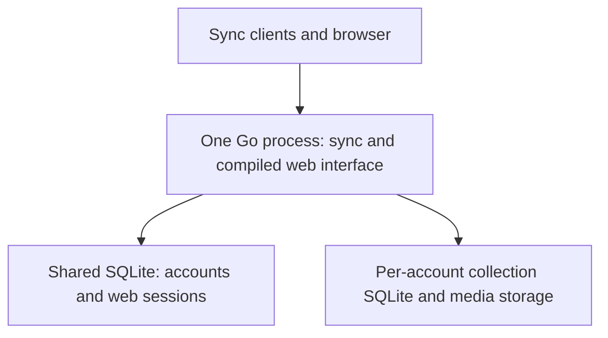
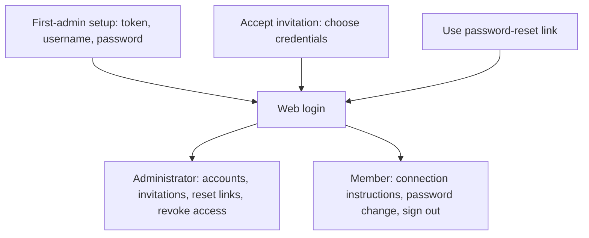
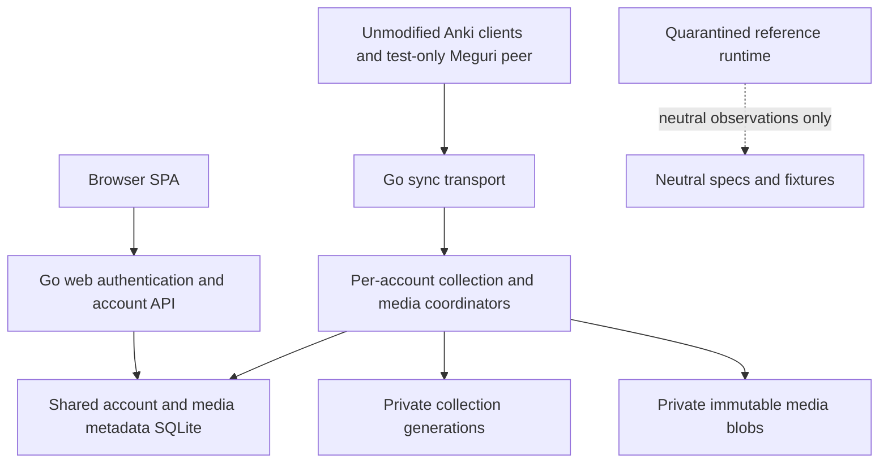
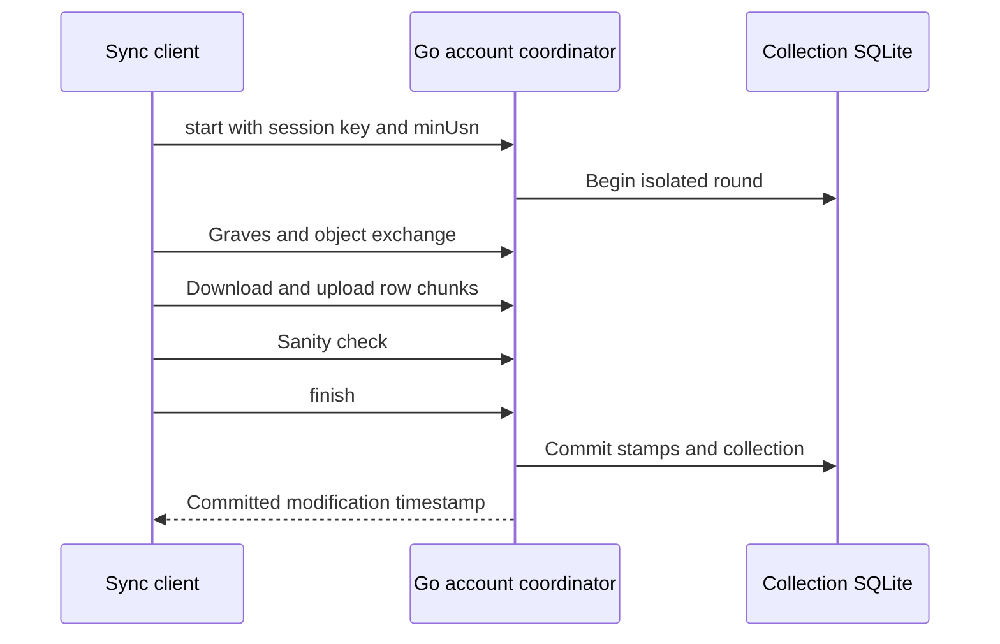
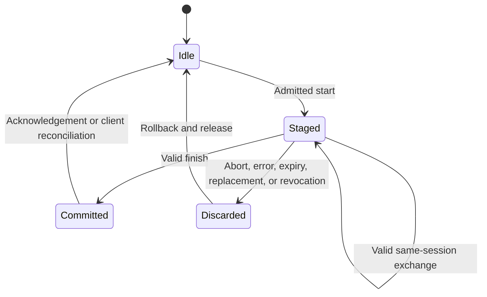
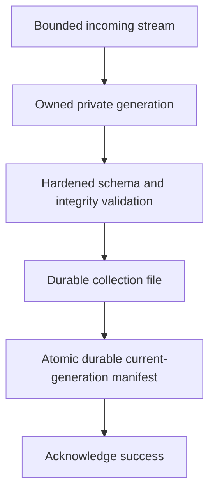
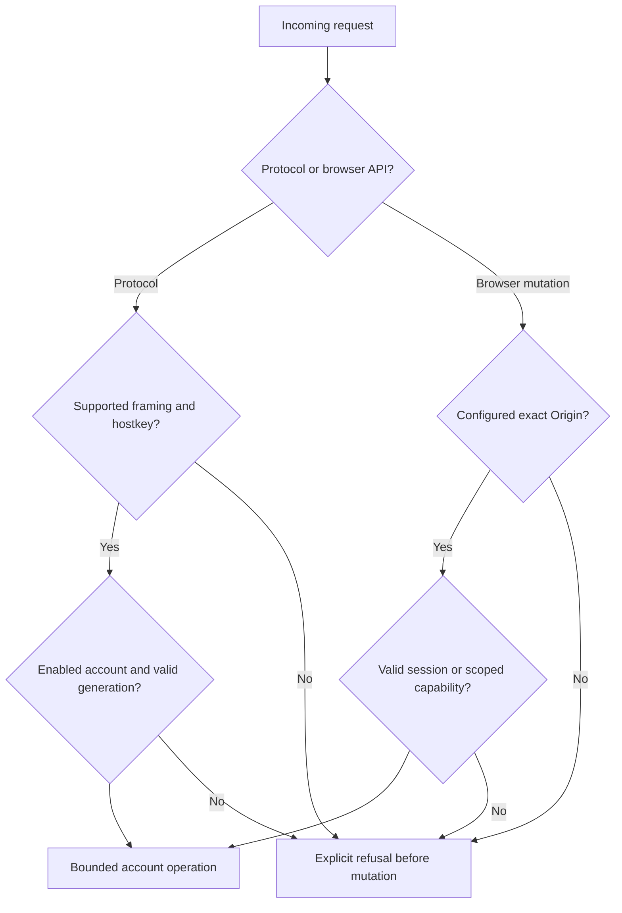
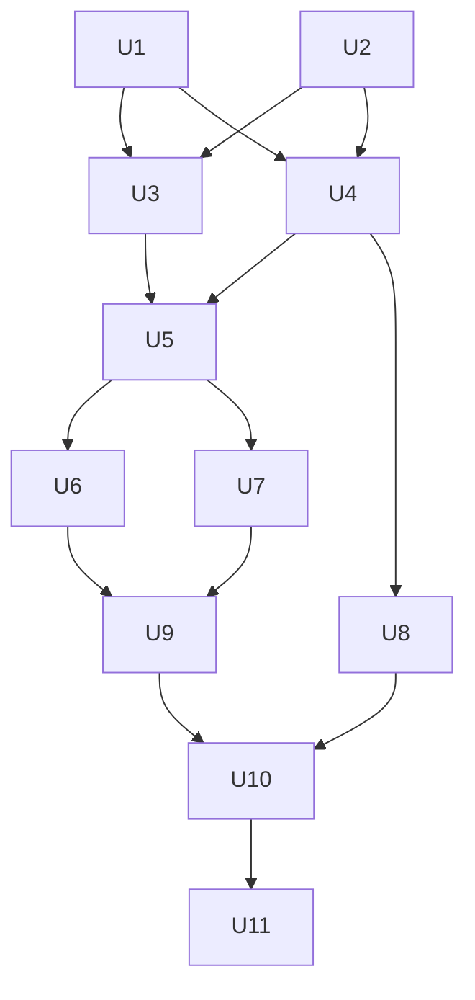

# Meguri Sync Server - Plan

## Goal Capsule

- **Objective:** Antoine can keep his Anki collection, review history, and media synchronized between Desktop and AnkiMobile through a server he operates and whose first-party code he can license independently of Anki.
- **Means:** Meguri Sync using the service, storage, and interface boundaries in KTD1–KTD4.
- **Product authority:** This contract records the scope confirmed on 2026-11-15. Existing clean-room, privacy, and verification rules remain authoritative. The later Meguri application integration is a separate work area.
- **Open blockers:** No unresolved product decision blocks planning. Current-release reference verification and Go similarity coverage are technical prerequisites, per R5 and R7.
- **Execution profile:** Autonomous lfg delivery with no PR. Local branches and worktrees are permitted by Antoine’s 2026-11-15 override; final integration and any push target `master`. Code is produced through the filtered implementation runner, with separate role sessions, per-unit commits and reviews, and coherent-batch gates under `docs/process/tiers.md`.
- **Stop conditions:** Do not weaken compatibility, publish false acceptance, access private collections, or bypass clean-room boundaries to finish. Preserve any unavailable final device evidence as incomplete. Resolve technical failures and review findings within the existing repair authorization.
- **Delivery owner:** The orchestrator completes planning, implementation, review fixes, verification, and local integration. No public deployment, real account setup, or PR is part of this run.

---

## Product Contract

### Summary

Build a private, self-hosted sync server and its web administration interface in this repository. The first release serves Antoine’s current clients, supports isolated private accounts, and favors simple operation over hosted-service scale.

### Problem Frame

Antoine wants control of the server’s first-party code and licensing, and wants to build it in Go. Existing Meguri tooling runs Anki’s server; the retained Meguri sync client is substantial but its historical live acceptance remains incomplete. This is also a project of personal interest, rather than a response to demonstrated performance failure in the official server.

Choosing Go does not establish a speed or security advantage. The official server already offers a Rust implementation. The work must demonstrate correct behavior and reasonable resource use.

### Key Decisions

- **Independent Go implementation.** Prefer one server implementation over a Go wrapper around the Rust core. Governs R1, R2, R4. (session-settled: user-approved — chosen over a Rust-backed wrapper: simpler runtime and first-party license boundary.)
- **MIT for new server code.** The simpler permissive license fits the ownership goal. Governs R3. (session-settled: user-approved — chosen over the proposed Apache-2.0 default: preserve freedom to modify and license independently with simpler terms.)
- **Separate collection databases per account.** Keep each collection’s transactions and recovery isolated. Governs R15. (session-settled: user-approved — chosen over a shared collection database: account isolation with one shared Go process.)
- **Browser-based administration.** A CLI alone does not meet the desired operator experience. Governs R19, R20, R21, R22, R23, R24, R25, R26, R27. (session-settled: user-directed — chosen over CLI-only administration: minimal, friendly setup and account management.)
- **Invitations and administrator-issued reset links.** Avoid an email service in the initial deployment. Governs R22, R24, R26. (session-settled: user-directed — chosen over open signup and email recovery: private accounts with less operational setup.)
- **Current Desktop and AnkiMobile releases.** Focus on the clients Antoine uses. Governs R7, R9. (session-settled: user-directed — chosen over broad client and historical-version coverage: keep initial implementation reasonably simple.)
- **Meguri application changes are later work.** The server remains useful independently of the app integration. Governs R8, R32. (session-settled: user-directed — chosen over changing routine Meguri sync now: this work delivers the server and web interface.)
- **HTTP behind an external HTTPS proxy.** Avoid certificate operations inside this service. Governs R28. (session-settled: user-directed — chosen over built-in TLS: deployment supplies HTTPS through a reverse proxy or tunnel.)

<!-- ce-section: work-relationships -->

### How This Work Fits Together

This plan covers the server and the web interface needed to operate it. The surrounding breakdown is the current understanding, not a committed roadmap.

- **Can proceed independently of:** Meguri application UI changes, per R32.
- **Enables:** a later Meguri app choice between iCloud Sync and Meguri Sync. That area depends on this server and a complete app-side reconciliation and migration contract.
- **Shares:** neutral sync specifications and suitable conformance assets with retained Meguri client work, per R8.
- **Still to decide later:** app-side switching between backends and migration of an existing collection. This plan does not define simultaneous synchronization through both backends.

### Actors

- A1. Operator: deploys the service, controls persistent storage and the HTTPS proxy, and can perform local administrator recovery.
- A2. Administrator: manages invitations, account access, and recovery links through the web interface.
- A3. Member: accepts an invitation, manages their own password, and synchronizes one account’s collection from supported clients.
- A4. Sync client: Anki Desktop, AnkiMobile, or the retained Meguri protocol client used for interoperability checks.

The initial operator, administrator, and member can all be Antoine.

### Requirements

**Ownership, implementation, and provenance**

- R1. Deliver the service as Meguri Sync within this repository, with an explicit license boundary for its server and frontend files.
- R2. Implement the server in Go without requiring Anki, Python, or Meguri’s Rust core in the deployed service.
- R3. License independently authored server and frontend code under MIT while retaining all applicable third-party notices and terms.
- R4. Follow `docs/process/provenance.md` and the role contracts; derive behavior from neutral specs without copying or translating Anki code.
- R5. Extend and validate similarity coverage for Go before crediting a similarity pass for this server, retaining the required independent review and provenance checks.
- R6. Use synthetic data for automated interoperability and resource checks without copying or transmitting private `local-data/` content.

**Compatibility and collection behavior**

- R7. Support unmodified stable Anki Desktop 26.09.4 and AnkiMobile 26.10, with exact tested builds recorded and current-release behavior verified beyond the repository’s 26.09.3 reference baseline.
- R8. Conform to Meguri’s neutral sync contract and exercise suitable retained-client checks; report client defects as blockers to the affected interoperability claim.
- R9. Support authenticated initial upload and download, incremental collection sync, full replacement when required by the protocol, and bidirectional media synchronization.
- R10. Preserve supported collection data and sync semantics across round trips, including review history, scheduling state, notes, cards, decks, note types, templates, configuration, and deletions.
- R11. A no-change sync must avoid retransmitting unchanged collection content and media beyond protocol-required exchanges.
- R12. Concurrent requests must not corrupt a collection or expose another account’s data, including simultaneous sync attempts for the same account.
- R13. Interrupted, rejected, or failed operations must leave valid committed state and allow recovery through protocol-defined retry or full-sync behavior.
- R14. Reject unsupported protocol or collection formats explicitly before destructive changes rather than reporting false success or silently dropping data.

**Storage, durability, and resource use**

- R15. Run one Go service process with a shared SQLite database for accounts and web sessions, plus one collection SQLite database and isolated media storage per account.
- R16. Use durable local disk storage in the first release, with one synchronized collection per account.
- R17. Provide a documented, tested backup-and-restore procedure covering account state, collections, and media without inconsistent references.
- R18. Bound request, decompression, temporary-storage, and concurrency resource use while safely handling invalid media paths and disk-full failures.



Storage and runtime boundary, per R15, R20, and R28. An external proxy supplies public HTTPS.

**Web interface and accounts**

- R19. Provide a minimal responsive React interface using shadcn/ui blocks, with keyboard access, visible focus, labeled controls, and accessible form feedback.
- R20. Serve compiled frontend assets from Go so deployment requires no separate Node server.
- R21. Require an operator-controlled one-time setup token to create the first administrator, and close first-admin setup durably after successful completion.
- R22. After initial setup, permit account creation only through valid administrator-issued invitations, with expiring single-use tokens and a user-chosen username and password.
- R23. Let members sign in, sign out, change their password, and find the server URL and client-connection instructions in the web interface.
- R24. Let administrators list accounts, create invitations, revoke account access, and generate copyable password-reset links in the web interface.
- R25. Enforce member and administrator permissions separately from sync authentication so a sync credential cannot authorize web administration.
- R26. Password-reset links must expire after one use or their lifetime, and a completed reset must invalidate prior web sessions and sync credentials without deleting collection data.
- R27. Provide a local operator recovery path for lost administrator access without enabling anonymous remote recovery or deleting user data.



Directional interface composition for R19–R24. The implementation uses shadcn blocks; exact layout, spacing, and copy remain design details.

**Deployment and delivery scope**

- R28. Serve HTTP behind an external HTTPS proxy or tunnel, with a configured public origin and explicit trusted-proxy handling for web authentication.
- R29. Provide a container image and Linux executable with documented startup, persistent storage, upgrade, and recovery instructions.
- R30. Store passwords as suitable password hashes and keep authentication secrets and collection contents out of ordinary service logs.
- R31. Record elapsed time and resource use for representative synthetic no-change, single-review, initial-transfer, and media-recovery workloads on a personal-scale deployment.
- R32. Deliver this work without changing the Meguri application or claiming its previously unfinished client work accepted.

### Key Flows

- F1. Establish the administrator
  - **Trigger:** the operator starts a fresh deployment.
  - **Steps:** The operator obtains the local setup credential, opens the setup page, and creates the first administrator. Later visits reach normal login. Covers R21, R28–R30.

- F2. Invite a member
  - **Trigger:** the administrator creates an invitation.
  - **Steps:** The administrator copies its link and shares it outside this service. The recipient opens it, chooses credentials, and receives client-connection instructions. Covers R22–R25.

- F3. Synchronize between clients
  - **Trigger:** a member points supported clients at the server and requests sync.
  - **Steps:** The client authenticates and performs the required initial or incremental exchange. The other client receives collection and media changes on its next sync; full replacement uses the client’s existing confirmation flow. Covers R7–R18.

- F4. Recover account access
  - **Trigger:** a member forgets their password.
  - **Steps:** The administrator generates a reset link and gives it to the member. The member chooses a new password and signs clients in again. Lost administrator access follows local operator recovery. Covers R24–R27.

- F5. Restore a deployment
  - **Trigger:** the operator restores a backup onto an empty deployment.
  - **Steps:** The operator follows the documented restore procedure and verifies authentication, collection state, and media availability before normal use. Covers R17, R29.

- F6. Manage a member’s own connection
  - **Trigger:** a signed-in member opens account settings.
  - **Steps:** The member finds connection details, changes their own password when needed, or signs out. Covers R23, R25, R30.

### Acceptance Examples

- AE1. Setup cannot be claimed anonymously
  - **Covers R21.** A browser without the setup token cannot create an administrator. Two valid concurrent attempts cannot create two first administrators; restarting preserves completed setup.

- AE2. Invitations are scoped and single-use
  - **Covers R22, R30.** A valid invitation creates one member. Expired, malformed, or consumed tokens cannot create an account; a rejected credential choice does not produce a partially created account.

- AE3. Account boundaries survive authenticated requests
  - **Covers R12, R24, R25.** A member cannot obtain another account’s collection, media, or administration access. A sync credential cannot create invitations. Revoked accounts cannot authenticate for further sync.

- AE4. Supported clients preserve study data
  - **Covers R7–R10, R14, R32.** A synthetic Desktop collection reaches AnkiMobile with media and review history intact. Mobile edits, reviews, and deletions return to Desktop; a server can then seed a fresh client. Retained Meguri-client checks have distinct evidence and unresolved client failures remain visible.

- AE5. A small update stays incremental
  - **Covers R9, R11, R31.** A no-change sync does not resend the collection or unchanged media. One review synchronizes its required changes without a full transfer unless the protocol independently requires one.

- AE6. Failed transfers preserve committed state
  - **Covers R12–R14, R18.** Interrupted full transfer, media upload, concurrent same-account sync, invalid paths, unsupported formats, and disk-full cases cannot publish corrupted state or false success. The next attempt follows the applicable retry or full-sync response.

- AE7. Reset recovers access without retaining old credentials
  - **Covers R26, R27.** A completed reset allows the new password, invalidates old sessions and sync credentials, and preserves collection and media data. Used or expired reset links fail. Local administrator recovery provides the same data preservation.

- AE8. A backup is usable on an empty deployment
  - **Covers R15–R17, R29.** Following the restore instructions recovers accounts, collection content, and media references together. A supported client can authenticate and synchronize against the restored service.

### Scope Boundaries

**Deferred for later**

- Meguri’s user-facing backend selector, backend migration, and routine app integration, per R32.
- AnkiDroid, historical Anki release matrices, and beta-client support beyond R7.
- Object storage for media or primary state, distributed deployment, and high availability beyond R16.
- Email delivery, public signup, account deletion workflows, and a broader administration CLI beyond R22–R27.
- A future outside-contribution policy granting any desired relicensing rights. The release license alone does not confer ownership of contributions.

**Outside this release’s purpose**

- Billing, subscriptions, a public hosted-service business, or built-in TLS certificate management.
- A card editor, scheduler, card renderer, or browser-based collection viewer.
- Copying an existing collection database file directly between live devices in place of the compatible sync protocol.

### Dependencies / Assumptions

- The 2026-11-15 published stable versions establish R7. Later releases require their own verification; “latest” is not an unbounded compatibility guarantee.
- Existing neutral specs were derived from 26.09.3. A spec-side reference check must resolve relevant differences before a clean implementation is credited against 26.09.4.
- The current scanner excludes Go files by language detection. A generic passing similarity result cannot satisfy R5 until that gap is closed.
- Desktop supports the primary automated interoperability lane. Actual AnkiMobile round-trip evidence requires a supported device and remains explicit acceptance evidence, per R7.
- The retained Meguri client has unfinished live evidence. A server passing Desktop tests does not establish Meguri interoperability, per R8.
- New first-party code is independently authored. Existing MPL-covered code cannot simply be relabeled MIT; third-party rights remain governed by R3.
- MIT permits modification and redistribution subject to its terms. Future releases of owned code may use other terms, but that does not revoke rights already granted in released MIT copies.
- The operator provides durable disk and the external HTTPS endpoint, per R16 and R28. No end-to-end encryption claim is made.
- The goal is a reasonable personal-scale service. There is no required load-testing platform, historical-version campaign, or numerical latency target beyond the evidence in R31.

### Planning-Owned Questions

The original technical questions are resolved in KTD1–KTD16 and the dependency-ordered units below. Runtime findings from current-client probes, exact dependency locks and image digests, and final device availability remain execution-time checks, not assumed passes.

### Sources / Research

Repository claims below were checked independently by source inspection. That inspection establishes code and policy facts, not passing runtime behavior.

- [`docs/process/provenance.md`](https://github.com/antoinefink/meguri/blob/master/docs/process/provenance.md), `docs/process/roles/spec-writer.md`, `docs/process/roles/implementer.md`, and `tools/cleanroom/README.md`: clean-room boundaries and provenance obligations.
- [`tools/similarity/config.yaml:46`](https://github.com/antoinefink/meguri/blob/master/tools/similarity/config.yaml), `tools/similarity/meguri_similarity/lexer.py:27`, and `tools/similarity/meguri_similarity/scan.py:62`: missing Go coverage.
- [`core/crates/meguri-servers/src/lib.rs:1`](https://github.com/antoinefink/meguri/blob/master/core/crates/meguri-servers/src/lib.rs), `docker/compose.yml:185`, and `tools/scripts/local_sync.py:173`: integration placeholder and utilities that invoke Anki’s server. The local utility uses a supplied immutable image; its release identity is not established by the utility alone.
- [`core/crates/meguri-sync/src/lib.rs`](https://github.com/antoinefink/meguri/blob/master/core/crates/meguri-sync/src/lib.rs); `specs/sync/transport.md`, `specs/sync/normal-sync.md`, `specs/sync/one-way.md`, and `specs/sync/media-sync.md`: retained client and neutral protocol contracts.
- [`docs/process/review-log/U107-normal-sync.md:314–328`](https://github.com/antoinefink/meguri/blob/master/docs/process/review-log/U107-normal-sync.md): parked work, incomplete live verification, and pending batch acceptance.
- [`docs/design/native-interface-contract.md:337–339`](https://github.com/antoinefink/meguri/blob/master/docs/design/native-interface-contract.md) and `app/Packages/MeguriKit/Sources/AppModel/Sync/SettingsPageVisibility.swift:7–9`: iCloud-only default UI and retained Anki interface override.
- [`docs/plans/2026-10-12-1926-feat-meguri-anki-compatible-apple-app-plan.md`](https://github.com/antoinefink/meguri/blob/master/docs/plans/2026-10-12-1926-feat-meguri-anki-compatible-apple-app-plan.md): existing application scope and frozen Anki-server work. This new contract does not establish acceptance of those old units.
- [Anki 26.09.3 license](https://raw.githubusercontent.com/ankitects/anki/26.09.3/LICENSE); [GNU FAQ on translation](https://www.gnu.org/licenses/gpl-faq.en.html#TranslateCode); [AGPL section 13](https://spdx.org/licenses/AGPL-3.0-or-later.html): Anki licensing and derivative-code constraints.
- [CJEU C-406/10](https://eur-lex.europa.eu/legal-content/EN/TXT/?uri=CELEX%3A62010CJ0406): functionality and protected expression are distinct. This informs the independent-implementation approach; it is not a guarantee of zero legal risk.
- [MIT license](https://opensource.org/license/mit), [Apache License 2.0](https://www.apache.org/licenses/LICENSE-2.0), and [Mozilla MPL FAQ](https://www.mozilla.org/en-US/MPL/2.0/FAQ/): license alternatives and separate treatment of existing covered files. Root `LICENSE:1` and `core/Cargo.toml:13` establish the repository’s existing MPL-2.0 license.
- [Anki Desktop 26.09.4 release](https://github.com/ankitects/anki/releases/tag/26.09.4) and [AnkiMobile App Store listing, version 26.10](https://apps.apple.com/us/app/ankimobile-flashcards/id373493387): stable client versions checked on 2026-11-15.
- [Anki self-hosted sync documentation](https://docs.ankiweb.net/manual/sync-server): supported custom-server setup, protocol drift, and official implementation choices.
- [shadcn/ui blocks](https://ui.shadcn.com/blocks) and [shadcn/ui MIT license](https://raw.githubusercontent.com/shadcn-ui/ui/main/LICENSE.md): requested frontend source and notice obligations.
- [SQLite server usage](https://www.sqlite.org/whentouse.html) and [WAL documentation](https://www.sqlite.org/wal.html): local transactional storage and same-host coordination.
- [S3 consistency](https://docs.aws.amazon.com/AmazonS3/latest/userguide/Welcome.html#ConsistencyModel) and [conditional writes](https://docs.aws.amazon.com/AmazonS3/latest/userguide/conditional-writes.html): object-level atomicity does not supply multi-object transactions. Disk-first scope avoids implementing that coordination in this release.

---

## Planning Contract

Product Contract unchanged; its planning-owned questions are resolved below without changing R/A/F/AE meanings or IDs.

### Key Technical Decisions

- KTD1. **A separate `server/` Go module owns production code.** Keep `cmd/meguri-sync`, HTTP handlers, account storage, collection codecs, sync engines, embedded assets, and the web source in this subtree. Reuse neutral specs and suitable input data, not translated MPL-covered Rust implementations. Test-only reference drivers stay quarantined; no Anki or Rust runtime enters the shipped executable. Implements R1–R4, R20, R32.
- KTD2. **Use a small, pinned dependency set.** Start from Go 1.27.4, `modernc.org/sqlite` 1.62.0 with its matching `modernc.org/libc` dependency, `klauspost/compress` 1.20.4, and the Go crypto/text/protobuf packages needed by the neutral contracts. Use stdlib HTTP routing and SQL rather than a web framework or ORM. Resolve and lock exact transitive versions through Docker, retaining license evidence. If a researched pin cannot be resolved or has a relevant advisory, choose a supported patched version and record the evidence before implementation. Implements R2–R5, R18, R30. Sources: [Go releases](https://go.dev/doc/devel/release), [modernc tags](https://gitlab.com/cznic/sqlite/-/tags), [compress release](https://github.com/klauspost/compress/releases/tag/v1.20.4).
- KTD3. **Compile a browser-only React SPA into the Go binary.** Use React/React DOM 19.3.1, Vite 8.3.8, TypeScript 7.0.2, Tailwind 4.3.5, and shadcn CLI 4.23.0 as researched starting pins. Adapt `login-01` and the minimal account/navigation parts of `sidebar-01`; remove sample OAuth, email recovery, public signup, charts, and external assets. Commit imported source, its MIT notices, source URLs/hashes, and the npm lockfile because a pinned CLI does not pin live registry content. Build with Node 26 LTS only in Docker. Implements R3, R19, R20. Sources: [Vite installation](https://ui.shadcn.com/docs/installation/vite), [login blocks](https://ui.shadcn.com/blocks/login), [sidebar blocks](https://ui.shadcn.com/blocks/sidebar).
- KTD4. **Keep server metadata out of transferable collections.** `accounts.sqlite` owns identities, credential generations, browser sessions, hostkeys, capabilities, and account-scoped media indexes/USNs. Each opaque account ID has its own schema-compatible collection SQLite and media blob directory. Account IDs, not usernames or remote filenames, select paths. Every writable connection uses the verified WAL/`synchronous=FULL` durability policy and bounded busy waiting; the accounts database also enforces its foreign-key constraints. A bounded connection manager coordinates these stores without claiming cross-database transactions. Implements R12, R15–R18, R25. Sources: `specs/storage/schema-18.md`, [SQLite server usage](https://www.sqlite.org/whentouse.html), [WAL durability](https://www.sqlite.org/wal.html#performance_considerations).
- KTD5. **Implement only observed current-client transport forms.** The initial contract is protocol v11, raw zstd, exact integer JSON, `anki-sync` authentication, and `anki-original-size` response framing. U2/U3 establish whether either target needs another form before it is added. Do not invent legacy multipart support or reject HTTP versions merely because the retained client uses HTTP/1.1. Keep browser APIs outside the protocol route families. Implements R7–R9, R14, R18. Sources: `specs/sync/transport.md`, `specs/sync/wire-format.md`.
- KTD6. **Use file-compatible schema-18 collections and independently authored codecs.** Implement schema-11 JSON to schema-18 SQLite/protobuf conversion from neutral model/storage specs, preserving supported unknown JSON and protobuf fields where their channel permits them. Register the pinned Unicode 12.1 `unicase` behavior on every collection connection; generic current-Unicode folding is insufficient. Do not regenerate unrelated full-transfer contents or introduce stock Anki templates/assets. Add older schema migrations only if a supported client’s verified traffic requires them. Implements R4, R7–R10, R14. Sources: `specs/model/protobuf-records.md`, `specs/model/schema11-json.md`, `specs/text/unicode-primitives.md`, `specs/text/checksum-and-sort-field.md`.
- KTD7. **A per-account coordinator owns collection sessions.** Hold an uncommitted SQLite transaction on a dedicated connection across the normal round, with bounded idle expiry and no process-wide collection mutex. Bind it to account, collection generation, native session key, and credential generation. A new admitted round replaces an unfinished round according to the server contract; abort, errors, expiry, and restart discard uncommitted work. `finish` rechecks generation ownership and commits before acknowledgement. Full-transfer admission and retirement rules are sealed in U3, so an old connection cannot commit successfully into a displaced file. Lost acknowledgements recover through ordinary client reconciliation rather than a new protocol extension. KTD16 owns lock ordering. Implements R10–R14, R18. Sources: `specs/sync/normal-sync.md`, `specs/sync/server-lifecycle.md` planned in U2.
- KTD8. **Publish full collection generations atomically.** Stream an upload into a private same-filesystem generation, validate its schema/integrity through a hardened connection, make it durable, then switch a small durable current-generation manifest under the account coordinator. Resolve any unfinished normal round and close old writable handles before activation; preserve the prior generation until durable publication and reader release. Downloads apply required server stamps and stream a pinned, self-contained committed snapshot independent of later replacement. Startup removes only unreferenced, owned staging generations after resolving the manifest. KTD16 owns lock ordering. Implements R9, R12–R14, R18. Sources: `specs/sync/one-way.md`, [SQLite security](https://www.sqlite.org/security.html).
- KTD9. **Publish media through immutable blobs and transactional metadata.** Stage and validate the complete archive independently of remote paths; publish durable account-private blobs before committing filename, hash, tombstone, and USN metadata in `accounts.sqlite`. Acknowledged metadata never points at nondurable bytes. Normal collection transactions and media use separate coordination under KTD16. Retain tombstones in v1; collect unreferenced owned blobs only with exclusive startup/offline ownership. Restore recovery is governed by KTD13 and cannot be inferred from an ahead cursor, matching USNs, or matching file counts. This avoids a multi-file rename journal and cross-database atomicity claims. Implements R9–R13, R17, R18. Sources: `specs/sync/media-sync.md`, `specs/sync/wire-format.md`.
- KTD10. **One identity has separate browser and native credentials.** The first administrator also owns a normal collection. Store Argon2id password hashes, hashed opaque session/hostkey secrets, and an account credential generation. Use bounded hash workers and bounded password/capability-attempt rate limiting, with generic authentication failures; ordinary authenticated sync chunks must not consume a password-attempt budget. Browser sign-out revokes that session; password change, reset, recovery, or account disable revokes all relevant credentials. Credential issuance rechecks the exact hash revision and generation verified before slow work, never attaching old-password proof to a new generation. Administrator capability creation and password replacement revalidate their original authority in their committing transaction. Serialize these operations with publication under KTD16. Preserve data and reject disabling the sole administrator. Implements R12, R21–R27, R30. Sources: [OWASP password storage](https://cheatsheetseries.owasp.org/cheatsheets/Password_Storage_Cheat_Sheet.html), [OWASP sessions](https://cheatsheetseries.owasp.org/cheatsheets/Session_Management_Cheat_Sheet.html).
- KTD11. **Initialization and capabilities have explicit durable states.** A local initialization command creates an owner-readable setup token file and a database singleton; normal serve refuses missing expected state instead of silently reinitializing. Browser setup uses that token under R21. Invitations last seven days, resets thirty minutes, and a newer reset replaces older ones. Validation/name conflicts leave a capability unclaimed. A successful provisioning claim durably reserves its capability, username, password hash, and opaque account ID; retries and startup resume only that same identity. Access and first-admin setup closure publish only at the ready transition, so filesystem failure neither exposes a partial account nor permits a second redemption. Put manually shared tokens in URL fragments, clear them promptly, and never consume them on GET. Implements R21, R22, R24, R26, R27, R30. Source: [OWASP reset guidance](https://cheatsheetseries.owasp.org/cheatsheets/Forgot_Password_Cheat_Sheet.html).
- KTD12. **Trust the configured public origin, not request headers.** Production web sessions use Secure, HttpOnly, SameSite cookies even though Go receives HTTP. Require an exact configured Origin on unsafe browser requests, including login/setup/reset; no permissive CORS. Trust forwarded client-IP/proto information only from configured proxy peers. Native sync routes authenticate hostkeys independently and never accept browser cookies as credentials. Test this through a private HTTPS proxy fixture. Implements R18, R25, R28, R30. Go’s generic cross-origin middleware alone does not enforce this fail-closed policy. Sources: [Go HTTP](https://pkg.go.dev/net/http), [OWASP CSRF](https://cheatsheetseries.owasp.org/cheatsheets/Cross-Site_Request_Forgery_Prevention_Cheat_Sheet.html).
- KTD13. **Use stopped-service backup and explicit client recovery.** Initialization, serve/startup sweeping, backup, restore, and recovery share one stable exclusive data-root lock identity. Never replace that lock during restore. Before backup, recover/checkpoint and close every database under the lock, retaining any required journal state. Restore accepts only an empty target, verifies every file, invalidates bearer capabilities, and durably keeps serving closed until local administrator recovery and explicit review of restored account/password state. Preserve backed-up collection state; the client recovery procedure explicitly requests a full transfer instead of assuming a changed `scm` overrides equal `mod`. Every participating client must complete a verified full collection and media-reset/rescan procedure before it is considered recovered; the runbook cannot infer recovery from successful HTTP, cursor equality, or counts. U3 proves the Desktop procedure and U11 proves the Mobile procedure, including delayed reconnect and renewed credentials. An unverified procedure blocks the affected restore claim rather than introducing an assumed wire signal. Historical password hashes and enabled states are snapshot data: do not claim post-backup revocations survive rollback automatically. No transparent automatic restore guarantee, online backup scheduler, or external auth journal is added. Implements R17, R26–R30. Sources: [SQLite backup](https://www.sqlite.org/backup.html), [SQLite WAL](https://www.sqlite.org/wal.html).
- KTD14. **Extend existing MG enforcement before adding production paths.** Add `server/` to the filtered source allowlist and provenance/test-host scopes; implement calibrated Go lexical/comment coverage and scoped JSX/TSX coverage without claiming nonexistent structural comparisons. Add dedicated Docker services, context allowlists, caches, source triggers, dependency/notices checks, and headless browser evidence. Preserve mandatory sandbox probes and quarantine. The cleanroom runner’s clean-master source condition remains; local worktrees can hold research/review work while code exports originate from clean master. Implements R4–R6, R29, R32. Sources: `tools/cleanroom/source_view.py`, `tools/similarity/AGENTS.md`, `tools/gate/tiers.yaml`.
- KTD15. **Use real reference clients, not only Go-to-Go tests.** A separate quarantined 26.09.4 reference runtime exercises supported Desktop backend operations through a neutral test protocol without changing the existing 26.09.3 oracle pin. A test-only Rust peer exercises retained Meguri APIs without editing application behavior. Actual AnkiMobile acceptance remains a distinct exact-build device round trip. Synthetic workload evidence reports behavior and resource use; it is not a hosted-scale program. Implements R6–R11, R31, R32. Sources: `docs/process/roles/oracle-maintainer.md`, `specs/conformance/sync-ops.md`.
- KTD16. **Keep publication barriers short and acquire them before shared metadata writes.** Decode/stream/hash outside account barriers and shared write transactions. An account request/publication barrier precedes its short collection/media state lock and any shared metadata write; never wait for an account barrier or client/network round while holding the shared writer. A retained normal-round connection is state owned by the coordinator, not a mutex held across the network. Under the barrier, recheck authority and generation, then finish the relevant commit, manifest switch, or media publication before a revoker may acknowledge. Administrative metadata transactions revalidate the actor and target authority without acquiring another account barrier while holding the writer. Close the relevant unfinished round rather than waiting for an abandoned client. Implements R12, R13, R18, R24–R27; refines KTD7–KTD10. Source: [SQLite isolation](https://www.sqlite.org/isolation.html).

### High-Level Technical Design

The production and reference boundaries follow KTD1, KTD4, and KTD15.



The normal round keeps one account transaction unpublished until finish, per KTD7.



Session states and revocation share the publication boundary in KTD7 and KTD10.



Full-transfer data moves through the durable publication stages in KTD8.



Request admission separates protocol and browser trust, per KTD5 and KTD12.



### Output Structure

The following paths declare the service boundary; unit file lists own the detailed work.

```text
server/
  AGENTS.md, LICENSE, THIRD_PARTY_NOTICES.md, README.md
  go.mod, go.sum
  cmd/meguri-sync/
  internal/{accounts,collection,httpapi,media,protocol,storage,webassets}/
  web/{src,public,e2e}/
  tests/{fixtures,meguri-peer,support}/
  licenses/
specs/sync/server-*.md
specs/servers/meguri-sync-web.md
specs/conformance/meguri-sync-server.md
oracle/meguri-sync-server/
docker/meguri-sync-*.Dockerfile
tools/mg.d/meguri-sync.sh
tools/scripts/meguri-sync/
```

### Implementation Constraints and Assumptions

| Evidence boundary | Available before production handlers | Acceptance still required |
|---|---|---|
| Existing neutral v11 contract | 26.09.3 facts and client semantics in U2 | Current-client verification, not inherited acceptance |
| Current Desktop backend | U3 records 26.09.4 forms, stamps, lifecycle, and recovery procedure | Candidate-server round trips in U5–U11 |
| Current AnkiMobile | Shared-protocol compatibility is an explicit working assumption | Exact-build real-device forms, round trips, and recovery in U11 |
| Retained Meguri peer | Existing neutral APIs and separate test-only adapter | Actual supported paths and explicit client-origin blockers in U11 |
| Web/account API | Original policy specified in U2 | U4/U8 real API/browser evidence |

- KTD2/KTD3 pins are research inputs, not dependency-resolution receipts. U1/U4/U8 record resolved locks, source notices, and image digests before claiming reproducibility.
- U2/U3 must establish Desktop-current upload schema, transport, blank-account behavior, session transitions, stamping, and media envelopes before dependent compatibility handlers are implemented. They do not seal unobserved Mobile behavior; its conditional claims remain open until U11 without blocking independent Desktop-backed implementation.
- A copied or translated Rust implementation cannot be relabeled MIT. Neutral field declarations and protocol facts are usable; code reuse retains its original license under R3.
- Initial metadata has a small fixed schema. Media indexing belongs to KTD4’s shared server database, never to the transferable collection.
- No service method contacts a public sync service. Test endpoints are job-owned local services; production reverse-proxy installation remains operator work.
- The same account can administer the service and sync its own collection. Administrators gain no browser collection viewer or cross-account content endpoint.
- R18 limits are configurable bounded controls; select initial values from verified legal client payloads and synthetic measurements rather than inheriting conflicting media limits blindly.
- Remaining SDK method names, package resolution, and actual fault results are execution-time discoveries within their named units. They cannot waive R7 or R8.

### System-Wide Impact and Risks

- The new source tree changes cleanroom, provenance, similarity, dependency, Docker-context, and tier-trigger coverage. U1 makes those changes explicit before server files can escape checks.
- Current Anki SQLite/protobuf representations and collation are the largest implementation risk. U2/U3 contract evidence and U5 round-trip fixtures precede normal sync.
- Long-lived collection transactions, media metadata, and account revocation touch different stores. KTD7–KTD10 define their ownership and publication order; tests must cross those seams.
- The app’s original milestones and frozen client acceptance remain separate. A new server receipt does not satisfy an old app unit automatically.
- Restore rolls collection and identity state back to a snapshot. KTD13 makes the operator acknowledge that boundary before serving; preserving a separate permanent revocation journal is considered but not built for this personal-scale service.
- Online backup, a distributed lock service, per-user billing quotas, generalized role management, and automatic reference-version tracking are considered and not built. None is required for the chosen one-process private deployment; measured need or a changed product scope can reopen them later.

---

## Implementation Units

U-IDs are local to this plan. Review logs and commit provenance must also identify this plan, so these units cannot be confused with the existing application plan’s U-IDs.

| Unit | Outcome | Primary paths | Depends on |
|---|---|---|---|
| U1 | Tooling enforces the new source boundary | `tools/`, `docker/` | None |
| U2 | Neutral server and web contracts | `specs/sync/server-*.md`, `specs/servers/meguri-sync-web.md` | None |
| U3 | Current-release reference harness and neutral fixtures | `oracle/meguri-sync-server/`, `conformance/` | U1, U2 |
| U4 | Account, credential, and service substrate | `server/internal/accounts/`, `server/internal/httpapi/` | U1, U2 |
| U5 | Collection representation and full transfer | `server/internal/collection/`, `server/internal/protocol/` | U3, U4 |
| U6 | Transactional incremental sync | `server/internal/collection/`, `server/internal/protocol/` | U5 |
| U7 | Durable media sync | `server/internal/media/`, `server/internal/protocol/` | U3, U4, U5 |
| U8 | Minimal shadcn administration interface | `server/web/`, `server/internal/webassets/` | U4 |
| U9 | Offline recovery and coherent backup/restore | `server/cmd/`, `server/internal/storage/` | U5, U6, U7 |
| U10 | Reproducible release packaging and notices | `docker/`, `server/licenses/`, `server/README.md` | U8, U9 |
| U11 | Complete interoperability, resilience, and usability evidence | `server/tests/`, `server/web/e2e/`, `conformance/` | U3, U6, U7, U8, U9, U10 |



### U1. Extend tooling and provenance to the server boundary

**Goal:** New Go and frontend paths receive the required isolation, dependency, provenance, privacy, and similarity enforcement.

**Requirements:** R1–R6, R29, R32; KTD1, KTD14.

**Dependencies:** None.

**Files:** `tools/cleanroom/source_view.py`, `tools/tests/cleanroom.bats`, `tools/hooks/commit-msg`, `tools/gate/static-checks/ankiweb-hosts.sh`, `tools/gate/static-checks/no-retries.sh`, `tools/tests/provenance.bats`, `tools/similarity/meguri_similarity/lexer.py`, `tools/similarity/config.yaml`, `tools/similarity/tests/test_lexer.py`, `tools/similarity/tests/test_scan_synthetic.py`, `tools/mg.d/meguri-sync.sh`, `tools/tests/meguri_sync.bats`, `tools/gate/tiers.yaml`, `docker/compose.yml`, `docker/meguri-sync-dev.Dockerfile` and its context allowlist.

**Approach:** Extend the existing mechanisms in KTD14, preserving their denied trees and reports. Add pinned Go/Node tooling services and source-mutation utilities for dependency locks and licensed block imports. Register jobs and triggers only when their implementation exists; future lanes remain explicitly pending until their owning units land.

**Patterns to follow:** `tools/AGENTS.md`, `docker/AGENTS.md`, existing `mg_job` result helpers and cleanroom boundary tests.

**Test scenarios:**

- Permit ordinary `server/` source while refusing nested forbidden trees, links, submodules, credentials, and history.
- Reject a server-code commit missing the appropriate role, session, or spec/requirement provenance.
- Include Go raw strings, escaped strings, comments, and file/line attribution in scanner coverage; retain existing-language behavior.
- Detect controlled cross-language lexical/comment positives without claiming a Go-only structural lane proves translation independence.
- Dry-run every new job without mutation, validate its tier/utility registration, and reject browser test retries.

**Verification:** Focused tooling tests, actual cleanroom boundary probes, and similarity calibration pass with Go files demonstrably counted. No production server behavior is introduced by this unit.

### U2. Specify server behavior and current-client probes

**Goal:** Implementers receive neutral baseline server/web contracts and a complete current-release probe contract.

**Requirements:** R4, R7–R18, R21–R30; F1–F6; AE1–AE8; KTD5–KTD13.

**Dependencies:** None. U3 validates and seals current-release reference clauses before compatibility code depends on them.

**Files:** `specs/sync/server-transport.md`, `specs/sync/server-collection.md`, `specs/sync/server-lifecycle.md`, `specs/sync/server-media.md`, `specs/servers/meguri-sync-web.md`, `specs/conformance/meguri-sync-server.md`, relevant `specs/*/interop-vocab.txt`, `conformance/schema/meguri-sync-server.schema.json`, and spec-side provenance under `oracle/provenance/`.

**Approach:** Separate verified Anki behavior from original Meguri Sync policy. Specify initial account state, method admission/order, USN/stamp transitions, conflict/deletion semantics, schema/protobuf conversion boundaries, media envelopes/limits, abort/expiry, and acknowledgement outcomes. Define the narrow browser endpoints, identity rules, capability states, error outcomes, and KTD10–KTD13 publication boundaries without copying code or reference control flow.

**Execution note:** Use existing neutral facts first. Mark unknown reference behavior for U3 probes; no dependent compatibility implementation proceeds with those facts unresolved.

**Patterns to follow:** `specs/README-format.md`, `specs/sync/transport.md`, `specs/sync/wire-format.md`, `specs/model/schema11-json.md`, `specs/model/protobuf-records.md`.

**Test scenarios:**

- Classify every endpoint and state transition as a verified reference fact or original server policy, with a neutral observation for each reference-dependent rule.
- Cover first-admin token delivery, administrator-as-member identity, invitation conflicts, reset/disable during each publication phase, and stopped restore admission.
- Establish exact current-client transport and schema forms rather than assuming the old pin or requiring speculative legacy transport.

**Verification:** An independent spec review finds no unclassified server behavior or missing current-client probe. Original account/web policy is complete; compatibility clauses carry their reference baseline until U3 verification. Spec and oracle work keep separate role commits.

### U3. Add a quarantined current-release interoperability harness

**Goal:** A neutral test boundary can drive the supported Desktop backend against reference and candidate servers.

**Requirements:** R4, R6–R10, R14, R31, R32; F3; AE4, AE5; KTD15.

**Dependencies:** U1 and U2. This unit supplies the current-release evidence and the spec-side refinement that seals the reference clauses before U5.

**Files:** `oracle/meguri-sync-server/driver.py`, its test-only lock and self-tests, `docker/meguri-sync-reference.Dockerfile` and allowlist, `tools/mg.d/meguri-sync.sh`, `conformance/schema/meguri-sync-server.schema.json`, `conformance/fixtures/meguri-sync-server/`, `conformance/recordings/scenarios/meguri-sync-server/`, `specs/conformance/meguri-sync-server.md`.

**Approach:** Pin the requested current Anki wheel and artifact hashes in a separate reference image. Keep every SDK adapter and reference implementation dependency in `oracle/`; communicate only through the neutral schema. Generate synthetic collections with original note types/templates and observations safe for implementers. Leave the existing global oracle pin and goldens untouched.

**Patterns to follow:** Oracle-maintainer quarantine rules and existing conformance protocol/result validation.

**Test scenarios:**

- The reference client performs initial upload/download, normal sync, and media exchange against the reference server using only job-owned endpoints.
- A malformed harness request or unreachable candidate produces a failed receipt, never a successful empty run.
- Probe missing server facts from U2, including blank-account download, session replacement/expiry, full-download stamps, media pagination, and no-op USNs.
- Generated fixtures contain no stock Anki template assets, private data, credentials, or executable reference code outside quarantine.

**Verification:** Harness self-tests and reference-to-reference smoke produce nonzero validated observations. Record current-release identity and lock hashes separately from the original application oracle.

### U4. Build the account and service substrate

**Goal:** The Go service securely initializes storage and implements the account APIs consumed by native sync and the web UI.

**Requirements:** R1–R3, R12, R15, R16, R18, R21–R28, R30; A1–A3; F1, F2, F4, F6; AE1–AE3, AE7; KTD1, KTD2, KTD4, KTD10–KTD12, KTD16.

**Dependencies:** U1 and U2’s completed original web/account contract.

**Files:** `server/AGENTS.md`, `server/LICENSE`, `server/go.mod`, `server/go.sum`, `server/cmd/meguri-sync/main.go`, `server/internal/accounts/`, `server/internal/httpapi/`, `server/internal/storage/`, `server/internal/accounts/accounts_test.go`, `server/internal/httpapi/auth_test.go`, `server/internal/storage/provision_test.go`, `tools/mg.d/meguri-sync.sh`.

**Approach:** Create the module and process/configuration/storage boundary before exposing handlers. Implement capability and credential transactions, internal native-credential issuance, browser authorization, setup closure, account provisioning, and revocation coordination. Protocol hostkey framing waits for U5. Add only the local initialization/recovery primitives needed by the original flows; U9 completes operational commands.

**Execution note:** Prove the account publication and authorization boundaries before adding any collection mutation route.

**Patterns to follow:** KTD10–KTD12 and `specs/servers/meguri-sync-web.md`; use SQL placeholders and server-owned account IDs.

**Test scenarios:**

- Covers AE1. Concurrent setup submissions create one administrator, and restart does not reopen setup.
- Covers AE2. Invite validation/username conflicts do not consume a token; concurrent valid redemption creates one account.
- Covers AE3. Browser sessions, native hostkeys, member/admin permissions, and disabled accounts remain distinct under actual HTTP requests.
- Covers AE7. Password change/reset and credential generation changes invalidate prior credentials without changing account data.
- Pause a login after old-password verification, finish reset/disable, and resume issuance: no fresh credential may carry that old authority. Repeat for administrator capability creation and competing password replacements.
- Wrong or missing browser Origin, spoofed forwarding headers, unknown credentials, expired capabilities, and exhausted hash capacity fail before mutation.
- Provisioning failures between account and filesystem steps recover to the same opaque identity without exposing an incomplete account.
- Kill between the durable provisioning claim, directory/collection creation, ready transition, and setup closure; concurrent retries resume one reserved identity rather than burn or reuse its capability.

**Verification:** Go unit/integration and race checks pass through MG with real temporary SQLite files. The administrator can also obtain a sync-only hostkey for their own account.

### U5. Implement collection codecs, transport, and full transfer

**Goal:** Supported clients can authenticate, inspect metadata, and exchange a complete valid collection through the Go server.

**Requirements:** R7–R10, R12–R16, R18, R25; F3; AE4, AE6; KTD4–KTD8.

**Dependencies:** U3, U4, and the completed current-release clauses from U2.

**Files:** `server/internal/collection/{schema,objects,protobuf,unicase,notes}.go`, `server/internal/collection/codecs_test.go`, `server/internal/collection/full_test.go`, `server/internal/protocol/{framing,login,meta,full}.go`, `server/internal/protocol/transport_test.go`, `server/tests/fixtures/`, `tools/mg.d/meguri-sync.sh`, server interop tier entries.

**Approach:** Implement KTD5/KTD6 representations independently, then KTD8 publication and snapshot download. Harden uploaded database connections and preserve unrelated supported content. Keep all private metadata outside the transferable file. Introduce the candidate-server interoperability job with explicit selected lane arguments; the batch gate waits until all registered required lanes exist.

**Execution note:** Start from neutral representation and full-transfer fixtures before normal reconciliation. Do not substitute a server-private database format that cannot round-trip through real clients.

**Patterns to follow:** U2 server contracts and the neutral storage, text, schema-11 JSON, and protobuf specs cited by KTD6.

**Test scenarios:**

- Covers AE4. A current Desktop backend uploads a synthetic collection and a fresh backend downloads equivalent supported content and valid stamps.
- Preserve 64-bit IDs, BLOB/TEXT distinctions, unknown supported object fields, filtered decks, presets, template bytes, and review metadata through codec/full-transfer tests.
- Match pinned `unicase`, note sort-field, and checksum vectors, including the documented folding quirk.
- Covers AE6. Corrupt/unsupported/truncated uploads, cancellation, disk-full, and kills around publication never replace the committed generation falsely.
- Serve a valid blank account snapshot and a WAL-backed committed snapshot without leaking incomplete sidecars or server metadata.
- Interleave a paused normal round, full upload publication, and stamped full download in both orders; acknowledged changes must belong to the manifest-selected generation or its explicit later replacement.

**Verification:** Go fixtures and actual reference-client full-transfer tests pass; inspect the downloaded database through the neutral reference boundary rather than relying on Go decoding itself.

### U6. Implement transactional incremental reconciliation

**Goal:** Normal sync converges supported client collections without whole-file replacement or partial commits.

**Requirements:** R8–R14, R18; F3; AE4–AE6; KTD6, KTD7, KTD10.

**Dependencies:** U5.

**Files:** `server/internal/collection/{session,graves,changes,chunks,sanity}.go`, `server/internal/collection/normal_test.go`, `server/internal/collection/session_test.go`, `server/internal/protocol/normal.go`, current-client neutral scenario inputs.

**Approach:** Use the verified lifecycle contract to select pending server changes, exchange objects and rows, enforce conflict/deletion semantics, compare sanity, and commit closing stamps. Retain one unpublished round and coordinate abort, replacement, expiry, and credential-generation changes through KTD7/KTD10.

**Patterns to follow:** `specs/sync/server-collection.md`, `specs/sync/server-lifecycle.md`, and neutral tuple/object rules; existing Rust implementations are peers, not translation templates.

**Test scenarios:**

- Covers AE4. Two real reference clients exchange edits, reviews, deletions, decks, note types, presets, tags, and config in both directions.
- Exactly 250 objects, 251 graves, and mixed multi-chunk collections terminate correctly without missing or duplicate effects.
- Equal/different modification stamps, duplicate tuple IDs in order, review-ID collisions, and case-folded name collisions match the contract.
- Covers AE5. No-change and one-review exchanges stay incremental.
- Covers AE6. Invalid session order/key, bad sanity, abort, expiry, a new start, or process death rolls back uncommitted changes.
- A lost finish acknowledgement and subsequent ordinary retry preserve one review history; password reset/disable cannot be followed by an old-generation commit.
- Overlap finish, media publication, and reset/disable under deterministic barriers; each completes within its bound and a second account progresses without waiting for an idle network round.

**Verification:** Go/race tests and current-reference two-client normal-sync lanes pass, with database state observed independently after commits and refusals.

### U7. Implement durable media synchronization

**Goal:** Media additions, replacements, and deletions converge through compatible batches without losing acknowledged bytes or cursor progress.

**Requirements:** R9–R13, R15–R18, R25; F3; AE3–AE6; KTD4, KTD9, KTD10.

**Dependencies:** U3, U4, U5.

**Files:** `server/internal/media/{index,archive,blobs,recovery}.go`, `server/internal/media/media_test.go`, `server/internal/media/recovery_test.go`, `server/internal/protocol/media.go`, neutral media fixtures and interop scenarios.

**Approach:** Implement the verified media methods and KTD9 publication order using account-scoped metadata. Enforce archive and filename rules without extracting remote names as paths. Keep media independent of a collection round, and include KTD10 revocation checks at publication.

**Patterns to follow:** `specs/sync/server-media.md`, `specs/sync/media-sync.md`, `specs/sync/wire-format.md` W15–W17.

**Test scenarios:**

- Covers AE4. Current reference clients exchange images/audio, replacements, and deletions in both directions.
- Page 1,005 changes, split 26 requested files into legal batches, preserve ordered mixed add/delete metadata, and terminate empty listings correctly.
- Identical content and deletion of an absent filename count as processed without inventing USN changes.
- Covers AE6. Invalid/duplicate mappings, unsafe names, symlinks, bad CRC, expansion limits, interruption, and publication failure preserve committed metadata and bytes.
- Lost upload acknowledgement and restart do not duplicate media effects; normal collection sync can coexist with independent media work.
- The KTD13 recovery procedure repairs ahead, equal, and already-overtaken restored cursors, including equal file counts with different hashes and credentials reissued after restore.

**Verification:** Go/race and actual reference-client media lanes pass, including process-kill publication points and independently checked file hashes.

### U8. Build the minimal shadcn web interface

**Goal:** Operators and members can complete the agreed account flows in a small, usable browser interface.

**Requirements:** R19–R28, R30; A1–A3; F1, F2, F4, F6; AE1–AE3, AE7; KTD3, KTD10–KTD12.

**Dependencies:** U4.

**Files:** `server/web/package.json`, `server/web/package-lock.json`, `server/web/components.json`, `server/web/src/{app,api,components,pages}/`, `server/web/src/api.test.ts`, `server/web/e2e/accounts.spec.ts`, `server/web/e2e/accessibility.spec.ts`, `server/web/playwright.config.ts`, `server/web/upstream-records.json`, `server/internal/webassets/`, `server/internal/httpapi/assets_test.go`, `specs/servers/meguri-sync-web.md`, server web MG jobs and tier triggers.

**Approach:** Import and simplify the licensed blocks selected in KTD3. Provide setup, login, invite acceptance, reset, member connection/settings, and administrator account pages over U4’s real APIs. Keep role gates server-enforced and preserve nonsecret form input after failures. Embed the built assets with explicit API/asset/known-navigation routing; missing assets never return the SPA shell.

**Patterns to follow:** The requested official shadcn blocks, `docs/design/workflow.md`, and the browser-specific screen contract in `specs/servers/meguri-sync-web.md`. The server web interface is not a SwiftUI screen or an excuse to change the native app.

**Test scenarios:**

- Covers F1/F2/AE1/AE2. Complete setup and invitation flows through the compiled UI and real Go API, including expiry, username conflict, and lost/repeated submission.
- Covers F4/AE7. A reset link permits only password selection; the previous native/browser credentials stop working and collection data remains.
- Covers AE3. Members cannot reach administrator actions by navigation or direct API calls; a sync hostkey cannot authorize the browser interface.
- Form errors, session expiry, a signed-in user opening another invitation, browser refresh, and invalid navigation retain clear account identity and useful recovery actions.
- Keyboard-only use, focus after errors/dialogs, labels, contrast, touch targets, and narrow/wide layouts pass against actual built pages.
- The production binary serves all assets offline without Node, third-party requests, social-login placeholders, or client-side secret storage.

**Verification:** Type checks, focused frontend/API tests, and zero-retry headless browser/accessibility tests pass through MG. Retain screenshots of the exact compiled interface for independent review.

### U9. Add local recovery and coherent backup/restore

**Goal:** The operator can recover access and restore a complete deployment without accidental overwrite, stale authority, or undetected cursor divergence.

**Requirements:** R12–R18, R26–R30; F4, F5; AE6–AE8; KTD8–KTD10, KTD13.

**Dependencies:** U5, U6, U7.

**Files:** `server/cmd/meguri-sync/operations.go`, `server/internal/storage/{lock,backup,restore}.go`, `server/internal/storage/backup_test.go`, `server/internal/storage/restore_test.go`, `server/internal/accounts/recovery_test.go`, `server/tests/support/`, operator runbook sections in `server/README.md`.

**Approach:** Implement KTD13 using exclusive offline ownership and password input outside command arguments. Restore into a fresh root, validate the complete generation, rotate capabilities, and require explicit local review/recovery before serving. Coordinate restored collection stamps and KTD9 media-cursor recovery through the ordinary client protocol.

**Patterns to follow:** Existing MG ownership/retained-artifact conventions and the original operational contract from U2; no private collection helpers or production server state are used.

**Test scenarios:**

- Covers AE7. Local administrator recovery preserves collection/media, closes setup, and invalidates previous credentials.
- Covers AE8. A stopped backup restores onto an empty root and supports fresh authentication and independently verified collection/media reads.
- Refuse concurrent serve/recovery/backup writers, nonempty restore destinations, incomplete archives, tampered manifests, unsafe archive entries, and disk-full publication.
- A backup predating a password reset or account disable cannot silently reopen service with restored authority; the required local review gate remains closed.
- An existing client completes explicit full collection reconciliation and verified media reset/rescan, including equal modification stamps, delayed reconnect after server USNs catch up, equal counts with different hashes, and renewed credentials.
- Cancellation or process death at each restore phase leaves either the untouched destination or a clearly incomplete, non-serving restoration.
- Initialization, serve, recovery, backup, and restore contend on the same stable lock; restoring cannot replace its identity or open service before durable review clearance.
- A backup taken immediately after a killed writer recovers committed WAL contents; deterministic write/flush/commit failures distinguish rollback from committed-but-unacknowledged publication.

**Verification:** CLI integration, race/fault, and current-client post-restore tests pass with synthetic data; the documented procedure is rehearsed from a clean directory.

### U10. Package the release with complete license evidence

**Goal:** A self-hoster can build and run the production service from reproducible inputs without development runtimes or reference dependencies.

**Requirements:** R1–R5, R19, R20, R28–R30; F1, F5; KTD1–KTD3, KTD13, KTD14.

**Dependencies:** U8, U9.

**Files:** `docker/meguri-sync-release.Dockerfile` and allowlist, `server/compose.yaml`, `server/LICENSE`, `server/THIRD_PARTY_NOTICES.md`, `server/licenses/`, `server/README.md`, `tools/scripts/meguri-sync/licenses.*`, `tools/tests/meguri_sync.bats`, packaging/dependency MG jobs and tier triggers.

**Approach:** Build web assets and the Go executable in separate pinned stages, then ship an unprivileged final image and Linux binary with notices. Record the complete shipped Go/npm dependency graph and imported component notices. Keep reference harnesses, Rust peers, private trees, source credentials, Node, and Python out of the final artifacts.

**Patterns to follow:** `docker/AGENTS.md` context allowlists, MG manifests, and existing dependency-license policy, adapted explicitly to Go/npm.

**Test scenarios:**

- A fresh container with only its documented configuration and persistent volume completes initialization and real browser/native smoke flows.
- The Linux artifact and container run with Node/Python absent and no writable source checkout or reference runtime.
- Unknown/unapproved shipped dependency licenses, missing notices, altered lock integrity, or a forbidden Docker context path fail the packaging check.
- Restart/upgrade against the supported metadata schema preserves accounts and collections; an unsupported future metadata schema refuses writes.
- The runbook covers external HTTPS configuration, safe link sharing, Desktop-led transfer from an existing private server, client connection settings, backup, restore, and access recovery.

**Verification:** Production package smoke and dependency/notices checks pass against the exact release artifacts. No deployment or real account creation is claimed.

### U11. Close interoperability, resilience, and usability evidence

**Goal:** The completed service is verified across the agreed client, browser, and recovery flows, with incomplete external evidence kept explicit.

**Requirements:** R4–R32; F1–F6; AE1–AE8; KTD14, KTD15.

**Dependencies:** U3, U6, U7, U8, U9, U10.

**Files:** `server/tests/meguri-peer/Cargo.toml`, `server/tests/meguri-peer/src/`, `server/tests/meguri-peer/tests/`, `server/tests/support/`, `server/web/e2e/`, neutral conformance scenarios/recordings, fault/resource MG jobs and tier triggers, `docs/process/review-log/meguri-sync-acceptance.md`, final runbook corrections.

**Approach:** Exercise the exact packaged Go service through the quarantined current Desktop backend and a test-only retained-Meguri peer. Complete cross-layer failure and browser coverage and collect the personal-scale workload report. Run final current-Mobile validation separately on a supported device without modifying the Meguri app or using private collection fixtures.

**Execution note:** Do not replace an unavailable peer or device result with a Go-only self-test. Preserve failed receipts, diagnose the owning boundary, and fix eligible server defects through clean-room repair/review rounds.

**Patterns to follow:** The neutral protocol from U3, MG queued-evidence rules, and the original retained-client APIs without application changes.

**Test scenarios:**

- Covers AE4. Current Desktop A → server → Desktop B and current AnkiMobile preserve supported collection/media/review state across initial, incremental, and replacement flows.
- The retained Meguri peer tests real auth/full/normal/media paths that its existing API supports; a client-origin defect stays an explicit affected-claim blocker.
- Covers AE5/AE6. Capture no-change, one-review, initial-transfer, and media-recovery resource evidence while verifying content and bounded failure behavior.
- Covers AE1–AE3/AE7/AE8. Run browser invitation/reset/disable operations during native sync publication and repeat a complete backup/restore rehearsal.
- Complete independent code and built-interface review, remove abandoned attempts, and verify all eligible fixes against the same production artifact.

**Verification:** Required automated lanes and coherent-batch gates pass, all actionable eligible findings are corrected, and final device/reference evidence is either actually present or explicitly still awaiting its required step. An incomplete acceptance item cannot be reported as a fully accepted server.

---

## Verification Contract

All build, test, lint, browser, reference, and packaging work runs through `tools/mg`; development and reference workloads run in Docker. Host orchestration may coordinate job-owned containers but never bypasses the MG result contract. New command names below are planned jobs, not claims that they already exist.

| Evidence | MG entry point | Proves and limits |
|---|---|---|
| Tooling and boundaries | `tools/mg selftest`, focused Bats selection, `tools/mg cleanroom --check` | Registry, filtered source, and sandbox boundaries; no protocol acceptance |
| Provenance and test policy | `tools/mg static-checks --base <batch-base>` | Required trailers, test-host scope, no retries |
| Go and browser dependency/notices | `tools/mg sync-server-deps` | Resolved shipped dependency/license graph and notices; not an absence-of-risk certificate |
| Go implementation | `tools/mg sync-server-test` | Unit, SQL/HTTP integration, and race checks using temporary synthetic data |
| Actual compiled web interface | `tools/mg sync-server-web` | Type/focused tests plus real Go-served Playwright/a11y flows, zero retries, retained screenshots |
| Reference harness | `tools/mg sync-server-reference` | Current pinned SDK runtime, neutral harness self-tests, and baseline observations |
| Interoperability | `tools/mg sync-server-interop` | Selected full/normal/media lanes and retained peer, with nonzero exact-client counts |
| Failure and recovery | `tools/mg sync-server-faults` | Deterministic interruption, revocation, disk-full, publication, restart, and restore cases |
| Release artifacts | `tools/mg sync-server-package` | Exact executable/container startup, asset completeness, notices, and runtime exclusions |
| Personal workload | `tools/mg sync-server-bench` | R31 elapsed-time, transfer, and resource report with hardware/input identity |
| Similarity | `tools/mg similarity-selftest`, `tools/mg similarity --base <batch-base>` | Calibrated Go and applicable frontend coverage, with corpus/report quarantine retained |
| Coherent integration batch | `tools/mg gate --base <original-batch-base>` | Required existing and new lanes selected by triggers; no failed receipt is relabeled passed |

Source-changing dependency/block import utilities run before gates; verification must leave the tracked source unchanged. Gate and packaging manifests identify source/lock hashes and exact arguments. A stage with no tests, a stale result, or a skipped required path cannot satisfy another lane.

Use three coherent integration boundaries: U1–U4, U5–U8, and U9–U11. Record each original batch base and every unit’s start before mutation. Within a batch, keep focused checks, independent source review, provenance/privacy/similarity evidence, separate role-appropriate commits, and logs at `docs/process/review-log/meguri-sync-U<N>.md`. The final boundary is this server’s delivery gate; it does not claim closure of the original application milestones.

The reference lane never contacts a public sync service and never reads private collections. Its 26.09.4 runtime is separate from the original 26.09.3 oracle. Neutral current-client vectors may be consumed in isolated implementation sessions; quarantined source, driver code, and raw reference reports may not.

AnkiMobile acceptance uses the exact target build and synthetic data. If device access or a required one-time user setup is unavailable, record the actual missing step and continue all independent automated work. Final acceptance still requires the real evidence; no fabricated, inferred, or Desktop-substituted Mobile pass is allowed.

### Required Cross-Layer Cases

- Interrupted normal/full/media work preserves committed content, and lost acknowledgements recover without duplicate reviews or media loss.
- Reset/disable during each staging/publication phase prevents old-generation publication after revocation acknowledges.
- A stopped backup restores auth, collection, and media together; KTD13’s explicit operator/client recovery covers delayed reconnect, equal modification stamps, and reused or overtaken media cursor values.
- A private HTTPS proxy preserves configured-origin checks and Secure cookies over backend HTTP, including spoofed forwarded headers and missing/null Origin.
- New accounts, a Desktop-led migration from an existing server, and a fresh receiving client use explicit existing-client transfer decisions; empty-card metadata is not proof of absent data.

---

## Definition of Done

- The Product Contract’s implemented behavior is traced to unit and cross-layer evidence, including F1–F6 and AE1–AE8.
- U1–U11 have role-appropriate implementation, focused verification, independent review/fix evidence, provenance/privacy/similarity checks, and their required coherent-batch gates.
- The exact production binary/container has the requested usable shadcn interface, complete dependency notices, and no reference/runtime contamination.
- Supported Desktop and retained-Meguri compatibility claims are backed by actual results, and current AnkiMobile acceptance has real exact-build evidence before full acceptance is claimed.
- Operator/client instructions are rehearsed with synthetic data, including first setup, migration, offline recovery, complete backup/restore, and stale client cursors.
- All eligible correctness, safety, privacy, accessibility, and interoperability review findings are fixed; any residual decision or external limitation is recorded durably with its practical consequence.
- Abandoned implementation attempts, temporary production fallbacks, demo/social-login links, and unused dependencies are removed. Retained failed evidence is preserved.
- Changes are committed and integrated locally according to the authorized workflow. No PR is created, no force push occurs, and no real deployment or private collection transfer is implied by completion.
