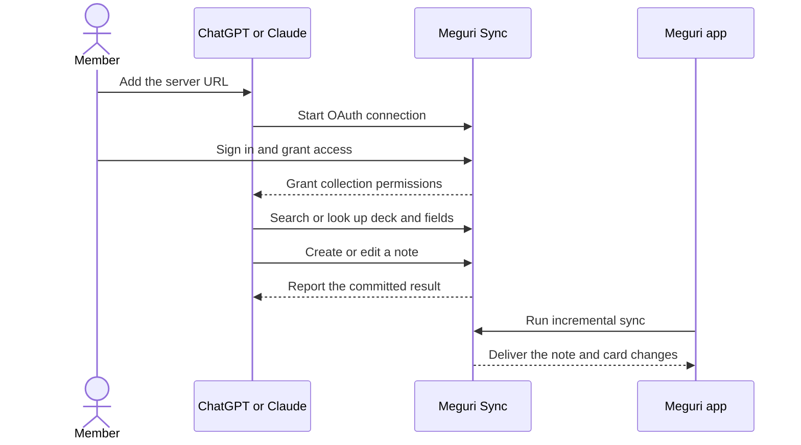
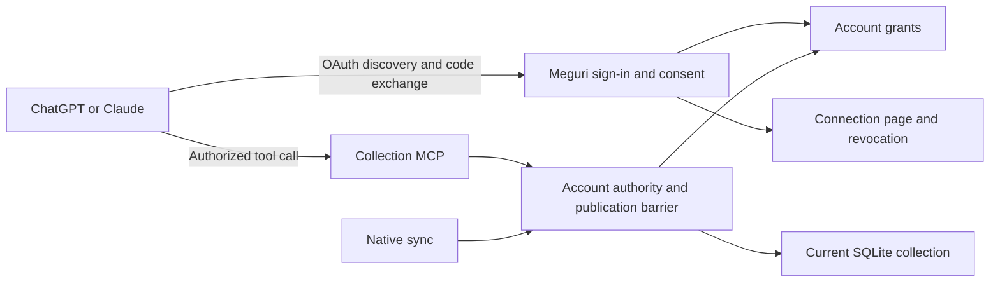

# Meguri Sync Collection MCP - Plan

## Goal Capsule

- **Objective** A Meguri Sync member can find, create, and correct notes from ChatGPT or Claude while the Meguri app is closed.
- **Means** A remote MCP connection to the member's Meguri Sync server.
- **Product authority** Antoine confirmed the four-tool scope, OAuth sign-in for both clients, and a 200 MB performance check. This is follow-on work to usable daily reviews with Meguri Sync. See the [repository priorities](../../AGENTS.md) and [verification register](../process/verification-status.md).
- **Integration prerequisites** Independent implementation and draft review use the `mcp` worktree. Integrating the feature follows the daily-review priority and requires the applicable full gate.

---

## Product Contract

### Summary

Meguri Sync will let a member connect ChatGPT or Claude directly to their synced collection with their existing Meguri account. A connection grants read access or read-and-write access to four tools for finding notes, discovering where to put them, and saving changes that reach the app through incremental sync.

### Problem Frame

The original app plan deferred MCP in favor of local AnkiConnect compatibility. That workflow depends on an app running on the Mac. The member wants to add and correct study material from the same chat where they learn it, including when their devices are offline. They also need routine edits to stay responsive as review history and other collection data accumulate. [Original app plan](2026-10-12-1926-feat-meguri-anki-compatible-apple-app-plan.md)

### Key Decisions

- **Direct connection to Meguri Sync** supports ChatGPT and Claude with the study app closed (session-settled: user-approved — chosen over a desktop bridge: the server already holds the synced collection). Governs R1, R2, R4.
- **Four collection tools** let the client discover existing note types and fields before it writes (session-settled: user-approved — chosen over a broader collection API: the four tools complete the core note workflows). Governs R8, R9, R10, R11.
- **OAuth with published client identities** gives members a short sign-in flow (session-settled: user-approved — chosen over manual OAuth registration or shared secrets: both target clients support the published-identity flow). Governs R5, R6, R7. [OpenAI authentication](https://developers.openai.com/plugins/build/auth), [Claude authentication](https://claude.com/docs/connectors/building/authentication)

<!-- ce-section: work-relationships -->
### How This Work Fits Together

- Collection MCP depends on [Meguri Sync](2026-11-15-1028-feat-meguri-sync-server-plan.md) for server-side account ownership and incremental delivery to devices.
- The [Meguri Sync provider contract](../../specs/sync/meguri-provider.md) governs device binding and provider handoffs. An MCP connection follows the account's server copy, which can differ from the installed device collection after a provider switch.

### Actors

- A1. **Meguri Sync member** connects a client, chooses what it can do, and can revoke its access.
- A2. **MCP client** discovers the available tools and acts using the member's grant.
- A3. **Meguri app** receives committed changes when it next syncs the bound collection.

### Requirements

**Connection and permissions**

- R1. Members connect to their own server through remote MCP over HTTPS using Streamable HTTP.
- R2. The connection supports the custom MCP integration in ChatGPT and the custom connector in Claude.
- R3. Support the current stable MCP specification and the protocol revisions needed for R2. [Current MCP specification](https://modelcontextprotocol.io/specification/latest)
- R4. Each grant binds tool access to the account's current Meguri Sync collection on that server.
- R5. The member signs in to Meguri with their existing account and authorizes the client through MCP OAuth with PKCE and Client ID Metadata Documents. [MCP authorization](https://modelcontextprotocol.io/specification/latest/basic/authorization)
- R6. Each client receives read access or read-and-write access, and the server enforces that grant on every tool call.
- R7. The member can revoke a client's grant in Meguri, ending that client's access and ability to renew it.

**Collection tools**

- R8. **Search notes** by text, deck, tag, or exact note ID and return bounded pages with note IDs, fields, tags, and the revision needed to edit each result.
- R9. **Look up decks and note types** through one read-only tool that returns existing decks, note types, and the field names for each type.
- R10. **Create a note** in an existing deck using an existing note type and return its stable note ID.
- R11. **Edit a note** by ID, changing only the fields or tags specified by the client.
- R12. Return a conflict if the note changed or the collection was replaced since the client read the note.
- R13. Reject an invalid creation or edit without partially applying it.

**Sync and performance**

- R14. Acknowledge a successful write only after the server commits the complete collection change.
- R15. A normal incremental sync delivers committed MCP edits and new notes, including the cards generated for new notes, to devices bound to that collection.
- R16. A single-note lookup or write uses targeted collection access without reading, copying, or rebuilding the entire SQLite database.
- R17. When an active sync round prevents a write, return a retryable busy result within a short, measured limit.

### Key Flows

- F1. The member enters the Meguri Sync URL in ChatGPT or Claude, signs in to Meguri, reviews the requested collection access, and grants it. Meguri displays the connection so the member can later revoke it. Covers R1, R2, R4–R7.
- F2. The client searches for a note and uses its ID and revision to edit the selected fields. For a new note, the client first looks up the target deck and the chosen note type's fields. The app receives successful changes on its next incremental sync. Covers R8–R15.

### Acceptance Examples

- AE1. **Connect and sync in each client.** With the app closed and a generated account already synced, connect ChatGPT and Claude separately. In each client, find a known note by text, fix one field, discover the deck and note type, and create a note. Verify both changes and the new note's generated cards on the next normal app sync. Covers R1–R6, R8–R11, R14, R15.
- AE2. **Enforce access.** A read-only grant can search and look up deck and field information. A write attempt has no effect. A note ID from another account cannot reveal or change that note. After revocation, the old access and renewal credentials cannot authorize another call. Covers R4, R6, R7.
- AE3. **Protect existing work.** If a device sync changes a note after the client reads it, editing with the older revision reports a conflict and preserves the newer version. A collection replacement also invalidates the old edit. An invalid field on a create or edit leaves the collection as it was. Covers R11–R13.
- AE4. **Handle an active writer.** Keep a sync round open on the generated 200 MB collection, then attempt an MCP edit. The client receives a retryable busy result within the agreed limit and the note is unchanged. The edit succeeds after the sync round releases the writer. Covers R14, R16, R17.

### Success Criteria

- On a generated 200 MB SQLite collection, record server-side latency, database I/O, and peak memory for exact lookup, creation, and a one-field edit. Compare with a smaller generated collection at the same result or change size to detect work proportional to the full database size. Covers R16.
- Report latency for bounded text search separately and record time to the busy result during active sync. Agree on the latency and busy limits during implementation planning, using a named test environment and reproducible fixtures. Covers R8, R17.

### Scope Boundaries

- The release covers the four note tools and their connection permissions. Deck and note type data are read-only. Server and account administration remain outside the collection grant.
- The tools operate on the member's current server-side Meguri Sync collection. Operations on device-local and iCloud collections follow their own provider paths.
- Note deletion, media operations, scheduling, review, and deck or note type authoring are follow-on candidates.

### Outstanding Questions

**Deferred to Planning**

- Which MCP protocol revisions and authentication metadata are needed for the two real client connections at implementation time?
- What reproducible benchmark environment and latency limits should govern single-note operations and busy responses?

### Sources / Research

- [Meguri Sync browser account contract](../../specs/servers/meguri-sync-web.md) defines the existing account sign-in and separate native sync credentials.
- [Server collection sync contract](../../specs/sync/server-collection.md) defines incremental change selection. [Server lifecycle](../../specs/sync/server-lifecycle.md) describes the retained write transaction during a normal sync round.
- [SQLite architecture](https://www.sqlite.org/arch.html) explains page-level access. The [server schema](../../server/src/collection/schema.sql) gives notes a primary key, and the [server connection setup](../../server/src/collection/schema.rs) configures WAL.
- [ChatGPT custom MCP integration](https://developers.openai.com/api/docs/guides/custom-mcp-server) and the [Claude MCP server guide](https://claude.com/docs/connectors/building) describe each client's connection and test flow.
- [AnkiMCP documentation](https://ankimcp.ai/docs/) describes a desktop-hosted workflow. The [anki-cloud MCP guide](https://github.com/danielpmichalski/anki-cloud/blob/main/docs/mcp-integration.md) documents server-backed note operations through a local bridge.
---

## Planning Contract

Product Contract unchanged.

### Implementation prerequisites

- Keep the daily-review repairs first for integration. The inspected full gate `gate/20261119T033410Z-80366` was cancelled, and its partial results remain in the [verification register](../process/verification-status.md). Run focused checks for independent changes on this worktree.
- The [repository workflow](../../AGENTS.md) authorizes the `mcp` branch and a draft PR against `master`. Preserve separate local and hosted verification evidence.
- Prove native sync compatibility under mixed-client note creation before shipping U3. Resolve different-GUID ID collisions and changing new-card position state under the reviewed native sync contract. One local uniqueness check cannot prove convergence across offline devices.

### Key Technical Decisions

- KTD1. **Share the HTTPS origin and isolate request families.** Mount the collection MCP route alongside the existing Axum service. Verify a released, pinned Rust MCP SDK with both the 2026-07-28 and existing handshake lifecycles in the release dependency graph. Use the official `rmcp` crate if its released feature set passes that check. Keep native framing and browser cookie routes separate. Governs R1–R3. [Transport specification](https://modelcontextprotocol.io/specification/2026-07-28/basic/transports/streamable-http), [Rust SDK](https://docs.rs/crate/rmcp/latest)
- KTD2. **Authorize from Meguri's existing account and persist a separate grant.** Keep authorization requests, single-use codes, and access and refresh credential digests in account metadata. Bind them to client, resource, account, scopes and account credential generation. Validate published client identity, exact redirect URI and S256 PKCE. A mature OAuth implementation must pass the dependency and deployment review before selection. Recheck authority at the account owner boundary. Use the account's existing revocation and recovery transitions. Governs R4–R7. [MCP authorization](https://modelcontextprotocol.io/specification/latest/basic/authorization), [OAuth security guidance](https://www.rfc-editor.org/rfc/rfc9700.html)
- KTD3. **Read the current collection in bounded queries.** Reuse the server's configured SQLite connection and typed deck and note-type readers. Use key lookup for IDs and bounded cursors for text, deck and tag searches. Return IDs as strings and revisions tied to the publication generation, persisted note state and field layout. Keep content as data in MCP results. Governs R8, R9, R12, R16.
- KTD4. **Commit a short standalone collection transaction.** Reuse the per-account publication barrier and recheck the grant and current generation at the write boundary. An MCP write gets a bounded busy result while a live sync round owns the writer. Commit complete note, tag, card and sync-visible state together. Allocate a server-visible sequence and modification stamp for incremental delivery, including same-tick edits. Preserve schema and last-successful-sync markers, unrelated record data and existing card schedules. Use note and card-generation rules from the neutral Meguri specs. Keep the server's first-party dependency boundary at `meguri-model`. Governs R10–R17.
- KTD5. **Add consent and connection management to the existing browser flow.** Resume the authorization request after the existing sign-in. Show the signed-in account, client, and exact granted access on consent. Show the MCP URL and revocable grants on Connection. Use current page, form, focus, and status components. Governs R2, R5–R7.

### High-Level Technical Design

This sketch describes boundaries and sequence. Exact types and SQL belong to implementation.

| State | Transition and owner |
|---|---|
| Approval pending | OAuth binds the request to the validated client, redirect, resource and requested scopes. Browser sign-in resumes that request. |
| Code issued | The member grants access. The token endpoint exchanges the code once with a matching verifier. |
| Grant active | Tool requests resolve the account and scope. Refresh remains bound to the grant and rotates its credential. |
| Grant ended | Revoke, account disable, credential reset or restore invalidates access and renewal at the appropriate owner boundary. |

The collection write path resolves authority and generation, checks the note revision and writer availability, applies the operation, commits, and returns the result. It uses the normal sync contract for visibility to device reads that follow.

### Dependencies and Assumptions

- Preserve the current release packaging and license boundaries. The spec amendment defines MCP as a collection author and adds consent and grant management to the current browser contract.
- Ship the four tools together in one reviewable PR when there is an authorized PR workflow. Treat U1–U5 as one coherent verification batch under [verification tiers](../process/tiers.md).
- Use generated, disposable accounts and collections for Chrome and both hosted clients. Record actual client versions and the negotiated MCP revisions in the test evidence.

---

## Implementation Units

### U1. Define standalone collection writes and OAuth authority

**Goal** Establish the protocol, storage and authorization contracts before changing the shared server code.

**Requirements** R3–R7, R10–R17. **Dependencies** Existing server contracts and the implementation prerequisites above.

**Files** `specs/servers/meguri-sync-web.md`, new `specs/servers/meguri-collection-mcp.md`, `specs/sync/server-collection.md`, `specs/sync/server-lifecycle.md`, `specs/notes/card-generation.md`, and new `server/tests/mcp_collection.rs` and `server/tests/mcp_oauth.rs` fixtures.

**Approach** Settle the collection invariants, account revocation boundary and compatible stamps. Verify collision and new-card positions with the existing cross-client protocol before covering them in U3. Review the dependency choice, rollback and exact packaging impact before admitting the SDK and OAuth code.

**Test scenarios**

- Native sync from a baseline carries an eligible server-authored note, tags and cards with equal-second and equal-millisecond variations.
- Independently created notes from a sync baseline converge with distinct identities, including the case of device and server choosing the same candidate ID.
- After restore, reset or disable, previous credentials fail authorization while the current collection remains readable to a newly authorized account when applicable.

**Verification** Independent neutral-spec and privacy review, then real protocol characterization with generated fixtures.

### U2. Serve MCP reads and OAuth grants

**Goal** Connect a scoped client to the server's four-tool surface, with read actions usable as soon as consent succeeds.

**Requirements** R1–R9, R16. **Dependencies** U1.

**Files** `server/src/httpapi/mod.rs`, `server/src/accounts/barrier.rs`, `server/src/storage/schema.sql`, the metadata migration seam in `server/src/storage/deletion.rs`, `server/Cargo.toml`, `server/Cargo.lock`, `server/DEPENDENCIES.md`, new `server/src/mcp/`, `server/tests/mcp_oauth.rs` and new `server/tests/mcp_protocol.rs`.

**Approach** Implement KTD1–KTD3. Use the configured public origin for metadata and issuer. Match reviewed local client records and exact callback URIs. Reject unknown client IDs without outbound requests. Resolve account and scopes from the token and grant. Bound ingress, search results and database work. Authenticate tool calls independently of discovery and browser navigation.

**Test scenarios**

- Covers AE2. A read grant lists decks and searches by text or exact ID, and a different account's note ID reveals no content.
- Both supported MCP lifecycles discover the same tools and return compatible result shapes.
- Consent denial, rejected redirects, a mismatched verifier, code replay, invalid audience, and refresh after revoke all fail at the appropriate boundary.
- A request with an unsupported note query returns a bounded error. Paginated results continue without leaking another account's note data.

**Verification** Real loopback protocol calls, locked dependency and release-package checks, and authentication contract review.

### U3. Create and edit notes with incremental sync

**Goal** Apply R10 and R11 to the current account's collection and deliver the resulting records through ordinary device sync.

**Requirements** R10–R17. **Dependencies** U1, U2.

**Files** New `server/src/collection/mcp_notes.rs`, `server/src/collection/mod.rs`, `server/src/accounts/barrier.rs`, `server/src/protocol/normal.rs` where shared writer coordination requires it, `server/tests/mcp_collection.rs`, and `server/tests/mcp_protocol.rs`.

**Approach** Implement KTD4. Use existing note normalization and typed collection readers where they preserve semantics. Supply the neutral spec's card generation and placement through server-local operations. Check the exact revision and current generation before mutation. The sync ingest upsert is a different write path and overwrites fields an MCP patch must preserve.

**Test scenarios**

- Covers AE1. Create ordinary and cloze notes using known note types, then sync and inspect the generated cards.
- Covers AE3. Update one field and verify sibling fields, unrequested tags, flags, note data, and existing card review state. Reject an invalid field or stale revision without partial effects.
- Covers AE4. Hold a native writer open, attempt the edit, observe the bounded busy result, then retry successfully after finish.
- Revoke while a write is waiting on authority, replace the collection after a read, and verify each stale operation leaves both collections intact.

**Verification** Real server transactions, durability and native incremental round trips, and release-mode page I/O evidence.

### U4. Add and review the browser screens

**Goal** Let members understand, grant, and revoke access in the existing Meguri browser interface.

**Requirements** R2, R5–R7. **Dependencies** U2.

**Files** `server/src/webassets/mod.rs`, `server/web/src/app.tsx`, `server/web/src/forms.tsx`, `server/web/src/policy.ts`, `server/web/src/api.ts`, new `server/web/src/mcp-connections.tsx`, and new `server/web/tests/browser/mcp.spec.ts`.

**Approach** Implement KTD5 with the existing account shell, labeled controls, announced status, and focus handling. Support signed-out and signed-in entry, permission choices, deny, return to the client, expired request, active grants, confirmation, and empty list. Keep member choices visible to keyboard users and at narrow widths.

**Test scenarios**

- Covers F1 / AE1. Follow a generated client's authorization request through sign-in and consent, and verify the grant appears on Connection.
- Covers AE2. Confirm and cancel revocation using the keyboard, verify focus recovery and announced status, then confirm the revoked client fails its next request.
- An expired request offers a path back to the client. A loading or failed grant request keeps the account screen usable.
- Verify mobile-width reflow and run the browser accessibility suite on each changeable screen and state.

**Verification** Build and run the exact release fixture through MG. Show all changed screens and states in Chrome so Antoine can leave feedback. Record the build identity and distinguish visual review from functional evidence.

### U5. Verify hosted clients, performance, and packaging

**Goal** Prove real-client compatibility and the performance promises on a generated large collection.

**Requirements** R1–R3, R8, R14–R17 and AE1–AE4. **Dependencies** U3, U4.

**Files** New `server/tests/mcp_performance.rs`, `tools/mg.d/meguri-sync.sh`, and the browser and server fixture paths owned by U2–U4.

**Approach** Use equivalent generated schemas at about 20 and 200 MB and measure exact lookup, create, and edit with fixed input sizes. Use a release Docker runner with two CPUs, 2 GiB memory, local SSD storage, WAL durability, and recorded fixture/cache state. Use 150 ms idle p95 per single-note operation and a 250 ms busy-response limit as the initial server-side acceptance budgets. Record page I/O, peak memory, warm and cold runs, checkpoint work, and bounded text search separately.

**Test scenarios**

- Covers AE1. Complete the full workflow in actual ChatGPT and Claude with generated disposable grants and verify both clients' committed writes on native Meguri Sync.
- Use a dedicated, publicly reachable TLS fixture of the release image for hosted clients. Preserve the canonical origin and forward `/mcp`, the OAuth metadata, authorization and token routes, and the consent page and APIs. Exclude credential-bearing queries, headers, and response bodies from proxy logs. Use only generated data.
- Covers AE4. Run under a held native writer and measure the busy-response limit without counting external network delay.
- Show page I/O and incremental process memory for a one-row operation do not scale with the total database file size.
- Package and smoke-test the exact release binary with its reviewed dependencies.

**Verification** Retained benchmark receipts, real-client evidence, Chrome review captures, and required package and integration checks.

---

## Verification Contract

| Area | Evidence |
|---|---|
| Server and dependencies | `tools/mg sync-server-test`, `tools/mg sync-server-lint`, `tools/mg sync-server-deps`, and `tools/mg sync-server-package-test` cover the changed binary, reviewed dependencies, and shipping artifact. |
| Real client sync | `tools/mg meguri-provider-real-server` and the applicable server interoperability checks cover collection compatibility. Record the dedicated ChatGPT and Claude sessions separately. |
| Chrome | Use `tools/mg sync-web-check`, `tools/mg sync-web-actualserver-build`, and `tools/mg sync-web-preview-up` for the generated local fixture. `tools/mg sync-web-browser` checks the built fixture. |
| Batch boundary | Keep focused evidence and independent review per unit. Run the required full gate at the coherent boundary using the repository's active integration base and verify provenance, privacy and similarity. |

---

## Definition of Done

- Each of the four tools passes the scoped access and generated-collection acceptance examples.
- Both hosted clients complete sign-in and the note workflow. Committed changes arrive through native incremental sync.
- Measured results meet the recorded performance budgets and show no whole-file work for single-note operations.
- Chrome shows each changed browser screen and relevant state from the exact reviewed build.
- The required integration and independent review evidence is complete, and the authorized PR is open with CI recorded.
