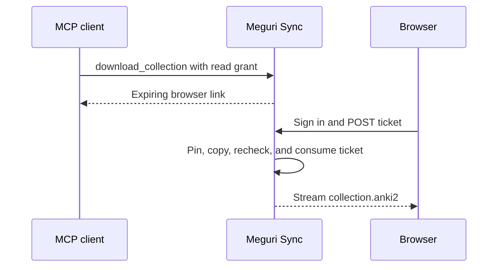

# Download the full SQLite collection from MCP

Add the argument-free `download_collection` read tool. It gives the user a link that downloads the current synced collection as `collection.anki2`. The file contains the full committed SQLite database. The export scope is the collection database. Media files and server account metadata live outside it.

## Implementation

Use the existing browser handoff pattern. The tool returns `download_url` and `expires_at`. Keep the opaque token in the URL fragment. The page clears the fragment before bootstrap. Require the same Meguri account and a deliberate download action. Send the token in a same-origin form POST body, so browser download machinery can stream the file to disk. Never put the token in a request URL. A ten-minute, single-use, bounded server-side ticket stores the original MCP authority. Reject expiration, revoke, invalidated authorization, and incorrect browser accounts. Keep the ticket usable after an incorrect account or failed preparation. Consume it atomically before the successful response. Use the existing private headers and a fixed attachment filename.

Pin the published generation and commit view under the existing read barrier. Reuse the private staging, temporary byte reservations and SQLite backup routine from native sync. Open the source read-only without write stamps or checkpoints. Copy off the barrier and release the source before the response. Recheck original authority, browser session and publication under the barrier before consuming the ticket. Hold the stage, root, and capacity until streaming finishes or the response is dropped. Use bounded chunks and a bounded number of concurrent exports. Preserve native sync and MCP point operations.

## Verification

Use generated accounts and actual MCP transport. Check discovery, empty input validation, and read-grant access. Redeem with a signed-in owner and open the downloaded file in SQLite. Check a committed WAL change, absence of uncommitted changes, a preserved opaque value, unchanged live sync stamps, rejection for a different account, revocation, and replay. Exercise the browser fragment and real attachment save flow in Docker. Run focused `tools/mg` server and web jobs, then open the pull request against `master` for the hosted checks. Keep independent approval and privacy evidence per repository rules.
