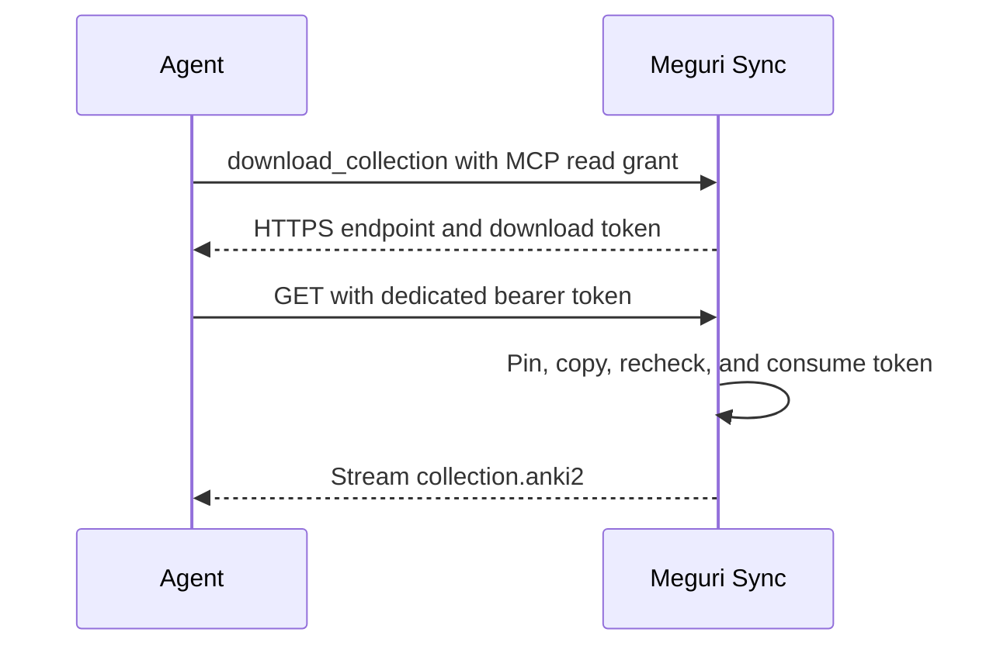

# Download the full SQLite collection from MCP

Add the argument-free `download_collection` read tool. The connected agent can save the full committed collection as `collection.anki2`. The established read grant authorizes the tool. The agent fetches the file without asking the user to sign in or confirm. The export covers the collection database. Media and account data live outside it.

## Implementation

The tool returns `download_url`, a dedicated `download_token`, and `expires_at`. The agent makes a GET request to the fixed HTTPS URL and sends the token in the `Authorization: Bearer` header. Cap the single-use credential at ten minutes or the original access credential’s expiry, whichever comes first. Use the configured origin. Keep secrets out of URLs, logs, and errors. The token grants one download for the same original account and cannot call MCP. Authentication uses only the dedicated credential at the download endpoint. Preserve the account scope of the MCP read grant and refuse expired or revoked authority, account resets, and replay. Do not require a browser session, a browser action, or any new OAuth consent.

Pin the published generation and committed view under the account read barrier. Create the private stage under that guard. Run the SQLite copy after releasing it, with bounded temporary storage. Recheck original authority and publication before consuming the token. Use bounded streaming and retain stage ownership until the response completes or drops. Preserve page size and committed WAL changes without changing sync stamps. Keep existing browser, MCP and native operations compatible.

## Verification

Use generated accounts and real HTTP. From an authorized MCP read grant, automatically download the SQLite file using only the returned URL and token. Verify both protocol revisions, empty arguments, exact file headers, committed WAL contents, the 64 KiB source page size, SQLite integrity, unchanged live bytes, account binding, credential isolation, expiry, revoke, reset, atomic redemption and cleanup. Run focused `tools/mg` Docker server checks and obtain independent clean-room review. Update the existing pull request against `master` and follow hosted CI.
