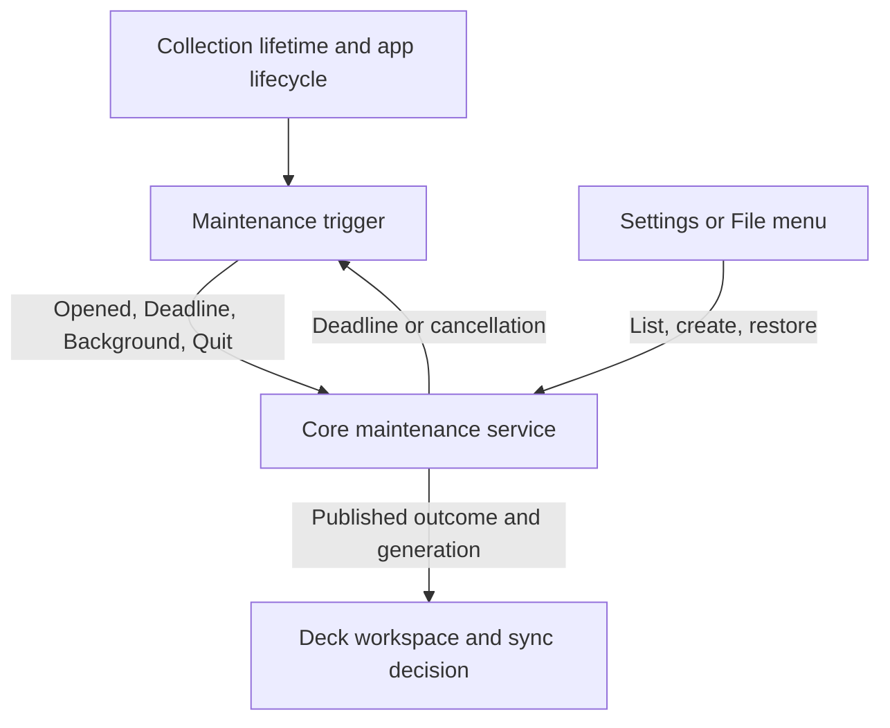

# Back up and restore collections on Apple devices

## Goal Capsule

A person can find their backups, choose one, and recover their collection in Meguri on iPhone, iPad, and Mac. The app also takes the scheduled device backups that populate this list. Ship one reviewed change with screenshots of the actual app on all three platforms.

---

## Product Contract

### Requirements

- R1. Back up the open collection on demand and on the existing maintenance schedule. Show when the last backup succeeded, the result of a manual request, and that device backups omit media. Make the existing collection export with media reachable.
- R2. Open Backups from Settings on every platform, including when an existing collection is damaged. On Mac, add the File menu commands for Back Up Now and Restore from Backup. Reveal the configured folder in Finder or Files and expose the existing interval and retention settings.
- R3. In the restore sheet list local backups and retained server copies newest first with date, time, and size. Show unverified copies as unavailable and select the newest eligible entry. A person can select an older one. Present actionable empty, loading, progress, and failure states.
- R4. Confirm the selected backup and destructive local replacement. Preserve the current collection through the core safety backup. Allow cancellation while supported. On success refresh the deck workspace, release stale collection state, and honor the current provider’s publication decision. An offline person can use device backups.
- R5. Surface the existing Meguri Sync account backup history for connected users through its authenticated browser Collection page. Make the destination and effect clear. Scheduled backups on that server include media and restore on the server. A local retained server copy belongs to the device restore sheet.

The native screen contract is `settings.backups` in `docs/design/screen-inventory.yaml`. Settings navigation and the File menu follow N11.4 and N15 in `docs/design/native-interface-contract.md`. The product plan assigns native scheduling and restore to U154 and U163a.

---

## Planning Contract

The core already owns package creation, retention, listing, verification, and replacement. `CoreMaintenanceService` exposes these operations to Swift and has bridge tests. The app has no production caller for its backup APIs. Connected-account backup history already exists on the server and uses browser-session authority under W11 in `specs/servers/meguri-sync-web.md`.

- KTD1. Use the existing typed maintenance calls and the exact name returned by listing. Keep wall-clock display and the distinction between ordinary, verified server, and unverified entries from the bridge. Keep all archive reads, writes, and validation in core.
- KTD2. Mount the backup coordinator at collection lifetime so Settings, the main window, and lifecycle events share one operation state. Apply `MaintenanceFailure.candidateActive`, generation, and publication facts on terminal delivery. Only report the old collection intact when the core establishes that outcome.
- KTD3. Let core decide when work is due. Maintain one cancellable timer for the current deadline; treat closure, nil deadlines, and collection replacement as ownership boundaries. Observe lifecycle changes independently of Settings visibility.
- KTD4. Use the configured Meguri Sync service's browser destination without copying credentials into a URL or granting native sync keys browser permissions. Device-only users retain the full local workflow.

---

## Implementation Units

### U1. Connect automatic backups to collection lifetime

Use `CoreEventStream` maintenance deadlines, the existing Ready/change fanout, the app's scene background transition, and the Mac termination sequence. Respect suspend/quit ordering in `specs/package/backup-triggers.md` T3–T4. Keep work off the main thread. One foreground scene closing while a second remains active must not close the shared collection. Exercise immediate and rescheduled deadlines, cancellation, unchanged collections, and terminal delivery racing a replacement.

### U2. Create, list, and restore from shared collection state

Compose `app/Packages/MeguriCore/Sources/CoreBridge/MaintenanceService.swift` with the existing `ReviewCollection` state and replacement handling. Keep lists associated with the current collection. Refresh on opening the page or sheet and after a write. Forward typed outcomes and safe cancellation to the UI. Reconcile post-activation failures and pending sync decisions through the existing replacement flow. Test a selected older backup, an active review, a stale selection, a failed pre-restore safety backup, and a candidate that became active before failure.

### U3. Add native Backups navigation and controls

Use the shared grouped Settings form and a restore sheet owned by its presenting scene. On Mac also wire the two File commands. Connect the damaged-collection remedy to the same sheet. Show each selected backup's date at confirmation. After a rejected candidate allow another choice in the open sheet. Implement the screen contract's manual backup progress, safe cancellation, folder reveal, no-media footer and per-field limit changes. Keep integer values from other versions intact unless that field is edited. Use the existing export route, and a distinctly labeled browser link for the connected account's server backups. Use native keyboard navigation, accessible names and touch targets, and String Catalog entries.

### U4. Verify recovery and capture screenshots

With a disposable Meguri Dev collection, back up a recognizable card, change it, choose its earlier backup, cancel once, then confirm restoration. Assert the older card contents and the new safety backup, including after relaunch. Verify the restored collection does not silently overwrite the server. Exercise the iPhone, iPad and Mac entry points, including the focused-window File menu on Mac. Capture actual populated lists and confirmations and inspect each at native size. Include only screenshots containing synthetic data on the PR.

---

## Verification Contract

Exercise recovery from an already damaged collection by rejecting one candidate and successfully restoring another. Preserve the failed lifecycle and its restore entry after a pre-activation refusal, even when ordinary entry activation would become unavailable. Reconcile the Settings screen contract and actual copy with the core outcome. A pre-activation refusal leaves the old collection in place. A failure after replacement must report the active candidate. Confirmation names a provider decision only when it applies to the current service. Check Off, iCloud and Meguri Sync.

Capture the populated Backups settings page as well as the list and confirmation on each platform. Use the actual Swift test suite and method names from MaintenanceServiceTests.swift, including MaintenanceMappingTests and the maintenance methods on EventTests. Require nonzero executed case counts.

When an unreadable collection fails its initial open, establish the existing local recovery host before listing backups. Test with a file that is damaged at cold launch and verify offline restoration preserves the damaged predecessor.

| Check | Evidence |
| --- | --- |
| Scheduler | A deterministic clock and event test proves deadline replacement and cancellation, plus a real locally created automatic archive from an armed collection. |
| Device operations | Existing `MaintenanceServiceTests` plus focused MeguriKit tests pass through `tools/mg swift-test --package <package> -- --filter <suite>`. Verify selected-backup contents, safety copy, retention edits, empty and unverified entries, and partial activation reporting. |
| Device journeys | `tools/mg ui-test` against the native builds through the VM, sequentially on phone, tablet and Mac. Observe the native restore workflow, cancellation and restored contents. |
| Presentation | Run the applicable screenshot, accessibility and independent design checks through `tools/mg`. Inspect the images and check the uploaded PR links. Record the precise source and platform for each. |
| Integration | Run the narrow applicable Apple builds and repo gates. Review the change independently and apply verified findings. Record unrelated inherited gate failures separately from the feature evidence. |

## Definition of Done

The three apps expose real backup creation, listing and confirmed restoration. Recovery tests prove which collection was restored and what happened to its predecessor. The PR contains viewable synthetic screenshots from all three platforms and identifies the passing checks. Land the authorized result as one commit on the repository’s default integration branch and verify the final checkout is clean at that commit.
