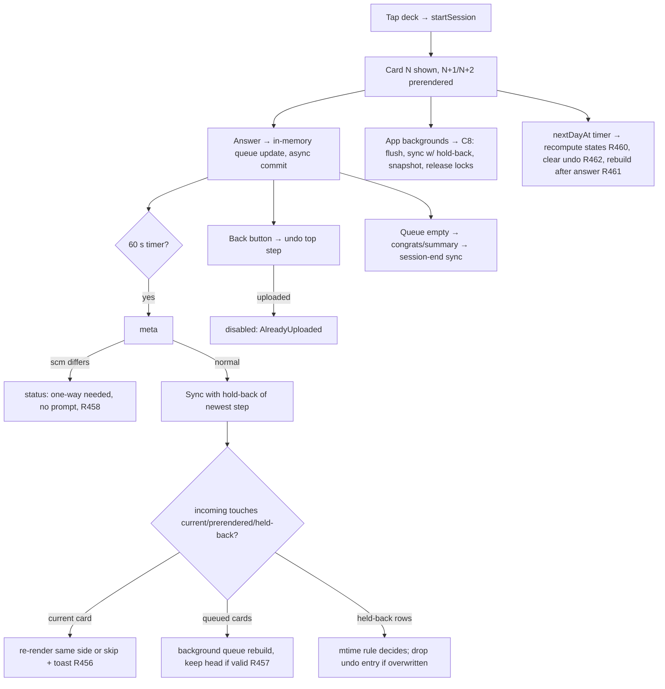

# Meguri: cross-area flow analysis (spec-flow)

Scope: only the flows in which separately built units must agree on state and sequencing. The plan already passed document review, so this note does not re-review the wording of single requirements.

Grounding: the repo has no code yet. Phase 1 grounding is the requirements document `docs/plans/2026-10-12-1926-feat-meguri-anki-compatible-apple-app-plan.md`. "Existing patterns" here means requirement IDs, not code.

Units named below: **Core** (Rust: storage, op layer, undo, scheduler/queue, sync, media, stats aggregates, optimizer, local servers), **Review** (Swift review controller plus two WKWebView pages), **Shell** (Home, deck page, toolbar, lifecycle), **Editor**, **Browse**, **Widget** (App Group snapshot plus WidgetKit), **Integrations** (Mac HTTP servers, which run in Core).

---

## Core state contracts (what the Rust API must expose)

The flows below share these contracts. Each flow names the ones it depends on.

| ID | Contract | Why several units need it |
|---|---|---|
| **C1 Op executor** | One serialized write path for UI, sync, local servers and maintenance. Each op carries a `source` (UserUndoable, UserNonUndoable, SyncIncoming, LocalApi, Optimizer, Rollover, Maintenance) and returns `OpResult { seq, changes: ChangeSet, undo: Option<UndoMeta>, generation }`. | R1658, R1789 and R1790 need API writes on the same path. Ordering and undo eligibility both depend on `source`. |
| **C2 Change stream** | Ordered, coalesced `ChangeSet` events with a monotonic `seq`. Contents: card ids (with a flag for "scheduling-relevant" vs "memory-state-only"), note ids, notetype ids (with a `schemaChanged` flag), deck ids, deck-config ids, config keys, tags, revlog ids added and removed, media names added and removed, and `source`. Includes a `CollectionReplaced(generation)` event. | Home counts (R45), Browse row invalidation (R1241, R1792), Editor reload (R822, R1793), Review re-render and queue rebuild (R447, R456, R457), heatmap totals (R1286), widget snapshot (R1434), sync status `mod > ls` (R1559) and the undo menu title (R173) all subscribe to it. |
| **C3 Undo manager in Core** | Entries hold `{id, name, kind, sessionId?, touchedSet, beforeImages, uploaded:bool}`. It exposes `peek()`, which returns either an available step or a disabled reason (`None`, `ClearedByRollover`, `ClearedBySync`, `ClearedByOneWay`, `ChangedExternally`, `AlreadyUploaded`). Core enforces "never undo an uploaded step"; the UI cannot override it. | R365, R366, R370, R725, R1520 and R1796 must all agree. Undoing an answer whose revlog row was already uploaded makes revlog counts diverge. Revlog deletions have no graves, so the next `sanityCheck2` fails and forces a one-way sync (R1533). |
| **C4 Sync job** | `sync(kind, holdBack: HoldBackPolicy, cancel)` with stage and progress events. The result is `{incoming: ChangeSet, oneWayRequired, serverMsg, mediaUsn}`. `meta` runs as its own step with no local write lock, so "one-way needed" can be found without touching data. | R88, R458, R699, R1519–R1535, R1549 |
| **C5 Session and queue** | `startSession(deck)`, then `head(n)`, which returns cards plus a `stateToken` per card. `answer(cardId, rating, stateToken, answeredAt, ms)` updates the in-memory queue at once and commits asynchronously. Events: `QueueHeadChanged(diff)`, `CurrentCardChanged{eligible|removed|memoryOnly}`, `CommitFailed(cardId)`. | R362, R444–R447, R456, R457, R680, R727–R729 |
| **C6 Day clock** | `today`, `nextDayAt`, `checkRollover()`, and a `RolledOver{oldDay,newDay}` event. Swift arms a single timer for `nextDayAt` (R1854 forbids polling). | R459–R464, R597, R598, R316, R1435 |
| **C7 Collection lifecycle** | States: `NoCollection`, `Opening`, `Upgrading`, `Ready(generation)`, `ExclusiveBusy{op, phase, cancellable}`, `Failed(reason)`. Waiters can block with a timeout (5 s for Migaku, 30 s for AnkiConnect). Every cache and handle is keyed by `generation`. | R171, R1670, R1706, R1797, R1489 |
| **C8 Suspend protocol** | `prepareForSuspend(deadline)`: commit or flush queued ops, abort or roll back a running normal sync, write the widget snapshot, release SQLite locks. `resume()` then re-checks `data_version`, rollover and external changes. | R14, R452, R1552, R1554, R2006, R2007 |
| **C9 Media service** | Media writes are staged inside an op, so `/receive` stays atomic (R1702). It keeps the media index, emits `MediaArrived(names)`, and holds a media lock shared by media sync and Check Media. | R986, R1573, R1584, R498, R1645–R1649 |
| **C10 Widget snapshot builder** | A Core-side derivation. It precomputes the "now" values and the values "after the next rollover" (streak, today) so the widget runs no streak logic. It writes atomically and reports `changed:bool`. | R315–R317, R1433–R1435 |

---

## User flows

### Flow 1: iPhone review session with periodic sync, leaving the app, rollover, undo

Entry: tap a deck (R75). Exits: ✕ or Esc, queue exhaustion, timebox Finish, D/B/T, app termination (R455).

Sequencing the units must agree on:
1. **Answer path.** Review sends `answer` to C5. Core updates the in-memory queue, siblings and load-balancer cache, then returns. The commit runs on C1, and the undo entry exists from the moment of input. The UI swaps pages on the next frame. A failed commit raises `CommitFailed` and Review rolls back to that card (R362, R680).
2. **Hold-back.** It only skips the upload. The answer is still committed locally within 1 s (R2006). The hold-back must not delay the local commit.
3. **Periodic sync.** The order is: `meta` → incoming changes applied → `ChangeSet(source=SyncIncoming)` → the undo manager clears every entry except the held-back one (unless incoming touched it) → Review receives `CurrentCardChanged` or `QueueHeadChanged` → the widget snapshot is not rewritten mid-session, because R1434 lists session end as the trigger.
4. **Leaving the foreground.** The order is: answer timer pauses (R360) → audio stops → session record persisted (R441) → C8 → sync with hold-back inside the background-task budget → snapshot → locks released. If time runs out, the sync aborts (R1554), but the held-back answer is already committed.
5. **Rollover.** C6 fires. Current-card states are recomputed in place (R460) and undo is cleared (R462), which releases the hold-back so the next sync uploads the answer. The queue is rebuilt after the next answer (R461).
6. **Undo.** `peek()` drives the button state and the reason text (R365, R366). Undoing an answer that is queued behind a running sync must be defined (see Q3).

### Flow 2: Automatic FSRS optimization after sync, then sync again

Entry: a successful incremental sync with no session active (R699), and `today − lastFsrsOptimize ≥ 30` (R692).

Steps: sync 1 succeeds → optimizer job starts (background, cancellable, R698) → each preset is trained and evaluated (R693–R695) → write step: `fsrsParams6`, memory-state refresh without rescheduling (R686, R697), and `lastFsrsOptimize` → sync 2 → done. Terminal states: adopted and synced; nothing adopted (no write); abandoned (sync failure, or a session started).

Interplays:
- **The user starts a review during training.** This is common on iPhone: launch → sync → tap a deck within seconds. R699 says "never runs while a review session is active". The spec does not say whether the job is cancelled or the write is only deferred. If the write lands mid-session, every card in the preset changes: `stateToken`s go stale, labels change and R728 notices appear. See Q6.
- **The end-of-session summary.** The summary allows undoing the last answer (R99, R371). The R1549 session-end sync would upload that answer, and the optimizer write afterwards is non-undoable (R725 then clears the whole stack). The summary's Undo would then try to delete an uploaded revlog row. See Q2.
- **Another device optimizing at the same time.** Mac and iPhone both see the 30-day condition after syncing. Both write `fsrsParams6` for the same preset and memory states for the same cards. The sync rules then resolve deck configs by mtime (R1524) and cards row by row (R1527), which can leave preset A's parameters next to memory states computed from preset B's. Nothing in the spec prevents this.
- **Another device in a session.** Device B's periodic sync receives thousands of memory-state-only card changes. Every queued `stateToken` goes stale, so pre-renders are discarded (R447). The current card shows "Card changed, please answer again" (R728) even though its due date is unchanged.
- **Write and sync ordering.** R699 says "abandoning the run without writing anything if either sync fails". Writing happens before sync 2, so a failed sync 2 has already written, unless the write and sync 2 share one local transaction (see Q1 and Q6).
- **iPhone background task.** Running in a BGProcessingTask needs DB write locks while backgrounded. That is fine if the collection is in the private container, and risky if it is in the App Group (see Q5).

### Flow 3: One-way sync needed mid-use

Trigger A: a local schema change, for example adding a field on the Mac. R1476 asks for confirmation, then `scm` is set and the status shows one-way needed (R103).
Trigger B: the server's `scm` differs (F5), or incoming notetype field counts differ (R1525), or a sanity check fails (R1533).

Steps: detection, which is silent for automatic syncs (R166) and never happens mid-session (R458) → the user starts the sync → choice sheet (R1536–R1538, Cancel by default) → forced local backup (R1539) → for an upload, a server download into a backup (R1540) → the **exclusive phase** (upload: checkpoint, compact, post; download: stream to temp, integrity check, atomic swap) → `CollectionReplaced(generation+1)` → derived indexes rebuilt (R1489) → media merge sync (R1546).

Questions the units must agree on:
- **When the exclusive window opens and what it blocks.** The spec says long operations keep the UI usable (R170, R1494) and that only one exclusive op runs at a time (R171). It does not list what is disabled during a one-way swap: Study, Add, open Edit panels, Browse bulk actions, deck options, the local servers (R1670 says they report unavailable). Starting a session between confirming the choice and the swap would break R458.
- **Open drafts.** An open Add draft refers to notetype and deck ids that may not exist after a download. The spec does not say whether the draft is kept, revalidated or must be closed first.
- **What survives the swap.** Every Swift-side cache (deck tree, Browse id list, editor note, Recently-received note ids, undo stack, session record, widget snapshot) must be dropped or revalidated by generation. The session record (R441) points at card ids that may no longer exist.
- **Automatic sync finding a one-way requirement.** It updates the status only (R166). For Mac quit (R127) and iOS background (R1552), the spec does not say whether the quit-time sync is skipped. A prompt cannot be shown at quit.
- **The iPhone-reviews-lost case.** The Mac makes a schema change and uploads, while the iPhone has unsynced reviews. The iPhone is then forced to download and loses them. R951 warns about this, but Antoine's main study device is the one that loses data. R1537 shows the count; the reviews are recoverable only from the R1539 backup.
- **Auto-sync pause after restore or `.colpkg` import (R1548).** The pause flag must live outside the collection, because the collection is the thing being replaced. The plan has to say where it is stored.

### Flow 4: Mac local servers writing while the user is in the editor, Browse or review

Entry: an `/receive`, `addNote` or `updateNoteFields` request arrives on the Integrations thread → C7 wait if the collection is busy (R1706, R1797) → C1 op with `source=LocalApi` → `ChangeSet` → subscribers react within 1 s, coalesced (R1792).

Per surface:
- **Editor.** R1793 (API): keep the user's unsaved edits and show "Reload / Keep mine". R822 (sync or a Browse action): save pending edits first, then reload. The Editor needs `source` in the change event to pick a policy, and "Keep mine" needs a defined granularity (whole note, or only the fields the user touched).
- **Browse.** Visible rows refresh in place, and the result set shows "Results changed — Refresh" (R1792). The spec does not say whether the same rule applies to sync-incoming changes or to changes made from another Meguri screen.
- **Review.** The current card re-renders, or advances when it is suspended, deleted or moved (R1794, R456). New cards from Migaku update counts and the progress bar (R1708) and trigger a background queue rebuild (R457). A rebuild that reorders the head throws away the pre-rendered N+1/N+2 and risks the R1807 one-frame budget.
- **Undo.** API ops are not undoable (R1795). The top entry is dropped if the op touches its objects (R1796). This also applies to the held-back answer: once its entry is dropped, it must become uploadable.
- **Sync.** Requests wait during a sync (R1659). Their rows are `usn=-1` and go up on the next sync. Migaku requests that arrive during a one-way swap go to the durable pending queue (R1706). The plan must say what happens when the routed deck or notetype id no longer exists in the replaced collection.
- **Add-screen defaults.** Adds through the normal path would update `_nt_*_lastDeck`, `_deck_*_lastNotetype` and `curModel` "after every successful add" (R801). Migaku traffic would then rewrite the user's Add-screen defaults and create config churn on every card.

### Flow 5: Widget snapshot freshness

Writers: Core's C10 builder, called from Shell lifecycle hooks. Reader: the widget extension through the App Group.

The trigger lists disagree. R315 says: session end, every sync, undo of the last answer, rollover while running, background. R1434 says: session end, any undo, sync, background, rollover. The contents also disagree: R315 adds streak stats, due today, tomorrow's forecast and theme; R1433 adds per-day forecast, studied time and time zone. Staleness thresholds differ (36 h in R317, one day in R1436), and so does the empty-state copy ("Open Meguri to set up" vs "Open Meguri to get started").

No trigger covers these writes, although each changes what the widget shows:
- `heatmap` config edits: theme, excluded decks, history limits.
- Set Due Date, Reset and Forget in Browse (they change the forecast).
- Deck delete or move (it changes the excluded-deck scope).
- `.apkg` import with scheduling, one-way download, Check Database.
- A time-zone change.
- On the Mac, reviewing for an hour with the window frontmost: the widget refreshes only at session end.

### Flow 6: First launch through first review

Paths (R157, R1591):
- (a) Log in to AnkiWeb or a self-hosted server → `hostKey` → `meta` → server non-empty and local empty → full download with no prompt (R158) → integrity check → open → upgrades (R705: schedVer 2 to v3; R702: FSRS off triggers the one-time sheet and a full memory-state computation, which immediately creates a large incremental upload) → derived indexes built → the "12,533 notes · …" line (R159) → Home → background media download (R1584) → first review while media is still arriving.
- (b) `.colpkg` → backup is not applicable (no collection yet) → swap → `scm` set → auto-sync paused (R1548) → a later login gives an Upload/Download choice (both sides have cards).
- (c) `.apkg` from the welcome screen → this needs an empty collection to be created first (the "Start Empty" semantics) → import → a later login then always needs the one-way choice, because the new collection's `scm` differs from the server's.
- (d) Start Empty, then log in → download offered without the upload question (R1593).

Points the units must agree on:
- **C7 states during onboarding.** No Home exists yet. The progress UI is part of onboarding, not the status glyph.
- **First review before indexes are ready.** The first review can start before the search index, stats columnar cache or media index is complete. Each consumer needs a "building" state; deck counts and the review queue must not wait on the search index.
- **Interrupted first download.** This is not specified on iOS: backgrounding during a large collection download. The plan must choose between a background `URLSession` and a restart.
- **Local network permission.** Self-hosted login triggers the iOS Local Network permission prompt (R1501) in the middle of onboarding.

### Flow 7: Media from the editor to another device, and Check Media

Steps: attach or paste in the Editor → C9 normalizes the name, dedupes and writes the file plus an index entry (R979–R986) → the note save inserts the reference (debounced, R820) → collection sync uploads the note → media sync uploads the file (R1534, R1579) → device B's collection sync brings the note first → B's media sync downloads the file later → B renders the card.

Gaps:
- **The window between the two syncs on device B.** The card renders with a 404. R498 records a diagnostic, and R1584 applies its "quiet placeholder" only to the first media download. No rule says what happens when the file arrives while the card or a pre-render is on screen: an `` that already failed does not retry by itself.
- **File without a referencing note.** The file is written before the note commits; an undone Add or a crash leaves it as an orphan, which Check Media later reports. That is acceptable, but the editor and C9 must agree that media writes happen outside the note transaction, except for `/receive`, which must roll back (R1702).
- **Check Media and media sync at the same time.** Check Media renames files and rewrites notes (R1646–R1648). It is not in the R171 exclusive list, so a concurrent media sync could download or delete the same names.
- **Case-only name collisions.** Two server files differing only by case land on a case-insensitive Mac volume. R1570 covers local adds, not incoming downloads.

---

## Gaps

### Critical (blocks implementation or risks data)

1. **The hold-back mechanism is undefined at the protocol level.** The spec says "hold back the newest answer from the upload" (R88, R726, R1520) but not how. Simply skipping `usn=-1` rows breaks R1530 ("no row still has usn = -1") and the `sanityCheck2` revlog and card counts. That produces a forced one-way sync on Antoine's main device about once a minute.
   - The deck row's today counters also include the held-back increment, so the deck row cannot simply be skipped either.
   - After `finish`, `mod = ls` hides the still-pending held-back rows from the status check (R1559).
   - The plan has to pick a mechanism (Q1). The undo manager, sync and status all depend on it.
2. **Undo of an uploaded answer has no Core-level guard.** Revlog deletions do not sync, so undoing an uploaded answer guarantees a later sanity-check failure and a one-way sync. Several paths can reach it: the summary and congrats undo after the session-end sync (R99, R371 vs R1549), redo/undo across a sync, and deeper stack entries after R1796. This must be a Core invariant (C3), not a UI rule.
3. **Sync's write lock vs answers during a 60-second sync cadence.** R1519 runs a normal sync "inside one local transaction". R1495 then queues answers until the sync ends. Several things conflict:
   - R2006 and R1491 require durability within 1 s, while a sync takes up to 3 s on a LAN and up to the 60 s timeout on a bad network.
   - R680 says a failed commit rolls the session back. A queued answer that fails its R727 stale check after the sync has applied incoming changes would yank the user back from card N+2.
   - The in-memory queue must therefore be an overlay of uncommitted ops, and every Core read path must agree on that overlay.
4. **The spec contradicts itself on sync during review.** AE68 says "given a review session is active, no automatic sync starts until it ends". R88, R726, R1550 and AE9 require sync about every 60 s during review. Tests generated from AE68 would fail the core design.
5. **The spec contradicts itself on how far a sync clears undo.** R725 says a sync that applies changes clears the whole undo and redo history. R1520 and R365 keep the held-back answer undoable. R1520 also says "discards cached queues" before sync, which conflicts with R457 and R1807 (no interruption, instant next card).
6. **What the UI blocks during the exclusive phase is undefined.** This covers one-way download, upload, `.colpkg` import and restore. No list exists of disabled entry points, of the point from which a session may no longer start, of what happens to open Add or Edit drafts, or of generation-based invalidation of Swift caches. Implementers will each pick something different, and the R2003 fault-injection suite has no spec to check.

### Important

7. **Optimizer vs sessions and other devices.** R699 does not say whether a session start cancels the job or defers the write. Nothing guards against two Meguri devices optimizing concurrently, which gives mixed parameter and memory-state results. The literal "writes nothing if sync 2 fails" conflicts with writing before sync 2. A remote optimization makes every pending answer stale on the other device.
8. **Change events need a `source`, and editor conflict policy depends on it.** Sync follows R822 (save then reload), the API follows R1793 (Reload / Keep mine), and R1550 says no auto-sync while edits are unsaved. "Keep mine" has no defined granularity. R823 implies field level, keeping untouched fields byte-identical.
9. **R1796 truncation depth.** Dropping only the top entry leaves deeper entries that would later clobber the API change when undone. The rule should truncate the stack at the deepest intersecting entry.
10. **Queue rebuild vs pre-rendered head.** R447 and R457 rebuild on sync, API and Migaku changes, but nothing says to keep N+1/N+2 when their identity and states are unchanged. Without that rule, every Migaku card received during a Mac review session costs an on-demand render (R446, 50 ms) instead of the one-frame swap.
11. **Widget snapshot: two specs and missing triggers** (Flow 5). The contents, triggers, staleness threshold and empty-state copy must be merged into one. The snapshot should be a subscriber to C2 (debounced and diffed) instead of a hand-maintained trigger list.
12. **Collection location.** R14 says "shared container", which implies the App Group. R1450 says "app container", and R317 says the widget never opens the DB. Keeping the collection in an App Group container brings the iOS 0xdead10cc termination risk for background sync and optimization.
13. **Summary and congrats screens are outside the session for hold-back purposes.** The R1549 session-end sync and the R699 optimizer would invalidate summary undo (R99, AE4).
14. **Hold-back scope when the newest step is not an answer.** Example: answer A, then bury B. R365 says "the most recent answer is always undoable", while R723 says the button undoes the top step of any kind. The plan must decide whether the hold-back covers only the top step, or the run of steps down to and including the last answer.
15. **Migaku and AnkiConnect adds update Add-screen defaults and config** through R801 on every received card. This creates config churn, against the spirit of R1586, and changes what the user's Add screen opens with.
16. **Media arriving while a card is shown.** No re-request or re-render rule exists for missing files once `MediaArrived` fires. It matters beyond the first download (R1584).
17. **Foreground-return ordering.** The order of `data_version` and external-change check, rollover, queue rebuild, sync and snapshot write is unspecified. Rollover must come before sync so the hold-back is released correctly and the queue is rebuilt once.

### Minor

18. **Stale check on memory-state-only changes.** R727 and R728 show "Card changed, please answer again" even when the fresh labels equal the displayed ones. Comparing displayed labels with fresh labels would avoid needless notices after a remote optimization.
19. **Stale check and rollover between input and commit.** The answer was accepted at 03:59:59 and commits at 04:00:02 after a sync. The stale check should compare the card row, not day-dependent derived states.
20. **Back-button depth.** With a 60 s sync cadence and R725, R367's "up to 30 steps" is effectively "steps since the last sync". The disabled-reason copy should say this (`AlreadyUploaded`).
21. **External-process detection.** R2014 ("refuse to open a collection another program has open") cannot be implemented without a lock probe, given R1452 (no exclusive lock). R1453 detection via `data_version` needs a defined check point (foreground and before each write transaction), since R1854 forbids polling.
22. **R456 mentions "another iPad window"**, which R7 rules out (one scene). Harmless.
23. **Check Media vs media sync exclusivity**, and incoming case-only media name collisions on the Mac (Flow 7).
24. **One-way required at Mac quit or iOS background.** Skip the sync and set the status only. This should be stated explicitly.

---

## Questions (priority order; each with stakes and a default)

1. **How is hold-back implemented?**
   - Stakes: sync correctness, a forced one-way sync every minute if done wrong, and undo semantics.
   - **Default: a snapshot-and-stage sync with a virtual held-back overlay.**
     - The normal sync reads outgoing rows from a read snapshot taken at sync start. For every row in the held-back undo entry's touched set, it uses that entry's before-image (the revlog row is absent).
     - It computes the `sanityCheck2` counts from that virtual state plus the incoming changes.
     - It stages the incoming changes, then commits them in one short write transaction at the end.
     - Uploaded rows are marked with the server USN only when the live row still equals the uploaded image.
     - At commit, the R1527 rule (pending and newer mtime wins) resolves conflicts with rows changed during the sync, including the held-back rows. If the incoming row wins, the held-back undo entry is dropped.
     - `col.mod` is bumped after `finish` whenever pending rows remain.
   - This also resolves Q3, because there is no long write lock.
   - Alternative: keep Anki's single long transaction, rewind the held-back step inside it, sync, then replay it. That is closer to Anki but keeps the R1495 queue problem.

2. **Does the session-end summary or congrats screen extend the hold-back?**
   - Stakes: AE4 and R99 undo correctness; Critical gap 2.
   - **Default: yes.** The session for hold-back purposes ends when the summary is dismissed. The session-end sync (R1549) and the optimizer (R699) start after dismissal.

3. **What happens to answers given while a sync runs?** This applies only if Q1 keeps the long transaction.
   - Stakes: R2006 durability, and rollback UX after a failed queued commit.
   - **Default: moot under Q1's default.** Answers commit immediately and are reconciled at sync commit.
   - Otherwise: write queued ops to a durable sidecar journal that is replayed at launch. A queued answer that fails the stale check is dropped with a toast instead of rolling the user back.

4. **One reconciled rule for sync and undo.** Replace R725's "sync clears the whole history" and R1520's "discard cached queues" with one rule. Stakes: Critical gaps 4 and 5.
   - **Default: a sync that applies incoming changes clears every undo and redo entry except the held-back entry.** The held-back entry is cleared too if incoming touches its rows.
   - The queue is rebuilt in the background after commit, keeping the displayed card and any still-valid pre-renders.
   - Fix AE68 to "a manual sync is unavailable during review (R89); automatic syncs follow R88".

5. **Where does the collection live on iOS: private container or App Group?**
   - Stakes: 0xdead10cc terminations during background sync and optimization, and the exact suspend protocol (C8).
   - **Default: the private app container.** The App Group holds only the widget snapshot. R14's "shared container" wording is corrected.

6. **Optimizer coordination.**
   - Stakes: mixed parameter and memory-state results across devices, mid-session label churn, and abandoned runs.
   - **Default:**
     - Training may run at any time when no session is active. A session start cancels the job, and it retries after the next successful sync with no session active (the iOS background task is the main path).
     - The write step runs only after a fresh `meta` shows the server `mod` unchanged since sync 1. It writes `fsrsParams6`, the memory states and `lastFsrsOptimize` in one local transaction, then syncs immediately.
     - If sync 2 fails, the local write stays and goes up with the next normal sync; R699's "nothing written" applies only to failures before the write.
     - Accept the small two-device race window.

7. **Exclusive-phase UI contract.** Stakes: R458, the safety of open drafts, and stale Swift caches.
   - **Default:**
     - From the moment the user confirms a one-way choice, restore or `.colpkg` import until `CollectionReplaced` (or cancel), the app is in `ExclusiveBusy`. Study, Add, Edit, bulk actions, deck options and note-type edits are disabled with "Waiting for <op>".
     - Read-only screens show their last data.
     - Open Add or Edit sheets must be closed first: edits are saved, and the Add draft goes through the R816 discard prompt.
     - Local servers answer "collection unavailable".
     - After the swap, all Swift state resets by `generation`, and the app lands on Home.

8. **When an automatic sync finds that a one-way sync is required, does it prompt?**
   - Stakes: interruptions (R166, R1562), and Antoine missing the warning.
   - **Default: never prompt from an automatic sync.** Show the status glyph plus a persistent non-modal banner on Home, and skip quit-time and background syncs.

9. **Should Meguri protect unsynced iPhone reviews when the other side forces a one-way sync?**
   - Stakes: Antoine's main device losing a day of reviews. Anki has the same weakness.
   - **Default: no merge, keeping Anki semantics.** In addition:
     - Before applying a schema change, Meguri runs a normal sync first when online. The R951 dialog says "syncing first…".
     - The download choice sheet shows the unsynced review count prominently (R1537 already requires it).

10. **Granularity of "Keep mine" and the editor conflict policy by source.**
    - Stakes: silent overwrites of fields.
    - **Default: field-level merge.** Fields the user touched win; untouched fields take the new values. For a sync source, the same banner appears instead of R822's auto-save-then-reload. Auto-sync still waits for the 600 ms debounce to flush (R1550).

11. **Hold-back scope when the top step is not an answer.**
    - **Default: hold back the contiguous run of top-of-stack steps from this session, down to and including the most recent answer.** This is usually one step, at most a few.

12. **Widget snapshot: one schema and a subscription model.**
    - **Default:**
      - Use the union of the R315 and R1433 fields, plus the precomputed "after next rollover" values.
      - Rebuild debounced (about 2 s) after any `ChangeSet` touching revlog, card due or queue, the `heatmap` or `rollover` config, or the deck set, and on rollover, background and session end.
      - Write and reload only when the bytes differ.
      - Use one staleness threshold (24 h) and one empty-state string.

13. **Do API and Migaku adds update `curModel`, `_nt_*_lastDeck` and `_deck_*_lastNotetype`?**
    - **Default: no.** Only the Add screen writes them.

14. **What happens when media arrives for a card that is on screen or pre-rendered?**
    - **Default:** on `MediaArrived`, re-render the affected pre-rendered cards. On the visible side, reset the `src` of failed `img`, `audio` and `source` elements in place, without re-running scripts. Treat any media not yet downloaded as a "quiet placeholder", not only during the first download.

15. **Queue rebuild contract.**
    - **Default:** a rebuild returns a head diff. Review keeps pre-rendered cards whose `(cardId, stateToken)` is unchanged.

16. **Foreground-return order.**
    - **Default:** `data_version` and external-change check → rollover → queue head refresh → sync (with hold-back if a session is open) → snapshot.

---

## Recommended next steps

- Settle Q1–Q4 before you split units. They decide the shape of C1, C3, C4 and C5, and they fix Critical gaps 1–5. Give one unit, "Core op executor + undo + change stream", ownership of the hold-back invariant ("no uploaded step is undoable") and of a property test for it. The property test interleaves random answers, undo, redo, syncs, API writes and rollovers against the local sync server, and asserts that `sanityCheck2` never fails.
- Patch the requirements:
  - AE68's second clause.
  - R725 vs R1520 (Q4).
  - R14's "shared container" (Q5).
  - Merge R315/R1433/R1434 and R317/R1436/R1438 (Q12).
  - R1796's truncation depth.
  - Extend R99/R371 to cover the summary hold-back (Q2).
- Write the C7 exclusive-phase contract (Q7) as a unit with its own fault-injection scenarios (R2003). Check it with an XCUITest that tries to start a review or open Add during a one-way download.
- Specify the optimizer as a job with a commit gate (Q6). Add a two-device scenario to the sync conformance suite: two Meguri clients both past the 30-day mark, plus one client in a session receiving the other's optimization.
- Add sync scenarios with an active session. Run them against the local server and a second client (desktop Anki in the oracle container) changing the current card, a queued card and the held-back card mid-session. Assert the Review events (`CurrentCardChanged`, `QueueHeadChanged`) and the R727/R728 outcomes. AE27 covers only the current card.
